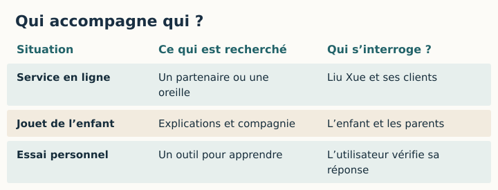

# BCE ECG — Chinois LVB (ELVi) 2026 · Corrigé guidé

*Corrigé rédigé par IA, non officiel. Signalez toute erreur.*

**Rédaction** · GPT-6.2 Astra Ultra · vitesse non renseignée

[Sujet officiel, option Chinois LVB (ELVi)](https://www.concours-bce.com/sites/default/files/2026-04/76%20CH%20-%20LANGUE_VIVANTE_B_ELVI_CHINOIS_HEBREU_JAPONAIS_POLONAIS.pdf#page=2)

Le résumé compare les documents 1 et 2 en 250 caractères, l’essai répond aux deux questions en 350 caractères, avec une tolérance de 10 % dans les deux cas. Les décomptes ci-dessous portent sur les caractères chinois, hors ponctuation. Le thème traduit seulement l’extrait entre crochets sur la politique de l’enfant unique et le témoignage du père.

## Préparer les trois exercices

Dans le premier texte, distinguer les personnes qui paient pour être écoutées de la jeune professionnelle qui vend son temps. Liu Xue s’inquiète de la baisse des tarifs et diversifie ses revenus. Dans le second, distinguer ce que la petite Duo Duo attend de son jouet et les interrogations de deux parents. Li Xuan se demande si son enfant gardera son autonomie de jugement. Huang Qinqin s’interroge sur l’apprentissage des relations humaines. Les propos d’un parent ne sont pas ceux de tous.

Pour l’essai, formuler une pratique précise à la première personne, puis raconter le moment où l’utilisateur pourrait renoncer à raisonner. Le modèle de copie propose de vérifier une interprétation de poésie avant d’en faire un argument. Sur les publicités de la page 7, relever la fonction promise : expliquer un proverbe, aider un enfant à prendre la parole ou transmettre un appel à l’aide. Une promesse publicitaire ne mesure pas l’effet réel de l’appareil.

Pour le thème, le démonstratif « cette politique » reprend la politique de l’enfant unique. *四十多岁* exprime la décennie d’âge, *一出家门* l’immédiateté du souvenir du père, et *可能* la prudence de sa dernière remarque. La fonction universitaire et les noms propres sont donnés dans le document.

## Résumé analytique comparatif · 251 caractères

两篇报道都写到人们需要有谁听自己说话，但提供陪伴的方式不同。刘雪在网上接单，客户多是城市白领。有人找不到一起打游戏的朋友，有人想在深夜向陌生人诉苦。他们付钱买的是另一个人的时间。对刘雪来说，这种工作收入见效快，也可以自己决定何时停下来，但入行的人多了，价格不断下降，她担心难以长久做下去，便靠发布短视频增加收入。第二篇里的玩伴则是家长为孩子买的智能玩具。朵朵把玩偶当作老师、朋友和画画的助手，还希望它陪自己长大。李轩眼下并不怕玩具取代父母，却怕孩子以后凡事先问它，逐渐不会自己想。黄沁沁担心的是，机器总作出积极的回应，孩子难以学会面对真人复杂的情绪。

## Essai argumenté · 341 caractères

我学中文时有个习惯，先把自己的理解写在纸上，再请人工智能挑毛病。有一次我读李白的《静夜思》，请它给一个没学过中文的朋友解释末句。它几秒钟就写出了一段通顺的外语，但把思乡说成了诗人对某个亲人的思念。我重新读了原诗，发现诗里只说故乡，并没有点出那个人是谁。我把两个版本念给朋友听，让他比较想象中的画面。那次谈话比照着机器的答案背诵有意思得多。

可是，要是我一遇到生词就让它把整首诗讲完，我也许根本不会发现这个问题。材料里的小女孩把玩偶当老师，也当朋友；广告里的孩子还能跟玩具练习怎样开口邀请同学。这种练习能给害羞的人一点勇气。到了操场上，对方可能想玩别的，也可能拒绝，接下来怎么办，只能听清对方的话再决定。因此我给自己定了一条规矩：先猜，说明理由，再查词典或问真人，最后才看机器还有什么建议。如果我能合上屏幕说清为何接受某个答案，人工智能就帮我多想了一步。

## Thème

在独生子女政策推行之初，也就是二十世纪八十年代出生的人，如今已经四十多岁了。由于职场竞争往往十分激烈，他们有时很少有时间陪伴家人。澳门大学研究人工智能和心理学的吴海燕教授认为，这使得人们“几乎没有多少与人交往的空间，因而转向其他方式来满足自己的情感需求”。她还说，这种陪伴即使是虚拟的，“也能让那些原本会感到孤单的人生活得更幸福”。

张雅纯的父亲张鹏说，他理解女儿为什么对自己的机器人有感情。“我们年轻的时候不缺朋友，一出家门就有一大群。如今城里的年轻人似乎压力很大，所以他们可能缺少朋友。”
