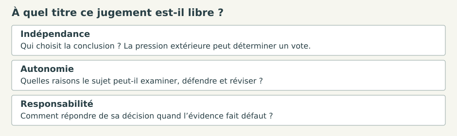

# BCE ECG — Culture générale (EDHEC-ESSEC) 2026 · Corrigé guidé

*Corrigé rédigé par IA, non officiel. Signalez toute erreur.*

**Rédaction initiale** · claude-opus-5-5 · configuration complémentaire non renseignée

**Relecture antérieure** · configuration non renseignée

**Lecture du rapport du jury** · GPT-6.2 Astra Ultra · vitesse non renseignée

**Révision** · GPT-6.2 Astra Ultra · vitesse non renseignée

**Révision (tour 3)** · GPT-6.2 Astra Ultra · vitesse non renseignée

**Révision (tour 4)** · GPT-6.2 Astra Ultra · vitesse non renseignée · 26 novembre 2026

## Construire la dissertation

La feuille du 22 avril donne un infinitif et un complément de manière. La question centrale porte donc sur ce qui se passe lorsque quelqu’un juge, et sur le degré de liberté avec lequel il le fait. Rédiger la copie sans chiffres, lettres ni titres de parties. Le rapport demande de hiérarchiser les sens de la liberté. Pour établir une hiérarchie, il faut un critère qui départage deux jugements paraissant tous les deux indépendants.

**Une épreuve de comparaison.** Deux membres d’un jury de lecture couronnent le même livre. Le premier l’a choisi parce qu’il sait que le directeur l’apprécie. Le second a discuté les objections des autres membres et peut expliquer en quoi le livre déplace les conventions de son genre. L’identité du vote n’établit pas l’identité de la liberté. Inversement, voter contre le directeur par réflexe laisse encore son opinion décider du résultat. L’aptitude à produire, modifier et défendre les raisons de son jugement offre un critère plus exigeant que la seule différence de verdict.

> [!INDICATION]
> Une règle limite-t-elle davantage le juge lorsqu’elle lui impose de motiver sa décision ou lorsqu’elle lui impose la décision elle-même ?

Dans le premier cas, la règle donne au perdant une prise sur les raisons du jugement et au juge un moyen de s’écarter d’une pression. Dans le second cas, la personne censée juger est réduite au rôle de porte-parole. La comparaison fournit une transition de l’indépendance vers les conditions institutionnelles d’une liberté réelle. Elle explique aussi pourquoi la seule sincérité ne suffit pas à établir l’impartialité.

**Bien employer Kant.** Le jugement déterminant dispose d’un universel auquel rapporter le particulier. Le jugement réfléchissant se met à la recherche de l’universel à partir du particulier. Ce sont deux rapports différents à une règle. La distinction n’établit pas une échelle sur laquelle toute décision réfléchissante serait automatiquement plus libre que toute décision déterminante. La réflexion sur le cas peut rester prisonnière d’un préjugé, tandis qu’appliquer en connaissance de cause une règle publiquement justifiable peut être un acte autonome. [Kant, introduction à la *Critique du jugement*](https://classiques.uqam.ca/classiques/kant_emmanuel/Critique_du_jugement/Critique_du_jugement_intro.html)

**Lire le retour à Zola.** La conclusion ne vend pas l’indépendance au prix de l’infaillibilité. Qu’une accusation puisse être soumise à contradiction explique à la fois ce qui rend la parole plus libre et ce qui oblige son auteur à en répondre. C’est ce lien que la fin d’une copie doit établir entre l’indépendance initialement revendiquée et l’activité de juger.

Demandez ce qui change si le vote reste secret et qu’une preuve nouvelle devient accessible. Le juré conserve la même indépendance extérieure. Sa capacité à justifier, voire à réviser, sa décision change avec les raisons qu’il peut désormais examiner.

Pour distinguer les deux conditions, faites varier successivement ce que le juré peut dire et ce qu’il peut savoir. Un vote indépendant protège la conclusion. L’accès aux pièces et la contradiction agissent plus tôt, au moment où les raisons de conclure se forment.

## Dissertation rédigée

Le 13 janvier 1898, deux jours après l’acquittement d’Esterhazy par un conseil de guerre, Zola publie dans *L’Aurore* sa lettre ouverte au président de la République. Pourquoi juger publiquement une affaire qu’un tribunal vient de trancher ? Zola s’expose à une poursuite en diffamation qui peut donner lieu à un débat contradictoire sur ce que la discipline militaire et le secret avaient jusque-là soustrait à l’examen. Le geste est libre par le refus d’une tutelle, mais il engage l’écrivain à répondre de ses affirmations. Le seul courage de contredire un conseil de guerre ne prouve pas que l’on ait raison. Une liberté qui dispenserait Zola de produire ses raisons offrirait au premier accusateur venu la même autorité.

Juger, c'est d'abord, au sens logique, affirmer ou nier un rapport entre deux idées ; c'est aussi apprécier et évaluer, quand je juge une action bonne ou une œuvre belle ; c'est enfin trancher, rendre une sentence, au sens judiciaire. Dans tous les cas, le jugement est un acte : il engage celui qui le porte. La liberté, quant à elle, se dit en plusieurs sens : absence de contrainte extérieure ou indépendance, pouvoir de choisir entre deux partis ou libre arbitre, autonomie de celui qui se donne à lui-même sa loi, mais aussi licence, absence de retenue, comme lorsqu'on parle « en toute liberté » pour dire qu'on parle sans fard. La locution « en toute » est décisive : elle suppose qu'il y a des degrés dans la liberté du jugement, et elle en vise le degré le plus haut, comme on agit en toute bonne foi ou en toute connaissance de cause. Le sujet ne demande donc pas si nous sommes libres de juger, mais ce que serait la plénitude de cette liberté.

Une entière indépendance paraît requise pour que le citoyen, le savant ou le juge puisse se prononcer. Mais une décision que ne contraindraient ni les faits ni la possibilité d’être contredit pourrait tout aussi bien être un caprice. À quelles conditions pouvons-nous dire que quelqu’un juge en toute liberté ? Il faut d’abord reconnaître ce que libère l’absence de tutelle, puis distinguer les règles qui imposent une conclusion de celles qui donnent prise sur ses raisons. La difficulté ultime sera de comprendre comment décider sous ces règles quand elles ne fournissent pas d’avance la réponse.

Juger en toute liberté semble d'abord presque une redondance, car un jugement qui ne serait pas libre ne serait pas un jugement. Dans la quatrième des *Méditations métaphysiques* (1641), Descartes distingue deux facultés à l'œuvre dans le jugement : l'entendement, qui conçoit les idées, et la volonté, qui affirme ou nie. Or si mon entendement est fini, ma volonté est si ample que Descartes y reconnaît la marque en moi de l'image de Dieu : rien ne peut me forcer à affirmer ce que je refuse d'affirmer. L'acte de juger, parce qu'il relève de la volonté, est donc libre par essence. Kant en tire la conséquence morale et politique dans *Réponse à la question : qu'est-ce que les Lumières ?* (1784) : la minorité est l'incapacité de se servir de son entendement sans la direction d'autrui, et l'on en est responsable quand elle tient au manque de courage, non au manque d'entendement : la paresse et la lâcheté en sont les causes. Celui qui adopte le jugement de son tuteur, de son directeur de conscience ou de son médecin ne juge pas : il répète. La devise des Lumières, *Sapere aude*, fait du jugement libre une exigence que nul ne peut remplir à ma place.

Cette liberté intérieure appelle une liberté extérieure, et le jugement libre devient un droit. Spinoza le montre dans le *Traité théologico-politique* (1670) : nul ne peut transférer à autrui son droit naturel de juger, et un État qui prétendrait régler les opinions ne produirait que des hypocrites ou des révoltés, si bien que la fin véritable de l'État est la liberté. La lettre de Zola en est une illustration éclatante : en jugeant contre le conseil de guerre, l'écrivain fait de la liberté de juger une affaire publique, qui concerne la nation entière et non la seule conscience. Et le juge lui-même ne peut rendre la justice que s'il est indépendant des pressions du pouvoir, des parties et de l'opinion. Juger en toute liberté, en ce premier sens, c'est juger sans tutelle.

Pourtant, prise au pied de la lettre, l'absence de toute contrainte ruine le jugement plus qu'elle ne l'accomplit. Descartes lui-même explique l'erreur par cette liberté : je me trompe parce que ma volonté, plus étendue que mon entendement, se porte à juger de ce que je ne comprends pas. C'est pourquoi le premier précepte du *Discours de la méthode* (1637) commande d'« éviter soigneusement la précipitation et la prévention ». Le jugement qui ne connaît aucune retenue n'est pas plus libre, il est plus téméraire : il affirme tout et n'importe quoi. Flaubert l'a résumé dans une lettre à Louis Bouilhet du 4 septembre 1850 : « La bêtise consiste à vouloir conclure. » Le sot n'est pas celui qui manque d'avis, mais celui qui en a sur tout et tranche sans examen. Plus grave encore, ce jugement prétendument affranchi est souvent le plus asservi. Dans « Les Animaux malades de la peste », La Fontaine montre une assemblée qui délibère sans autre règle que la flatterie : le lion avoue avoir dévoré des moutons et même le berger, on l'absout ; l'âne avoue avoir tondu la largeur de sa langue dans un pré, on le condamne à mort. La morale dit ce qu'est un tel tribunal : « Selon que vous serez puissant ou misérable, / Les jugements de cour vous rendront blanc ou noir. » L'assemblée était libre de juger comme elle voulait ; elle a jugé comme le voulaient la crainte et l'intérêt. Spinoza en donne la raison dans l'*Éthique* (1677) : les hommes se croient libres parce qu'ils ont conscience de leurs volitions et ignorent les causes qui les déterminent. Le jugement qui croit ne dépendre de rien dépend en réalité de tout ce qu'il ignore.

L'absence de contrainte n'est donc pas la plénitude de la liberté de juger. Il faut alors chercher cette plénitude non dans l'indépendance à l'égard de toute règle, mais dans un certain rapport aux règles.

Imaginons qu’un juré vote à bulletin secret. Le secret le protège d’un ordre donné par un supérieur. Il peut pourtant reconduire, sans l’examiner, un préjugé sur l’accusé. S’il accepte de reformuler son motif à la lumière d’une objection, la contradiction peut accroître sa liberté de juger. La protection de sa décision et l’examen de ses raisons répondent à deux exigences distinctes.

L’affaire Dreyfus permet de reprendre la difficulté au point précis où se forment les raisons du juge. En 1894, un dossier secret fut communiqué au conseil de guerre à l’insu de la défense. Imaginons que chacun des juges ait voté selon sa conviction, sans subir d’ordre. Quelle confiance accorder à cette indépendance si les pièces qui la nourrissent ont échappé à la contradiction ? La défense aurait pu demander d’où venait une pièce ou à qui elle se rapportait. En écartant ces questions, la procédure retranchait des possibilités à l’intelligence même du juge. L’exigence du débat contradictoire prend ici son sens. Une règle qui oblige à écouter une objection peut restituer au jugement une liberté que le secret du vote, à lui seul, ne lui donnait pas.

La liberté du jugement a des degrés, et son degré le plus haut est la liberté éclairée. Descartes le dit expressément dans la même quatrième Méditation : l'indifférence, cet état où aucune raison ne me pousse d'un côté plutôt que de l'autre, est « le plus bas degré de la liberté ». Plus je vois clairement où sont le vrai et le bien, plus je m'y porte librement ; et si je les connaissais toujours clairement, je n'aurais jamais à délibérer, je serais entièrement libre sans être jamais indifférent. La connaissance n'est donc pas une borne posée à la volonté de juger : elle est ce qui la libère de l'hésitation et de l'arbitraire. Spinoza va plus loin encore : être libre, ce n'est pas échapper à toute nécessité, c'est agir par la seule nécessité de sa nature, et l'homme devient libre à mesure qu'il comprend les causes qui le déterminent. Juger en toute liberté, c'est alors juger en toute connaissance de cause, et l'on mesure le contresens qui fait de la vérité une contrainte pour l'esprit.

Encore faut-il que cette lumière soit la mienne. Au paragraphe 40 de la *Critique de la faculté de juger*, Kant rapproche trois maximes, penser par soi-même, penser en se mettant à la place de tout autre et penser en accord avec soi-même. La seconde éclaire la première. Si je tiens pour indépendant le seul jugement que personne ne partage, je laisse encore à autrui le soin de déterminer ma position, puisque j’en prends mécaniquement le contrepied. Élargir son point de vue suppose de se demander si une raison vaudrait encore depuis une autre place, y compris si personne autour de soi n’est disposé à la défendre. L’accord effectivement constaté ne remplace donc pas l’examen du sujet qui juge.

Cette autonomie ne naît pas seule : elle se forme, et elle se protège. Elle se forme d'abord par l'éducation. Dans le chapitre « De l'institution des enfants » des *Essais*, Montaigne demande pour l'enfant un précepteur qui ait plutôt la tête bien faite que bien pleine, et qui lui fasse tout examiner sans rien loger dans sa tête par simple autorité. La contrainte de l'exercice est ici la condition d'un jugement propre : on n'apprend pas à juger librement en étant livré à soi-même, mais en étant obligé à examiner. Elle se protège ensuite par les institutions. Montesquieu, dans *De l'esprit des lois* (1748), fait de la séparation de la puissance de juger d'avec la puissance législative et l'exécutrice une condition de la liberté. Les règles du procès vont dans le même sens : la présomption d'innocence, le contradictoire, les droits de la défense, l'obligation de motiver une décision contraignent le juge, mais elles libèrent son jugement des pressions et des passions, et notamment de cette clameur qui condamne avant d'avoir entendu. C'est précisément ce qui manquait à l'assemblée de La Fontaine. Les contraintes qui libèrent ne sont donc pas les contraintes qui aliènent : la censure empêche de juger, la procédure permet de juger bien.

Mais la liberté éclairée reste un idéal. Descartes l'énonce au conditionnel : si je connaissais toujours clairement le vrai et le bien. Or nous ne le connaissons pas toujours, et il faut pourtant juger. Faut-il dire alors que nous ne jugeons jamais en toute liberté, ou que cette liberté se joue précisément là où la connaissance fait défaut ?

La condition humaine oblige souvent à décider sans évidence complète. La morale par provision de Descartes, dans le *Discours de la méthode*, distingue la nécessité pratique d’agir de la certitude théorique quant au vrai. Chez Kant, la distinction entre jugement déterminant et jugement réfléchissant permet de poser un problème voisin, dans un autre registre. Dans l’un, l’universel est donné et il faut lui rapporter le cas. Dans l’autre, le particulier est donné et l’universel reste à chercher. Cette distinction ne signifie pas que les obligations morales seraient inventées à chaque décision, ni que l’improvisation esthétique garantirait la liberté. Elle fait voir le travail qui reste à celui qui juge quand aucune subsomption toute faite ne lui indique comment accueillir le cas. Un critique peut ainsi convoquer un genre pour décrire une œuvre nouvelle, puis réviser le genre parce que l’œuvre résiste à son classement. Il doit pouvoir faire suivre ce parcours à son lecteur.

Dans *Eichmann à Jérusalem*, Hannah Arendt s’arrête sur le langage de l’accusé et sa prétention à avoir obéi à un devoir de type kantien. Cette prétention détourne le sens de l’autonomie. Au lieu de se demander si une maxime peut valoir universellement, il fait de la volonté de son chef le critère auquel il entend se conformer. Arendt interroge cette défaillance du jugement sans absoudre l’accusé. Son analyse politique n’autorise pas à diagnostiquer la même personnalité chez tous les responsables ni à négliger leur antisémitisme et leurs choix. Elle permet de formuler une distinction décisive pour notre question : garder personnellement l’initiative d’exécuter une décision ne signifie pas soumettre librement à l’examen la norme dont on se réclame.

La littérature fait voir cette conquête de l'intérieur. À la fin de *La Princesse de Clèves* (1678), rien n'empêche plus l'héroïne, devenue veuve, d'épouser le duc de Nemours qu'elle aime et qui l'aime : ni la loi, ni les usages, une fois le temps du deuil passé. Elle refuse pourtant. Le roman de Madame de La Fayette consacre de longues pages à cette délibération : elle pèse son devoir envers la mémoire d'un mari dont elle se sent responsable de la mort, et le repos que menacerait une passion dont elle prévoit la fin. Aucune règle extérieure ne lui dicte ce choix, et c'est pourquoi il est si libre : elle juge contre sa passion, contre les attentes du monde et contre Nemours lui-même, par des raisons qu'elle s'est données en s'examinant. Sa liberté n'était pas là au début du roman, dans la jeune fille formée par sa mère et livrée à la cour ; elle s'est conquise au fil d'épreuves où elle a appris à se juger elle-même. Kant le dit des Lumières en général : on n'apprend à marcher seul qu'en faisant quelques chutes, et les tuteurs qui effraient les mineurs par ce danger les maintiennent dans la minorité. La plénitude de la liberté de juger n'est pas la cause de l'exercice du jugement, elle en est le fruit.

Juger en toute liberté ne peut donc signifier juger sans aucune contrainte : ce jugement sans retenue, qui tranche sur tout, n'est que la forme la plus pauvre de la liberté, et souvent la plus asservie, car il obéit sans le savoir aux passions, aux intérêts et aux préjugés. La plénitude de la liberté du jugement réside plutôt dans l'autonomie d'un sujet qui s'oblige à penser par lui-même, à se mettre à la place d'autrui et à rester conséquent, qui s'appuie sur la connaissance et sur des institutions qui le protègent. Mais cette autonomie n'est jamais donnée : elle se conquiert par l'éducation et par l'exercice, et elle s'éprouve surtout là où les règles manquent, quand il faut juger sans certitude et répondre de son jugement. La totalité qu'annonce l'expression « en toute liberté » n'est pas un point de départ, c'est un horizon, vers lequel on progresse à mesure qu'on ose juger. C'est sans doute pourquoi la lettre de Zola nous touche encore : elle ne montre pas un homme libre de tout lien, mais un homme qui s'est rendu libre en s'exposant délibérément aux poursuites pour ce qu'il avait jugé.

[Sujet officiel, code 252](https://www.concours-bce.com/sites/default/files/2026-04/252%20-%20DISSERTATION_DE_CULTURE_GENERALE_EDHEC_BS_ESSEC_BS.pdf) · [Rapport du jury 2026](https://www.concours-bce.com/sites/default/files/2026-09/252%20-%20Diss%20culture%20g%C3%A9n%C3%A9rale%20EDHEC%20BS%20.ESSEC%20BS%202026.pdf)
