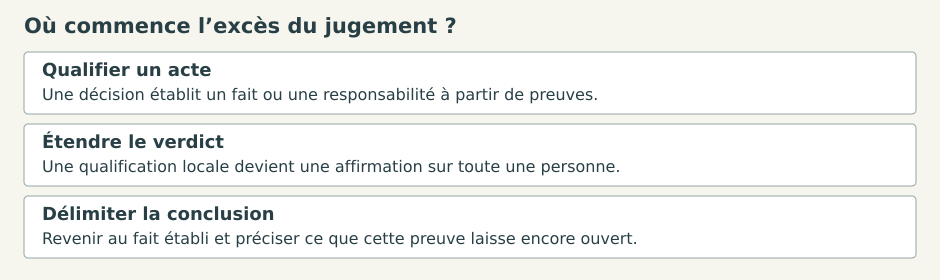

# BCE ECG — Culture générale (emlyon-HEC) 2026 · Corrigé brut

*Corrigé rédigé par IA, non officiel. Signalez toute erreur.*

**Rédaction initiale** · claude-opus-5-5 · configuration complémentaire non renseignée

**Relecture antérieure** · configuration non renseignée

**Lecture du rapport du jury** · GPT-6.2 Astra Ultra · vitesse non renseignée

**Révision** · GPT-6.2 Astra Ultra · vitesse non renseignée

**Révision (tour 3)** · GPT-6.2 Astra Ultra · vitesse non renseignée

**Révision (tour 4)** · GPT-6.2 Astra Ultra · vitesse non renseignée · 26 novembre 2026

## Dissertation rédigée

Au sortir des égouts de Paris, Javert tient de nouveau Jean Valjean à sa merci. Or cet homme lui a épargné la vie aux barricades. L’inspecteur accomplit d’abord plusieurs gestes de son métier puis laisse à Valjean la possibilité de lui échapper. Le chapitre « Javert déraillé », dans la cinquième partie des *Misérables*, donne à lire son trouble. Un classement qui conserve sa pertinence administrative, puisque Valjean est bien recherché, est devenu intenable comme verdict sur la personne. Javert n’est pas magistrat. C’est précisément l’intérêt du cas : on peut se mettre à juger toute une existence dans l’exercice d’un pouvoir qui ne vous charge pas de prononcer pareil jugement.

Le sujet a la forme d'une sentence inachevée. « À trop juger » rappelle les tournures proverbiales, « à trop vouloir… », « à force de… », qui annoncent une conséquence fâcheuse ; mais le point final la laisse dans l'ombre, comme si elle allait de soi, ou comme s'il revenait à celui qui lit de la penser. L'infinitif est sans sujet ni objet : on ne sait ni qui juge, ni ce qui est jugé. Juger, c'est pourtant l'acte le plus constant de l'esprit : affirmer ou nier, rapporter un cas particulier à une règle, apprécier ce qui est bon ou beau, trancher un litige. Dès lors, la difficulté est réelle : comment pourrait-il y avoir un excès de ce qui est l'activité même de la pensée ? Le « trop » ne peut être seulement quantitatif, juger trop souvent ou de trop de choses ; il désigne plutôt une démesure qualitative, juger trop généralement, trop absolument, au mépris du cas, et peut-être un excès inscrit dans la structure même du jugement.

On se demandera donc ce que l'on perd à trop juger, et si ce danger appelle à juger moins ou à juger autrement. On verra d'abord qu'à trop juger, on manque ce que l'on juge, parce que le général écrase le singulier ; ensuite qu'à trop juger, on se perd soi-même, parce que le juge s'expose au jugement et que l'excès naît d'une disproportion propre à l'homme ; enfin que le remède n'est pas de renoncer à juger, car l'abstention est une autre démesure, mais d'apprendre au jugement à se mesurer lui-même.

À trop juger, on manque d’abord l’objet du jugement. Une qualification peut être exacte dans ses limites. Si je la convertis en réponse à toute question nouvelle sur la personne qualifiée, j’étends son ressort au-delà de ce qu’elle établit. Chez Hugo, l’erreur judiciaire qui menace Champmathieu rappelle d’ailleurs que la reconnaissance policière elle-même peut faillir. L’embarras final de Javert ne se réduit pourtant pas à une confusion d’identité : il sait précisément qui l’a délivré. Aristote, au livre V de l’*Éthique à Nicomaque*, montre que l’universalité de la loi peut la rendre défectueuse dans un cas qu’elle ne pouvait prévoir exactement. L’équité rétablit ce que le législateur aurait décidé devant ce cas. La règle de plomb des bâtisseurs de Lesbos épouse la pierre pour bien la mesurer. C’est la généralisation indue du verdict, même correctement formulé dans son domaine, qui constitue ici la démesure.

La faute dont Javert connaît le dossier appartient au passé. Le geste par lequel Valjean lui laisse la vie sauve introduit un fait nouveau dont son jugement devrait pouvoir répondre. L’excès commence lorsque le prédicat de forçat détermine à l’avance le sens de tout geste ultérieur. Plus aucun fait ne pourrait alors compter comme une objection : en ce sens, la répétition du verdict finit par rendre le jugement impossible.

Ce défaut ne concerne pas que les tribunaux ; il menace tout jugement qui prend sa propre mesure pour la mesure de toutes choses. Montaigne, dans « Des cannibales », raconte ce qu'on sait des Indiens du Brésil et retourne contre ses lecteurs leur indignation : « chacun appelle barbarie ce qui n'est pas de son usage ». Les Européens qui jugent les cannibales barbares jugent trop, parce qu'ils jugent selon la seule règle de leur coutume, et Montaigne n'a pas de peine à montrer que les guerres de religion de son temps sont plus cruelles que les festins qu'ils condamnent. Pascal en tire une leçon plus amère dans les *Pensées* : « Plaisante justice qu'une rivière borne ! Vérité au deçà des Pyrénées, erreur au-delà. » Le jugement qui se croit universel n'est souvent que local. À trop juger, on ne connaît plus l'autre : on ne connaît que sa propre règle, appliquée hors de son domaine.

Le cas peut même se dérober entièrement au lecteur. Dans *Le Procès*, publié en 1925, Joseph K. est arrêté sans qu’on lui indique une accusation intelligible. Le lecteur suit un personnage qui se croit innocent et cherche l’objet de la poursuite. Cette mise en récit ne permet pas de prononcer à sa place une décision d’innocence ; elle permet d’éprouver ce que devient l’existence d’un homme quand toute action, jusque dans sa défense, paraît interprétable contre lui. L’excès du jugement tient alors à l’extension indéfinie du justiciable, qui ne laisse plus aucune conduite extérieure à la procédure.

À trop juger, on perd donc ce que l'on juge. Mais la perte ne s'arrête pas à l'objet : elle revient sur celui qui juge.

À trop juger, on s'expose soi-même au jugement. L'avertissement de l'Évangile selon Matthieu est célèbre : « Ne jugez point, afin que vous ne soyez point jugés. Car on vous jugera du jugement dont vous jugez, et l'on vous mesurera avec la mesure dont vous mesurez. » Le même passage oppose la paille que l'on voit dans l'œil de son frère à la poutre qu'on ne voit pas dans le sien. Shakespeare en tire le titre et le thème de *Mesure pour mesure* (vers 1604) : à Vienne, Angelo, qui gouverne en l'absence du duc, remet en vigueur une loi oubliée et condamne à mort Claudio pour avoir mis enceinte sa fiancée avant le mariage ; mais quand Isabelle, la sœur du condamné, vient implorer sa grâce, il exige qu'elle se donne à lui. Le juge le plus rigoureux est le plus coupable, et le duc revenu le condamne selon la mesure qu'il appliquait aux autres, avant de lui pardonner à la prière de ses victimes. La sévérité excessive n'était pas la marque d'une vertu supérieure : elle en tenait lieu, et la pièce se dénoue non par un surcroît de rigueur, mais par la clémence.

La comédie montre une autre façon de se perdre dans le jugement, sans hypocrisie cette fois. Alceste, dans *Le Misanthrope* de Molière (1666), est sincère : il juge tout le monde avec la même franchise, ne passe rien à ses amis ni à la femme qu'il aime, et déclare le sonnet d'Oronte « bon à mettre au cabinet ». Il a souvent raison sur le fond ; mais à vouloir juger chaque parole et chaque usage, il se brouille avec Oronte et avec la cour, perd son procès, perd Célimène et finit par chercher, loin des hommes, un endroit écarté où il soit libre d'être homme d'honneur. Philinte lui oppose la sagesse de la mesure : « La parfaite raison fuit toute extrémité, / Et veut que l'on soit sage avec sobriété. » Trop juger rend ridicule, parce que celui qui juge sans cesse ne vit plus parmi les hommes, il les toise.

La parole du juge peut même transformer l’aveu de sa propre faute en pouvoir. Dans *La Chute* de Camus, Jean-Baptiste Clamence, ancien avocat, raconte à Amsterdam une nuit parisienne. Après avoir dépassé une femme penchée sur un pont, il entend une chute et des appels, sans revenir sur ses pas. Le récit souligne l’écart entre ce qu’il a entendu, ce qu’il a fait et ce qu’il veut désormais faire admettre à son interlocuteur. Devenu « juge-pénitent », il s’accuse pour entraîner celui qui l’écoute dans une culpabilité commune. L’extension de l’aveu est aussi un excès de juridiction : à quel titre sa propre défaillance l’autoriserait-elle à rendre un verdict sur tous ?

D'où vient cette pente à trop juger ? Descartes en donne la raison dans la quatrième des *Méditations métaphysiques* (1641) : le jugement suppose l'entendement, qui conçoit, et la volonté, qui affirme ou nie. Or l'entendement est fini, et la volonté est sans bornes ; je me trompe parce que ma volonté s'étend plus loin que mon entendement et me porte à juger de ce que je ne conçois pas clairement. Le trop juger n'est donc pas un accident de caractère : il tient à la condition d'un être fini doté d'une volonté infinie. Pascal le dit à sa manière : l'homme n'est ni ange ni bête, et qui veut faire l'ange fait la bête. Juger comme si l'on voyait tout, c'est s'attribuer un regard qui n'est pas le nôtre.

Faut-il conclure qu'il faudrait cesser de juger ? Ce serait oublier que l'abstention est une décision, et qu'elle a ses propres victimes.

L’abstention elle-même appelle donc un examen. Dans *Eichmann à Jérusalem*, Arendt interroge l’usage par l’accusé de formules d’obéissance et de devoir. La conformité aux ordres ne décharge pas de la responsabilité de juger ce que l’on fait. Ce cas n’autorise pourtant ni à réduire un acteur du génocide à un automate ni à effacer l’engagement des responsables. Il indique comment deux erreurs en apparence opposées peuvent procéder d’une même démission. L’une absout l’acte au seul motif qu’il est ordonné ; l’autre condamne toute une personne en déduisant son être d’une seule catégorie. Dans les deux cas, on prête à une règle une portée qu’il aurait fallu juger.

Une copie de concours fournit une épreuve simple de cette mesure. Elle contient une erreur démontrable. Le correcteur peut légitimement la signaler et diminuer la note. En concluant que son auteur est incapable de raisonner, il excéderait sa preuve dès la première appréciation. Supposons maintenant qu’un second lecteur, alerté par une solution inattendue, reprenne le raisonnement ligne à ligne. Il porte davantage de jugements, mais peut rendre la note plus juste. Ce que fait perdre le « trop » apparaît ainsi avec précision. Le premier correcteur substituait au travail présent une identité arrêtée qui devait valoir pour tous les travaux à venir. Le second laisse au détail singulier le pouvoir de déplacer le critère dont il était parti.

Comment se régler, dès lors ? La prudence chez Aristote suppose une expérience des situations particulières ; l’équité corrige la généralité légale là où celle-ci manquerait sa fin. Kant distingue, dans l’introduction de la *Critique de la faculté de juger*, l’opération qui rapporte le particulier à un universel donné de celle qui cherche l’universel quand le particulier seul est donné. Il ne suffit donc pas de conseiller une indulgence automatique ni de privilégier le cas singulier par principe. Le jugement de mon acte peut demeurer ferme tout en laissant ouverte la possibilité que je me transforme. La question utile est de savoir ce que je suis autorisé à conclure de ce que je viens d’établir.

Une mesure intérieure reste possible, à condition qu’elle ne se referme pas sur elle-même. Le « Que sais-je ? » de Montaigne éprouve l’assurance avec laquelle le sujet parle. Si l’examen de soi devenait une inspection permanente, il reproduirait à son tour le travers dénoncé. Le contre-exemple du roman de Hugo porte sur un acte précis. L’évêque Myriel présente comme un don l’argenterie que Valjean a prise et y joint les chandeliers. Il transforme par sa conduite la situation qu’il juge et ouvre à l’autre une possibilité d’agir. Il ne sait nullement d’avance ce que Valjean fera de cette liberté. Cette incertitude acceptée fixe une limite concrète au pouvoir de conclure sur autrui.

La conséquence laissée en suspens par « À trop juger. » apparaît au terme de ce parcours. On peut établir justement une faute et se tromper en prétendant avoir, pour cette raison, épuisé la connaissance de celui qui l’a commise. L’excès fait alors perdre une possibilité au jugé et compromet chez le juge la capacité de reconnaître une action nouvelle. Le droit de conclure subsiste dans les limites de ce qui a été examiné. Javert se brise sur la rencontre d’un bienfaiteur qu’il savait seulement nommer forçat ; le geste de Myriel ouvre un avenir précisément parce qu’il laisse à Valjean le soin d’en décider.

## Repère après la dissertation

[Sujet officiel, code 254](https://www.concours-bce.com/sites/default/files/2026-04/254%20-%20DISSERTATION_DE_CULTURE_GENERALE_EM_LYON_HEC_PARIS.pdf) · [Rapport du jury 2026](https://www.concours-bce.com/sites/default/files/2026-09/254%20-%20Diss%20Culture%20g%C3%A9n%C3%A9rale%20HEC%20Paris.%20EMLyon%202026.pdf)
