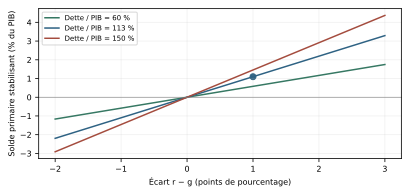

# BCE ECG — ESH (ESCP-SKEMA) 2026 · Corrigé brut

*Corrigé rédigé par IA, non officiel. Signalez toute erreur.*

**Rédaction** · Claude Opus 5.5 · effort non renseigné · vitesse non renseignée · 13 novembre 2026

**Révision** · Claude Opus 5.5 · effort non renseigné · vitesse non renseignée · 13 novembre 2026

**Révision** · GPT-6.2 Astra Ultra · vitesse non renseignée · 24 novembre 2026

**Révision (tour 3)** · GPT-6.2 Astra Ultra · vitesse non renseignée · 26 novembre 2026

**Sujet.** Y a-t-il une limite à l’endettement public ?

**Problématique** : la dette publique se heurte-t-elle à un seuil objectif au-delà duquel elle devient insoutenable, ou sa limite dépend-elle de conditions économiques et institutionnelles (écart entre taux d'intérêt et croissance, usage des fonds, crédibilité de l'État et de la banque centrale) qui en font une limite mobile et, en dernier ressort, politique ?

* * *

Dans sa première estimation de mars 2026, disponible le jour de l’épreuve, l’Insee évalue la dette publique française de fin 2025 à 115,6 % du PIB et le déficit de l’année à 5,1 % du PIB. Le Japon dépasse depuis longtemps 200 % du PIB sans crise de financement, alors que l'Argentine a fait défaut en décembre 2001 avec une dette bien moindre. Le même ratio peut donc être supportable pour un pays et fatal pour un autre : le sujet invite à se demander s'il existe une limite à l'endettement public, et laquelle.

La dette publique est la dette brute consolidée en valeur nominale des administrations publiques, au sens de Maastricht. Elle couvre les dépôts, les titres de créance et les crédits de l’État, des organismes divers d’administration centrale, des administrations locales et des administrations de sécurité sociale. Les déficits y contribuent, ainsi que les ajustements de flux et de stocks, par exemple les variations de trésorerie ; son coût annuel est la charge d'intérêts, qu'il ne faut pas confondre avec la dette elle-même. Une limite peut s'entendre de plusieurs façons : un plafond juridique, comme le plafond de la dette fédérale américaine voté par le Congrès ; un seuil économique au-delà duquel la croissance serait freinée ; ou une limite de soutenabilité. Ce dernier terme est flou. Il peut désigner la capacité à payer les intérêts, à refinancer la dette qui arrive à échéance, à la rembourser ou à la racheter. Le ratio de la dette au PIB, le plus utilisé, se justifie surtout pour la première acception : le PIB mesure l'assiette des recettes fiscales qui financent les intérêts. Un État, en effet, ne rembourse presque jamais sa dette : il la refinance en émettant de nouveaux titres.

La question est donc moins celle d'un niveau maximal que celle des conditions dans lesquelles une dette reste finançable. Dès lors, la dette publique se heurte-t-elle à un seuil objectif au-delà duquel elle devient insoutenable, ou sa limite dépend-elle de conditions économiques et institutionnelles qui en font une limite mobile et, en dernier ressort, politique ?

L'arithmétique de la dette et le jugement des marchés imposent bien une limite à l'endettement public. Mais cette limite n'est ni un seuil universel ni une donnée fixe, car elle dépend de l'écart entre taux d'intérêt et croissance, du rôle de la banque centrale et de l'usage des fonds empruntés. C'est finalement dans la capacité politique d'une société à financer sa dette que se trouve la limite décisive.

* * *

L'endettement public rencontre d'abord une limite arithmétique, que les créanciers et l'économie réelle se chargent de rappeler.

L'équation de la dynamique de la dette en donne la mesure. Notons $d_t$ le ratio de la dette publique au PIB à la fin de l'année $t$, $r$ le taux d'intérêt apparent de la dette (la charge d'intérêts rapportée au stock, qui reflète les conditions d'émission passées et non le seul taux de marché du jour), $g$ le taux de croissance nominal du PIB et $sp_t$ le solde primaire, c'est-à-dire le solde budgétaire hors charge d'intérêts, rapporté au PIB. Dans le modèle sans ajustement de flux et de stocks, diviser la dette en niveau $(1+r)D_t-SP_{t+1}$ par le PIB nominal $(1+g)Y_t$ donne

$$d_{t+1} = d_t \, \frac{1+r}{1+g} - sp_{t+1}$$

Le ratio est stable lorsque le solde primaire atteint le niveau stabilisant :

$$sp^{*} = d \, \frac{r-g}{1+g}$$

Si le taux d'intérêt dépasse le taux de croissance, la dette s'alimente elle-même : c'est l'effet *boule de neige*, et l'État doit dégager un excédent primaire d'autant plus grand que la dette est élevée. À titre illustratif, avec une dette de 113 % du PIB et un écart $r-g$ d'un point, il faut un excédent primaire d'environ 1,1 % du PIB pour stabiliser le ratio ; la France est loin de cette situation puisque son solde primaire est déficitaire. La contrainte budgétaire intertemporelle généralise ce raisonnement : sous une condition de non-Ponzi et hors financement monétaire, la dette initiale est couverte par les excédents primaires futurs. Un État qui emprunterait indéfiniment pour payer ses intérêts mènerait un jeu de Ponzi que les prêteurs finiraient par refuser.

Ce refus peut être brutal, car la limite est fixée par la confiance des créanciers. Lorsque la dette augmente, les investisseurs exigent une prime de risque, ce qui élève $r$ et rend plus probable le défaut qu'ils redoutent. Guillermo Calvo (1988) a montré que ce mécanisme peut produire des équilibres multiples : la même dette est soutenable si les marchés y croient et insoutenable s'ils en doutent. Paul De Grauwe (2011) a appliqué ce raisonnement à la zone euro : un État qui emprunte dans une monnaie qu'il n'émet pas ne peut pas garantir aux créanciers qu'il disposera toujours des liquidités pour les rembourser, et s'expose à des crises auto-réalisatrices. La Grèce en a fait l'expérience à partir de 2010, jusqu'à la restructuration de sa dette détenue par les créanciers privés en mars 2012 et au rachat d'une partie de ses titres en décembre 2012. Au Royaume-Uni, le projet budgétaire de septembre 2022 a été suivi d’une forte baisse du prix des obligations d’État. Les appels de marge de fonds de pension à levier les ont forcés à vendre, amplifiant cette baisse. La Banque d’Angleterre a acheté temporairement des titres pour rétablir le fonctionnement du marché. Cet épisode illustre un risque de liquidité même pour une dette en monnaie nationale. Pour les pays émergents, Carmen Reinhart, Kenneth Rogoff et Miguel Savastano (2003) parlent de *debt intolerance*, d'intolérance à la dette : des défauts surviennent à des niveaux d'endettement modérés lorsque l'histoire du pays a entamé la confiance.

La limite peut enfin être économique, si la dette freine la croissance. L'effet d'éviction en est le mécanisme le plus ancien : en absorbant l'épargne disponible, l'État élève les taux d'intérêt et réduit l'investissement privé. L'équivalence ricardienne, formulée par Robert Barro (1974), pose une limite d'une autre nature, à l'efficacité du déficit plutôt qu'à la croissance : des ménages qui anticipent les impôts futurs nécessaires au remboursement épargnent davantage, de sorte que la dette est neutre et qu'un déficit ne stimule pas l'activité. Carmen Reinhart et Kenneth Rogoff (2010) ont cru identifier un seuil : au-delà de 90 % du PIB, la croissance serait nettement plus faible. Leur étude a été très discutée. Thomas Herndon, Michael Ash et Robert Pollin (2013) y ont relevé des erreurs de calcul et des choix de pondération contestables, et le sens de la causalité reste incertain, puisqu'une croissance faible fait aussi monter la dette. À recettes et dépenses totales données, une charge d’intérêts croissante réduit les marges disponibles pour les dépenses d'éducation, de recherche ou d'investissement qui soutiennent la croissance future.

Il existe donc bien une limite. Mais les exemples japonais et argentin suggèrent qu'elle n'est pas un seuil fixe : sa position dépend de conditions qu'il faut préciser.

* * *

La limite de l'endettement public est mobile, car elle dépend de l'écart entre taux d'intérêt et croissance, du rôle de la banque centrale et de ce que la dette finance.

La croissance suffit déjà à éloigner la limite. Evsey Domar (1944) l'avait montré : si l'État maintient un déficit total, intérêts compris, constant en proportion du PIB dans une économie en croissance, le ratio de la dette converge vers un niveau fini, quel que soit le taux d'intérêt. Un exemple donne un ordre de grandeur des valeurs de référence de Maastricht. Un déficit de 3 % du PIB avec une croissance nominale de 5 % stabilise la dette à 63 % du PIB dans la convention annuelle retenue, proche des 60 % de l’approximation continue. L'arithmétique change de sens, en outre, lorsque le taux d'intérêt est inférieur au taux de croissance : même un déficit primaire constant laisse alors le ratio converger. Olivier Blanchard, dans « Public Debt and Low Interest Rates » (2019), a rappelé qu'aux États-Unis le taux d'intérêt sans risque a été, en moyenne, inférieur au taux de croissance nominal depuis les années 1950 : le refinancement peut alors, sous certaines conditions, éviter de nouvelles hausses d’impôts, et un déficit primaire peut être maintenu sans que le ratio explose. L'histoire le confirme. Le Royaume-Uni, dont la dette dépassait 200 % du PIB après les guerres napoléoniennes, puis de nouveau après 1945, l'a réduite par la croissance et, au XXe siècle, par l'inflation et la répression financière, comme l'ont montré Carmen Reinhart et Belen Sbrancia (2015). Le Japon a longtemps financé une dette de plus de 200 % du PIB à des taux proches de zéro, parce qu'elle est très majoritairement détenue par des résidents et pour une large part par la Banque du Japon ; la remontée de ces taux depuis la sortie des taux négatifs, en mars 2024, montre que la limite se déplace avec eux.

Le rôle de la banque centrale déplace aussi la limite. Le 26 juillet 2012, Mario Draghi déclare que la BCE fera « whatever it takes » pour préserver l'euro ; l'annonce, en septembre, d'un programme d'achats de titres publics potentiellement illimités (OMT) achève de faire refluer les primes de risque des pays du Sud, sans qu'il soit jamais utilisé, ce qui confirme le caractère auto-réalisateur des crises de dette en union monétaire. En mars 2020, le programme d'achats d'urgence face à la pandémie, porté à 1 850 milliards d'euros, permet aux États de la zone euro de financer à des taux très bas l'explosion des déficits liée au Covid. Les tenants de la théorie monétaire moderne, comme Stephanie Kelton (*The Deficit Myth*, 2020), en concluent qu'un État doté d’un accès effectif à l’émission monétaire peut en principe assurer le paiement nominal d’une dette dans sa monnaie et que la seule limite à ses dépenses est l'inflation. Mais cette limite est réelle. Thomas Sargent et Neil Wallace (1981) avaient montré qu'une banque centrale contrainte de financer les déficits finit par perdre la maîtrise de l'inflation : c'est la dominance budgétaire. Le retour de l'inflation en 2022, qui a conduit la BCE à relever ses taux à partir de juillet, a mis fin à la période des taux nuls et rendu à l'écart $r-g$ toute son importance.

La limite dépend enfin de ce que la dette finance. Abba Lerner (1943) jugeait les finances publiques à leurs effets sur l'économie, non à l'équilibre comptable du budget. Le classement comptable de la dépense suffit mal à mesurer sa contrepartie future. Des salaires d’enseignants ou un soutien temporaire à l’emploi peuvent préserver du capital humain. Un investissement matériel peut rapporter peu. Il faut comparer les bénéfices sociaux et les recettes induites avec le coût d’emprunt et les risques du projet. Les travaux de Philippe Aghion sur la croissance par l'innovation donnent un fondement à ce raisonnement, et le rapport Draghi de septembre 2024 estime à 750 à 800 milliards d'euros par an l'investissement supplémentaire nécessaire à la compétitivité européenne et à la transition énergétique. La règle d'or des finances publiques, qui limite l'emprunt aux dépenses d'investissement, en est la traduction. L'emprunt commun européen du plan *Next Generation EU*, décidé en 2020, a suivi cette logique en finançant des réformes et des investissements dans la transition écologique et numérique.

La limite de l'endettement public n'est donc pas un niveau de dette : elle dépend de la croissance, de la politique monétaire et de l'usage des fonds. Mais elle dépend surtout de la capacité d'une société à dégager les excédents primaires qui garantissent la dette.

* * *

En dernier ressort, la limite de l'endettement public est politique : elle tient aux règles que les États se donnent et au consentement des citoyens à financer la dette.

Les États se fixent d'abord des limites juridiques. Le traité de Maastricht (1992) a retenu les plafonds de 3 % du PIB pour le déficit et de 60 % pour la dette ; le Pacte de stabilité et de croissance (1997) devait les faire respecter. La clause dérogatoire générale activée en 2020 a suspendu ces règles pendant la crise sanitaire, et une réforme entrée en vigueur en 2024 les a remplacées par des trajectoires de dépenses propres à chaque pays. L'Allemagne a inscrit en 2009 dans sa Loi fondamentale un frein à l'endettement limitant le déficit structurel fédéral à 0,35 % du PIB, avant de l'assouplir en mars 2025 pour financer un fonds d'investissement dans les infrastructures et ses dépenses de défense. Ces règles ne sont pas des limites économiques : elles sont des engagements de crédibilité, et leur révision montre qu'elles se plient aux priorités politiques. Le plafond de la dette fédérale américaine l'illustre jusqu'à l'absurde : il ne limite pas la dette, puisque le Congrès le relève régulièrement, mais il provoque des crises politiques, comme en 2011, lorsque l'agence S&P a retiré aux États-Unis leur note AAA.

La véritable limite tient au consentement à l'impôt. Henning Bohn (1998) a montré que la dette publique américaine est restée soutenable parce que l'excédent primaire augmente lorsque la dette augmente : la soutenabilité est un comportement politique avant d'être un ratio. La limite d'endettement est alors le point au-delà duquel une société refuse l'effort budgétaire nécessaire pour stabiliser la dette. La Grèce, soumise à l'austérité à partir de 2010, a perdu environ un quart de son PIB entre 2008 et 2013 et traversé une crise politique et sociale majeure, et Olivier Blanchard et Daniel Leigh (2013) ont montré que les effets récessifs de la consolidation avaient été sous-estimés. En France, les difficultés à faire adopter les budgets ont contribué à la chute du gouvernement de Michel Barnier, censuré en décembre 2024, puis de celui de François Bayrou, renversé en septembre 2025 : la question de la dette y est devenue celle de la répartition de l'effort entre impôts, dépenses sociales et générations.

C'est aussi pour cette raison que la limite se franchit par des choix de répartition. Carmen Reinhart et Kenneth Rogoff (*This Time Is Different*, 2009) ont montré que les défauts souverains, les restructurations et les poussées d'inflation reviennent tout au long de l'histoire : lorsque la dette dépasse ce qu'une société accepte de payer, elle est réduite par une perte infligée aux créanciers, aux épargnants par l'inflation ou aux contribuables par l'austérité. La question de la limite devient alors celle de l'équité entre groupes sociaux et entre générations. Une dette qui finance la transition écologique transmet aux générations futures un capital en même temps qu'une charge ; une dette qui finance la consommation présente ne leur transmet que la charge. C'est pourquoi la limite de l'endettement public ne se mesure pas seulement en points de PIB, mais aussi à la légitimité de ce que la dette finance.

* * *

Il existe bien une limite à l'endettement public. Elle résulte de l'arithmétique de la dette, qui impose des excédents primaires lorsque le taux d'intérêt dépasse le taux de croissance, du jugement des créanciers, qui peut se retourner brutalement, et du poids de la charge d'intérêts sur les dépenses utiles à la croissance. Mais cette limite n'est pas un seuil universel : elle recule lorsque la croissance dépasse le taux d'intérêt, lorsqu'une banque centrale crédible garantit la liquidité des titres publics et lorsque la dette finance l'investissement. En dernier ressort, elle est politique : c'est le point où une société refuse l'impôt, l'austérité ou l'inflation qui garantissent sa dette. La remontée des taux d'intérêt depuis 2022 et l'ampleur des investissements qu'exige la transition écologique rendent cette question plus pressante. Elle oblige à distinguer la dette qui prépare l'avenir de celle qui le grève.

## Vérification sur le sujet

Dissertation unique sur une éventuelle limite à l’endettement public. La démonstration, le guide et la figure ont été rapprochés du sujet et du rapport. Les deux textes distinguent encours, charge d’intérêt et solde primaire, puis traitent croissance, risque de refinancement et choix institutionnels.

Un exemple de refinancement distingue une contrainte de liquidité de la dynamique du ratio. Pour un encours de 100 dont 20 arrivent à échéance, un État à solde total nul doit, en l’absence de trésorerie disponible, émettre 20 pour rembourser les titres échus. L’encours reste de 100, mais l’accès au marché au moment du renouvellement demeure décisif. Si seule cette tranche est refinancée avec deux points d’intérêt de plus, la charge annuelle augmente d’abord de 0,4. Multiplier les deux points par la totalité de l’encours supposerait que toutes les échéances se renouvellent simultanément.

## Sources

[Sujet BCE, code 270](https://www.concours-bce.com/sites/default/files/2026-04/270%20-%20ESH_ESCP_BS_SKEMA_BS.pdf) · [Rapport du jury 2026](https://www.concours-bce.com/sites/default/files/2026-09/270%20-%20Eco%20Socio%20ESCP.SKEMA%202026.pdf)

[Insee, première estimation des finances publiques de 2025](https://www.insee.fr/fr/statistiques/8956575) · [Banque d’Angleterre, crise des gilts de 2022](https://www.bankofengland.co.uk/quarterly-bulletin/2023/2023/financial-stability-buy-sell-tools-a-gilt-market-case-study) · [Olivier Blanchard, dette et taux bas](https://doi.org/10.1257/aer.109.4.1197)
