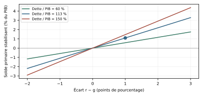

# BCE ECG — ESH (ESCP-SKEMA) 2026 · Corrigé guidé

*Corrigé rédigé par IA, non officiel. Signalez toute erreur.*

**Rédaction** · Claude Opus 5.5 · effort non renseigné · vitesse non renseignée · 13 novembre 2026

**Révision** · Claude Opus 5.5 · effort non renseigné · vitesse non renseignée · 13 novembre 2026

**Révision** · GPT-6.2 Astra Ultra · vitesse non renseignée · 24 novembre 2026

**Révision (tour 3)** · GPT-6.2 Astra Ultra · vitesse non renseignée · 26 novembre 2026

## Présentation du sujet

**Cadre.** Épreuve d'économie, sociologie et histoire du monde contemporain (ESH), conception ESCP BS et SKEMA BS, voie générale, lundi 27 avril 2026, de 8 h à 12 h. Aucun document, aucune calculatrice. Le sujet tient en une question : « Y a-t-il une limite à l'endettement public ? ». La consigne demande d'éviter tout verbiage, recommande de ne pas dépasser huit pages et prévient qu'il sera tenu compte du plan, de l'exposition et de la correction de la langue.

**Place dans le programme.** Le sujet relève d'abord du module 4.2, dont le commentaire demande de s'interroger « en particulier sur la soutenabilité de la dette publique » (4.2.3, contraintes des politiques économiques). Il mobilise aussi la monnaie et le financement de l'économie (1.1.2), la croissance endogène (2.1.1), le marché international des capitaux (3.2.3), la gouvernance budgétaire et monétaire de l'Union européenne (3.3.2) et les modèles macroéconomiques (4.1).

**Difficulté.** Le sujet est classique et n'a posé, selon le rapport 2026, « aucun problème d'interprétation ». La difficulté est technique : le jury attend l'équation de la dynamique de la dette écrite correctement et commentée, ce que la plupart des candidats n'ont pas su faire. Le rapport donne 3 698 copies corrigées, une moyenne de 10,30 et un écart type de 3,70, avec des notes de 0 à 20.

**Ce que propose ce corrigé.** Un plan possible en trois parties. Le rapport ne privilégie aucun plan, mais énumère quatre ensembles d'éléments théoriques autour desquels la copie devait s'articuler : les formats d'expression de la limite, l'équation de la dette et l'écart $r-g$, le lien entre dette et croissance, la monétisation et les chocs exogènes. Le plan ci-dessous les intègre tous.

**Gestion du temps.** Environ 1 h de brouillon (définitions, équation vérifiée, problématique, plan détaillé), 2 h 30 de rédaction, 30 min pour l'introduction et la conclusion au propre et la relecture.

## Analyse du sujet

> [!INDICATION]
> Qui s'endette exactement quand on parle de dette publique ? Et la dette est-elle un stock, un flux ou un coût ?

> [!INDICATION]
> « Limite » a plusieurs sens : juridique, économique, financier. Et que veut dire « soutenable » pour un État qui ne rembourse presque jamais sa dette ?

#### Solution

- **Dette publique.** Dette brute consolidée, en dépôts, titres de créance et crédits, de l'ensemble des administrations publiques (État, organismes divers d'administration centrale, collectivités locales, administrations de sécurité sociale), au sens du traité de Maastricht, en valeur nominale. Elle reflète aussi les acquisitions d’actifs et les ajustements entre flux et stocks. Ne pas la confondre avec le déficit (un flux) ni avec la charge d'intérêts (son coût annuel).
- **Limite.** Trois sens : un plafond juridique (plafond de la dette américaine, critères de Maastricht, frein allemand) ; un seuil économique (au-delà duquel la croissance serait freinée) ; une limite de soutenabilité.
- **Soutenabilité.** Terme flou : capacité à payer les intérêts, à refinancer, à rembourser ou à racheter sa dette. Le ratio dette/PIB se justifie surtout pour la capacité à payer les intérêts, car le PIB est l'assiette des recettes fiscales ; d'autres indicateurs existent (charge d'intérêts sur PIB ou sur recettes, montant absolu, maturité, part détenue par les non-résidents).
- **La forme du sujet.** « Y a-t-il » est une question d'existence : il faut répondre oui ou non, et dire quelle limite. La réponse nuancée attendue est qu'une limite existe, mais qu'elle n'est pas un seuil fixe.
- **Bornes.** Économies développées surtout (France, zone euro, États-Unis, Japon, Royaume-Uni), avec l'éclairage des pays émergents (défauts) et de l'histoire longue (après 1815, après 1945).
- **Hors sujet.** Réduire le sujet aux plafonds législatifs, ou à une histoire de la dette française sans analyse.

> [!JURY]
> Le rapport 2026 attendait que les candidats sachent définir la dette publique « en ne la limitant pas à la dette de l’Etat ». Il relève que « Les candidats ont d’ailleurs parfois confondu la dette et la charge financière de la dette », et précise que « Le sujet ne devait évidemment pas se réduire à l’existence de limites législatives ».

## Problématique

> [!INDICATION]
> Comparez des pays : un ratio élevé sans crise ici, un défaut avec une dette modérée là. Qu'est-ce que cela dit de l'idée d'un seuil ?

> [!INDICATION]
> De quoi dépend la limite ?

#### Solution

**Problématique retenue.** La dette publique se heurte-t-elle à un seuil objectif au-delà duquel elle devient insoutenable, ou sa limite dépend-elle de conditions économiques et institutionnelles (écart entre taux d'intérêt et croissance, usage des fonds, crédibilité de l'État et de la banque centrale) qui en font une limite mobile et, en dernier ressort, politique ?

Elle met le sujet en tension parce qu'elle confronte deux intuitions : la contrainte budgétaire intertemporelle impose une limite, mais aucun seuil n'a résisté à l'examen (Japon, Argentine, controverse Reinhart-Rogoff). Elle permet de répondre nettement : oui, il y a une limite, mais elle est conditionnelle et politique.

**Variante acceptable.** Partir de la notion de soutenabilité et de ses quatre sens (payer les intérêts, refinancer, rembourser, racheter) pour montrer que la limite n'est pas la même selon le sens retenu.

## Plan détaillé

Le plan va de la limite la plus mécanique à la plus politique : il existe une limite arithmétique et financière (I), mais elle se déplace avec $r-g$, la banque centrale et l'usage des fonds (II), et sa position décisive dépend des règles et du consentement à l'impôt (III). L'équation de la dette sert de point d'entrée, comme le suggère le rapport.

### Partie I — Une limite arithmétique, financière et économique

> [!INDICATION]
> Écrivez l'évolution du ratio dette/PIB d'une année à l'autre en partant de la dette en niveau, puis divisez par le PIB. Quand le ratio est-il stable ?

> [!INDICATION]
> Que se passe-t-il si les créanciers doutent ? Pensez aux primes de risque, aux équilibres multiples et aux États qui empruntent dans une monnaie qu'ils n'émettent pas.

> [!INDICATION]
> Pour la croissance, deux mécanismes classiques et une étude empirique célèbre, avec sa controverse.

#### Solution

- **I.1 — L'arithmétique de la dette.** Sans ajustement entre flux et stocks, en niveau $D_{t+1} = (1+r)\,D_t - SP_{t+1}$ ; on divise par $Y_{t+1} = (1+g)\,Y_t$ :

  $$d_{t+1} = d_t \, \frac{1+r}{1+g} - sp_{t+1}$$

  avec $d$ le ratio dette/PIB, $r$ le taux d'intérêt apparent, $g$ la croissance nominale, $sp$ le solde primaire en points de PIB. Solde primaire stabilisant :

  $$sp^{*} = d \, \frac{r-g}{1+g}$$

  Si $r > g$, effet boule de neige. Ordre de grandeur : $d = 113\,\%$ et $r - g = 1$ point donnent $sp^{*} \approx 1{,}1\,\%$ du PIB. Solde total stabilisant (intérêts compris) : $s^{*} = -\,g\,d/(1+g)$, soit environ $-3{,}3\,\%$ du PIB pour $d = 113\,\%$ et $g = 3\,\%$ : un déficit total de cet ordre stabilise le ratio. Contrainte budgétaire intertemporelle : dans la représentation usuelle hors financement monétaire, la condition de non-Ponzi conduit à égaler la dette initiale à la valeur actuelle des excédents primaires futurs.
- **I.2 — La limite fixée par les créanciers.** Prime de risque, hausse de $r$ ; équilibres multiples (Calvo, 1988) ; fragilité des États d'une union monétaire (De Grauwe, 2011). Grèce : crise à partir de 2010, restructuration de mars 2012, rachat de décembre 2012. Royaume-Uni, septembre 2022 : projet de budget Truss, hausse des rendements amplifiée par les ventes forcées des fonds à levier, achats temporaires pour rétablir la liquidité du marché. *Debt intolerance* des émergents (Reinhart, Rogoff et Savastano, 2003), défaut argentin de 2001.
- **I.3 — La limite économique.** Effet d'éviction ; équivalence ricardienne (Barro, 1974), qui fait de la dette une charge neutre et limite l'efficacité du déficit plutôt que la croissance ; seuil de 90 % (Reinhart et Rogoff, 2010) contesté (Herndon, Ash et Pollin, 2013 ; causalité inverse). À enveloppe budgétaire donnée, la hausse des intérêts réduit la place disponible pour d’autres dépenses.
- *Transition* : le Japon et l'Argentine montrent que la limite n'est pas un seuil : de quoi dépend-elle ?

> [!METHODE]
> Une équation se présente : on dit d'où elle vient (dette en niveau, division par le PIB), on définit chaque terme, puis on en tire une conclusion (le solde stabilisant, le rôle de $r-g$). Une équation posée sans commentaire n'apporte rien.

> [!PIEGE]
> Écrire l'équation en valeur absolue, prendre pour $r$ le taux de marché du jour, ou pour $g$ la croissance réelle. Le taux apparent reflète les conditions d'émission passées ; la croissance est nominale, puisque la dette est en euros courants.

> [!JURY]
> Rapport 2026 : l'équation a été introduite par de nombreux candidats, « mais le plus souvent exprimée sous une forme incorrecte ». Erreurs relevées : « La dette n’est pas exprimée en ratio mais en valeur absolue », « r est défini comme le taux de marché actuel et non le taux apparent de la dette », « g est défini comme le taux de croissance réel du PIB, alors qu’il s’agit du taux nominal ». Le jury regrette aussi « que les candidats n’aient pas décrit les principes et modalités de construction de cette équation ».

### Partie II — Une limite mobile : croissance, banque centrale et usage des fonds

> [!INDICATION]
> Que devient le ratio si le déficit total, intérêts compris, reste constant en part du PIB dans une économie en croissance ? Puis reprenez l'équation avec $r < g$ et un déficit primaire constant. Pensez à un économiste des années 1940 et à une conférence de 2019.

> [!INDICATION]
> Que change le fait que la banque centrale achète des titres publics ? Jusqu'où peut-elle aller ?

> [!INDICATION]
> Toutes les dettes se valent-elles ? Pensez à ce que finance l'emprunt et à son effet sur $g$.

#### Solution

- **II.1 — La croissance et l'écart $r - g$.** Domar (1944) : avec un déficit total (intérêts compris) constant en part du PIB et une croissance positive, le ratio converge vers $b(1+g)/g$, quel que soit $r$ ; Maastricht : 3 % de déficit et 5 % de croissance nominale stabilisent la dette à 63 % dans cette convention annuelle, environ 60 % en temps continu. Si de plus $r < g$, même un déficit primaire constant laisse le ratio converger. Blanchard, « Public Debt and Low Interest Rates » (2019) : aux États-Unis, $r < g$ en moyenne depuis les années 1950 ; le refinancement peut alors, sous certaines conditions, éviter de nouvelles hausses d’impôts. Royaume-Uni après 1815 et après 1945 ; liquidation de la dette par l'inflation et la répression financière (Reinhart et Sbrancia, 2015). Japon : a longtemps financé plus de 200 % du PIB à taux quasi nuls, dette détenue par des résidents et largement par la Banque du Japon ; la remontée des taux depuis la sortie des taux négatifs (mars 2024) montre que la limite se déplace.
- **II.2 — La banque centrale.** Draghi, 26 juillet 2012, « whatever it takes », puis l'annonce du programme OMT : les primes refluent. PEPP (2020, porté à 1 850 milliards d'euros). Théorie monétaire moderne (Kelton, *The Deficit Myth*, 2020) : l’émission dans sa monnaie réduit le risque de pénurie nominale de liquidités. L’inflation, le mandat de la banque centrale et la décision politique de payer demeurent déterminants. Sargent et Wallace (1981) : dominance budgétaire. Retour de l'inflation et hausse des taux de la BCE à partir de juillet 2022.
- **II.3 — L'usage des fonds.** Lerner (1943), finances fonctionnelles. Dette d'investissement (éducation, recherche, infrastructures) qui relève $g$ ; Aghion, croissance par l'innovation ; rapport Draghi (septembre 2024, 750 à 800 milliards d'euros par an d'investissement supplémentaire, public et privé). Règle d'or ; emprunt commun de *Next Generation EU* (2020).
- *Transition* : la limite dépend surtout de la capacité à dégager des excédents primaires, donc d'un choix politique.

> [!JURY]
> Le rapport 2026 rappelle que le papier de Blanchard « a été très discuté, car il ouvrait la porte à un accroissement du déficit primaire lorsque les taux d’intérêt étaient bas ». Il juge le lien entre dette et croissance inévitable : « Ce thème était inévitable dans le traitement du sujet. » Il demande aussi d'expliquer le Japon : « Bien sûr le cas du Japon, dont les taux d’intérêt sont restés très longtemps très bas malgré un ratio dette publique sur PIB très élevé, devait être expliqué ».

### Partie III — Une limite décisive : politique et institutionnelle

> [!INDICATION]
> Les règles budgétaires sont-elles des limites économiques ou des engagements ? Que montre leur révision ?

> [!INDICATION]
> Qu'est-ce qui garantit, en fin de compte, les excédents primaires futurs ? Cherchez un auteur qui a fait de la soutenabilité un comportement.

#### Solution

- **III.1 — Les limites que les États se donnent.** Maastricht (1992), 3 % et 60 % ; Pacte de stabilité et de croissance (1997) ; clause dérogatoire générale (2020) ; réforme de 2024 (trajectoires de dépenses par pays). Frein à l'endettement allemand (2009, déficit structurel fédéral de 0,35 % du PIB), assoupli en mars 2025 (fonds d'infrastructures, défense). Plafond de la dette américaine : relevé régulièrement, il peut bloquer de nouvelles émissions et provoquer une crise de trésorerie même quand des dépenses ont déjà été votées (perte du AAA chez S&P en 2011).
- **III.2 — Le consentement à l'impôt.** Bohn (1998) : soutenabilité si l'excédent primaire augmente avec la dette. La limite est le refus de l'effort nécessaire. Grèce : un quart du PIB perdu entre 2008 et 2013 ; multiplicateurs sous-estimés (Blanchard et Leigh, 2013). France : censure du gouvernement Barnier (décembre 2024), chute du gouvernement Bayrou (septembre 2025).
- **III.3 — Franchir la limite : une question de répartition.** Reinhart et Rogoff, *This Time Is Different* (2009) : défauts, restructurations et inflation reviennent ; la perte est supportée par les créanciers, les épargnants ou les contribuables. Équité entre générations : les générations héritent d’actifs, d’institutions et de créances aussi bien que de la charge fiscale. Évaluer l’usage réel des fonds et la distribution des coûts.

> [!PIEGE]
> Présenter le plafond américain ou les critères de Maastricht comme « la » limite de la dette. Ce sont des règles politiques, que l'on révise ; elles servent la partie III, pas la définition.

## Références et exemples

| Référence ou exemple | Ce qu'elle apporte | Où |
|---|---|---|
| Équation $d_{t+1} = d_t (1+r)/(1+g) - sp_{t+1}$, solde stabilisant | limite arithmétique, effet boule de neige | I.1 |
| Calvo (1988) ; De Grauwe (2011) | équilibres multiples, fragilité en union monétaire | I.2 |
| Grèce 2010-2012 ; Royaume-Uni 2022 ; Argentine 2001 | limite fixée par les créanciers | intro, I.2 |
| Reinhart, Rogoff et Savastano (2003) | intolérance à la dette | I.2 |
| Barro (1974) | équivalence ricardienne | I.3 |
| Reinhart et Rogoff (2010) ; Herndon, Ash et Pollin (2013) | seuil de 90 % et sa critique | I.3 |
| Domar (1944) ; Blanchard (2019) | déficit total constant et ratio fini ; $r < g$, coût budgétaire conditionnellement faible | II.1 |
| Reinhart et Sbrancia (2015) ; Royaume-Uni après 1815 et 1945 ; Japon | réduction de la dette par la croissance et l'inflation | II.1 |
| Draghi (2012) ; PEPP (2020) | banque centrale et primes de risque | II.2 |
| Kelton (2020) ; Sargent et Wallace (1981) | théorie monétaire moderne, dominance budgétaire | II.2 |
| Lerner (1943) ; Aghion ; rapport Draghi (2024) ; *Next Generation EU* | qualité de la dette | II.3 |
| Maastricht (1992), Pacte (1997), réforme 2024, frein allemand (2009, 2025), plafond américain | règles et leur révision | III.1 |
| Bohn (1998) ; Blanchard et Leigh (2013) | soutenabilité comme comportement, coût de l'austérité | III.2 |
| Reinhart et Rogoff, *This Time Is Different* (2009) | défauts et répartition des pertes | III.3 |

## Introduction et conclusion rédigées

#### Solution

**Introduction.** À la fin de 2024, la dette publique française atteint environ 113 % du PIB, pour un déficit public de 5,8 % du PIB. Le Japon dépasse depuis longtemps 200 % du PIB sans crise de financement, alors que l'Argentine a fait défaut en décembre 2001 avec une dette bien moindre. Le même ratio peut donc être supportable pour un pays et fatal pour un autre.

La dette publique est la dette brute consolidée en valeur nominale des administrations publiques, au sens de Maastricht. Elle couvre les dépôts, les titres de créance et les crédits de ces administrations. Sa charge annuelle d’intérêts est un flux. Une limite peut être un plafond juridique, un seuil économique ou une limite de soutenabilité, terme flou qui peut désigner la capacité à payer les intérêts, à refinancer, à rembourser ou à racheter la dette. Le ratio de la dette au PIB se justifie surtout pour la première acception, puisque le PIB est l'assiette des recettes fiscales, et un État refinance sa dette plus qu'il ne la rembourse.

Dès lors, la dette publique se heurte-t-elle à un seuil objectif au-delà duquel elle devient insoutenable, ou sa limite dépend-elle de conditions économiques et institutionnelles qui en font une limite mobile et, en dernier ressort, politique ?

L'arithmétique de la dette et le jugement des marchés imposent bien une limite. Mais elle n'est ni un seuil universel ni une donnée fixe, car elle dépend de l'écart entre taux d'intérêt et croissance, du rôle de la banque centrale et de l'usage des fonds. C'est finalement dans la capacité politique d'une société à financer sa dette que se trouve la limite décisive.

**Conclusion.** Il existe bien une limite à l'endettement public : celle de l'arithmétique de la dette quand le taux d'intérêt dépasse la croissance, celle du jugement des créanciers, celle de la charge d'intérêts qui évince les dépenses utiles. Mais elle n'est pas un seuil universel : elle recule quand la croissance dépasse le taux d'intérêt, quand une banque centrale crédible garantit la liquidité des titres publics et quand la dette finance l'investissement. En dernier ressort, elle est politique : c'est le point où une société refuse l'impôt, l'austérité ou l'inflation qui garantissent sa dette. La remontée des taux depuis 2022 et l'ampleur des investissements qu'exige la transition écologique obligent à distinguer la dette qui prépare l'avenir de celle qui le grève.

## Pièges à éviter

> [!PIEGE]
> Annoncer un seuil (60 %, 90 %, 100 % du PIB) comme une loi économique. Le seuil de 60 % est une convention juridique, celui de 90 % une estimation contestée.

> [!PIEGE]
> Confondre dette et déficit, ou dette et charge d'intérêts ; parler de la dette « de l'État » quand il s'agit de celle des administrations publiques.

> [!PIEGE]
> Juxtaposer les théories (keynésiens, ricardiens, MMT) sans les faire servir la question de la limite. Chaque théorie doit dire où se trouve la limite et pourquoi.

> [!JURY]
> Rapport 2026 : « Nous ne privilégions aucun plan », la cohérence du plan étant l'un des principaux critères. Les travaux de Reinhart et Rogoff pouvaient servir, « certes controversés sur le plan économétrique ». Enfin, « l’orthographe et la syntaxe sont des critères implicites d’évaluation très importants ».

## Bilan

- **Méthode.** Sur un sujet technique, l'outil central (ici l'équation de la dette) se construit, se définit terme à terme et s'interprète ; il ouvre la copie au lieu de l'encombrer. La réponse à une question d'existence (« Y a-t-il… ? ») doit être nette : oui, mais une limite conditionnelle.
- **Notions à revoir.** Dette au sens de Maastricht ; déficit, solde primaire et charge d'intérêts ; taux apparent ; contrainte budgétaire intertemporelle ; solde stabilisant ; effet d'éviction ; équivalence ricardienne ; dominance budgétaire ; règles budgétaires européennes.
- **Références à maîtriser.** Domar (1944), Barro (1974), Sargent et Wallace (1981), Bohn (1998), Reinhart et Rogoff (2009, 2010), Blanchard (2019), Blanchard et Leigh (2013).
- **Sujets voisins.** « Faut-il craindre la dette publique ? » ; « La politique budgétaire est-elle encore efficace ? » ; « Faut-il des règles budgétaires ? » ; « L'indépendance des banques centrales est-elle menacée ? » ; « Peut-on financer la transition écologique par la dette ? ».

## Vérification sur le sujet

Dissertation unique sur une éventuelle limite à l’endettement public. La démonstration, le guide et la figure ont été rapprochés du sujet et du rapport. Les deux textes distinguent encours, charge d’intérêt et solde primaire, puis traitent croissance, risque de refinancement et choix institutionnels.

Un exemple de refinancement distingue une contrainte de liquidité de la dynamique du ratio. Pour un encours de 100 dont 20 arrivent à échéance, un État à solde total nul doit, en l’absence de trésorerie disponible, émettre 20 pour rembourser les titres échus. L’encours reste de 100, mais l’accès au marché au moment du renouvellement demeure décisif. Si seule cette tranche est refinancée avec deux points d’intérêt de plus, la charge annuelle augmente d’abord de 0,4. Multiplier les deux points par la totalité de l’encours supposerait que toutes les échéances se renouvellent simultanément.

## Sources

[Sujet BCE, code 270](https://www.concours-bce.com/sites/default/files/2026-04/270%20-%20ESH_ESCP_BS_SKEMA_BS.pdf) · [Rapport du jury 2026](https://www.concours-bce.com/sites/default/files/2026-09/270%20-%20Eco%20Socio%20ESCP.SKEMA%202026.pdf)

[Insee, première estimation des finances publiques de 2025](https://www.insee.fr/fr/statistiques/8956575) · [Banque d’Angleterre, crise des gilts de 2022](https://www.bankofengland.co.uk/quarterly-bulletin/2023/2023/financial-stability-buy-sell-tools-a-gilt-market-case-study) · [Olivier Blanchard, dette et taux bas](https://doi.org/10.1257/aer.109.4.1197)
