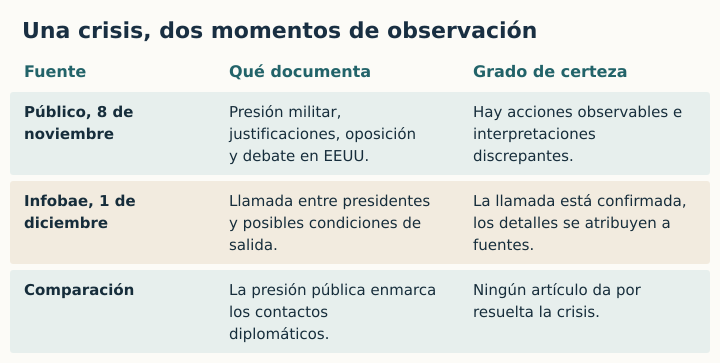

# BCE ECG — Espagnol LVA (ELVi) 2026 · Corrigé brut

*Corrigé rédigé par IA, non officiel. Signalez toute erreur.*

**Rédaction** · GPT-6.2 Astra Ultra · vitesse non renseignée

**Lecture du rapport du jury** · GPT-6.2 Astra Ultra · vitesse non renseignée · 26 novembre 2026

**Révision** · GPT-6.2 Astra Ultra · vitesse non renseignée · 26 novembre 2026

[Sujet officiel, option Espagnol LVA (ELVi)](https://www.concours-bce.com/sites/default/files/2026-04/75%20GB%20-%20LANGUE_VIVANTE_A_ELVI_ALLEMAND_ANGLAIS_ESPAGNOL.pdf#page=14) · [Rapport du jury 2026](https://www.concours-bce.com/sites/default/files/2026-10/75%20-%20Espagnol%20LVA%20Elvi%202026.pdf)

Le dossier espagnol LVA commence à la page 14. Le résumé confronte les documents 1 et 2 en 350 mots et l’essai demande 500 mots, avec une marge de 10 %. Le thème commence avec les espoirs de Donald Trump pour le Nobel 2025 et s’achève sur sa candidature imaginaire pour 2026.

## Résumé analytique comparatif · 357 mots

Los dos artículos describen una crisis en la que la campaña estadounidense contra el narcotráfico plantea una cuestión política más amplia: la continuidad de Nicolás Maduro en el poder. Néstor Prieto Amador examina el 8 de noviembre la distancia entre el objetivo declarado por Washington y la magnitud de la presión ejercida. Los periodistas de Infobae reconstruyen el 1 de diciembre una gestión diplomática que, según sus fuentes, habría podido desembocar en la salida del mandatario venezolano.

Prieto Amador subraya el carácter excepcional del despliegue estadounidense y el coste humano de los ataques contra embarcaciones presuntamente vinculadas al tráfico de drogas. Contrapone la justificación de Trump a los datos sobre el peso relativo de la ruta caribeña y recoge las dudas sobre la identidad de las víctimas. Mientras Maduro moviliza a sus seguidores, María Corina Machado presenta una transición venezolana como beneficiosa para la seguridad estadounidense y anima a Washington a mantener la presión. El Senado estadounidense rechazó por 51 votos a 49 una propuesta para limitar el margen de actuación presidencial. La estrechez del resultado revela una división que los contactos entre jefes de Estado dejan fuera de plano. Sus declaraciones dejan incierto hasta dónde pretende llegar.

El segundo artículo sitúa esa incertidumbre en la breve conversación telefónica del 21 de noviembre entre ambos mandatarios. Trump confirmó que hablaron, pero los detalles proceden de fuentes informadas. Según estas, Maduro habría condicionado su partida a garantías para su familia, a una amnistía y al levantamiento de sanciones que alcanzaban también a numerosos funcionarios. Trump habría rechazado buena parte de las peticiones y concedido un plazo limitado para salir del país. El Gobierno venezolano rechaza las acusaciones criminales y atribuye la presión al interés estadounidense por sus recursos. Washington, por su parte, cuestiona la legitimidad de la reelección de Maduro.

En conjunto, los textos describen una relación asimétrica sin atribuirle un desenlace seguro. El primero contrasta las explicaciones públicas de la fuerza y las reacciones que provoca. El segundo muestra que dicha fuerza también forma parte del contexto de una negociación. El plazo referido por las fuentes habría vencido y persisten desacuerdos, aunque estas no descartan otra conversación.

## Essai argumenté · 501 mots

Un país conserva su soberanía cuando puede escoger entre alternativas que sus ciudadanos tienen motivos para aceptar, incluso si ninguna le sale gratis. Bajo esta definición, creo que los países latinoamericanos pueden mantener un margen de decisión frente a Washington, aunque ese margen varía enormemente. La afirmación rotunda de independencia de un presidente y su amistad personal con otro son pruebas bastante pobres de que una sociedad decide su propio futuro.

Las caricaturas del dossier muestran dos maneras de confundir soberanía con estilo. Petro planta cara a Trump, pero el guante estadounidense lleva escrito el nombre de un instrumento económico: los aranceles. Milei, en cambio, avanza agarrado a la corbata de su interlocutor. En un caso es posible defender públicamente la dignidad nacional sin disponer de mercados alternativos para los productores que perderían sus ventas. La imagen argentina se publicó en febrero, ocho meses antes que la colombiana. No representan las etapas de un mismo conflicto. Plantean dos preguntas distintas sobre los costes de una decisión nacional. En el segundo caso se puede conseguir financiación en un momento de urgencia y descubrir después que la continuidad del crédito depende de un resultado electoral aceptable para un socio extranjero. Haría la misma pregunta a ambos presidentes: ¿podría el siguiente gobierno cambiar de rumbo sin precipitar una crisis que hiciera ilusoria su victoria en las urnas?

La historia ofrece ejemplos menos desalentadores. Los tratados Torrijos-Carter, firmados en 1977, fijaron el camino para la transferencia del canal a Panamá, culminada en 1999. Panamá no alcanzó la paridad económica con Estados Unidos para obtener ese resultado. Logró convertir una reclamación histórica en un compromiso público con un calendario verificable. La negociación llevó tiempo y estuvo sometida a intereses contradictorios en ambos países. Precisamente por eso enseña más sobre la autonomía que una fotografía de dos mandatarios dándose la mano. En otro registro, México impulsó el Tratado de Tlatelolco de 1967. Un problema regional pudo abordarse mediante una regla latinoamericana en cuya elaboración participaron Estados de tamaños muy distintos. La acción colectiva permite que un país pequeño haga algo más que pedir protección individualmente a una potencia.

Sin embargo, sería un error medir la soberanía únicamente por la capacidad de un ejecutivo para resistir presiones externas. En Venezuela, los ciudadanos deben poder exigir que se respete su voto, incluidos quienes se oponen a Maduro y quienes temen una intervención extranjera. Defender la no intervención y pedir garantías electorales son posiciones compatibles. Además, diversificar socios termina siendo una libertad muy precaria si cada acuerdo se firma en secreto y una dependencia comercial simplemente sustituye a otra.

Por eso daría prioridad a instituciones capaces de examinar públicamente la deuda y los contratos, a relaciones económicas regionales que amplíen las alternativas y a mecanismos multilaterales de negociación. Ninguna medida elimina las asimetrías con Estados Unidos. Sí pueden impedir que la voluntad de un solo gobernante, extranjero o nacional, determine cuánto vale un voto latinoamericano. La soberanía posible se reconoce en esa continuidad de las opciones cuando cambian los gobiernos.

## Thème

Así pues, el señor Donald Trump podía legítimamente albergar algunas esperanzas de cara a la edición de 2025. Él también despliega sus tropas en el Caribe. Él también recurre al chantaje de la ayuda estadounidense, amenazando con asfixiar financieramente a Argentina en caso de revés electoral del señor Javier Milei. Él también multiplica los asesinatos (cada vez menos) selectivos en nombre de la lucha contra el terrorismo: así justifica la eliminación en alta mar de ciudadanos venezolanos acusados sin pruebas de narcotráfico. Y él también planea golpes de Estado contra gobiernos reacios a plegarse a sus exigencias, como en Venezuela, donde autorizó a la Agencia Central de Inteligencia (CIA) a derrocar al presidente Nicolás Maduro.

Nada de esto bastó. El comité noruego prefirió a la señora María Corina Machado, opositora venezolana de extrema derecha que lleva veinticinco años reclamando una intervención extranjera contra su propio país y que, nada más recibir el premio, se apresuró a felicitar al señor Benjamín Netanyahu por sus acciones en Gaza. El señor Trump ahogó su decepción lanzando una nueva cruzada, esta vez contra Colombia. Ya está puliendo su currículo de cara a la añada de 2026.

