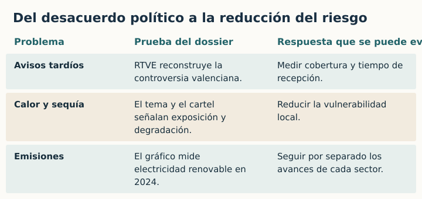
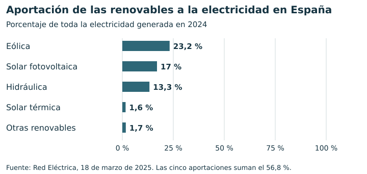

# BCE ECG — Espagnol LVB (ELVi) 2026 · Corrigé brut

*Corrigé rédigé par IA, non officiel. Signalez toute erreur.*

**Rédaction** · GPT-6.2 Astra Ultra · vitesse non renseignée

**Lecture du rapport du jury** · GPT-6.2 Astra Ultra · vitesse non renseignée · 26 novembre 2026

**Révision** · GPT-6.2 Astra Ultra · vitesse non renseignée · 26 novembre 2026

[Sujet officiel, option Espagnol LVB (ELVi)](https://www.concours-bce.com/sites/default/files/2026-04/76%20GB%20-%20LANGUE_VIVANTE_B_ELVI_ALLEMAND_ANGLAIS_ESPAGNOL.pdf#page=12) · [Rapport du jury 2026](https://www.concours-bce.com/sites/default/files/2026-11/76%20-%20Espagnol%20LVB%20Elvi%202026.pdf)

L’espagnol LVB commence à la page 12. Les deux textes en espagnol visent 250 et 350 mots, avec 10 % de tolérance. Le thème est limité aux deux paragraphes entre crochets sur l’été espagnol de 2025.

## Résumé analytique comparatif · 262 mots

Emilio Santiago y RTVE coinciden en que la división política dificulta la respuesta de España a las consecuencias del cambio climático. El primero juzga las posibilidades de una estrategia futura. El segundo muestra cómo, un año después de la dana valenciana, la discusión sobre las decisiones adoptadas durante la emergencia sigue enfrentando a partidos y administraciones.

Para Santiago, un acuerdo que protegiera unos compromisos mínimos frente a la alternancia sería deseable. Acoge por ello la propuesta de pacto de Estado de Pedro Sánchez, pero duda de que la derecha actual vaya a respaldarla. Señala el peso de Vox en los gobiernos autonómicos, la actuación del PP y un clima internacional adverso a la descarbonización. Si fracasa el consenso, propone consolidar una mayoría política favorable a la transición industrial verde y comprometer recursos duraderos para la adaptación.

RTVE describe un desacuerdo concreto sobre quién disponía de la información y quién debía avisar a la población. Al gobierno valenciano le correspondía emitir la alerta, que llegó cuando ya había municipios inundados. Carlos Mazón reprocha al Gobierno central la información recibida. El Ejecutivo de Sánchez cuestiona la reacción autonómica, mientras el PP y otros críticos piden cuentas también a Madrid. Las protestas y la posición de las víctimas muestran que la disputa desborda el Parlamento. RTVE recoge las acusaciones de los dos gobiernos sin asumir la interpretación de ninguno.

Así, donde el articulista considera improbable el acuerdo futuro y busca otra mayoría, RTVE documenta las consecuencias de la desconfianza ya instalada. La distribución formal de competencias no ha resuelto la controversia sobre la responsabilidad política.

## Essai argumenté · 364 mots

España podría reducir los riesgos ambientales si juzgara sus políticas por las personas que dejan de estar expuestas, además de por la energía limpia que producen. Un megavatio renovable y un aviso recibido a tiempo resuelven problemas diferentes. Creo que ambas tareas merecen una financiación estable y que la urgencia de la segunda suele pasar inadvertida hasta el día de la catástrofe.

En Valencia, el debate sobre quién debió actuar durante la dana muestra lo caro que sale improvisar la coordinación. Los ayuntamientos conocen sus barrios y la Generalitat tiene competencias en materia de alertas. El Estado dispone de servicios meteorológicos e hidrológicos. Deberían acordar responsabilidades concretas, probar los avisos con asociaciones de vecinos y publicar después una evaluación comprensible. También importa dónde se construye. Preservar terrenos inundables o recuperar espacio junto a los ríos puede suscitar oposición local inmediata, aunque reduzca pérdidas durante décadas. Hacen falta compensaciones y alternativas de vivienda para que la prevención no recaiga en quienes menos pueden permitírsela.

El calor exige una política social igualmente precisa. Un jubilado solo en un piso mal aislado y una trabajadora al aire libre pueden sufrir consecuencias muy distintas de las que experimenta una familia con aire acondicionado. Abrir bibliotecas y centros de barrio como refugios climáticos, dar sombra a los patios escolares y mejorar el aislamiento de las viviendas reduciría esa desigualdad. Recuperar suelos degradados, como propone el cartel de Naciones Unidas, ayudaría además a conservar agua allí donde la sequía amenaza la economía rural.

A largo plazo, España tiene una ventaja que debe consolidar. Según el gráfico, en 2024 las renovables generaron casi el 57 por ciento de la electricidad española. Solo la eólica aportó algo más del 23 por ciento de la generación total. Extenderlas exige redes fiables y participación de los municipios que acogen las instalaciones. No basta extrapolar ese porcentaje al transporte o a la calefacción, que requieren sus propias soluciones. Un acuerdo estatal sería valioso si fija plazos y presupuestos que se puedan comprobar. Mientras se negocia, las administraciones ya pueden medir algo más revelador que el número de anuncios políticos: cuántas personas pueden recibir un aviso, encontrar agua o protegerse del calor en su propio barrio.

## Thème

Este año España sufrió su verano más caluroso desde que comenzaron los registros en 1961, con una temperatura media de 24,2 °C, según la agencia meteorológica nacional. En agosto, el país padeció una ola de calor récord de dieciséis días que avivó unos incendios forestales en los que murieron cuatro personas y ardieron cientos de miles de hectáreas. Nueve de los diez veranos más calurosos registrados en España desde 1961 se han producido en el siglo XXI, según la Aemet.

Aunque está acostumbrada a las altas temperaturas, España sufre episodios de calor cada vez más numerosos y más próximos entre sí, a veces fuera de los meses de verano, lo que preocupa a los científicos. Llevan años advirtiendo de los efectos del cambio climático sobre las olas de calor, las sequías y otros fenómenos meteorológicos extremos, cada vez más intensos y frecuentes.

