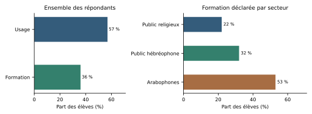

# BCE ECG · Hébreu LVB (ELVi) 2026 · Corrigé brut

*Corrigé rédigé par IA, non officiel. Signalez toute erreur.*

**Rédaction** · GPT-6.2 Astra Ultra · vitesse non renseignée · 24 novembre 2026

**Révision (tour 1)** · GPT-6.2 Astra Ultra · vitesse non renseignée

### Question 1 · Résumé analytique comparatif · 242 mots

בישראל רווחת התפיסה שלפיה על בית הספר ללמד את תלמידיו להשתמש בבינה מלאכותית כחלק מן הלימודים הרגילים. הכתבה הראשונה מציגה את המהלך בראשיתו כהזדמנות לשנות את דרכי ההוראה, ואילו השנייה בוחנת כעבור שנה עד כמה ההבטחות התממשו בכיתות. בשתיהן מדובר ביוזמה ממלכתית רחבת היקף, הנשענת על שיתוף פעולה בין משרד החינוך לחברות טכנולוגיה ועל הדרכת צוותי ההוראה בידי אנשי מקצוע.

לפי הכתבה הראשונה, התלמידים עתידים לפגוש את הכלים האלה בשוק העבודה, ולכן ראוי שיתרגלו כבר בבית הספר למידה עצמאית, פתרון בעיות ושימוש ביקורתי במידע. מערכת שמתאימה תרגילים לקצב ההתקדמות של כל תלמיד יכולה לפנות למורה זמן להנחיה אישית ולעבודה בקבוצות. יוזמות דומות בחו״ל מוצגות כבסיס לתוכנית הישראלית. גם בכתבה השנייה מצוטט גורם במשרד הסבור ששימוש מושכל בטכנולוגיה עשוי לפתוח בפני תלמידים אפשרויות חדשות, אלא שהוא חושש גם לגורלם של מי שלא ילמדו להשתמש בה כראוי.

הסקר המתואר בכתבה השנייה מראה מדוע ההבחנה הזאת חשובה. חמישים ושבעה אחוזים מהתלמידים דיווחו שהם משתמשים בכלים, אך רק שלושים ושישה אחוזים אמרו שבית הספר מלמד אותם כיצד לעשות זאת. גם הגישה להכשרה אינה שווה. בחינוך הממלכתי־דתי דיווחו על הוראה כזאת עשרים ושניים אחוזים בלבד, לעומת חמישים ושלושה אחוזים בקרב דוברי הערבית. לפי העדויות, קשיי כניסה למערכת, מחסור בתשתיות ולוח זמנים דחוק הכבידו על המורים. לטענת אחד המקורות, הלחץ להציג תוצאות בתוך שלושה חודשים פגע באיכות המהלך והגדיל את עלותו. משימות שנמדדו בעיקר לפי עצם השלמתן לא תמיד עודדו הבנה. כך מתברר הפער בין מספר החברות והמדריכים שגויסו לבין היכולת להפוך שימוש מזדמן ללמידה מעמיקה ונגישה לכול.

### Question 2 · Essai argumenté · 340 mots

בתמונה שבסוף התיק ניצב רובוט מול לוח ריק. התלמידים מביטים בו, אבל אין לדעת איזו שאלה מעסיקה אותם ואיך יגיב אם יאמר אחד מהם שהוא טועה. בעיניי, דווקא הפרט החסר הזה קובע מה ראוי לעשות בבינה מלאכותית בבית הספר. אני תומך בהוראה שתאפשר לכל תלמיד בישראל להכיר את הכלים הללו, ומסתייג מהנחה שלפיה עצם הצבתם בכיתה כבר משפרת את הלמידה.

אפשר להתחיל משיעור בספרות. נניח שקוראים את השיר ״אל ארצי״ של רחל. תוכנה יכולה להציע לתלמיד שעדיין מתקשה בעברית פירוש למילה ״עלילות״ ולהזמין אותו לקרוא שוב את הבית הראשון. אבל מי שיקבל מן התוכנה סיכום מוכן על אהבת הארץ עלול להחמיץ את המתח בין צניעותה של הדוברת לבין עצם כתיבת השיר. הייתי מבקש משתי קבוצות להשוות בין הפירוש שהציעה התוכנה לבין שתי שורות שיבחרו בעצמן, ואחר כך להגן על קריאתן בפני הכיתה. כך גם תשובה משכנעת של המכונה יכולה לשמש נקודת מוצא למחלוקת מנומקת.

לדרך הזאת יש קרבה למסורת הלימוד בחברותא. לומד אחד מציע פירוש וחברו מבקש שיראה לו היכן מצא לכך יסוד בטקסט. גם תוכנה יכולה להעלות קושיה שלא חשבתי עליה, אבל לחבר שלומד איתי יש אחריות כלפיי. הוא יודע מתי התשובה שלו בלבלה אותי ומתי מוטב שייתן לי עוד רגע לחשוב. לכן הייתי משאיר בכל משימה שלב שבו התלמידים מדברים זה עם זה בלי מסך. כאשר התשובה כוללת ציטוט או עובדה היסטורית, עליהם גם לפתוח את המקור ולבדוק אם הדברים אכן מופיעים בו.

כדי שהשיטה תהיה נגישה לכולם, דרושים מכשירים בבית הספר, זמן הכשרה למורים ומשימות שמתאימות גם לכיתות שבהן שפת ההוראה היא ערבית. לא הייתי נותן ציון על עבודה המחייבת מנוי פרטי בבית. במקום לספור כמה תלמידים התחברו לפורטל, אפשר לבדוק אם תלמיד מסוגל להסביר מדוע דחה תשובה מוטעית, או לפתור בעיה דומה בעצמו שבוע אחר כך. מורה שמזהה קושי בקריאה יוכל אז לבחור בין הסבר אישי, קריאה בזוגות ותרגול בעזרת המחשב.

בסופו של דבר, אני רוצה שבוגר בית הספר ידע גם להשתמש בכלי וגם להחליט מתי לסגור אותו. אם השקעה בטכנולוגיה מותירה למורה פחות זמן להקשיב לתלמיד, כדאי לשנות את התוכנית. אם היא מאפשרת לעוד תלמיד להשתתף בדיון שבעבר התקשה להצטרף אליו, יש לה מקום בכיתה.

### Question 3 · Thème du français en hébreu

האם אפשר להשלים עם כך שבאותה מערכת חינוך מעוררים בקרב בני הדורות הצעירים מודעות לצורך במעבר לדפוסי חיים בני־קיימה, שהוא ממטרותיו של החינוך לפיתוח בר־קיימה, ובה בעת מעודדים אותם להשתמש במשאבים שכבר הוכח כי הם תורמים לפגיעה בתנאים המאפשרים חיים בכדור הארץ, וכי תרומתם לפגיעה זו עלולה עוד לגדול?

את השאלה האתית יש לבחון במישור של החברות המייצרות את האמצעים הטכנולוגיים ושל הארגונים הבוחרים להשתמש בהם, ולא במישור של האמצעים עצמם. בין השיקולים האתיים הרבים העשויים להאט את התפשטות הבינה המלאכותית, לשיקול שמעלה הפילוסוף דניאל דנט יש חשיבות מיוחדת בתחום החינוך: ״יצירת בני אדם מזויפים, שהבינה המלאכותית מאפשרת, מערערת את עקרון האמון שעליו מושתתות החברות האנושיות. יש לאסור יצירה כזאת ולהעניש עליה בחומרה שאינה פחותה מזו שבה מענישים על ייצור כסף מזויף ועל הפצתו.״

**Repère de lecture**

Dans l’enquête, 57 % des élèves déclarent utiliser l’IA et 36 % avoir reçu une formation. L’écart de 21 points porte sur deux réponses distinctes. Pour isoler les utilisateurs sans formation, il faudrait disposer du croisement des deux réponses individuelles.

## Sources

[Sujet BCE 76 CH, dossier hébreu, pages 8 à 15](https://www.concours-bce.com/sites/default/files/2026-04/76%20CH%20-%20LANGUE_VIVANTE_B_ELVI_CHINOIS_HEBREU_JAPONAIS_POLONAIS.pdf#page=8) · [Texte du poème de Rachel utilisé dans l’essai](https://he.wikisource.org/wiki/%D7%90%D7%9C_%D7%90%D7%A8%D7%A6%D7%99_(%D7%A8%D7%97%D7%9C))
