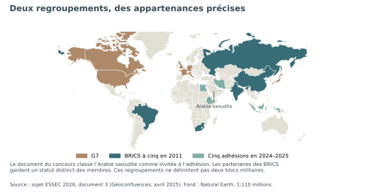

# BCE ECG — HGGMC (ESSEC) 2026 · Corrigé brut

*Corrigé rédigé par IA, non officiel. Signalez toute erreur.*

**Rédaction** · Claude Opus 5.5 · effort non renseigné · vitesse non renseignée

**Révision (tour 1)** · modèle non renseigné · effort non renseigné · vitesse non renseignée

**Révision (tour 2)** · GPT-6.2 Astra Ultra · vitesse non renseignée

**Problématique** : le monde se désoccidentalise moins par un rejet de l'Occident que par l'appropriation de ses instruments ; cette émancipation, réelle mais inachevée, différenciée et réversible, met fin au monopole occidental sur la puissance et sur l'universel sans faire sortir le monde du cadre qu'il a construit.

* * *

En août 2023, au sommet de Johannesburg, les BRICS annoncent l'invitation de six pays, dont l'Arabie saoudite, l'Iran, l'Égypte et l'Éthiopie. Le groupe, réuni pour la première fois au niveau des chefs d'État en 2009, accueille quatre d'entre eux en 2024 puis l'Indonésie en 2025, ce qui porte les BRICS+ à dix membres, tandis que l'adhésion saoudienne n'est pas finalisée et que l'Argentine a décliné l'invitation (document 3) ; neuf autres États en deviennent partenaires en 2025. Huit mois plus tôt, en décembre 2022, le ministre chinois des Affaires étrangères, Wang Yi, se félicitait que la Chine et la Russie aient œuvré pour l'« avènement d'un monde multipolaire » et la « démocratisation des relations internationales », contre « l'hégémonie » et « une nouvelle guerre froide ». Ces deux faits semblent annoncer la fin d'un monde ordonné autour de l'Occident.

L'Occident n'est pas d'abord une réalité géographique. Il désigne une construction historique et politique, née en Europe occidentale et prolongée en Amérique du Nord, qui associe des institutions (démocratie représentative, État de droit, économie de marché), des valeurs présentées comme universelles depuis les Lumières (droits de l'individu, libertés publiques) et, depuis 1945, une communauté de puissance structurée par les États-Unis. Ses frontières varient selon les critères : le Japon, la Corée du Sud, l'Australie ou Israël y appartiennent par leurs alliances et leurs institutions plus que par leur histoire. La désoccidentalisation désigne le recul de la centralité occidentale dans l'ordre mondial : économique, militaire, diplomatique, institutionnel, culturel et normatif, lorsque la prétention de l'Occident à définir des normes universelles est contestée. Elle ne se confond ni avec l'antioccidentalisme ni avec le remplacement de la puissance américaine par la puissance chinoise. La préposition « vers » indique une direction et non un état : le sujet interroge un processus en cours, dont ni l'aboutissement ni l'irréversibilité ne sont acquis. Enfin, « le monde » impose de raisonner à toutes les échelles, des institutions internationales aux sociétés, et dans toutes les régions, pas seulement à travers le face-à-face sino-américain.

L'Occident a dominé le monde à partir du XIXe siècle par l'industrialisation, la colonisation et la diffusion de ses normes, puis il a construit après 1945 l'essentiel des institutions internationales. Le rattrapage économique de l'Asie, l'affirmation de puissances émergentes et la contestation de ses valeurs semblent aujourd'hui remettre en cause cette centralité. Mais ceux qui la contestent le font souvent avec les instruments que l'Occident a lui-même diffusés : l'État souverain, le marché mondial, la technologie, les institutions multilatérales. La thèse soutenue ici est que le monde se désoccidentalise moins par un rejet de l'Occident que par l'appropriation de ses instruments, et que cette émancipation met fin au monopole occidental sur la puissance et sur l'universel sans faire sortir le monde du cadre qu'il a construit.

On montrera d'abord que la désoccidentalisation est engagée dans tous les domaines de la puissance, puis qu'elle procède d'une émancipation ancienne, nourrie par les héritages de la domination et par l'appropriation des outils occidentaux, ainsi que par les fractures de l'Occident lui-même. On verra enfin qu'elle reste inachevée, plurielle et réversible.

* * *

La désoccidentalisation est d'abord une réalité observable : l'Occident a perdu le monopole de la richesse, de la diplomatie et de la définition des normes.

Le centre de gravité de l'économie mondiale s'est déplacé vers l'Asie. Kenneth Pomeranz (*The Great Divergence*, 2000) a montré que l'avance de l'Europe sur les régions les plus développées de la Chine ne date que de la fin du XVIIIe siècle, lorsque le charbon et les ressources des colonies américaines ont permis à l'Angleterre de desserrer ses contraintes écologiques. Deux siècles plus tard, la « grande divergence » laisse place à ce que Richard Baldwin a appelé une grande convergence (*The Great Convergence*, 2016) : la fragmentation internationale des chaînes de valeur, à partir des années 1990, a transféré des capacités industrielles vers une poignée de pays d'Asie. La Chine, entrée à l'OMC en 2001, est devenue le premier pays industriel du monde, et son PIB en parité de pouvoir d'achat dépasse celui des États-Unis depuis le milieu des années 2010. Le document 2, qui classe les pays selon l'évolution de l'écart entre leur PIB par habitant, en dollars constants, et la moyenne mondiale de 2003 à 2023, nuance fortement ce tableau. La Chine et le Brésil figurent parmi les pays qui réduisent leur écart, tandis que la Russie et plusieurs pays d'Europe centrale franchissent la moyenne. L’Inde, l’Indonésie et de nombreux pays africains, malgré une croissance souvent rapide, voient au contraire l'écart absolu se creuser, et la plupart des pays riches d'Amérique du Nord, d'Europe occidentale et d'Océanie continuent de s'éloigner vers le haut, le Japon faisant exception. La désoccidentalisation économique est donc d'abord un déplacement des masses productives vers l'Asie, et surtout vers la Chine, plutôt qu'un rattrapage des niveaux de vie.

Un écart en dollars et un taux de croissance peuvent évoluer en sens différents. Dans un exemple fictif, le PIB par habitant d’un pays passe de 2 000 à 2 600 dollars constants pendant que la moyenne mondiale passe de 10 000 à 11 000. Le pays croît de 30 % contre 10 % dans le monde, mais son écart à la moyenne passe de 8 000 à 8 400 dollars. Le document 2 compare de tels écarts absolus ; la place d’un pays dans la production mondiale, sa croissance en pourcentage et son niveau de vie répondent à trois questions différentes.

Sur le plan géopolitique et institutionnel, les puissances non occidentales construisent leurs propres cadres et refusent de s'aligner. Les BRICS (document 3) se sont dotés d'une Nouvelle banque de développement, décidée en 2014 ; la Chine a lancé en 2013 les « nouvelles routes de la soie » et fondé en 2015 la Banque asiatique d'investissement dans les infrastructures, que le Royaume-Uni a rejointe contre l'avis de Washington ; l'Organisation de coopération de Shanghai, créée en 2001, a accueilli l'Inde et le Pakistan en 2017, puis l'Iran en 2023. Ces cadres naissent aussi de l'échec de la réforme des institutions de 1945 : la révision des quotes-parts du FMI décidée en 2010 n'est entrée en vigueur qu'en 2016, faute de ratification par le Congrès américain, et l'élargissement du Conseil de sécurité, que réclament l'Inde, le Brésil ou l'Union africaine, reste bloqué. Faute de pouvoir réformer ces institutions, les émergents les contournent. Surtout, la guerre en Ukraine a révélé le refus de nombreux États de choisir un camp. Le 2 mars 2022, la résolution de l'Assemblée générale des Nations unies qui exige le retrait russe recueille 141 voix, mais 35 États s'abstiennent, parmi lesquels la Chine, l'Inde, l'Afrique du Sud et de nombreux pays africains, et la plupart des pays du Sud refusent d'appliquer les sanctions. L'Inde accroît ses achats de pétrole russe tout en participant au Quad avec les États-Unis, le Japon et l'Australie ; l'Arabie saoudite coordonne sa production de pétrole avec la Russie au sein de l'OPEP+ tout en restant protégée par Washington. Ce multi-alignement, que revendique le ministre indien des Affaires étrangères Subrahmanyam Jaishankar, est une forme nouvelle du non-alignement : il ne s'agit plus de rester hors des blocs, mais de multiplier les partenariats au gré des intérêts. En Afrique, les juntes du Mali, du Burkina Faso et du Niger ont congédié les forces françaises entre 2022 et 2023 et se sont tournées vers la Russie.

La contestation est enfin normative. Le discours de Wang Yi reproduit dans le document 6 refuse le « faux débat » entre « la démocratie contre l'autoritarisme » et présente la multipolarité comme une démocratisation des relations internationales : l'universalisme occidental y est décrit comme un instrument d'hégémonie. La Russie dénonce un « Occident collectif » et se pose en défenseur des valeurs traditionnelles ; la Chine oppose aux droits de l'homme le droit au développement et la non-ingérence. Cette critique trouve un écho dans les sociétés du Sud parce qu'elle s'appuie sur les doubles standards de l'Occident : l'intervention en Irak en 2003, sans mandat du Conseil de sécurité, a durablement affaibli la crédibilité de son discours sur le droit international. La démocratie libérale n'apparaît plus comme l'horizon commun que Francis Fukuyama croyait voir se dessiner en 1989 (*The End of History and the Last Man*, 1992) : des régimes autoritaires ou illibéraux revendiquent un autre modèle et l'exportent.

Cette désoccidentalisation n'est pas un phénomène récent : elle plonge ses racines dans l'histoire de la domination occidentale, et elle emprunte à l'Occident ses propres armes.

* * *

La désoccidentalisation procède d'une émancipation ancienne, qui puise dans la mémoire de la domination et dans l'appropriation des instruments de l'Occident, et que favorisent les fractures de l'Occident lui-même.

La mémoire de la domination occidentale nourrit les revendications actuelles. La Chine fait des guerres de l'opium (1839-1842, puis 1856-1860) et des traités inégaux, à commencer par celui de Nankin en 1842, le début d'un « siècle d'humiliation » que la renaissance nationale doit effacer : la récupération de Hong Kong en 1997, la revendication sur Taïwan et le refus de l'ingérence étrangère s'inscrivent dans ce récit. Pour l'Afrique et une grande partie de l'Asie, la colonisation et la décolonisation fondent une défiance durable. La volonté d'autonomie n'est d'ailleurs pas nouvelle : à la conférence de Bandung, en avril 1955, vingt-neuf États d'Asie et d'Afrique condamnent le colonialisme et affirment leur droit à une voie propre ; le mouvement des non-alignés, fondé à Belgrade en 1961, puis la revendication d'un nouvel ordre économique international, portée à l'Assemblée générale des Nations unies en 1974, prolongent cette contestation. Le document 6 montre que la Chine, observatrice du mouvement des non-alignés depuis 1992, et la Russie, depuis 2021, en réinvestissent aujourd'hui le langage pour le retourner contre les États-Unis. La désoccidentalisation actuelle réactive ainsi un « tiers-mondisme » de la guerre froide, mais avec des moyens de puissance que les pays de Bandung n'avaient pas.

Ces moyens, les puissances émergentes les ont acquis en s'appropriant les instruments de l'Occident. Le Japon de l'ère Meiji, à partir de 1868, a montré la voie en adoptant l'industrie, l'armée et les institutions occidentales pour échapper au sort de la Chine. La Chine des réformes, à partir de 1978, a fait de même avec le marché mondial : ouverture aux investissements étrangers, zones économiques spéciales, entrée à l'OMC. Elle a dissocié le capitalisme et la démocratie libérale, que l'Occident croyait inséparables, et elle utilise désormais les règles du commerce international, la propriété intellectuelle et la normalisation technique pour défendre ses intérêts. L'ordre que contestent ces puissances est aussi celui qu'elles invoquent : la Chine et la Russie défendent la souveraineté des États et la non-ingérence, principes nés dans l'Europe des traités de Westphalie et inscrits dans la Charte des Nations unies. Le document 5 le montre à sa manière : en 2018, six États, dont les États-Unis pour 28,4 %, financent les deux tiers du budget des opérations de maintien de la paix, mais treize États, tous d'Asie et d'Afrique, fournissent les deux tiers des troupes. En 2018, la Chine figure des deux côtés du graphique, parmi les six principaux financeurs et les treize grands fournisseurs de troupes. L’Éthiopie, le Bangladesh et le Rwanda figurent dans la seconde colonne. Financer, fournir le personnel et décider des mandats au Conseil de sécurité constituent trois formes de participation politique. Les puissances du Sud ne quittent pas le système multilatéral : elles y prennent une place croissante et réclament d'en partager la direction. La désoccidentalisation passe ainsi par une appropriation et une réinterprétation du cadre occidental, une forme de syncrétisme, plus que par sa destruction.

Elle est favorisée, enfin, par les fractures de l'Occident lui-même. Le désaccord de 2003 sur l'Irak a opposé la France et l'Allemagne aux États-Unis ; la crise financière de 2008, partie des États-Unis, a terni le modèle de régulation occidental et conduit à élargir le G20 aux puissances émergentes. Les États-Unis eux-mêmes remettent en cause l'ordre qu'ils ont bâti : retrait de l'accord de Paris, paralysie de l'organe d'appel de l'OMC, droits de douane généralisés annoncés en avril 2025, pressions sur les alliés européens. Ivan Krastev et Stephen Holmes (*The Light That Failed*, 2019, traduit sous le titre *Le Moment illibéral*) montrent que la contestation du modèle libéral traverse aussi l'Europe centrale et les États-Unis. Une partie de la désoccidentalisation vient donc de l'intérieur : l'Occident cesse de se penser comme un ensemble solidaire et de défendre les normes qu'il prétendait universelles.

La désoccidentalisation est donc un mouvement profond, enraciné dans l'histoire et alimenté par l'Occident lui-même. Elle n'en reste pas moins incomplète, et ses acteurs sont trop divers pour former un ordre alternatif.

* * *

La désoccidentalisation reste inachevée, plurielle et réversible : le monde devient post-occidental plus qu'il ne devient non occidental.

L'Occident conserve d'abord l'essentiel de la puissance structurelle. Susan Strange (*States and Markets*, 1988) distingue la puissance relationnelle, capacité à obtenir d'un autre acteur ce qu'il n'aurait pas fait, et la puissance structurelle, capacité à fixer les règles du jeu. La perte de centralité diffère selon les structures. Dans la finance, le dollar garde une place majeure ; dans la production et la normalisation technique, des acteurs asiatiques peuvent aussi infléchir les règles. Le dollar représente un peu moins de 60 % des réserves de change mondiales ; l'exclusion de banques russes du réseau de messagerie interbancaire SWIFT en 2022 a montré la portée de ce levier, que le système chinois de paiements transfrontaliers ne remplace pas encore. Les États-Unis restent la première puissance militaire, avec plus de 750 milliards de dollars de dépenses en 2021 selon le document 1, et un réseau d'alliances sans équivalent. Le document 4 souligne que les alliances nées après 1945 sont d'une stabilité inédite au regard de l'histoire : l'OTAN, que l'on disait en état de mort cérébrale, s'est élargie à la Finlande en 2023 et à la Suède en 2024. Les universités, les grandes entreprises du numérique, les technologies critiques des semi-conducteurs, avec l'appui de partenaires comme Taïwan, le Japon ou la Corée du Sud, restent largement contrôlés par l'Occident et ses alliés. Le document 2 rappelle enfin que, mesurés en dollars, les écarts de niveau de vie entre la plupart des pays occidentaux et la majorité des pays du Sud ont continué de se creuser depuis 2003.

Le monde non occidental est ensuite trop divers pour former un bloc. Les BRICS réunissent des rivaux : l'Inde et la Chine se sont affrontées dans la vallée de Galwan en juin 2020, et l'Inde se méfie d'une organisation qu'elle voit dominée par Pékin ; l'Arabie saoudite et les Émirats ménagent Washington ; le Brésil refuse de choisir. Le document 6 rappelle que le non-alignement contemporain oppose moins le Nord et le Sud que « the West and the Rest » : mais ce « reste » n'a ni projet commun ni modèle unique. Surtout, l'Occident garde une forte attraction sur les sociétés, y compris celles dont les gouvernements le contestent : les migrations vers l'Europe et l'Amérique du Nord, la demande de diplômes occidentaux, les mobilisations démocratiques de Hong Kong en 2019 ou des printemps arabes de 2011 montrent que la demande de libertés ne se réduit pas à une importation occidentale. Une norme internationale peut aussi se construire par des initiatives venues de plusieurs régions. Lors de la rédaction de la Déclaration universelle de 1948, la déléguée indienne Hansa Mehta a contribué à faire retenir à l’article premier la formule « tous les êtres humains ». Cette intervention change le sens d’une règle commune en y incluant explicitement les femmes. Elle invite à distinguer le lieu historique de certaines formulations, les coalitions qui les ont rédigées et les usages qu’en font aujourd’hui des citoyens. Les mobilisations locales en faveur des libertés disent quelque chose de leurs revendications ; elles ne constituent pas un vote d’adhésion géopolitique à l’Occident.

Enfin, la désoccidentalisation peut n'être qu'un déplacement de domination. En Afrique, le recul de la France et, plus largement, de l'Occident s'accompagne de l'arrivée de nouveaux partenaires, Chine, Russie, Turquie, États du Golfe, qui ne sont pas moins intéressés aux ressources du continent ; le surendettement de pays comme la Zambie, en défaut en 2020, a montré que la dépendance pouvait changer de créancier sans disparaître. À l'inverse, le recul militaire et politique de la France n'efface pas des liens culturels anciens : le français reste langue officielle ou langue d'enseignement dans une grande partie de l'Afrique de l'Ouest et centrale, et c'est en Afrique que vit désormais la majorité de ceux qui le parlent au quotidien. Une influence peut survivre à la perte de la puissance. Une Chine hégémonique ne désoccidentaliserait pas le monde au sens d'une émancipation : elle remplacerait un centre par un autre. La trajectoire reste en outre réversible : la croissance chinoise ralentit et sa population décline, tandis que les États-Unis conservent une démographie et une capacité d'innovation supérieures. Le monde qui se dessine est post-occidental : l'Occident n'y est plus le centre unique, mais il en reste un pôle majeur, et les règles qu'il a forgées restent le langage commun de ceux qui le contestent.

* * *

Le monde va bien vers une désoccidentalisation, si l'on entend par là la fin du monopole occidental sur la richesse, la diplomatie et la définition de l'universel. Elle se manifeste par le rattrapage de l'Asie, le multi-alignement des puissances moyennes et la contestation des normes libérales. Elle s'enracine dans les mémoires de la domination coloniale et dans l'appropriation des instruments occidentaux, et l'Occident l'alimente par ses propres fractures. Mais elle reste inachevée, parce que l'Occident conserve la puissance structurelle ; plurielle, parce que le monde non occidental n'a ni unité ni modèle commun ; réversible, parce qu'elle peut se réduire à un changement de centre. Le monde devient post-occidental plus qu'il ne devient non occidental : le cadre de l'État souverain, du marché mondial et du multilatéralisme demeure, mais l'Occident n'en a plus la maîtrise exclusive. Son avenir dépendra moins des émergents que de la capacité de l'Occident à rester fidèle aux normes qu'il a promues, et de celle des puissances qui le contestent à proposer autre chose qu'une hégémonie de remplacement.

[Sujet officiel](https://www.concours-bce.com/sites/default/files/2026-04/265%20-%20HGG_ESSEC_BS.pdf) · [Rapport du jury](https://www.concours-bce.com/sites/default/files/2026-10/265%20-%20His%20g%C3%A9o%20ESSEC%202026.pdf) · [Rôle des femmes dans la rédaction de la Déclaration universelle](https://www.un.org/en/observances/human-rights-day/women-who-shaped-the-universal-declaration) · [Fond cartographique Natural Earth](https://www.naturalearthdata.com/downloads/110m-cultural-vectors/110m-admin-0-countries/)
