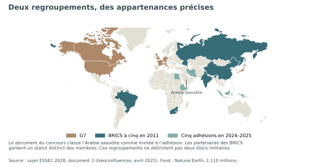

# BCE ECG — HGGMC (ESSEC) 2026 · Corrigé guidé

*Corrigé rédigé par IA, non officiel. Signalez toute erreur.*

**Rédaction** · Claude Opus 5.5 · effort non renseigné · vitesse non renseignée

**Révision (tour 1)** · modèle non renseigné · effort non renseigné · vitesse non renseignée

**Révision (tour 2)** · GPT-6.2 Astra Ultra · vitesse non renseignée

## Présentation du sujet

**Cadre.** Épreuve d'histoire, géographie et géopolitique du monde contemporain (HGGMC), conception ESSEC BS, voie générale, jeudi 23 avril 2026, de 8 h à 12 h, sans calculatrice. Sujet : « Vers une désoccidentalisation du monde ? ». Six documents l'accompagnent, « destinés à aider à la réflexion » et qui « n'ont pas à faire l'objet d'un commentaire spécifique » :

| Document | Contenu | Usage possible |
|---|---|---|
| 1 | Carte des puissances militaires (dépenses 2021, indice de puissance, capacité nucléaire) | persistance de la supériorité militaire américaine (III) |
| 2 | Trajectoires du PIB par habitant relativement à la moyenne mondiale, 2003-2023 (Bouron et Mathian, *Géoconfluences*, 2025) | rattrapage chinois et creusement de l’écart absolu pour l’Inde, l’Indonésie et de nombreux pays africains (I, III) |
| 3 | BRICS avant et après élargissement (Loïzzo, *Géoconfluences*, 2023 et 2025) | institutions alternatives et hétérogénéité du groupe (I, III) |
| 4 | Recomposition des alliances (Schmitt, *La Vie des idées*, 2022) | stabilité des alliances nées après 1945, lien alliances-multilatéralisme (III) |
| 5 | Contributions aux opérations de maintien de la paix de l'ONU en 2018 | six principaux financeurs, treize principaux fournisseurs de troupes ; la Chine dans les deux colonnes (II) |
| 6 | Le Sud global, un anti-Occident ? (Capdepuy, *Géoconfluences*, 2023), avec un discours de Wang Yi de décembre 2022 | contestation normative, non-alignement réinterprété (I, II) |

**Place dans le programme.** Le sujet traverse les deux années : géopolitique de la guerre froide et de la décolonisation (I.1.3), monde depuis les années 1990, émergences et rééquilibrages (I.2.2), gouvernance mondiale (I.2.3), modèles de croissance et décollage des émergents (I.3.3), acteurs de la mondialisation (II.1.2), Union européenne dans le monde (III.1.3), géopolitique de l'Afrique et du Moyen-Orient (III.2.3), États-Unis (IV.1.2), Asie multipolaire, Chine et Inde (IV.2).

**Difficulté.** Le sujet paraît familier, et c'est son piège : il invite à une chronique de l'actualité ou à un face-à-face sino-américain. Le rapport 2026 donne 3 452 copies, une moyenne de 10,63 sur 20, un écart type de 3,8, et 15,8 % de notes égales ou supérieures à 15.

**Ce que propose ce corrigé.** Un plan analytique possible en trois parties (manifestations, ressorts, limites), que le rapport juge en général plus efficace que le plan dialectique le plus fréquent (le monde reste occidental, mais l'Occident est concurrencé, et pourtant il reste puissant). La problématique énonce une thèse, comme le rapport le demande.

**Gestion du temps.** 1 h de brouillon (définitions, lecture des documents, problématique, plan détaillé avec exemples localisés et datés), 2 h 30 de rédaction, 30 min pour l'introduction et la conclusion au propre et la relecture. Un croquis n'est utile que s'il spatialise un argument (par exemple les recompositions d'alliances en Afrique ou dans l'Indo-Pacifique).

## Analyse du sujet

> [!INDICATION]
> Avant de parler de désoccidentalisation, définissez ce qui recule : l'Occident est-il un espace, un bloc, un modèle, une prétention ? Où commencent et où finissent ses frontières ?

> [!INDICATION]
> Interrogez chaque mot de l'intitulé, y compris la préposition et le point d'interrogation. Que dit « vers » de l'état d'avancement du processus ?

#### Solution

- **L'Occident.** Pas une simple catégorie géographique : une construction historique, politique et culturelle, née en Europe occidentale et prolongée en Amérique du Nord, qui associe des institutions (démocratie représentative, État de droit, économie de marché), des valeurs revendiquées comme universelles depuis les Lumières (droits de l'individu, libertés publiques) et, depuis 1945, une communauté de puissance structurée par les États-Unis. Frontières variables : le Japon, la Corée du Sud, Taïwan, l'Australie, la Nouvelle-Zélande ou Israël y appartiennent selon les critères (alliances, institutions) plus que par l'histoire. Ne pas confondre Occident, OTAN, Nord développé et démocraties libérales ; distinguer l'existence d'un ensemble occidental de son unité politique.
- **Désoccidentalisation.** Recul de la centralité occidentale, dans plusieurs dimensions : économique (déplacement de la production vers l'Asie), géopolitique (nouveaux pôles), institutionnelle (contestation ou contournement des institutions de 1945), militaire, culturelle, normative (contestation de l'universalité des valeurs), idéologique (modèles autoritaires ou illibéraux). Ce n'est ni l'antioccidentalisme ni le remplacement des États-Unis par la Chine.
- **Vers.** Une direction, pas un état : processus en cours, ni linéaire, ni achevé, ni irréversible. Le point d'interrogation invite à en mesurer l'avancement et les limites.
- **Le monde.** Toutes les échelles (système international, États, sociétés, individus) et toutes les régions (Chine, Inde, Russie, Golfe, Afrique, Amérique latine, Asie du Sud-Est, et les sociétés occidentales elles-mêmes) ; des acteurs non étatiques (organisations internationales, firmes, mouvements religieux, sociétés civiles).
- **Bornes temporelles.** Le cœur est contemporain (depuis les années 1990, et surtout 2000-2026), mais la profondeur historique est indispensable : domination impériale et coloniale, traités inégaux, Bandung, non-alignement.
- **Hors sujet.** Une histoire de l'occidentalisation du monde ; un tableau des relations sino-américaines ; une dissertation générale sur l'émergence du Sud global.

> [!JURY]
> Rapport 2026 : le sujet « ne portait ni sur les relations sino-américaines ni sur l’émergence du Sud global ». Sur la préposition, le rapport précise que « vers » « ne renvoie ni à un processus nécessairement linéaire, ni à une évolution achevée ». Il invite enfin à distinguer l'Occident comme construction historique et civilisationnelle de l'espace nord-atlantique ou des seuls États-Unis.

## Problématique

> [!INDICATION]
> Les contestataires de l'Occident rompent-ils vraiment avec lui ? Regardez leurs moyens.

> [!INDICATION]
> Une problématique forte énonce une thèse : quelle est la vôtre sur l'état d'avancement et la nature du processus ?

#### Solution

**Problématique retenue (sous forme de thèse).** Le monde se désoccidentalise moins par un rejet de l'Occident que par l'appropriation de ses instruments ; cette émancipation, réelle mais inachevée, différenciée et réversible, met fin au monopole occidental sur la puissance et sur l'universel sans faire sortir le monde du cadre qu'il a construit.

Elle met le sujet en tension parce qu'elle refuse deux réponses simples : le déclin inéluctable de l'Occident et la permanence de sa domination. Elle répond au paradoxe du sujet (comment parler de désoccidentalisation quand l'Occident conserve une puissance considérable ?) par la distinction entre perte de monopole et sortie du cadre.

**Variantes acceptables** (citées par le rapport) : se demander si l'affaiblissement relatif de l'Occident suffit à parler de désoccidentalisation ; si la remise en cause de l'ordre libéral entraîne une véritable désoccidentalisation ; ou quel rapport existe entre le rattrapage des pays non occidentaux et une désoccidentalisation réelle ou supposée.

> [!JURY]
> Le rapport 2026 rappelle qu'« une bonne problématique énonce la thèse que le candidat défend et va s’efforcer de démontrer dans le développement » ; les questions construites sur une alternative ne sont donc pas les plus pertinentes, et les formulations vagues en « dans quelle mesure » ont été nombreuses.

## Plan détaillé

Plan analytique : les manifestations (I), les ressorts (II), les limites (III). Il évite de consacrer une partie entière à l'occidentalisation du monde : l'histoire intervient en II, comme explication des revendications actuelles. Un plan qui ferait de la réappropriation du cadre occidental puis des fractures internes de l'Occident les moteurs de la désoccidentalisation, cité par le rapport, serait tout aussi valable ; ces deux idées sont ici intégrées en II.

### Partie I — Une désoccidentalisation engagée dans tous les domaines de la puissance

> [!INDICATION]
> Passez en revue les dimensions de la puissance (économique, géopolitique et institutionnelle, normative) et cherchez pour chacune un fait daté et localisé. Lisez le document 2 avec soin : que mesure-t-il exactement ?

> [!INDICATION]
> Pour la diplomatie, quelle notion décrit le refus de choisir un camp depuis 2022, et en quoi diffère-t-elle du non-alignement de la guerre froide ?

#### Solution

- **I.1 — Le déplacement du centre de gravité économique.** Pomeranz (*The Great Divergence*, 2000) : l'avance européenne ne date que de la fin du XVIIIe siècle. Baldwin (*The Great Convergence*, 2016) : fragmentation des chaînes de valeur et transfert industriel vers quelques pays d'Asie. Chine à l'OMC (2001), premier pays industriel, PIB en parité de pouvoir d'achat supérieur à celui des États-Unis depuis le milieu des années 2010. Document 2 : seuls la Chine, le Brésil et quelques pays comme le Kazakhstan ou la Turquie réduisent leur écart de PIB par habitant à la moyenne mondiale ; l'Inde, l'Asie du Sud-Est et l'Afrique le voient se creuser en dollars, les pays riches s'éloignent vers le haut (sauf le Japon). Un déplacement des masses productives, pas un rattrapage des niveaux de vie.
- **I.2 — De nouveaux cadres et le multi-alignement.** BRICS (document 3) et Nouvelle banque de développement (2014) ; nouvelles routes de la soie (2013), Banque asiatique d'investissement dans les infrastructures (2015, avec le Royaume-Uni contre l'avis de Washington) ; Organisation de coopération de Shanghai (2001, Inde et Pakistan en 2017, Iran en 2023). Réformer ou contourner les institutions de 1945 : quotes-parts du FMI révisées en 2010, en vigueur seulement en 2016 ; élargissement du Conseil de sécurité bloqué. Vote du 2 mars 2022 : 141 voix, 35 abstentions (Chine, Inde, Afrique du Sud, nombreux États africains), sanctions non appliquées par la plupart des pays du Sud. Multi-alignement : Inde (pétrole russe et Quad), Arabie saoudite (OPEP+ et protection américaine) ; Jaishankar. Sahel : départ des forces françaises du Mali, du Burkina Faso et du Niger (2022-2023), rapprochement avec la Russie.
- **I.3 — La contestation de l'universel.** Document 6 : Wang Yi récuse le « faux débat » démocratie contre autoritarisme et présente la multipolarité comme une démocratisation des relations internationales. « Occident collectif » dans le discours russe ; droit au développement et non-ingérence contre droits de l'homme. Doubles standards : Irak 2003. Fin de l'horizon commun de Fukuyama (1989, livre en 1992).

Un écart en dollars et un taux de croissance peuvent évoluer en sens différents. Dans un exemple fictif, le PIB par habitant d’un pays passe de 2 000 à 2 600 dollars constants pendant que la moyenne mondiale passe de 10 000 à 11 000. Le pays croît de 30 % contre 10 % dans le monde, mais son écart à la moyenne passe de 8 000 à 8 400 dollars. Le document 2 compare de tels écarts absolus ; la place d’un pays dans la production mondiale, sa croissance en pourcentage et son niveau de vie répondent à trois questions différentes.

Lire le millésime avant de citer les BRICS. Le document 3 code dix membres, neuf partenaires et un pays invité à adhérer. Une demande d’adhésion constitue encore un quatrième statut. Ces appartenances ne valent pas obligation de défense mutuelle.
- *Transition* : ces manifestations ont des racines anciennes et empruntent les armes de l'Occident.

> [!PIEGE]
> Lire le document 2 comme une carte du rattrapage des Suds. Il mesure des écarts en dollars constants à la moyenne mondiale : en ce sens, l'Inde et presque toute l'Afrique s'éloignent de la moyenne entre 2003 et 2023, même avec une croissance rapide. Il sert autant la partie III que la partie I.

> [!JURY]
> Le rapport 2026 juge que la gouvernance mondiale « a été étonnamment peu présente dans les copies » : il fallait se demander si les puissances émergentes transforment les institutions existantes, les contournent ou en construisent d'autres. Il recommande aussi la notion de multi-alignement plutôt que celle de non-alignement.

### Partie II — Une émancipation ancienne, qui emprunte les armes de l'Occident

> [!INDICATION]
> Quels épisodes de la domination occidentale nourrissent aujourd'hui les récits nationaux et les revendications ? Remontez au XIXe siècle et à la guerre froide.

> [!INDICATION]
> Comment des pays non occidentaux ont-ils acquis leurs moyens de puissance ? Pensez au Japon de Meiji, à la Chine des réformes, et aux principes juridiques qu'ils invoquent.

> [!INDICATION]
> L'Occident est-il uni ? Cherchez des fractures internes qui accélèrent le processus.

#### Solution

- **II.1 — La mémoire de la domination.** Guerres de l'opium (1839-1842, 1856-1860), traité de Nankin (1842), « siècle d'humiliation » ; Hong Kong (1997), Taïwan. Bandung (avril 1955, vingt-neuf États d'Asie et d'Afrique), mouvement des non-alignés (Belgrade, 1961), nouvel ordre économique international (Assemblée générale de l'ONU, 1974). Document 6 : Chine observatrice des non-alignés depuis 1992, Russie depuis 2021, qui en réinvestissent le langage.
- **II.2 — L'appropriation des instruments occidentaux.** Japon de Meiji (1868) ; Chine des réformes (1978), zones économiques spéciales, OMC ; dissociation du capitalisme et de la démocratie libérale. Souveraineté et non-ingérence, principes westphaliens inscrits dans la Charte des Nations unies, invoqués contre l'Occident. Document 5 : en 2018, six États (dont les États-Unis, 28,4 %) financent les deux tiers du budget du maintien de la paix, treize États d'Asie et d'Afrique fournissent les deux tiers des troupes ; la Chine, deuxième financeur, est le seul membre permanent parmi ces grands fournisseurs de troupes. Un syncrétisme plutôt qu'une rupture.
- **II.3 — Les fractures de l'Occident.** Désaccord sur l'Irak (2003) ; crise de 2008 et élargissement du G20 aux émergents ; États-Unis contre l'ordre qu'ils ont bâti (accord de Paris, organe d'appel de l'OMC paralysé, droits de douane d'avril 2025). Krastev et Holmes (*The Light That Failed*, 2019 ; *Le Moment illibéral*) : la contestation libérale traverse aussi l'Occident.
- *Transition* : un mouvement profond, mais incomplet, et porté par des acteurs trop divers pour former un ordre alternatif.

> [!METHODE]
> L'histoire sert d'explication, pas de récit : chaque rappel (traités inégaux, Bandung) doit éclairer une revendication contemporaine précise (Taïwan, multi-alignement, critique des institutions de 1945).

> [!JURY]
> Rapport 2026 : « Près d’un tiers des copies ont consacré une première partie entière à l’occidentalisation du monde. Cette démarche était intellectuellement maladroite ». Le jury attendait pourtant une profondeur historique : les guerres de l'opium, les traités inégaux, Bandung et le mouvement des non-alignés ont été valorisés lorsqu'ils servaient le raisonnement.

### Partie III — Une désoccidentalisation inachevée, plurielle et réversible

> [!INDICATION]
> Distinguez deux formes de puissance : obtenir d'un autre ce qu'on veut, et fixer les règles du jeu. Laquelle l'Occident a-t-il le plus perdue ?

> [!INDICATION]
> Le « reste du monde » forme-t-il un bloc ? Et une hégémonie chinoise serait-elle une désoccidentalisation ou un changement de centre ?

#### Solution

- **III.1 — La puissance structurelle demeure.** Strange (*States and Markets*, 1988) : puissance relationnelle et puissance structurelle. Dollar (un peu moins de 60 % des réserves de change), exclusion de banques russes de SWIFT (2022) ; document 1 : plus de 750 milliards de dollars de dépenses militaires américaines en 2021 ; document 4 : stabilité des alliances nées après 1945 ; OTAN élargie à la Finlande (2023) et à la Suède (2024) ; universités, numérique, semi-conducteurs avec Taïwan, le Japon et la Corée du Sud. Document 2 : écarts de niveau de vie qui se creusent avec la plupart des Suds.
- **III.2 — Un monde non occidental divisé, des sociétés attirées.** Rivalité sino-indienne (Galwan, juin 2020), Golfe qui ménage Washington, Brésil qui refuse de choisir ; document 6 : « the West and the Rest », mais un « reste » sans projet commun. Attraction de l'Occident : migrations, diplômes, mobilisations de Hong Kong (2019) et printemps arabes (2011). L’action internationale des gouvernements et les aspirations des habitants se mesurent par des indices différents.

Une norme internationale peut aussi se construire par des initiatives venues de plusieurs régions. Lors de la rédaction de la Déclaration universelle de 1948, la déléguée indienne Hansa Mehta a contribué à faire retenir à l’article premier la formule « tous les êtres humains ». Cette intervention change le sens d’une règle commune en y incluant explicitement les femmes. Elle invite à distinguer le lieu historique de certaines formulations, les coalitions qui les ont rédigées et les usages qu’en font aujourd’hui des citoyens. Les mobilisations locales en faveur des libertés disent quelque chose de leurs revendications ; elles ne constituent pas un vote d’adhésion géopolitique à l’Occident.
- **III.3 — Un changement de centre ?** Afrique : nouveaux partenaires (Chine, Russie, Turquie, Golfe), défaut zambien de 2020 ; persistance de la francophonie malgré le recul français. Une hégémonie chinoise remplacerait un centre par un autre ; trajectoire réversible (ralentissement et déclin démographique chinois). Un monde post-occidental plutôt que non occidental.

> [!PIEGE]
> La lecture décliniste : annoncer la chute inéluctable d'un Occident vieillissant face à un Sud global conquérant. Il faut distinguer déclin relatif et déclin absolu.

> [!JURY]
> Le rapport 2026 relève que la puissance structurelle, la capacité à fixer les règles, les normes et les institutions, a été bien moins analysée que la puissance relationnelle ; cette distinction permettait de comprendre le paradoxe central du sujet. Il note aussi que « La dimension normative a été l’un des grands angles morts des copies. »

## Références et exemples

| Référence ou exemple | Ce qu'elle apporte | Où |
|---|---|---|
| Sommet des BRICS de Johannesburg (août 2023) ; Wang Yi (décembre 2022, document 6) | accroche : élargissement et discours multipolaire | intro, I.3 |
| Pomeranz, *The Great Divergence* (2000) ; Baldwin, *The Great Convergence* (2016) | divergence puis convergence | I.1 |
| Document 2 (Bouron et Mathian, 2025) | rattrapage chinois, écarts creusés ailleurs | I.1, III.1 |
| BRICS (document 3), NBD (2014), AIIB (2015), OCS (2001) | institutions alternatives | I.2 |
| Vote du 2 mars 2022 ; multi-alignement indien et saoudien ; Sahel 2022-2023 | refus d'aligner, recomposition | I.2 |
| Fukuyama (1989, 1992) ; Irak 2003 | horizon libéral, doubles standards | I.3 |
| Guerres de l'opium, traité de Nankin (1842) ; Bandung (1955) ; Belgrade (1961) ; NOEI (1974) | profondeur historique des revendications | II.1 |
| Meiji (1868) ; réformes chinoises (1978) ; principes westphaliens ; document 5 | appropriation du cadre occidental | II.2 |
| Crise de 2008, G20 ; politique américaine (2017-2025) ; Krastev et Holmes (2019) | fractures internes de l'Occident | II.3 |
| Strange, *States and Markets* (1988) ; dollar, SWIFT ; documents 1 et 4 ; OTAN 2023-2024 | puissance structurelle et militaire | III.1 |
| Galwan (2020) ; Hong Kong (2019) ; printemps arabes (2011) | hétérogénéité du Sud, attraction de l'Occident | III.2 |
| Zambie (2020) ; francophonie | changement de dépendance, influence durable | III.3 |

Autres références que le rapport 2026 juge pertinentes, à n'utiliser que si on en maîtrise la thèse : Huntington (*The Clash of Civilizations and the Remaking of World Order*), Kindleberger et Gilpin (théories de l'hégémonie), Philippe Nemo (*Qu'est-ce que l'Occident ?*), Georges-Henri Soutou, Didier Billion et Christophe Ventura (*Désoccidentalisation. Repenser l'ordre du monde*, 2023), Sophie Bessis, Kishore Mahbubani, Michel Duclos, Richard Haass (Moyen-Orient « post-américain »), Pierre Grosser (multi-alignement).

## Introduction et conclusion rédigées

#### Solution

**Introduction.** En août 2023, au sommet de Johannesburg, les BRICS annoncent l'invitation de six pays, dont l'Arabie saoudite, l'Iran, l'Égypte et l'Éthiopie ; quatre rejoignent le groupe en 2024 et l'Indonésie en 2025, ce qui porte les BRICS+ à dix membres, et neuf autres États en deviennent partenaires en 2025. Huit mois plus tôt, Wang Yi se félicitait que la Chine et la Russie aient œuvré pour l'« avènement d'un monde multipolaire » et contre « l'hégémonie ». Ces deux faits semblent annoncer la fin d'un monde ordonné autour de l'Occident.

L'Occident n'est pas d'abord une réalité géographique, mais une construction historique et politique, née en Europe occidentale et prolongée en Amérique du Nord, qui associe des institutions, des valeurs présentées comme universelles et, depuis 1945, une communauté de puissance structurée par les États-Unis, aux frontières variables. La désoccidentalisation désigne le recul de sa centralité dans l'ordre mondial, dans toutes les dimensions de la puissance, y compris la définition des normes ; elle ne se confond ni avec l'antioccidentalisme ni avec le remplacement des États-Unis par la Chine. La préposition « vers » indique une direction, non un état acquis, et « le monde » impose de raisonner à toutes les échelles et dans toutes les régions.

L'Occident a dominé le monde à partir du XIXe siècle, puis construit après 1945 l'essentiel des institutions internationales. Le rattrapage de l'Asie, l'affirmation de puissances émergentes et la contestation de ses valeurs semblent remettre en cause cette centralité, mais ceux qui la contestent le font souvent avec les instruments que l'Occident a diffusés. La thèse soutenue ici est que le monde se désoccidentalise moins par un rejet de l'Occident que par l'appropriation de ses instruments, et que cette émancipation met fin au monopole occidental sans faire sortir le monde du cadre qu'il a construit.

On montrera d'abord que la désoccidentalisation est engagée dans tous les domaines de la puissance, puis qu'elle procède d'une émancipation ancienne, nourrie par les héritages de la domination, par l'appropriation des outils occidentaux et par les fractures de l'Occident lui-même ; on verra enfin qu'elle reste inachevée, plurielle et réversible.

**Conclusion.** Le monde va bien vers une désoccidentalisation, si l'on entend par là la fin du monopole occidental sur la richesse, la diplomatie et la définition de l'universel. Elle s'enracine dans les mémoires de la domination et dans l'appropriation des instruments occidentaux, et l'Occident l'alimente par ses propres fractures. Mais elle reste inachevée, parce que l'Occident conserve la puissance structurelle ; plurielle, parce que le monde non occidental n'a ni unité ni modèle commun ; réversible, parce qu'elle peut se réduire à un changement de centre. Le monde devient post-occidental plus qu'il ne devient non occidental. Son évolution dépendra de la capacité de l'Occident à rester fidèle aux normes qu'il a promues, et de celle des puissances qui le contestent à proposer autre chose qu'une hégémonie de remplacement.

## Pièges à éviter

> [!PIEGE]
> Consacrer la première partie à l'occidentalisation du monde (colonisation, guerre froide, mondialisation) : le sujet porte sur la désoccidentalisation, et l'histoire doit expliquer, non remplir.

> [!PIEGE]
> Réduire le sujet au triptyque Chine, Russie, États-Unis. L'Inde, le Golfe, la Turquie, l'Afrique, l'Amérique latine, l'Asie du Sud-Est, les organisations internationales, les firmes et les sociétés font partie du sujet.

> [!PIEGE]
> Paraphraser les documents ou en faire le plan du devoir. Ils confortent une idée, précisent une situation, fournissent un exemple ; ils ne remplacent pas les connaissances personnelles.

> [!JURY]
> Rapport 2026 : les documents devaient être considérés « comme des supports de réflexion et d’argumentation, et non comme le contenu même du devoir ». Sur les références : « Le name dropping demeure contre-productif », et « Une copie citant cinq ou six auteurs réellement maîtrisés sera toujours préférable à une copie accumulant une vingtaine de noms sans analyse. »

> [!JURY]
> Sur la longueur, le rapport 2026 juge qu'« Une copie d’environ huit pages constitue un ordre de grandeur minimal raisonnable » ; les meilleures copies atteignaient dix à douze pages.

## Bilan

- **Méthode.** Définir l'objet qui recule (l'Occident) avant le processus (la désoccidentalisation) ; analyser toutes les composantes de l'intitulé, préposition comprise ; formuler la problématique comme une thèse ; préférer un plan analytique au plan dialectique « oui, non, oui ».
- **Notions à revoir.** Occident et ses frontières ; multipolarité, multi-alignement, non-alignement ; puissance relationnelle et structurelle ; gouvernance mondiale et institutions alternatives ; universalisme et relativisme des valeurs ; néocolonialismes.
- **Références à maîtriser.** Pomeranz (2000), Fukuyama (1992), Huntington, Strange (1988), Krastev et Holmes (2019) ; repères : 1842, 1955, 1961, 1974, 2001, 2008, 2014, 2022, 2023.
- **Sujets voisins.** « Le Sud global existe-t-il ? » ; « Vers un monde multipolaire ? » ; « Les BRICS, une alternative à l'ordre occidental ? » ; « L'Occident est-il en déclin ? » ; « La gouvernance mondiale est-elle encore occidentale ? ».

[Sujet officiel](https://www.concours-bce.com/sites/default/files/2026-04/265%20-%20HGG_ESSEC_BS.pdf) · [Rapport du jury](https://www.concours-bce.com/sites/default/files/2026-10/265%20-%20His%20g%C3%A9o%20ESSEC%202026.pdf) · [Rôle des femmes dans la rédaction de la Déclaration universelle](https://www.un.org/en/observances/human-rights-day/women-who-shaped-the-universal-declaration) · [Fond cartographique Natural Earth](https://www.naturalearthdata.com/downloads/110m-cultural-vectors/110m-admin-0-countries/)
