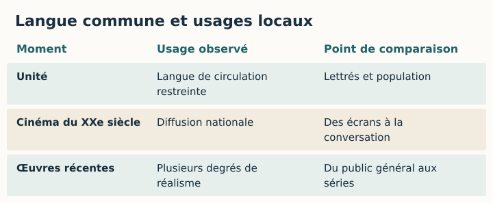

# BCE ECG — Italien LVA (ELVi) 2026 · Corrigé guidé

*Corrigé rédigé par IA, non officiel. Signalez toute erreur.*

**Rédaction** · GPT-6.2 Astra Ultra · vitesse non renseignée

**Lecture du rapport du jury** · GPT-6.2 Astra Ultra · vitesse non renseignée · 26 novembre 2026

**Révision** · GPT-6.2 Astra Ultra · vitesse non renseignée · 26 novembre 2026

[Sujet officiel, option Italien LVA (ELVi)](https://www.concours-bce.com/sites/default/files/2026-04/75%20AR%20-%20LANGUE_VIVANTE_A_ELVI_ARABE_ITALIEN_PORTUGAIS_RUSSE.pdf#page=8) · [Rapport du jury 2026](https://www.concours-bce.com/sites/default/files/2026-11/75%20-%20Italien%20LVA%20ELVi%202026.pdf)

Le dossier va de l’unification aux pratiques du cinéma et des séries. Le résumé compare l’entretien de Paolo Balboni et l’article du Post. L’essai peut aussi utiliser l’histoire linguistique de Christian Bec et la carte des variétés parlées en Italie. Le thème s’arrête au début du XXe siècle.

## Préparer les trois exercices

Pour construire le résumé, repérer deux publics dans la réponse de Balboni. L’italien qui unit les lettrés au Trecento ne décrit pas encore l’usage de toute la population. Le chiffre de 2,5 % a une limite géographique expresse. Puis inverser la flèche entre écran et société : le cinéma diffuse une langue commune qui marque la conversation, tandis que le jeu contemporain cherche à restituer des différences déjà perceptibles dans les conversations. *Gomorra* et l’exemple de la Rai empêchent de parler d’une évolution uniforme.

Pour l’essai, passer de la question « combien de langues ? » aux situations où un même locuteur change de registre. Sur la carte, le frioulan comme le sarde ont une couleur propre, et des îlots dans le Midi signalent la présence d’autres langues. Ces couleurs ne disent pas quelle proportion d’habitants parle chaque variété. En tirer une proposition précise pour un scénario pédagogique, culturel ou institutionnel, puis lui opposer le cas d’un nouvel arrivant.

Dans le thème, « depuis le Moyen Âge » appelle *dal Medioevo*, la veille historique *alla vigilia*, « désormais uniques » la mise en commun nationale de trois institutions. Conserver le temps du récit et la différence finale entre savoir écrire à dix ans et parler habituellement la langue.

Le rapport parle de cinq documents. La liste imprimée p. 8 et les numéros des pages suivantes en donnent quatre. On dispose de l’entretien de Balboni p. 9, de l’article du *Post* p. 10, de l’extrait de Christian Bec p. 11 et de la carte p. 12. Pour rapprocher les deux articles, comparer les choix de langue de Montalbano chez Camilleri et les choix de diction d’un acteur à l’écran. Les deux composent une voix pour un public, même si le personnage donne l’impression de parler spontanément. Dans le thème, *si è affermato un potere centralizzato* permet d’exprimer l’absence d’un pouvoir central sans calquer « connaître une centralisation ».

## Résumé analytique comparatif · 344 mots

Per Paolo Balboni la storia dell’italiano comune ha due calendari. Già nel Trecento gli intellettuali disponevano di una lingua condivisa, mentre per gran parte della popolazione la svolta sarebbe arrivata soltanto dopo la metà del Novecento. Al momento dell’unificazione, fuori dalla Toscana e dal Lazio, secondo lo studioso appena il due e mezzo per cento degli abitanti conosceva l’italiano. Balboni invita quindi a chiedersi chi abbia avuto la forza politica di imporre il proprio idioma. A un veneziano o a un napoletano la sola conoscenza dello standard può tuttora risultare insufficiente in alcune situazioni.

Il cinema, al centro dell’articolo del Post, permette di osservare come quella gerarchia abbia inciso sull’uso. Sotto il fascismo lo schermo contribuì intenzionalmente a diffondere un modello nazionale. Anche in seguito un personaggio poteva avere un lieve accento riconoscibile senza che la sua parlata riproducesse fedelmente quella locale. Il rapporto tra finzione e vita quotidiana funzionava anche in direzione inversa. Dalla lingua dei film passarono nel vocabolario comune parole come «paparazzo». Balboni, dal canto suo, attribuisce al romanesco e al napoletano del neorealismo un ruolo nell’arricchimento dell’italiano.

L’affermazione dell’idioma nazionale non ha dunque cancellato la capacità di alternare registri. Balboni distingue la lingua che serve ad agire da quella in cui si pensa o si esprimono gli affetti. Per alcuni l’italiano assolve entrambe le funzioni, per altri la seconda spetta al dialetto. La varietà siciliana costruita da Camilleri rende accessibili i pensieri di Montalbano anche quando il commissario si rivolge al questore in italiano corrente.

Nelle produzioni audiovisive più recenti il Post rileva una nuova attenzione proprio alle differenze tra voci, legate anche all’ambiente sociale e all’epoca. Dagli anni Duemila la ricerca del parlato locale si è accentuata soprattutto dove gli autori godono di maggiore autonomia. In *Gomorra* può prevalere la fedeltà alla cadenza effettiva anche a costo di una comprensione meno immediata. La televisione generalista continua invece a privilegiare la comprensibilità per tutti, mentre un film come *C’è ancora domani* adotta una soluzione intermedia. La pluralità sopravvive così anche nelle forme in cui viene rappresentata a un pubblico nazionale.

## Essai argumenté · 501 mots

Qualche anno fa un insegnante avrebbe potuto sentire una parola dialettale durante un’interrogazione e segnarla senz’altro come errore. Oggi mi sembrerebbe più istruttivo chiedere all’alunno di ripetere il concetto in italiano e di spiegare che cosa cambia nella seconda versione. È precisamente questa facoltà di passare da un interlocutore all’altro, senza perdere l’esperienza che ciascuna lingua racchiude, che l’Italia dovrebbe trasmettere a chi cresce nel suo territorio.

La conquista di un italiano comune ha avuto un valore sociale enorme. Una paziente calabrese che consulta un medico a Torino ha diritto a capire la diagnosi, quale che sia la lingua parlata a casa da entrambi. Saper presentare una domanda, leggere un contratto o intervenire in un’assemblea permette di partecipare a istituzioni che operano su scala nazionale. Anche per questo sarebbe ingiusto riservare una scuola ricca di registri ai figli di laureati e dire agli altri che basta custodire le radici. L’accesso all’italiano scritto e argomentativo deve essere garantito a tutti. Il testo di Bec ricorda quanto fosse lungo il tragitto tra poter frequentare gratuitamente la scuola elementare e usare ogni giorno la lingua studiata. Anche un insegnante di oggi deve chiedersi con chi un allievo abbia occasione di usare l’italiano fuori dall’aula.

Ma chi parla bene la lingua comune può avere ottime ragioni per sceglierne un’altra. Nelle *Poesie a Casarsa* il giovane Pasolini fa del friulano una lingua di poesia, capace di affidare alla pagina un mondo solitamente ascoltato dalla viva voce. Per leggerlo oggi un adolescente di Palermo avrà magari bisogno di una traduzione. Il tempo impiegato a confrontare due versi gli farà scoprire che una tradizione locale può interessargli anche quando non gli appartiene per nascita. Lo stesso vale per chi incontra sottotitolati i dialoghi di una serie ambientata a Napoli. La traduzione allarga la comunità di chi ascolta.

Occorre però chiedersi chi abbia il potere di riconoscere una voce come autentica. Una ragazza cresciuta a Venezia da genitori albanesi può conoscere il veneziano meglio di un turista italiano e sentirsi ugualmente chiedere da dove venga «davvero». Se il dialetto diventa una prova di discendenza, chi vorrebbe impararlo si ritrova escluso. La carta del dossier, che disegna anche piccole aree di lingua albanese nel Mezzogiorno, ricorda del resto quanto sia antica la presenza di più tradizioni sullo stesso territorio. I colori di una carta non possono decidere quale debba essere l’identità di una persona.

Immagino quindi una scuola in cui gli alunni raccolgano, con il consenso degli interessati, racconti di famiglia, li trascrivano e ne preparino insieme una versione italiana annotata. Chi ha un nonno sardo e chi ha una zia arrivata da poco avrebbero un compito ugualmente impegnativo. Una biblioteca comunale potrebbe conservare le registrazioni accanto alle trascrizioni, lasciando che le generazioni successive le ascoltino e le discutano. Così si insegnerebbe insieme l’esattezza dell’italiano e il rispetto di differenze che non si lasciano sempre tradurre parola per parola. Il futuro dei dialetti dipenderà anche dal numero di occasioni in cui un giovane potrà usarli per dire qualcosa di nuovo.

## Thème

Nella penisola non si è mai affermato un potere centralizzato. I numerosi dialetti sono parlati da tutte le classi sociali e in ogni occasione. Nella prima metà dell’Ottocento, a servirsi dell’italiano nella penisola sono gli scrittori di mestiere e gli uomini d’affari. La loro prosa è astratta, rigida, rimasta pressoché immutata dal Medioevo. Alla vigilia dell’Unità gli italiani che parlano italiano sono circa seicentomila, ma va sottolineato che il numero di coloro che sanno non solo parlare, ma anche leggere e scrivere correntemente e correttamente la lingua «nazionale» è estremamente esiguo. Eppure l’unificazione resta, sul piano linguistico come su molti altri, l’avvenimento più importante della storia dell’Italia moderna, perché comporta la creazione di un nuovo apparato statale, con un unico potere centrale, un unico esercito e un’unica scuola. I primi provvedimenti a favore dell’italianizzazione risalgono al 1859, quando la scuola elementare diventa gratuita. Ma poiché la scolarizzazione e la capacità di leggere e scrivere in italiano all’età di dieci anni non comportano automaticamente l’uso quotidiano della lingua nazionale, all’inizio del Novecento questa rimane una lingua imposta alla maggioranza degli italiani.
