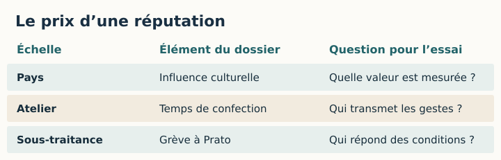

# BCE ECG — Italien LVB (ELVi) 2026 · Corrigé guidé

*Corrigé rédigé par IA, non officiel. Signalez toute erreur.*

**Rédaction** · GPT-6.2 Astra Ultra · vitesse non renseignée

**Lecture du rapport du jury** · GPT-6.2 Astra Ultra · vitesse non renseignée · 26 novembre 2026

**Révision** · GPT-6.2 Astra Ultra · vitesse non renseignée · 26 novembre 2026

[Sujet officiel, option Italien LVB (ELVi)](https://www.concours-bce.com/sites/default/files/2026-04/76%20AR%20-%20LANGUE_VIVANTE_B_ELVI_ARABE_ITALIEN_PORTUGAIS_RUSSE.pdf#page=8) · [Rapport du jury 2026](https://www.concours-bce.com/sites/default/files/2026-11/76%20-%20Italien%20LVB%20Elvi%202026.pdf)

Les deux articles italiens alimentent le résumé. L’essai peut confronter leurs arguments au reportage sur la sous-traitance, au classement de l’influence culturelle et à la photographie de la grève de Prato. Le thème s’arrête à l’identification du représentant de la CGIL.

## Préparer les trois exercices

Relier deux échelles dans le résumé. Dell’Olio estime la richesse produite par la filière culturelle et créative. Les 303 milliards incluent les effets indirects, les 623 milliards concernent l’ensemble des marchandises exportées. Attolini fournit une autre unité de preuve, les heures pour confectionner une veste à la main. Réserver la grève et l’enquête judiciaire à l’essai, qui autorise la mobilisation du reste du dossier.

Pour l’essai, mettre le classement et la photo en regard. Le graphique place l’Italie en tête pour l’influence culturelle, mais la légende de la photo indique une revendication chiffrée sur le temps de travail. Examiner une décision concrète du donneur d’ordre, par exemple le délai entre commande et livraison, puis expliquer ce qu’un atelier doit faire pour la tenir. Comparer avec les moyens nécessaires à une formation rémunérée.

Dans le thème, *essere nel mirino della magistratura* conserve la métaphore du texte source. Rendre « sous-traitants » par *subappaltatori* ou *imprese terziste*, et « parquet » par *procura*. Garder l’attribution de la dernière phrase au syndicaliste et sa modalité. L’ouverture ou l’extension d’une enquête est un fait de procédure.

Devant le document 4, demander quel nombre permettrait de vérifier chacune des deux affirmations. Le classement donne l’ordre des pays selon leur influence culturelle, sans distances mesurables entre les rangs. La légende de la photographie de Prato permet une opération différente. Douze heures pendant sept jours représentent 84 heures hebdomadaires, huit heures pendant cinq jours en représentent 40. Cet écart de 44 heures décrit le cas dénoncé par les grévistes. Il ne mesure pas la durée moyenne de travail dans toutes les entreprises de mode italiennes. Dans le thème, *la procura ha esteso un’inchiesta* conserve le stade de la procédure.

## Résumé analytique comparatif · 249 mots

L’influenza culturale dell’Italia incide sul valore dei suoi prodotti. Secondo Luigi Dell’Olio, arte e bellezza orientano le preferenze dei consumatori stranieri anche quando questi acquistano beni industriali. Nel quadro nazionale, la moda, il design e l’alimentazione beneficiano di un patrimonio che attrae visitatori e alimenta la creatività dei distretti produttivi. La misura economica più diretta viene dalla filiera culturale e creativa, che nel 2024 ha generato oltre 112 miliardi di euro di valore aggiunto. Includendo le ricadute sulle altre attività si arriva a 303 miliardi. Il totale comprende quindi il valore diretto già ricordato.

Il caso campano descritto da Agro24 consente di osservare da vicino il lavoro che sostiene questa reputazione. Nella seconda regione italiana per produzione di moda operano più di ventisettemila imprese. A Casalnuovo gli abiti della famiglia Attolini hanno conquistato clienti internazionali e produzioni cinematografiche. L’azienda esporta nove decimi di quanto produce. Il prezzo di una simile specializzazione si misura anche in tempo e competenze, con venticinque ore di lavoro manuale per una sola giacca.

Dove il primo articolo vede nella cultura una risorsa per l’innovazione e la transizione ecologica, il secondo mette in luce una condizione della sua durata. La notorietà della sartoria non basta ad attirare apprendisti che vi intravedano una carriera. Gli Attolini stanno perciò creando una scuola interna e chiedono contratti legati alla formazione, incentivi alle assunzioni e credito più accessibile. Il prestigio riconosciuto all’estero produce dunque risultati concreti, ma la continuità di questi risultati dipende dalla possibilità di trasmettere il mestiere.

## Essai argumenté · 354 mots

Un abito italiano può fare il giro del mondo senza che chi lo indossa sappia chi ne ha cucito le maniche. A mio avviso il rilancio del made in Italy dovrebbe partire proprio da quella domanda. Se il nome del produttore vale tanto da giustificare un prezzo elevato, una parte di quel prezzo deve pagare il tempo e la competenza di chi lavora lungo tutta la filiera.

La prima sfida riguarda il ricambio generazionale. È difficile convincere un ventenne a imparare un mestiere lento se per mesi deve lavorare gratis o dipendere dai genitori. La scuola progettata dagli Attolini offre un punto di partenza. Un consorzio di sartorie potrebbe stipendiare maestri e apprendisti, concordare orari con gli istituti professionali e rilasciare una qualifica utilizzabile anche fuori dall’impresa che ha formato il giovane. Un piccolo laboratorio potrebbe così assumere qualcuno già capace di tagliare una stoffa pregiata senza sostenere da solo tutto il costo della formazione.

La seconda sfida riguarda chi già produce. Nella fotografia dello sciopero di Prato i lavoratori chiedono otto ore per cinque giorni alla settimana. La didascalia contrappone quelle quaranta ore settimanali alle ottantaquattro denunciate. Il primo posto per influenza culturale, nel grafico accanto, non registra neppure una di quelle ore. L’inchiesta milanese citata nel dossier solleva la questione delle responsabilità nella subfornitura. Un committente che chiede migliaia di pezzi in tempi brevissimi dovrebbe verificare se il prezzo pattuito consenta effettivamente di corrispondere salari regolari. Pubblicare i fornitori autorizzati e offrire ai dipendenti un canale per segnalare abusi sarebbe più convincente di una campagna pubblicitaria sulle tradizioni.

Esiste infine un’occasione ambientale. Nel distretto tessile di Prato la lavorazione di fibre recuperate fa parte della storia locale. Sostenere la selezione dei materiali e progettare capi riparabili permetterebbe di associare quella tradizione a risultati verificabili, come la durata di un cappotto o la quota di lana rigenerata. Occorrono informazioni leggibili anche per chi compra all’estero. Vorrei che il cliente potesse chiedere dove far riparare un capo, da quale laboratorio provenga e come vi si lavori, ricevendo tre risposte precise. Un modello produttivo diventa esportabile quando altri possono comprenderne e riprodurne le pratiche migliori.

## Thème

Per il governo, che ha fatto della difesa del «made in Italy» uno dei suoi cavalli di battaglia, la vicenda è a dir poco imbarazzante. I grandi marchi del lusso italiano, come Gucci, Versace, Dolce & Gabbana o ancora Ferragamo, sono nel mirino della magistratura perché si rivolgono a imprese terziste che non rispettano la dignità di alcuni dei loro dipendenti. Giovedì 4 dicembre la procura di Milano ha annunciato di aver esteso a tredici grandi nomi della moda un’inchiesta avviata nel 2024. Nella zona di Firenze, dove si trovano numerosi laboratori che producono per le grandi firme, operai cinesi, ma anche pakistani o senegalesi, lavorano a ritmi infernali per salari da fame. «Il caporalato non può diventare la regola nel settore della moda, dove i subappaltatori continuano a sfruttare la miseria umana», spiega Alessandro Picchioni, responsabile della federazione dei lavoratori tessili della CGIL.
