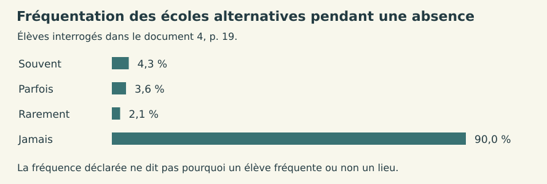

# BCE ECG · Japonais LVB (ELVi) 2026 · Corrigé guidé

*Corrigé rédigé par IA, non officiel. Signalez toute erreur.*

**Rédaction** · GPT-6.2 Astra Ultra · vitesse non renseignée

**Autocontrôle** · GPT-6.2 Astra Ultra · vitesse non renseignée

**Révision (tour 1)** · GPT-6.2 Astra Ultra · vitesse non renseignée

## 1. Résumé analytique comparatif

不登校の増加は、子供の意欲だけでは説明できない。読売新聞によれば、学校に行くことについて、社会の側の考え方も変化した。二〇一七年に教育機会確保法が施行され、教室の外にも学びの場があるという理解が広まった。また、コロナ禍の一斉休校は、登校が当然だという意識を変えるとともに、生活のリズムにも影響したという。記事は、支援を受けられず孤立する子供を案じる一方、校内の別室で学べる仕組みが、最近の増加幅を小さくした可能性を指摘する。

これに対し、堀江貴文は増加の経緯を統計で示すのではなく、一律の教育そのものに疑問を投げかける。スマートフォンで多くの知識を得られる時代に、すべての子供が同じ場所で同じ水準を目指す必要はないというのである。そこで、対面でこそできる体験を重視する新しい学校をつくり、従来の教室に合わなかった子供にも学ぶ喜びを開こうとしている。両者に共通するのは、登校しないことと学ばないことを区別する視点である。前者が学校とのつながりを保つ条件を問うのに対し、後者は通う先を選び直せることに積極的な意味を見いだしている。

## 2. Essai argumenté

学校で学ぶか、学校に通わずに学ぶか。私は、子供が選んだ学び方を後から変えられることが大切だと思う。同じ教室でも、友達から声をかけてもらえる日と、人目が気になって何も言えない日とでは、その意味は違う。

学校には、家庭だけでは出会いにくい人や考えに触れる機会がある。例えば、日本の小学校の給食では、子供が当番を分担する。相手の分も考えて準備し、一緒に後片付けをする経験は、動画を見ることだけでは得にくい。先生が毎日の小さな変化に気づき、困り事を聞けることも大きい。しかし、同じ班で過ごすことが苦痛になった子にとっては、その時間割が逃げ場を奪う。欠席を本人の努力不足と決めつければ、助けを求めることまで難しくなる。

一方、学校に通わずに学べば、得意な課題に時間をかけたり、体調に合わせて休んだりできる。日本のフリースクールでは、家庭の外に仲間を見つけることもできる。ただし、その選択肢は住所や家計に左右される。資料四では、調査に答えた不登校の子供の九割が、休んでいた間にフリースクールに行っていない。行かなかった理由までは、この数字から分からない。ネット教材を配るだけでも、質問できる相手や安心して過ごせる場所は生まれない。

だからこそ、校内の別室、地域の居場所、家庭での学習を行き来できる仕組みがほしい。週に一度だけ先生と話すことも、一つのつながり方である。復帰した人数だけで成果を測ると、別の場所で関心を取り戻した子供を見落とす。何を学べたか、誰に相談できるかを本人と確かめることを、私は学校の内外に共通する出発点にしたい。

## 3. Traduction du français en japonais

このような状況について、母親の三一・〇％が「とても心配している」、四五％が「どちらかといえば心配している」と答えた。つまり、学校に対するわが子の態度を心配している母親は四分の三を超える。子供が学校に行きたがらない理由として母親が最も多く挙げたのは「友達との関係」（三六・八％）で、次いで「学校の宿題」（三四・五％）、「心身の健康上の問題」（二八・三％）の順だった。

こうした場合の母親の対応として最も多かったのは、「できるだけ学校に行くよう子供を説得しようとする」（三五・三％）で、次に多かったのは「行くかどうかは子供に決めさせる」（二三・二％）だった。「学校に行くよう強く言う」と答えた母親は六・二％と、少数にとどまった。

## Lire les deux textes avant de prendre position

La question I en japonais invite à donner un avis sur les raisons de la hausse. La consigne française exige une comparaison sans commentaire personnel. Le rapport du jury précise qu’il fallait expliquer la hausse sur dix ans, accorder une place comparable aux documents 1 et 2 et distinguer résumé et prise de position. La réponse confronte donc les explications disponibles. Les causes avancées par le *Yomiuri* sont datées : reconnaissance de formes d’apprentissage extérieures après l’entrée en vigueur de la loi en 2017, puis effet des fermetures liées à la pandémie. Horie apporte une critique de la norme scolaire et du décalage entre les aptitudes individuelles et un enseignement uniformisé. Son article ne mesure pas directement la hausse.

Le chiffre du journal, 353 970 élèves du primaire et du collège en 2024, correspond à la définition retenue dans le document 1, au moins trente jours d’absence dans l’année, hors raisons médicales et économiques. Un nombre d’enfants qui auraient exprimé un jour une réticence renvoie à une autre population et à une autre mesure. Le paragraphe à traduire provient précisément de ce second type d’enquête.

## Faire intervenir une donnée visuelle

Le document 4 interroge les élèves sur les lieux fréquentés pendant l’absence. Pour les écoles alternatives, l’ordre de la légende est « souvent », « parfois », « rarement », « jamais ». Les quatre pourcentages sont 4,3 %, 3,6 %, 2,1 % et 90,0 %. Le dernier chiffre renseigne sur la fréquentation par les répondants, sans préciser les raisons du choix. Dans le document 5, les barres empilent les effectifs de primaire et de collège. L’axe vertical est en dizaines de milliers de personnes. Les effectifs des deux groupes augmentent de 2014 à 2024. Le total de 2024 ne s’obtient pas en ajoutant une nouvelle fois le segment inférieur à la hauteur totale.

L’essai mobilise le service de la cantine par les élèves, les *free schools* et la possibilité de rester en relation avec un professeur depuis un autre lieu. Il éprouve pour chaque solution à la fois une promesse et une difficulté. Dans le thème, traduire les seuls paragraphes entre crochets des pages 18 et 19. Les pourcentages de motifs et de réponses parentales restent distincts. Le seuil des trois quarts se rapporte à la réunion des deux degrés d’inquiétude. La phrase ultérieure sur le dilemme des parents est hors du passage.

**Décompte éditorial.** Le japonais s’écrit normalement sans espace entre les mots. Le résumé compte 253 unités et l’essai 364 avec la segmentation lexicale japonaise d’ICU, ponctuation exclue. Le sujet formule ses longueurs en mots et ne donne pas de convention japonaise de segmentation. Cette mesure éditoriale situe les textes dans les fourchettes de 225–275 et 315–385.

Pour expliquer en japonais les deux proportions, préciser d’abord le groupe auquel appartient le pourcentage. Le graphique décrit une fréquence déclarée pendant l’absence. Le motif du choix appelle une autre source.

[Fascicule officiel commun, à partir de la page 16](https://www.concours-bce.com/sites/default/files/2026-04/76%20CH%20-%20LANGUE_VIVANTE_B_ELVI_CHINOIS_HEBREU_JAPONAIS_POLONAIS.pdf#page=16) · [Rapport 2026 de japonais LVB](https://www.concours-bce.com/sites/default/files/2026-09/76%20%20-%20Japonais%20LVB%20Elvi%202026.pdf)
