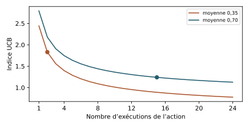

# BCE ECG — Maths 2 appliquées (ESSEC) 2026 · Corrigé brut

*Corrigé rédigé par IA, non officiel. Signalez toute erreur.*

**Rédaction** · Claude Opus 5.5 · effort non renseigné · vitesse non renseignée

**Révision (tour 1)** · modèle non renseigné · effort non renseigné · vitesse non renseignée

**Révision (tour 2)** · modèle non renseigné · effort non renseigné · vitesse non renseignée

**Révision (tour 3)** · GPT-6.2 Astra Ultra · vitesse non renseignée

Épreuve de 4 heures, sans calculatrice ni document.

Notations du modèle : $I_j$ est la $j$-ème action réalisée et $X_{i,j}$ la récompense de l'action $i$ lors de sa $j$-ème exécution.

$N_{i,j}$ est le nombre de fois où l'action $i$ a été choisie parmi les $j$ premières. La récompense de la $j$-ème action est donc $Y_j=X_{I_j,N_{I_j,j}}$.

## Résultats généraux

### Question 1

Récurrence sur $k\ge1$. Pour $k=1$, c'est une égalité. Supposons l'inégalité vraie au rang $k$, et notons $A=\bigcup_{i=1}^kB_i$. Comme $P(A\cup B_{k+1})=P(A)+P(B_{k+1})-P(A\cap B_{k+1})$ et $P(A\cap B_{k+1})\ge0$ :

$$\begin{aligned}
P\Big(\bigcup_{i=1}^{k+1}B_i\Big)&\le P(A)+P(B_{k+1})\\
&\le\sum_{i=1}^{k+1}P(B_i).
\end{aligned}$$

Donc, pour tout $k\in\mathbb N^*$, $\boxed{P\Big(\bigcup_{i=1}^kB_i\Big)\le\sum_{i=1}^kP(B_i).}$

### Question 2

Posons $g(t)=1-\theta+\theta e^t$.

Comme $1-\theta\ge0$ et $\theta e^t\ge0$, et que ces deux termes ne sont pas nuls en même temps (si $\theta=1$, $\theta e^t>0$), on a $g(t)>0$ pour tout réel $t$.

**a)** $g$ est de classe $\mathcal C^\infty$ et strictement positive, donc $\ln\circ g$ est de classe $\mathcal C^2$, et $f$ aussi. On a $g'=g''=\theta e^t$, donc

$$f'(t)=\frac t4+\theta-\frac{\theta e^t}{1-\theta+\theta e^t}.$$

Puis

$$\begin{aligned}
f''(t)&=\frac14-\frac{\theta e^t(1-\theta+\theta e^t)-(\theta e^t)^2}{(1-\theta+\theta e^t)^2}\\
&=\frac14-\frac{\theta(1-\theta)e^t}{(1-\theta+\theta e^t)^2}\\
&=\frac{(1-\theta+\theta e^t)^2-4(1-\theta)\theta e^t}{4(1-\theta+\theta e^t)^2}.
\end{aligned}$$

Avec $a=1-\theta$ et $b=\theta e^t$, le numérateur vaut $(a+b)^2-4ab=(a-b)^2$. D'où

$$\boxed{f''(t)=\frac{(1-\theta-\theta e^t)^2}{4(1-\theta+\theta e^t)^2}.}$$

**b)** $f''\ge0$, donc $f'$ est croissante sur $\mathbb R$, et $f'(0)=\theta-\frac\theta1=0$.

Ainsi $f'\le0$ sur $]-\infty,0]$ et $f'\ge0$ sur $[0,+\infty[$.

La fonction $f$ est donc décroissante puis croissante, et admet en $0$ son minimum $f(0)=-\ln1=0$. Donc $\boxed{f(t)\ge0}$ pour tout réel $t$.

Ainsi $\ln(1-\theta+\theta e^t)\le\frac{t^2}8+\theta t$. Par croissance de l'exponentielle, $1-\theta+\theta e^t\le e^{t^2/8}e^{\theta t}$. En multipliant par $e^{-\theta t}>0$ :

$$\boxed{(1-\theta)e^{-\theta t}+\theta e^{(1-\theta)t}\le\exp\Big(\frac{t^2}8\Big).}$$

### Question 3

**a)** $t\mapsto e^t$ est de classe $\mathcal C^2$ sur $\mathbb R$, de dérivée seconde $e^t\ge0$ : **elle est convexe sur $\mathbb R$.**

**b)** Soit $x\in[-\theta,1-\theta]$ et $t\in\mathbb R$. Posons $\lambda=\theta+x\in[0,1]$ ; alors $1-\lambda=1-\theta-x\in[0,1]$, et

$$\begin{aligned}
\lambda(1-\theta)+(1-\lambda)(-\theta)&=\lambda-\theta\\
&=x.
\end{aligned}$$

Donc $tx=\lambda\,(1-\theta)t+(1-\lambda)(-\theta t)$. Par convexité de l'exponentielle (définition, avec les poids $\lambda$ et $1-\lambda$) :

$$\boxed{e^{tx}\le(\theta+x)e^{(1-\theta)t}+(1-\theta-x)e^{-\theta t}.}$$

### Question 4

Soit $t\in\mathbb R$. La variable $e^{tX}$ est positive et bornée par $e^{|t|}$, puisque $|X|\le1$. Elle admet donc une espérance.

Par la question 3.b appliquée à $x=X(\omega)\in[-\theta,1-\theta]$, pour tout $\omega$ :

$$e^{tX}\le(\theta+X)e^{(1-\theta)t}+(1-\theta-X)e^{-\theta t}.$$

Par croissance et linéarité de l'espérance, avec $E(X)=0$ :

$$E(e^{tX})\le\theta e^{(1-\theta)t}+(1-\theta)e^{-\theta t}.$$

La question 2.b donne alors $\boxed{E(e^{tX})\le\exp\Big(\frac{t^2}8\Big).}$

### Question 5

**a)** Soit $t>0$. La fonction $u\mapsto e^{tu}$ est strictement croissante, donc

$$\begin{aligned}&[\overline X_n-\mu\ge\varepsilon]\\&=\big[e^{t(\overline X_n-\mu)}\ge e^{t\varepsilon}\big].\end{aligned}$$

La variable $e^{t(\overline X_n-\mu)}$ est positive et bornée, donc admet une espérance. L'inégalité de Markov, avec $a=e^{t\varepsilon}>0$, donne

$$P(\overline X_n-\mu\ge\varepsilon)\le\frac{E\big(e^{t(\overline X_n-\mu)}\big)}{e^{t\varepsilon}}.$$

Or $t(\overline X_n-\mu)=\sum_{k=1}^n\frac tn(X_k-\mu)$, donc

$$e^{t(\overline X_n-\mu)}=\prod_{k=1}^n\exp\Big(\frac tn(X_k-\mu)\Big).$$

Les $X_k$ étant indépendantes, ces $n$ facteurs le sont (lemme des coalitions) et admettent une espérance (ils sont bornés). L'espérance du produit est le produit des espérances :

$$\boxed{\begin{aligned}&P(\overline X_n-\mu\ge\varepsilon)\\&\le e^{-t\varepsilon}\prod_{k=1}^nE\Big(\exp\Big(\frac tn(X_k-\mu)\Big)\Big).\end{aligned}}$$

**b)** Comme $X_k\in[0,1]$, on a $\mu=E(X_k)\in[0,1]$. La variable $X_k-\mu$ est d'espérance nulle et à valeurs dans $[-\mu,1-\mu]$.

La question 4, avec $\theta=\mu$ et $\frac tn$ au lieu de $t$, donne

$$E\Big(\exp\Big(\frac tn(X_k-\mu)\Big)\Big)\le\exp\Big(\frac{t^2}{8n^2}\Big).$$

Le produit de ces $n$ majorants vaut $\exp\big(\frac{t^2}{8n}\big)$. Pour $t>0$, par a) :

$$P(\overline X_n-\mu\ge\varepsilon)\le\exp\Big(-t\varepsilon+\frac{t^2}{8n}\Big).$$

Pour $t=0$, le majorant vaut $1$ et l'inégalité est triviale. Elle vaut donc pour tout $t\ge0$.

Le trinôme $t\mapsto-t\varepsilon+\frac{t^2}{8n}$ est minimal en $t=4n\varepsilon\ge0$, où il vaut $-4n\varepsilon^2+2n\varepsilon^2=-2n\varepsilon^2$. D'où

$$\boxed{P(\overline X_n-\mu\ge\varepsilon)\le\exp(-2n\varepsilon^2).}$$

### Question 6

Posons $X'_k=1-X_k$. Ces variables sont indépendantes (lemme des coalitions), à valeurs dans $[0,1]$, de même espérance $\mu'=1-\mu$, et $\overline{X'}_n=1-\overline X_n$. Ainsi $\overline{X'}_n-\mu'=\mu-\overline X_n$. La question 5 appliquée aux $X'_k$ donne

$$\begin{aligned}
P(\overline X_n-\mu\le-\varepsilon)&=P(\overline{X'}_n-\mu'\ge\varepsilon)\\
&\le\boxed{\exp(-2n\varepsilon^2).}
\end{aligned}$$

### Question 7

Posons $\varepsilon=\sqrt{\frac{\ln(2/\alpha)}{2n}}$, bien défini et strictement positif car $\frac2\alpha>2>1$. Alors $\exp(-2n\varepsilon^2)=\frac\alpha2$.

Par les questions 1, 5 et 6 :

$$\begin{aligned}
P(|\overline X_n-\mu|\ge\varepsilon)&\le P(\overline X_n-\mu\ge\varepsilon)+P(\overline X_n-\mu\le-\varepsilon)\\
&\le\frac\alpha2+\frac\alpha2=\alpha.
\end{aligned}$$

L'événement $[\overline X_n-\varepsilon\le\mu\le\overline X_n+\varepsilon]$ est $[|\overline X_n-\mu|\le\varepsilon]$. Il contient $[|\overline X_n-\mu|<\varepsilon]$, contraire de $[|\overline X_n-\mu|\ge\varepsilon]$. Donc

$$P\big(\overline X_n-\varepsilon\le\mu\le\overline X_n+\varepsilon\big)\ge1-\alpha.$$

Les bornes $\overline X_n\pm\varepsilon$ ne dépendent que de l'échantillon et de $n$ et $\alpha$, pas de $\mu$ : **c'est un intervalle de confiance aléatoire pour $\mu$ au niveau de confiance $1-\alpha$.**

## Utilisation d'une table SQL

### Question 8

**a)**

```sql
SELECT Action FROM Bandit WHERE Numero = 100;
```

**b)**

```sql
SELECT Numero FROM Bandit WHERE Action = 2 AND Recompense <> 0;
```

**c)** $N_{1,100}(\omega)$ est le nombre d'indices $k\le100$ tels que $I_k(\omega)=1$ :

```sql
SELECT COUNT(*) FROM Bandit WHERE Action = 1 AND Numero <= 100;
```

**d)** $\hat X_{2,n}(\omega)$ est la moyenne des récompenses obtenues lors des exécutions de l'action 2 :

```sql
SELECT COALESCE(AVG(Recompense), 0) FROM Bandit WHERE Action = 2;
```

`COALESCE` renvoie zéro lorsque le filtre ne sélectionne aucune ligne, conformément à la définition de $\hat X_{2,n}$. Après au moins cent essais de l’action 2, la moyenne estime son paramètre $p_2$. Si le nombre d’essais dépend des récompenses passées, on doit tenir compte de cette sélection. Par exemple, pour tout $\varepsilon>0$, une union sur les tailles fixes donne
$$P\big(N_{2,n}\ge100,\ |\hat X_{2,n}-p_2|\ge\varepsilon\big)\le\sum_{k=100}^n 2e^{-2k\varepsilon^2}.$$
Cette borne porte sur l’événement conjoint. Pour un nombre fixé $k$ d’essais on dispose directement de $2e^{-2k\varepsilon^2}$.

## La stratégie ETC et une majoration de son regret moyen

### Question 9

**a)** $Y_j$ ne prend que les valeurs $0$ et $1$, donc $E(Y_j)=P(Y_j=1)$. Les événements $[I_j=i]$, $i\in[\![1,r]\!]$, forment un système complet d'événements. Par la formule des probabilités totales :

$$\boxed{\begin{aligned}E(Y_j)&=P(Y_j=1)\\&=\sum_{i=1}^rP([Y_j=1]\cap[I_j=i]).\end{aligned}}$$

**b)** Sur $[I_j=i]$, l'action $i$ a été choisie au moins une fois parmi les $j$ premières, donc $N_{i,j}\in[\![1,j]\!]$ ; le cas $N_{i,j}=0$ est impossible. Sur cet événement, $Y_j=X_{i,N_{i,j}}$.

Les événements $[N_{i,j}=k]$, $k\in[\![1,j]\!]$, sont deux à deux incompatibles et leur réunion contient $[I_j=i]$. Donc $[Y_j=1]\cap[I_j=i]$ est la réunion disjointe des événements $[X_{i,k}=1]\cap[I_j=i]\cap[N_{i,j}=k]$, $1\le k\le j$, et

$$\boxed{\begin{aligned}&P([Y_j=1]\cap[I_j=i])\\&=\sum_{k=1}^jP([X_{i,k}=1]\cap[I_j=i]\cap[N_{i,j}=k]).\end{aligned}}$$

**c)** L'événement $[I_j=i]\cap[N_{i,j}=k]$ ne dépend que de $I_1,\dots,I_j$. Comme les $X_{i,k}$ sont indépendantes des $I_j$ (hypothèse du modèle), on a

$$\begin{aligned}&P([X_{i,k}=1]\cap[I_j=i]\cap[N_{i,j}=k])\\&=p_i\,P([I_j=i]\cap[N_{i,j}=k]).\end{aligned}$$

En sommant sur $k$, les événements $[I_j=i]\cap[N_{i,j}=k]$ formant une partition de $[I_j=i]$ (question b), la probabilité de $[Y_j=1]\cap[I_j=i]$ vaut $p_iP(I_j=i)$.

Avec a), $\boxed{E(Y_j)=\sum_{i=1}^rp_iP(I_j=i).}$

Pour ETC ou UCB, les actions ultérieures sont déterminées par les récompenses passées : l’indépendance globale des deux familles, imprimée au début du modèle, doit alors être remplacée par l’indépendance de la récompense à venir. Plus précisément, pour déterminer si l’action $i$ est choisie pour la $k$-ième fois à l’étape $j$, on peut rejouer la stratégie en modifiant arbitrairement $X_{i,k}$ : le choix de l’étape qui révèle cette variable ne change jamais. L’événement considéré est donc déterminé par les autres récompenses et par l’aléa indépendant utilisé pour choisir les actions. Cela justifie la même factorisation pour ces stratégies. Comme $p_i\le p^*$ et $\sum_iP(I_j=i)=1$ : $\boxed{E(Y_j)\le p^*.}$

### Question 10

**a)** $N_{i,n}=\sum_{j=1}^n\mathbf 1_{[I_j=i]}$. Par linéarité de l'espérance, et comme $E(\mathbf 1_{[I_j=i]})=P(I_j=i)$ :

$$\boxed{\begin{aligned}E(N_{i,n})&=\sum_{j=1}^nE(\mathbf 1_{[I_j=i]})\\&=\sum_{j=1}^nP(I_j=i).\end{aligned}}$$

**b)** Par linéarité et la question 9.c :

$$\begin{aligned}
E(\Delta_n)&=np^*-\sum_{j=1}^nE(Y_j)\\
&=\sum_{j=1}^n\sum_{i=1}^r\big(p^*-p_i\big)P(I_j=i)\\
&=\sum_{i=1}^r\delta_i\sum_{j=1}^nP(I_j=i).
\end{aligned}$$

On a utilisé $np^*=\sum_j\sum_ip^*P(I_j=i)$. Avec a) :

$$\boxed{E(\Delta_n)=\sum_{i=1}^r\delta_iE(N_{i,n}).}$$

### Question 11

Si chaque $I_j$ suit la loi uniforme sur $[\![1,r]\!]$, alors $P(I_j=i)=\frac1r$ et $E(N_{i,n})=\frac nr$. Par 10.b :

$$\boxed{E(\Delta_n)=\frac nr\sum_{i=1}^r\delta_i.}$$

Le regret moyen croît linéairement en $n$.

### Question 12

Lors des $rm=6$ premières actions, chaque action est réalisée $m=2$ fois : l'action 1 aux étapes 1 et 2, l'action 2 aux étapes 3 et 4, l'action 3 aux étapes 5 et 6. Donc :

$$\begin{aligned}
\hat X_{1,6}(\omega)&=\frac{0+1}2=\frac12,\\
\hat X_{2,6}(\omega)&=\frac{1+1}2=1,\\
\hat X_{3,6}(\omega)&=\frac{0+0}2=0.
\end{aligned}$$

Le maximum $1$ est atteint pour le seul indice $2$ : $\boxed{Z_2(\omega)=2.}$ Pour $j\in[\![7,10]\!]$, $I_j(\omega)=Z_2(\omega)$ : **la deuxième ligne du tableau se complète par $2,2,2,2$.**

### Question 13

`Rec[(k-1)*m : k*m]` contient les $m$ récompenses de l'action $k$ (indices Python à partir de 0). On calcule chaque moyenne et on garde le plus petit indice qui réalise le maximum (inégalité stricte) :

```python
def Z(m,r,Rec):
    meilleur = 1
    Max = 0
    for l in range(m):
        Max = Max + Rec[l]
    Max = Max/m
    for k in range(2,r+1):
        s = 0
        for l in range((k-1)*m, k*m):
            s = s + Rec[l]
        moy = s/m
        if moy > Max:
            Max = moy
            meilleur = k
    return meilleur
```

Sur l'exemple de la question 12, `Z(2,3,[0,1,1,1,0,0])` renvoie `2`.

### Question 14

**a)** Lors des $mr$ premières actions, chaque action est réalisée exactement $m$ fois : $\boxed{N_{i,mr}=m.}$ Donc

$$\begin{aligned}
\hat X_{i,mr}&=\frac1m\sum_{k=1}^mX_{i,k}\\
&=\boxed{\overline X_{i,m}.}
\end{aligned}$$

**b)** Les variables $X_{i,1},\dots,X_{i,m}$ sont indépendantes, à valeurs dans $\{0,1\}\subset[0,1]$, de même espérance $p_i$. Les questions 5.b et 6, appliquées avec $m$ au lieu de $n$ et $\varepsilon\ge0$, donnent avec a) :

$$\boxed{\begin{aligned}P(\hat X_{i,mr}-p_i\ge\varepsilon)&\le\exp(-2m\varepsilon^2),\\P(\hat X_{i,mr}-p_i\le-\varepsilon)&\le\exp(-2m\varepsilon^2).\end{aligned}}$$

### Question 15

**a)** Pendant la phase d'exploration, l'action $i$ est réalisée $m$ fois. Ensuite, aux $n-mr$ étapes restantes, l'action réalisée est $Z_m$. Donc

$$N_{i,n}=m+(n-mr)\,\mathbf 1_{[Z_m=i]}.$$

Par linéarité de l'espérance :

$$\boxed{E(N_{i,n})=m+(n-mr)P(Z_m=i).}$$

Si $Z_m=i$, alors $\hat X_{i,mr}$ est le maximum des $\hat X_{k,mr}$, donc $\hat X_{i,mr}\ge\hat X_{s,mr}$. Ainsi $[Z_m=i]\subset[\hat X_{i,mr}\ge\hat X_{s,mr}]$ et, comme $n-mr>0$ :

$$\boxed{E(N_{i,n})\le m+(n-mr)P\big(\hat X_{i,mr}\ge\hat X_{s,mr}\big).}$$

**b)** On passe par le complémentaire. Supposons $\hat X_{i,mr}-p_i<\frac{\delta_i}2$ et $p_s-\hat X_{s,mr}<\frac{\delta_i}2$. Comme $p_s=p^*=p_i+\delta_i$ :

$$\begin{aligned}
\hat X_{i,mr}&<p_i+\frac{\delta_i}2\\
&=p_s-\frac{\delta_i}2<\hat X_{s,mr}.
\end{aligned}$$

Donc $[\hat X_{i,mr}\ge\hat X_{s,mr}]$ est contenu dans la réunion de $[\hat X_{i,mr}-p_i\ge\frac{\delta_i}2]$ et de $[p_s-\hat X_{s,mr}\ge\frac{\delta_i}2]$. Par la question 1 :

$$\boxed{\begin{aligned}&P\big(\hat X_{i,mr}\ge\hat X_{s,mr}\big)\\&\le P\Big(\hat X_{i,mr}-p_i\ge\frac{\delta_i}2\Big)+P\Big(p_s-\hat X_{s,mr}\ge\frac{\delta_i}2\Big).\end{aligned}}$$

**c)** La question 14.b avec $\varepsilon=\frac{\delta_i}2\ge0$, appliquée à l'action $i$ puis à l'action $s$, majore chacun des deux termes par $\exp\big(-2m\frac{\delta_i^2}4\big)=\exp\big(-m\frac{\delta_i^2}2\big)$. Avec a), puis $n-mr\le n$ :

$$\boxed{\begin{aligned}E(N_{i,n})&\le m+2(n-mr)\exp\Big(-m\frac{\delta_i^2}2\Big)\\&\le m+2n\exp\Big(-m\frac{\delta_i^2}2\Big).\end{aligned}}$$

### Question 16

**a)** Par 10.b, avec $\delta_i\ge0$ et 15.c :

$$\boxed{\begin{aligned}E(\Delta_n)&\le\sum_{i=1}^r\delta_i\Big(m+2n\exp\Big(-m\frac{\delta_i^2}2\Big)\Big)\\&=m\sum_{i=1}^r\delta_i+2n\sum_{i=1}^r\delta_i\exp\Big(-m\frac{\delta_i^2}2\Big).\end{aligned}}$$

**b)** Soit $h(x)=xe^{-x}$ sur $]0,+\infty[$.

On a $h'(x)=(1-x)e^{-x}$, donc $h$ est croissante sur $]0,1]$, décroissante sur $[1,+\infty[$, de maximum $h(1)=\frac1e$.

Ainsi $xe^{-x}\le\frac1e$, soit $\boxed{e^{-x}\le\frac1{xe}}$ pour tout $x>0$.

Pour $\delta_i\neq0$, avec $x=m\frac{\delta_i^2}2>0$ :

$$\begin{aligned}
\delta_i\exp\Big(-m\frac{\delta_i^2}2\Big)&\le\delta_i\cdot\frac2{e\,m\,\delta_i^2}\\
&=\frac2e\cdot\frac1{m\delta_i}\le\frac1{m\delta_i},
\end{aligned}$$

car $\frac2e<1$. Les termes tels que $\delta_i=0$ sont nuls. En sommant :

$$\begin{aligned}2n\sum_{i=1}^r\delta_i\exp\Big(-m\frac{\delta_i^2}2\Big)&\le\frac{2n}m\sum_{\delta_i\neq0}\frac1{\delta_i}\\&=\frac{2n\beta}m.\end{aligned}$$

Avec a) :

$$\boxed{E(\Delta_n)\le m\alpha+2n\frac\beta m.}$$

**c)** Les $p_i$ ne sont pas tous égaux, donc au moins un $\delta_i$ est strictement positif : $\alpha>0$ et $\beta>0$.

Posons $x_n=\sqrt{\frac{2n\beta}\alpha}$, de sorte que $m=\lfloor x_n\rfloor+1$, et $x_n<m\le x_n+1$.

- Quand $n\to+\infty$, $x_n\to+\infty$, donc $m\ge2$ pour $n$ assez grand.
- $\frac{rm}n\le\frac{r(x_n+1)}n$, qui tend vers 0 car $x_n$ est de l'ordre de $\sqrt n$. Donc $mr<n$ pour $n$ assez grand.

Pour un tel $n$, par b) :

- $m\alpha\le(x_n+1)\alpha=\sqrt{2n\alpha\beta}+\alpha$ ;
- $m>x_n$, donc $\frac{2n\beta}m<\frac{2n\beta}{x_n}=\sqrt{2n\alpha\beta}$.

En additionnant, $E(\Delta_n)\le2\sqrt{2n\alpha\beta}+\alpha$, c'est-à-dire

$$\boxed{E(\Delta_n)\le\sqrt{8\alpha\beta}\,\sqrt n+\alpha.}$$

La question donne un majorant d’ordre $\sqrt n$ pour le regret moyen de cette stratégie ETC.

## La stratégie UCB et une majoration de son regret

### Question 17

Les variables $X_{i,1},\dots,X_{i,j}$ sont indépendantes, à valeurs dans $[0,1]$, d'espérance $p_i$, et $\gamma\ge0$ car $\ln\theta<0$.

La question 6 avec $j$ au lieu de $n$ et $\varepsilon=\gamma$ donne

$$\begin{aligned}
P(\overline X_{i,j}+\gamma\le p_i)&=P(\overline X_{i,j}-p_i\le-\gamma)\\
&\le\exp(-2j\gamma^2).
\end{aligned}$$

Or $2j\gamma^2=-\ln(\theta)$, donc $\exp(-2j\gamma^2)=\theta$ :

$$\boxed{P(\overline X_{i,j}+\gamma\le p_i)\le\theta.}$$

### Question 18

**a)** Pour $j\in[\![1,r]\!]$, $I_j=j$ : chaque action est réalisée exactement une fois lors des $r$ premières étapes. Donc $\boxed{N_{i,r}=1}$ et $\boxed{\hat X_{i,r}=X_{i,1}.}$

**b)** `rd.random()` simule une variable de loi uniforme sur $[0,1[$, inférieure à $p$ avec la probabilité $p$ :

```python
def Bernoulli(p):
    if rd.random() < p:
        return 1
    else:
        return 0
```

**c)** On simule la récompense $x$ de l'action $i$ (paramètre `P[i-1]`, les actions étant numérotées à partir de 1) et on met à jour la moyenne : $\hat X_{i,j+1}=\frac{N_{i,j}\hat X_{i,j}+x}{N_{i,j}+1}$.

```python
def maj(hatX,N,i,P):
    x = Bernoulli(P[i-1])
    return (N*hatX + x)/(N+1)
```

### Question 19

Les lignes complétées sont : `range(r,n)`, `Max=val`, `I[j]=k+1` et `N[I[j]-1]=N[I[j]-1]+1`.

```python
def Actions(P, n):
    r = len(P)
    I = np.zeros(n, dtype=int)
    I[:r] = np.arange(1, r + 1)
    N = np.ones(r, dtype=int)
    hatX = np.array([Bernoulli(p) for p in P], dtype=float)
    for j in range(r, n):
        meilleur = 0
        maximum = hatX[0] + np.sqrt(np.log(n) / N[0])
        for k in range(1, r):
            valeur = hatX[k] + np.sqrt(np.log(n) / N[k])
            if valeur > maximum:
                maximum = valeur
                meilleur = k
        I[j] = meilleur + 1
        hatX[meilleur] = maj(hatX[meilleur], N[meilleur], I[j], P)
        N[meilleur] += 1
    return I
```

L'élément d'indice Python `j` de `I` est l'action $I_{j+1}$ ; au début du tour `j`, `N` et `hatX` contiennent les $N_{k,j}$ et $\hat X_{k,j}$, et la boucle sur `k` cherche le plus petit indice qui maximise $U_{k,j}$.

Le tableau des actions a un type entier pour indexer les compteurs. Les moyennes sont de type flottant dès leur initialisation, y compris si les premières récompenses valent toutes zéro ou un. Le premier maximum rencontré est conservé en cas d’égalité.



### Question 20

**a)** Supposons $N_{i,n}>u$. On a $N_{i,r}=1\le u$ (question 18.a), et $N_{i,\cdot}$ augmente d'au plus 1 à chaque étape.

Soit $k+1$ le plus petit indice de $[\![r+1,n]\!]$ tel que $N_{i,k+1}=u+1$ : il existe car $N_{i,n}\ge u+1$.

Alors $N_{i,k}=u$ et $I_{k+1}=i$, avec $k\in[\![r,n-1]\!]$.

Par définition de la stratégie UCB, $I_{k+1}=i$ signifie que $U_{i,k}$ est le maximum des $U_{l,k}$, donc $U_{i,k}\ge U_{s,k}$. **L'événement $[N_{i,k}=u]\cap[U_{i,k}\ge U_{s,k}]$ est réalisé.**

Sur $[N_{i,k}=u]$, l'action $i$ a été réalisée $u$ fois et $\hat X_{i,k}=\frac1u\sum_{l=1}^uX_{i,l}=\overline X_{i,u}$. Donc

$$\begin{aligned}
U_{i,k}&=\overline X_{i,u}+\sqrt{\frac{\ln n}u}\\
&=V_{i,u}.
\end{aligned}$$

Ainsi $V_{i,u}=U_{i,k}\ge U_{s,k}\ge\min_{j\in[\![r,n-1]\!]}U_{s,j}$ : **l'événement $\big[V_{i,u}\ge\min_{j\in[\![r,n-1]\!]}U_{s,j}\big]$ est réalisé.**

**b)** Supposons $N_{i,n}>u$ et notons $\mu_s=\min_jU_{s,j}$. Si $\mu_s\le p_s$, le premier événement de $A_{i,u}$ est réalisé. Sinon $\mu_s>p_s$, et par a), $V_{i,u}\ge\mu_s>p_s$ : le second l'est.

Donc $[N_{i,n}>u]\subset A_{i,u}$.

On a toujours $N_{i,n}\le n$, et $N_{i,n}\le u$ hors de $[N_{i,n}>u]$. D'où

$$\begin{aligned}
N_{i,n}&\le u+n\,\mathbf 1_{[N_{i,n}>u]}\\
&\le u+n\,\mathbf 1_{A_{i,u}}.
\end{aligned}$$

Par croissance de l'espérance :

$$\boxed{E(N_{i,n})\le u+P(A_{i,u})\,n.}$$

### Question 21

**a)** *Première inégalité.* Pour $j\in[\![r,n-1]\!]$, notons $k=N_{s,j}\in[\![1,j]\!]\subset[\![1,n-1]\!]$. Alors $\hat X_{s,j}=\overline X_{s,k}$, donc $U_{s,j}=V_{s,k}\ge\min_{l\in[\![1,n-1]\!]}V_{s,l}$. En passant au minimum sur $j$, $\min_jU_{s,j}\ge\min_kV_{s,k}$, d'où l'inclusion

$$\Big[\min_{j\in[\![r,n-1]\!]}U_{s,j}\le p_s\Big]\subset\Big[\min_{k\in[\![1,n-1]\!]}V_{s,k}\le p_s\Big].$$

*Seconde inégalité.* L'événement $[\min_kV_{s,k}\le p_s]$ est la réunion des $[V_{s,k}\le p_s]$, $k\in[\![1,n-1]\!]$. Pour chaque $k$, on applique la question 17 avec $\theta=\frac1{n^2}\in\,]0,1[$ : alors

$$\gamma=\sqrt{\frac{2\ln n}{2k}}=\sqrt{\frac{\ln n}k},$$

donc $V_{s,k}=\overline X_{s,k}+\gamma$ et $P(V_{s,k}\le p_s)\le\frac1{n^2}$. Par la question 1 :

$$\boxed{\begin{aligned}P\Big(\min_{j\in[\![r,n-1]\!]}U_{s,j}\le p_s\Big)&\le P\Big(\min_{k\in[\![1,n-1]\!]}V_{s,k}\le p_s\Big)\\&\le\frac{n-1}{n^2}\le\frac1n.\end{aligned}}$$

**b)** Posons $\varepsilon=\delta_i-\sqrt{\frac{\ln n}u}\ge0$. Comme $p_s=p_i+\delta_i$ :

$$\begin{aligned}
[V_{i,u}\ge p_s]&=\Big[\overline X_{i,u}+\sqrt{\frac{\ln n}u}\ge p_i+\delta_i\Big]\\
&=[\overline X_{i,u}-p_i\ge\varepsilon].
\end{aligned}$$

Les $X_{i,1},\dots,X_{i,u}$ sont indépendantes, à valeurs dans $[0,1]$, d'espérance $p_i$. La question 5.b avec $u$ au lieu de $n$ donne

$$\boxed{P(V_{i,u}\ge p_s)\le\exp\bigg(-2u\Big(\delta_i-\sqrt{\frac{\ln n}u}\Big)^2\bigg).}$$

**c)** Pour $t\ge\frac{\ln n}{\delta_i^2}$, on a $\delta_i\sqrt t\ge\sqrt{\ln n}$. La fonction $t\mapsto\delta_i\sqrt t-\sqrt{\ln n}$ est croissante et positive sur cet intervalle, donc son carré y est croissant (le carré est croissant sur $\mathbb R_+$).

Par décroissance de $y\mapsto\exp(-2y)$, **$\varphi$ est décroissante sur $\big[\frac{\ln n}{\delta_i^2},+\infty\big[$.**

**d)** Avec $u=\big\lfloor\frac{4\ln n}{\delta_i^2}\big\rfloor+1$, on a $u>\frac{4\ln n}{\delta_i^2}$. Comme $\frac{4\ln n}{\delta_i^2}\in[1,n-2]$, on a aussi $u\in[\![2,n-1]\!]$. De plus $\delta_i\sqrt u>2\sqrt{\ln n}$, donc $\delta_i-\sqrt{\frac{\ln n}u}>0$ et b) s'applique.

En factorisant $u$ :

$$2u\Big(\delta_i-\sqrt{\frac{\ln n}u}\Big)^2=2\big(\delta_i\sqrt u-\sqrt{\ln n}\big)^2.$$

Le majorant de b) vaut donc $\varphi(u)$. Comme $u\ge\frac{4\ln n}{\delta_i^2}\ge\frac{\ln n}{\delta_i^2}$, par c) :

$$\begin{aligned}
P(V_{i,u}\ge p_s)&\le\varphi\Big(\frac{4\ln n}{\delta_i^2}\Big)\\
&=\exp\big(-2(2\sqrt{\ln n}-\sqrt{\ln n})^2\big)\\
&=e^{-2\ln n}=\boxed{\frac1{n^2}.}
\end{aligned}$$

Enfin, par la question 1, a) et ce qui précède :

$$\begin{aligned}
P(A_{i,u})&\le\frac1n+\frac1{n^2}\\
&\le\boxed{\frac2n.}
\end{aligned}$$

### Question 22

Par 20.b et 21.d, avec $u\le\frac{4\ln n}{\delta_i^2}+1$ :

$$\begin{aligned}
E(N_{i,n})&\le u+n\cdot\frac2n\\
&\le\boxed{\frac{4\ln n}{\delta_i^2}+3.}
\end{aligned}$$

Cette majoration vaut pour toute action $i$ telle que $p_i<p^*$, c'est-à-dire $\delta_i>0$, dès que $n$ est assez grand pour que $\frac{4\ln n}{\delta_i^2}\in[1,n-2]$ pour toutes ces actions (ce qui arrive car $\frac{\ln n}n\to0$).

Les termes $\delta_i=0$ ne contribuent pas à 10.b. Donc

$$\begin{aligned}
E(\Delta_n)&=\sum_{\delta_i\neq0}\delta_iE(N_{i,n})\\
&\le\sum_{\delta_i\neq0}\Big(\frac{4\ln n}{\delta_i}+3\delta_i\Big)\\
&=\boxed{4\beta\ln(n)+3\alpha.}
\end{aligned}$$

La question donne un majorant d’ordre $\ln n$ pour le regret moyen de la stratégie UCB, à paramètres des actions fixés.
