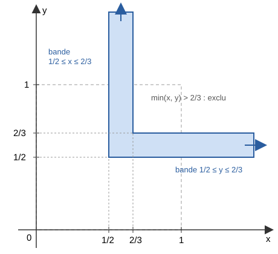
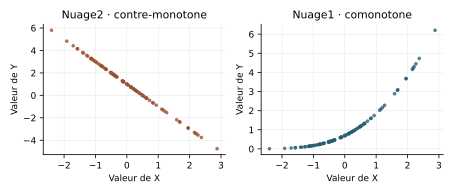

# BCE ECG — Mathématiques 2 approfondies (ESCP-HEC) 2026 · Corrigé brut

*Corrigé rédigé par IA, non officiel. Signalez toute erreur.*

**Rédaction** · Claude Opus 5.5 · effort non renseigné · vitesse non renseignée

**Révision (tour 1)** · modèle non renseigné · effort non renseigné · vitesse non renseignée

**Révision (tour 2)** · modèle non renseigné · effort non renseigné · vitesse non renseignée

**Révision (tour 3)** · GPT-6.2 Astra Ultra · vitesse non renseignée

**Révision (tour 4)** · GPT-6.2 Astra Ultra · vitesse non renseignée

Épreuve de 4 h, sans document ni calculatrice. Thème : fonctions de répartition de couples, fonctions 2-croissantes, copules et théorème de Sklar.

Notation utilisée dans tout le corrigé : $\varphi$ désigne la fonction de répartition de la loi uniforme sur $[0,1]$,

$$\varphi(t)=\begin{cases}0&\text{si }t<0\\t&\text{si }0\leqslant t\leqslant1\\1&\text{si }t>1\end{cases}$$

## Préliminaires

### 1.

$g$ est continue et strictement croissante sur l'intervalle ouvert $]a,b[$. Par le théorème de la bijection, $g$ réalise une bijection de $]a,b[$ sur l'intervalle $\big]\lim_ag,\lim_bg\big[$, soit $]0,1[$.

### 2.

Pour $x\in\mathbb{R}$, $F_X(x)=\int_{-\infty}^xf(t)\,\mathrm{d}t$.

- $F_X$ est une fonction de répartition : croissante sur $\mathbb{R}$, à valeurs dans $[0,1]$, et continue car $X$ est à densité.
- Fixons $x_0\in\,]a,b[$. Sur cet intervalle, $F_X(x)=F_X(x_0)+\int_{x_0}^xf(t)\,\mathrm{d}t$ avec $f$ continue : la fonction est de classe $\mathcal{C}^1$, de dérivée $f>0$, donc strictement croissante.
- Limite en $a$ : si $a=-\infty$, c'est une propriété des fonctions de répartition ; si $a$ est fini, $f$ est nulle à gauche de $a$, donc $F_X(a)=0$, et la limite est nulle par continuité.
- De même, si $b=+\infty$, $\lim_{+\infty}F_X=1$ ; si $b$ est fini, $F_X(b)=\int_{-\infty}^{+\infty}f-\int_b^{+\infty}f=1$, d'où $\lim_{x\to b}F_X(x)=1$.

**Donc $F_X\in\mathcal{F}_{(a,b)}$.**

## I) Fonction de répartition d'un couple : propriétés et exemples

### 3.

Comme $[X\leqslant t]\cap[Y\leqslant y]\subset[X\leqslant t]$, on a $0\leqslant F_{(X,Y)}(t,y)\leqslant F_X(t)$, et $F_X(t)\to0$ quand $t\to-\infty$. Par encadrement, $\lim_{t\to-\infty}F_{(X,Y)}(t,y)=0$. De même, $0\leqslant F_{(X,Y)}(x,t)\leqslant F_Y(t)\to0$.

### 4. (a)

$Y$ est à valeurs réelles : pour tout $\omega$, il existe $n\in\mathbb{N}$ tel que $Y(\omega)\leqslant n$. Donc

$$[X\leqslant x]=\bigcup_{n\in\mathbb{N}}\big([X\leqslant x]\cap[Y\leqslant n]\big),$$

d'où $\boxed{F_X(x)=\mathbb{P}\Big(\bigcup_{n\in\mathbb{N}}[X\leqslant x]\cap[Y\leqslant n]\Big)}$.

### 4. (b)

La suite d'événements $\big([X\leqslant x]\cap[Y\leqslant n]\big)_n$ est croissante. Par continuité croissante, $F_X(x)=\lim_{n\to+\infty}F_{(X,Y)}(x,n)$.

La fonction $r\mapsto F_{(X,Y)}(x,r)$ est croissante (inclusion des événements) et majorée par $1$ : elle a une limite $\ell$ en $+\infty$ (théorème de la limite monotone), qui est aussi la limite de la suite $F_{(X,Y)}(x,n)$. Donc $\boxed{F_X(x)=\lim_{r\to+\infty}F_{(X,Y)}(x,r)}$.

### 5.

Le même raisonnement, en échangeant les rôles de $X$ et $Y$, donne $[Y\leqslant y]=\bigcup_n\big([X\leqslant n]\cap[Y\leqslant y]\big)$, puis $\boxed{F_Y(y)=\lim_{t\to+\infty}F_{(X,Y)}(t,y)}$.

### 6.

Par 4.(b), $\lim_{r\to+\infty}F_{(X,Y)}(t,r)=F_X(t)$, qui tend vers $1$ quand $t\to+\infty$. Par 5, $\lim_{t\to+\infty}F_{(X,Y)}(t,r)=F_Y(r)$, qui tend vers $1$ quand $r\to+\infty$.

Les deux limites itérées valent $1$.

### 7.

Soient $a_1\leqslant b_1$ et $a_2\leqslant b_2$. Comme $[X\leqslant a_1]\subset[X\leqslant b_1]$ :

$$F_{(X,Y)}(b_1,b_2)-F_{(X,Y)}(a_1,b_2)=\mathbb{P}\big([a_1<X\leqslant b_1]\cap[Y\leqslant b_2]\big),$$

$$F_{(X,Y)}(b_1,a_2)-F_{(X,Y)}(a_1,a_2)=\mathbb{P}\big([a_1<X\leqslant b_1]\cap[Y\leqslant a_2]\big).$$

En retranchant, comme $[Y\leqslant a_2]\subset[Y\leqslant b_2]$ :

$$\begin{aligned}
&F_{(X,Y)}(b_1,b_2)-F_{(X,Y)}(a_1,b_2)-F_{(X,Y)}(b_1,a_2)+F_{(X,Y)}(a_1,a_2)\\
&\quad=\mathbb{P}\big([a_1<X\leqslant b_1]\cap[a_2<Y\leqslant b_2]\big)\geqslant0 .
\end{aligned}$$

**$F_{(X,Y)}$ est 2-croissante.**

### 8. (a)

$[X\leqslant x]\cap[Y\leqslant y]$ est inclus dans $[X\leqslant x]$ et dans $[Y\leqslant y]$, donc $F_{(X,Y)}(x,y)\leqslant F_X(x)$ et $F_{(X,Y)}(x,y)\leqslant F_Y(y)$ : $\boxed{F_{(X,Y)}(x,y)\leqslant\min(F_X(x),F_Y(y))}$.

### 8. (b)

Avec $A=[X\leqslant x]$ et $B=[Y\leqslant y]$, $\mathbb{P}(A\cup B)\leqslant1$, donc

$$\begin{aligned}
\mathbb{P}(A\cap B) &= \mathbb{P}(A)+\mathbb{P}(B)-\mathbb{P}(A\cup B)\\
&\geqslant F_X(x)+F_Y(y)-1 .
\end{aligned}$$

Comme $\mathbb{P}(A\cap B)\geqslant0$ : $\boxed{F_{(X,Y)}(x,y)\geqslant\max(F_X(x)+F_Y(y)-1,0)}$.

### 9.

Pour $F\in\mathcal{F}_{(a,b)}$, on a $\lim_{+\infty}F=1$. Si $b=+\infty$, c'est la définition.

Si $b$ est fini, $F$ est croissante, majorée par $1$, et vaut au moins $\lim_bF=1$ à droite de $b$ : elle y est constante égale à $1$.

Par 4.(b) et continuité de $\min$ : $F_X(x)=\lim_{r\to+\infty}\min(F_1(x),F_2(r))=\min(F_1(x),1)=F_1(x)$. De même avec 5 : $F_Y=F_2$.

### 10. (a)

*Lemme.* Si $Z$ a pour fonction de répartition $G\in\mathcal{F}_{(a,b)}$, alors pour $u\in\,]0,1[$ :

$$[G(Z)\leqslant u]=[Z\leqslant G^{-1}(u)].$$

En effet, soit $z_u=G^{-1}(u)\in\,]a,b[$. Si $z\leqslant z_u$, $G(z)\leqslant G(z_u)=u$ par croissance.

Si $z>z_u$, ou bien $z<b$ et $G(z)>u$ par stricte croissance sur $]a,b[$, ou bien $z\geqslant b$ et $G(z)=1>u$.

Ainsi $\mathbb{P}(G(Z)\leqslant u)=G(z_u)=u$.

$G(Z)$ est à valeurs dans $[0,1]$, donc sa fonction de répartition vaut $0$ sur $]-\infty,0[$ et $1$ sur $[1,+\infty[$.

En $0$, par continuité à droite, elle vaut $\lim_{u\to0^+}u=0$.

**$G(Z)$ suit la loi uniforme sur $[0,1]$.**

Par 9, $X$ et $Y$ ont pour fonctions de répartition $F_1$ et $F_2$ :

**$U$ et $V$ suivent la loi uniforme sur $[0,1]$.**

### 10. (b)

Pour $(u,v)\in\,]0,1[^2$, par le lemme :

$$\begin{aligned}
F_{(U,V)}(u,v) &= \mathbb{P}\big([X\leqslant F_1^{-1}(u)]\cap[Y\leqslant F_2^{-1}(v)]\big)\\
&= \min\big(F_1(F_1^{-1}(u)),F_2(F_2^{-1}(v))\big)\\
&= \min(u,v).
\end{aligned}$$

Si $u\leqslant0$ ou $v\leqslant0$, $F_{(U,V)}(u,v)\leqslant\min(F_U(u),F_V(v))=0$.

Si $u\geqslant1$, l'événement $[U\leqslant u]$ est certain et $F_{(U,V)}(u,v)=F_V(v)$ ; de même si $v\geqslant1$. Dans tous les cas :

$$\boxed{\forall(x,y)\in\mathbb{R}^2,\quad F_{(U,V)}(x,y)=\min\big(\varphi(x),\varphi(y)\big)}$$

### 10. (c)

$\min(\varphi(x),\varphi(y))\geqslant\frac12$ équivaut à $\varphi(x)\geqslant\frac12$ et $\varphi(y)\geqslant\frac12$, soit $x\geqslant\frac12$ et $y\geqslant\frac12$.

Et $\min(\varphi(x),\varphi(y))\leqslant\frac23$ équivaut à $x\leqslant\frac23$ ou $y\leqslant\frac23$. L'ensemble cherché est

$$\Big\{(x,y) : x\geqslant\tfrac12,\ y\geqslant\tfrac12\Big\}\setminus\Big\{(x,y) : x>\tfrac23,\ y>\tfrac23\Big\},$$

réunion des deux demi-bandes $[\frac12,\frac23]\times[\frac12,+\infty[$ et $[\frac12,+\infty[\times[\frac12,\frac23]$ : un « L » non borné.



### 10. (d)

$U$ et $V$ sont à valeurs dans $[0,1]$ (images par $F_1$, $F_2$).

Supposons $U-V>\frac1n$ : alors $U>\frac1n+V\geqslant\frac1n$, et comme $U\leqslant1$, il existe un unique $k\in[\![1;n-1]\!]$ tel que $\frac kn<U\leqslant\frac{k+1}n$.

Pour ce $k$, $V<U-\frac1n\leqslant\frac kn$. Donc

$$\Big[U-V>\frac1n\Big]\subset\bigcup_{k=1}^{n-1}\Big(\Big[\frac kn<U\leqslant\frac{k+1}n\Big]\cap\Big[V\leqslant\frac kn\Big]\Big),$$

et par sous-additivité :

$$\boxed{\mathbb{P}\Big(U-V>\frac1n\Big)\leqslant\sum_{k=1}^{n-1}\mathbb{P}\Big(\Big[\frac kn<U\leqslant\frac{k+1}n\Big]\cap\Big[V\leqslant\frac kn\Big]\Big)}$$

### 10. (e)

Comme en 7, pour $k\in[\![1;n-1]\!]$ :

$$\begin{aligned}
\mathbb{P}\Big(\Big[\frac kn<U\leqslant\frac{k+1}n\Big]\cap\Big[V\leqslant\frac kn\Big]\Big) &= F_{(U,V)}\Big(\frac{k+1}n,\frac kn\Big)-F_{(U,V)}\Big(\frac kn,\frac kn\Big)\\
&= \frac kn-\frac kn=0 .
\end{aligned}$$

Donc $\mathbb{P}(U-V>\frac1n)=0$ pour tout $n\geqslant2$. Or $[U>V]=\bigcup_{n\geqslant2}[U-V>\frac1n]$, réunion croissante : par continuité croissante, $\mathbb{P}(U>V)=0$, soit $\boxed{\mathbb{P}(U\leqslant V)=1}$.

L'expression de $F_{(U,V)}$ est symétrique en $(U,V)$ : le même raisonnement donne $\mathbb{P}(V\leqslant U)=1$. L'intersection de deux événements presque sûrs est presque sûre, donc $\boxed{\mathbb{P}(U=V)=1}$.

### 10. (f)

$\mathbb{P}(X\leqslant a_1)=0$ : c'est clair si $a_1=-\infty$, et sinon $F_1(a_1)=\lim_{a_1}F_1=0$ par continuité. De même $\mathbb{P}(X\geqslant b_1)=1-\lim_{x\to b_1^-}F_1(x)=0$. Donc $X\in\,]a_1,b_1[$ presque sûrement.

Sur l'événement presque sûr $[U=V]\cap[a_1<X<b_1]$, on a $F_1(X)=F_2(Y)$, avec $F_2(Y)\in\,]0,1[$ car $Y\in\,]a_2,b_2[$, d'où

$$X=F_1^{-1}\big(F_1(X)\big)=F_1^{-1}\big(F_2(Y)\big).$$

**$X=F_1^{-1}(F_2(Y))$ presque sûrement.**

### 11.

Posons $g=F_1^{-1}\circ F_2$ sur $]a_2,b_2[$, qui contient $Y(\Omega)$. $F_2$ est croissante et $F_1^{-1}$ aussi (réciproque d'une bijection strictement croissante).

Donc $g$ est croissante, et $X=g(Y)$ ps par 10.(f).

Les rôles de $X$ et $Y$ sont symétriques ($\min$ est symétrique et $\mathbb{P}(U=V)=1$).

Avec $h=F_2^{-1}\circ F_1$ sur $]a_1,b_1[$, croissante, on obtient $Y=h(X)$ ps.

**$X$ et $Y$ sont comonotones.**

### 12.

Si $W$ suit la loi uniforme sur $[0,1]$, le couple $(F_1^{-1}(W),F_2^{-1}(W))$ a pour fonction de répartition $\mathbb{P}(W\leqslant F_1(x),W\leqslant F_2(y))=\min(F_1(x),F_2(y))$.

Avec $X\hookrightarrow\mathcal{N}(0,1)$, $W=\Phi(X)$ et $F_2^{-1}(w)=-\ln(1-w)$, on simule donc $Y=-\ln(1-\Phi(X))$.

```python
def Nuage1():
    X = rd.normal(0, 1, 100)
    Y = -sp.log_ndtr(-X)
    plt.plot(X, Y, linestyle='', marker='*')
    plt.show()
```

La symétrie normale donne $1-\Phi(x)=\Phi(-x)$. La fonction `sp.log_ndtr` calcule directement $\ln\Phi$. Pour $x=10$, la soustraction `1 - sp.ndtr(10)` est arrondie à zéro, alors que la valeur de $Y$ vaut environ $53{,}23$.

### 13.

Par 4.(b) et la limite $\lim_{+\infty}F_2=1$ (question 9), avec la continuité de $\max$ : $F_X(x)=\max(F_1(x)+1-1,0)=F_1(x)$. De même $F_Y=F_2$.

### 14. (a)

Par le lemme de 10.(a), $U$ et $V$ suivent la loi uniforme sur $[0,1]$. Pour $w\in[0,1]$, comme $V$ est à densité, $\mathbb{P}(1-V\leqslant w)=\mathbb{P}(V\geqslant1-w)=1-(1-w)=w$ :

**$1-V$ suit aussi la loi uniforme sur $[0,1]$.**

Pour $(u,v)\in\,]0,1[^2$, comme en 10.(b), $F_{(U,V)}(u,v)=\max(u+v-1,0)$. Pour $(u,w)\in\,]0,1[^2$ :

$$\begin{aligned}
\mathbb{P}\big([U\leqslant u]\cap[1-V\leqslant w]\big) &= \mathbb{P}(U\leqslant u)-\mathbb{P}\big([U\leqslant u]\cap[V<1-w]\big)\\
&= u-\max(u-w,0)\\
&= \min(u,w),
\end{aligned}$$

où l'on a utilisé $\mathbb{P}(U\leqslant u,V<c)=\lim_{c'\to c^-}F_{(U,V)}(u,c')=\max(u+c-1,0)$ (continuité croissante et continuité de $\max$). Les cas où $u$ ou $w$ sort de $]0,1[$ se traitent comme en 10.(b) :

$$\boxed{\forall(x,y)\in\mathbb{R}^2,\quad F_{(U,1-V)}(x,y)=\min\big(\varphi(x),\varphi(y)\big)}$$

### 14. (b)

Le couple $(U,1-V)$ est à valeurs dans $[0,1]^2$ et a la même fonction de répartition que le couple $(U,V)$ de 10.(b). Les questions 10.(d) et 10.(e) n'utilisent que ces deux propriétés : elles donnent $\boxed{\mathbb{P}(U=1-V)=1}$.

### 14. (c)

Comme en 10.(f), $X\in\,]a_1,b_1[$ ps. Sur l'événement presque sûr $[U=1-V]\cap[a_1<X<b_1]$, $F_1(X)=1-F_2(Y)$, avec $1-F_2(Y)\in\,]0,1[$ car $Y\in\,]a_2,b_2[$. Donc $X=F_1^{-1}(1-F_2(Y))$ ps.

### 15.

$g:y\mapsto F_1^{-1}(1-F_2(y))$ est décroissante sur $]a_2,b_2[$ ($1-F_2$ est décroissante, $F_1^{-1}$ croissante), et $X=g(Y)$ ps par 14.(c).

Comme $V=1-U$ ps et $X\in\,]a_1,b_1[$ ps, $Y=F_2^{-1}(1-F_1(X))$ ps (raisonnement symétrique), avec $h:x\mapsto F_2^{-1}(1-F_1(x))$ décroissante. **$X$ et $Y$ sont contra-monotones.**

### 16.

Ici $F_2(y)=\Phi\big(\frac{y-1}2\big)$, donc $F_2^{-1}(p)=1+2\,\Phi^{-1}(p)$, et l'on simule $Y=F_2^{-1}(1-\Phi(X))$ :

```python
def Nuage2():
    X = rd.normal(0, 1, 100)
    Y = 1 - 2 * X
    plt.plot(X, Y, linestyle='', marker='*')
    plt.show()
```

Comme $1-\Phi(x)=\Phi(-x)$, on a en fait $Y=1-2X$ (vérifié numériquement).

### 17.

- Le graphe **(a)** est une droite décroissante, avec des ordonnées de $-4$ à $6$ : c'est **`Nuage2`**, où $Y=1-2X$ (contra-monotonie).
- Le graphe **(b)** est une courbe croissante et convexe, à ordonnées positives : c'est **`Nuage1`**, où $Y=-\ln(1-\Phi(X))\geqslant0$ est une fonction croissante de $X$ (comonotonie).



## II) Fonctions 2-croissantes et copules 2-dimensionnelles

### Partie A : Fonctions 2-croissantes

#### 18. (a)

$t\mapsto\max(t,y_0)$ vaut $y_0$ sur $]-\infty,y_0]$ et $t$ sur $[y_0,+\infty[$ : elle est croissante. De même pour $t\mapsto\max(x_0,t)$.

#### 18. (b)

Avec $(a_1,a_2)=(0,0)$ et $(b_1,b_2)=(1,1)$ :

$$f_1(1,1)-f_1(0,1)-f_1(1,0)+f_1(0,0)=1-1-1+0=-1<0 .$$

**$f_1$ n'est pas 2-croissante.**

#### 19. (a)

Pour $a_1\leqslant b_1$ et $a_2\leqslant b_2$ :

$$b_1b_2-a_1b_2-b_1a_2+a_1a_2=(b_1-a_1)(b_2-a_2)\geqslant0 .$$

**$f_2$ est 2-croissante.**

#### 19. (b)

Pour $y=-1$, $t\mapsto f_2(t,-1)=-t$ est strictement décroissante.

#### 20.

Une fonction croissante par rapport à chaque variable n'est pas forcément 2-croissante ($f_1$), et une fonction 2-croissante n'est pas forcément croissante par rapport à chaque variable ($f_2$). **Les deux notions sont indépendantes : aucune n'entraîne l'autre.**

#### 21. (a)

Soit $h\neq0$. Pour $t\to0$, par définition de la dérivée partielle par rapport à la seconde variable :

$$\frac{F(x+h,y+t)-F(x+h,y)}{t}\to\partial_2F(x+h,y),\qquad\frac{F(x,y+t)-F(x,y)}{t}\to\partial_2F(x,y).$$

La limite intérieure vaut donc $\frac{\partial_2F(x+h,y)-\partial_2F(x,y)}h$.

Comme $F$ est de classe $\mathcal{C}^2$, la fonction $\partial_2F$ admet une dérivée partielle par rapport à la première variable, et quand $h\to0$ ce taux tend vers $\partial_1(\partial_2F)(x,y)$, qui est égal à $\partial^2_{1,2}F(x,y)$ par le théorème de Schwarz. D'où l'égalité demandée.

#### 21. (b)

Soit $(x,y)\in I\times J$. Comme $I$ et $J$ sont des intervalles ouverts, pour $h>0$ et $t>0$ assez petits, $(x+h,y+t)\in I\times J$.

La 2-croissance, appliquée à $(a_1,a_2)=(x,y)$ et $(b_1,b_2)=(x+h,y+t)$, montre que le numérateur est positif, et $ht>0$ : le quotient est positif.

En passant à la limite $t\to0^+$, puis $h\to0^+$ (les limites de 21.(a) existent, donc coïncident avec les limites à droite), on obtient $\boxed{\partial^2_{1,2}F(x,y)\geqslant0}$.

#### 22. (a)

Soit $y\in[a_2,b_2]$. La fonction $x\mapsto\partial_2F(x,y)$ est de classe $\mathcal{C}^1$, de dérivée $\partial_1(\partial_2F)(x,y)=\partial^2_{1,2}F(x,y)$ (Schwarz), donc

$$\int_{a_1}^{b_1}\partial^2_{1,2}F(x,y)\,\mathrm{d}x=\partial_2F(b_1,y)-\partial_2F(a_1,y).$$

Cette fonction de $y$ est continue, et $\partial_2F(b_1,\cdot)$ est la dérivée de $y\mapsto F(b_1,y)$. Donc

$$\begin{aligned}
\int_{a_2}^{b_2}\Big(\int_{a_1}^{b_1}\partial^2_{1,2}F(x,y)\,\mathrm{d}x\Big)\mathrm{d}y &= \big[F(b_1,y)-F(a_1,y)\big]_{y=a_2}^{y=b_2}\\
&= F(b_1,b_2)-F(a_1,b_2)-F(b_1,a_2)+F(a_1,a_2).
\end{aligned}$$

#### 22. (b)

*Si $\partial^2_{1,2}F\geqslant0$ sur $I\times J$.* Soient $(a_1,a_2),(b_1,b_2)\in I\times J$ avec $a_1\leqslant b_1$, $a_2\leqslant b_2$.

Comme $I$ et $J$ sont des intervalles, le rectangle $[a_1,b_1]\times[a_2,b_2]$ est inclus dans $I\times J$.

L'intégrale intérieure est positive pour tout $y$, puis l'intégrale extérieure aussi (bornes dans l'ordre croissant) : par 22.(a), $F$ est 2-croissante sur $I\times J$.

*Réciproquement*, c'est la question 21.(b).

**$F$ est 2-croissante sur $I\times J$ si et seulement si $\partial^2_{1,2}F\geqslant0$ sur $I\times J$.**

#### 23.

Soient $x$, $y$ et $a_1\leqslant b_1$. Pour $s\leqslant y$, la 2-croissance avec $(a_1,s)$ et $(b_1,y)$ donne

$$F(b_1,y)-F(a_1,y)\geqslant F(b_1,s)-F(a_1,s).$$

Quand $s\to-\infty$, le membre de droite tend vers $0$, d'où $F(b_1,y)\geqslant F(a_1,y)$ :

**$t\mapsto F(t,y)$ est croissante.** De même, avec $(s,a_2)$ et $(x,b_2)$ pour $s\leqslant x$, puis $s\to-\infty$, **$t\mapsto F(x,t)$ est croissante.**

### Partie B : Copule 2-dimensionnelle

#### 24.

$U$ et $V$ sont à valeurs dans $[0,1]$. Pour $u\in[0,1]$, comme $[V\leqslant1]$ est certain :

$$\begin{aligned}
\mathbb{P}(U\leqslant u) &= \mathbb{P}\big([U\leqslant u]\cap[V\leqslant1]\big)\\
&= C(u,1)\\
&= u.
\end{aligned}$$

$F_U$ vaut $0$ sur $]-\infty,0[$ et $1$ sur $]1,+\infty[$ : $F_U=\varphi$.

**$U$ et $V$ (de même avec $C(1,v)=v$) suivent la loi uniforme sur $[0,1]$.**

#### 25.

*Conditions au bord.* Pour $x\in[0,1]$ :

$$\begin{aligned}
C^*(0,x) &= x-1+C(1,1-x)\\
&= x-1+(1-x)\\
&= 0
\end{aligned}$$

$$\begin{aligned}
C^*(x,0) &= x-1+C(1-x,1)\\
&= 0,
\end{aligned}$$

$$\begin{aligned}
C^*(1,x) &= x+C(0,1-x)\\
&= x
\end{aligned}$$

$$\begin{aligned}
C^*(x,1) &= x+C(1-x,0)\\
&= x.
\end{aligned}$$

*2-croissance.* Soient $(a_1,a_2),(b_1,b_2)\in[0,1]^2$ avec $a_1\leqslant b_1$, $a_2\leqslant b_2$. La partie affine $u+v-1$ disparaît de l'accroissement double, car $(b_1+b_2)-(a_1+b_2)-(b_1+a_2)+(a_1+a_2)=0$.

Avec $a_1'=1-b_1\leqslant b_1'=1-a_1$ et $a_2'=1-b_2\leqslant b_2'=1-a_2$, il reste

$$C(a_1',a_2')-C(b_1',a_2')-C(a_1',b_2')+C(b_1',b_2')\geqslant0,$$

par 2-croissance de $C$ sur $[0,1]^2$. **$C^*$ est une copule.**

Si $(U,V)$ est le couple associé à $C$, les marges uniformes n’ont pas d’atomes. Pour $u,v\in[0,1]$, le passage au complément donne
$$\begin{aligned}
\mathbb P(1-U\le u,\,1-V\le v)
&=1-\mathbb P(U<1-u)-\mathbb P(V<1-v)\\
&\quad+\mathbb P(U<1-u,\,V<1-v)\\
&=u+v-1+C(1-u,1-v)=C^*(u,v).
\end{aligned}$$

#### 26. (a)

Soient $v\in[0,1]$ et $u_1\leqslant u_2$ dans $[0,1]$.

- 2-croissance avec $(u_1,0)$ et $(u_2,v)$ : $C(u_2,v)-C(u_1,v)-C(u_2,0)+C(u_1,0)\geqslant0$, et $C(\cdot,0)=0$, donc $C(u_2,v)-C(u_1,v)\geqslant0$.
- 2-croissance avec $(u_1,v)$ et $(u_2,1)$ : $C(u_2,1)-C(u_1,1)-C(u_2,v)+C(u_1,v)\geqslant0$, soit $C(u_2,v)-C(u_1,v)\leqslant u_2-u_1$.

La seconde inégalité se démontre de même, avec $(0,v_1),(u,v_2)$ puis $(u,v_1),(1,v_2)$.

#### 26. (b)

Par l'inégalité triangulaire, puis 26.(a) (en ordonnant $u_1,u_2$ et $v_1,v_2$) :

$$\begin{aligned}
|C(u_2,v_2)-C(u_1,v_1)| &\leqslant |C(u_2,v_2)-C(u_1,v_2)|+|C(u_1,v_2)-C(u_1,v_1)|\\
&\leqslant |u_2-u_1|+|v_2-v_1| .
\end{aligned}$$

#### 26. (c)

Soit $(u_0,v_0)\in[0,1]^2$. Pour $(u,v)\in[0,1]^2$, avec la norme euclidienne :

$$|C(u,v)-C(u_0,v_0)|\leqslant|u-u_0|+|v-v_0|\leqslant2\,\|(u,v)-(u_0,v_0)\| ,$$

qui tend vers $0$ quand $(u,v)\to(u_0,v_0)$. **$C$ est continue sur $[0,1]^2$.**

## III) Démonstration du théorème de Sklar et application

### Partie A : le théorème

#### 27. (a)

Pour $(x,y)\in\,]0,1[^2$, le lemme de 10.(a) appliqué à $F_X\in\mathcal{F}_{(a,b)}$ et $F_Y\in\mathcal{F}_{(c,d)}$ donne

$$\begin{aligned}
\mathbb{P}\big([F_X(X)\leqslant x]\cap[F_Y(Y)\leqslant y]\big) &= \mathbb{P}\big([X\leqslant F_X^{-1}(x)]\cap[Y\leqslant F_Y^{-1}(y)]\big)\\
&= F_{(X,Y)}\big(F_X^{-1}(x),F_Y^{-1}(y)\big)=C(x,y).
\end{aligned}$$

Sur le bord de $[0,1]^2$, avec $U=F_X(X)$ et $V=F_Y(Y)$, de loi uniforme sur $[0,1]$ (lemme de 10.(a)) :

- si $y=1$ : $\mathbb{P}([U\leqslant x]\cap[V\leqslant1])=\mathbb{P}(U\leqslant x)=x=C(x,1)$ ;
- si $x=1$ : de même, on obtient $y=C(1,y)$ ;
- sinon $x=0$ ou $y=0$, et la probabilité est majorée par $\mathbb{P}(U\leqslant0)=0$ ou $\mathbb{P}(V\leqslant0)=0$ : elle vaut $0=C(x,y)$.

**La formule $C(x,y)=\mathbb{P}([F_X(X)\leqslant x]\cap[F_Y(Y)\leqslant y])$ vaut sur $[0,1]^2$.**

#### 27. (b)

Par 27.(a), $C$ coïncide sur $[0,1]^2$ avec la fonction de répartition du couple $(F_X(X),F_Y(Y))$, qui est 2-croissante sur $\mathbb{R}^2$ (question 7). **$C$ est 2-croissante sur $[0,1]^2$.**

#### 27. (c)

$C$ est à valeurs réelles et 2-croissante sur $[0,1]^2$. Par définition, $C(1,x)=C(x,1)=x$.

Enfin $C(0,x)=C(x,0)=0$ : c'est le cas « sinon », sauf aux deux coins $(0,1)$ et $(1,0)$, où les branches $y=1$ et $x=1$ donnent respectivement $0$.

**$C$ est une copule.**

#### 28.

*Existence.* Soit $C$ la copule de 27 et $(x,y)\in\mathbb{R}^2$ ; posons $u=F_X(x)$ et $v=F_Y(y)$.

- Si $u,v\in\,]0,1[$, alors $x\in\,]a,b[$ et $y\in\,]c,d[$ (hors de ces intervalles, les fonctions de répartition valent 0 ou 1). Donc $C(u,v)=F_{(X,Y)}\big(F_X^{-1}(u),F_Y^{-1}(v)\big)=F_{(X,Y)}(x,y)$.
- Si $u=1$ : $\mathbb{P}(X>x)=0$, donc $F_{(X,Y)}(x,y)=\mathbb{P}(Y\leqslant y)=v=C(1,v)$. De même si $v=1$.
- Si $u=0$ (resp. $v=0$) : $0\leqslant F_{(X,Y)}(x,y)\leqslant u$ (resp. $v$) par 8.(a), donc $F_{(X,Y)}(x,y)=0=C(u,v)$.

*Unicité.* Soit $C'$ une copule vérifiant la même relation. Pour $(u,v)\in\,]0,1[^2$, avec $x=F_X^{-1}(u)$ et $y=F_Y^{-1}(v)$ :

$$C'(u,v)=F_{(X,Y)}(x,y)=C(u,v).$$

Sur le bord de $[0,1]^2$, deux copules coïncident (elles valent $0$, $u$ ou $v$). Donc $C'=C$.

(Dans le théorème admis imprimé page 6, sous la question 28, il faut lire $C(F_1(x),F_2(y))$ et non $C(F_1(x),F_2(x))$.)

#### 29.

Par 4.(b), $F_{X_1}(x_1)=\lim_{r\to+\infty}C(F_1(x_1),F_2(r))$. Or $F_2(r)\to1$ et $C$ est continue sur $[0,1]^2$ (26.(c)), donc $F_{X_1}(x_1)=C(F_1(x_1),1)=F_1(x_1)$. De même, par 5, $F_{X_2}=F_2$.

### Partie B : un premier exemple, la distribution logistique bivariée de Gumbel

#### 30.

Par 4.(b), $F_{Z_1}(x)=\lim_{y\to+\infty}\frac{1}{1+\mathrm{e}^{-x}+\mathrm{e}^{-y}}=\frac1{1+\mathrm{e}^{-x}}$. Cette fonction est de classe $\mathcal{C}^1$ sur $\mathbb{R}$ : $Z_1$ est à densité, de densité

$$\boxed{f_{Z_1}(x)=\frac{\mathrm{e}^{-x}}{(1+\mathrm{e}^{-x})^2}}$$

Par 5 et symétrie, $Z_2$ a la même loi (logistique), de même densité.

#### 31.

$F_{Z_1}$ est continue, strictement croissante et de classe $\mathcal{C}^1$ sur $\mathbb{R}$, de limites 0 en $-\infty$ et 1 en $+\infty$ : elle appartient à $\mathcal{F}_{(-\infty,+\infty)}$.

Il en va de même pour $F_{Z_2}$, et la question 28 s'applique.

Pour $u\in\,]0,1[$, $\frac1{1+\mathrm{e}^{-x}}=u$ équivaut à $\mathrm{e}^{-x}=\frac1u-1$. Donc, pour $(u,v)\in\,]0,1[^2$ :

$$\begin{aligned}
C(u,v) &= \frac{1}{1+\big(\frac1u-1\big)+\big(\frac1v-1\big)}\\
&= \frac{uv}{u+v-uv}.
\end{aligned}$$

Avec les valeurs au bord ($C(u,1)=u$, $C(1,v)=v$, $0$ ailleurs), qui coïncident avec cette formule dès que $(u,v)\neq(0,0)$ :

$$\boxed{C(u,v)=\frac{uv}{u+v-uv}\ \text{ si }(u,v)\in[0,1]^2\setminus\{(0,0)\}}$$

et $C(0,0)=0$.

### Partie C : un deuxième exemple, la famille des copules de Gumbel-Barnett

#### 32. (a)

Notons $p=\ln u_1<0$ et $q=\ln v_1<0$, de sorte que $pq>0$ et $g(\theta)=pq\,\theta^2-(1+p+q)\,\theta+1$.

C'est un trinôme de coefficient dominant $pq>0$ : $g$ est décroissante sur $]-\infty,\theta_*]$ et croissante sur $[\theta_*,+\infty[$, avec $\theta_*=\frac{1+p+q}{2pq}$.

On a $g(0)=1$ et $g(1)=pq-p-q>0$.

| Cas | Variations de $g$ sur $[0,1]$ |
|---|---|
| $\theta_*\leqslant0$ | croissante, de $g(0)=1$ à $g(1)$ |
| $0<\theta_*<1$ | décroissante sur $[0,\theta_*]$, croissante sur $[\theta_*,1]$ |
| $\theta_*\geqslant1$ | décroissante, de $g(0)=1$ à $g(1)$ |

Dans le cas central, le minimum vaut $g(\theta_*)=1-\frac{(1+p+q)^2}{4pq}$.

#### 32. (b)

Si $\theta_*\leqslant0$ ou $\theta_*\geqslant1$, $g$ est monotone sur $[0,1]$ et $\min_{[0,1]}g=\min(g(0),g(1))>0$.

Si $0<\theta_*<1$, alors $0<1+p+q<2pq$, donc $(1+p+q)^2<4p^2q^2$ et

$$g(\theta_*)>1-\frac{4p^2q^2}{4pq}=1-pq .$$

Or $1+p+q>0$ donne $|p|+|q|<1$, donc $|p|<1$, $|q|<1$ et $pq<1$ : $g(\theta_*)>0$.

**Dans tous les cas, $g$ est positive (et même strictement) sur $[0,1]$.**

On peut aussi lire le signe sans localiser le minimum. Avec $p=\ln u_1<0$ et $q=\ln v_1<0$,
$$g(\theta)=(1-\theta)+\theta(-p-q)+\theta^2pq.$$
Les trois termes sont positifs ou nuls. En $\theta=0$, le premier vaut $1$. Pour $0<\theta\leq1$, le deuxième est strictement positif.

#### 33.

Sur $]0,1[^2$, $C_\theta(u,v)=uv\exp(-\theta\ln u\ln v)$ est un produit et une composée de fonctions de classe $\mathcal{C}^2$ : $C_\theta$ est de classe $\mathcal{C}^2$ sur $]0,1[^2$.

Posons $E=\exp(-\theta\ln u\ln v)$. Alors

$$\partial_1C_\theta(u,v)=vE-\theta v\ln v\,E=vE\,(1-\theta\ln v),$$

puis, avec $\partial_2E=-\frac{\theta\ln u}vE$ :

$$\begin{aligned}
\partial^2_{2,1}C_\theta(u,v) &= E\,(1-\theta\ln v)-\theta\ln u\,E\,(1-\theta\ln v)-\theta E\\
&= E\big[(1-\theta\ln u)(1-\theta\ln v)-\theta\big]\\
&= E\big[\theta^2\ln u\ln v-\theta(1+\ln u+\ln v)+1\big].
\end{aligned}$$

Par Schwarz, $\partial^2_{1,2}C_\theta=\partial^2_{2,1}C_\theta$. Le crochet est $g(\theta)$ calculé avec $(u_1,v_1)=(u,v)$ : il est positif par 32.(b), et $E>0$. Donc $\partial^2_{1,2}C_\theta\geqslant0$ sur $]0,1[^2$.

Soit $[a_1,b_1]\times[a_2,b_2]\subset\,]0,1[^2$. Le calcul de 22(a), qui n'utilise que les valeurs de $C_\theta$ sur ce rectangle, donne

$$C_\theta(b_1,b_2)-C_\theta(a_1,b_2)-C_\theta(b_1,a_2)+C_\theta(a_1,a_2)=\int_{a_2}^{b_2}\Big(\int_{a_1}^{b_1}\partial^2_{1,2}C_\theta(x,y)\,\mathrm{d}x\Big)\mathrm{d}y,$$

intégrale d'une fonction positive, donc positive. **$C_\theta$ est 2-croissante sur $]0,1[^2$.**

#### 34.

*Continuité de $C_\theta$ sur $[0,1]^2$.* La formule est continue sur $]0,1]^2$.

Pour $(u,v)\in\,]0,1]^2$, $\ln u\ln v\geqslant0$ et $\theta\geqslant0$, donc $0\leqslant C_\theta(u,v)\leqslant uv$ ; cette majoration vaut aussi hors de $]0,1]^2$, où $C_\theta=0$.

En un point $(u_0,v_0)$ avec $u_0=0$ ou $v_0=0$, $C_\theta(u_0,v_0)=0$ et $|C_\theta(u,v)|\leqslant uv\to0$.

*2-croissance.* Soient $(a_1,a_2),(b_1,b_2)\in[0,1]^2$ avec $a_1\leqslant b_1$, $a_2\leqslant b_2$.

Pour $\varepsilon\in\,]0,\frac12[$, l'application $s_\varepsilon:t\mapsto\varepsilon+(1-2\varepsilon)t$ envoie $[0,1]$ dans $]0,1[$ en conservant l'ordre. Par 33 :

$$C_\theta(s_\varepsilon(b_1),s_\varepsilon(b_2))-C_\theta(s_\varepsilon(a_1),s_\varepsilon(b_2))-C_\theta(s_\varepsilon(b_1),s_\varepsilon(a_2))+C_\theta(s_\varepsilon(a_1),s_\varepsilon(a_2))\geqslant0 .$$

Quand $\varepsilon\to0$, $s_\varepsilon(t)\to t$ et, par continuité de $C_\theta$, on obtient l'inégalité de 2-croissance en $(a_1,a_2),(b_1,b_2)$. **$C_\theta$ est 2-croissante sur $[0,1]^2$.**

#### 35.

Pour $x\in[0,1]$ : $(0,x)$ et $(x,0)$ ne sont pas dans $]0,1]^2$, donc $C_\theta(0,x)=C_\theta(x,0)=0$.

Pour $x\in\,]0,1]$, $C_\theta(1,x)=x\,\mathrm{e}^{-\theta\cdot0\cdot\ln x}=x$, et $C_\theta(1,0)=0$ ; de même $C_\theta(x,1)=x$. Avec 34, **$C_\theta$ est une copule** pour tout $\theta\in[0,1]$.

#### 36.

Soient $F_1(x)=1-\mathrm{e}^{-x}$ et $F_2(y)=1-\mathrm{e}^{-2y}$ pour $x,y>0$, nulles sur $\mathbb{R}_-$ : ce sont les fonctions de répartition des lois $\mathcal{E}(1)$ et $\mathcal{E}(2)$.

Pour $x,y>0$, $F_1(x),F_2(y)\in\,]0,1[$ et $F_{(X,Y)}(x,y)=C_1(F_1(x),F_2(y))$ ; si $x\leqslant0$ ou $y\leqslant0$, les deux membres sont nuls.

Ainsi $F_{(X,Y)}(x,y)=C_1(F_1(x),F_2(y))$ sur $\mathbb{R}^2$.

Par 4.(b), la continuité de $C_1$ (copule par 35, continue par 26.(c)) et $F_2(r)\to1$ :

$$\begin{aligned}
F_X(x) &= \lim_{r\to+\infty}C_1(F_1(x),F_2(r))\\
&= C_1(F_1(x),1)\\
&= F_1(x),
\end{aligned}$$

et de même $F_Y=F_2$ par 5. (On peut aussi le voir directement : pour $x>0$, $\ln(1-\mathrm{e}^{-2y})\to0$ quand $y\to+\infty$.)

**$X$ suit la loi exponentielle $\mathcal{E}(1)$ et $Y$ la loi exponentielle $\mathcal{E}(2)$.**
