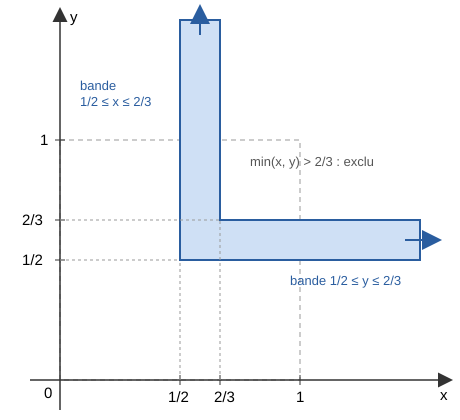
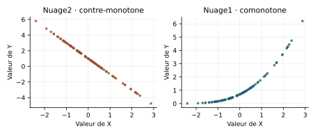

# BCE ECG — Mathématiques 2 approfondies (ESCP-HEC) 2026 · Corrigé guidé

*Corrigé rédigé par IA, non officiel. Signalez toute erreur.*

**Rédaction** · Claude Opus 5.5 · effort non renseigné · vitesse non renseignée

**Révision (tour 1)** · modèle non renseigné · effort non renseigné · vitesse non renseignée

**Révision (tour 2)** · modèle non renseigné · effort non renseigné · vitesse non renseignée

**Révision (tour 3)** · GPT-6.2 Astra Ultra · vitesse non renseignée

**Révision (tour 4)** · GPT-6.2 Astra Ultra · vitesse non renseignée

## Présentation du sujet

**Cadre.** Épreuve de 4 heures, conception ESCP BS – HEC Paris, sans document ni calculatrice. Un seul problème de 36 questions numérotées (54 au niveau le plus fin), en trois parties précédées de préliminaires. Selon le rapport 2026, 2836 copies ont été corrigées, avec une note péréquée moyenne de 10,84. Le rapport appelle la question 34 « dernière question » et parle d’une « Partie IV » pour les questions 28 à 32. Les numéros donnés ici suivent le sujet imprimé, qui va jusqu’à la question 36 en partie III.

**Le fil directeur.** Une **copule** est une fonction de répartition de couple dont les deux lois marginales sont uniformes sur $[0,1]$. Le théorème de Sklar dit que la loi d'un couple se décompose en ses deux lois marginales et une copule, qui porte toute la dépendance. Les bornes de Fréchet-Hoeffding $\max(u+v-1,0)$ et $\min(u,v)$ sont les copules extrêmes : elles correspondent aux couples contra-monotones et comonotones.

- **Préliminaires (Q1–Q2)** : la classe $\mathcal{F}_{(a,b)}$ des fonctions de répartition « régulières », bijection sur $]0,1[$.
- **Partie I (Q3–Q17)** : propriétés de la fonction de répartition d'un couple (limites, marges, 2-croissance, bornes de Fréchet-Hoeffding) ; étude des deux bornes comme fonctions de répartition, comonotonie et contra-monotonie ; simulations Python et lecture de nuages de points.
- **Partie II (Q18–Q26)** : fonctions 2-croissantes (contre-exemples, caractérisation par $\partial^2_{1,2}F\geqslant0$), copules (marges uniformes, copule de survie, caractère lipschitzien et continuité).
- **Partie III (Q27–Q36)** : démonstration du théorème de Sklar, copule logistique de Gumbel, copules de Gumbel-Barnett.

**Notions du programme.** Fonctions de répartition, variables à densité, continuité monotone des probabilités, théorème de la limite monotone, théorème de la bijection, fonctions de deux variables de classe $\mathcal{C}^2$ et théorème de Schwarz, intégrales sur un segment, trinôme du second degré, Python (`numpy.random`, `scipy.special`, `matplotlib`).

**Difficulté.** Le sujet manipule surtout des **événements** et des **inégalités** ; peu de calculs. La difficulté est la rigueur : distinguer un événement de sa probabilité, l'égalité en loi de l'égalité presque sûre, et traiter les cas au bord ($0$, $1$, extrémités des intervalles).

**Questions à ne pas laisser passer.** Q1, Q2, Q3, Q4, Q7, Q8, Q9, Q10(a), Q13, Q17, Q18, Q19, Q20, Q23, Q24, Q26(a)–(c), Q30, Q35.

**Gestion du temps.** Environ 15 minutes pour les préliminaires, 1 h 30 pour la partie I, 1 h pour la partie II et 1 h pour la partie III.

> [!JURY]
> Le rapport 2026 recommande de « Distinguer clairement les événements des probabilités » et relève une « Confusion entre égalité en loi et égalité presque sûre ». C'est tout l'enjeu des questions 10 à 15.

---

## Préliminaires

On vérifie que les fonctions de $\mathcal{F}_{(a,b)}$ sont inversibles « là où il faut » et que les lois à densité usuelles y appartiennent.

### Question 1

> [!INDICATION]
> Théorème de la bijection : quelle est l'image d'un intervalle ouvert par une fonction continue strictement croissante ?

#### Solution

$g$ est continue et strictement croissante sur $]a,b[$ : elle réalise une bijection de $]a,b[$ sur $]\lim_ag,\lim_bg[\,=\,]0,1[$.

> [!JURY]
> Le rapport 2026 conseille de « Connaître les théorèmes fondamentaux (théorème d'encadrement, bijection). »

### Question 2

> [!INDICATION]
> Vérifier un à un les points de la définition de $\mathcal{F}_{(a,b)}$ : continuité, croissance, valeurs, régularité sur $]a,b[$, stricte croissance, limites aux bornes.

> [!INDICATION]
> Sur $]a,b[$, écrire $F_X(x)=F_X(x_0)+\int_{x_0}^xf$ ; aux bornes finies, utiliser que $f$ est nulle hors de $]a,b[$.

#### Solution

$F_X$ est une fonction de répartition continue (variable à densité), à valeurs dans $[0,1]$, croissante. Sur $]a,b[$, elle est de classe $\mathcal{C}^1$, de dérivée $f>0$ : elle y est strictement croissante.

Si $a$ est fini, $F_X(a)=\int_{-\infty}^af=0$ et la limite en $a$ est nulle par continuité ; si $a=-\infty$, c'est une propriété des fonctions de répartition. De même la limite en $b$ vaut $1$.

> [!PIEGE]
> Quand $a$ ou $b$ est fini, la « limite en $a$ » n'est pas la limite en $-\infty$ : il faut utiliser que $f$ est nulle hors de $]a,b[$.

---

## Partie I — Fonction de répartition d'un couple : propriétés et exemples

Les questions 3 à 8 sont générales et reposent sur des inclusions d'événements et la continuité monotone. Les questions 9 à 17 étudient deux exemples : les bornes de Fréchet-Hoeffding.

### Question 3

> [!INDICATION]
> Majorer $F_{(X,Y)}(t,y)$ par une fonction de répartition d'une seule variable.

#### Solution

$0\leqslant F_{(X,Y)}(t,y)\leqslant F_X(t)\to0$ quand $t\to-\infty$ ; par encadrement, la limite est nulle. De même pour la seconde variable.

> [!JURY]
> Le rapport 2026 signale une « Mauvaise application du théorème d'encadrement » : écrire les deux inégalités, et la limite des deux bornes.

### Question 4(a)

> [!INDICATION]
> Pour tout $\omega$, $Y(\omega)$ est un réel : il existe un entier qui le majore.

#### Solution

$[X\leqslant x]=\bigcup_{n\in\mathbb{N}}\big([X\leqslant x]\cap[Y\leqslant n]\big)$, d'où l'égalité en passant aux probabilités.

### Question 4(b)

> [!INDICATION]
> Continuité croissante pour la suite ; puis théorème de la limite monotone pour passer de la suite $(n)$ à la variable réelle $r$.

#### Solution

La réunion est croissante : $F_X(x)=\lim_nF_{(X,Y)}(x,n)$. La fonction $r\mapsto F_{(X,Y)}(x,r)$ est croissante et majorée, donc a une limite en $+\infty$, nécessairement égale à celle de la suite.

> [!PIEGE]
> La continuité croissante donne une limite **de suite**. Pour une limite quand $r\to+\infty$ réel, il faut la monotonie de $r\mapsto F_{(X,Y)}(x,r)$.

### Question 5

> [!INDICATION]
> Même démarche, en échangeant les rôles de $X$ et $Y$.

#### Solution

$[Y\leqslant y]=\bigcup_n\big([X\leqslant n]\cap[Y\leqslant y]\big)$, puis continuité croissante et limite monotone : $F_Y(y)=\lim_{t\to+\infty}F_{(X,Y)}(t,y)$.

### Question 6

> [!INDICATION]
> Les limites intérieures se calculent avec 4(b) et 5.

#### Solution

$\lim_{t\to+\infty}\big(\lim_{r\to+\infty}F_{(X,Y)}(t,r)\big)=\lim_{t\to+\infty}F_X(t)=1$, et de même dans l'autre ordre avec $F_Y$.

### Question 7

> [!INDICATION]
> Interpréter l'expression $F(b_1,b_2)-F(a_1,b_2)-F(b_1,a_2)+F(a_1,a_2)$ comme la probabilité qu'un point aléatoire tombe dans un rectangle.

> [!INDICATION]
> Faire la différence en deux temps : d'abord en $x$, puis en $y$, en utilisant des inclusions d'événements.

#### Solution

$$\begin{aligned}
&F_{(X,Y)}(b_1,b_2)-F_{(X,Y)}(a_1,b_2)-F_{(X,Y)}(b_1,a_2)+F_{(X,Y)}(a_1,a_2)\\
&\quad=\mathbb{P}\big([a_1<X\leqslant b_1]\cap[a_2<Y\leqslant b_2]\big)\geqslant0 .
\end{aligned}$$

> [!METHODE]
> L'accroissement double d'une fonction de répartition sur un rectangle $]a_1,b_1]\times]a_2,b_2]$ est la probabilité de ce rectangle : c'est l'analogue en dimension 2 de $F(b)-F(a)=\mathbb{P}(a<X\leqslant b)$.

### Question 8(a)

> [!INDICATION]
> Inclusion d'événements.

#### Solution

$[X\leqslant x]\cap[Y\leqslant y]$ est inclus dans chacun des deux événements, d'où $F_{(X,Y)}(x,y)\leqslant\min(F_X(x),F_Y(y))$.

### Question 8(b)

> [!INDICATION]
> Formule de Poincaré pour deux événements, et $\mathbb{P}(A\cup B)\leqslant1$.

#### Solution

$\mathbb{P}(A\cap B)=\mathbb{P}(A)+\mathbb{P}(B)-\mathbb{P}(A\cup B)\geqslant F_X(x)+F_Y(y)-1$, et $\mathbb{P}(A\cap B)\geqslant0$.

### Question 9

> [!INDICATION]
> Utiliser 4(b) ; que vaut $\lim_{+\infty}F_2$ quand $b_2$ est fini ?

#### Solution

Pour $F\in\mathcal{F}_{(a,b)}$, $\lim_{+\infty}F=1$ (si $b$ est fini, $F$ vaut $1$ à droite de $b$ par croissance).

Donc $F_X(x)=\lim_r\min(F_1(x),F_2(r))=F_1(x)$, et de même $F_Y=F_2$.

### Question 10(a)

> [!INDICATION]
> Montrer d'abord, pour $u\in\,]0,1[$, l'égalité d'événements $[F_1(X)\leqslant u]=[X\leqslant F_1^{-1}(u)]$.

> [!INDICATION]
> Distinguer $x\leqslant F_1^{-1}(u)$, $F_1^{-1}(u)<x<b_1$ et $x\geqslant b_1$. Les cas $u\leqslant0$, $u\geqslant1$ se traitent à part.

#### Solution

Pour $u\in\,]0,1[$, $[F_1(X)\leqslant u]=[X\leqslant F_1^{-1}(u)]$, car $F_1$ est croissante, strictement croissante sur $]a_1,b_1[$ et égale à $1$ au-delà de $b_1$. Donc

$$\mathbb{P}(U\leqslant u)=F_1(F_1^{-1}(u))=u .$$

$U$ est à valeurs dans $[0,1]$, et $\mathbb{P}(U\leqslant0)=\lim_{u\to0^+}u=0$ (continuité à droite). **$U$, et de même $V$, suivent la loi uniforme sur $[0,1]$.**

> [!JURY]
> Le rapport 2026 cite une « Mauvaise interprétation des notations (ex. $F_X(X) = P[X \leqslant X] = 1$ bloquant certains candidats). » $F_X(X)$ est la variable aléatoire $\omega\mapsto F_X(X(\omega))$ : on remplace l'argument de $F_X$, pas la variable dans l'événement.

### Question 10(b)

> [!INDICATION]
> Pour $(u,v)\in\,]0,1[^2$, utiliser 10(a) pour revenir à $F_{(X,Y)}$. Traiter ensuite les autres cas.

#### Solution

Pour $(u,v)\in\,]0,1[^2$ :

$$\begin{aligned}
F_{(U,V)}(u,v) &= F_{(X,Y)}\big(F_1^{-1}(u),F_2^{-1}(v)\big)\\
&= \min(u,v).
\end{aligned}$$

Si $u\leqslant0$ ou $v\leqslant0$, la probabilité est nulle ; si $u\geqslant1$, elle vaut $F_V(v)$ ; si $v\geqslant1$, $F_U(u)$.

En notant $\varphi$ la fonction de répartition de $\mathcal{U}([0,1])$ : $F_{(U,V)}(x,y)=\min(\varphi(x),\varphi(y))$ sur $\mathbb{R}^2$.

### Question 10(c)

> [!INDICATION]
> Traduire séparément $\min(\varphi(x),\varphi(y))\geqslant\frac12$ et $\min(\varphi(x),\varphi(y))\leqslant\frac23$.

#### Solution

La première condition équivaut à $x\geqslant\frac12$ et $y\geqslant\frac12$ ; la seconde à $x\leqslant\frac23$ ou $y\leqslant\frac23$. L'ensemble est la réunion des demi-bandes $[\frac12,\frac23]\times[\frac12,+\infty[$ et $[\frac12,+\infty[\times[\frac12,\frac23]$.



> [!PIEGE]
> L'ensemble n'est pas borné : $F_{(U,V)}$ est définie sur tout $\mathbb{R}^2$, et vaut par exemple $\min(1,\varphi(y))=\varphi(y)$ pour $x\geqslant1$.

### Question 10(d)

> [!INDICATION]
> Sur $[U-V>\frac1n]$, localiser $U$ dans l'un des intervalles $]\frac kn,\frac{k+1}n]$, puis majorer $V$.

#### Solution

Si $U-V>\frac1n$, alors $U>\frac1n$ (car $V\geqslant0$), et $U\leqslant1$.

Il existe donc $k\in[\![1;n-1]\!]$ avec $\frac kn<U\leqslant\frac{k+1}n$, et alors $V<U-\frac1n\leqslant\frac kn$.

D'où l'inclusion dans la réunion, puis l'inégalité par sous-additivité.

### Question 10(e)

> [!INDICATION]
> Chaque terme de la somme se calcule avec $F_{(U,V)}$, comme en Q7.

> [!INDICATION]
> Écrire $[U>V]$ comme une réunion croissante d'événements $[U-V>\frac1n]$.

#### Solution

$$\begin{aligned}
\mathbb{P}\Big(\Big[\tfrac kn<U\leqslant\tfrac{k+1}n\Big]\cap\Big[V\leqslant\tfrac kn\Big]\Big) &= \min\Big(\tfrac{k+1}n,\tfrac kn\Big)-\min\Big(\tfrac kn,\tfrac kn\Big)\\
&= 0 .
\end{aligned}$$

Donc $\mathbb{P}(U-V>\frac1n)=0$, et par continuité croissante $\mathbb{P}(U>V)=0$ : $\mathbb{P}(U\leqslant V)=1$. Par symétrie, $\mathbb{P}(V\leqslant U)=1$, et l'intersection de deux événements presque sûrs est presque sûre : $\mathbb{P}(U=V)=1$.

> [!PIEGE]
> $U$ et $V$ ont la même loi (uniforme) : cela ne suffit pas à conclure $U=V$ ps. C'est la loi **du couple** qui donne l'égalité presque sûre.

### Question 10(f)

> [!INDICATION]
> Pour appliquer $F_1^{-1}$ à $F_1(X)$, il faut savoir que $X\in\,]a_1,b_1[$ : est-ce presque sûr ?

#### Solution

$\mathbb{P}(X\leqslant a_1)=0$ et $\mathbb{P}(X\geqslant b_1)=0$ (continuité de $F_1$ et limites $0$, $1$ aux bornes).

Sur l'événement presque sûr $[U=V]\cap[a_1<X<b_1]$, $F_1(X)=F_2(Y)\in\,]0,1[$, donc $X=F_1^{-1}(F_2(Y))$.

> [!METHODE]
> Schéma général : une égalité presque sûre $A=B$ s'obtient en exhibant un événement presque sûr sur lequel on peut écrire la chaîne d'égalités. On intersecte autant d'événements presque sûrs que nécessaire ($[U=V]$, $[a_1<X<b_1]$…) : une intersection finie (ou dénombrable) d'événements presque sûrs est presque sûre.

### Question 11

> [!INDICATION]
> Composer les fonctions trouvées en 10(f) et vérifier leur monotonie ; échanger les rôles de $X$ et $Y$.

#### Solution

$g=F_1^{-1}\circ F_2$ est croissante sur $]a_2,b_2[$ et $X=g(Y)$ ps ; symétriquement $h=F_2^{-1}\circ F_1$ est croissante et $Y=h(X)$ ps.

### Question 12

> [!INDICATION]
> Simuler $X\hookrightarrow\mathcal{N}(0,1)$, puis prendre $Y=F_2^{-1}(F_1(X))$ ; la réciproque de la fonction de répartition de $\mathcal{E}(1)$ se calcule à la main.

#### Solution

```python
def Nuage1():
    X = rd.normal(0, 1, 100)
    Y = -sp.log_ndtr(-X)
    plt.plot(X, Y, linestyle='', marker='*')
    plt.show()
```

La symétrie normale donne $1-\Phi(x)=\Phi(-x)$. La fonction `sp.log_ndtr` calcule directement $\ln\Phi$. Pour $x=10$, la soustraction `1 - sp.ndtr(10)` est arrondie à zéro, alors que la valeur de $Y$ vaut environ $53{,}23$.

Le couple $(F_1^{-1}(W),F_2^{-1}(W))$, avec $W=\Phi(X)$ uniforme, a pour fonction de répartition $\min(F_1(x),F_2(y))$ : c'est bien le couple de l'exemple.

> [!JURY]
> Le rapport 2026 note que « Le Python a été peu maîtrisé » et recommande de « Maîtriser les bibliothèques de base pour les simulations probabilistes ».

### Question 13

> [!INDICATION]
> Même démarche qu'en Q9.

#### Solution

$F_X(x)=\lim_r\max(F_1(x)+F_2(r)-1,0)=\max(F_1(x),0)=F_1(x)$ ; de même $F_Y=F_2$.

### Question 14(a)

> [!INDICATION]
> Les lois de $U$ et $V$ s'obtiennent comme en 10(a). Pour $1-V$, passer au complémentaire.

> [!INDICATION]
> Pour le couple $(U,1-V)$, écrire $[1-V\leqslant w]=[V\geqslant1-w]$ et retrancher la probabilité de $[U\leqslant u]\cap[V<1-w]$.

#### Solution

$U$, $V$ et $1-V$ suivent la loi uniforme sur $[0,1]$.

Pour $(u,v)\in\,]0,1[^2$, $F_{(U,V)}(u,v)=\max(u+v-1,0)$, et pour $(u,w)\in\,]0,1[^2$ :

$$\begin{aligned}
F_{(U,1-V)}(u,w) &= u-\mathbb{P}\big([U\leqslant u]\cap[V<1-w]\big)\\
&= u-\max(u-w,0)\\
&= \min(u,w).
\end{aligned}$$

Avec les cas au bord : $F_{(U,1-V)}(x,y)=\min(\varphi(x),\varphi(y))$ sur $\mathbb{R}^2$.

> [!PIEGE]
> $\mathbb{P}(U\leqslant u,V<c)$ n'est pas directement une valeur de $F_{(U,V)}$ : on l'obtient comme limite à gauche en $c$, et $F_{(U,V)}$ est continue ici.

### Question 14(b)

> [!INDICATION]
> Le couple $(U,1-V)$ a la même fonction de répartition que le couple de Q10(b) : quelles hypothèses les questions 10(d)–(e) utilisaient-elles ?

#### Solution

10(d)–(e) n'utilisent que la fonction de répartition du couple et le fait qu'il est à valeurs dans $[0,1]^2$ : elles s'appliquent à $(U,1-V)$ et donnent $\mathbb{P}(U=1-V)=1$.

### Question 14(c)

> [!INDICATION]
> Comme en 10(f).

#### Solution

Sur l'événement presque sûr $[U=1-V]\cap[a_1<X<b_1]$, $F_1(X)=1-F_2(Y)\in\,]0,1[$, donc $X=F_1^{-1}(1-F_2(Y))$ ps.

### Question 15

> [!INDICATION]
> Monotonie de $y\mapsto F_1^{-1}(1-F_2(y))$ ; symétrie des rôles.

#### Solution

$g:y\mapsto F_1^{-1}(1-F_2(y))$ est décroissante et $X=g(Y)$ ps ; de même $h:x\mapsto F_2^{-1}(1-F_1(x))$ est décroissante et $Y=h(X)$ ps.

### Question 16

> [!INDICATION]
> $F_2(y)=\Phi\big(\frac{y-1}2\big)$ : calculer $F_2^{-1}$ à l'aide de $\Phi^{-1}$, fournie par `sp.ndtri`.

#### Solution

```python
def Nuage2():
    X = rd.normal(0, 1, 100)
    Y = 1 - 2 * X
    plt.plot(X, Y, linestyle='', marker='*')
    plt.show()
```

Comme $1-\Phi(x)=\Phi(-x)$, on a $Y=1-2X$ : le nuage est porté par une droite de pente $-2$.

### Question 17

> [!INDICATION]
> Comonotonie : nuage porté par une courbe croissante. Contra-monotonie : par une courbe décroissante. Regarder aussi le signe des ordonnées.

#### Solution

(a) droite décroissante, ordonnées de $-4$ à $6$ : **`Nuage2`** ($Y=1-2X$). (b) courbe croissante et convexe, ordonnées positives : **`Nuage1`** ($Y=-\ln(1-\Phi(X))\geqslant0$).

---



## Partie II — Fonctions 2-croissantes et copules 2-dimensionnelles

### Partie A : Fonctions 2-croissantes

On compare la 2-croissance à la croissance par rapport à chaque variable, puis on la caractérise, pour une fonction $\mathcal{C}^2$, par le signe de la dérivée croisée.

> [!METHODE]
> Un changement croissant de coordonnées conserve l’ordre des points. Les lois marginales influencent la forme du nuage, comme le montrent la droite et la courbe des questions 16 et 17. Comonotonie et contra-monotonie sont les cas extrêmes, où le nuage est porté par le graphe d'une fonction monotone ; ils correspondent aux copules $\min(u,v)$ et $\max(u+v-1,0)$, bornes de Fréchet-Hoeffding.

### Question 18(a)

> [!INDICATION]
> Écrire $t\mapsto\max(t,y_0)$ par morceaux.

#### Solution

Elle vaut $y_0$ pour $t\leqslant y_0$ et $t$ pour $t\geqslant y_0$ : elle est croissante ; de même pour l'autre variable.

### Question 18(b)

> [!INDICATION]
> Un rectangle bien choisi, avec des coordonnées $0$ et $1$, suffit.

#### Solution

Pour $(0,0)$ et $(1,1)$ : $f_1(1,1)-f_1(0,1)-f_1(1,0)+f_1(0,0)=1-1-1+0=-1<0$.

> [!JURY]
> Le rapport 2026 relève une « Difficulté à construire des contre-exemples simples » et recommande de « Savoir construire des contre-exemples simples. » Ici, les quatre valeurs de la fonction aux sommets du carré suffisent pour calculer un accroissement négatif.

### Question 19(a)

> [!INDICATION]
> Factoriser l'accroissement double.

#### Solution

$b_1b_2-a_1b_2-b_1a_2+a_1a_2=(b_1-a_1)(b_2-a_2)\geqslant0$.

### Question 19(b)

> [!INDICATION]
> Choisir $y$ négatif.

#### Solution

Pour $y=-1$, $t\mapsto-t$ est décroissante.

> [!JURY]
> Le rapport 2026 note que « La question 19(b) (contre-exemple simple) a été globalement bien comprise et traitée. »

### Question 20

> [!INDICATION]
> Que montrent $f_1$ et $f_2$ sur les implications entre « croissante en chaque variable » et « 2-croissante » ?

#### Solution

Aucune des deux propriétés n'entraîne l'autre : $f_1$ est croissante en chaque variable sans être 2-croissante, $f_2$ est 2-croissante sans être croissante en chaque variable.

### Question 21(a)

> [!INDICATION]
> Calculer d'abord la limite intérieure en $t$ (dérivée partielle par rapport à la seconde variable), puis la limite en $h$.

#### Solution

Quand $t\to0$, le quotient tend vers $\frac{\partial_2F(x+h,y)-\partial_2F(x,y)}h$, qui tend vers $\partial_1(\partial_2F)(x,y)$ quand $h\to0$.

Par le théorème de Schwarz ($F$ de classe $\mathcal{C}^2$), c'est $\partial^2_{1,2}F(x,y)$.

> [!PIEGE]
> Les deux limites sont **successives**, pas simultanées : on ne peut pas faire tendre $(h,t)$ vers $(0,0)$ ensemble sans argument supplémentaire.

### Question 21(b)

> [!INDICATION]
> Pour $h>0$ et $t>0$ petits, le quotient est positif par 2-croissance. Passer à la limite.

#### Solution

Pour $(x,y)\in I\times J$ et $h,t>0$ assez petits ($I$, $J$ ouverts), le quotient est positif ; ses limites successives à droite valent $\partial^2_{1,2}F(x,y)$, qui est donc positive.

### Question 22(a)

> [!INDICATION]
> Intégrer d'abord en $x$ : $\partial^2_{1,2}F$ est la dérivée en $x$ de $\partial_2F$. Puis intégrer en $y$.

#### Solution

$$\begin{aligned}
\int_{a_1}^{b_1}\partial^2_{1,2}F(x,y)\,\mathrm{d}x &= \partial_2F(b_1,y)-\partial_2F(a_1,y),\\
\int_{a_2}^{b_2}\big(\partial_2F(b_1,y)-\partial_2F(a_1,y)\big)\,\mathrm{d}y &= F(b_1,b_2)-F(b_1,a_2)-F(a_1,b_2)+F(a_1,a_2).
\end{aligned}$$

### Question 22(b)

> [!INDICATION]
> Un sens est la question 21 ; l'autre vient de la positivité de l'intégrale.

#### Solution

Si $\partial^2_{1,2}F\geqslant0$ sur $I\times J$, le rectangle $[a_1,b_1]\times[a_2,b_2]$ est dans $I\times J$ et l'intégrale double itérée de 22(a) est positive : $F$ est 2-croissante. La réciproque est 21(b).

> [!METHODE]
> En dimension 1, « croissante » se lit sur $f'\geqslant0$ ; en dimension 2, « 2-croissante » se lit sur $\partial^2_{1,2}F\geqslant0$. La preuve est la même : intégrer la dérivée.

### Question 23

> [!INDICATION]
> Appliquer la 2-croissance au rectangle de sommets $(a_1,s)$ et $(b_1,y)$, puis faire tendre $s$ vers $-\infty$.

#### Solution

Pour $s\leqslant y$ et $a_1\leqslant b_1$ : $F(b_1,y)-F(a_1,y)\geqslant F(b_1,s)-F(a_1,s)\to0$ quand $s\to-\infty$. Donc $t\mapsto F(t,y)$ est croissante ; de même pour l'autre variable.

> [!METHODE]
> C'est la réponse à la question 20 dans le cas des fonctions de répartition : 2-croissance **et** limites nulles en $-\infty$ entraînent la croissance en chaque variable.

### Partie B : Copule 2-dimensionnelle

### Question 24

> [!INDICATION]
> $V$ est à valeurs dans $[0,1]$ : que vaut $\mathbb{P}([U\leqslant u]\cap[V\leqslant1])$ ?

#### Solution

Pour $u\in[0,1]$, $\mathbb{P}(U\leqslant u)=C(u,1)=u$ ; avec $U\in[0,1]$, $U\hookrightarrow\mathcal{U}([0,1])$. De même $V\hookrightarrow\mathcal{U}([0,1])$ grâce à $C(1,v)=v$.

### Question 25

> [!INDICATION]
> Vérifier les quatre conditions au bord, puis la 2-croissance : la partie affine $u+v-1$ disparaît de l'accroissement double.

> [!INDICATION]
> Le changement $u\mapsto1-u$, $v\mapsto1-v$ renverse l'ordre ; vérifier qu'on retombe sur un accroissement double de $C$ sur un rectangle bien orienté.

#### Solution

$C^*(0,x)=x-1+C(1,1-x)=0$, $C^*(1,x)=x+C(0,1-x)=x$, et de même dans l'autre variable. L'accroissement double de $C^*$ sur $[a_1,b_1]\times[a_2,b_2]$ vaut celui de $C$ sur $[1-b_1,1-a_1]\times[1-b_2,1-a_2]$, positif.

Si $(U,V)$ est le couple associé à $C$, les marges uniformes n’ont pas d’atomes. Pour $u,v\in[0,1]$, le passage au complément donne
$$\begin{aligned}
\mathbb P(1-U\le u,\,1-V\le v)
&=1-\mathbb P(U<1-u)-\mathbb P(V<1-v)\\
&\quad+\mathbb P(U<1-u,\,V<1-v)\\
&=u+v-1+C(1-u,1-v)=C^*(u,v).
\end{aligned}$$

### Question 26(a)

> [!INDICATION]
> Deux applications de la 2-croissance : avec les rectangles $[u_1,u_2]\times[0,v]$ et $[u_1,u_2]\times[v,1]$.

#### Solution

Avec $(u_1,0),(u_2,v)$ et $C(\cdot,0)=0$ : $C(u_2,v)-C(u_1,v)\geqslant0$. Avec $(u_1,v),(u_2,1)$ et $C(\cdot,1)=\mathrm{id}$ : $C(u_2,v)-C(u_1,v)\leqslant u_2-u_1$. De même pour la seconde variable.

### Question 26(b)

> [!INDICATION]
> Inégalité triangulaire en passant par le point intermédiaire $(u_1,v_2)$.

#### Solution

$$\begin{aligned}
|C(u_2,v_2)-C(u_1,v_1)| &\leqslant |C(u_2,v_2)-C(u_1,v_2)|+|C(u_1,v_2)-C(u_1,v_1)|\\
&\leqslant |u_2-u_1|+|v_2-v_1| .
\end{aligned}$$

### Question 26(c)

> [!INDICATION]
> Majorer $|u-u_0|+|v-v_0|$ par un multiple de la norme euclidienne de $(u,v)-(u_0,v_0)$.

#### Solution

$|C(u,v)-C(u_0,v_0)|\leqslant2\|(u,v)-(u_0,v_0)\|\to0$ : $C$ est continue en tout point de $[0,1]^2$.

> [!JURY]
> Rapport 2026 : « Peu de candidats ont su utiliser la norme euclidienne pour montrer la continuité ».

---

## Partie III — Démonstration du théorème de Sklar et application

### Partie A : le théorème

On construit la copule d'un couple à marges régulières en « uniformisant » les marges, puis on montre qu'elle est unique.

### Question 27(a)

> [!INDICATION]
> Sur $]0,1[^2$, réutiliser l'égalité d'événements de 10(a) pour chacune des deux variables.

> [!INDICATION]
> Sur le bord, utiliser que $F_X(X)$ et $F_Y(Y)$ suivent la loi uniforme sur $[0,1]$.

#### Solution

Sur $]0,1[^2$ : $\mathbb{P}([F_X(X)\leqslant x]\cap[F_Y(Y)\leqslant y])=F_{(X,Y)}(F_X^{-1}(x),F_Y^{-1}(y))=C(x,y)$.

Au bord : pour $y=1$, la probabilité vaut $\mathbb{P}(F_X(X)\leqslant x)=x$ ; pour $x=1$, elle vaut $y$ ; si $x=0$ ou $y=0$, elle est nulle.

> [!PIEGE]
> L'égalité $C(x,y)=\mathbb{P}([F_X(X)\leqslant x]\cap[F_Y(Y)\leqslant y])$ doit être vérifiée **aussi sur le bord** de $[0,1]^2$ : c'est là que la définition de $C$ est donnée « à la main », et c'est elle qui sert en 27(b) pour $a_1=0$ ou $b_1=1$.

### Question 27(b)

> [!INDICATION]
> $C$ est la restriction à $[0,1]^2$ d'une fonction de répartition de couple : utiliser Q7.

#### Solution

$C$ coïncide sur $[0,1]^2$ avec la fonction de répartition de $(F_X(X),F_Y(Y))$, 2-croissante par Q7.

### Question 27(c)

> [!INDICATION]
> Il reste les conditions au bord, lisibles sur la définition de $C$.

#### Solution

$C(1,x)=C(x,1)=x$ par définition, et $C(0,x)=C(x,0)=0$ (cas « sinon », branche $y=1$ au point $(0,1)$ et branche $x=1$ au point $(1,0)$). Avec 27(b), $C$ est une copule.

### Question 28

> [!INDICATION]
> Existence : distinguer selon que $F_X(x)$ et $F_Y(y)$ sont dans $]0,1[$, égaux à $0$ ou égaux à $1$.

> [!INDICATION]
> Unicité : sur $]0,1[^2$, tout point s'écrit $(F_X(x),F_Y(y))$ ; sur le bord, toutes les copules coïncident.

#### Solution

*Existence* avec la copule $C$ de 27, en posant $u=F_X(x)$, $v=F_Y(y)$ :

- si $u,v\in\,]0,1[$, alors $x=F_X^{-1}(u)$, $y=F_Y^{-1}(v)$, et $C(u,v)=F_{(X,Y)}(x,y)$ par définition ;
- si $u=1$, $\mathbb{P}(X>x)=0$, donc $F_{(X,Y)}(x,y)=F_Y(y)=C(1,v)$ ; de même si $v=1$ ;
- si $u=0$ ou $v=0$, $F_{(X,Y)}(x,y)=0$ par 8(a), et $C(u,v)=0$.

*Unicité* : si $C'$ convient, pour $(u,v)\in\,]0,1[^2$, $C'(u,v)=F_{(X,Y)}(F_X^{-1}(u),F_Y^{-1}(v))=C(u,v)$ ; au bord, $C'=C$ par définition d'une copule.

> [!PIEGE]
> Dans le théorème admis imprimé page 6, sous la question 28, on lit $C(F_1(x),F_2(x))$ : il faut lire $C(F_1(x),F_2(y))$.

### Question 29

> [!INDICATION]
> Q4(b) et la continuité de $C$ (Q26(c)).

#### Solution

$F_{X_1}(x_1)=\lim_rC(F_1(x_1),F_2(r))=C(F_1(x_1),1)=F_1(x_1)$, par continuité de $C$ et $F_2(r)\to1$. De même $F_{X_2}=F_2$.

### Partie B : un premier exemple, la distribution logistique bivariée de Gumbel

> [!METHODE]
> Une loi de couple se donne souvent par sa fonction de répartition : les lois marginales s'obtiennent par passage à la limite dans l'autre variable (Q4(b) et Q5), sans calcul d'intégrale. Pour montrer qu'une marginale est à densité, on vérifie que sa fonction de répartition est continue et de classe $\mathcal{C}^1$ sauf peut-être en un nombre fini de points.

### Question 30

> [!INDICATION]
> Calculer la fonction de répartition marginale par Q4(b), puis la dériver.

#### Solution

$F_{Z_1}(x)=\frac1{1+\mathrm{e}^{-x}}$, de classe $\mathcal{C}^1$ sur $\mathbb{R}$ : $Z_1$ est à densité, de densité

$$f_{Z_1}(x)=\frac{\mathrm{e}^{-x}}{(1+\mathrm{e}^{-x})^2},$$

et $Z_2$ a la même loi logistique.

### Question 31

> [!INDICATION]
> Inverser la fonction de répartition logistique, puis remplacer dans $F$.

#### Solution

$F_{Z_1}^{-1}(u)$ vérifie $\mathrm{e}^{-x}=\frac1u-1$. Donc, pour $(u,v)\in\,]0,1[^2$,

$$C(u,v)=\frac1{\frac1u+\frac1v-1}=\frac{uv}{u+v-uv},$$

formule qui reste valable au bord de $[0,1]^2$ sauf en $(0,0)$, où $C$ vaut $0$.

> [!METHODE]
> Pour trouver la copule d'une loi de couple connue, on compose sa fonction de répartition avec les réciproques des fonctions de répartition marginales : $C(u,v)=F(F_1^{-1}(u),F_2^{-1}(v))$.

### Partie C : un deuxième exemple, la famille des copules de Gumbel-Barnett

### Question 32(a)

> [!INDICATION]
> $g$ est un trinôme en $\theta$ ; signe de son coefficient dominant, abscisse de son sommet.

> [!INDICATION]
> Selon la position de $\theta_*$ par rapport à $0$ et $1$, trois tableaux. Calculer $g(0)$ et $g(1)$.

#### Solution

Avec $p=\ln u_1<0$ et $q=\ln v_1<0$, $g(\theta)=pq\,\theta^2-(1+p+q)\theta+1$, $pq>0$ : $g$ décroît puis croît, de sommet en $\theta_*$.

On a $g(0)=1$ et $g(1)=pq-p-q>0$.

| Cas | Variations sur $[0,1]$ |
|---|---|
| $\theta_*\leqslant0$ | croissante |
| $0<\theta_*<1$ | décroissante puis croissante, minimum en $\theta_*$ |
| $\theta_*\geqslant1$ | décroissante |

### Question 32(b)

> [!INDICATION]
> Dans les cas monotones, regarder les valeurs aux bornes. Dans le cas central, encadrer $1+p+q$ grâce à $0<\theta_*<1$.

#### Solution

Cas monotones : $\min g=\min(g(0),g(1))>0$. Cas $0<\theta_*<1$ : $0<1+p+q<2pq$, d'où

$$g(\theta_*)=1-\frac{(1+p+q)^2}{4pq}>1-pq,$$

et $pq<1$ car $|p|+|q|<1$. Donc $g>0$ sur $[0,1]$.

> [!PIEGE]
> Le discriminant de $g$ peut être positif (par exemple pour $u_1,v_1$ proches de $1$) : ce n'est pas lui qui conclut, mais la position de $\theta_*$ par rapport à $[0,1]$.

On peut aussi lire le signe sans localiser le minimum. Avec $p=\ln u_1<0$ et $q=\ln v_1<0$,
$$g(\theta)=(1-\theta)+\theta(-p-q)+\theta^2pq.$$
Les trois termes sont positifs ou nuls. En $\theta=0$, le premier vaut $1$. Pour $0<\theta\leq1$, le deuxième est strictement positif.

### Question 33

> [!INDICATION]
> Calculer $\partial_1C_\theta$, puis dériver par rapport à $v$ ; factoriser par $\mathrm{e}^{-\theta\ln u\ln v}$.

> [!INDICATION]
> Reconnaître $g(\theta)$ dans le facteur restant, puis appliquer la caractérisation de Q22.

#### Solution

Sur $]0,1[^2$, les logarithmes, le produit et l’exponentielle sont de classe $\mathcal C^2$, donc leur composée $C_\theta$ aussi. Avec $E=\mathrm{e}^{-\theta\ln u\ln v}$ :

$$\begin{aligned}
\partial_1C_\theta(u,v) &= vE\,(1-\theta\ln v),\\
\partial^2_{2,1}C_\theta(u,v) &= E\big[(1-\theta\ln u)(1-\theta\ln v)-\theta\big].
\end{aligned}$$

Le crochet vaut $\theta^2\ln u\ln v-\theta(1+\ln u+\ln v)+1$, c'est-à-dire $g(\theta)$ pour $(u_1,v_1)=(u,v)$ : il est positif.

Pour un rectangle $[a_1,b_1]\times[a_2,b_2]\subset\,]0,1[^2$, le calcul de Q22(a) écrit l'accroissement double comme l'intégrale double itérée de $\partial^2_{1,2}C_\theta\geqslant0$ : il est positif, et $C_\theta$ est 2-croissante sur $]0,1[^2$.

### Question 34

> [!INDICATION]
> Montrer que $C_\theta$ est continue sur $[0,1]^2$, en majorant $C_\theta(u,v)$ par $uv$.

> [!INDICATION]
> Approcher un rectangle de $[0,1]^2$ par des rectangles de $]0,1[^2$ et passer à la limite.

#### Solution

Pour $(u,v)\in\,]0,1]^2$, $\ln u\ln v\geqslant0$, donc $0\leqslant C_\theta(u,v)\leqslant uv$.

Ainsi $C_\theta$ est continue sur $[0,1]^2$, y compris aux points d'une coordonnée nulle.

Avec $s_\varepsilon(t)=\varepsilon+(1-2\varepsilon)t$, qui envoie $[0,1]$ dans $]0,1[$ en conservant l'ordre, l'accroissement double sur le rectangle image est positif (Q33) ; quand $\varepsilon\to0$, la continuité donne la 2-croissance sur $[0,1]^2$.

### Question 35

> [!INDICATION]
> Vérifier les conditions au bord à partir de la définition.

#### Solution

$C_\theta(0,x)=C_\theta(x,0)=0$ (cas « sinon ») ; $C_\theta(1,x)=x\,\mathrm{e}^{0}=x$ pour $x\in\,]0,1]$, et $C_\theta(1,0)=0$. Par symétrie, $C_\theta(x,1)=x$ aussi. Avec Q34, $C_\theta$ est une copule.

### Question 36

> [!INDICATION]
> Reconnaître $F_{(X,Y)}(x,y)=C_\theta(F_1(x),F_2(y))$ pour un $\theta$ et deux fonctions de répartition usuelles.

> [!INDICATION]
> Conclure avec Q4(b) et la continuité de la copule (ou par un calcul direct de limite).

#### Solution

Avec $F_1(x)=1-\mathrm{e}^{-x}$ et $F_2(y)=1-\mathrm{e}^{-2y}$ (nulles sur $\mathbb{R}_-$), $F_{(X,Y)}=C_1(F_1,F_2)$ sur $\mathbb{R}^2$. Par Q4(b) et continuité de $C_1$ :

$$F_X(x)=C_1(F_1(x),1)=F_1(x),$$

et de même $F_Y=F_2$. **$X\hookrightarrow\mathcal{E}(1)$ et $Y\hookrightarrow\mathcal{E}(2)$.**

> [!JURY]
> Le rapport 2026 recommande de « Vérifier la cohérence des résultats (ex. une probabilité ne peut pas dépasser 1). » Ici, on peut contrôler que $F_X$ obtenue est bien une fonction de répartition.

---

## Bilan

**Méthodes à retenir.**

- Passer d'une suite à une variable réelle : continuité monotone pour la suite, puis théorème de la limite monotone.
- Accroissement double d'une fonction de répartition = probabilité d'un rectangle.
- Transformation par la fonction de répartition : pour $F\in\mathcal{F}_{(a,b)}$, $[F(X)\leqslant u]=[X\leqslant F^{-1}(u)]$, donc $F(X)$ est uniforme sur $[0,1]$.
- Réciproquement, si $W\hookrightarrow\mathcal{U}([0,1])$, alors $F^{-1}(W)$ a pour fonction de répartition $F$ : c'est la méthode d'inversion, utilisée en Q12 et Q16.
- Égalité presque sûre à partir de la loi d'un couple : découper l'événement $[U>V]$ en tranches de largeur $\frac1n$, puis continuité croissante.
- 2-croissance d'une fonction $\mathcal{C}^2$ : signe de $\partial^2_{1,2}F$ ; extension au bord par continuité.
- Copule d'une loi connue : $C=F\circ(F_1^{-1},F_2^{-1})$.

**Prérequis à revoir.** Continuité monotone des probabilités, théorème de la bijection, lois usuelles et leurs fonctions de répartition, théorème de Schwarz, trinôme du second degré, bibliothèque `numpy.random`.

**Questions transposables.** Q3–Q8 (propriétés générales d'une fonction de répartition de couple), Q10(a) (transformation par la fonction de répartition), Q21–Q22 (2-croissance et dérivée croisée), Q26 (fonction lipschitzienne donc continue).
