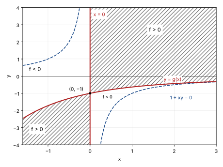

# BCE ECG — Maths appliquées (emlyon) 2026 · Corrigé guidé

*Corrigé rédigé par IA, non officiel. Signalez toute erreur.*

## Présentation du sujet

**Thème.** Trois exercices indépendants, un par grand domaine du programme. Le rapport 2026 le résume : « le sujet était composé de trois exercices correspondant aux trois thèmes au programme : analyse, algèbre et probabilités ».

- **Exercice 1 (analyse).** Point critique de $f(x,y)=x+\ln(1+xy)$, puis étude de sa ligne de niveau 0, formée de la droite $x=0$ et de la courbe de $g(x)=\frac{e^{-x}-1}x$, et enfin d'une fonction intégrale $G$.
- **Exercice 2 (algèbre).** L'endomorphisme $\varphi(M)=\mathrm{tr}(M)I-M$ de $\mathcal M_2(\mathbb R)$ donne la formule de la comatrice, une formule pour $(M+N)^{-1}$, puis l'expression de $\mathrm{tr}(M^n)$ à l'aide des polynômes de Tchebychev quand $\det M=1$.
- **Exercice 3 (probabilités discrètes).** Temps d'attente $T$ du premier double pile, calculé en découpant $T$ en une somme de variables $N_i$, simulation en Python, puis loi faible des grands nombres pour le nombre de doubles piles.

**Format.** Épreuve de 4 heures, sans calculatrice ni document ; 33 questions (11 + 8 + 14), numérotées à partir de 1 dans chaque exercice.

**Barème et statistiques (rapport 2026).** Exercice 1 : 27 % ; exercice 2 : 27 % ; exercice 3 : 42 % ; présentation et rédaction : 4 %. Sur 4 192 copies, la moyenne est de 10,55 et l'écart-type de 5,2 (quartiles 6,5 – 10,5 – 14,6). Les points de présentation et de rédaction comptaient « comme environ deux questions de difficulté moyenne ».

**Difficulté.** Les questions de cours rapportent beaucoup : gradient et point critique (Ex. 1, Q1), linéarité et matrice d'un endomorphisme (Ex. 2, Q1 à 3), lois géométriques (Ex. 3, Q1 à 3), loi de Bernoulli et Bienaymé-Tchebychev (Ex. 3, Q11 et 14). Les questions délicates sont Ex. 1 Q7 et Q11, Ex. 2 Q5.a et Q6.b, Ex. 3 Q6 et Q7, et le calcul de variance de la question 13.

**Gestion du temps.** Comptez environ 70 minutes pour l'exercice 1, 60 minutes pour l'exercice 2 et 100 minutes pour l'exercice 3, qui pèse le plus. Les parties B et C de l'exercice 3 peuvent se traiter sans la partie A.

**Notations et rappel.** Épreuve de 4 heures, sans calculatrice ni document. Les bibliothèques Python sont importées sous les noms `np`, `rd` et `plt`.

## Exercice 1 — Partie A : Étude d'une fonction de deux variables

On cherche le point critique de $f$ avec le gradient et la hessienne, puis on écrit les lignes de niveau comme des courbes $y=\varphi_k(x)$.

### Question 1

> [!INDICATION]
> a) Dérivez par rapport à une variable en considérant l'autre comme une constante.

> [!INDICATION]
> b) Commencez par la seconde composante du gradient, la plus simple.

> [!INDICATION]
> c) La nature du point critique se lit sur le signe des valeurs propres de la hessienne.

#### Solution

**a)** Sur l'ouvert $\mathcal D$, on a $1+xy>0$ et $f$ est de classe $\mathcal C^2$ (composée et somme de fonctions de classe $\mathcal C^2$). Pour $(x,y)\in\mathcal D$ :

$$\begin{aligned}\partial_1f(x,y)&=1+\frac{y}{1+xy},\\\partial_2f(x,y)&=\frac{x}{1+xy}.\end{aligned}$$

Donc

$$\boxed{\nabla f(x,y)=\begin{pmatrix}1+\dfrac{y}{1+xy}\\[2mm]\dfrac{x}{1+xy}\end{pmatrix}.}$$

**b)** $(x,y)\in\mathcal D$ est un point critique si et seulement si $\nabla f(x,y)=0$.

- La seconde équation $\frac{x}{1+xy}=0$ donne $x=0$.
- La première devient alors $1+y=0$, soit $y=-1$.

Réciproquement, $(0,-1)\in\mathcal D$ car $1+0\times(-1)=1>0$, et le gradient y est nul. **$f$ admet un unique point critique : $(x_0,y_0)=(0,-1)$.**

**c)** Pour $(x,y)\in\mathcal D$ :

$$\begin{aligned}
\partial^2_{1,1}f(x,y)&=-\frac{y^2}{(1+xy)^2},\\
\partial^2_{1,2}f(x,y)=\partial^2_{2,1}f(x,y)&=\frac{(1+xy)-yx}{(1+xy)^2}=\frac1{(1+xy)^2},\\
\partial^2_{2,2}f(x,y)&=-\frac{x^2}{(1+xy)^2}.
\end{aligned}$$

Au point $(0,-1)$, on a $1+xy=1$, d'où

$$\boxed{\nabla^2f(0,-1)=\begin{pmatrix}-1&1\\1&0\end{pmatrix}.}$$

Ses valeurs propres sont les réels $\lambda$ tels que $\nabla^2f(0,-1)-\lambda I$ n'est pas inversible, c'est-à-dire tels que

$$(-1-\lambda)(-\lambda)-1=\lambda^2+\lambda-1=0.$$

Elles valent $\lambda_1=\frac{-1-\sqrt5}2<0$ et $\lambda_2=\frac{-1+\sqrt5}2>0$. Elles sont non nulles et de signes opposés : **$(0,-1)$ est un point selle (point col) de $f$**, qui n'est donc pas un extremum local.

> [!JURY]
> Rapport 2026, sur la question 1 : « Peu de candidats ont répondu complètement à la question c), soit parce qu'ils n'ont pas réussi à déterminer le signe des valeurs propres de la hessienne, soit parce qu'ils ne connaissaient pas la notion de point selle. » Le jury relève aussi des erreurs de notation : le gradient est un vecteur, la hessienne une matrice.

> [!METHODE]
> Pour $H=\begin{pmatrix}a&b\\b&c\end{pmatrix}$, les valeurs propres sont les racines de $(a-\lambda)(c-\lambda)-b^2=0$, obtenue en écrivant que $H-\lambda I$ n'est pas inversible ; leur produit vaut donc $ac-b^2$. S'il est strictement négatif, les deux valeurs propres sont non nulles et de signes opposés : point selle.

### Question 2

> [!INDICATION]
> a) Isolez le logarithme, puis composez par l'exponentielle. Pourquoi l'hypothèse $(x,y)\in\mathcal D$ est-elle utile ?

> [!INDICATION]
> b) Il suffit de traduire la formule de a) en Python, élément par élément de la liste `X`. Pour les valeurs de $k$, évaluez la liste `K` à la main.

#### Solution

**a)** Soit $(x,y)\in\mathcal D$ avec $x\neq0$.

Comme $1+xy>0$ et que $\ln$ est une bijection de $]0,+\infty[$ sur $\mathbb R$, de réciproque $\exp$ :

$$\begin{aligned}
f(x,y)=k&\iff\ln(1+xy)=k-x\\
&\iff1+xy=e^{k-x}\\
&\iff y=\frac{e^{k-x}-1}{x}\qquad(x\neq0).
\end{aligned}$$

**b)** Ligne 5 complétée :

```python
    M = [(np.exp(k-x)-1)/x for x in X]
```

`np.linspace(-2,2,100)` renvoie les réels $-2+\frac{4i}{99}$, $0\le i\le99$, qui ne s'annulent jamais (il faudrait $i=49{,}5$) : la division par `x` est licite.

La liste `K` contient les réels $-0{,}4+\frac i5$ pour $i\in[\![0,7]\!]$. Le graphique représente donc les lignes de niveau

$$\boxed{k\in\{-0{,}4\,;\,-0{,}2\,;\,0\,;\,0{,}2\,;\,0{,}4\,;\,0{,}6\,;\,0{,}8\,;\,1\}.}$$

Le trait vertical en $x=0$ vient de ce que `plt.plot` relie le dernier point d'abscisse négative au premier d'abscisse positive : pour $k\neq0$, la fonction $x\mapsto\frac{e^{k-x}-1}x$ tend vers $\pm\infty$ de part et d'autre de $0$.

> [!JURY]
> Rapport 2026 : « Question très bien réussie même si on peut lire $e^{x+\ln(1+xy)}=e^x+e^{\ln(1+xy)}$. » Pour b), « Peu de candidats donnent la liste des valeurs de de $k$. Le programme à trou est bien réussi dans l'ensemble. »

## Exercice 1 — Partie B : Étude de la ligne de niveau zéro

La ligne de niveau 0 contient la courbe de $g$ : on étudie $g$ (signe, prolongement par continuité, dérivabilité en 0, variations) pour la tracer et pour lire le signe de $f$.

### Question 3

> [!INDICATION]
> Étudiez séparément les signes du numérateur et du dénominateur, selon le signe de $x$.

#### Solution

Soit $x\in\mathbb R^*$.

- Si $x>0$, alors $-x<0$ donc $e^{-x}<1$ : le numérateur est strictement négatif et le dénominateur strictement positif.
- Si $x<0$, alors $e^{-x}>1$ : le numérateur est strictement positif et le dénominateur strictement négatif.

Dans les deux cas, $\boxed{g(x)<0\text{ pour tout }x\in\mathbb R^*.}$

> [!JURY]
> Rapport 2026 : « L'étude du signe d'un quotient n'est pas maîtrisée. »

### Question 4

> [!INDICATION]
> Une forme indéterminée « $0/0$ » : quel développement limité de l'exponentielle connaissez-vous ?

#### Solution

Au voisinage de $0$, $e^u=1+u+\frac{u^2}2+o(u^2)$. Avec $u=-x$ :

$$e^{-x}-1=-x+\frac{x^2}2+o(x^2).$$

En divisant par $x\neq0$ :

$$g(x)=-1+\frac x2+o(x).$$

Donc $g(x)\to-1$ quand $x\to0$ : **$g$ admet un prolongement continu en $0$, en posant $g(0)=-1$.**

> [!JURY]
> Rapport 2026, questions 4 et 5 : « La plupart des candidats savent écrire la limite à calculer, mais pensent trop rarement à utiliser un développement limité. »

### Question 5

> [!INDICATION]
> Revenez à la définition : étudiez la limite du taux d'accroissement en 0, en réutilisant le développement de la question 4.

#### Solution

Pour $x\neq0$, par le développement limité de la question 4 :

$$\begin{aligned}
\frac{g(x)-g(0)}{x-0}&=\frac{g(x)+1}{x}\\
&=\frac12+o(1).
\end{aligned}$$

Le taux d'accroissement a une limite finie en $0$ : **$g$ est dérivable en $0$ et $\boxed{g'(0)=\frac12}$.**

> [!PIEGE]
> On ne peut pas calculer $g'(0)$ en remplaçant $x$ par $0$ dans l'expression de $g'(x)$ valable sur $\mathbb R^*$ : il faut le taux d'accroissement (ou un théorème de prolongement de la dérivée, qui n'est pas au programme).

### Question 6

> [!INDICATION]
> a) Dérivez un quotient.

> [!INDICATION]
> b) Le signe de $g'(x)$ est celui de son numérateur : étudiez ce numérateur comme une fonction de $x$.

> [!INDICATION]
> c) En $-\infty$, posez $u=-x$ et utilisez les croissances comparées.

#### Solution

**a)** $g$ est dérivable sur $\mathbb R^*$ comme quotient de fonctions dérivables dont le dénominateur ne s'annule pas. Pour $x\neq0$ :

$$\begin{aligned}
g'(x)&=\frac{-e^{-x}\,x-(e^{-x}-1)}{x^2}\\
&=\boxed{\frac{1-(1+x)e^{-x}}{x^2}.}
\end{aligned}$$

**b)** Posons $h(x)=1-(1+x)e^{-x}$ pour $x\in\mathbb R$. La fonction $h$ est dérivable et

$$\begin{aligned}
h'(x)&=-e^{-x}+(1+x)e^{-x}\\
&=xe^{-x}.
\end{aligned}$$

Donc $h'<0$ sur $]-\infty,0[$ et $h'>0$ sur $]0,+\infty[$.

Ainsi $h$ est strictement décroissante sur $]-\infty,0]$ et strictement croissante sur $[0,+\infty[$.

Elle admet en $0$ un minimum strict, $h(0)=0$. Ainsi $h(x)>0$ pour $x\neq0$ et, comme $x^2>0$ :

$$\boxed{g'(x)>0\text{ pour tout }x\in\mathbb R^*.}$$

**c)** *En $+\infty$.* On a $e^{-x}\to0$, donc $e^{-x}-1\to-1$, et $\frac1x\to0$ : $\boxed{\lim_{x\to+\infty}g(x)=0.}$

Plus précisément, $g(x)\sim-\frac1x$, donc $g$ tend vers $0$ par valeurs négatives.

*En $-\infty$.* Posons $u=-x\to+\infty$. Alors

$$g(x)=\frac{e^u-1}{-u}=-\frac{e^u}{u}+\frac1u.$$

Par croissances comparées, $\frac{e^u}u\to+\infty$, donc $\boxed{\lim_{x\to-\infty}g(x)=-\infty.}$

*Variations.* $g$ est continue sur $\mathbb R$ (question 4) et strictement croissante sur $]-\infty,0]$ et sur $[0,+\infty[$ (question 6.b), donc strictement croissante sur $\mathbb R$.

| $x$ | $-\infty$ | | $0$ | | $+\infty$ |
|---|---|---|---|---|---|
| $g'(x)$ | | $+$ | $\frac12$ | $+$ | |
| $g$ | $-\infty$ | $\nearrow$ | $-1$ | $\nearrow$ | $0^-$ |

> [!METHODE]
> Pour le signe d'une expression qui mélange polynôme et exponentielle, on l'étudie comme une fonction : on la dérive, on cherche son minimum, et on compare ce minimum à 0.

> [!JURY]
> Rapport 2026 : « La question b) demandait un peu d'initiative, peu de candidats ont abouti au résultat. »

### Question 7

> [!INDICATION]
> a) Écrivez $1+xy=0$ sous la forme $y=\ldots$ : est-ce une droite ? Puis utilisez la question 2.a avec $k=0$.

> [!INDICATION]
> a) Comparez $g(x)$ et $-\frac1x$ pour placer les courbes l'une par rapport à l'autre.

> [!INDICATION]
> b) Reprenez le calcul de 2.a avec une inégalité ; attention au signe de $x$ quand vous divisez.

#### Solution

**a)** La courbe d'équation $1+xy=0$ est l'hyperbole d'équation $y=-\frac1x$, $x\neq0$ (aucun point d'abscisse nulle ne la vérifie). Ce n'est pas une droite. Elle a deux branches, asymptotes aux deux axes.

Par la question 2.a avec $k=0$, la ligne de niveau 0 est la réunion :

- de la droite $x=0$, puisque $f(0,y)=0+\ln1=0$ pour tout $y$ ;
- de la courbe de $g$ (privée du point d'abscisse $0$, qui est sur la droite).

Position relative : pour $x\neq0$, $g(x)-\big(-\frac1x\big)=\frac{e^{-x}}x$. La courbe de $g$ est donc au-dessus de l'hyperbole pour $x>0$, en dessous pour $x<0$ : elle reste dans $\mathcal D$, comme il se doit.

Elle passe par $(0,-1)$ avec la pente $\frac12$.



**b)** Le domaine $\mathcal D$ est formé des points tels que $y>-\frac1x$ si $x>0$, $y<-\frac1x$ si $x<0$, et de toute la droite $x=0$.

Pour $(x,y)\in\mathcal D$ avec $x\neq0$ :

$$\begin{aligned}
f(x,y)>0&\iff\ln(1+xy)>-x\\
&\iff1+xy>e^{-x}\\
&\iff xy>e^{-x}-1.
\end{aligned}$$

- Pour $x>0$ : $f(x,y)>0\iff y>g(x)$, la zone **au-dessus** de la courbe de $g$.
- Pour $x<0$ : en divisant par $x<0$, $f(x,y)>0\iff y<g(x)$, la zone **en dessous** de la courbe de $g$.

Les deux zones hachurées sur la figure sont donc $\{x>0,\ y>g(x)\}$ et $\{x<0,\ y<g(x)\}$. Dans les deux autres zones (entre la courbe de $g$ et l'hyperbole), $f$ est négative.

> [!JURY]
> Rapport 2026 : « Un nombre extrêmement faible de candidats ont réussi à représenter les deux courbes. On trouve régulièrement que la courbe d'équation $1+xy=0$ est une droite. La question b) n'a quasiment pas été traitée. »

> [!PIEGE]
> Diviser une inégalité par $x<0$ change son sens : c'est ce qui fait passer de « au-dessus de la courbe » pour $x>0$ à « en dessous » pour $x<0$.

## Exercice 1 — Partie C : Aire de la surface délimitée par la ligne de niveau zéro

La fonction $G$, primitive de $g$, mesure une aire délimitée par la ligne de niveau 0. On obtient son comportement en $+\infty$ et en $0^+$.

### Question 8

> [!INDICATION]
> De quelle propriété de $g$ sur $\mathbb R$ a-t-on besoin pour appliquer le théorème fondamental de l'analyse ?

#### Solution

La fonction $g$ (prolongée) est continue sur $\mathbb R$ : sur $\mathbb R^*$ comme quotient de fonctions continues, et en $0$ par la question 4.

Pour tout $x$, $G(x)$ est l'intégrale d'une fonction continue sur le segment d'extrémités $0$ et $x$, donc existe.

Par le théorème fondamental de l'analyse, $G$ est la primitive de $g$ sur $\mathbb R$ qui s'annule en $0$. Elle est donc dérivable, de dérivée $g$ continue :

$$\boxed{G\in\mathcal C^1(\mathbb R)\quad\text{et}\quad G'=g.}$$

> [!JURY]
> Rapport 2026 : « On note un manque de précision dans la rédaction. On voit souvent écrit que la dérivée de $G(x)=H(x)-H(0)$ (où $H$ est une primitive de $g$ sur $\mathbf R$) est $G'(x)=H'(x)-H'(0)$. » $H(0)$ est une constante : sa dérivée est nulle.

### Question 9

> [!INDICATION]
> Relation de Chasles, puis linéarité de l'intégrale sur un segment ne contenant pas 0.

#### Solution

Soit $x>0$. Par la relation de Chasles, puis par linéarité de l'intégrale sur le segment d'extrémités $1$ et $x$ (sur lequel $t\mapsto\frac{e^{-t}}t$ et $t\mapsto\frac1t$ sont continues) :

$$\begin{aligned}
G(x)&=G(1)+\int_1^x\frac{e^{-t}-1}t\,dt\\
&=G(1)+\int_1^x\frac{e^{-t}}t\,dt-\int_1^x\frac{dt}t\\
&=\boxed{G(1)+\int_1^x\frac{e^{-t}}t\,dt-\ln(x).}
\end{aligned}$$

### Question 10

> [!INDICATION]
> L'intégrale de la question 9 a-t-elle une limite finie quand $x\to+\infty$ ? Comparez son intégrande à une fonction dont l'intégrale converge.

> [!INDICATION]
> Pour l'équivalent, montrez que le quotient $\frac{G(x)}{-\ln x}$ tend vers 1.

#### Solution

*Convergence de $\int_1^{+\infty}\frac{e^{-t}}t\,dt$.* Pour $t\ge1$, on a $0\le\frac{e^{-t}}t\le e^{-t}$. L'intégrale $\int_1^{+\infty}e^{-t}dt$ converge (elle vaut $e^{-1}$).

Par comparaison de fonctions positives, $\int_1^{+\infty}\frac{e^{-t}}t\,dt$ converge ; notons $L$ sa valeur.

Pour $x>1$, par la question 9 :

$$\frac{G(x)}{-\ln(x)}=1-\frac{G(1)+\int_1^x\frac{e^{-t}}t\,dt}{\ln(x)}.$$

Le numérateur de la fraction tend vers $G(1)+L$, réel fixe, et $\ln(x)\to+\infty$ : la fraction tend vers $0$. Donc $\frac{G(x)}{-\ln(x)}\to1$, c'est-à-dire

$$\boxed{G(x)\underset{x\to+\infty}{\sim}-\ln(x).}$$

> [!PIEGE]
> Écrire « $G(x)\sim G(1)+L-\ln(x)$ donc $G(x)\sim-\ln(x)$ » sans justification n'est pas une preuve : les équivalents ne s'ajoutent pas. Le passage par le quotient est sûr.

### Question 11

> [!INDICATION]
> Exprimez l'intégrale à l'aide de $G(x)$ grâce à la question 9.

> [!INDICATION]
> $G$ est dérivable en 0 : écrivez son développement limité d'ordre 1 en 0.

#### Solution

Soit $x>0$. Par la question 9 :

$$\begin{aligned}
\int_x^1\frac{e^{-t}}t\,dt&=-\int_1^x\frac{e^{-t}}t\,dt\\
&=-\ln(x)+G(1)-G(x).
\end{aligned}$$

$G$ est dérivable en $0$ avec $G(0)=0$ et $G'(0)=g(0)=-1$. Elle admet donc en $0$ le développement limité d'ordre 1 :

$$G(x)=G(0)+G'(0)x+o(x)=-x+o(x).$$

En reportant :

$$\boxed{\int_x^1\frac{e^{-t}}t\,dt=-\ln(x)+G(1)+x+o(x).}$$

> [!JURY]
> Rapport 2026 : « Question difficile et très peu abordée. » Elle ne demande pourtant que les questions 8 et 9 et la définition du développement limité d'ordre 1 d'une fonction dérivable.

## Exercice 2 — Partie A : Un endomorphisme de $\mathcal M_2(\mathbb R)$

L'application $\varphi:M\mapsto\mathrm{tr}(M)I-M$ est un endomorphisme de l'espace $\mathcal M_2(\mathbb R)$, de dimension 4. Sa matrice est donc carrée d'ordre 4.

### Question 1

> [!INDICATION]
> Revenez à la définition d'une application linéaire.

#### Solution

Soit $M=\begin{pmatrix}a&b\\c&d\end{pmatrix}$, $N=\begin{pmatrix}a'&b'\\c'&d'\end{pmatrix}$ et $\lambda\in\mathbb R$. La matrice $\lambda M+N$ a pour coefficients diagonaux $\lambda a+a'$ et $\lambda d+d'$, donc

$$\begin{aligned}
\mathrm{tr}(\lambda M+N)&=(\lambda a+a')+(\lambda d+d')\\
&=\lambda\,\mathrm{tr}(M)+\mathrm{tr}(N).
\end{aligned}$$

**L'application $\mathrm{tr}$ est linéaire.**

> [!JURY]
> Rapport 2026 : « des étudiants veulent montrer la linéarité de $\varphi$ en utilisant le critère établissant qu'un sous-ensemble est un sous-espace vectoriel. » Une application linéaire se vérifie sur $\lambda M+N$, pas avec le critère des sous-espaces.

### Question 2

> [!INDICATION]
> a) Utilisez la linéarité de la trace établie en 1, et vérifiez que $\varphi$ arrive dans $\mathcal M_2(\mathbb R)$.

> [!INDICATION]
> b) et c) Que vaut la trace de $I$ ?

#### Solution

**a)** Pour toute $M\in\mathcal M_2(\mathbb R)$, $\varphi(M)=\mathrm{tr}(M)I-M$ appartient à $\mathcal M_2(\mathbb R)$. Pour $M,N\in\mathcal M_2(\mathbb R)$ et $\lambda\in\mathbb R$, par linéarité de la trace (question 1) :

$$\begin{aligned}
\varphi(\lambda M+N)&=\big(\lambda\,\mathrm{tr}(M)+\mathrm{tr}(N)\big)I-\lambda M-N\\
&=\lambda\big(\mathrm{tr}(M)I-M\big)+\big(\mathrm{tr}(N)I-N\big)\\
&=\lambda\varphi(M)+\varphi(N).
\end{aligned}$$

**$\varphi$ est une application linéaire de $\mathcal M_2(\mathbb R)$ dans lui-même : c'est un endomorphisme.**

**b)** $\mathrm{tr}(I)=2$, donc $\varphi(I)=2I-I=\boxed{I.}$

**c)** Par linéarité de la trace :

$$\begin{aligned}
\mathrm{tr}\big(\varphi(M)\big)&=\mathrm{tr}(M)\,\mathrm{tr}(I)-\mathrm{tr}(M)\\
&=2\,\mathrm{tr}(M)-\mathrm{tr}(M)=\boxed{\mathrm{tr}(M).}
\end{aligned}$$

### Question 3

> [!INDICATION]
> a) Calculez l'image de chaque vecteur de la base canonique, puis décomposez-la dans cette base.

> [!INDICATION]
> b) Interprétez $A^2$ comme la matrice de $\varphi\circ\varphi$.

> [!INDICATION]
> c) Résolvez le système $AX=\lambda X$ en fonction de $\lambda$.

#### Solution

**a)** On a $\mathrm{tr}(E_1)=\mathrm{tr}(E_4)=1$ et $\mathrm{tr}(E_2)=\mathrm{tr}(E_3)=0$, et $I=E_1+E_4$. Donc

$$\begin{aligned}
\varphi(E_1)&=I-E_1=E_4,\\
\varphi(E_2)&=-E_2,\\
\varphi(E_3)&=-E_3,\\
\varphi(E_4)&=I-E_4=E_1.
\end{aligned}$$

La matrice de $\varphi$ dans la base $\mathcal B$, dont les colonnes sont les coordonnées des images, est une matrice de $\mathcal M_4(\mathbb R)$ :

$$\boxed{A=\begin{pmatrix}0&0&0&1\\0&-1&0&0\\0&0&-1&0\\1&0&0&0\end{pmatrix}.}$$

**b)** Le calcul donne $\boxed{A^2=I_4.}$

On le retrouve sans calcul : $\varphi\circ\varphi$ échange deux fois $E_1$ et $E_4$, et multiplie deux fois $E_2$ et $E_3$ par $-1$.

Ainsi $A\times A=I_4$ : **$A$ est inversible et $A^{-1}=A$.**

**c)** Soit $\lambda\in\mathbb R$ et $X={}^t(x_1,x_2,x_3,x_4)$. L'équation $AX=\lambda X$ s'écrit

$$\begin{cases}x_4=\lambda x_1\\-x_2=\lambda x_2\\-x_3=\lambda x_3\\x_1=\lambda x_4.\end{cases}$$

Les première et dernière équations donnent $x_1=\lambda^2x_1$ et $x_4=\lambda^2x_4$.

Si $\lambda\notin\{-1,1\}$, alors $x_1=x_4=0$, et $(1+\lambda)x_2=(1+\lambda)x_3=0$ donne $x_2=x_3=0$ : seul $X=0$ convient, et $\lambda$ n'est pas valeur propre.

- $\lambda=1$ : le système équivaut à $x_2=x_3=0$ et $x_4=x_1$. Le sous-espace propre est $E_1(A)=\mathrm{Vect}\big({}^t(1,0,0,1)\big)$, non réduit à $\{0\}$.
- $\lambda=-1$ : le système équivaut à $x_4=-x_1$, avec $x_2$ et $x_3$ libres. Donc $E_{-1}(A)=\mathrm{Vect}\big({}^t(1,0,0,-1),{}^t(0,1,0,0),{}^t(0,0,1,0)\big)$.

Ces trois vecteurs forment une famille libre (leurs deuxième et troisième coordonnées séparent les deux derniers, et le premier est le seul à avoir une première coordonnée non nulle) : c'est une base de $E_{-1}(A)$. Le vecteur ${}^t(1,0,0,1)$, non nul, est une base de $E_1(A)$.

$$\boxed{\mathrm{Sp}(A)=\{-1,1\}.}$$

En termes de matrices de $\mathcal M_2(\mathbb R)$ : $E_1+E_4=I$ engendre le sous-espace propre de $\varphi$ pour $1$, et $(E_1-E_4,E_2,E_3)$ est une base du sous-espace propre pour $-1$.

> [!JURY]
> Rapport 2026 : « Un nombre important de candidats trouve une matrice de $\mathcal M_2(\mathbf R)$ au lieu d'une matrice de $\mathcal M_4(\mathbf R)$. » Pour c), « Certains candidats affirment qu'une famille génératrice est une base sans vérifier qu'elle est libre. »

> [!METHODE]
> La matrice d'un endomorphisme d'un espace de dimension $d$ est carrée d'ordre $d$ : ici $\dim\mathcal M_2(\mathbb R)=4$. Ses colonnes sont les coordonnées des images des vecteurs de base.

## Exercice 2 — Partie B : Deux formules d'inversion

L'identité $M\varphi(M)=\det(M)I$ donne la formule de la comatrice pour les matrices d'ordre 2, puis une formule d'inversion pour une somme.

### Question 4

> [!INDICATION]
> Écrivez $\mathrm{tr}(M)I$ comme une matrice diagonale, puis effectuez le produit coefficient par coefficient.

#### Solution

$\mathrm{tr}(M)=a+d$, donc

$$\begin{aligned}
\varphi(M)&=\begin{pmatrix}a+d&0\\0&a+d\end{pmatrix}-\begin{pmatrix}a&b\\c&d\end{pmatrix}\\
&=\boxed{\begin{pmatrix}d&-b\\-c&a\end{pmatrix}.}
\end{aligned}$$

Puis

$$\begin{aligned}
M\varphi(M)&=\begin{pmatrix}a&b\\c&d\end{pmatrix}\begin{pmatrix}d&-b\\-c&a\end{pmatrix}\\
&=\begin{pmatrix}ad-bc&-ab+ba\\cd-dc&-cb+da\end{pmatrix}\\
&=\boxed{\det(M)\,I.}
\end{aligned}$$

> [!JURY]
> Rapport 2026 : « Des candidats perdent bêtement des points en ne détaillant pas le calcul. »

### Question 5

> [!INDICATION]
> a) Séparez les deux sens. Pour l'un, la question 4 fournit directement un inverse ; pour l'autre, raisonnez par l'absurde.

> [!INDICATION]
> b) Exprimez $\det(M)M^{-1}$ et $\det(N)N^{-1}$ à l'aide de $\varphi$, puis utilisez la linéarité de $\varphi$.

#### Solution

**a)** *Si $\det(M)\neq0$.* Par la question 4, $M\Big(\frac1{\det(M)}\varphi(M)\Big)=I$. Pour des matrices carrées, cela suffit : $M$ est inversible et

$$\boxed{M^{-1}=\frac1{\det(M)}\varphi(M).}$$

*Si $\det(M)=0$.* Raisonnons par l'absurde en supposant $M$ inversible. Alors $M\varphi(M)=0$ ; en multipliant à gauche par $M^{-1}$, on obtient $\varphi(M)=0$, c'est-à-dire $M=\mathrm{tr}(M)I$.

En prenant la trace, $\mathrm{tr}(M)=2\,\mathrm{tr}(M)$, donc $\mathrm{tr}(M)=0$ et $M=0$, qui n'est pas inversible : contradiction.

Ainsi **$M$ est inversible si et seulement si $\det(M)\neq0$**, et dans ce cas $M^{-1}=\frac1{\det(M)}\varphi(M)$.

**b)** $M$, $N$ et $M+N$ sont inversibles, donc leurs déterminants sont non nuls (question a). Par a), $\det(M)M^{-1}=\varphi(M)$ et $\det(N)N^{-1}=\varphi(N)$.

Par linéarité de $\varphi$, puis par a) appliquée à $M+N$ :

$$\begin{aligned}
\frac{\det(M)}{\det(M+N)}M^{-1}+\frac{\det(N)}{\det(M+N)}N^{-1}&=\frac{\varphi(M)+\varphi(N)}{\det(M+N)}\\
&=\frac{\varphi(M+N)}{\det(M+N)}\\
&=(M+N)^{-1}.
\end{aligned}$$

D'où

$$\boxed{(M+N)^{-1}=\frac{\det(M)}{\det(M+N)}M^{-1}+\frac{\det(N)}{\det(M+N)}N^{-1}.}$$

> [!JURY]
> Rapport 2026, question 5.a : « Question où le raisonnement est évalué et qui est globalement très mal abordée. Même le sens facile ($\Leftarrow$) est généralement présenté de manière floue sous forme d'une équivalence (avec plus ou moins l'hypothèse $\det(M)$ non nul). »

## Exercice 2 — Partie C : Polynômes de Tchebychev et trace des matrices de déterminant 1

Pour $\det M=1$, la relation $M^2=\mathrm{tr}(M)M-I$ donne $M^n$ par récurrence : ses coefficients suivent la récurrence des polynômes de Tchebychev.

### Question 6

> [!INDICATION]
> b) La récurrence porte sur deux termes consécutifs : pourquoi une récurrence simple ne suffit-elle pas ?

> [!INDICATION]
> b) Quel est le degré d'une différence de deux polynômes de degrés différents ?

#### Solution

**a)** Avec $n=1$ puis $n=2$ dans la relation de récurrence :

$$\begin{aligned}
P_2(x)&=xP_1(x)-P_0(x)=\boxed{x,}\\
P_3(x)&=xP_2(x)-P_1(x)=\boxed{x^2-1.}
\end{aligned}$$

**b)** On montre par récurrence double, pour $n\in\mathbb N^*$, la propriété $\mathcal H(n)$ : « $\deg(P_n)=n-1$ et $\deg(P_{n+1})=n$ ».

*Initialisation.* $\deg(P_1)=0$ et $\deg(P_2)=1$ : $\mathcal H(1)$ est vraie.

*Hérédité.* Supposons $\mathcal H(n)$ vraie pour un $n\ge1$. Alors $xP_{n+1}$ est de degré $n+1$ et $P_n$ de degré $n-1<n+1$. Le degré d'une somme de deux polynômes de degrés différents est le plus grand des deux.

Donc $P_{n+2}=xP_{n+1}-P_n$ est de degré $n+1$, et $\mathcal H(n+1)$ est vraie.

Par récurrence, $\boxed{\deg(P_n)=n-1\text{ pour tout }n\in\mathbb N^*.}$

> [!JURY]
> Rapport 2026 : « La plupart des candidats appliquent une récurrence simple qui ne permet pas d'établir rigoureusement la propriété. La règle sur le degré d'une somme de polynômes n'est globalement pas connue des candidats. »

### Question 7

> [!INDICATION]
> a) Appliquez la question 4 avec $\det(M)=1$.

> [!INDICATION]
> b) Récurrence : multipliez $M^n$ par $M$ et remplacez $M^2$ grâce à a).

> [!INDICATION]
> c) Prenez la trace de $(*)$ ; utilisez la récurrence de Tchebychev pour simplifier $XP_n-2P_{n-1}$.

#### Solution

On note $t=\mathrm{tr}(M)$. Alors $a_0=P_0(t)=0$, $a_1=P_1(t)=1$, et pour $n\ge1$, $a_{n+1}=ta_n-a_{n-1}$ (relation de récurrence évaluée en $t$).

**a)** Par la question 4 et $\det(M)=1$ : $M\varphi(M)=I$, soit $M\big(tI-M\big)=I$. En développant, $tM-M^2=I$, d'où

$$\boxed{M^2=\mathrm{tr}(M)M-I.}$$

**b)** Récurrence sur $n\ge1$.

*Initialisation.* $-a_0I+a_1M=M=M^1$.

*Hérédité.* Supposons $M^n=-a_{n-1}I+a_nM$. Alors, avec a) :

$$\begin{aligned}
M^{n+1}&=M\,M^n=-a_{n-1}M+a_nM^2\\
&=-a_{n-1}M+a_n(tM-I)\\
&=-a_nI+(ta_n-a_{n-1})M\\
&=-a_nI+a_{n+1}M.
\end{aligned}$$

La relation $a_{n+1}=ta_n-a_{n-1}$ justifie la dernière égalité. Par récurrence, pour tout $n\ge1$ :

$$\boxed{M^n=-a_{n-1}I+a_nM.\qquad(*)}$$

**c)** Par linéarité de la trace et $\mathrm{tr}(I)=2$ :

$$\begin{aligned}
\mathrm{tr}(M^n)&=-2a_{n-1}+a_n\,t\\
&=tP_n(t)-2P_{n-1}(t).
\end{aligned}$$

Le polynôme $Q_n=XP_n-2P_{n-1}$ convient. Comme $XP_n=P_{n+1}+P_{n-1}$ :

$$\boxed{\begin{aligned}Q_n&=P_{n+1}-P_{n-1},\\\mathrm{tr}(M^n)&=Q_n\big(\mathrm{tr}(M)\big).\end{aligned}}$$

Vérification : $Q_1=P_2-P_0=X$ et $\mathrm{tr}(M)=t$ ; $Q_2=P_3-P_1=X^2-2$, et $\mathrm{tr}(M^2)=t^2-2$ par a).

> [!JURY]
> Rapport 2026 : pour b), « Il fallait clairement justifier la relation entre $a_{n+1}$, $a_n$ et $a_{n-1}$ » ; pour c), « L'expression de $Q_n$ n'a été que rarement donnée. »

### Question 8

> [!INDICATION]
> a) Gardez deux termes consécutifs et décalez-les à chaque tour, à l'aide d'une variable auxiliaire.

> [!INDICATION]
> b) Traduisez l'identité $(*)$ avec $t=\mathrm{tr}(M)$, en appelant `P` deux fois.

#### Solution

**a)** On garde dans `P0` et `P1` deux termes consécutifs : après le passage d'indice `k` dans la boucle, `P0` contient $P_k(x)$ et `P1` contient $P_{k+1}(x)$.

```python
def P(n,x):
    P0 = 0
    P1 = 1
    for k in range(1,n+1):
        P2 = x*P1 - P0
        P0 = P1
        P1 = P2
    return(P0)
```

Pour $n=0$, la boucle n'est pas exécutée et la fonction renvoie $0=P_0(x)$.

**b)** Par $(*)$, $M^n=-P_{n-1}(t)I+P_n(t)M$ avec $t=\mathrm{tr}(M)$ :

```python
def Puissance(n,M):
    t = M[0,0] + M[1,1]
    return -P(n-1,t)*np.eye(2) + P(n,t)*M
```

Contrôle : pour $M=\begin{pmatrix}2&3\\1&2\end{pmatrix}$ (de déterminant 1), `Puissance(n,M)` coïncide avec $M^n$ pour $n=1,\dots,5$.

> [!PIEGE]
> L'ordre des affectations compte : écrire `P0 = P1` avant de calculer le nouveau terme perd $P_{k-1}$. La variable auxiliaire `P2` évite ce piège.

## Exercice 3 — Partie A : Rang moyen du premier double pile

On calcule l'espérance du temps d'attente du premier double pile sans déterminer la loi de $T$, en découpant l'expérience en répétitions indépendantes.

### Question 1

> [!INDICATION]
> a) Reconnaissez le temps d'attente du premier succès dans une suite d'épreuves de Bernoulli indépendantes : citez ces mots.

> [!INDICATION]
> b) Passez de la loi de $N-1$ à celle de $N$ avec soin, puis utilisez la linéarité de l'espérance.

#### Solution

**a)** $N-1$ est le rang du premier pile dans une suite de lancers indépendants, chacun donnant pile avec la probabilité $p$. C'est le temps d'attente du premier succès dans un processus de Bernoulli :

$$\boxed{N-1\hookrightarrow\mathcal G(p)}$$

soit $P(N-1=k)=q^{k-1}p$ pour $k\in\mathbb N^*$.

**b)** $N$ prend ses valeurs dans $[\![2,+\infty[\![$ et, pour $n\ge2$, $(N=n)=(N-1=n-1)$, donc

$$\boxed{P(N=n)=q^{n-2}p.}$$

Par linéarité et propriétés de la variance :

$$\begin{aligned}
E(N)&=E(N-1)+1=\boxed{\frac1p+1,}\\
V(N)&=V(N-1)=\boxed{\frac q{p^2}.}
\end{aligned}$$

> [!JURY]
> Rapport 2026 : « La justification de la loi géométrique est rarement satisfaisante, il manque trop souvent des mots clés. » Pour b), l'erreur fréquente est d'écrire que si $P(N-1=k)=f(k)$, alors $P(N=k)=f(k+1)$ : c'est $P(N=k)=f(k-1)$.

### Question 2

> [!INDICATION]
> a) Décrivez l'événement comme une suite précise de piles et de faces.

> [!INDICATION]
> b) Utilisez la formule des probabilités totales avec le système complet $(N=n)_{n\ge2}$ et le résultat de a).

#### Solution

**a)** Pour $n\ge2$, l'événement $(N=n)\cap S$ est $F_1\cdots F_{n-2}P_{n-1}P_n$. Par indépendance des lancers :

$$\boxed{P\big((N=n)\cap S\big)=q^{n-2}p^2.}$$

**b)** Les événements $(N=n)$, $n\ge2$, forment un système complet d'événements. Par la formule des probabilités totales et a) :

$$\begin{aligned}
P(S)&=\sum_{n=2}^{+\infty}q^{n-2}p^2\\
&=\frac{p^2}{1-q}=\boxed{p.}
\end{aligned}$$

La série géométrique converge car $|q|<1$.

> [!JURY]
> Rapport 2026 : « Peu de candidats pensent à utiliser la question précédente pour traiter celle-ci. »

### Question 3

> [!INDICATION]
> a) Chaque répétition est une épreuve de Bernoulli : quelle est sa probabilité de succès ?

> [!INDICATION]
> b) Combien de piles isolés contient une répétition qui ne réalise pas $S$ ? Et celle qui réalise $S$ ?

#### Solution

**a)** Les répétitions de la première expérience sont indépendantes, et chacune réalise $S$ avec la probabilité $p$ (question 2.b). $R$ est le rang de la première répétition qui réalise $S$ : c'est le temps d'attente du premier succès dans un processus de Bernoulli de paramètre $p$.

$$\boxed{R\hookrightarrow\mathcal G(p).}$$

**b)** Une répétition qui ne réalise pas $S$ se termine par $\cdots F\,P\,F$ : elle contient un unique pile, précédé d'un face (ou premier lancer de toute la série) et suivi d'un face. Ce pile est isolé. La répétition précédente se termine elle aussi par un face. La répétition qui réalise $S$ se termine par le double pile et ne contient pas de pile isolé.

Le nombre de piles isolés obtenus avant le premier double pile est donc $R-1$, et en moyenne :

$$\boxed{E(R-1)=\frac1p-1=\frac qp.}$$

> [!JURY]
> Rapport 2026 : « Seuls quelques candidats ont su reconnaître la loi géométrique. » Pour b), « Peu de candidats pensent à fournir l'espérance de $R-1$. »

### Question 4

> [!INDICATION]
> a) Quand $N_i$ vaut-il 0 ? Exprimez cet événement à l'aide de $R$.

> [!INDICATION]
> b) Formule des probabilités composées avec l'événement $(R\ge i)$.

> [!INDICATION]
> c) Ramenez la série qui définit $E(N_i)$ à celle qui définit $E(N)$.

#### Solution

$N_i=0$ sur $(R<i)$, et $N_i\ge2$ sur $(R\ge i)$. Comme $R\hookrightarrow\mathcal G(p)$, on a $P(R\ge i)=q^{i-1}$, qui est non nul.

**a)** Donc $(N_i=0)=(R<i)$ et

$$\boxed{P(N_i=0)=1-q^{i-1}.}$$

**b)** Pour $k\ge2$, $(N_i=k)\subset(R\ge i)$. Par la formule des probabilités composées et l'énoncé (loi conditionnelle de $N_i$ sachant $R\ge i$) :

$$\begin{aligned}
P(N_i=k)&=P(R\ge i)\,P_{(R\ge i)}(N_i=k)\\
&=q^{i-1}\,q^{k-2}p\\
&=\boxed{p\,q^{i+k-3}.}
\end{aligned}$$

**c)** $N_i$ prend ses valeurs dans $\{0\}\cup[\![2,+\infty[\![$. Elle admet une espérance si et seulement si la série $\sum_kk\,P(N_i=k)$ converge absolument ; ses termes sont positifs. Or

$$\begin{aligned}k\,P(N_i=k)&=k\,p\,q^{i+k-3}\\&=q^{i-1}\,k\,P(N=k),\end{aligned}$$

et $\sum_kk\,P(N=k)$ converge, de somme $E(N)=\frac{1+p}p$ (question 1.b). Donc $N_i$ admet une espérance et

$$\boxed{E(N_i)=q^{i-1}\,\frac{1+p}p.}$$

> [!JURY]
> Rapport 2026 : « On attend de voir écrit « convergence absolue », et la condition $|q|<1$ pour justifier la convergence d'une série géométrique est trop souvent oubliée. »

### Question 5

> [!INDICATION]
> Reconnaissez une série géométrique et vérifiez la condition sur sa raison.

#### Solution

La série $\sum_{i\ge1}q^{i-1}$ est géométrique de raison $q$, avec $|q|<1$ : elle converge et sa somme vaut $\frac1{1-q}=\frac1p$. Donc $\sum_{i\ge1}E(N_i)$ converge et

$$\boxed{\sum_{i=1}^{+\infty}E(N_i)=\frac{1+p}{p^2}.}$$

### Question 6

> [!INDICATION]
> a) Distinguez les cas $R\le n$ et $R>n$ ; quelle est la plus petite valeur non nulle d'un $N_i$ ?

> [!INDICATION]
> b) Reconnaissez dans le membre de droite l'espérance de $N_1+\cdots+N_n$.

> [!INDICATION]
> c) Une série à termes positifs dont les sommes partielles sont majorées converge.

#### Solution

**a)** Notons $U_n=N_1+\cdots+N_n$. Soit $k\in[\![0,n]\!]$.

- Sur $(R\le n)$, on a $N_i=0$ pour $i>n$, donc $T=U_n$.
- Sur $(R>n)$, les $N_1,\dots,N_n$ valent tous au moins 2, donc $U_n\ge2n>n$, et $T\ge U_n>n$.

Ainsi $(T=k)$ est contenu dans $(R\le n)$, sur lequel $T=U_n$. De même, $(U_n=k)$ est contenu dans $(R\le n)$. Donc $(T=k)=(U_n=k)$ et

**$P(T=k)=P(N_1+\cdots+N_n=k)$.**

**b)** $U_n$ est une somme de $n$ variables admettant une espérance, donc admet une espérance $E(U_n)=\sum_{i=1}^nE(N_i)$. C'est une variable à valeurs dans $\mathbb N$, donc $E(U_n)=\sum_{k\ge0}k\,P(U_n=k)$, série à termes positifs. Avec a) :

$$\begin{aligned}
\sum_{k=2}^nk\,P(T=k)&=\sum_{k=2}^nk\,P(U_n=k)\\
&\le\sum_{k=0}^{+\infty}k\,P(U_n=k)=\sum_{i=1}^nE(N_i).
\end{aligned}$$

On a donc bien majoré $\sum_{k=2}^nk\,P(T=k)$ par $\sum_{i=1}^nE(N_i)$, ce qui est l'inégalité demandée.

**c)** $T$ prend ses valeurs dans $[\![2,+\infty[\![$. La série $\sum_kk\,P(T=k)$ est à termes positifs. Par b) et la question 5, ses sommes partielles sont majorées par $\sum_{i=1}^{+\infty}E(N_i)=\frac{1+p}{p^2}$.

Une série à termes positifs dont les sommes partielles sont majorées converge : **$T$ admet une espérance**, et

$$E(T)\le\sum_{i=1}^{+\infty}E(N_i).$$

> [!JURY]
> Rapport 2026 : « Beaucoup de candidats appliquent un argument de comparaison de séries à termes positifs qui n'est pas correct puisqu'on n'a pas établi d'inégalité entre les termes généraux des deux séries, il convenait plutôt de montrer que la série à termes positifs $\sum k\mathbf P(T=k)$ est majorée. »

### Question 7

> [!INDICATION]
> Une inégalité est acquise ; pour l'autre, comparez $N_1+\cdots+N_n$ et $T$, puis faites tendre $n$ vers l'infini.

#### Solution

L'inégalité $E(T)\le\sum_{i\ge1}E(N_i)$ vient d'être établie. Inversement, pour tout $n\ge1$, les $N_i$ sont positifs, donc $U_n=N_1+\cdots+N_n\le T$. Par croissance de l'espérance ($U_n$ et $T$ en admettent une) :

$$\sum_{i=1}^nE(N_i)\le E(T).$$

En faisant tendre $n$ vers $+\infty$, $\sum_{i=1}^{+\infty}E(N_i)\le E(T)$. Finalement

$$\boxed{\begin{aligned}E(T)&=\sum_{i=1}^{+\infty}E(N_i)\\&=\frac{1+p}{p^2}.\end{aligned}}$$

> [!METHODE]
> Pour montrer une égalité entre deux réels, on prouve souvent deux inégalités. Ici la croissance de l'espérance donne l'inégalité manquante.

## Exercice 3 — Partie B : Simulation informatique

Trois fonctions Python qui simulent les expériences de la partie A, puis un test de cohérence d'une fréquence.

### Question 8

> [!INDICATION]
> Avec quelle condition sur `rd.random()` simule-t-on un face ? Et un pile ?

#### Solution

`rd.random() < p` simule un pile (probabilité $p$) et `rd.random() >= p` un face.

```python
def Exp_1(p):
    N = 1
    while rd.random() >= p :
        N = N + 1

    if rd.random() < p :
        S = 1
    else:
        S = 0
    return N+1, S
```

La boucle compte les lancers jusqu'au premier pile inclus ($N$ est le rang du premier pile), puis on effectue le lancer supplémentaire. Chaque appel à `rd.random()` simule un nouveau lancer.

> [!JURY]
> Rapport 2026 : « Des erreurs dans l'utilisation de `np.random()`, et des oublis de parenthèses après le `np.random`. » Chaque appel `rd.random()` est un nouveau tirage.

### Question 9

> [!INDICATION]
> Suivez l'algorithme ligne à ligne ; `Exp_1(p)` renvoie un couple dont on extrait les composantes par leur indice.

#### Solution

```python
def Exp_2(p):
    R = 0
    S = 0
    T = 0
    while S == 0:
        R = R + 1
        E = Exp_1(p)
        S = E[1]
        T = T + E[0]
    return R, T
```

`E[0]` et `E[1]` sont la première et la deuxième composante du couple renvoyé par `Exp_1`.

> [!JURY]
> Rapport 2026 : « Beaucoup de candidats ne savent pas appeler la première composante d'un couple. » En Python, c'est `E[0]`.

### Question 10

> [!INDICATION]
> a) Comptez les réalisations où la deuxième composante de `Exp_2(p)` vaut `n`.

> [!INDICATION]
> b) Calculez $P(T=4)$ pour $p=\frac12$ en listant les suites de quatre lancers qui conviennent.

#### Solution

**a)**

```python
def Freq_T(n,p):
    c = 0
    for i in range(10**4):
        if Exp_2(p)[1] == n:
            c = c + 1
    return c/10**4
```

**b)** Calculons $P(T=4)$ pour $p=\frac12$. Le premier double pile occupe les lancers 3 et 4. Le lancer 2 est alors un face (sinon le double pile serait en 2-3), et le lancer 1 est quelconque. Les issues favorables sont $F_1F_2P_3P_4$ et $P_1F_2P_3P_4$, donc

$$\begin{aligned}P(T=4)&=2\times\frac1{2^4}\\&=\frac18=0{,}125.\end{aligned}$$

La fréquence observée sur $10^4$ réalisations est proche de cette probabilité (loi faible des grands nombres) ; l'écart-type de la fréquence est $\sqrt{\frac{0{,}125\times0{,}875}{10^4}}\approx0{,}003$. **L'affichage `0.123` est cohérent.**

> [!METHODE]
> Pour juger une fréquence observée sur $10^4$ essais, comparez l'écart à la probabilité théorique avec l'écart-type $\sqrt{p(1-p)/10^4}$ de la fréquence.

## Exercice 3 — Partie C : Nombre de doubles piles

On compte les doubles piles parmi les $n+1$ premiers lancers. Les indicatrices $Y_k$ ne sont pas indépendantes, mais seules les voisines sont corrélées, ce qui suffit pour une loi faible des grands nombres.

### Question 11

> [!INDICATION]
> $Y_n$ ne prend que deux valeurs : calculez $P(Y_n=1)$ en justifiant.

#### Solution

$Y_n$ ne prend que les valeurs $0$ et $1$, et $P(Y_n=1)=P(P_nP_{n+1})=p^2$ par indépendance des lancers. Donc

$$\boxed{\begin{aligned}&Y_n\hookrightarrow\mathcal B(p^2),\\&E(Y_n)=p^2,\\&V(Y_n)=p^2(1-p^2).\end{aligned}}$$

> [!JURY]
> Rapport 2026 : « Quelques candidats affirment le résultat sans aucune justification. »

### Question 12

> [!INDICATION]
> a) Pour la non-indépendance, il suffit d'un couple de valeurs pour lequel la probabilité de l'intersection n'est pas le produit des probabilités.

> [!INDICATION]
> a) Pour $Y_n$ et $Y_m$, de quels lancers dépend chacune des deux variables ?

> [!INDICATION]
> b) Formule de König-Huygens pour la covariance.

#### Solution

**a)** *$Y_n$ et $Y_{n+1}$.* L'événement $[Y_n=1]\cap[Y_{n+1}=1]$ est $P_nP_{n+1}P_{n+2}$. Par indépendance des lancers, sa probabilité vaut $p^3$.

Or $P(Y_n=1)\,P(Y_{n+1}=1)=p^4$, et $p^3\neq p^4$ puisque $p\in\,]0,1[$. **$Y_n$ et $Y_{n+1}$ ne sont pas indépendantes.**

*$Y_n$ et $Y_m$ avec $m\ge n+2$.* La variable $Y_n$ est une fonction des résultats des lancers $n$ et $n+1$.

De même, $Y_m$ est une fonction des résultats des lancers $m$ et $m+1$.

Comme $m>n+1$, ces lancers sont distincts. Les lancers étant mutuellement indépendants, le lemme des coalitions montre que **$Y_n$ et $Y_m$ sont indépendantes.**

**b)** $Y_nY_{n+1}$ vaut 1 exactement sur $[Y_n=1]\cap[Y_{n+1}=1]$, donc $E(Y_nY_{n+1})=p^3$. Par la formule de König-Huygens :

$$\begin{aligned}
\mathrm{cov}(Y_n,Y_{n+1})&=E(Y_nY_{n+1})-E(Y_n)E(Y_{n+1})\\
&=p^3-p^4=\boxed{p^3(1-p).}
\end{aligned}$$

$Y_n$ et $Y_m$ sont indépendantes, donc $\boxed{\mathrm{cov}(Y_n,Y_m)=0.}$

> [!JURY]
> Rapport 2026 : « On attendait une démonstration mathématiques du fait que $Y_n$ et $Y_{n+1}$ ne sont pas indépendantes, il ne suffit pas de faire une phrase. Il est trop souvent écrit $\mathbf P(Y_n\cap Y_{n+1})$ montrant une confusion manifeste entre variable aléatoire et événement. »

### Question 13

> [!INDICATION]
> a) Les $Y_k$ ne sont pas indépendantes : développez $V(S_n)=\mathrm{cov}(S_n,S_n)$ par bilinéarité.

> [!INDICATION]
> a) Comptez les couples $(k,l)$ tels que $|k-l|=1$.

> [!INDICATION]
> b) Majorez $1-p^2$ et $p(1-p)$ par 1.

#### Solution

**a)** Par linéarité de l'espérance, $E(S_n)=\sum_{k=1}^nE(Y_k)$, donc $\boxed{E(S_n)=np^2.}$

$S_n$ est une variable finie, qui admet une variance. Par bilinéarité et symétrie de la covariance :

$$\begin{aligned}V(S_n)&=\mathrm{cov}(S_n,S_n)\\&=\sum_{k=1}^n\sum_{l=1}^n\mathrm{cov}(Y_k,Y_l).\end{aligned}$$

On sépare les termes selon $|k-l|$, avec la question 12.b :

- les $n$ termes $k=l$ valent $V(Y_k)=p^2(1-p^2)$ ;
- les termes $|k-l|=1$ sont au nombre de $2(n-1)$ et valent $p^3(1-p)$ ;
- les termes $|k-l|\ge2$ sont nuls.

Donc

$$\boxed{V(S_n)=np^2(1-p^2)+2(n-1)p^3(1-p).}$$

**b)** On a $V\big(\frac{S_n}n\big)=\frac{V(S_n)}{n^2}$. Or $1-p^2\le1$ et $p^3(1-p)=p^2\cdot p(1-p)\le p^2$, donc

$$\begin{aligned}
V(S_n)&\le np^2+2(n-1)p^2\\
&\le3np^2.
\end{aligned}$$

D'où

$$\boxed{V\Big(\frac{S_n}n\Big)\le\frac{3p^2}n.}$$

> [!PIEGE]
> La formule « variance de la somme = somme des variances » exige l'indépendance, qui n'a pas lieu ici. Il faut les termes de covariance des voisins.

> [!JURY]
> Rapport 2026, question 13.b : « Quelques tentatives intéressantes, mais très peu de candidats possèdent un sens des inégalités. »

### Question 14

> [!INDICATION]
> Vérifiez que $\frac{S_n}n$ admet une variance et calculez son espérance avant d'appliquer l'inégalité.

#### Solution

La variable $\frac{S_n}n$ admet une espérance $E\big(\frac{S_n}n\big)=p^2$ et une variance (question 13). L'inégalité de Bienaymé-Tchebychev, avec $\varepsilon>0$, donne

$$\begin{aligned}
P\Big(\Big|\frac{S_n}n-p^2\Big|\ge\varepsilon\Big)&\le\frac{V(S_n/n)}{\varepsilon^2}\\
&\le\boxed{3\Big(\frac p\varepsilon\Big)^2\frac1n.}
\end{aligned}$$

Une probabilité est positive et le majorant tend vers $0$ quand $n\to+\infty$. Par encadrement :

$$\boxed{\lim_{n\to+\infty}P\Big(\Big|\frac{S_n}n-p^2\Big|\ge\varepsilon\Big)=0.}$$

> [!JURY]
> Rapport 2026 : « On attend des candidats qu'ils vérifient les hypothèses d'application de l'inégalité de Bienaymé–Tchebychev. »

## Bilan

**Méthodes à retenir.**

- Nature d'un point critique : signe des valeurs propres de la hessienne (point selle si elles sont de signes opposés).
- Lignes de niveau : résoudre $f(x,y)=k$ en $y$ ; le signe de $f$ se lit de part et d'autre de la ligne de niveau 0.
- Prolongement par continuité et dérivabilité en un point : développement limité et taux d'accroissement.
- Fonction intégrale d'une fonction continue : classe $\mathcal C^1$ et dérivée par le théorème fondamental, développement limité d'ordre 1.
- Matrice d'un endomorphisme de $\mathcal M_2(\mathbb R)$ : carrée d'ordre 4.
- Récurrence double pour une suite définie par deux termes.
- Espérance par découpage en une somme de variables, et existence d'une espérance par majoration des sommes partielles.
- Variance d'une somme de variables non indépendantes par bilinéarité de la covariance ; Bienaymé-Tchebychev.

**Prérequis à revoir.** Développements limités usuels, croissances comparées, comparaison d'intégrales de fonctions positives ; lois géométrique et de Bernoulli, formule des probabilités totales, séries géométriques et leurs dérivées.

**Questions transposables.** Le temps d'attente du premier double pile ($E(T)=\frac1p+\frac1{p^2}$), la formule de l'inverse d'une matrice d'ordre 2 et le théorème de Cayley-Hamilton en dimension 2 ($M^2=\mathrm{tr}(M)M-\det(M)I$) reviennent souvent.
