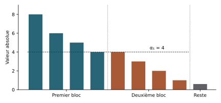

# BCE ECG — Maths appliquées (ESSEC-HEC) 2026 · Corrigé brut

*Corrigé rédigé par IA, non officiel. Signalez toute erreur.*

**Rédaction** · Claude Opus 5.5 · effort non renseigné · vitesse non renseignée

**Révision (tour 1)** · modèle non renseigné · effort non renseigné · vitesse non renseignée

**Révision (tour 2)** · modèle non renseigné · effort non renseigné · vitesse non renseignée

**Révision (tour 3)** · GPT-6.2 Astra Ultra · vitesse non renseignée

Épreuve de 4 heures, sans calculatrice ni document. On note $\|X\|$ la norme euclidienne de $X\in\mathcal M_{d,1}(\mathbb R)$. La matrice $A$ est une $(\varepsilon,\mathcal X)$-isométrie si, pour tout $X\in\mathcal X$, $(1-\varepsilon)\|X\|^2\le\|AX\|^2\le(1+\varepsilon)\|X\|^2$.

Remarque utile tout au long du sujet : les normes sont positives et la racine carrée est croissante. Pour $\varepsilon\in\,]0,1[$, la condition d'isométrie équivaut donc à

$$\sqrt{1-\varepsilon}\,\|X\|\le\|AX\|\le\sqrt{1+\varepsilon}\,\|X\|.$$

## Préliminaire informatique

### Question 1

**a)**

```python
def Norme(X):
    return np.sqrt(np.sum(X**2))
```

`X**2` élève chaque coefficient au carré, `np.sum` en fait la somme, `np.sqrt` en prend la racine.

**b)** Pour $X={}^t(1,0,1,1,1)$, on a $\|X\|^2=4$, donc $\|X\|=2$. Le vecteur $\frac1{\|X\|}X$ est de norme 1 par homogénéité. La console affiche :

```text
2.0
1.0
```

### Question 2

On calcule

$$AX=\begin{pmatrix}2&1\\0&1\\1&0\end{pmatrix}\begin{pmatrix}1\\-1\end{pmatrix}=\begin{pmatrix}1\\-1\\1\end{pmatrix}.$$

Mathématiquement, $\|AX\|^2=1+1+1=3$. Avec la fonction `Norme` de la question 1, Python affiche en fait `2.9999999999999996` (racine puis carré en flottants) : le `3.0` de l'énoncé en est l'arrondi, ce qu'on signale comme une imprécision d'énoncé.

Ensuite $\|X\|^2=2$, donc le quotient $\|AX\|^2/\|X\|^2$ vaut $\frac32$, soit environ $1{,}5$ en flottants. Avec `eps = 0.6`, Python évalue la comparaison chaînée `0.4 <= 1.5 <= 1.6`, qui est vraie : il affiche `True`.

Autrement dit, $(1-0{,}6)\|X\|^2\le\|AX\|^2\le(1+0{,}6)\|X\|^2$ : la matrice $A$ est une $(0{,}6,\{X\})$-isométrie.

### Question 3

```python
def EstIsom(A, LX, eps):
    for X in LX:
        nX2 = Norme(X)**2
        nAX2 = Norme(np.dot(A, X))**2
        if nAX2 < (1-eps)*nX2 or nAX2 > (1+eps)*nX2:
            return False
    return True
```

La fonction renvoie `False` dès qu'un élément de la liste viole l'encadrement, et `True` si tous le respectent.

Avec la matrice $A$ de la question 2 et $\varepsilon=0{,}2$ :

- pour $X_1={}^t(-1,3)$, on a $AX_1={}^t(1,3,-1)$, donc $\|AX_1\|^2=11$ et $\|X_1\|^2=10$. Or $8\le11\le12$ ;
- pour $X_2={}^t(1,-2)$, on a $AX_2={}^t(0,-2,1)$, donc $\|AX_2\|^2=5=\|X_2\|^2$. Or $4\le5\le6$.

Les deux vecteurs vérifient l'encadrement, avec des marges d'au moins une unité, très supérieures aux erreurs d'arrondi. La console affiche **`True`**.

## Le lemme de Johnson-Lindenstrauss

### Question 4

```python
M = rd.normal(0, 1, [m, n]) / np.sqrt(m)
```

`rd.normal(0,1,[m,n])` simule une matrice $m\times n$ de coefficients indépendants de loi $\mathcal N(0,1)$, que l'on divise par $\sqrt m$.

### Question 5

**a)** On a $G_{i,j}\hookrightarrow\mathcal N(0,1)$ et $x_j\neq0$. Une transformée affine $aG+b$, avec $a\neq0$, d'une variable de loi normale suit une loi normale, d'espérance $aE(G)+b$ et de variance $a^2V(G)$. Donc

$$\boxed{x_jG_{i,j}\hookrightarrow\mathcal N(0,x_j^2).}$$

**b)** Soit $J$ l'ensemble des indices $j$ tels que $x_j\neq0$ ; il est non vide car $\|X\|=1$.

Pour $j\notin J$, on a $x_jG_{i,j}=0$, donc $Y_i=\sum_{j\in J}x_jG_{i,j}$.

Les variables $G_{i,j}$, $j\in J$, sont mutuellement indépendantes, donc par le lemme des coalitions les $x_jG_{i,j}$, $j\in J$, le sont aussi. Une somme de variables indépendantes de lois normales suit une loi normale, d'espérance la somme des espérances et de variance la somme des variances. Comme $\sum_{j\in J}x_j^2=\|X\|^2=1$ :

$$\boxed{Y_i\hookrightarrow\mathcal N(0,1).}$$

$Y_i$ admet un moment d'ordre 2 et, par la formule de König-Huygens :

$$\begin{aligned}
E(Y_i^2)&=V(Y_i)+E(Y_i)^2\\
&=1+0\\
&=\|X\|^2=1.
\end{aligned}$$

**c)** La $i$-ème composante de $MX$ est

$$\begin{aligned}(MX)_i&=\frac1{\sqrt m}\sum_{j=1}^nG_{i,j}x_j\\&=\frac{Y_i}{\sqrt m}.\end{aligned}$$

Donc

$$\begin{aligned}
Z&=\|MX\|^2\\
&=\sum_{i=1}^m\Big(\frac{Y_i}{\sqrt m}\Big)^2\\
&=\boxed{\frac1m\sum_{i=1}^mY_i^2.}
\end{aligned}$$

### Question 6

On fixe $\varepsilon\in\,]0,1[$ et $t\in\,]0,\frac14]$.

**a)** $Y_i$ a pour densité $\varphi:x\mapsto\frac1{\sqrt{2\pi}}e^{-x^2/2}$. Par le théorème de transfert, $e^{tY_i^2}$ admet une espérance si et seulement si l'intégrale de $x\mapsto e^{tx^2}\varphi(x)$ sur $\mathbb R$ converge absolument, et l'espérance vaut alors cette intégrale. L'intégrande est positif et

$$e^{tx^2}\varphi(x)=\frac1{\sqrt{2\pi}}e^{-(1-2t)\frac{x^2}2}.$$

Posons $c=1-2t$ ; comme $t\le\frac14$, on a $c\ge\frac12>0$. La fonction $g:x\mapsto e^{-cx^2/2}$ est continue, positive et paire sur $\mathbb R$.

Par croissances comparées, $x^2g(x)\to0$ quand $x\to+\infty$, donc $g(x)=o\big(\frac1{x^2}\big)$ en $+\infty$. L'intégrale de Riemann $\int_1^{+\infty}\frac{dx}{x^2}$ converge, donc $\int_1^{+\infty}g$ converge par comparaison de fonctions positives.

L'intégrale sur $[0,1]$ est celle d'une fonction continue sur un segment. Par parité, $\int_{-\infty}^{+\infty}g$ converge.

Ainsi $E(e^{tY_i^2})$ existe et

$$\boxed{E\big(e^{tY_i^2}\big)=\frac1{\sqrt{2\pi}}\int_{-\infty}^{+\infty}e^{-(1-2t)\frac{x^2}2}\,dx.}$$

**b)** Posons $\sigma=\frac1{\sqrt{1-2t}}>0$. La densité de la loi $\mathcal N(0,\sigma^2)$ est

$$x\mapsto\frac1{\sigma\sqrt{2\pi}}e^{-\frac{x^2}{2\sigma^2}}=\frac{\sqrt{1-2t}}{\sqrt{2\pi}}\,e^{-(1-2t)\frac{x^2}2},$$

et son intégrale sur $\mathbb R$ vaut $1$. Donc

$$\int_{-\infty}^{+\infty}e^{-(1-2t)\frac{x^2}2}dx=\frac{\sqrt{2\pi}}{\sqrt{1-2t}},$$

et

$$\boxed{E\big(e^{tY_i^2}\big)=\frac1{\sqrt{1-2t}}.}$$

### Question 7

**a)** On a $tmZ=t\sum_{i=1}^mY_i^2$, donc

$$e^{tmZ}=\prod_{i=1}^me^{tY_i^2}.$$

Pour $i$ fixé, $Y_i$ ne dépend que de la ligne $(G_{i,1},\dots,G_{i,n})$. Ces $m$ lignes sont formées de variables mutuellement indépendantes, et deux lignes distinctes n'ont aucune variable commune. Par le lemme des coalitions, $Y_1,\dots,Y_m$ sont mutuellement indépendantes, puis $e^{tY_1^2},\dots,e^{tY_m^2}$ aussi.

Chacune admet une espérance (question 6). L'espérance d'un produit de variables mutuellement indépendantes admettant une espérance existe et vaut le produit des espérances :

$$E(e^{tmZ})=\prod_{i=1}^mE\big(e^{tY_i^2}\big).$$

En particulier $E(e^{tmZ})$ existe.

L'inclusion $[Z>1+\varepsilon]\subset[Z\ge1+\varepsilon]$ donne la première inégalité. Comme $u\mapsto e^{tmu}$ est strictement croissante ($tm>0$), on a

$$[Z\ge1+\varepsilon]=\big[e^{tmZ}\ge e^{tm(1+\varepsilon)}\big].$$

On applique l'inégalité de Markov à $U=e^{tmZ}$, positive et d'espérance finie, avec $a=e^{tm(1+\varepsilon)}>0$ :

$$\boxed{\begin{aligned}P(Z>1+\varepsilon)&\le P(Z\ge1+\varepsilon)\\&\le E(e^{tmZ})\,e^{-tm(1+\varepsilon)}.\end{aligned}}$$

**b)** Par a) et la question 6, $E(e^{tmZ})=(1-2t)^{-m/2}$. Donc

$$\begin{aligned}
P(Z>1+\varepsilon)&\le\frac{e^{-tm}e^{-tm\varepsilon}}{(\sqrt{1-2t})^m}\\
&=\boxed{\Big(\frac{e^{-t}}{\sqrt{1-2t}}\Big)^m e^{-tm\varepsilon}.}
\end{aligned}$$

**c)** Soit $f(t)=-t-\frac12\ln(1-2t)-2t^2$ sur $[0,\frac14]$, dérivable car $1-2t>0$. On a

$$\begin{aligned}
f'(t)&=-1+\frac1{1-2t}-4t\\
&=\frac{-(1-2t)+1-4t(1-2t)}{1-2t}\\
&=\frac{2t(4t-1)}{1-2t}.
\end{aligned}$$

Sur $[0,\frac14]$, on a $2t\ge0$, $4t-1\le0$ et $1-2t>0$, donc $f'\le0$.

Ainsi $f$ est décroissante et $f(t)\le f(0)=0$ :

$$\boxed{-t-\tfrac12\ln(1-2t)\le2t^2.}$$

Par croissance de l'exponentielle :

$$\begin{aligned}
\Big(\frac{e^{-t}}{\sqrt{1-2t}}\Big)^m&=\exp\Big(m\big(-t-\tfrac12\ln(1-2t)\big)\Big)\\
&\le e^{2mt^2}.
\end{aligned}$$

Avec b) :

$$\boxed{P(Z>1+\varepsilon)\le e^{m(2t^2-t\varepsilon)}.}$$

**d)** L'inégalité vaut pour tout $t\in\,]0,\frac14]$. On choisit $t=\frac\varepsilon4$, qui est dans $]0,\frac14[$ car $\varepsilon\in\,]0,1[$. Alors

$$\begin{aligned}
2t^2-t\varepsilon&=\frac{\varepsilon^2}8-\frac{\varepsilon^2}4\\
&=-\frac{\varepsilon^2}8,
\end{aligned}$$

d'où

$$\boxed{P(Z>1+\varepsilon)\le e^{-m\frac{\varepsilon^2}8}.}$$

### Question 8

Les événements $[Z<1-\varepsilon]$ et $[Z>1+\varepsilon]$ sont incompatibles, puisque $1-\varepsilon<1+\varepsilon$. Donc

$$\begin{aligned}
P\big([Z<1-\varepsilon]\cup[Z>1+\varepsilon]\big)&=P(Z<1-\varepsilon)+P(Z>1+\varepsilon)\\
&\le\boxed{2e^{-m\frac{\varepsilon^2}8}.}
\end{aligned}$$

### Question 9

**a)** Par homogénéité, $\|U_i\|=\frac1{\|X_i\|}\|X_i\|=1$. Par linéarité, $MX_i=\|X_i\|\,MU_i$, donc

$$\|MX_i\|^2=\|X_i\|^2\,\|MU_i\|^2.$$

En divisant l'encadrement qui définit $B_i$ par $\|X_i\|^2>0$, on obtient

$$\boxed{B_i=\big[1-\varepsilon\le\|MU_i\|^2\le1+\varepsilon\big].}$$

**b)** L'événement « $M$ n'est pas une $(\varepsilon,\mathcal X)$-isométrie » est la réunion des $\overline{B_i}$, $1\le i\le r$.

- Si $X_i=0$, l'encadrement s'écrit $0\le0\le0$ : $B_i=\Omega$ et $P(\overline{B_i})=0$.
- Si $X_i\neq0$, le vecteur $U_i$ est de norme 1. Les questions 5 à 8 s'appliquent donc à $X=U_i$, avec $Z_i=\|MU_i\|^2$ : $P(\overline{B_i})\le2e^{-m\varepsilon^2/8}$.

Par l'inégalité admise sur la réunion :

$$\begin{aligned}
P\Big(\bigcup_{i=1}^r\overline{B_i}\Big)&\le\sum_{i=1}^rP(\overline{B_i})\\
&\le\boxed{2r\,e^{-m\frac{\varepsilon^2}8}.}
\end{aligned}$$

**c)** On a les équivalences

$$\begin{aligned}
m>\frac{8\ln(2r)}{\varepsilon^2}&\iff m\frac{\varepsilon^2}8>\ln(2r)\\
&\iff2r\,e^{-m\frac{\varepsilon^2}8}<1.
\end{aligned}$$

Alors la probabilité de la réunion des $\overline{B_i}$ est strictement inférieure à 1. L'événement $B_1\cap\dots\cap B_r$ a donc une probabilité strictement positive : il n'est pas vide.

Pour $\omega$ dans cet événement, la matrice $A=M(\omega)$ vérifie l'encadrement pour tous les $X_i$. **Il existe donc une matrice $A\in\mathcal M_{m,n}(\mathbb R)$ qui est une $(\varepsilon,\mathcal X)$-isométrie.**

### Question 10

On simule des matrices $M$ jusqu'à en obtenir une qui convienne :

```python
def Isom(LX, m, eps):
    n = np.shape(LX[0])[0]
    M = rd.normal(0, 1, [m, n]) / np.sqrt(m)
    while not EstIsom(M, LX, eps):
        M = rd.normal(0, 1, [m, n]) / np.sqrt(m)
    return M
```

Les tirages sont indépendants. Dès que $m>\frac{8\ln(2r)}{\varepsilon^2}$, chacun réussit avec une probabilité $p>0$ (question 9.c) : le nombre de tirages suit alors une loi géométrique de paramètre $p$, et la boucle s'arrête presque sûrement.

Une boucle infinie est possible pour certaines données. Prenons $m=1$, $n=2$, $0<\varepsilon<1/2$ et les quatre vecteurs $e_1,e_2,e_1+e_2,e_1-e_2$. Si la ligne $(a,b)$ convenait, les deux premiers tests donneraient $|ab|\ge 1-\varepsilon$. Les deux derniers imposeraient $(a+b)^2,(a-b)^2\in[2(1-\varepsilon),2(1+\varepsilon)]$. En soustrayant, on obtiendrait $4|ab|\le4\varepsilon$, ce qui est impossible.

## ε-isométries pour les ensembles sporadiques de $\mathcal M_{n,1}(\mathbb R)$

### Question 11

Une partie de $[\![1,n]\!]$ à $k$ éléments est une combinaison de $k$ éléments parmi $n$ :

$$\boxed{\#\mathcal T_k=\binom nk.}$$

### Question 12

**a)** $\langle X\rangle\le0$ signifie que $X$ n'a aucune composante non nulle : $\boxed{\mathcal C_0=\{0\}}$.

Tout $X$ a au plus $n$ composantes non nulles : $\boxed{\mathcal C_n=\mathcal M_{n,1}(\mathbb R)}$.

**b)** Notons $E_1,\dots,E_n$ la base canonique de $\mathcal M_{n,1}(\mathbb R)$.

Le support de $X$ est inclus dans $T$ si et seulement si $x_j=0$ pour tout $j\notin T$, c'est-à-dire si et seulement si $X=\sum_{p=1}^kx_{i_p}E_{i_p}$. Donc

$$\mathcal Q(T)=\mathrm{Vect}(E_{i_1},\dots,E_{i_k}),$$

qui est un sous-espace vectoriel. La famille $(E_{i_1},\dots,E_{i_k})$ est libre, comme sous-famille de la base canonique, et génératrice de $\mathcal Q(T)$ : c'en est une base. Donc $\boxed{\dim\mathcal Q(T)=k.}$

**c)** *Inclusion $\supset$.* Si $X\in\mathcal Q(T)$ avec $T\in\mathcal T_k$, alors $S(X)\subset T$, donc $\langle X\rangle\le\#T=k$ et $X\in\mathcal C_k$.

*Inclusion $\subset$.* Soit $X\in\mathcal C_k$ et $s=\#S(X)\le k$. Il reste $n-s\ge k-s$ indices hors de $S(X)$.

On en ajoute $k-s$ à $S(X)$ pour obtenir une partie $T\in\mathcal T_k$ qui contient $S(X)$. Alors $X\in\mathcal Q(T)$. Donc

$$\boxed{\mathcal C_k=\bigcup_{T\in\mathcal T_k}\mathcal Q(T).}$$

**$\mathcal C_k$ n'est pas un sous-espace vectoriel** pour $1\le k\le n-1$. En effet, $U=E_1+\dots+E_k$ et $V=E_{k+1}$ (qui existe car $k+1\le n$) sont dans $\mathcal C_k$.

Mais $U+V$ a $k+1$ composantes non nulles, donc $U+V\notin\mathcal C_k$ : $\mathcal C_k$ n'est pas stable par addition.

### Question 13

**a)** On a $0\le(|x_i|-|y_i|)^2=x_i^2+y_i^2-2|x_i||y_i|$, d'où $\boxed{2|x_i||y_i|\le x_i^2+y_i^2.}$

**b)** Par l'inégalité triangulaire puis a) :

$$\begin{aligned}
\Big|\sum_{i=1}^nx_iy_i\Big|&\le\sum_{i=1}^n|x_i||y_i|\\
&\le\frac12\Big(\sum_{i=1}^nx_i^2+\sum_{i=1}^ny_i^2\Big)\\
&=\frac12(1+1)=1.
\end{aligned}$$

**c)** Pour $X$ et $Y$ non nuls, les vecteurs $X'=\frac X{\|X\|}$ et $Y'=\frac Y{\|Y\|}$ sont de norme 1. Leurs composantes sont $\frac{x_i}{\|X\|}$ et $\frac{y_i}{\|Y\|}$. Par b) :

$$\Big|\sum_{i=1}^n\frac{x_iy_i}{\|X\|\,\|Y\|}\Big|\le1.$$

En multipliant par $\|X\|\|Y\|>0$ :

$$\boxed{\Big|\sum_{i=1}^nx_iy_i\Big|\le\|X\|\,\|Y\|.}$$

Les deux membres étant positifs, on élève au carré :

$$\boxed{\begin{aligned}\Big(\sum_{i=1}^nx_iy_i\Big)^2&\le\|X\|^2\,\|Y\|^2\\&=\Big(\sum_{i=1}^nx_i^2\Big)\Big(\sum_{i=1}^ny_i^2\Big).\end{aligned}}$$

Si $X=0$ ou $Y=0$, les deux membres sont nuls : **l'inégalité reste vraie** (c'est une égalité).

### Question 14

**a)** La $i$-ème composante de $AX$ est $(AX)_i=\sum_{j=1}^na_{i,j}x_j$. Par définition de la norme :

$$\boxed{\begin{aligned}\|AX\|^2&=\sum_{i=1}^m(AX)_i^2\\&=\sum_{i=1}^m\Big(\sum_{j=1}^na_{i,j}x_j\Big)^2.\end{aligned}}$$

**b)** Pour $i$ fixé, on applique la question 13.c aux vecteurs $(a_{i,1},\dots,a_{i,n})$ et $(x_1,\dots,x_n)$ ; elle reste valable si l'un est nul. On obtient

$$\begin{aligned}\Big(\sum_{j=1}^na_{i,j}x_j\Big)^2&\le\Big(\sum_{j=1}^na_{i,j}^2\Big)\Big(\sum_{j=1}^nx_j^2\Big)\\&=\Big(\sum_{j=1}^na_{i,j}^2\Big)\|X\|^2.\end{aligned}$$

On somme sur $i$ :

$$\boxed{\begin{aligned}\|AX\|^2&\le\Big(\sum_{i=1}^m\sum_{j=1}^na_{i,j}^2\Big)\|X\|^2\\&=\alpha^2\|X\|^2.\end{aligned}}$$

En particulier $\|AX\|\le\alpha\|X\|$.

### Question 15

Par linéarité, $AX=AY+A(X-Y)$. L'inégalité rappelée en préambule, appliquée aux vecteurs $AY$ et $A(X-Y)$ de $\mathcal M_{m,1}(\mathbb R)$, donne

$$\boxed{\|AY\|-\|A(X-Y)\|\le\|AX\|\le\|AY\|+\|A(X-Y)\|.}$$

### Question 16

Le sujet note $n$ l'indice de la suite ; on le note $p$ pour ne pas le confondre avec la dimension $n$.

La suite est arithmético-géométrique. Son point fixe $\ell$ vérifie $\ell=\frac\delta4(3+\ell)$, soit $\ell\big(1-\frac\delta4\big)=\frac{3\delta}4$ :

$$\ell=\frac{3\delta}{4-\delta}.$$

Pour tout $p\in\mathbb N$, on a $u_{p+1}-\ell=\frac\delta4(u_p-\ell)$. Donc

$$u_p-\ell=\Big(\frac\delta4\Big)^p(u_0-\ell).$$

Comme $0<\frac\delta4<1$, on a $\big(\frac\delta4\big)^p\to0$, donc

$$\boxed{\lim_{p\to+\infty}u_p=\frac{3\delta}{4-\delta}.}$$

Enfin $4-\delta>0$, donc

$$\begin{aligned}
\frac{3\delta}{4-\delta}\le\delta&\iff3\le4-\delta\\
&\iff\delta\le1,
\end{aligned}$$

ce qui est vrai : $\boxed{\frac{3\delta}{4-\delta}\le\delta.}$

### Question 17

On rappelle que $\varepsilon=2\delta+\delta^2$ et que $A$ est une $\big(\frac\delta2,\mathcal X_{T,\delta}\big)$-isométrie.

**a)** Pour $Y\in\mathcal X_{T,\delta}$ de norme 1, on a $1-\frac\delta2\le\|AY\|^2\le1+\frac\delta2$. La racine carrée étant croissante, $\sqrt{1-\frac\delta2}\le\|AY\|\le\sqrt{1+\frac\delta2}$.

Pour $u\in[0,1]$, on a $u^2\le u$, donc $u\le\sqrt u$. Pour $u\ge1$, on a $u\le u^2$, donc $\sqrt u\le u$.

On applique cela à $u=1-\frac\delta2\in[0,1]$ et à $u=1+\frac\delta2\ge1$ :

$$\boxed{\begin{aligned}1-\frac\delta2&\le\sqrt{1-\frac\delta2}\le\|AY\|,\\\|AY\|&\le\sqrt{1+\frac\delta2}\le1+\frac\delta2.\end{aligned}}$$

**b)** On montre par récurrence sur $p\in\mathbb N^*$ (indice noté $n$ dans l'énoncé) la propriété :

$\mathcal P(p)$ : pour tout $X\in\mathcal Q(T)$ de norme 1, $1-u_p\le\|AX\|\le1+u_p$.

Soit $X\in\mathcal Q(T)$ de norme 1 et $Y\in\mathcal X_{T,\delta}$ de norme 1 tel que $\|X-Y\|\le\frac\delta4$.

Comme $\mathcal Q(T)$ est un sous-espace vectoriel (12.b) qui contient $X$ et $Y$, on a $X-Y\in\mathcal Q(T)$.

*Initialisation ($p=1$).* Par la question 14.b, $\|A(X-Y)\|\le\alpha\|X-Y\|\le(1+u_0)\frac\delta4$. Par la question 15 et a) :

$$\begin{aligned}
\|AX\|&\le\|AY\|+\|A(X-Y)\|\\
&\le1+\frac\delta2+\frac\delta4(1+u_0)\\
&=1+\frac\delta4(3+u_0)\\
&=1+u_1,
\end{aligned}$$

et de même

$$\begin{aligned}
\|AX\|&\ge\|AY\|-\|A(X-Y)\|\\
&\ge1-\frac\delta2-\frac\delta4(1+u_0)\\
&=1-u_1.
\end{aligned}$$

*Hérédité.* Supposons $\mathcal P(p)$ vraie. Soit $W\in\mathcal Q(T)$ non nul : $\frac W{\|W\|}$ est de norme 1 dans $\mathcal Q(T)$, donc $\|AW\|\le(1+u_p)\|W\|$ par homogénéité. Cette inégalité reste vraie pour $W=0$.

Avec $W=X-Y$ :

$$\|A(X-Y)\|\le(1+u_p)\frac\delta4.$$

Les mêmes calculs qu'à l'initialisation, avec $u_p$ à la place de $u_0$, donnent

$$\begin{aligned}
\|AX\|&\le1+\frac\delta4(3+u_p)=1+u_{p+1},\\
\|AX\|&\ge1-\frac\delta4(3+u_p)=1-u_{p+1}.
\end{aligned}$$

Donc $\mathcal P(p+1)$ est vraie. Par récurrence, pour tout $p\in\mathbb N^*$ et tout $X\in\mathcal Q(T)$ de norme 1 :

$$\boxed{1-u_p\le\|AX\|\le1+u_p.}$$

L'outil effectif est l'inégalité de la question 15 ; l'énoncé renvoie à la question 13, qui intervient à travers 14.b.

**c)** Pour $X$ fixé, on passe à la limite quand $p\to+\infty$ dans les inégalités larges de b), grâce à la question 16 :

$$1-\frac{3\delta}{4-\delta}\le\|AX\|\le1+\frac{3\delta}{4-\delta}.$$

Avec $\frac{3\delta}{4-\delta}\le\delta$, on obtient

$$\boxed{1-\delta\le\|AX\|\le1+\delta.}$$

Ensuite $1+\varepsilon=1+2\delta+\delta^2=(1+\delta)^2$, donc $1+\delta=\sqrt{1+\varepsilon}$. Par ailleurs

$$\begin{aligned}
1-\varepsilon&=1-2\delta-\delta^2\\
&\le1-2\delta+\delta^2=(1-\delta)^2.
\end{aligned}$$

Comme $1-\varepsilon>0$ et $1-\delta>0$, la croissance de la racine donne $\sqrt{1-\varepsilon}\le1-\delta$. Ainsi

$$\boxed{\sqrt{1-\varepsilon}\le\|AX\|\le\sqrt{1+\varepsilon}.}$$

**d)** Soit $X\in\mathcal Q(T)$. Si $X=0$, l'encadrement de définition s'écrit $0\le0\le0$. Sinon, $\frac X{\|X\|}\in\mathcal Q(T)$ est de norme 1. Par c) et homogénéité :

$$\sqrt{1-\varepsilon}\,\|X\|\le\|AX\|\le\sqrt{1+\varepsilon}\,\|X\|.$$

En élevant au carré des quantités positives, on obtient $(1-\varepsilon)\|X\|^2\le\|AX\|^2\le(1+\varepsilon)\|X\|^2$. **$A$ est une $(\varepsilon,\mathcal Q(T))$-isométrie.**

### Question 18

Soit $T\in\mathcal T_k$. Notons $E_T$ l'événement « $M$ est une $\big(\frac\delta2,\mathcal X_{T,\delta}\big)$-isométrie ».

Par la question 17 appliquée à $A=M(\omega)$ : si $\omega\in E_T$, alors $M(\omega)$ est une $(\varepsilon,\mathcal Q(T))$-isométrie.

L'événement « $M$ n'est pas une $(\varepsilon,\mathcal Q(T))$-isométrie » est donc contenu dans $\overline{E_T}$.

L'ensemble $\mathcal X_{T,\delta}$ est fini, de cardinal $r\le\big(\frac{12}\delta\big)^k$, et $\frac\delta2\in\,]0,1[$. La question 9.b, appliquée avec $\frac\delta2$ à la place de $\varepsilon$, donne

$$\begin{aligned}
P(\overline{E_T})&\le2r\,e^{-m\frac{(\delta/2)^2}8}\\
&\le2\Big(\frac{12}\delta\Big)^ke^{-m\frac{\delta^2}{32}}.
\end{aligned}$$

D'où la **première majoration** : la probabilité que $M$ ne soit pas une $(\varepsilon,\mathcal Q(T))$-isométrie est inférieure à $2\big(\frac{12}\delta\big)^ke^{-m\delta^2/32}$.

Par 12.c, $\mathcal C_k$ est la réunion des $\mathcal Q(T)$, $T\in\mathcal T_k$.

Donc $M$ est une $(\varepsilon,\mathcal C_k)$-isométrie dès que c'est une $(\varepsilon,\mathcal Q(T))$-isométrie pour tout $T\in\mathcal T_k$, en particulier sur l'événement $\bigcap_TE_T$.

L'événement « $M$ n'est pas une $(\varepsilon,\mathcal C_k)$-isométrie » est donc contenu dans la réunion des $\overline{E_T}$, qui compte $\binom nk$ événements (question 11). Par l'inégalité sur la réunion :

$$\boxed{P\big(M\text{ n'est pas une }(\varepsilon,\mathcal C_k)\text{-isométrie}\big)\le2\binom nk\Big(\frac{12}\delta\Big)^ke^{-m\frac{\delta^2}{32}}.}$$

### Question 19

**a)** On a

$$\binom nk=\frac{n(n-1)\cdots(n-k+1)}{k!}.$$

Chacun des $k$ facteurs du numérateur est compris entre $1$ et $n$, donc $\boxed{\binom nk\le\frac{n^k}{k!}.}$

**b)** Pour tout réel $x$, $e^x=\sum_{j=0}^{+\infty}\frac{x^j}{j!}$. Avec $x=k\ge1$, tous les termes sont positifs. Donc $e^k$ est supérieur à la somme des deux termes d'indices $j=k-1$ et $j=k$, qui sont distincts et d’indices entiers positifs ou nuls :

$$e^k\ge\frac{k^{k-1}}{(k-1)!}+\frac{k^k}{k!}.$$

Or $\frac{k^{k-1}}{(k-1)!}=\frac{k\cdot k^{k-1}}{k\,(k-1)!}=\frac{k^k}{k!}$, d'où $\boxed{e^k\ge2\frac{k^k}{k!}.}$

Ainsi $\frac2{k!}\le\frac{e^k}{k^k}$ et, par a) :

$$\begin{aligned}
2\binom nk&\le\frac{2n^k}{k!}\\
&\le\frac{n^ke^k}{k^k}=\boxed{\Big(\frac{en}k\Big)^k.}
\end{aligned}$$

**c)** On utilise les événements $E_T$ de la question 18, avec $n=bk$ et $m=ak$. Par 18 et 19.b :

$$\begin{aligned}
P\Big(\bigcup_{T\in\mathcal T_k}\overline{E_T}\Big)&\le(eb)^k\Big(\frac{12}{\delta}\Big)^ke^{-ak\frac{\delta^2}{32}}\\
&=\exp\Big(k\Big[\ln\Big(\frac{12be}\delta\Big)-a\frac{\delta^2}{32}\Big]\Big).
\end{aligned}$$

L'hypothèse $a>32\,\frac{\ln(12be/\delta)}{\delta^2}$ rend le crochet strictement négatif. Comme $k\ge1$, la probabilité est strictement inférieure à $1$. L'événement $\bigcap_{T\in\mathcal T_k}E_T$ a donc une probabilité strictement positive : il n'est pas vide.

Pour $\omega$ dans cet événement, $A=M(\omega)$ est une $(\varepsilon,\mathcal Q(T))$-isométrie pour tout $T\in\mathcal T_k$ (question 17), donc une $(\varepsilon,\mathcal C_k)$-isométrie.

**Il existe $A\in\mathcal M_{m,n}(\mathbb R)$ qui est une $(\varepsilon,\mathcal C_k)$-isométrie.**

## L'acquisition comprimée

### Question 20

**a)** Pour tout $i$, l'inégalité triangulaire dans $\mathbb R$ donne $|x_i+y_i|\le|x_i|+|y_i|$. En sommant sur $i\in[\![1,n]\!]$ :

$$\boxed{|X+Y|\le|X|+|Y|.}$$

On montre ensuite l'inégalité généralisée par récurrence sur $r\ge1$. Le cas $r=1$ est une égalité. Si elle est vraie au rang $r$, alors

$$\begin{aligned}
\Big|\sum_{i=1}^{r+1}X_i\Big|&\le\Big|\sum_{i=1}^rX_i\Big|+|X_{r+1}|\\
&\le\sum_{i=1}^{r+1}|X_i|.
\end{aligned}$$

**b)** Les supports étant deux à deux disjoints, pour chaque indice $j\in[\![1,n]\!]$, au plus un des $X_i$ a une $j$-ème composante non nulle. La $j$-ème composante de $\sum_iX_i$ est donc nulle ou égale à cette unique composante non nulle.

Dans les deux cas, sa valeur absolue est la somme des valeurs absolues des $j$-èmes composantes des $X_i$. En sommant sur $j$ :

$$\boxed{\begin{aligned}\Big|\sum_{i=1}^rX_i\Big|&=\sum_{j=1}^n\sum_{i=1}^r|(X_i)_j|\\&=\sum_{i=1}^r|X_i|.\end{aligned}}$$

**c)** Soit $X\in\mathcal C_k$, $S=S(X)$ et $s=\#S\le k$.

*Première inégalité.* En développant le carré, les doubles produits $|x_i||x_j|$ sont positifs, donc

$$\begin{aligned}
|X|^2&=\Big(\sum_{i=1}^n|x_i|\Big)^2\\
&\ge\sum_{i=1}^nx_i^2=\|X\|^2.
\end{aligned}$$

D'où $\|X\|\le|X|$, les deux nombres étant positifs.

*Seconde inégalité.* Notons $\mathbf 1_S(i)$ le nombre qui vaut $1$ si $i\in S$ et $0$ sinon. On applique la question 13.c aux vecteurs de composantes $|x_i|$ et $\mathbf 1_S(i)$ :

$$\begin{aligned}
|X|&=\sum_{i=1}^n|x_i|\,\mathbf 1_S(i)\\
&\le\|X\|\sqrt{\sum_{i=1}^n\mathbf 1_S(i)^2}\\
&=\sqrt s\,\|X\|.
\end{aligned}$$

Comme $s\le k$ :

$$\boxed{\|X\|\le|X|\le\sqrt k\,\|X\|.}$$

### Question 21

**a)** Soit $X\in\mathcal C_k$ tel que $AX=0$. Alors $(1-\varepsilon)\|X\|^2\le\|AX\|^2=0$ avec $1-\varepsilon>0$. Donc $\|X\|=0$, puis $\boxed{X=0}$ par la propriété de la norme.

**b)** Les vecteurs $E_1,\dots,E_k$ de la base canonique ($k\le n$) ont pour images les colonnes $C_1=AE_1,\dots,C_k=AE_k$ de $A$. Supposons $\sum_{j=1}^k\lambda_jC_j=0$. Alors $A\big(\sum_j\lambda_jE_j\big)=0$.

Or $\sum_j\lambda_jE_j$ a au plus $k$ composantes non nulles, donc appartient à $\mathcal C_k$ : par a), il est nul, et tous les $\lambda_j$ sont nuls.

La famille $(C_1,\dots,C_k)$ est donc libre dans l'espace engendré par les colonnes de $A$, dont la dimension est $\mathrm{rg}(A)$. Donc $\boxed{\mathrm{rg}(A)\ge k.}$

### Question 22

**a)** Si $x_i=y_i=0$, alors $x_i-y_i=0$ : donc $S(X-Y)\subset S(X)\cup S(Y)$. Ainsi $\langle X-Y\rangle\le\langle X\rangle+\langle Y\rangle\le2k$, et $X-Y\in\mathcal C_{2k}$, avec $2k\le n$.

De plus $A(X-Y)=AX-AY=0$. La question 21.a, appliquée à la $(\varepsilon,\mathcal C_{2k})$-isométrie $A$, donne $X-Y=0$, soit $\boxed{X=Y.}$

**b)** $Y$ est solution de $AX=B$. Soit $X$ une solution telle que $\langle X\rangle\le\langle Y\rangle$.

Alors $\langle X\rangle\le k$, donc $X\in\mathcal C_k$, et $AX=AY$. Par a), $X=Y$.

Ainsi toute solution $X\neq Y$ vérifie $\langle X\rangle>\langle Y\rangle$ : **$Y$ est l'unique solution de $AX=B$ qui minimise $\langle X\rangle$.**

### Question 23

On a $AZ=AY-AX=B-B=0$. Si $\langle Z\rangle\le3k$, alors $Z\in\mathcal C_{3k}$, avec $3k\le n$.

La question 21.a, appliquée à la $(\varepsilon,\mathcal C_{3k})$-isométrie $A$, donne $\boxed{Z=0.}$

### Question 24

**a)** Comme $S$ et $\overline S$ forment une partition de $[\![1,n]\!]$, on a $Z=Z_S+Z_{\overline S}$. De $Z=Y-X$ on tire $Y=X+Z_S+Z_{\overline S}$, d'où

$$\boxed{Y-Z_{\overline S}=X+Z_S.}$$

Le support de $Y$ est $S$, celui de $-Z_{\overline S}$ est inclus dans $\overline S$ : ils sont disjoints. Par 20.b, et comme $|-Z_{\overline S}|=|Z_{\overline S}|$ :

$$\boxed{|Y-Z_{\overline S}|=|Y|+|Z_{\overline S}|.}$$

**b)** Par a), 20.a et l'hypothèse $|X|\le|Y|$ :

$$\begin{aligned}
|Y|+|Z_{\overline S}|&=|X+Z_S|\\
&\le|X|+|Z_S|\\
&\le|Y|+|Z_S|.
\end{aligned}$$

D'où $\boxed{|Z_{\overline S}|\le|Z_S|.}$

**c)** $Z_S$ a son support inclus dans $S$, de cardinal $\langle Y\rangle\le k$, donc $Z_S\in\mathcal C_k$. Par 20.c, $|Z_S|\le\sqrt k\|Z_S\|$, puis par b) :

$$\boxed{\|Z_S\|\ge\frac1{\sqrt k}|Z_S|\ge\frac1{\sqrt k}|Z_{\overline S}|.}$$

### Question 25

Remarque préalable : $\langle Z_S\rangle\le k$ et $\langle Z\rangle\ge3k+1$, donc $\langle Z_{\overline S}\rangle\ge2k+1$ et $r\ge1$.

Ordonnons les coefficients non nuls hors de $S$ par valeur absolue décroissante, en départageant librement les ex æquo. Les indices dont le coefficient est nul peuvent être rangés dans le dernier ensemble. Si le nombre de coefficients non nuls est multiple de $2k$, le dernier vecteur est nul. On convient aussi que la restriction à un ensemble vide est le vecteur nul.



**a)** Soit $i\in[\![1,r]\!]$. Le vecteur $Z_{T_i}$ a exactement $2k$ composantes non nulles, chacune de valeur absolue au moins $\alpha_i$. Donc

$$|Z_{T_i}|\ge2k\alpha_i=\sqrt{2k}\sqrt{2k\alpha_i^2}.$$

Les composantes non nulles de $Z_{T_{i+1}}$ sont, en valeur absolue, inférieures ou égales à toutes celles de $Z_{T_i}$, donc à $\alpha_i$, et il y en a au plus $2k$. Ainsi $\|Z_{T_{i+1}}\|^2\le2k\alpha_i^2$ et, la racine étant croissante :

$$\boxed{|Z_{T_i}|\ge\sqrt{2k}\sqrt{2k\alpha_i^2}\ge\sqrt{2k}\,\|Z_{T_{i+1}}\|.}$$

**b)** Les $T_i$ sont disjoints et $Z_{\overline S}$ est la somme des $Z_{T_i}$, $1\le i\le r+1$ : par 20.b, $|Z_{\overline S}|$ est la somme des $|Z_{T_i}|$.

On somme a) pour $i\in[\![1,r]\!]$ :

$$\begin{aligned}
\sqrt{2k}\sum_{i=2}^{r+1}\|Z_{T_i}\|&\le\sum_{i=1}^r|Z_{T_i}|\\
&\le\sum_{i=1}^{r+1}|Z_{T_i}|\\
&=|Z_{\overline S}|.
\end{aligned}$$

Par 24.c, $|Z_{\overline S}|\le\sqrt k\|Z_S\|$. Donc $\sqrt{2k}\sum_{i=2}^{r+1}\|Z_{T_i}\|\le\sqrt k\|Z_S\|$. En divisant par $\sqrt k>0$ :

$$\boxed{\|Z_S\|\ge\sqrt2\sum_{i=2}^{r+1}\|Z_{T_i}\|.}$$

### Question 26

**a)** On a $Z=Z_{S\cup T_1}+\sum_{i=2}^{r+1}Z_{T_i}$, donc par linéarité

$$AZ=AZ_{S\cup T_1}+\sum_{i=2}^{r+1}AZ_{T_i}.$$

L'inégalité du préambule ($\|U\|-\|V\|\le\|U+V\|$) donne

$$\|AZ\|\ge\|AZ_{S\cup T_1}\|-\Big\|\sum_{i=2}^{r+1}AZ_{T_i}\Big\|.$$

Le vecteur $Z_{S\cup T_1}$ a au plus $k+2k=3k$ composantes non nulles, et chaque $Z_{T_i}$ en a au plus $2k\le3k$ : ces vecteurs sont dans $\mathcal C_{3k}$.

Comme $A$ est une $(\varepsilon,\mathcal C_{3k})$-isométrie :

$$\begin{aligned}
\|AZ_{S\cup T_1}\|&\ge\sqrt{1-\varepsilon}\,\|Z_{S\cup T_1}\|,\\
\|AZ_{T_i}\|&\le\sqrt{1+\varepsilon}\,\|Z_{T_i}\|.
\end{aligned}$$

Par l'inégalité triangulaire itérée :

$$\begin{aligned}
\Big\|\sum_{i=2}^{r+1}AZ_{T_i}\Big\|&\le\sum_{i=2}^{r+1}\|AZ_{T_i}\|\\
&\le\sqrt{1+\varepsilon}\sum_{i=2}^{r+1}\|Z_{T_i}\|.
\end{aligned}$$

D'où

$$\boxed{\begin{aligned}\|AZ\|&\ge\|AZ_{S\cup T_1}\|-\Big\|\sum_{i=2}^{r+1}AZ_{T_i}\Big\|\\&\ge\sqrt{1-\varepsilon}\,\|Z_{S\cup T_1}\|-\sqrt{1+\varepsilon}\sum_{i=2}^{r+1}\|Z_{T_i}\|.\end{aligned}}$$

**b)** Les supports de $Z_S$ et $Z_{T_1}$ sont disjoints, donc $\|Z_{S\cup T_1}\|^2=\|Z_S\|^2+\|Z_{T_1}\|^2$. Ainsi $\|Z_{S\cup T_1}\|\ge\|Z_S\|$. Par 25.b, $\sum_{i=2}^{r+1}\|Z_{T_i}\|\le\frac{\|Z_S\|}{\sqrt2}$. En reportant dans a) :

$$\boxed{\|AZ\|\ge\Big(\sqrt{1-\varepsilon}-\frac{\sqrt{1+\varepsilon}}{\sqrt2}\Big)\|Z_S\|.}$$

**c)** On a $AZ=0$ (question 23). Le coefficient est strictement positif :

$$\begin{aligned}
\sqrt{1-\varepsilon}>\frac{\sqrt{1+\varepsilon}}{\sqrt2}&\iff2(1-\varepsilon)>1+\varepsilon\\
&\iff\varepsilon<\frac13,
\end{aligned}$$

ce qui est l'hypothèse. Donc $\|Z_S\|\le0$, soit $\boxed{Z_S=0.}$

Alors, par 24.b, $|Z_{\overline S}|\le|Z_S|=0$, donc $Z_{\overline S}=0$. Ainsi $Z=Z_S+Z_{\overline S}=0$, c'est-à-dire $\boxed{X=Y.}$

Cela contredit l'hypothèse $\langle Z\rangle\ge3k+1$ : ce cas est en fait impossible, et la conclusion $X=Y$ vaut dans tous les cas, grâce à la question 23.

### Question 27

$Y$ est solution de $AX=B$. Soit $X$ une solution telle que $|X|\le|Y|$, et $Z=Y-X$.

- Si $\langle Z\rangle\le3k$, alors $X=Y$ par la question 23.
- Si $\langle Z\rangle\ge3k+1$, alors $X=Y$ par la question 26.c.

Toute solution $X\neq Y$ vérifie donc $|X|>|Y|$ : **$Y$ est l'unique solution de l'équation $AX=B$ qui minimise $|X|$.**
