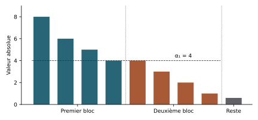

# BCE ECG — Maths appliquées (ESSEC-HEC) 2026 · Corrigé guidé

*Corrigé rédigé par IA, non officiel. Signalez toute erreur.*

**Rédaction** · Claude Opus 5.5 · effort non renseigné · vitesse non renseignée

**Révision (tour 1)** · modèle non renseigné · effort non renseigné · vitesse non renseignée

**Révision (tour 2)** · modèle non renseigné · effort non renseigné · vitesse non renseignée

**Révision (tour 3)** · GPT-6.2 Astra Ultra · vitesse non renseignée

## Présentation du sujet

**Thème.** Le sujet introduit l'acquisition comprimée (*compressed sensing*) : retrouver un vecteur $Y\in\mathcal M_{n,1}(\mathbb R)$ qui a peu de composantes non nulles à partir de la seule mesure $AY\in\mathcal M_{m,1}(\mathbb R)$, avec $m$ bien plus petit que $n$. L'outil central est la notion de $(\varepsilon,\mathcal X)$-isométrie : une matrice qui conserve presque la norme des vecteurs de $\mathcal X$. Le rapport 2026 rappelle que le sujet « faisait référence aux cours d'algèbre, d'analyse et de probabilité ».

**Format.** Épreuve de 4 heures, sans calculatrice ni document ; 27 questions numérotées, la plupart découpées en sous-questions. Un aide-mémoire Python est fourni en fin d'énoncé.

**Découpage.**

| Partie | Questions | Contenu | Notions mobilisées |
|---|---|---|---|
| Préliminaire informatique | 1–3 | norme, test d'isométrie en Python | `numpy`, boucles, booléens |
| Lemme de Johnson-Lindenstrauss | 4–10 | une matrice gaussienne normalisée est une isométrie approchée pour un ensemble fini | lois normales, indépendance, théorème de transfert, intégrales impropres, Markov, étude de fonction |
| Ensembles sporadiques | 11–19 | isométrie sur l'ensemble $\mathcal C_k$ des vecteurs à au plus $k$ composantes non nulles | dénombrement, sous-espaces vectoriels, Cauchy-Schwarz, suites arithmético-géométriques, récurrence, série exponentielle |
| Acquisition comprimée | 20–27 | $Y$ est l'unique solution de $AX=AY$ qui minimise $\langle X\rangle$, puis $|X|$ | inégalités triangulaires, supports disjoints, rang |

**Barème publié (rapport 2026).** Préliminaire 8 %, Johnson-Lindenstrauss 30 %, ensembles sporadiques 36 %, acquisition comprimée 26 % ; l'informatique pèse 11 % au total. Les questions les plus pondérées sont 17.b, 18, 3, 7.a, 7.c, 9.b, 2, 5.b, 6.a, 9.c, 10, 12.b, 12.c, 13.c, 16, 19.b, 19.c, 20.c et 25.a. Sur 2 680 copies, la moyenne est de 9,5 et l'écart-type de 5,1 ; le rapport indique 13/20 avec 32 % du barème et 20/20 avec 50 %.

**Difficulté.** Le sujet est long mais très guidé. Beaucoup de questions sont abordables à tout moment : 1 à 4, 5, 11, 12, 13, 14, 15, 16, 19.a-b, 20, 21, 22 et 23. Les points délicats sont 7.a (indépendance des $Y_i$), 17.b (récurrence), 18 (inclusions d'événements) et 24 à 26 (manipulation des supports).

**Gestion du temps.** Comptez 25 minutes pour le préliminaire et la question 4, 70 minutes pour Johnson-Lindenstrauss, 80 minutes pour les ensembles sporadiques et 60 minutes pour l'acquisition comprimée. La dernière partie commence par des questions faciles (20 à 23) : ne les sacrifiez pas faute de temps. Le jury le dit : « Pour avoir une très bonne note, la résolution d'environ 50% des questions suffit en général. »

**Notations et rappel.** Épreuve de 4 heures, sans calculatrice ni document. On note $\|X\|$ la norme euclidienne de $X\in\mathcal M_{d,1}(\mathbb R)$. La matrice $A$ est une $(\varepsilon,\mathcal X)$-isométrie si, pour tout $X\in\mathcal X$, $(1-\varepsilon)\|X\|^2\le\|AX\|^2\le(1+\varepsilon)\|X\|^2$.

Remarque utile tout au long du sujet : les normes sont positives et la racine carrée est croissante. Pour $\varepsilon\in\,]0,1[$, la condition d'isométrie équivaut donc à

$$\sqrt{1-\varepsilon}\,\|X\|\le\|AX\|\le\sqrt{1+\varepsilon}\,\|X\|.$$

## Partie I — Préliminaire informatique

Trois questions de Python sur la norme euclidienne et le test d'isométrie. Elles se traitent sans rien savoir du reste du sujet et rapportent dès le début de l'épreuve.

### Question 1

> [!INDICATION]
> La norme est une racine carrée de somme de carrés : quelles fonctions de l'aide-mémoire font la somme et la racine ?

> [!INDICATION]
> Pour b), calculez $\|X\|^2$ à la main, puis utilisez l'homogénéité de la norme pour le second affichage.

#### Solution

**a)**

```python
def Norme(X):
    return np.sqrt(np.sum(X**2))
```

`X**2` élève chaque coefficient au carré, `np.sum` en fait la somme, `np.sqrt` en prend la racine.

**b)** Pour $X={}^t(1,0,1,1,1)$, on a $\|X\|^2=4$, donc $\|X\|=2$. Le vecteur $\frac1{\|X\|}X$ est de norme 1 par homogénéité. La console affiche :

```text
2.0
1.0
```

> [!JURY]
> Rapport 2026 : « Il n'y a pas non plus besoin d'inventer des commandes en informatique ! Rappelons qu'un aide-mémoire était mis à disposition des candidats à la fin du sujet. » Les opérations terme à terme (`X**2`) et `np.sum` suffisent.

### Question 2

> [!INDICATION]
> Calculez le produit $AX$ à la main, puis les deux normes au carré.

> [!INDICATION]
> La seconde ligne est une double comparaison chaînée en Python : que vaut chaque membre ?

#### Solution

On calcule

$$AX=\begin{pmatrix}2&1\\0&1\\1&0\end{pmatrix}\begin{pmatrix}1\\-1\end{pmatrix}=\begin{pmatrix}1\\-1\\1\end{pmatrix}.$$

Mathématiquement, $\|AX\|^2=1+1+1=3$. Avec la fonction `Norme` de la question 1, Python affiche en fait `2.9999999999999996` (racine puis carré en flottants) : le `3.0` de l'énoncé en est l'arrondi, ce qu'on signale comme une imprécision d'énoncé.

Ensuite $\|X\|^2=2$, donc le quotient $\|AX\|^2/\|X\|^2$ vaut $\frac32$, soit environ $1{,}5$ en flottants. Avec `eps = 0.6`, Python évalue la comparaison chaînée `0.4 <= 1.5 <= 1.6`, qui est vraie : il affiche `True`.

Autrement dit, $(1-0{,}6)\|X\|^2\le\|AX\|^2\le(1+0{,}6)\|X\|^2$ : la matrice $A$ est une $(0{,}6,\{X\})$-isométrie.

> [!PIEGE]
> « Expliquer » demande de refaire le calcul, pas de paraphraser l'affichage. Le rapport classe la question 2 parmi les plus pondérées.

### Question 3

> [!INDICATION]
> Parcourez la liste et renvoyez `False` dès qu'un vecteur viole l'encadrement.

> [!INDICATION]
> Pour l'exemple, calculez $\|AX\|^2$ et $\|X\|^2$ pour chacun des deux vecteurs et comparez avec $0{,}8$ et $1{,}2$ fois $\|X\|^2$.

#### Solution

```python
def EstIsom(A, LX, eps):
    for X in LX:
        nX2 = Norme(X)**2
        nAX2 = Norme(np.dot(A, X))**2
        if nAX2 < (1-eps)*nX2 or nAX2 > (1+eps)*nX2:
            return False
    return True
```

La fonction renvoie `False` dès qu'un élément de la liste viole l'encadrement, et `True` si tous le respectent.

Avec la matrice $A$ de la question 2 et $\varepsilon=0{,}2$ :

- pour $X_1={}^t(-1,3)$, on a $AX_1={}^t(1,3,-1)$, donc $\|AX_1\|^2=11$ et $\|X_1\|^2=10$. Or $8\le11\le12$ ;
- pour $X_2={}^t(1,-2)$, on a $AX_2={}^t(0,-2,1)$, donc $\|AX_2\|^2=5=\|X_2\|^2$. Or $4\le5\le6$.

Les deux vecteurs vérifient l'encadrement, avec des marges d'au moins une unité, très supérieures aux erreurs d'arrondi. La console affiche **`True`**.

> [!METHODE]
> Pour tester une propriété « pour tout $X$ », on renvoie `False` au premier contre-exemple et `True` seulement après la boucle. Placer le `return True` dans la boucle est l'erreur classique.

> [!JURY]
> Le rapport 2026 note que « Les questions d'informatique sont plutôt bien faites. Il reste des confusions entre range(n) et range(1,n+1). » Une boucle directe `for X in LX` évite ce piège d'indices.

## Partie II — Le lemme de Johnson-Lindenstrauss

On montre qu'une matrice à coefficients gaussiens indépendants, normalisée par $\frac1{\sqrt m}$, conserve presque la norme d'un vecteur fixé avec une probabilité exponentiellement proche de 1 (inégalité de Chernoff, questions 6 et 7). Une réunion d'événements donne ensuite le résultat pour un ensemble fini de vecteurs.

### Question 4

> [!INDICATION]
> L'aide-mémoire donne une fonction qui simule d'un coup une matrice de variables normales indépendantes.

#### Solution

```python
M = rd.normal(0, 1, [m, n]) / np.sqrt(m)
```

`rd.normal(0,1,[m,n])` simule une matrice $m\times n$ de coefficients indépendants de loi $\mathcal N(0,1)$, que l'on divise par $\sqrt m$.

> [!PIEGE]
> Les paramètres de `rd.normal` sont l'espérance et l'écart-type, pas la variance. Ici les deux valent respectivement 0 et 1, mais l'ordre compte dès qu'on change de loi.

### Question 5

> [!INDICATION]
> a) est une question de cours sur les transformations affines d'une variable normale. Attention au paramètre de variance.

> [!INDICATION]
> b) Quelle propriété de stabilité des lois normales s'applique, et sous quelle hypothèse ? Pour $E(Y_i^2)$, pensez à la formule de König-Huygens.

> [!INDICATION]
> c) Écrivez la $i$-ème composante du produit $MX$.

#### Solution

**a)** On a $G_{i,j}\hookrightarrow\mathcal N(0,1)$ et $x_j\neq0$. Une transformée affine $aG+b$, avec $a\neq0$, d'une variable de loi normale suit une loi normale, d'espérance $aE(G)+b$ et de variance $a^2V(G)$. Donc

$$\boxed{x_jG_{i,j}\hookrightarrow\mathcal N(0,x_j^2).}$$

**b)** Soit $J$ l'ensemble des indices $j$ tels que $x_j\neq0$ ; il est non vide car $\|X\|=1$.

Pour $j\notin J$, on a $x_jG_{i,j}=0$, donc $Y_i=\sum_{j\in J}x_jG_{i,j}$.

Les variables $G_{i,j}$, $j\in J$, sont mutuellement indépendantes, donc par le lemme des coalitions les $x_jG_{i,j}$, $j\in J$, le sont aussi. Une somme de variables indépendantes de lois normales suit une loi normale, d'espérance la somme des espérances et de variance la somme des variances. Comme $\sum_{j\in J}x_j^2=\|X\|^2=1$ :

$$\boxed{Y_i\hookrightarrow\mathcal N(0,1).}$$

$Y_i$ admet un moment d'ordre 2 et, par la formule de König-Huygens :

$$\begin{aligned}
E(Y_i^2)&=V(Y_i)+E(Y_i)^2\\
&=1+0\\
&=\|X\|^2=1.
\end{aligned}$$

**c)** La $i$-ème composante de $MX$ est

$$\begin{aligned}(MX)_i&=\frac1{\sqrt m}\sum_{j=1}^nG_{i,j}x_j\\&=\frac{Y_i}{\sqrt m}.\end{aligned}$$

Donc

$$\begin{aligned}
Z&=\|MX\|^2\\
&=\sum_{i=1}^m\Big(\frac{Y_i}{\sqrt m}\Big)^2\\
&=\boxed{\frac1m\sum_{i=1}^mY_i^2.}
\end{aligned}$$

> [!JURY]
> Rapport 2026 : un nombre non négligeable de candidats donne pour $x_jG_{i,j}$ une loi normale de paramètres $(0,x_j)$ au lieu de $(0,x_j^2)$. Le second paramètre de $\mathcal N(\mu,\sigma^2)$ est la variance.

> [!PIEGE]
> En b), les termes tels que $x_j=0$ sont nuls et n'ont pas de loi normale non dégénérée : on les écarte avant d'appliquer la stabilité. Il faut aussi citer l'indépendance : le rapport juge les hypothèses d'indépendance « rarement mentionnées ».

### Question 6

> [!INDICATION]
> Le théorème de transfert ramène l'existence de l'espérance à la convergence (absolue) d'une intégrale impropre. Cette convergence se démontre.

> [!INDICATION]
> Pour la convergence, comparez l'intégrande à $\frac1{x^2}$ en l'infini. Pour le calcul, reconnaissez la densité d'une loi normale centrée de variance bien choisie.

#### Solution

On fixe $\varepsilon\in\,]0,1[$ et $t\in\,]0,\frac14]$.

**a)** $Y_i$ a pour densité $\varphi:x\mapsto\frac1{\sqrt{2\pi}}e^{-x^2/2}$. Par le théorème de transfert, $e^{tY_i^2}$ admet une espérance si et seulement si l'intégrale de $x\mapsto e^{tx^2}\varphi(x)$ sur $\mathbb R$ converge absolument, et l'espérance vaut alors cette intégrale. L'intégrande est positif et

$$e^{tx^2}\varphi(x)=\frac1{\sqrt{2\pi}}e^{-(1-2t)\frac{x^2}2}.$$

Posons $c=1-2t$ ; comme $t\le\frac14$, on a $c\ge\frac12>0$. La fonction $g:x\mapsto e^{-cx^2/2}$ est continue, positive et paire sur $\mathbb R$.

Par croissances comparées, $x^2g(x)\to0$ quand $x\to+\infty$, donc $g(x)=o\big(\frac1{x^2}\big)$ en $+\infty$. L'intégrale de Riemann $\int_1^{+\infty}\frac{dx}{x^2}$ converge, donc $\int_1^{+\infty}g$ converge par comparaison de fonctions positives.

L'intégrale sur $[0,1]$ est celle d'une fonction continue sur un segment. Par parité, $\int_{-\infty}^{+\infty}g$ converge.

Ainsi $E(e^{tY_i^2})$ existe et

$$\boxed{E\big(e^{tY_i^2}\big)=\frac1{\sqrt{2\pi}}\int_{-\infty}^{+\infty}e^{-(1-2t)\frac{x^2}2}\,dx.}$$

**b)** Posons $\sigma=\frac1{\sqrt{1-2t}}>0$. La densité de la loi $\mathcal N(0,\sigma^2)$ est

$$x\mapsto\frac1{\sigma\sqrt{2\pi}}e^{-\frac{x^2}{2\sigma^2}}=\frac{\sqrt{1-2t}}{\sqrt{2\pi}}\,e^{-(1-2t)\frac{x^2}2},$$

et son intégrale sur $\mathbb R$ vaut $1$. Donc

$$\int_{-\infty}^{+\infty}e^{-(1-2t)\frac{x^2}2}dx=\frac{\sqrt{2\pi}}{\sqrt{1-2t}},$$

et

$$\boxed{E\big(e^{tY_i^2}\big)=\frac1{\sqrt{1-2t}}.}$$

> [!JURY]
> Rapport 2026 : « La seule question demandant de justifier la convergence d'une intégrale impropre n'est quasiment pas abordée. Les candidats déclarent trop souvent que le théorème de transfert donne directement l'existence de l'espérance et la convergence de l'intégrale. »

> [!METHODE]
> Pour calculer $\int_{\mathbb R}e^{-cx^2/2}dx$, on reconnaît une densité de $\mathcal N\big(0,\frac1c\big)$ : son intégrale vaut 1, il ne reste qu'à ajuster la constante. Cela évite tout changement de variable.

### Question 7

> [!INDICATION]
> a) Écrivez $e^{tmZ}$ comme un produit. Quelle propriété de l'espérance permet de séparer le produit, et sous quelle hypothèse ?

> [!INDICATION]
> a) Pour l'inégalité, transformez l'événement $[Z\ge1+\varepsilon]$ à l'aide d'une fonction croissante, puis appliquez Markov.

> [!INDICATION]
> c) Étudiez une fonction d'une variable sur $[0,\frac14]$ ; d) choisissez $t$ pour optimiser l'exposant $2t^2-t\varepsilon$.

#### Solution

**a)** On a $tmZ=t\sum_{i=1}^mY_i^2$, donc

$$e^{tmZ}=\prod_{i=1}^me^{tY_i^2}.$$

Pour $i$ fixé, $Y_i$ ne dépend que de la ligne $(G_{i,1},\dots,G_{i,n})$. Ces $m$ lignes sont formées de variables mutuellement indépendantes, et deux lignes distinctes n'ont aucune variable commune. Par le lemme des coalitions, $Y_1,\dots,Y_m$ sont mutuellement indépendantes, puis $e^{tY_1^2},\dots,e^{tY_m^2}$ aussi.

Chacune admet une espérance (question 6). L'espérance d'un produit de variables mutuellement indépendantes admettant une espérance existe et vaut le produit des espérances :

$$E(e^{tmZ})=\prod_{i=1}^mE\big(e^{tY_i^2}\big).$$

En particulier $E(e^{tmZ})$ existe.

L'inclusion $[Z>1+\varepsilon]\subset[Z\ge1+\varepsilon]$ donne la première inégalité. Comme $u\mapsto e^{tmu}$ est strictement croissante ($tm>0$), on a

$$[Z\ge1+\varepsilon]=\big[e^{tmZ}\ge e^{tm(1+\varepsilon)}\big].$$

On applique l'inégalité de Markov à $U=e^{tmZ}$, positive et d'espérance finie, avec $a=e^{tm(1+\varepsilon)}>0$ :

$$\boxed{\begin{aligned}P(Z>1+\varepsilon)&\le P(Z\ge1+\varepsilon)\\&\le E(e^{tmZ})\,e^{-tm(1+\varepsilon)}.\end{aligned}}$$

**b)** Par a) et la question 6, $E(e^{tmZ})=(1-2t)^{-m/2}$. Donc

$$\begin{aligned}
P(Z>1+\varepsilon)&\le\frac{e^{-tm}e^{-tm\varepsilon}}{(\sqrt{1-2t})^m}\\
&=\boxed{\Big(\frac{e^{-t}}{\sqrt{1-2t}}\Big)^m e^{-tm\varepsilon}.}
\end{aligned}$$

**c)** Soit $f(t)=-t-\frac12\ln(1-2t)-2t^2$ sur $[0,\frac14]$, dérivable car $1-2t>0$. On a

$$\begin{aligned}
f'(t)&=-1+\frac1{1-2t}-4t\\
&=\frac{-(1-2t)+1-4t(1-2t)}{1-2t}\\
&=\frac{2t(4t-1)}{1-2t}.
\end{aligned}$$

Sur $[0,\frac14]$, on a $2t\ge0$, $4t-1\le0$ et $1-2t>0$, donc $f'\le0$.

Ainsi $f$ est décroissante et $f(t)\le f(0)=0$ :

$$\boxed{-t-\tfrac12\ln(1-2t)\le2t^2.}$$

Par croissance de l'exponentielle :

$$\begin{aligned}
\Big(\frac{e^{-t}}{\sqrt{1-2t}}\Big)^m&=\exp\Big(m\big(-t-\tfrac12\ln(1-2t)\big)\Big)\\
&\le e^{2mt^2}.
\end{aligned}$$

Avec b) :

$$\boxed{P(Z>1+\varepsilon)\le e^{m(2t^2-t\varepsilon)}.}$$

**d)** L'inégalité vaut pour tout $t\in\,]0,\frac14]$. On choisit $t=\frac\varepsilon4$, qui est dans $]0,\frac14[$ car $\varepsilon\in\,]0,1[$. Alors

$$\begin{aligned}
2t^2-t\varepsilon&=\frac{\varepsilon^2}8-\frac{\varepsilon^2}4\\
&=-\frac{\varepsilon^2}8,
\end{aligned}$$

d'où

$$\boxed{P(Z>1+\varepsilon)\le e^{-m\frac{\varepsilon^2}8}.}$$

> [!METHODE]
> C'est la méthode de Chernoff : on applique Markov non pas à $Z$ mais à $e^{\lambda Z}$, puis on optimise en $\lambda$. Le minimum de $t\mapsto2t^2-t\varepsilon$ est atteint en $t=\frac\varepsilon4$, d'où l'exposant $-\frac{\varepsilon^2}8$.

> [!JURY]
> Rapport 2026 : « Les hypothèses d'indépendance sont rarement mentionnées et leur vérification très rarement justifiée avec soin attendu. » Ici, l'indépendance des $Y_i$ vient du lemme des coalitions (chaque $Y_i$ ne dépend que de la ligne $i$). Pour 7.c, le rapport relève des « circonvolutions pour parvenir au résultat attendu » après une faute de calcul : soignez la dérivée.

### Question 8

> [!INDICATION]
> Les deux événements peuvent-ils se produire en même temps ?

#### Solution

Les événements $[Z<1-\varepsilon]$ et $[Z>1+\varepsilon]$ sont incompatibles, puisque $1-\varepsilon<1+\varepsilon$. Donc

$$\begin{aligned}
P\big([Z<1-\varepsilon]\cup[Z>1+\varepsilon]\big)&=P(Z<1-\varepsilon)+P(Z>1+\varepsilon)\\
&\le\boxed{2e^{-m\frac{\varepsilon^2}8}.}
\end{aligned}$$

> [!PIEGE]
> Même sans remarquer l'incompatibilité, la majoration $P(A\cup B)\le P(A)+P(B)$ suffit. N'écrivez pas d'égalité sans la justifier.

### Question 9

> [!INDICATION]
> a) Utilisez l'homogénéité de la norme et la linéarité de $M$.

> [!INDICATION]
> b) Écrivez l'événement « $M$ n'est pas une isométrie » comme une réunion, et traitez à part le cas $X_i=0$.

> [!INDICATION]
> c) Transformez l'hypothèse sur $m$ en une inégalité sur $2re^{-m\varepsilon^2/8}$ ; qu'implique une probabilité strictement positive ?

#### Solution

**a)** Par homogénéité, $\|U_i\|=\frac1{\|X_i\|}\|X_i\|=1$. Par linéarité, $MX_i=\|X_i\|\,MU_i$, donc

$$\|MX_i\|^2=\|X_i\|^2\,\|MU_i\|^2.$$

En divisant l'encadrement qui définit $B_i$ par $\|X_i\|^2>0$, on obtient

$$\boxed{B_i=\big[1-\varepsilon\le\|MU_i\|^2\le1+\varepsilon\big].}$$

**b)** L'événement « $M$ n'est pas une $(\varepsilon,\mathcal X)$-isométrie » est la réunion des $\overline{B_i}$, $1\le i\le r$.

- Si $X_i=0$, l'encadrement s'écrit $0\le0\le0$ : $B_i=\Omega$ et $P(\overline{B_i})=0$.
- Si $X_i\neq0$, le vecteur $U_i$ est de norme 1. Les questions 5 à 8 s'appliquent donc à $X=U_i$, avec $Z_i=\|MU_i\|^2$ : $P(\overline{B_i})\le2e^{-m\varepsilon^2/8}$.

Par l'inégalité admise sur la réunion :

$$\begin{aligned}
P\Big(\bigcup_{i=1}^r\overline{B_i}\Big)&\le\sum_{i=1}^rP(\overline{B_i})\\
&\le\boxed{2r\,e^{-m\frac{\varepsilon^2}8}.}
\end{aligned}$$

**c)** On a les équivalences

$$\begin{aligned}
m>\frac{8\ln(2r)}{\varepsilon^2}&\iff m\frac{\varepsilon^2}8>\ln(2r)\\
&\iff2r\,e^{-m\frac{\varepsilon^2}8}<1.
\end{aligned}$$

Alors la probabilité de la réunion des $\overline{B_i}$ est strictement inférieure à 1. L'événement $B_1\cap\dots\cap B_r$ a donc une probabilité strictement positive : il n'est pas vide.

Pour $\omega$ dans cet événement, la matrice $A=M(\omega)$ vérifie l'encadrement pour tous les $X_i$. **Il existe donc une matrice $A\in\mathcal M_{m,n}(\mathbb R)$ qui est une $(\varepsilon,\mathcal X)$-isométrie.**

> [!METHODE]
> Méthode probabiliste d'existence : si un événement a une probabilité strictement positive, il n'est pas vide, donc il existe un $\omega$ qui le réalise. On démontre ainsi l'existence d'un objet sans le construire.

### Question 10

> [!INDICATION]
> Répétez la simulation tant que la matrice obtenue ne convient pas, en réutilisant la fonction de la question 3.

#### Solution

On simule des matrices $M$ jusqu'à en obtenir une qui convienne :

```python
def Isom(LX, m, eps):
    n = np.shape(LX[0])[0]
    M = rd.normal(0, 1, [m, n]) / np.sqrt(m)
    while not EstIsom(M, LX, eps):
        M = rd.normal(0, 1, [m, n]) / np.sqrt(m)
    return M
```

Les tirages sont indépendants. Dès que $m>\frac{8\ln(2r)}{\varepsilon^2}$, chacun réussit avec une probabilité $p>0$ (question 9.c) : le nombre de tirages suit alors une loi géométrique de paramètre $p$, et la boucle s'arrête presque sûrement.

Une boucle infinie est possible pour certaines données. Prenons $m=1$, $n=2$, $0<\varepsilon<1/2$ et les quatre vecteurs $e_1,e_2,e_1+e_2,e_1-e_2$. Si la ligne $(a,b)$ convenait, les deux premiers tests donneraient $|ab|\ge 1-\varepsilon$. Les deux derniers imposeraient $(a+b)^2,(a-b)^2\in[2(1-\varepsilon),2(1+\varepsilon)]$. En soustrayant, on obtiendrait $4|ab|\le4\varepsilon$, ce qui est impossible.

> [!METHODE]
> Une boucle `while` « tirer jusqu'au succès » termine presque sûrement dès que la probabilité de succès est strictement positive : le nombre de tirages suit une loi géométrique.

## Partie III — ε-isométries pour les ensembles sporadiques de $\mathcal M_{n,1}(\mathbb R)$

L'ensemble $\mathcal C_k$ des vecteurs « sporadiques » est infini, mais c'est une réunion finie de sous-espaces $\mathcal Q(T)$. Sur chacun, un recouvrement fini admis (le réseau $\mathcal X_{T,\delta}$) permet de passer d'une isométrie sur un ensemble fini à une isométrie sur tout le sous-espace (question 17). La partie se clôt sur le nombre de mesures $m$ suffisant.

### Question 11

> [!INDICATION]
> C'est une question de cours sur les combinaisons.

#### Solution

Une partie de $[\![1,n]\!]$ à $k$ éléments est une combinaison de $k$ éléments parmi $n$ :

$$\boxed{\#\mathcal T_k=\binom nk.}$$

> [!JURY]
> Rapport 2026 : « Question 11 : très peu réussie, qui aura donné des réponses plus farfelues les unes que les autres, alors qu'il s'agit d'un résultat de cours ! »

### Question 12

> [!INDICATION]
> a) Revenez à la définition de $\langle X\rangle$.

> [!INDICATION]
> b) Décrivez $\mathcal Q(T)$ comme un espace engendré par des vecteurs de la base canonique.

> [!INDICATION]
> c) Pour l'inclusion difficile, complétez le support de $X$ en une partie à exactement $k$ éléments. Pour la dernière question, cherchez deux vecteurs de $\mathcal C_k$ dont la somme sort de $\mathcal C_k$.

#### Solution

**a)** $\langle X\rangle\le0$ signifie que $X$ n'a aucune composante non nulle : $\boxed{\mathcal C_0=\{0\}}$.

Tout $X$ a au plus $n$ composantes non nulles : $\boxed{\mathcal C_n=\mathcal M_{n,1}(\mathbb R)}$.

**b)** Notons $E_1,\dots,E_n$ la base canonique de $\mathcal M_{n,1}(\mathbb R)$.

Le support de $X$ est inclus dans $T$ si et seulement si $x_j=0$ pour tout $j\notin T$, c'est-à-dire si et seulement si $X=\sum_{p=1}^kx_{i_p}E_{i_p}$. Donc

$$\mathcal Q(T)=\mathrm{Vect}(E_{i_1},\dots,E_{i_k}),$$

qui est un sous-espace vectoriel. La famille $(E_{i_1},\dots,E_{i_k})$ est libre, comme sous-famille de la base canonique, et génératrice de $\mathcal Q(T)$ : c'en est une base. Donc $\boxed{\dim\mathcal Q(T)=k.}$

**c)** *Inclusion $\supset$.* Si $X\in\mathcal Q(T)$ avec $T\in\mathcal T_k$, alors $S(X)\subset T$, donc $\langle X\rangle\le\#T=k$ et $X\in\mathcal C_k$.

*Inclusion $\subset$.* Soit $X\in\mathcal C_k$ et $s=\#S(X)\le k$. Il reste $n-s\ge k-s$ indices hors de $S(X)$.

On en ajoute $k-s$ à $S(X)$ pour obtenir une partie $T\in\mathcal T_k$ qui contient $S(X)$. Alors $X\in\mathcal Q(T)$. Donc

$$\boxed{\mathcal C_k=\bigcup_{T\in\mathcal T_k}\mathcal Q(T).}$$

**$\mathcal C_k$ n'est pas un sous-espace vectoriel** pour $1\le k\le n-1$. En effet, $U=E_1+\dots+E_k$ et $V=E_{k+1}$ (qui existe car $k+1\le n$) sont dans $\mathcal C_k$.

Mais $U+V$ a $k+1$ composantes non nulles, donc $U+V\notin\mathcal C_k$ : $\mathcal C_k$ n'est pas stable par addition.

> [!JURY]
> Rapport 2026 : « une réunion de sous-espaces vectoriels n'est en général pas un sous-espace vectoriel. » Un contre-exemple explicite est la seule réponse attendue à la dernière question.

### Question 13

> [!INDICATION]
> a) Partez d'un carré positif.

> [!INDICATION]
> b) Majorez la valeur absolue de la somme par la somme des valeurs absolues, puis appliquez a) terme à terme.

> [!INDICATION]
> c) Le cas général est celui de vecteurs non nuls de norme quelconque : normalisez-les pour revenir à b).

#### Solution

**a)** On a $0\le(|x_i|-|y_i|)^2=x_i^2+y_i^2-2|x_i||y_i|$, d'où $\boxed{2|x_i||y_i|\le x_i^2+y_i^2.}$

**b)** Par l'inégalité triangulaire puis a) :

$$\begin{aligned}
\Big|\sum_{i=1}^nx_iy_i\Big|&\le\sum_{i=1}^n|x_i||y_i|\\
&\le\frac12\Big(\sum_{i=1}^nx_i^2+\sum_{i=1}^ny_i^2\Big)\\
&=\frac12(1+1)=1.
\end{aligned}$$

**c)** Pour $X$ et $Y$ non nuls, les vecteurs $X'=\frac X{\|X\|}$ et $Y'=\frac Y{\|Y\|}$ sont de norme 1. Leurs composantes sont $\frac{x_i}{\|X\|}$ et $\frac{y_i}{\|Y\|}$. Par b) :

$$\Big|\sum_{i=1}^n\frac{x_iy_i}{\|X\|\,\|Y\|}\Big|\le1.$$

En multipliant par $\|X\|\|Y\|>0$ :

$$\boxed{\Big|\sum_{i=1}^nx_iy_i\Big|\le\|X\|\,\|Y\|.}$$

Les deux membres étant positifs, on élève au carré :

$$\boxed{\begin{aligned}\Big(\sum_{i=1}^nx_iy_i\Big)^2&\le\|X\|^2\,\|Y\|^2\\&=\Big(\sum_{i=1}^nx_i^2\Big)\Big(\sum_{i=1}^ny_i^2\Big).\end{aligned}}$$

Si $X=0$ ou $Y=0$, les deux membres sont nuls : **l'inégalité reste vraie** (c'est une égalité).

> [!JURY]
> Rapport 2026 : « Question 13.c : Aucun candidat n'a compris que le cas général fait référence au cas où les vecteurs X et Y ne sont plus de norme 1 ! » La question 13.c figure parmi les plus pondérées.

### Question 14

> [!INDICATION]
> a) Écrivez la $i$-ème composante du vecteur $AX$, puis la définition de la norme.

> [!INDICATION]
> b) Appliquez Cauchy-Schwarz à chaque ligne de $A$ et au vecteur $X$.

#### Solution

**a)** La $i$-ème composante de $AX$ est $(AX)_i=\sum_{j=1}^na_{i,j}x_j$. Par définition de la norme :

$$\boxed{\begin{aligned}\|AX\|^2&=\sum_{i=1}^m(AX)_i^2\\&=\sum_{i=1}^m\Big(\sum_{j=1}^na_{i,j}x_j\Big)^2.\end{aligned}}$$

**b)** Pour $i$ fixé, on applique la question 13.c aux vecteurs $(a_{i,1},\dots,a_{i,n})$ et $(x_1,\dots,x_n)$ ; elle reste valable si l'un est nul. On obtient

$$\begin{aligned}\Big(\sum_{j=1}^na_{i,j}x_j\Big)^2&\le\Big(\sum_{j=1}^na_{i,j}^2\Big)\Big(\sum_{j=1}^nx_j^2\Big)\\&=\Big(\sum_{j=1}^na_{i,j}^2\Big)\|X\|^2.\end{aligned}$$

On somme sur $i$ :

$$\boxed{\begin{aligned}\|AX\|^2&\le\Big(\sum_{i=1}^m\sum_{j=1}^na_{i,j}^2\Big)\|X\|^2\\&=\alpha^2\|X\|^2.\end{aligned}}$$

En particulier $\|AX\|\le\alpha\|X\|$.

> [!JURY]
> Rapport 2026 : « la matrice AX ne saurait être égale à ses coefficients, ce qui rend les écritures comme $AX=\sum_{j=1}^na_{i,j}x_j$ nécessairement fausses. » Écrivez $(AX)_i$ pour la composante. Le rapport signale aussi « De nombreuses grosses confusions entre carré d'une somme et somme des carrés. »

### Question 15

> [!INDICATION]
> Décomposez $AX$ en une somme de deux termes faisant intervenir $Y$, puis utilisez les inégalités admises en préambule.

#### Solution

Par linéarité, $AX=AY+A(X-Y)$. L'inégalité rappelée en préambule, appliquée aux vecteurs $AY$ et $A(X-Y)$ de $\mathcal M_{m,1}(\mathbb R)$, donne

$$\boxed{\|AY\|-\|A(X-Y)\|\le\|AX\|\le\|AY\|+\|A(X-Y)\|.}$$

### Question 16

> [!INDICATION]
> Reconnaissez une suite arithmético-géométrique : cherchez d'abord son point fixe.

> [!INDICATION]
> Étudiez la suite $(u_p-\ell)$ : elle est géométrique. Sa raison est-elle dans $]-1,1[$ ?

#### Solution

Le sujet note $n$ l'indice de la suite ; on le note $p$ pour ne pas le confondre avec la dimension $n$.

La suite est arithmético-géométrique. Son point fixe $\ell$ vérifie $\ell=\frac\delta4(3+\ell)$, soit $\ell\big(1-\frac\delta4\big)=\frac{3\delta}4$ :

$$\ell=\frac{3\delta}{4-\delta}.$$

Pour tout $p\in\mathbb N$, on a $u_{p+1}-\ell=\frac\delta4(u_p-\ell)$. Donc

$$u_p-\ell=\Big(\frac\delta4\Big)^p(u_0-\ell).$$

Comme $0<\frac\delta4<1$, on a $\big(\frac\delta4\big)^p\to0$, donc

$$\boxed{\lim_{p\to+\infty}u_p=\frac{3\delta}{4-\delta}.}$$

Enfin $4-\delta>0$, donc

$$\begin{aligned}
\frac{3\delta}{4-\delta}\le\delta&\iff3\le4-\delta\\
&\iff\delta\le1,
\end{aligned}$$

ce qui est vrai : $\boxed{\frac{3\delta}{4-\delta}\le\delta.}$

> [!JURY]
> Rapport 2026 : « Question 16 : Beaucoup de candidats ont affirmé sans preuve que la suite $(u_n)$ convergeait. » Le jury ajoute que beaucoup pensent à tort que si la limite est inférieure à un réel, les termes le sont aussi : toutes les suites ne sont pas monotones.

> [!PIEGE]
> L'énoncé note $n$ l'indice de la suite alors que $n$ est déjà la dimension. Changez de lettre dans votre copie et signalez-le.

### Question 17

> [!INDICATION]
> a) Passez de l'encadrement des carrés à celui des normes, puis comparez $\sqrt u$ et $u$ selon que $u\le1$ ou $u\ge1$.

> [!INDICATION]
> b) Raisonnez par récurrence sur l'indice de la suite. Pour majorer $\|A(X-Y)\|$, utilisez 14.b au premier rang, puis l'hypothèse de récurrence appliquée au vecteur $X-Y$, qui est dans $\mathcal Q(T)$.

> [!INDICATION]
> c) Passez à la limite dans les inégalités larges de b). Pour la seconde partie, comparez $1\pm\varepsilon$ à $(1\pm\delta)^2$.

#### Solution

On rappelle que $\varepsilon=2\delta+\delta^2$ et que $A$ est une $\big(\frac\delta2,\mathcal X_{T,\delta}\big)$-isométrie.

**a)** Pour $Y\in\mathcal X_{T,\delta}$ de norme 1, on a $1-\frac\delta2\le\|AY\|^2\le1+\frac\delta2$. La racine carrée étant croissante, $\sqrt{1-\frac\delta2}\le\|AY\|\le\sqrt{1+\frac\delta2}$.

Pour $u\in[0,1]$, on a $u^2\le u$, donc $u\le\sqrt u$. Pour $u\ge1$, on a $u\le u^2$, donc $\sqrt u\le u$.

On applique cela à $u=1-\frac\delta2\in[0,1]$ et à $u=1+\frac\delta2\ge1$ :

$$\boxed{\begin{aligned}1-\frac\delta2&\le\sqrt{1-\frac\delta2}\le\|AY\|,\\\|AY\|&\le\sqrt{1+\frac\delta2}\le1+\frac\delta2.\end{aligned}}$$

**b)** On montre par récurrence sur $p\in\mathbb N^*$ (indice noté $n$ dans l'énoncé) la propriété :

$\mathcal P(p)$ : pour tout $X\in\mathcal Q(T)$ de norme 1, $1-u_p\le\|AX\|\le1+u_p$.

Soit $X\in\mathcal Q(T)$ de norme 1 et $Y\in\mathcal X_{T,\delta}$ de norme 1 tel que $\|X-Y\|\le\frac\delta4$.

Comme $\mathcal Q(T)$ est un sous-espace vectoriel (12.b) qui contient $X$ et $Y$, on a $X-Y\in\mathcal Q(T)$.

*Initialisation ($p=1$).* Par la question 14.b, $\|A(X-Y)\|\le\alpha\|X-Y\|\le(1+u_0)\frac\delta4$. Par la question 15 et a) :

$$\begin{aligned}
\|AX\|&\le\|AY\|+\|A(X-Y)\|\\
&\le1+\frac\delta2+\frac\delta4(1+u_0)\\
&=1+\frac\delta4(3+u_0)\\
&=1+u_1,
\end{aligned}$$

et de même

$$\begin{aligned}
\|AX\|&\ge\|AY\|-\|A(X-Y)\|\\
&\ge1-\frac\delta2-\frac\delta4(1+u_0)\\
&=1-u_1.
\end{aligned}$$

*Hérédité.* Supposons $\mathcal P(p)$ vraie. Soit $W\in\mathcal Q(T)$ non nul : $\frac W{\|W\|}$ est de norme 1 dans $\mathcal Q(T)$, donc $\|AW\|\le(1+u_p)\|W\|$ par homogénéité. Cette inégalité reste vraie pour $W=0$.

Avec $W=X-Y$ :

$$\|A(X-Y)\|\le(1+u_p)\frac\delta4.$$

Les mêmes calculs qu'à l'initialisation, avec $u_p$ à la place de $u_0$, donnent

$$\begin{aligned}
\|AX\|&\le1+\frac\delta4(3+u_p)=1+u_{p+1},\\
\|AX\|&\ge1-\frac\delta4(3+u_p)=1-u_{p+1}.
\end{aligned}$$

Donc $\mathcal P(p+1)$ est vraie. Par récurrence, pour tout $p\in\mathbb N^*$ et tout $X\in\mathcal Q(T)$ de norme 1 :

$$\boxed{1-u_p\le\|AX\|\le1+u_p.}$$

L'outil effectif est l'inégalité de la question 15 ; l'énoncé renvoie à la question 13, qui intervient à travers 14.b.

**c)** Pour $X$ fixé, on passe à la limite quand $p\to+\infty$ dans les inégalités larges de b), grâce à la question 16 :

$$1-\frac{3\delta}{4-\delta}\le\|AX\|\le1+\frac{3\delta}{4-\delta}.$$

Avec $\frac{3\delta}{4-\delta}\le\delta$, on obtient

$$\boxed{1-\delta\le\|AX\|\le1+\delta.}$$

Ensuite $1+\varepsilon=1+2\delta+\delta^2=(1+\delta)^2$, donc $1+\delta=\sqrt{1+\varepsilon}$. Par ailleurs

$$\begin{aligned}
1-\varepsilon&=1-2\delta-\delta^2\\
&\le1-2\delta+\delta^2=(1-\delta)^2.
\end{aligned}$$

Comme $1-\varepsilon>0$ et $1-\delta>0$, la croissance de la racine donne $\sqrt{1-\varepsilon}\le1-\delta$. Ainsi

$$\boxed{\sqrt{1-\varepsilon}\le\|AX\|\le\sqrt{1+\varepsilon}.}$$

**d)** Soit $X\in\mathcal Q(T)$. Si $X=0$, l'encadrement de définition s'écrit $0\le0\le0$. Sinon, $\frac X{\|X\|}\in\mathcal Q(T)$ est de norme 1. Par c) et homogénéité :

$$\sqrt{1-\varepsilon}\,\|X\|\le\|AX\|\le\sqrt{1+\varepsilon}\,\|X\|.$$

En élevant au carré des quantités positives, on obtient $(1-\varepsilon)\|X\|^2\le\|AX\|^2\le(1+\varepsilon)\|X\|^2$. **$A$ est une $(\varepsilon,\mathcal Q(T))$-isométrie.**

> [!METHODE]
> L'hérédité utilise l'hypothèse $\mathcal P(p)$ sur un **autre** vecteur ($X-Y$, renormalisé) que celui que l'on étudie : c'est pourquoi on la formule « pour tout $X\in\mathcal Q(T)$ de norme 1 ». L'homogénéité de la norme permet ensuite de l'étendre à tout vecteur de $\mathcal Q(T)$.

> [!JURY]
> Rapport 2026 : « dans la question 17, où il fallait passer à la limite dans l'inégalité, les candidats ont affirmé dans plus de la moitié des cas que la suite était croissante, donc inférieure à sa limite. » La question 17.b est la première de la liste des questions les plus pondérées.

> [!PIEGE]
> L'énoncé renvoie en 17.b à « la question 13 » ; l'outil effectif est l'inégalité de la question 15 (et 14.b, qui découle de 13, pour le premier rang).

### Question 18

> [!INDICATION]
> Ramenez l'événement portant sur l'ensemble infini $\mathcal Q(T)$ à un événement portant sur l'ensemble fini $\mathcal X_{T,\delta}$, grâce à la question 17.

> [!INDICATION]
> Appliquez 9.b avec $\frac\delta2$ au lieu de $\varepsilon$, puis la décomposition de $\mathcal C_k$ obtenue en 12.c et l'inégalité sur une réunion.

#### Solution

Soit $T\in\mathcal T_k$. Notons $E_T$ l'événement « $M$ est une $\big(\frac\delta2,\mathcal X_{T,\delta}\big)$-isométrie ».

Par la question 17 appliquée à $A=M(\omega)$ : si $\omega\in E_T$, alors $M(\omega)$ est une $(\varepsilon,\mathcal Q(T))$-isométrie.

L'événement « $M$ n'est pas une $(\varepsilon,\mathcal Q(T))$-isométrie » est donc contenu dans $\overline{E_T}$.

L'ensemble $\mathcal X_{T,\delta}$ est fini, de cardinal $r\le\big(\frac{12}\delta\big)^k$, et $\frac\delta2\in\,]0,1[$. La question 9.b, appliquée avec $\frac\delta2$ à la place de $\varepsilon$, donne

$$\begin{aligned}
P(\overline{E_T})&\le2r\,e^{-m\frac{(\delta/2)^2}8}\\
&\le2\Big(\frac{12}\delta\Big)^ke^{-m\frac{\delta^2}{32}}.
\end{aligned}$$

D'où la **première majoration** : la probabilité que $M$ ne soit pas une $(\varepsilon,\mathcal Q(T))$-isométrie est inférieure à $2\big(\frac{12}\delta\big)^ke^{-m\delta^2/32}$.

Par 12.c, $\mathcal C_k$ est la réunion des $\mathcal Q(T)$, $T\in\mathcal T_k$.

Donc $M$ est une $(\varepsilon,\mathcal C_k)$-isométrie dès que c'est une $(\varepsilon,\mathcal Q(T))$-isométrie pour tout $T\in\mathcal T_k$, en particulier sur l'événement $\bigcap_TE_T$.

L'événement « $M$ n'est pas une $(\varepsilon,\mathcal C_k)$-isométrie » est donc contenu dans la réunion des $\overline{E_T}$, qui compte $\binom nk$ événements (question 11). Par l'inégalité sur la réunion :

$$\boxed{P\big(M\text{ n'est pas une }(\varepsilon,\mathcal C_k)\text{-isométrie}\big)\le2\binom nk\Big(\frac{12}\delta\Big)^ke^{-m\frac{\delta^2}{32}}.}$$

> [!METHODE]
> Pour majorer la probabilité d'un événement compliqué, on l'inclut dans un événement plus simple (ici, fini) dont on sait majorer la probabilité. Les inclusions d'événements se rédigent dans le bon sens : si $E_T$ est réalisé, alors $M$ est une isométrie sur $\mathcal Q(T)$.

### Question 19

> [!INDICATION]
> a) Écrivez le coefficient binomial comme un quotient de $k$ facteurs.

> [!INDICATION]
> b) La série exponentielle en $x=k$ est à termes positifs : gardez seulement deux termes bien choisis.

> [!INDICATION]
> c) Combinez 18 et 19.b, puis écrivez le majorant sous la forme $\exp(k\times\text{(quelque chose)})$.

#### Solution

**a)** On a

$$\binom nk=\frac{n(n-1)\cdots(n-k+1)}{k!}.$$

Chacun des $k$ facteurs du numérateur est compris entre $1$ et $n$, donc $\boxed{\binom nk\le\frac{n^k}{k!}.}$

**b)** Pour tout réel $x$, $e^x=\sum_{j=0}^{+\infty}\frac{x^j}{j!}$. Avec $x=k\ge1$, tous les termes sont positifs. Donc $e^k$ est supérieur à la somme des deux termes d'indices $j=k-1$ et $j=k$, qui sont distincts et d’indices entiers positifs ou nuls :

$$e^k\ge\frac{k^{k-1}}{(k-1)!}+\frac{k^k}{k!}.$$

Or $\frac{k^{k-1}}{(k-1)!}=\frac{k\cdot k^{k-1}}{k\,(k-1)!}=\frac{k^k}{k!}$, d'où $\boxed{e^k\ge2\frac{k^k}{k!}.}$

Ainsi $\frac2{k!}\le\frac{e^k}{k^k}$ et, par a) :

$$\begin{aligned}
2\binom nk&\le\frac{2n^k}{k!}\\
&\le\frac{n^ke^k}{k^k}=\boxed{\Big(\frac{en}k\Big)^k.}
\end{aligned}$$

**c)** On utilise les événements $E_T$ de la question 18, avec $n=bk$ et $m=ak$. Par 18 et 19.b :

$$\begin{aligned}
P\Big(\bigcup_{T\in\mathcal T_k}\overline{E_T}\Big)&\le(eb)^k\Big(\frac{12}{\delta}\Big)^ke^{-ak\frac{\delta^2}{32}}\\
&=\exp\Big(k\Big[\ln\Big(\frac{12be}\delta\Big)-a\frac{\delta^2}{32}\Big]\Big).
\end{aligned}$$

L'hypothèse $a>32\,\frac{\ln(12be/\delta)}{\delta^2}$ rend le crochet strictement négatif. Comme $k\ge1$, la probabilité est strictement inférieure à $1$. L'événement $\bigcap_{T\in\mathcal T_k}E_T$ a donc une probabilité strictement positive : il n'est pas vide.

Pour $\omega$ dans cet événement, $A=M(\omega)$ est une $(\varepsilon,\mathcal Q(T))$-isométrie pour tout $T\in\mathcal T_k$ (question 17), donc une $(\varepsilon,\mathcal C_k)$-isométrie.

**Il existe $A\in\mathcal M_{m,n}(\mathbb R)$ qui est une $(\varepsilon,\mathcal C_k)$-isométrie.**

> [!JURY]
> Rapport 2026 : « Question 19.a : Plusieurs candidats ont démontré que $\binom nk\sim\frac{n^k}{k!}$, et ont ensuite directement conclu avec l'inégalité demandée par l'énoncé, ce qui est bien sûr un raisonnement totalement faux. » Pour 19.b : « Une minorité de candidats seulement connaissent bien la série exponentielle. Les deux erreurs fréquentes concernent la somme, elle démarre à i = 1 au lieu de i = 0 et le fait de sommer sur la mauvaise variable. »

> [!PIEGE]
> Un équivalent ne donne jamais une inégalité valable pour tout $n$. Ici la majoration est immédiate facteur par facteur.

## Partie IV — L'acquisition comprimée

On exploite enfin les isométries. Si $A$ est une isométrie sur $\mathcal C_{2k}$, le vecteur $Y$ est le plus « creux » des antécédents de $AY$.

Si $A$ est une isométrie sur $\mathcal C_{3k}$ avec $\varepsilon<\frac13$, il minimise aussi la somme $|X|$ des valeurs absolues, problème bien plus facile à résoudre en pratique.

### Question 20

> [!INDICATION]
> a) Travaillez composante par composante, puis faites une récurrence sur $r$.

> [!INDICATION]
> b) Supports disjoints : combien de vecteurs $X_i$ ont au plus une composante non nulle à un indice donné ?

> [!INDICATION]
> c) Pour $|X|\le\sqrt k\|X\|$, appliquez Cauchy-Schwarz au vecteur des $|x_i|$ et à un vecteur d'indicatrices bien choisi.

#### Solution

**a)** Pour tout $i$, l'inégalité triangulaire dans $\mathbb R$ donne $|x_i+y_i|\le|x_i|+|y_i|$. En sommant sur $i\in[\![1,n]\!]$ :

$$\boxed{|X+Y|\le|X|+|Y|.}$$

On montre ensuite l'inégalité généralisée par récurrence sur $r\ge1$. Le cas $r=1$ est une égalité. Si elle est vraie au rang $r$, alors

$$\begin{aligned}
\Big|\sum_{i=1}^{r+1}X_i\Big|&\le\Big|\sum_{i=1}^rX_i\Big|+|X_{r+1}|\\
&\le\sum_{i=1}^{r+1}|X_i|.
\end{aligned}$$

**b)** Les supports étant deux à deux disjoints, pour chaque indice $j\in[\![1,n]\!]$, au plus un des $X_i$ a une $j$-ème composante non nulle. La $j$-ème composante de $\sum_iX_i$ est donc nulle ou égale à cette unique composante non nulle.

Dans les deux cas, sa valeur absolue est la somme des valeurs absolues des $j$-èmes composantes des $X_i$. En sommant sur $j$ :

$$\boxed{\begin{aligned}\Big|\sum_{i=1}^rX_i\Big|&=\sum_{j=1}^n\sum_{i=1}^r|(X_i)_j|\\&=\sum_{i=1}^r|X_i|.\end{aligned}}$$

**c)** Soit $X\in\mathcal C_k$, $S=S(X)$ et $s=\#S\le k$.

*Première inégalité.* En développant le carré, les doubles produits $|x_i||x_j|$ sont positifs, donc

$$\begin{aligned}
|X|^2&=\Big(\sum_{i=1}^n|x_i|\Big)^2\\
&\ge\sum_{i=1}^nx_i^2=\|X\|^2.
\end{aligned}$$

D'où $\|X\|\le|X|$, les deux nombres étant positifs.

*Seconde inégalité.* Notons $\mathbf 1_S(i)$ le nombre qui vaut $1$ si $i\in S$ et $0$ sinon. On applique la question 13.c aux vecteurs de composantes $|x_i|$ et $\mathbf 1_S(i)$ :

$$\begin{aligned}
|X|&=\sum_{i=1}^n|x_i|\,\mathbf 1_S(i)\\
&\le\|X\|\sqrt{\sum_{i=1}^n\mathbf 1_S(i)^2}\\
&=\sqrt s\,\|X\|.
\end{aligned}$$

Comme $s\le k$ :

$$\boxed{\|X\|\le|X|\le\sqrt k\,\|X\|.}$$

> [!JURY]
> Rapport 2026 : « Question 20.a : Trop de candidats ont affirmé qu'il s'agissait de l'inégalité triangulaire usuelle, puis se sont contentés de recopier l'inégalité généralisée qui était indiquée dans le sujet, en affirmant qu'elle était immédiate ! » La question 20.c figure parmi les plus pondérées.

### Question 21

> [!INDICATION]
> a) Que donne l'inégalité de gauche de la définition quand $AX=0$ ?

> [!INDICATION]
> b) Montrez que $k$ colonnes de $A$ forment une famille libre, en vous ramenant à a).

#### Solution

**a)** Soit $X\in\mathcal C_k$ tel que $AX=0$. Alors $(1-\varepsilon)\|X\|^2\le\|AX\|^2=0$ avec $1-\varepsilon>0$. Donc $\|X\|=0$, puis $\boxed{X=0}$ par la propriété de la norme.

**b)** Les vecteurs $E_1,\dots,E_k$ de la base canonique ($k\le n$) ont pour images les colonnes $C_1=AE_1,\dots,C_k=AE_k$ de $A$. Supposons $\sum_{j=1}^k\lambda_jC_j=0$. Alors $A\big(\sum_j\lambda_jE_j\big)=0$.

Or $\sum_j\lambda_jE_j$ a au plus $k$ composantes non nulles, donc appartient à $\mathcal C_k$ : par a), il est nul, et tous les $\lambda_j$ sont nuls.

La famille $(C_1,\dots,C_k)$ est donc libre dans l'espace engendré par les colonnes de $A$, dont la dimension est $\mathrm{rg}(A)$. Donc $\boxed{\mathrm{rg}(A)\ge k.}$

> [!JURY]
> Rapport 2026 : « Question 21.a : Trop de candidats pensent que AX = 0 implique A = 0 ou X = 0 ! » Le produit matriciel n'est pas intègre : c'est l'isométrie qui donne la conclusion.

### Question 22

> [!INDICATION]
> a) Comparez le support de $X-Y$ aux supports de $X$ et de $Y$.

> [!INDICATION]
> b) Raisonnez sur une solution $X$ qui ferait au moins aussi bien que $Y$, et montrez qu'elle est dans $\mathcal C_k$.

#### Solution

**a)** Si $x_i=y_i=0$, alors $x_i-y_i=0$ : donc $S(X-Y)\subset S(X)\cup S(Y)$. Ainsi $\langle X-Y\rangle\le\langle X\rangle+\langle Y\rangle\le2k$, et $X-Y\in\mathcal C_{2k}$, avec $2k\le n$.

De plus $A(X-Y)=AX-AY=0$. La question 21.a, appliquée à la $(\varepsilon,\mathcal C_{2k})$-isométrie $A$, donne $X-Y=0$, soit $\boxed{X=Y.}$

**b)** $Y$ est solution de $AX=B$. Soit $X$ une solution telle que $\langle X\rangle\le\langle Y\rangle$.

Alors $\langle X\rangle\le k$, donc $X\in\mathcal C_k$, et $AX=AY$. Par a), $X=Y$.

Ainsi toute solution $X\neq Y$ vérifie $\langle X\rangle>\langle Y\rangle$ : **$Y$ est l'unique solution de $AX=B$ qui minimise $\langle X\rangle$.**

> [!METHODE]
> « $Y$ est l'unique solution qui minimise » se démontre en deux temps : $Y$ est solution, et toute solution qui fait au moins aussi bien que $Y$ lui est égale.

### Question 23

> [!INDICATION]
> Calculez $AZ$ et appliquez la question 21.a avec le bon ensemble $\mathcal C_{3k}$.

#### Solution

On a $AZ=AY-AX=B-B=0$. Si $\langle Z\rangle\le3k$, alors $Z\in\mathcal C_{3k}$, avec $3k\le n$.

La question 21.a, appliquée à la $(\varepsilon,\mathcal C_{3k})$-isométrie $A$, donne $\boxed{Z=0.}$

### Question 24

> [!INDICATION]
> a) Décomposez $Z$ selon $S$ et son complémentaire, et utilisez $Z=Y-X$. Pour l'égalité sur $|\cdot|$, regardez les supports.

> [!INDICATION]
> b) Combinez a), l'inégalité triangulaire de 20.a et l'hypothèse $|X|\le|Y|$.

> [!INDICATION]
> c) Le vecteur $Z_S$ appartient à un ensemble $\mathcal C_j$ : lequel ? Utilisez 20.c.

#### Solution

**a)** Comme $S$ et $\overline S$ forment une partition de $[\![1,n]\!]$, on a $Z=Z_S+Z_{\overline S}$. De $Z=Y-X$ on tire $Y=X+Z_S+Z_{\overline S}$, d'où

$$\boxed{Y-Z_{\overline S}=X+Z_S.}$$

Le support de $Y$ est $S$, celui de $-Z_{\overline S}$ est inclus dans $\overline S$ : ils sont disjoints. Par 20.b, et comme $|-Z_{\overline S}|=|Z_{\overline S}|$ :

$$\boxed{|Y-Z_{\overline S}|=|Y|+|Z_{\overline S}|.}$$

**b)** Par a), 20.a et l'hypothèse $|X|\le|Y|$ :

$$\begin{aligned}
|Y|+|Z_{\overline S}|&=|X+Z_S|\\
&\le|X|+|Z_S|\\
&\le|Y|+|Z_S|.
\end{aligned}$$

D'où $\boxed{|Z_{\overline S}|\le|Z_S|.}$

**c)** $Z_S$ a son support inclus dans $S$, de cardinal $\langle Y\rangle\le k$, donc $Z_S\in\mathcal C_k$. Par 20.c, $|Z_S|\le\sqrt k\|Z_S\|$, puis par b) :

$$\boxed{\|Z_S\|\ge\frac1{\sqrt k}|Z_S|\ge\frac1{\sqrt k}|Z_{\overline S}|.}$$

### Question 25

> [!INDICATION]
> a) Minorez chaque composante non nulle de $Z_{T_i}$ par $\alpha_i$, et majorez chaque composante de $Z_{T_{i+1}}$ par $\alpha_i$.

> [!INDICATION]
> b) Sommez a) sur $i$, puis enchaînez avec 20.b et 24.c.

#### Solution

Remarque préalable : $\langle Z_S\rangle\le k$ et $\langle Z\rangle\ge3k+1$, donc $\langle Z_{\overline S}\rangle\ge2k+1$ et $r\ge1$.

Ordonnons les coefficients non nuls hors de $S$ par valeur absolue décroissante, en départageant librement les ex æquo. Les indices dont le coefficient est nul peuvent être rangés dans le dernier ensemble. Si le nombre de coefficients non nuls est multiple de $2k$, le dernier vecteur est nul. On convient aussi que la restriction à un ensemble vide est le vecteur nul.



**a)** Soit $i\in[\![1,r]\!]$. Le vecteur $Z_{T_i}$ a exactement $2k$ composantes non nulles, chacune de valeur absolue au moins $\alpha_i$. Donc

$$|Z_{T_i}|\ge2k\alpha_i=\sqrt{2k}\sqrt{2k\alpha_i^2}.$$

Les composantes non nulles de $Z_{T_{i+1}}$ sont, en valeur absolue, inférieures ou égales à toutes celles de $Z_{T_i}$, donc à $\alpha_i$, et il y en a au plus $2k$. Ainsi $\|Z_{T_{i+1}}\|^2\le2k\alpha_i^2$ et, la racine étant croissante :

$$\boxed{|Z_{T_i}|\ge\sqrt{2k}\sqrt{2k\alpha_i^2}\ge\sqrt{2k}\,\|Z_{T_{i+1}}\|.}$$

**b)** Les $T_i$ sont disjoints et $Z_{\overline S}$ est la somme des $Z_{T_i}$, $1\le i\le r+1$ : par 20.b, $|Z_{\overline S}|$ est la somme des $|Z_{T_i}|$.

On somme a) pour $i\in[\![1,r]\!]$ :

$$\begin{aligned}
\sqrt{2k}\sum_{i=2}^{r+1}\|Z_{T_i}\|&\le\sum_{i=1}^r|Z_{T_i}|\\
&\le\sum_{i=1}^{r+1}|Z_{T_i}|\\
&=|Z_{\overline S}|.
\end{aligned}$$

Par 24.c, $|Z_{\overline S}|\le\sqrt k\|Z_S\|$. Donc $\sqrt{2k}\sum_{i=2}^{r+1}\|Z_{T_i}\|\le\sqrt k\|Z_S\|$. En divisant par $\sqrt k>0$ :

$$\boxed{\|Z_S\|\ge\sqrt2\sum_{i=2}^{r+1}\|Z_{T_i}\|.}$$

> [!PIEGE]
> Le décalage d'indice est le point délicat : la somme des $|Z_{T_i}|$ pour $i\le r$ majore la somme des $\|Z_{T_i}\|$ pour $2\le i\le r+1$. Vérifiez aussi que $r\ge1$, ce qui découle de $\langle Z\rangle\ge3k+1$.

### Question 26

> [!INDICATION]
> a) Écrivez $Z=Z_{S\cup T_1}+\sum_{i\ge2}Z_{T_i}$ et vérifiez que chacun de ces vecteurs appartient à $\mathcal C_{3k}$.

> [!INDICATION]
> b) Comparez $\|Z_{S\cup T_1}\|$ à $\|Z_S\|$, puis utilisez 25.b.

> [!INDICATION]
> c) Que vaut $AZ$ ? Le coefficient obtenu en b) est-il strictement positif ?

#### Solution

**a)** On a $Z=Z_{S\cup T_1}+\sum_{i=2}^{r+1}Z_{T_i}$, donc par linéarité

$$AZ=AZ_{S\cup T_1}+\sum_{i=2}^{r+1}AZ_{T_i}.$$

L'inégalité du préambule ($\|U\|-\|V\|\le\|U+V\|$) donne

$$\|AZ\|\ge\|AZ_{S\cup T_1}\|-\Big\|\sum_{i=2}^{r+1}AZ_{T_i}\Big\|.$$

Le vecteur $Z_{S\cup T_1}$ a au plus $k+2k=3k$ composantes non nulles, et chaque $Z_{T_i}$ en a au plus $2k\le3k$ : ces vecteurs sont dans $\mathcal C_{3k}$.

Comme $A$ est une $(\varepsilon,\mathcal C_{3k})$-isométrie :

$$\begin{aligned}
\|AZ_{S\cup T_1}\|&\ge\sqrt{1-\varepsilon}\,\|Z_{S\cup T_1}\|,\\
\|AZ_{T_i}\|&\le\sqrt{1+\varepsilon}\,\|Z_{T_i}\|.
\end{aligned}$$

Par l'inégalité triangulaire itérée :

$$\begin{aligned}
\Big\|\sum_{i=2}^{r+1}AZ_{T_i}\Big\|&\le\sum_{i=2}^{r+1}\|AZ_{T_i}\|\\
&\le\sqrt{1+\varepsilon}\sum_{i=2}^{r+1}\|Z_{T_i}\|.
\end{aligned}$$

D'où

$$\boxed{\begin{aligned}\|AZ\|&\ge\|AZ_{S\cup T_1}\|-\Big\|\sum_{i=2}^{r+1}AZ_{T_i}\Big\|\\&\ge\sqrt{1-\varepsilon}\,\|Z_{S\cup T_1}\|-\sqrt{1+\varepsilon}\sum_{i=2}^{r+1}\|Z_{T_i}\|.\end{aligned}}$$

**b)** Les supports de $Z_S$ et $Z_{T_1}$ sont disjoints, donc $\|Z_{S\cup T_1}\|^2=\|Z_S\|^2+\|Z_{T_1}\|^2$. Ainsi $\|Z_{S\cup T_1}\|\ge\|Z_S\|$. Par 25.b, $\sum_{i=2}^{r+1}\|Z_{T_i}\|\le\frac{\|Z_S\|}{\sqrt2}$. En reportant dans a) :

$$\boxed{\|AZ\|\ge\Big(\sqrt{1-\varepsilon}-\frac{\sqrt{1+\varepsilon}}{\sqrt2}\Big)\|Z_S\|.}$$

**c)** On a $AZ=0$ (question 23). Le coefficient est strictement positif :

$$\begin{aligned}
\sqrt{1-\varepsilon}>\frac{\sqrt{1+\varepsilon}}{\sqrt2}&\iff2(1-\varepsilon)>1+\varepsilon\\
&\iff\varepsilon<\frac13,
\end{aligned}$$

ce qui est l'hypothèse. Donc $\|Z_S\|\le0$, soit $\boxed{Z_S=0.}$

Alors, par 24.b, $|Z_{\overline S}|\le|Z_S|=0$, donc $Z_{\overline S}=0$. Ainsi $Z=Z_S+Z_{\overline S}=0$, c'est-à-dire $\boxed{X=Y.}$

Cela contredit l'hypothèse $\langle Z\rangle\ge3k+1$ : ce cas est en fait impossible, et la conclusion $X=Y$ vaut dans tous les cas, grâce à la question 23.

> [!METHODE]
> La condition $\varepsilon<\frac13$ est exactement celle qui rend le coefficient $\sqrt{1-\varepsilon}-\frac{\sqrt{1+\varepsilon}}{\sqrt2}$ strictement positif : c'est le moment où l'hypothèse de l'énoncé sert.

### Question 27

> [!INDICATION]
> Distinguez les deux cas $\langle Z\rangle\le3k$ et $\langle Z\rangle\ge3k+1$ traités dans la partie, puis concluez comme en 22.b.

#### Solution

$Y$ est solution de $AX=B$. Soit $X$ une solution telle que $|X|\le|Y|$, et $Z=Y-X$.

- Si $\langle Z\rangle\le3k$, alors $X=Y$ par la question 23.
- Si $\langle Z\rangle\ge3k+1$, alors $X=Y$ par la question 26.c.

Toute solution $X\neq Y$ vérifie donc $|X|>|Y|$ : **$Y$ est l'unique solution de l'équation $AX=B$ qui minimise $|X|$.**

> [!METHODE]
> Remplacer la minimisation de $\langle X\rangle$ (problème combinatoire) par celle de $|X|$ (problème convexe, résoluble par programmation linéaire) est l'idée clé de l'acquisition comprimée.

## Bilan

**Méthodes à retenir.**

- La méthode de Chernoff (questions 6 et 7) : Markov appliquée à $e^{tZ}$, calcul de la transformée de Laplace, puis optimisation en $t$.
- La méthode probabiliste d'existence (questions 9.c et 19.c) : un événement de probabilité strictement positive n'est pas vide.
- L'inégalité sur une réunion d'événements, combinée à une inclusion d'événements bien orientée (question 18).
- Le passage d'un ensemble fini à un sous-espace par un réseau et une récurrence (question 17), puis par homogénéité.
- Cauchy-Schwarz avec un vecteur d'indicatrices pour comparer $|X|$ et $\|X\|$ (question 20.c).

**Prérequis à revoir.** Les paramètres des lois normales et leur stabilité par somme indépendante ; le théorème de transfert et la convergence des intégrales impropres ; le lemme des coalitions ; les suites arithmético-géométriques ; la série exponentielle ; le rang d'une matrice et les familles libres.

**Questions transposables.** Le calcul de $E(e^{tY^2})$ pour $Y\hookrightarrow\mathcal N(0,1)$, le coefficient binomial majoré par $\frac{n^k}{k!}$, l'inégalité $e^k\ge\frac{k^k}{k!}$ et la stabilité par somme des lois normales reviennent souvent dans les sujets ECG.

Le rapport 2026 conclut : « Une page blanche vaut mieux qu'une page remplie de calculs stériles et/ou faux. »
