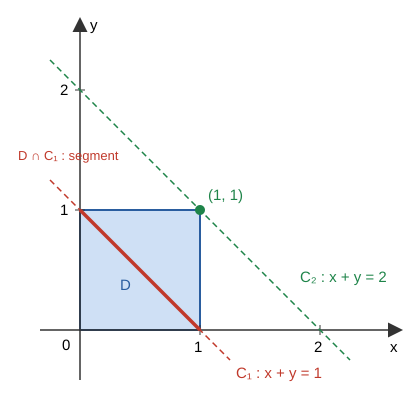

# BCE ECG — Mathématiques approfondies (emlyon) 2026 · Corrigé brut

*Corrigé rédigé par IA, non officiel. Signalez toute erreur.*

Épreuve de 4 h, sans document ni calculatrice. Deux problèmes indépendants : une inégalité de trace (algèbre bilinéaire), puis une marche aléatoire simple sur $\mathbb{Z}$.

## Problème 1

### Partie 1 - Un exemple

#### 1.

$A$ est symétrique réelle. Son polynôme caractéristique est $(1-X)^2-1=X(X-2)$ : ses valeurs propres sont $2$ et $0$. On a $A\begin{pmatrix}1\\1\end{pmatrix}=2\begin{pmatrix}1\\1\end{pmatrix}$ et $A\begin{pmatrix}1\\-1\end{pmatrix}=0$.

Les vecteurs $V_1=\frac1{\sqrt2}\begin{pmatrix}1\\1\end{pmatrix}$ et $V_2=\frac1{\sqrt2}\begin{pmatrix}1\\-1\end{pmatrix}$ forment une base orthonormée de vecteurs propres. La matrice $Q$ de colonnes $V_1,V_2$ est la matrice de passage de la base canonique (orthonormée) à une base orthonormée : elle est orthogonale et $Q^{-1}={}^tQ$. Les valeurs propres étant rangées dans l'ordre décroissant :

$$\boxed{Q=\frac1{\sqrt2}\begin{pmatrix}1&1\\1&-1\end{pmatrix},\qquad D=\begin{pmatrix}2&0\\0&0\end{pmatrix},\qquad A=QD\,{}^tQ}$$

#### 2. a.

Pour $(x,y)\neq(0,0)$, on pose $r=\sqrt{x^2+y^2}>0$. Alors

$$\begin{aligned}
\varphi(x,y) &= \frac1{r^2}\begin{pmatrix}x&y\end{pmatrix}\begin{pmatrix}x+y\\x+y\end{pmatrix}\\
&= \frac{(x+y)^2}{x^2+y^2}\\
&= 1+\frac{2xy}{x^2+y^2}.
\end{aligned}$$

$\varphi$ est le quotient de deux fonctions polynomiales, dont le dénominateur $x^2+y^2$ ne s'annule pas sur l'ouvert $\mathbb{R}^2\setminus\{(0,0)\}$ : **$\varphi$ est de classe $\mathcal{C}^2$ sur $\mathbb{R}^2\setminus\{(0,0)\}$.**

#### 2. b.

Pour $(x,y)\neq(0,0)$ :

$$\partial_1\varphi(x,y)=\frac{2y(x^2+y^2)-2xy\cdot2x}{(x^2+y^2)^2}=\frac{2y(y^2-x^2)}{(x^2+y^2)^2},$$

$$\partial_2\varphi(x,y)=\frac{2x(x^2-y^2)}{(x^2+y^2)^2}.$$

$(x,y)$ est critique si et seulement si $y(y^2-x^2)=0$ et $x(x^2-y^2)=0$.

- Si $y=0$, alors $x\neq0$ et la seconde équation donne $x^3=0$ : impossible.
- Si $y\neq0$, la première donne $x^2=y^2$, et la seconde est alors vérifiée.

Les points critiques sont les points $(x,x)$ et $(x,-x)$ avec $x\neq0$ : **il y en a une infinité, ce sont les points des deux droites $y=x$ et $y=-x$ privées de l'origine.**

#### 2. c.

Pour $\alpha\neq0$, $(\alpha x,\alpha y)\neq(0,0)$ et

$$\varphi(\alpha x,\alpha y)=1+\frac{2\alpha^2xy}{\alpha^2(x^2+y^2)}=\varphi(x,y).$$

#### 2. d.

$\varphi$ est continue sur $S_1$, qui est fermé, borné et non vide : elle y est bornée et atteint son maximum en un point $u_0\in S_1$.

Pour $(x,y)\neq(0,0)$, avec $\alpha=1/\|(x,y)\|$, le point $(\alpha x,\alpha y)$ est dans $S_1$, donc par 2.c

$$\varphi(x,y)=\varphi(\alpha x,\alpha y)\leqslant\varphi(u_0).$$

Ainsi $\varphi$ admet un maximum global sur l'ouvert $\mathbb{R}^2\setminus\{(0,0)\}$, atteint en $u_0$. Un extremum sur un ouvert est atteint en un point critique, donc $u_0$ est de la forme $(x,x)$ ou $(x,-x)$.

Or $\varphi(x,x)=2$ et $\varphi(x,-x)=0$.

**Le maximum global de $\varphi$ vaut $2$ ; il est atteint exactement aux points $(x,x)$, $x\neq0$.** (En effet $\varphi(x,y)=2$ équivaut à $(x-y)^2=0$.)

### Partie 2 - Une inégalité sur la trace

#### 3. a.

${}^tBB\in\mathcal{M}_m(\mathbb{R})$ et $B\,{}^tB\in\mathcal{M}_n(\mathbb{R})$, avec

$$({}^tBB)_{i,j}=\sum_{k=1}^n b_{k,i}\,b_{k,j}$$

$$(1\leqslant i,j\leqslant m),$$

$$(B\,{}^tB)_{i,j}=\sum_{k=1}^m b_{i,k}\,b_{j,k}$$

$$(1\leqslant i,j\leqslant n).$$

#### 3. b.

$$\begin{aligned}
\operatorname{Tr}({}^tBB) &= \sum_{i=1}^m\sum_{k=1}^n b_{k,i}^2\\
&= \sum_{k=1}^n\sum_{i=1}^m b_{k,i}^2\\
&= \operatorname{Tr}(B\,{}^tB).
\end{aligned}$$

#### 4.

Pour $n=2$, $D=[0,1]^2$ est le carré unité.

$\mathcal{C}_1$ est la droite d'équation $x+y=1$ : elle coupe $D$ selon le segment d'extrémités $(1,0)$ et $(0,1)$.

$\mathcal{C}_2$ est la droite d'équation $x+y=2$ : elle ne rencontre $D$ qu'au point $(1,1)$.



#### 5.

$f_\Lambda$ est linéaire, donc continue sur $D\cap\mathcal{C}_k$, qui est fermé, borné et non vide (il contient $e=(1,\dots,1,0,\dots,0)$, avec $k$ coordonnées égales à $1$). Elle y admet donc un maximum global.

Montrons qu'il est atteint en $e$, où $f_\Lambda(e)=\lambda_1+\dots+\lambda_k$.

Soit $x\in D\cap\mathcal{C}_k$.

Pour $i\leqslant k$, $\lambda_i\geqslant\lambda_k$ et $x_i-1\leqslant0$ ; pour $i>k$, $\lambda_i\leqslant\lambda_k$ et $x_i\geqslant0$. Donc

$$\begin{aligned}
f_\Lambda(x)-f_\Lambda(e) &= \sum_{i=1}^k\lambda_i(x_i-1)+\sum_{i=k+1}^n\lambda_ix_i\\
&\leqslant \lambda_k\sum_{i=1}^k(x_i-1)+\lambda_k\sum_{i=k+1}^nx_i\\
&= \lambda_k\Big(\sum_{i=1}^nx_i-k\Big)\\
&= 0.
\end{aligned}$$

**Le maximum de $f_\Lambda$ sur $D\cap\mathcal{C}_k$ est atteint en $(1,\dots,1,0,\dots,0)$ et vaut $\lambda_1+\dots+\lambda_k$.**

L'hypothèse $\Lambda\notin\operatorname{Vect}((1,\dots,1))$ n'est pas utilisée : si $\Lambda$ est constant, $f_\Lambda$ est constante sur $D\cap\mathcal{C}_k$.

#### 6. a.

Soit $F=\operatorname{Im}\pi$ et $G=\operatorname{Ker}\pi$.

Comme $\pi$ est une projection, $\mathbb{R}^n=F\oplus G$ et $\pi$ est la projection sur $F$ parallèlement à $G$.

Dans une base adaptée à cette décomposition (une base de $F$, de cardinal $r'=\dim F$, puis une base de $G$), la matrice de $\pi$ est

$$P'=\begin{pmatrix}I_{r'}&0\\0&0\end{pmatrix}.$$

$P$ et $P'$ sont semblables, et la trace est invariante par changement de base : $\operatorname{Tr}(P)=\operatorname{Tr}(P')=r'$. Et $\operatorname{rg}(P)=\dim\operatorname{Im}\pi=r'$. Donc $\boxed{\operatorname{rg}(P)=\operatorname{Tr}(P)}$.

#### 6. b.

Si $\pi$ est orthogonale, pour $x\in\mathbb{R}^n$, $\pi(x)\in F$ et $x-\pi(x)\in G=F^\perp$. Par le théorème de Pythagore,

$$\|x\|^2=\|\pi(x)\|^2+\|x-\pi(x)\|^2\geqslant\|\pi(x)\|^2,$$

d'où $\boxed{\|\pi(x)\|\leqslant\|x\|}$.

#### 6. c.

La base canonique $(e_1,\dots,e_n)$ est orthonormée, donc $p_{i,i}=\langle\pi(e_i),e_i\rangle$. Comme $e_i-\pi(e_i)$ est orthogonal à $\pi(e_i)$ :

$$\begin{aligned}
p_{i,i} &= \langle\pi(e_i),\pi(e_i)+(e_i-\pi(e_i))\rangle\\
&= \|\pi(e_i)\|^2 .
\end{aligned}$$

Donc $p_{i,i}\geqslant0$, et par 6.b, $p_{i,i}\leqslant\|e_i\|^2=1$ : $\boxed{p_{i,i}\in[0,1]}$.

#### 7.

$A$ est symétrique réelle : il existe une base orthonormée de $\mathbb{R}^n$ formée de vecteurs propres de $A$ (théorème spectral). Quitte à réordonner les vecteurs de cette base (ce qui la laisse orthonormée), on peut supposer les valeurs propres associées rangées dans l'ordre décroissant $\lambda_1\geqslant\dots\geqslant\lambda_n$.

Soit $Q$ la matrice de passage de la base canonique à cette base : c'est une matrice de passage entre deux bases orthonormées, donc $Q$ est orthogonale et $Q^{-1}={}^tQ$. Avec $D=\operatorname{diag}(\lambda_1,\dots,\lambda_n)$, la formule de changement de base donne $A=QDQ^{-1}=QD\,{}^tQ$.

#### 8.

Le coefficient $(i,j)$ de ${}^tMM$ est ${}^tC_iC_j=\langle C_i,C_j\rangle=\delta_{i,j}$, car $(C_1,\dots,C_k)$ est orthonormale : $\boxed{{}^tMM=I_k}$.

#### 9.

Si $\operatorname{Sp}(A)=\{\lambda_1\}$, alors $D=\lambda_1I_n$ et $A=Q(\lambda_1I_n)\,{}^tQ=\lambda_1I_n$. Donc

$$\begin{aligned}
\operatorname{Tr}({}^tMAM) &= \lambda_1\operatorname{Tr}({}^tMM)\\
&= \lambda_1\operatorname{Tr}(I_k)\\
&= k\lambda_1 .
\end{aligned}$$

**La quantité $\operatorname{Tr}({}^tMAM)=k\lambda_1$ ne dépend pas de $M$** : toute matrice $M$ convient.

#### 10. a.

On a ${}^tXX={}^tMQ\,{}^tQM={}^tMM=I_k$ (question 8). Donc

$$\begin{aligned}
P^2 &= X({}^tXX)\,{}^tX\\
&= X\,{}^tX=P,
\end{aligned}$$

et ${}^tP={}^t({}^tX)\,{}^tX=X\,{}^tX=P$. L'endomorphisme $\pi$ de $\mathbb{R}^n$ canoniquement associé à $P$ vérifie $\pi\circ\pi=\pi$ : c'est une projection.

Comme la base canonique est orthonormée et $P$ symétrique, $\pi$ est un endomorphisme symétrique. Un projecteur symétrique est un projecteur orthogonal : **$P$ est la matrice d'une projection orthogonale.**

#### 10. b.

Si ${}^tXY=0$, alors $PY=X({}^tXY)=0$. Réciproquement, si $PY=0$, alors

$$\begin{aligned}
0 &= {}^tXPY\\
&= ({}^tXX)\,{}^tXY\\
&= {}^tXY.
\end{aligned}$$

Donc $\boxed{\operatorname{Ker}(P)=\operatorname{Ker}({}^tX)}$. Par le théorème du rang, $\operatorname{rg}(P)=n-\dim\operatorname{Ker}(P)=n-\dim\operatorname{Ker}({}^tX)=\operatorname{rg}({}^tX)$.

Enfin ${}^tX\in\mathcal{M}_{k,n}(\mathbb{R})$ a $k$ lignes, donc $\operatorname{rg}({}^tX)\leqslant k$.

Et $\operatorname{Im}({}^tXX)\subset\operatorname{Im}({}^tX)$ avec ${}^tXX=I_k$ de rang $k$, donc $\operatorname{rg}({}^tX)\geqslant k$. Ainsi $\boxed{\operatorname{rg}(P)=k}$.

#### 10. c.

On a ${}^tMAM={}^tMQD\,{}^tQM={}^tXDX$. Pour $U\in\mathcal{M}_{k,n}(\mathbb{R})$ et $V\in\mathcal{M}_{n,k}(\mathbb{R})$, le calcul de 3.b donne $\operatorname{Tr}(UV)=\sum_{i,j}u_{i,j}v_{j,i}=\operatorname{Tr}(VU)$. Avec $U={}^tX$ et $V=DX$ :

$$\begin{aligned}
\operatorname{Tr}({}^tMAM) &= \operatorname{Tr}({}^tX\,DX)\\
&= \operatorname{Tr}(DX\,{}^tX)\\
&= \operatorname{Tr}(DP)=\operatorname{Tr}(PD).
\end{aligned}$$

$D$ étant diagonale, $\operatorname{Tr}(PD)=\sum_{i=1}^np_{i,i}\lambda_i=f_\Lambda(p_{1,1},\dots,p_{n,n})$. Or $P$ est la matrice, dans la base canonique, d'une projection orthogonale (10.a), donc chaque $p_{i,i}\in[0,1]$ (6.c), et $\sum_ip_{i,i}=\operatorname{Tr}(P)=\operatorname{rg}(P)=k$ (6.a et 10.b). Ainsi $(p_{1,1},\dots,p_{n,n})\in D\cap\mathcal{C}_k$.

Comme $A$ a deux valeurs propres distinctes, $\Lambda$ est non nul et n'est pas colinéaire à $(1,\dots,1)$ ; la question 5 assure l'existence du maximum, et

$$\boxed{\operatorname{Tr}({}^tMAM)\leqslant\max\{f_\Lambda(x):x\in D\cap\mathcal{C}_k\}}$$

(L'énoncé écrit $f_\Lambda(x_1,x_1,\dots,x_n)$ : il faut lire $f_\Lambda(x_1,x_2,\dots,x_n)$.)

#### 10. d.

Par la question 5, ce maximum vaut $\lambda_1+\dots+\lambda_k$. Si $C_i=V_i$ pour $i\in[\![1;k]\!]$, alors $AC_j=\lambda_jV_j$ et

$$({}^tMAM)_{i,j}={}^tV_i\,(\lambda_jV_j)=\lambda_j\delta_{i,j},$$

donc $\operatorname{Tr}({}^tMAM)=\lambda_1+\dots+\lambda_k$. La majoration de 10.c est atteinte : **la quantité $\operatorname{Tr}({}^tMAM)$ est maximale pour $M=(V_1\,|\,\cdots\,|\,V_k)$, et son maximum vaut $\lambda_1+\dots+\lambda_k$.**

#### 10. e.

Prenons $n=2$, $k=1$ et $A=\begin{pmatrix}1&1\\1&1\end{pmatrix}$, de rang $r=1$, de valeurs propres distinctes $2$ et $0$.

Une matrice $M$ de $\mathcal{M}_{2,1}(\mathbb{R})$ à colonne unitaire s'écrit $u=\frac{1}{\sqrt{x^2+y^2}}\begin{pmatrix}x\\y\end{pmatrix}$, et $\operatorname{Tr}({}^tuAu)={}^tuAu=\varphi(x,y)$.

La partie 2 dit que le maximum de $\varphi$ vaut $\lambda_1=2$ et qu'il est atteint pour $u=V_1=\frac1{\sqrt2}(1,1)$, c'est-à-dire aux points $(x,x)$. **On retrouve exactement le résultat de la question 2.d** : c'est le cas $k=1$, où l'on maximise le quotient de Rayleigh ${}^tuAu$ sur la sphère unité.

## Problème 2

### Partie 1 - Des résultats préliminaires

#### 1. a.

$W$ est à valeurs entières, et la somme ne porte que sur les $n\geqslant0$. Pour $t\in[0,1]$ et $n\in\mathbb{N}$, $0\leqslant\mathbf{P}(W=n)t^n\leqslant\mathbf{P}(W=n)$.

La série $\sum\mathbf{P}(W=n)$ converge (ses sommes partielles sont majorées par $1$). Par comparaison de séries à termes positifs, **$G_W(t)$ est bien défini pour tout $t\in[0,1]$.**

#### 1. b.

Si $0\leqslant s\leqslant t\leqslant1$, alors $s^n\leqslant t^n$ pour tout $n$, donc $\mathbf{P}(W=n)s^n\leqslant\mathbf{P}(W=n)t^n$. En sommant, $G_W(s)\leqslant G_W(t)$ :

**$G_W$ est croissante sur $[0,1]$.**

#### 1. c.

$G_W$ est croissante sur $[0,1[$ et majorée par $G_W(1)$. Par le théorème de la limite monotone, $G_W$ admet une limite finie $\ell$ en $1^-$.

#### 1. d.

Pour $t\in[0,1[$, les termes de la série étant positifs, une somme partielle est majorée par la somme ; puis $G_W(t)\leqslant G_W(1)$ par croissance :

$$\sum_{n=0}^m\mathbf{P}(W=n)t^n\leqslant G_W(t)\leqslant G_W(1).$$

À $m$ fixé, le membre de gauche est un polynôme en $t$, de limite $\sum_{n=0}^m\mathbf{P}(W=n)$ en $1$. En passant à la limite $t\to1^-$ dans les inégalités larges :

$$\sum_{n=0}^m\mathbf{P}(W=n)\leqslant\ell\leqslant G_W(1).$$

#### 1. e.

En faisant tendre $m$ vers $+\infty$ dans 1.d, $G_W(1)\leqslant\ell\leqslant G_W(1)$, donc $\ell=G_W(1)$ : $\lim_{t\to1^-}G_W(t)=G_W(1)$.

**$G_W$ est continue en $1$** (à gauche, ce qui suffit puisque $G_W$ est définie sur $[0,1]$).

#### 1. f.

Soit $t\in[0,1[$. Pour $n\geqslant1$, $0\leqslant n\mathbf{P}(W=n)t^{n-1}\leqslant nt^{n-1}$, et la série géométrique dérivée $\sum_{n\geqslant1}nt^{n-1}$ converge car $|t|<1$. Par comparaison de séries à termes positifs, **$\sum_{n\geqslant1}n\mathbf{P}(W=n)t^{n-1}$ converge.**

#### 2. a.

Soit $h(x)=\mathrm{e}^{-x}-1+x$, dérivable sur $\mathbb{R}$ avec $h'(x)=1-\mathrm{e}^{-x}$, négative sur $]-\infty,0]$ et positive sur $[0,+\infty[$.

Donc $h$ admet un minimum global en $0$, égal à $h(0)=0$ : $\boxed{1-x\leqslant\exp(-x)}$ pour tout réel $x$.

#### 2. b.

Les événements $\overline{A_n},\dots,\overline{A_m}$ sont mutuellement indépendants (les $A_k$ le sont). Donc

$$\begin{aligned}
\mathbf{P}\Big(\bigcup_{k=n}^mA_k\Big) &= 1-\mathbf{P}\Big(\bigcap_{k=n}^m\overline{A_k}\Big)\\
&= 1-\prod_{k=n}^m\big(1-\mathbf{P}(A_k)\big).
\end{aligned}$$

Par 2.a, $0\leqslant1-\mathbf{P}(A_k)\leqslant\exp(-\mathbf{P}(A_k))$ ; on peut multiplier ces inégalités entre réels positifs :

$$\prod_{k=n}^m\big(1-\mathbf{P}(A_k)\big)\leqslant\exp\Big(-\sum_{k=n}^m\mathbf{P}(A_k)\Big),$$

d'où $\boxed{\mathbf{P}\big(\bigcup_{k=n}^mA_k\big)\geqslant1-\exp\big(-\sum_{k=n}^m\mathbf{P}(A_k)\big)}$.

#### 2. c.

Soit $n\geqslant1$ et $B_n=\bigcup_{k\geqslant n}A_k$. La suite $\big(\bigcup_{k=n}^mA_k\big)_{m\geqslant n}$ est croissante, de réunion $B_n$ ; par continuité croissante,

$$\mathbf{P}(B_n)=\lim_{m\to+\infty}\mathbf{P}\Big(\bigcup_{k=n}^mA_k\Big).$$

La série à termes positifs $\sum\mathbf{P}(A_k)$ diverge, donc $\sum_{k=n}^m\mathbf{P}(A_k)\to+\infty$ quand $m\to+\infty$, et le minorant de 2.b tend vers $1$. Donc $\mathbf{P}(B_n)\geqslant1$, soit $\mathbf{P}(B_n)=1$.

La suite $(B_n)$ est décroissante ; par continuité décroissante, $\mathbf{P}\big(\bigcap_{n\geqslant1}B_n\big)=\lim_n\mathbf{P}(B_n)=1$ : $\boxed{\mathbf{P}\Big(\bigcap_{n\geqslant1}\bigcup_{k\geqslant n}A_k\Big)=1}$.

#### 3.

Soit $(j_1,\dots,j_n)\in\mathbb{R}^n$ et $j_0=0$. Les sommes partielles déterminent les termes et réciproquement, donc

$$\begin{aligned}
[U_n=(j_1,\dots,j_n)]&=\bigcap_{i=1}^n[W_i=j_i-j_{i-1}],\\
[V_{n,k}=(j_1,\dots,j_n)]&=\bigcap_{i=1}^n[W_{k+i-1}=j_i-j_{i-1}].
\end{aligned}$$

Les $W_i$ sont mutuellement indépendantes et de même loi, d'où

$$\begin{aligned}
\mathbf{P}(U_n=(j_1,\dots,j_n)) &= \prod_{i=1}^n\mathbf{P}(W_1=j_i-j_{i-1})\\
&= \mathbf{P}(V_{n,k}=(j_1,\dots,j_n)).
\end{aligned}$$

#### 4. a.

En développant,

$$\begin{aligned}
\sum_{k=1}^nc_k &= \sum_{k=1}^n\sum_{i=1}^ka_ib_{k-i}\\
&= \sum_{(i,j)\in I_n}a_ib_j\end{aligned}$$

$$I_n=\{(i,j):i\geqslant1,\ j\geqslant0,\ i+j\leqslant n\}.$$

De même $\sum_{k=1}^{2n}c_k=\sum_{(i,j)\in I_{2n}}a_ib_j$, et $\big(\sum_{i=1}^na_i\big)\big(\sum_{j=0}^nb_j\big)=\sum_{(i,j)\in K_n}a_ib_j$ avec $K_n=[\![1;n]\!]\times[\![0;n]\!]$.

On a $I_n\subset K_n\subset I_{2n}$ (si $1\leqslant i\leqslant n$ et $0\leqslant j\leqslant n$, alors $i+j\leqslant2n$). Les termes $a_ib_j$ étant positifs :

$$\begin{aligned}
\sum_{k=1}^nc_k&\leqslant\Big(\sum_{i=1}^na_i\Big)\Big(\sum_{j=0}^nb_j\Big)\\
&\leqslant\sum_{k=1}^{2n}c_k .
\end{aligned}$$

#### 4. b.

Notons $\alpha=\sum_{i\geqslant1}a_i$ et $\beta=\sum_{j\geqslant0}b_j$. Par 4.a, les sommes partielles de la série à termes positifs $\sum c_k$ sont majorées par $\alpha\beta$ : elle converge, de somme $\gamma$.

En faisant tendre $n$ vers $+\infty$ dans 4.a, $\gamma\leqslant\alpha\beta\leqslant\gamma$, donc

$$\boxed{\begin{aligned}\sum_{k=1}^{+\infty}c_k\\=\Big(\sum_{i=1}^{+\infty}a_i\Big)\Big(\sum_{j=0}^{+\infty}b_j\Big)\end{aligned}}$$

### Partie 2 - Une marche aléatoire

#### 5. a.

$\mathbf{E}(X_n)=1\cdot\frac12+(-1)\cdot\frac12=0$ et $\mathbf{E}(X_n^2)=1$, donc $\boxed{\mathbf{E}(X_n)=0,\ \mathbf{V}(X_n)=1}$.

#### 5. b.

Par linéarité de l'espérance (sans hypothèse d'indépendance), $\mathbf{E}(S_n)=0$. Les $X_k$ étant mutuellement indépendantes, la variance de leur somme est la somme des variances : $\boxed{\mathbf{E}(S_n)=0,\ \mathbf{V}(S_n)=n}$.

#### 6.

Soit $\varepsilon>0$. $\frac{S_n}n$ a pour espérance $0$ et pour variance $\frac{n}{n^2}=\frac1n$. Par l'inégalité de Bienaymé-Tchebychev :

$$\mathbf{P}\Big(\Big|\frac{S_n}n\Big|\geqslant\varepsilon\Big)\leqslant\frac{1}{n\varepsilon^2}\xrightarrow[n\to+\infty]{}0 .$$

**$\big(\frac{S_n}n\big)$ converge en probabilité vers la variable certaine égale à $0$** (loi faible des grands nombres).

#### 7. a.

```python
def simul_X():
    if rd.random() < 0.5:
        return 1
    else:
        return -1
```

#### 7. b.

```python
def simul_S(n):
    S = 0
    for k in range(n):
        S = S + simul_X()
    return S
```

#### 8.

Pour $n\in\mathbb{N}$ :

$$\begin{aligned}
2\sum_{k=1}^n\frac{X_k+1}2-n &= \sum_{k=1}^nX_k+n-n\\
&= S_n.
\end{aligned}$$

Pour $n=0$, les deux membres sont nuls.

La variable $\frac{X_k+1}2$ vaut $1$ si $X_k=1$ et $0$ si $X_k=-1$, chacune avec probabilité $\frac12$ :

**$\frac{X_k+1}2$ suit la loi de Bernoulli $\mathcal{B}(1/2)$.**

#### 9. a.

Posons $Y_n=\sum_{k=1}^n\frac{X_k+1}2$, à valeurs dans $[\![0;n]\!]$. Par 8, $S_n=2Y_n-n$, donc $S_n-n=2(Y_n-n)$ est pair : $S_n$ a la parité de $n$.

Si $i$ et $n$ n'ont pas la même parité, $[S_n=i]=\varnothing$ et $\mathbf{P}(S_n=i)=0$.

#### 9. b.

Les variables $\frac{X_k+1}2$ sont mutuellement indépendantes (fonctions des $X_k$, indépendantes) et de loi $\mathcal{B}(1/2)$ : $Y_n$ suit la loi binomiale $\mathcal{B}(n,1/2)$.

Si $i\in[\![-n;n]\!]$ a la parité de $n$, alors $\frac{n+i}2\in[\![0;n]\!]$ et

$$\begin{aligned}
\mathbf{P}(S_n=i) &= \mathbf{P}\Big(Y_n=\frac{n+i}2\Big)\\
&= \binom{n}{\frac{n+i}2}\Big(\frac12\Big)^n .
\end{aligned}$$

#### 10. a.

Par 9.b avec $i=0$ et $2n$ pas :

$$\begin{aligned}
\mathbf{P}(S_{2n}=0) &= \binom{2n}{n}\frac1{4^n}\\
&= \frac{(2n)!}{(n!)^2\,4^n}.
\end{aligned}$$

Par la formule de Stirling, $(2n)!\sim\sqrt{4\pi n}\,\big(\frac{2n}{\mathrm e}\big)^{2n}=2\sqrt{\pi n}\,\frac{4^nn^{2n}}{\mathrm e^{2n}}$ et $(n!)^2\sim2\pi n\,\frac{n^{2n}}{\mathrm e^{2n}}$. Par quotient d'équivalents :

$$\mathbf{P}(S_{2n}=0)\sim\frac{2\sqrt{\pi n}}{2\pi n}=\frac{1}{\sqrt{\pi n}} .$$

#### 10. b.

*L'argument attendu.* Avec $A_n=[S_{2n}=0]$, la série $\sum\mathbf{P}(A_n)$ est à termes positifs, de terme général équivalent à $\frac1{\sqrt{\pi n}}$ : elle diverge (comparaison à une série de Riemann d'exposant $\frac12\leqslant1$). La question 2.c conclurait que, presque sûrement, une infinité d'événements $A_n$ sont réalisés, c'est-à-dire que la marche passe une infinité de fois par $0$.

*Ce qui manque.* La question 2.c suppose les $A_n$ **mutuellement indépendants**, ce qui est faux ici. Par exemple $\mathbf{P}(S_2=0)=\frac12$ et $\mathbf{P}(S_4=0)=\frac{6}{16}=\frac38$, alors que

$$\begin{aligned}
\mathbf{P}(S_2=0,\ S_4=0) &= \mathbf{P}(S_2=0)\,\mathbf{P}(X_3+X_4=0)\\
&= \frac14\neq\frac3{16}.
\end{aligned}$$

La question 2.c ne s'applique donc pas telle quelle : l'énoncé est incomplet sur ce point. Le résultat est vrai (marche de Pólya récurrente) ; en voici une preuve avec les outils du sujet.

*Une preuve.* Pour $n\geqslant1$, notons $u_n=\mathbf{P}(S_{2n}=0)$, $u_0=1$, et $f_k$ la probabilité que le premier retour en $0$ ait lieu au temps $2k$ (les retours n'ont lieu qu'aux temps pairs, par 9.a).

*Décomposition.* $[S_{2n}=0]$ est la réunion disjointe, pour $k\in[\![1;n]\!]$, des intersections de deux événements : « premier retour au temps $2k$ », qui ne dépend que de $X_1,\dots,X_{2k}$, et $[S_{2n}-S_{2k}=0]$, qui ne dépend que de $X_{2k+1},\dots,X_{2n}$.

Par le lemme des coalitions et la question 3, $\mathbf{P}(S_{2n}-S_{2k}=0)=u_{n-k}$. Donc $u_n=\sum_{k=1}^nf_ku_{n-k}$ pour $n\geqslant1$.

*Fonctions génératrices.* Pour $s\in[0,1[$, posons $U(s)=\sum_{n\geqslant0}u_ns^n$ et $F(s)=\sum_{k\geqslant1}f_ks^k$ (séries convergentes, termes majorés par $s^n$).

La question 4.b, avec $a_k=f_ks^k$ et $b_j=u_js^j$, donne $F(s)U(s)=U(s)-1$, donc $F(s)=1-\frac1{U(s)}$.

*Passage à la limite.* La série $\sum u_n$ diverge, et $U$ est croissante sur $[0,1[$ (comme en 1.b).

Pour tout $N$, $U(s)\geqslant\sum_{n\leqslant N}u_ns^n$, qui tend vers $\sum_{n\leqslant N}u_n$ quand $s\to1^-$.

Donc $U(s)\to+\infty$, puis $F(s)\to1$.

Le raisonnement de 1.c à 1.e, appliqué à la série $\sum f_k$, donne $\sum_{k\geqslant1}f_k=\lim_{s\to1^-}F(s)=1$ : presque sûrement, la marche revient en $0$.

*Une infinité de retours.* Pour $m\geqslant1$, notons $E_m$ l'événement « au moins $m$ retours en $0$ ».

Pour $L\geqslant1$, notons $E_m^{(L)}$ l'événement « au moins $m$ retours en $0$ avant le temps $2L$ ». En décomposant selon le premier retour comme ci-dessus :

$$\mathbf{P}(E_{m+1}^{(L)})=\sum_{k=1}^Lf_k\,\mathbf{P}(E_m^{(L-k)}).$$

Supposons $\mathbf{P}(E_m)=1$. Alors $\mathbf{P}(E_m^{(L)})\to1$ quand $L\to+\infty$ (continuité croissante).

La suite $(E_{m+1}^{(L)})_L$ est croissante, de réunion $E_{m+1}$ : $\mathbf{P}(E_{m+1}^{(L)})\to\mathbf{P}(E_{m+1})$.

À $K$ fixé et $L\geqslant K$, $\mathbf{P}(E_{m+1}^{(L)})\geqslant\sum_{k=1}^Kf_k\,\mathbf{P}(E_m^{(L-k)})$ ; en faisant tendre $L$ vers $+\infty$, $\mathbf{P}(E_{m+1})\geqslant\sum_{k=1}^Kf_k$.

En faisant tendre $K$ vers $+\infty$, $\mathbf{P}(E_{m+1})\geqslant1$, donc $\mathbf{P}(E_{m+1})=1$.

Comme $\mathbf{P}(E_1)=\sum f_k=1$, une récurrence donne $\mathbf{P}(E_m)=1$ pour tout $m$. Par continuité décroissante, $\mathbf{P}\big(\bigcap_mE_m\big)=1$.

**Presque sûrement, la marche aléatoire passe une infinité de fois par $0$.**

#### 11. a.

$[T=1]=[S_1>0]=[X_1=1]$, donc $\boxed{\mathbf{P}(T=1)=\frac12}$.

#### 11. b.

Pour $n\geqslant2$, $[T=n]$ signifie : $S_j\leqslant0$ pour $1\leqslant j\leqslant n-1$ et $S_n>0$.

Or $S_n=S_{n-1}+X_n\leqslant S_{n-1}+1\leqslant1$ quand $S_{n-1}\leqslant0$, donc $S_n>0$ équivaut alors à $S_n=1$ ($S_n$ est entier). D'où

$$\begin{aligned}
[T=n]&=\Big(\bigcap_{j=1}^{n-1}[S_j\leqslant0]\Big)\\
&\quad\cap[S_n=1] .
\end{aligned}$$

#### 11. c.

Si $n\geqslant2$ est pair, $S_n$ est pair (9.a), donc $[S_n=1]=\varnothing$ et $[T=n]=\varnothing$ par 11.b. Pour $n=0$, $\mathbf{P}(T=0)=0$ par définition.

Donc $\boxed{\mathbf{P}(T=n)=0}$ pour tout $n$ pair.

#### 12. a.

$R_k$ est réalisé lorsque le marcheur fait son premier pas vers la gauche (en $-1$), reste ensuite strictement à gauche de l'origine jusqu'au temps $k$ inclus, et revient en $0$ au temps $k+1$ :

**$R_k$ est l'événement « la marche commence par descendre et revient en $0$ pour la première fois au temps $k+1$ ».**

#### 12. b.

Pour $j\geqslant2$, $S_j=-1+\sum_{i=2}^jX_i$ sur $[X_1=-1]$. Donc

$$\begin{aligned}
R_k={}&[X_1=-1]\cap\Big(\bigcap_{j=2}^k\Big[\sum_{i=2}^jX_i\leqslant0\Big]\Big)\\
&\cap\Big[\sum_{i=2}^{k+1}X_i=1\Big] .
\end{aligned}$$

Le second événement est $[V_{k,2}\in E_k]$, où $V_{k,2}$ est le vecteur de la question 3 construit sur $W_i=X_i$.

Ici $E_k$ est l'ensemble des $(j_1,\dots,j_k)\in[\![-k;k]\!]^k$ tels que $j_1,\dots,j_{k-1}\leqslant0$ et $j_k=1$.

Il est fini, et contient toutes les valeurs utiles : une somme d'au plus $k$ pas $\pm1$ est dans $[\![-k;k]\!]$.

Il ne dépend que de $X_2,\dots,X_{k+1}$ : il est indépendant de $[X_1=-1]$ (lemme des coalitions).

En sommant l'égalité de la question 3 sur les éléments de $E_k$, $\mathbf{P}(V_{k,2}\in E_k)=\mathbf{P}(U_k\in E_k)$. Or $[U_k\in E_k]=[T=k]$ par 11.b (et par 11.a pour $k=1$, où $[U_1\in E_1]=[S_1=1]$). Donc

$$\boxed{\mathbf{P}(R_k)=\frac12\,\mathbf{P}(T=k)}$$

#### 12. c.

Soit $n\geqslant1$. Sur $[T=n+1]$, on a $S_1\leqslant0$, donc $S_1=-1$, et $S_{n+1}=1$.

Comme les pas valent $\pm1$, la marche passe par $0$ entre les temps $1$ et $n+1$.

Soit $k+1$ le premier temps $\geqslant2$ où $S_{k+1}=0$.

Alors $1\leqslant k\leqslant n-1$, et

- $R_k$ est réalisé ;
- pour $k+2\leqslant j\leqslant n$, $S_j\leqslant0$, soit $S_j-S_{k+1}\leqslant0$ ;
- $S_{n+1}-S_{k+1}=1$.

Réciproquement, si l'un de ces événements est réalisé pour un $k\in[\![1;n-1]\!]$, alors $S_j\leqslant0$ pour $j\leqslant n$ et $S_{n+1}=1$, donc $T=n+1$.

Les événements obtenus pour des $k$ différents sont incompatibles, car $k+1$ est le premier retour en $0$. Par additivité :

$$\begin{aligned}
\mathbf{P}(T=n+1)=\sum_{k=1}^{n-1}\mathbf{P}\Big(&R_k\cap\Big(\bigcap_{j=k+2}^n[S_j-S_{k+1}\leqslant0]\Big)\\
&\cap[S_{n+1}-S_{k+1}=1]\Big) .
\end{aligned}$$

(Pour $n=1$, la somme est vide et $\mathbf{P}(T=2)=0$ par 11.c ; pour $k=n-1$, l'intersection sur $j$ est vide et vaut $\Omega$.)

#### 12. d.

Dans le terme d'indice $k$, $R_k$ dépend de $X_1,\dots,X_{k+1}$ et l'autre événement de $X_{k+2},\dots,X_{n+1}$ : ils sont indépendants (lemme des coalitions). Le second s'écrit $[V_{n-k,k+2}\in E_{n-k}]$ ; comme en 12.b, sa probabilité est $\mathbf{P}(U_{n-k}\in E_{n-k})=\mathbf{P}(T=n-k)$. Avec 12.b :

$$\begin{aligned}
\mathbf{P}(T=n+1)&=\frac12\sum_{k=1}^{n-1}\mathbf{P}(T=k)\\
&\qquad\times\mathbf{P}(T=n-k) .
\end{aligned}$$

Le terme $k=n$ qu'on ajoute est nul car $\mathbf{P}(T=0)=0$, d'où la seconde égalité.

#### 13. a.

Soit $t\in[0,1]$. Comme $\mathbf{P}(T=0)=0$, $G_T(t)=\sum_{i\geqslant1}\mathbf{P}(T=i)t^i=\sum_{j\geqslant0}\mathbf{P}(T=j)t^j$.

On applique 4.b aux séries convergentes à termes positifs de termes $a_i=\mathbf{P}(T=i)t^i$ ($i\geqslant1$) et $b_j=\mathbf{P}(T=j)t^j$ ($j\geqslant0$). Ici

$$\begin{aligned}
c_n &= \sum_{k=1}^n\mathbf{P}(T=k)t^k\,\mathbf{P}(T=n-k)t^{n-k}\\
&= \Big(\sum_{k=1}^n\mathbf{P}(T=k)\mathbf{P}(T=n-k)\Big)t^n,
\end{aligned}$$

d'où $\boxed{G_T(t)^2=\sum_{n=1}^{+\infty}\Big(\sum_{k=1}^n\mathbf{P}(T=k)\mathbf{P}(T=n-k)\Big)t^n}$.

#### 13. b.

Par 13.a puis 12.d, pour $t\in[0,1]$ :

$$\begin{aligned}
tG_T(t)^2 &= \sum_{n=1}^{+\infty}2\,\mathbf{P}(T=n+1)\,t^{n+1}\\
&= 2\sum_{m=2}^{+\infty}\mathbf{P}(T=m)\,t^m\\
&= 2\big(G_T(t)-\mathbf{P}(T=1)\,t\big)\\
&= 2G_T(t)-t .
\end{aligned}$$

#### 13. c.

En $t=1$ : $G_T(1)^2-2G_T(1)+1=0$, soit $(G_T(1)-1)^2=0$, donc $\boxed{G_T(1)=1}$.

Or $T$ est à valeurs dans $\{-1\}\cup\mathbb{N}^*$ (complété par $0$, de probabilité nulle), donc

$$\begin{aligned}
1 &= \mathbf{P}(T=-1)+\sum_{n\geqslant0}\mathbf{P}(T=n)\\
&= \mathbf{P}(T=-1)+G_T(1),
\end{aligned}$$

et $\boxed{\mathbf{P}(T=-1)=0}$.

#### 13. d.

$G_T$ est de classe $\mathcal{C}^1$ sur $[0,1[$ (admis en 1.f). En dérivant l'identité de 13.b sur $[0,1[$ :

$$G_T(t)^2+2tG_T(t)G_T'(t)=2G_T'(t)-1,$$

$$2\big(1-tG_T(t)\big)G_T'(t)=1+G_T(t)^2 .$$

Pour $t\in[0,1[$, $G_T(t)\leqslant G_T(1)=1$ (croissance), donc $tG_T(t)<1$ et

$$G_T'(t)=\frac{1+G_T(t)^2}{2\big(1-tG_T(t)\big)}.$$

Quand $t\to1^-$, $G_T(t)\to1$ (continuité en 1, question 1.e), donc le numérateur tend vers $2$ et $1-tG_T(t)\to0^+$ : $\boxed{\lim_{t\to1^-}G_T'(t)=+\infty}$.

#### 14. a.

On simule la marche jusqu'au premier temps où elle est strictement positive. Par 13.c, la boucle s'arrête presque sûrement.

```python
def simul_T():
    S = 0
    n = 0
    while S <= 0:
        S = S + simul_X()
        n = n + 1
    return n
```

#### 14. b.

`mystere(N)` simule $N$ réalisations indépendantes de $T$ et renvoie leur **moyenne empirique**. Sept appels avec $N=1000$ donnent des moyennes très dispersées (de $31{,}36$ à $8181{,}62$), qui ne se stabilisent pas.

Si $T$ avait une espérance et une variance, l'inégalité de Bienaymé-Tchebychev concentrerait ces moyennes autour de $\mathbf{E}(T)$. Leur dispersion suggère que **$T$ n'a pas d'espérance** (la somme $\sum n\mathbf{P}(T=n)$ diverge).

#### 14. c.

Formellement, $\mathbf{E}(T)=\sum_{n\geqslant1}n\mathbf{P}(T=n)$ (la valeur $-1$ a une probabilité nulle) et $G_T'(t)=\sum_{n\geqslant1}n\mathbf{P}(T=n)t^{n-1}$ pour $t<1$.

**Conjecture : $T$ admet une espérance si et seulement si $G_T'(t)$ a une limite finie quand $t\to1^-$, et alors $\mathbf{E}(T)=\lim_{t\to1^-}G_T'(t)$.**

Le sens direct se démontre : si $\mathbf{E}(T)$ existait, pour $t\in[0,1[$ on aurait $G_T'(t)=\sum_{n\geqslant1}n\mathbf{P}(T=n)t^{n-1}\leqslant\mathbf{E}(T)$, donc $G_T'$ serait bornée, ce qui contredit 13.d.

**Donc $T$ n'a pas d'espérance**, ce qui confirme 14.b. La réciproque (théorème d'Abel) reste une conjecture ici.
