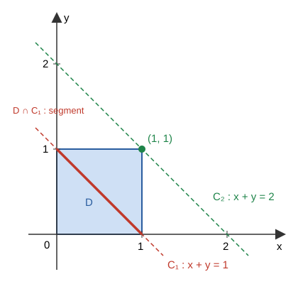

# BCE ECG — Mathématiques approfondies (emlyon) 2026 · Corrigé guidé

*Corrigé rédigé par IA, non officiel. Signalez toute erreur.*

## Présentation du sujet

**Cadre.** Épreuve de 4 heures, conception emlyon business school, sans document ni calculatrice. Deux problèmes indépendants, qui comptent selon le rapport 2026 pour 42 % et 58 % des points. Le rapport indique 3029 copies, une moyenne de 11,95 et un écart-type de 4,47 après péréquation.

**Problème 1 — une inégalité de trace (20 questions).**

- *Partie 1 (Q1–Q2)* : pour $A=\begin{pmatrix}1&1\\1&1\end{pmatrix}$, diagonalisation orthogonale et maximum du quotient $\varphi(x,y)=\frac{(x+y)^2}{x^2+y^2}$ sur $\mathbb{R}^2\setminus\{(0,0)\}$ : points critiques, homogénéité, compacité du cercle.
- *Partie 2 (Q3–Q10)* : $\operatorname{Tr}({}^tBB)=\operatorname{Tr}(B\,{}^tB)$, maximum d'une forme linéaire sur $[0,1]^n\cap\{\sum x_i=k\}$, trace d'un projecteur, diagonale d'un projecteur orthogonal, puis le **principe de Ky Fan** : pour $M$ à colonnes orthonormées, $\operatorname{Tr}({}^tMAM)\leqslant\lambda_1+\dots+\lambda_k$, avec égalité pour les $k$ premiers vecteurs propres.

**Problème 2 — une marche aléatoire (36 questions).**

- *Partie 1 (Q1–Q4)* : quatre lemmes indépendants : fonction génératrice $G_W$ et sa continuité en 1, lemme de Borel-Cantelli (cas divergent), invariance de la loi des sommes partielles par translation, produit de Cauchy de séries positives.
- *Partie 2 (Q5–Q14)* : marche aléatoire simple, loi faible des grands nombres, loi de $S_n$ et équivalent de $\mathbf{P}(S_{2n}=0)$, récurrence de la marche, temps $T$ de premier passage en $1$ : équation $tG_T^2=2G_T-t$, $T$ fini presque sûrement mais sans espérance, simulations Python.

**Notions du programme.** Théorème spectral et matrices orthogonales, projecteurs (orthogonaux), trace, rang, fonctions de deux variables (points critiques, extremum sur un fermé borné), séries à termes positifs, théorème de la limite monotone, indépendance et lemme des coalitions, continuité monotone des probabilités, loi binomiale, Bienaymé-Tchebychev, formule de Stirling (admise), Python.

**Difficulté.** Le rapport 2026 juge le sujet « relativement difficile car les questions moins guidées qu'elles ne l'ont pu être par le passé ». Il signale aussi que « l'énoncé d'une question était erroné », sans dire laquelle. La question 10.b du problème 2 invoque la question 2.c pour des événements qui ne sont pas indépendants : on l'explique dans la solution.

**Questions à ne pas laisser passer.** P1 : Q1, Q2.a–c, Q3, Q6.a–b, Q8, Q9. P2 : Q1.a–c, Q2.a, Q5, Q6, Q7, Q8, Q9, Q10.a, Q11.a et c.

**Gestion du temps.** Environ 1 h 30 pour le problème 1 et 2 h 15 pour le problème 2, avec un quart d'heure de relecture. Les résultats à démontrer sont donnés : on peut les admettre pour avancer.

> [!JURY]
> Le rapport 2026 insiste : « il ne sert à rien de vouloir traiter la totalité du sujet si aucun raisonnement ni calcul ne tient la route. Il est bien plus payant de prendre son temps et de traiter très soigneusement les questions que l'on choisit d'aborder. »

---

## Problème 1, partie 1 — Un exemple

On calcule à la main le maximum d'un quotient de Rayleigh en dimension 2. La partie 2 le retrouvera comme cas particulier.

### P1 — Question 1

> [!INDICATION]
> Calculer les valeurs propres de $A$ (trace et déterminant suffisent), puis un vecteur propre pour chacune.

> [!INDICATION]
> Pour que $Q$ soit orthogonale, ses colonnes doivent être orthogonales **et** de norme 1. Respecter l'ordre décroissant imposé.

#### Solution

Le polynôme caractéristique est $X(X-2)$ : valeurs propres $2$ et $0$, de vecteurs propres $(1,1)$ et $(1,-1)$. Normalisés, ils forment une base orthonormée. La matrice de passage $Q$ de la base canonique à cette base orthonormée est orthogonale, d'où

$$Q=\frac1{\sqrt2}\begin{pmatrix}1&1\\1&-1\end{pmatrix},\qquad D=\begin{pmatrix}2&0\\0&0\end{pmatrix},\qquad A=QD\,{}^tQ .$$

> [!JURY]
> Rapport 2026 : « Une matrice orthogonale n'est pas une matrice dont les colonnes sont orthogonales ! Il faut les normaliser ! » Et une partie des candidats « obtient les bonnes valeurs propres, mais ne les présente pas - alors que c'est explicitement écrit dans l'énoncé de la question - dans l'ordre décroissant, perdant ainsi des points faciles. »

### P1 — Question 2(a)

> [!INDICATION]
> Calculer $A\begin{pmatrix}x\\y\end{pmatrix}$, puis le produit par la ligne $(x\ \ y)$.

#### Solution

$$\begin{aligned}
\varphi(x,y) &= \frac{(x+y)^2}{x^2+y^2}\\
&= 1+\frac{2xy}{x^2+y^2}.
\end{aligned}$$

Quotient de fonctions polynomiales dont le dénominateur ne s'annule pas sur l'ouvert $\mathbb{R}^2\setminus\{(0,0)\}$ : $\varphi$ y est de classe $\mathcal{C}^2$.

> [!JURY]
> Rapport 2026 : « Un quotient de fonctions polynomiales n'est pas une fonction polynomiale. On pensera d'ailleurs à préciser que le dénominateur ne s'annule pas sur le domaine d'étude. »

### P1 — Question 2(b)

> [!INDICATION]
> Calculer les deux dérivées partielles et factoriser leurs numérateurs.

> [!INDICATION]
> Dans la résolution du système, distinguer $y=0$ et $y\neq0$ ; seul le couple $(x,y)$ est supposé non nul.

#### Solution

$$\partial_1\varphi(x,y)=\frac{2y(y^2-x^2)}{(x^2+y^2)^2}$$

$$\partial_2\varphi(x,y)=\frac{2x(x^2-y^2)}{(x^2+y^2)^2}.$$

Si $y=0$, alors $x\neq0$ et $\partial_2\varphi=2/x\neq0$.

Si $y\neq0$, $\partial_1\varphi=0$ impose $x^2=y^2$, et alors $\partial_2\varphi=0$.

**Points critiques : $(x,x)$ et $(x,-x)$, $x\neq0$** (deux droites privées de l'origine).

> [!JURY]
> Rapport 2026 : « Beaucoup de candidats font un peu vite la confusion entre $(x, y) \neq (0, 0)$ et $x \neq 0$ et $y \neq 0$ lors de la résolution du système. »

### P1 — Question 2(c)

> [!INDICATION]
> Numérateur et dénominateur sont homogènes de degré 2.

#### Solution

$\varphi(\alpha x,\alpha y)=1+\frac{2\alpha^2xy}{\alpha^2(x^2+y^2)}=\varphi(x,y)$ pour $\alpha\neq0$.

### P1 — Question 2(d)

> [!INDICATION]
> Sur le cercle $S_1$, fermé borné, la fonction continue $\varphi$ atteint un maximum. Ramener tout point non nul sur $S_1$ grâce à (c).

> [!INDICATION]
> Un maximum sur un ouvert est atteint en un point critique : comparer les valeurs de $\varphi$ aux points trouvés en (b).

#### Solution

$\varphi$ atteint sur $S_1$ un maximum en $u_0$. Pour $(x,y)\neq(0,0)$ et $\alpha=1/\|(x,y)\|$, $\varphi(x,y)=\varphi(\alpha x,\alpha y)\leqslant\varphi(u_0)$ : maximum global sur l'ouvert, atteint en un point critique.

Comme $\varphi(x,x)=2$ et $\varphi(x,-x)=0$, **le maximum vaut 2, atteint exactement aux points $(x,x)$, $x\neq0$.**

> [!METHODE]
> Une fonction homogène de degré 0 se ramène à sa restriction à la sphère unité, fermée et bornée : c'est le moyen standard d'obtenir l'existence d'un extremum sur un ouvert non borné.

> [!PIEGE]
> Rapport 2026 : « Il y a parfois confusion entre théorème de la limite monotone et théorème des bornes atteintes. » Ici, c'est le second (fonction continue sur un fermé borné).

---

## Problème 1, partie 2 — Une inégalité sur la trace

On veut maximiser $\operatorname{Tr}({}^tMAM)$ parmi les matrices $M$ à $k$ colonnes orthonormées.

On ramène le problème, par $P=X\,{}^tX$, à maximiser $\sum p_{i,i}\lambda_i$ sous les contraintes $p_{i,i}\in[0,1]$ et $\sum p_{i,i}=k$.

### P1 — Question 3(a)

> [!INDICATION]
> Préciser d'abord la taille de chaque produit : $B$ n'est pas carrée.

#### Solution

${}^tBB\in\mathcal{M}_m(\mathbb{R})$ et $B\,{}^tB\in\mathcal{M}_n(\mathbb{R})$ :

$$({}^tBB)_{i,j}=\sum_{k=1}^nb_{k,i}b_{k,j}$$

$$(B\,{}^tB)_{i,j}=\sum_{k=1}^mb_{i,k}b_{j,k}.$$

> [!JURY]
> Rapport 2026 : « Peu de candidats ont remarqué que l'on manipule des matrices qui ne sont pas nécessairement carrées. »

### P1 — Question 3(b)

> [!INDICATION]
> Sommer les coefficients diagonaux dans les deux cas et échanger les sommes finies.

#### Solution

Les deux traces valent $\sum_{i=1}^m\sum_{k=1}^nb_{k,i}^2$.

### P1 — Question 4

> [!INDICATION]
> $\mathcal{C}_1$ et $\mathcal{C}_2$ sont des droites ; repérer leurs intersections avec le carré.

#### Solution

$D$ est le carré unité. $\mathcal{C}_1$ est la droite $x+y=1$, qui coupe $D$ selon la diagonale de $(1,0)$ à $(0,1)$.

$\mathcal{C}_2$ est la droite $x+y=2$, qui touche $D$ au seul point $(1,1)$.

> [!METHODE]
> En dimension $n$, $D\cap\mathcal{C}_k$ est l'ensemble des « répartitions » d'une masse totale $k$ entre $n$ cases de capacité 1. Ses points extrémaux sont les vecteurs à $k$ coordonnées égales à $1$ et les autres nulles : c'est ce que la question 5 exploite.



### P1 — Question 5

> [!INDICATION]
> L'existence vient d'un théorème sur les fonctions continues. Pour le point, deviner : mettre le « poids » maximal sur les plus grands $\lambda_i$.

> [!INDICATION]
> Comparer $f_\Lambda(x)$ à $f_\Lambda(1,\dots,1,0,\dots,0)$ en majorant chaque $\lambda_i$ par $\lambda_k$ ou en le minorant par $\lambda_k$, selon le signe du facteur.

#### Solution

$f_\Lambda$ est linéaire donc continue sur le fermé borné non vide $D\cap\mathcal{C}_k$ : elle y a un maximum. Avec $e=(1,\dots,1,0,\dots,0)$ ($k$ uns) :

$$\begin{aligned}
f_\Lambda(x)-f_\Lambda(e) &= \sum_{i\leqslant k}\lambda_i(x_i-1)+\sum_{i>k}\lambda_ix_i\\
&\leqslant \lambda_k\Big(\sum_{i=1}^nx_i-k\Big)\\
&= 0 .
\end{aligned}$$

**Le maximum est atteint en $e$ et vaut $\lambda_1+\dots+\lambda_k$.**

> [!METHODE]
> C'est un argument d'échange : déplacer de la masse vers un indice de plus grand coefficient ne fait qu'augmenter la somme. L'hypothèse $\Lambda\notin\operatorname{Vect}((1,\dots,1))$ ne sert pas dans cette preuve.

### P1 — Question 6(a)

> [!INDICATION]
> Suivre l'énoncé : $F=\operatorname{Im}\pi$, $G=\operatorname{Ker}\pi$.

> [!INDICATION]
> La trace est invariante par changement de base.

#### Solution

$\mathbb{R}^n=\operatorname{Im}\pi\oplus\operatorname{Ker}\pi$ et, dans une base adaptée, la matrice de $\pi$ est $\begin{pmatrix}I_{r'}&0\\0&0\end{pmatrix}$ avec $r'=\dim\operatorname{Im}\pi=\operatorname{rg}(P)$. Sa trace vaut $r'$, comme celle de $P$, qui lui est semblable.

> [!PIEGE]
> Un projecteur n'est pas forcément orthogonal : en 6.a, aucune hypothèse d'orthogonalité n'est faite, et il ne faut pas en utiliser. La base adaptée à $\operatorname{Im}\pi\oplus\operatorname{Ker}\pi$ n'est pas orthonormée en général, ce qui n'empêche pas d'utiliser l'invariance de la trace.

### P1 — Question 6(b)

> [!INDICATION]
> Décomposer $x=\pi(x)+(x-\pi(x))$ et utiliser l'orthogonalité.

#### Solution

$\pi(x)\perp x-\pi(x)$, donc par Pythagore $\|x\|^2=\|\pi(x)\|^2+\|x-\pi(x)\|^2\geqslant\|\pi(x)\|^2$.

### P1 — Question 6(c)

> [!INDICATION]
> La base canonique est orthonormée : $p_{i,i}$ est un produit scalaire.

#### Solution

$p_{i,i}=\langle\pi(e_i),e_i\rangle=\|\pi(e_i)\|^2$ (car $e_i-\pi(e_i)\perp\pi(e_i)$), donc $0\leqslant p_{i,i}\leqslant\|e_i\|^2=1$ par 6.b.

> [!PIEGE]
> $p_{i,i}=\langle\pi(e_i),e_i\rangle$ n'est vrai que parce que la base canonique est orthonormée : le dire.

### P1 — Question 7

> [!INDICATION]
> Théorème spectral, puis réordonner la base orthonormée de vecteurs propres.

#### Solution

Il existe une base orthonormée de vecteurs propres de $A$ ; en la réordonnant, les valeurs propres sont décroissantes. La matrice de passage $Q$ (entre bases orthonormées) est orthogonale, et $A=QDQ^{-1}=QD\,{}^tQ$.

> [!PIEGE]
> Le rapport 2026 rappelle que « Le nom commun théorème est masculin » : on écrit le théorème spectral.

> [!METHODE]
> Retenir la forme $A=QD\,{}^tQ=\sum_i\lambda_iV_i\,{}^tV_i$ : elle montre que ${}^tVAV=\sum_i\lambda_i\langle V,V_i\rangle^2$ pour tout vecteur $V$, ce qui est l'idée cachée derrière la suite.

### P1 — Question 8

> [!INDICATION]
> Le coefficient $(i,j)$ de ${}^tMM$ est un produit scalaire de colonnes.

#### Solution

$({}^tMM)_{i,j}=\langle C_i,C_j\rangle=\delta_{i,j}$ : ${}^tMM=I_k$.

### P1 — Question 9

> [!INDICATION]
> Une matrice symétrique diagonalisable dont la seule valeur propre est $\lambda_1$ : que vaut-elle ?

#### Solution

$A=Q(\lambda_1I_n)\,{}^tQ=\lambda_1I_n$, donc $\operatorname{Tr}({}^tMAM)=\lambda_1\operatorname{Tr}(I_k)=k\lambda_1$ : **la quantité ne dépend pas de $M$**.

### P1 — Question 10(a)

> [!INDICATION]
> Calculer ${}^tXX$ grâce à Q8, puis $P^2$ et ${}^tP$.

> [!INDICATION]
> Un projecteur est orthogonal si et seulement s'il est symétrique ; il faut que la base dans laquelle on lit la matrice soit orthonormée.

#### Solution

${}^tXX={}^tMQ\,{}^tQM=I_k$, donc $P^2=X\,{}^tXX\,{}^tX=P$ et ${}^tP=P$. L'endomorphisme canoniquement associé est un projecteur, symétrique car sa matrice dans la base canonique (orthonormée) est symétrique : c'est une projection orthogonale.

> [!JURY]
> Rapport 2026 : « Oubli fréquent de préciser que la base canonique de $\mathbb{R}^n$ est orthonormale ».

### P1 — Question 10(b)

> [!INDICATION]
> Double inclusion ; pour l'une, multiplier $PY=0$ à gauche par ${}^tX$.

> [!INDICATION]
> Pour le rang : théorème du rang, puis encadrer $\operatorname{rg}({}^tX)$.

#### Solution

${}^tXY=0\Rightarrow PY=0$ ; et $PY=0\Rightarrow{}^tXY={}^tXX\,{}^tXY={}^tXPY=0$. Donc $\operatorname{Ker}P=\operatorname{Ker}{}^tX$ et $\operatorname{rg}P=\operatorname{rg}{}^tX$.

Enfin $\operatorname{rg}{}^tX\leqslant k$ (k lignes) et $\operatorname{rg}{}^tX\geqslant\operatorname{rg}({}^tXX)=k$. **$\operatorname{rg}(P)=k$.**

> [!JURY]
> Rapport 2026 : « Attention au choix des notations, parfois très malheureuses. » Le rapport cite la formule « Soit $X \in \operatorname{Ker}({}^tX)$ » : $X$ est déjà pris, on nomme $Y$ le vecteur du noyau.

### P1 — Question 10(c)

> [!INDICATION]
> Écrire ${}^tMAM={}^tXDX$ et faire « tourner » la trace (attention : matrices rectangulaires, la formule se démontre comme en Q3).

> [!INDICATION]
> $\operatorname{Tr}(PD)=\sum p_{i,i}\lambda_i$ : vérifier que $(p_{1,1},\dots,p_{n,n})$ appartient à $D\cap\mathcal{C}_k$ avec Q6 et Q10.b.

#### Solution

${}^tMAM={}^tXDX$ et $\operatorname{Tr}(UV)=\operatorname{Tr}(VU)$ pour $U\in\mathcal{M}_{k,n}$, $V\in\mathcal{M}_{n,k}$ (même calcul qu'en Q3), donc

$$\begin{aligned}
\operatorname{Tr}({}^tMAM) &= \operatorname{Tr}(DX\,{}^tX)\\
&= \operatorname{Tr}(PD)\\
&= \sum_{i=1}^np_{i,i}\lambda_i .
\end{aligned}$$

Par 6.c, $p_{i,i}\in[0,1]$ ; par 6.a et 10.b, $\sum p_{i,i}=\operatorname{rg}P=k$. Donc $\operatorname{Tr}({}^tMAM)=f_\Lambda(p_{1,1},\dots,p_{n,n})\leqslant\max_{D\cap\mathcal{C}_k}f_\Lambda$ (l'énoncé écrit $f_\Lambda(x_1,x_1,\dots)$ pour $f_\Lambda(x_1,x_2,\dots)$).

### P1 — Question 10(d)

> [!INDICATION]
> Que vaut ce maximum (Q5) ? Calculer ${}^tMAM$ quand les colonnes de $M$ sont $V_1,\dots,V_k$.

#### Solution

Le maximum vaut $\lambda_1+\dots+\lambda_k$ (Q5). Pour $C_i=V_i$, $({}^tMAM)_{i,j}=\lambda_j\delta_{i,j}$, de trace $\lambda_1+\dots+\lambda_k$ : la borne est atteinte, **la trace est maximale**.

> [!METHODE]
> Le schéma de la question est général : on transforme un problème d'optimisation sur des matrices ($M$ à colonnes orthonormées) en un problème sur des nombres ($p_{i,i}\in[0,1]$, de somme $k$), plus grand mais plus simple, dont on connaît le maximum ; puis on exhibe une matrice qui l'atteint.

### P1 — Question 10(e)

> [!INDICATION]
> Prendre $n=2$, $k=1$ et $M$ un vecteur colonne unitaire.

#### Solution

Pour $k=1$, $M=u$ unitaire et $\operatorname{Tr}({}^tuAu)={}^tuAu=\varphi(x,y)$ si $u=(x,y)/\|(x,y)\|$.

Le maximum vaut $\lambda_1=2$, atteint pour $u=V_1$, soit aux points $(x,x)$ : **c'est exactement la question 2.d.**

---

## Problème 2, partie 1 — Des résultats préliminaires

Quatre lemmes indépendants, chacun utilisé en partie 2. Ils sont tous classiques.

### P2 — Question 1(a)

> [!INDICATION]
> Majorer le terme général pour $t\in[0,1]$.

#### Solution

$0\leqslant\mathbf{P}(W=n)t^n\leqslant\mathbf{P}(W=n)$, terme général d'une série convergente : par comparaison de séries à termes positifs, $G_W(t)$ est défini.

> [!JURY]
> Rapport 2026 : « Il faut néanmoins comparer les termes généraux des séries et pas les séries elles-mêmes. »

### P2 — Question 1(b)

> [!INDICATION]
> Comparer terme à terme $G_W(s)$ et $G_W(t)$ pour $s\leqslant t$.

#### Solution

$s^n\leqslant t^n$ pour $0\leqslant s\leqslant t\leqslant1$ ; en sommant, $G_W(s)\leqslant G_W(t)$.

> [!PIEGE]
> Rapport 2026 : « Certains candidats ne font pas la différence entre la croissance de la fonction $G_W$ et la croissance de la suite des sommes partielles de la série qui définit $G_W$ ». Ici, c'est la variable $t$ qui varie.

### P2 — Question 1(c)

> [!INDICATION]
> Fonction croissante et majorée : quel théorème ?

#### Solution

$G_W$ est croissante et majorée par $G_W(1)$ sur $[0,1[$ : par le théorème de la limite monotone, elle a une limite finie $\ell$ en $1^-$.

### P2 — Question 1(d)

> [!INDICATION]
> Une somme partielle d'une série à termes positifs est inférieure à sa somme ; puis passer à la limite $t\to1^-$ à $m$ fixé.

#### Solution

$\sum_{n\leqslant m}\mathbf{P}(W=n)t^n\leqslant G_W(t)\leqslant G_W(1)$. Le membre de gauche est un polynôme en $t$ ; à la limite en $1^-$ :

$$\sum_{n=0}^m\mathbf{P}(W=n)\leqslant\ell\leqslant G_W(1).$$

### P2 — Question 1(e)

> [!INDICATION]
> Faire tendre $m$ vers l'infini.

#### Solution

On obtient $G_W(1)\leqslant\ell\leqslant G_W(1)$, donc $\lim_{t\to1^-}G_W(t)=G_W(1)$ : $G_W$ est continue en 1.

> [!METHODE]
> Le schéma de 1.c–1.e (limite monotone, encadrement par les sommes partielles, passage à la limite en deux temps) est le théorème d'Abel pour les séries à termes positifs. Il resservira en 10.b pour la série des $f_k$, et c'est lui qui justifierait la conjecture de 14.c.

### P2 — Question 1(f)

> [!INDICATION]
> Comparer à la série géométrique dérivée.

#### Solution

$0\leqslant n\mathbf{P}(W=n)t^{n-1}\leqslant nt^{n-1}$ et $\sum nt^{n-1}$ converge pour $|t|<1$.

### P2 — Question 2(a)

> [!INDICATION]
> Étudier $h(x)=\mathrm{e}^{-x}-1+x$ (ou invoquer la convexité de l'exponentielle).

#### Solution

$h'(x)=1-\mathrm{e}^{-x}$ est du signe de $x$ : $h$ a un minimum en $0$, égal à $0$. Donc $1-x\leqslant\mathrm{e}^{-x}$.

### P2 — Question 2(b)

> [!INDICATION]
> Passer au complémentaire : l'intersection des $\overline{A_k}$ se calcule par indépendance.

#### Solution

$$\begin{aligned}
\mathbf{P}\Big(\bigcup_{k=n}^mA_k\Big) &= 1-\prod_{k=n}^m\big(1-\mathbf{P}(A_k)\big)\\
&\geqslant 1-\exp\Big(-\sum_{k=n}^m\mathbf{P}(A_k)\Big),
\end{aligned}$$

par indépendance des $\overline{A_k}$ et 2.a (produit d'inégalités entre réels positifs).

> [!JURY]
> Rapport 2026 : « Il ne faut pas confondre les opérations entre événements (intersection et réunion) avec les opérations sur les probabilités (produit et somme). » La probabilité d'une intersection n'est un produit que pour des événements mutuellement indépendants : le dire.

### P2 — Question 2(c)

> [!INDICATION]
> Fixer $n$ et faire tendre $m$ vers l'infini (continuité croissante), puis faire tendre $n$ vers l'infini (continuité décroissante).

#### Solution

Pour $n$ fixé, $\mathbf{P}\big(\bigcup_{k\geqslant n}A_k\big)=\lim_m\mathbf{P}\big(\bigcup_{k=n}^mA_k\big)\geqslant1$ car le reste $\sum_{k=n}^m\mathbf{P}(A_k)$ tend vers $+\infty$. Les événements $\bigcup_{k\geqslant n}A_k$ décroissent et sont de probabilité 1, leur intersection aussi.

> [!PIEGE]
> Écrire $\mathbf{P}\big(\bigcup A_k\big)\geqslant\dots$ en sommant des probabilités d'événements non disjoints est faux ; ici on passe par le complémentaire, dont la probabilité est un produit grâce à l'indépendance.

### P2 — Question 3

> [!INDICATION]
> Les sommes partielles $(j_1,\dots,j_n)$ déterminent les termes $j_i-j_{i-1}$.

#### Solution

Avec $j_0=0$, $[U_n=(j_1,\dots,j_n)]=\bigcap_i[W_i=j_i-j_{i-1}]$ et $[V_{n,k}=(j_1,\dots,j_n)]=\bigcap_i[W_{k+i-1}=j_i-j_{i-1}]$. Par indépendance et égalité des lois, les deux probabilités valent $\prod_{i=1}^n\mathbf{P}(W_1=j_i-j_{i-1})$.

### P2 — Question 4(a)

> [!INDICATION]
> Développer $\sum_{k\leqslant n}c_k$ comme une somme de $a_ib_j$ sur un ensemble d'indices $(i,j)$, et faire de même pour le produit.

> [!INDICATION]
> Comparer les trois ensembles d'indices par inclusion (termes positifs).

#### Solution

$\sum_{k\leqslant n}c_k$ est la somme des $a_ib_j$ sur $I_n=\{i\geqslant1,j\geqslant0,i+j\leqslant n\}$ ; le produit, sur $[\![1;n]\!]\times[\![0;n]\!]$ ; $\sum_{k\leqslant2n}c_k$, sur $I_{2n}$.

Les inclusions $I_n\subset[\![1;n]\!]\times[\![0;n]\!]\subset I_{2n}$ et la positivité donnent l'encadrement.

> [!METHODE]
> Pour des séries à termes positifs, encadrer les sommes partielles d'un produit de Cauchy entre deux sommes partielles de la série produit est la preuve standard de $\sum c_k=(\sum a_i)(\sum b_j)$, sans aucune hypothèse d'absolue convergence à vérifier.

### P2 — Question 4(b)

> [!INDICATION]
> Sommes partielles majorées, puis passage à la limite dans l'encadrement.

#### Solution

Les sommes partielles de $\sum c_k$ sont majorées par $(\sum a_i)(\sum b_j)$ : convergence. À la limite, la somme $\gamma$ vérifie $\gamma\leqslant(\sum a_i)(\sum b_j)\leqslant\gamma$.

---

## Problème 2, partie 2 — Une marche aléatoire

On étudie $S_n$ (loi, retours en 0) puis le premier temps de passage $T$ en $1$, dont la fonction génératrice vérifie une équation du second degré.

### P2 — Question 5(a)

> [!INDICATION]
> Calcul direct sur deux valeurs.

#### Solution

$\mathbf{E}(X_n)=0$, $\mathbf{E}(X_n^2)=1$, donc $\mathbf{V}(X_n)=1$.

### P2 — Question 5(b)

> [!INDICATION]
> L'espérance est linéaire sans hypothèse ; pour la variance, il faut l'indépendance.

#### Solution

$\mathbf{E}(S_n)=0$ par linéarité ; $\mathbf{V}(S_n)=n$ car les $X_k$ sont indépendantes.

> [!JURY]
> Le rapport 2026 prend cet exemple : écrire l'additivité de l'espérance « "par indépendance" des Xi puis utiliser le même argument pour la variance, ce qui traduit que le candidat ne sait pas à quel moment cette indépendance est nécessaire. »

> [!PIEGE]
> La limite est une **variable certaine** : il faut dire laquelle (ici $0$), et rappeler que l'inégalité de Bienaymé-Tchebychev exige une variance finie, ce qui est le cas car $S_n$ est bornée.

### P2 — Question 6

> [!INDICATION]
> Inégalité de Bienaymé-Tchebychev appliquée à $S_n/n$.

#### Solution

$\mathbf{P}(|S_n/n|\geqslant\varepsilon)\leqslant\frac{1}{n\varepsilon^2}\to0$ : convergence en probabilité vers $0$.

### P2 — Question 7(a)

> [!INDICATION]
> `rd.random()` suit la loi uniforme sur $[0,1[$.

#### Solution

```python
def simul_X():
    if rd.random() < 0.5:
        return 1
    else:
        return -1
```

> [!JURY]
> Rapport 2026, sur l'informatique : « tout candidat qui sait programmer n'a pas à se restreindre à une réponse dans le cadre du programme et, contrairement aux maths, une réponse correcte, même hors programme, est complètement validée. »

### P2 — Question 7(b)

> [!INDICATION]
> Accumuler $n$ appels à `simul_X`.

#### Solution

```python
def simul_S(n):
    S = 0
    for k in range(n):
        S = S + simul_X()
    return S
```

### P2 — Question 8

> [!INDICATION]
> Développer la somme ; puis regarder les deux valeurs prises par $\frac{X_k+1}2$.

#### Solution

$2\sum\frac{X_k+1}2-n=S_n+n-n=S_n$. La variable $\frac{X_k+1}2$ vaut $1$ ou $0$ avec probabilité $\frac12$ : loi $\mathcal{B}(1/2)$.

### P2 — Question 9(a)

> [!INDICATION]
> Avec $Y_n=\sum\frac{X_k+1}2$ entier, $S_n=2Y_n-n$ : parité ?

#### Solution

$S_n-n=2(Y_n-n)$ est pair : $S_n$ a la parité de $n$, donc $[S_n=i]=\varnothing$ si $i\not\equiv n\pmod 2$.

> [!PIEGE]
> Ne pas oublier les cas où $\frac{n+i}{2}$ sort de $[\![0;n]\!]$ : ils n'arrivent pas ici car $i\in[\![-n;n]\!]$, mais il faut le dire pour que le coefficient binomial ait un sens.

### P2 — Question 9(b)

> [!INDICATION]
> Reconnaître la loi de $Y_n$ en justifiant l'indépendance.

#### Solution

Les $\frac{X_k+1}2$ sont indépendantes (lemme des coalitions) de loi $\mathcal{B}(1/2)$ : $Y_n\hookrightarrow\mathcal{B}(n,1/2)$, et $\mathbf{P}(S_n=i)=\mathbf{P}\big(Y_n=\frac{n+i}2\big)=\binom{n}{(n+i)/2}2^{-n}$.

> [!JURY]
> Rapport 2026 : « L'argument d'indépendance est régulièrement oublié » pour justifier que cette somme suit une loi binomiale.

### P2 — Question 10(a)

> [!INDICATION]
> $\mathbf{P}(S_{2n}=0)=\binom{2n}{n}4^{-n}$ ; appliquer Stirling à $(2n)!$ et à $n!$.

#### Solution

$$\begin{aligned}
\mathbf{P}(S_{2n}=0) &= \frac{(2n)!}{(n!)^2\,4^n}\\
&\sim \frac{\sqrt{4\pi n}\,(2n)^{2n}\mathrm{e}^{-2n}}{2\pi n\,n^{2n}\mathrm{e}^{-2n}\,4^n}\\
&= \frac{1}{\sqrt{\pi n}} .
\end{aligned}$$

> [!PIEGE]
> Rapport 2026 : « On voit trop souvent $(2n)! = 2 \times (n!)$. » Un quotient d'équivalents est licite, une somme non.

### P2 — Question 10(b)

> [!INDICATION]
> L'énoncé attend : $A_n=[S_{2n}=0]$, la série $\sum\mathbf{P}(A_n)$ diverge (Riemann), et Q2.c. Vérifier toutefois les hypothèses de Q2.c.

> [!INDICATION]
> Les $A_n$ sont-ils indépendants ? Calculer $\mathbf{P}(S_2=0,S_4=0)$.

> [!INDICATION]
> Pour une preuve correcte : décomposer selon le premier retour en $0$ et utiliser des fonctions génératrices comme en Q12–Q13.

#### Solution

*Argument attendu* : $\mathbf{P}(S_{2n}=0)\sim\frac1{\sqrt{\pi n}}$, terme général d'une série divergente, puis Q2.c.

*Défaut* : Q2.c exige des événements mutuellement indépendants. Or $\mathbf{P}(S_2=0,S_4=0)=\frac14$ alors que $\mathbf{P}(S_2=0)\mathbf{P}(S_4=0)=\frac12\cdot\frac38=\frac3{16}$. L'argument ne suffit donc pas tel quel.

*Preuve correcte (esquisse rigoureuse).* Avec $u_n=\mathbf{P}(S_{2n}=0)$ et $f_k$ la probabilité du premier retour au temps $2k$ :

- décomposition selon le premier retour, coalitions et Q3 : $u_n=\sum_{k=1}^nf_ku_{n-k}$ ;
- Q4.b sur $[0,1[$ : $F(s)U(s)=U(s)-1$, d'où $F(s)=1-1/U(s)$ ;
- $U(s)\to+\infty$ (série divergente), donc $\sum f_k=\lim F(s)=1$ : retour presque sûr ;
- même décomposition pour « au moins $m+1$ retours », récurrence sur $m$, puis continuité décroissante : une infinité de retours presque sûrement.

> [!PIEGE]
> Toujours vérifier les hypothèses d'un théorème qu'on invoque, même quand l'énoncé le suggère. Le rapport 2026 demande « des arguments rigoureux et un véritable raisonnement, en citant (et vérifiant) les conditions d'un théorème si on les utilise ».

### P2 — Question 11(a)

> [!INDICATION]
> $[T=1]$ ne dépend que du premier pas.

#### Solution

$[T=1]=[X_1=1]$, donc $\mathbf{P}(T=1)=\frac12$.

### P2 — Question 11(b)

> [!INDICATION]
> Si $S_{n-1}\leqslant0$, que peut valoir $S_n$ lorsqu'il est strictement positif ?

#### Solution

$T=n$ signifie $S_j\leqslant0$ pour $j<n$ et $S_n>0$.

Comme $S_n\leqslant S_{n-1}+1\leqslant1$ et $S_n$ est entier, $S_n>0\iff S_n=1$.

> [!METHODE]
> Une marche à pas $\pm1$ ne « saute » aucun entier : pour passer de $-1$ à $1$, elle passe par $0$. Ce principe des valeurs intermédiaires discret sert en 11.b et en 12.c.

### P2 — Question 11(c)

> [!INDICATION]
> Parité de $S_n$ (Q9.a).

#### Solution

Pour $n$ pair non nul, $S_n$ est pair, donc $[S_n=1]=\varnothing$ ; et $\mathbf{P}(T=0)=0$.

> [!METHODE]
> Avant d'attaquer 12.b–12.d, dessiner un chemin typique de $[T=n+1]$ : départ en $-1$, excursion sous l'axe jusqu'au premier retour en $0$, puis nouvelle excursion qui finit en $+1$. Tout le découpage de la question 12 se lit sur ce dessin.

### P2 — Question 12(a)

> [!INDICATION]
> Traduire chaque condition en mots : premier pas, position entre les temps 2 et $k$, position au temps $k+1$.

#### Solution

La marche descend au premier pas, reste strictement négative jusqu'au temps $k$, et revient en $0$ au temps $k+1$ : **premier retour en $0$ au temps $k+1$, par en dessous.**

### P2 — Question 12(b)

> [!INDICATION]
> Sur $[X_1=-1]$, réécrire $S_j$ à l'aide de $X_2+\dots+X_j$.

> [!INDICATION]
> L'événement restant porte sur le vecteur $V_{k,2}$ de Q3 ; comparer avec $U_k$ et Q11.b.

#### Solution

$R_k=[X_1=-1]\cap[V_{k,2}\in E_k]$ avec $E_k=\{(j_i)\in[\![-k;k]\!]^k : j_1,\dots,j_{k-1}\leqslant0,\ j_k=1\}$, ensemble fini qui contient toutes les valeurs possibles. Les deux événements sont indépendants (coalitions). Par Q3 (sommée sur $E_k$), $\mathbf{P}(V_{k,2}\in E_k)=\mathbf{P}(U_k\in E_k)=\mathbf{P}(T=k)$ (Q11.b, ou Q11.a si $k=1$). Donc $\mathbf{P}(R_k)=\frac12\mathbf{P}(T=k)$.

### P2 — Question 12(c)

> [!INDICATION]
> Sur $[T=n+1]$, la marche part de $-1$ et arrive en $1$ : elle passe par $0$. Découper selon le premier passage par $0$.

> [!INDICATION]
> Vérifier l'inclusion réciproque et l'incompatibilité des événements.

#### Solution

Sur $[T=n+1]$ ($n\geqslant1$), $S_1=-1$ et $S_{n+1}=1$.

Soit $k+1$ le premier temps où la marche revaut $0$ ; on a $1\leqslant k\leqslant n-1$.

Alors $R_k$ est réalisé, $S_j-S_{k+1}=S_j\leqslant0$ pour $k+2\leqslant j\leqslant n$ et $S_{n+1}-S_{k+1}=1$. Réciproquement, chacun de ces événements entraîne $T=n+1$, et ils sont deux à deux incompatibles ($k$ est déterminé). L'additivité donne la formule.

### P2 — Question 12(d)

> [!INDICATION]
> Indépendance par coalitions, puis Q3 pour la seconde partie, comme en Q12.b.

#### Solution

Le second événement dépend de $X_{k+2},\dots,X_{n+1}$ et a la probabilité $\mathbf{P}(T=n-k)$ (Q3, Q11.b). Avec Q12.b :

$$\begin{aligned}
\mathbf{P}(T=n+1)&=\frac12\sum_{k=1}^{n-1}\mathbf{P}(T=k)\\
&\qquad\times\mathbf{P}(T=n-k) ,
\end{aligned}$$

et le terme $k=n$ est nul car $\mathbf{P}(T=0)=0$.

> [!METHODE]
> Décomposition selon un premier temps de passage + indépendance des morceaux + invariance par translation (Q3) : c'est le schéma de toute l'étude des marches aléatoires. Il donne une équation de convolution, que les fonctions génératrices transforment en équation algébrique.

> [!PIEGE]
> En 12.b et 12.d, la question 3 donne l'égalité des probabilités pour **un** vecteur de valeurs ; on l'applique à un **ensemble** de valeurs en sommant sur cet ensemble. Il faut le rendre fini en le restreignant à $[\![-k;k]\!]^k$, qui contient toutes les valeurs de sommes partielles de $k$ pas : sans cela, les $j_i\leqslant0$ ne sont pas bornés.

### P2 — Question 13(a)

> [!INDICATION]
> Appliquer Q4.b à $a_i=\mathbf{P}(T=i)t^i$ et $b_j=\mathbf{P}(T=j)t^j$.

#### Solution

Ces séries sont à termes positifs et convergent vers $G_T(t)$ (car $\mathbf{P}(T=0)=0$), et $c_n=\big(\sum_{k=1}^n\mathbf{P}(T=k)\mathbf{P}(T=n-k)\big)t^n$. Q4.b donne la formule.

### P2 — Question 13(b)

> [!INDICATION]
> Multiplier 13.a par $t$ et reconnaître $2\mathbf{P}(T=n+1)$ grâce à 12.d.

#### Solution

$$\begin{aligned}
tG_T(t)^2 &= \sum_{n\geqslant1}2\,\mathbf{P}(T=n+1)\,t^{n+1}\\
&= 2\big(G_T(t)-\mathbf{P}(T=1)\,t\big)\\
&= 2G_T(t)-t .
\end{aligned}$$

### P2 — Question 13(c)

> [!INDICATION]
> En $t=1$, on obtient une équation du second degré en $G_T(1)$.

#### Solution

$(G_T(1)-1)^2=0$, donc $G_T(1)=1$. Comme $1=\mathbf{P}(T=-1)+G_T(1)$, $\mathbf{P}(T=-1)=0$.

### P2 — Question 13(d)

> [!INDICATION]
> Dériver l'identité de 13.b sur $[0,1[$ et isoler $G_T'(t)$.

> [!INDICATION]
> Signe et limite du facteur $1-tG_T(t)$ quand $t\to1^-$ : utiliser la croissance et la continuité en 1 de $G_T$.

#### Solution

$G_T^2+2tG_TG_T'=2G_T'-1$, d'où, comme $tG_T(t)<1$ sur $[0,1[$ :

$$G_T'(t)=\frac{1+G_T(t)^2}{2\big(1-tG_T(t)\big)}.$$

Le numérateur tend vers $2$ et le dénominateur vers $0^+$ : $\lim_{t\to1^-}G_T'(t)=+\infty$.

> [!METHODE]
> Autre voie : résoudre $tG^2-2G+t=0$ ; la racine compatible avec $G_T\leqslant1$ est $G_T(t)=\frac{1-\sqrt{1-t^2}}{t}$, dont la dérivée vaut $\frac{1-\sqrt{1-t^2}}{t^2\sqrt{1-t^2}}$.

### P2 — Question 14(a)

> [!INDICATION]
> Boucle `while` tant que la marche n'est pas strictement positive, avec un compteur de pas.

#### Solution

```python
def simul_T():
    S = 0
    n = 0
    while S <= 0:
        S = S + simul_X()
        n = n + 1
    return n
```

Elle termine presque sûrement (Q13.c). Exécutée, elle renvoie souvent 1 ou 3, parfois plusieurs milliers.

### P2 — Question 14(b)

> [!INDICATION]
> Que calcule `np.mean(ech)` ? Que devrait-on observer si $T$ avait une espérance ?

#### Solution

`mystere(N)` renvoie la moyenne empirique de $N$ simulations indépendantes de $T$. Les sept valeurs (de $31{,}36$ à $8181{,}62$) ne se stabilisent pas, alors que l'inégalité de Bienaymé-Tchebychev les concentrerait autour de $\mathbf{E}(T)$ si $T$ avait une espérance et une variance :

**on conjecture que $T$ n'a pas d'espérance.**

### P2 — Question 14(c)

> [!INDICATION]
> Comparer formellement $\sum n\mathbf{P}(T=n)$ et $G_T'(t)$ quand $t\to1$.

#### Solution

**Conjecture : $T$ admet une espérance si et seulement si $G_T'$ a une limite finie en $1^-$, et alors $\mathbf{E}(T)=\lim_{t\to1^-}G_T'(t)$.**

Le sens direct se prouve : si $\mathbf{E}(T)$ existait, $G_T'(t)\leqslant\sum n\mathbf{P}(T=n)=\mathbf{E}(T)$ pour $t<1$, donc $G_T'$ serait bornée, contrairement à 13.d.

**$T$ n'a donc pas d'espérance**, en accord avec 14.b ; seule la réciproque reste conjecturale.

---

## Bilan

**Méthodes à retenir.**

- Diagonalisation orthogonale : normaliser les vecteurs propres, ranger les valeurs propres comme demandé.
- Extremum d'une fonction homogène : se ramener à la sphère unité (fermé borné), puis aux points critiques.
- Trace : $\operatorname{Tr}(UV)=\operatorname{Tr}(VU)$ pour des matrices rectangulaires compatibles ; la trace d'un projecteur est son rang.
- Principe de Ky Fan : $\max\operatorname{Tr}({}^tMAM)=\lambda_1+\dots+\lambda_k$, atteint pour les $k$ premiers vecteurs propres.
- Séries génératrices : continuité en 1 par limite monotone ; produit de Cauchy de séries positives ; équation fonctionnelle issue d'une décomposition au premier passage.
- Borel-Cantelli (cas divergent) : vérifier l'indépendance avant de l'appliquer.

**Prérequis à revoir.** Théorème spectral, projecteurs orthogonaux, rang et noyau, séries à termes positifs, limite monotone, indépendance (lemme des coalitions), loi binomiale, Stirling.

**Questions transposables.** P1-Q5 (maximisation d'une forme linéaire sur un polytope), P1-Q6 (trace et diagonale d'un projecteur), P2-Q1 (continuité d'une fonction génératrice), P2-Q4 (produit de Cauchy), P2-Q12–13 (temps de premier passage).

> [!JURY]
> Le rapport 2026 conclut : « Même si l'épreuve est longue et qu'elle parait difficile, il y a toujours des questions accessibles à aller chercher dans le sujet. »
