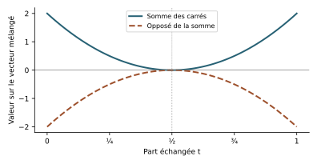

# BCE ECG — Mathématiques approfondies (ESSEC-HEC) 2026 · Corrigé brut

*Corrigé rédigé par IA, non officiel. Signalez toute erreur.*

**Rédaction** · Claude Opus 5.5 · effort non renseigné · vitesse non renseignée

**Révision (tour 1)** · modèle non renseigné · effort non renseigné · vitesse non renseignée

**Révision (tour 2)** · modèle non renseigné · effort non renseigné · vitesse non renseignée

**Révision (tour 3)** · GPT-6.2 Astra Ultra · vitesse non renseignée

**Révision (tour 4)** · GPT-6.2 Astra Ultra · vitesse non renseignée

Épreuve de 4 h, sans document ni calculatrice. Thème : théorème de Birkhoff-Von Neumann, fonctions S-convexes, théorèmes de Davis et de Fan.

Dans tout le corrigé, pour $x=(x_1,\dots,x_n)\in\mathbb{R}^n$ et $\sigma\in\mathscr{P}_n$, on rappelle que $x_\sigma=(x_{\sigma(1)},\dots,x_{\sigma(n)})$, et l'on identifie $\mathbb{R}^n$ et $\mathcal{M}_{n,1}(\mathbb{R})$.

## Partie I : préliminaires

### 1.

La $j$-ième colonne de $P_\sigma$ est la matrice des coordonnées de $\varphi_\sigma(e_j)$ dans la base canonique. Son $i$-ième coefficient vaut $(P_\sigma)_{i,j}=\delta_{i,\sigma(j)}$, donc

$$\varphi_\sigma(e_j)=\sum_{i=1}^n \delta_{i,\sigma(j)}\,e_i .$$

Le seul terme non nul est celui d'indice $i=\sigma(j)$ :

$$\boxed{\forall j\in[\![1;n]\!],\ \varphi_\sigma(e_j)=e_{\sigma(j)}}$$

### 2.

Pour tout $j\in[\![1;n]\!]$, la question 1 donne

$$\begin{aligned}
\varphi_\sigma\circ\varphi_\tau(e_j) &= \varphi_\sigma\big(e_{\tau(j)}\big)\\
&= e_{\sigma(\tau(j))}\\
&= \varphi_{\sigma\circ\tau}(e_j).
\end{aligned}$$

Les endomorphismes linéaires $\varphi_\sigma\circ\varphi_\tau$ et $\varphi_{\sigma\circ\tau}$ coïncident sur une base, donc sont égaux, et leurs matrices dans la base canonique aussi : $\boxed{P_\sigma P_\tau=P_{\sigma\circ\tau}}$.

Pour l'identité $\mathrm{id}$ de $[\![1;n]\!]$, $(P_{\mathrm{id}})_{i,j}=\delta_{i,j}$, donc $P_{\mathrm{id}}=I_n$. Soit $P=P_\sigma$ une matrice de permutation. L'application $\sigma^{-1}$ est une permutation et

$$\begin{aligned}
P_\sigma P_{\sigma^{-1}} &= P_{\sigma\circ\sigma^{-1}}\\
&= P_{\mathrm{id}}\\
&= I_n.
\end{aligned}$$

Une matrice carrée inversible à droite est inversible, donc $P_\sigma$ est inversible et $P_\sigma^{-1}=P_{\sigma^{-1}}$ : **l'inverse d'une matrice de permutation est une matrice de permutation.**

### 3.

Soit $P=P_\sigma\in\mathbb{P}_n$. Pour $(i,j)\in[\![1;n]\!]^2$ :

$$\begin{aligned}
({}^tP\,P)_{i,j} &= \sum_{k=1}^n P_{k,i}P_{k,j}\\
&= \sum_{k=1}^n \delta_{k,\sigma(i)}\,\delta_{k,\sigma(j)}\\
&= \delta_{\sigma(i),\sigma(j)}.
\end{aligned}$$

Comme $\sigma$ est injective, $\sigma(i)=\sigma(j)$ équivaut à $i=j$, donc $({}^tP\,P)_{i,j}=\delta_{i,j}$ et ${}^tP\,P=I_n$.

Ainsi $P$ est inversible d'inverse ${}^tP$, d'où aussi $P\,{}^tP=I_n$ : **$P\in\mathscr{O}_n$.**

### 4.

Pour $n\in\mathbb{N}^*$, notons $\mathcal{H}(n)$ : « pour tout $(x_1,\dots,x_n)\in\mathbb{R}^n$, il existe $\alpha\in\mathscr{P}_n$ telle que $x_{\alpha(1)}\geqslant\dots\geqslant x_{\alpha(n)}$ ».

*Initialisation.* Pour $n=1$, $\alpha=\mathrm{id}$ convient.

*Hérédité.* Soit $n\geqslant 2$ tel que $\mathcal{H}(n-1)$ soit vraie, et soit $(x_1,\dots,x_n)\in\mathbb{R}^n$.

Soit $m\in[\![1;n]\!]$ tel que $x_m=\max_{1\leqslant i\leqslant n}x_i$, et $\tau$ la permutation qui échange $1$ et $m$ (l'identité si $m=1$).

On pose $y_i=x_{\tau(i)}$ : alors $y_1=x_m\geqslant y_i$ pour tout $i$.

On applique $\mathcal{H}(n-1)$ à $(z_1,\dots,z_{n-1})=(y_2,\dots,y_n)$ : il existe $\gamma\in\mathscr{P}_{n-1}$ telle que $z_{\gamma(1)}\geqslant\dots\geqslant z_{\gamma(n-1)}$.

On définit $\beta\in\mathscr{P}_n$ par $\beta(1)=1$ et $\beta(k+1)=\gamma(k)+1$ pour $k\in[\![1;n-1]\!]$ ($\beta$ est bijective car $\gamma$ l'est).

Alors $y_{\beta(k+1)}=z_{\gamma(k)}$, donc

$$y_{\beta(1)}=y_1\geqslant y_{\beta(2)}\geqslant\dots\geqslant y_{\beta(n)} .$$

Avec $\alpha=\tau\circ\beta\in\mathscr{P}_n$, on a $x_{\alpha(i)}=y_{\beta(i)}$, d'où $x_{\alpha(1)}\geqslant\dots\geqslant x_{\alpha(n)}$. $\mathcal{H}(n)$ est vraie.

**Par récurrence, pour tout $n\in\mathbb{N}^*$ et tout $x\in\mathbb{R}^n$, il existe $\alpha\in\mathscr{P}_n$ vérifiant (1).**

### 5.

Par l'absurde, supposons qu'il existe $i$ tel que $x_{\alpha(i)}\neq x_{\beta(i)}$, et prenons le plus petit. Quitte à échanger $\alpha$ et $\beta$, on suppose $a=x_{\alpha(i)}>x_{\beta(i)}$. Soit

$$N=\operatorname{card}\{k\in[\![1;n]\!]\ :\ x_k\geqslant a\}.$$

- Comme $\alpha$ est une bijection, $N=\operatorname{card}\{j\ :\ x_{\alpha(j)}\geqslant a\}$. Pour $j\leqslant i$, $x_{\alpha(j)}\geqslant x_{\alpha(i)}=a$, donc $N\geqslant i$.
- Comme $\beta$ est une bijection, $N=\operatorname{card}\{j\ :\ x_{\beta(j)}\geqslant a\}$. Pour $j\geqslant i$, $x_{\beta(j)}\leqslant x_{\beta(i)}<a$, donc seuls les $j\leqslant i-1$ peuvent compter : $N\leqslant i-1$.

C'est contradictoire. Donc $\boxed{\forall i\in[\![1;n]\!],\ x_{\alpha(i)}=x_{\beta(i)}}$ : le vecteur $\hat x$ ne dépend pas du choix de $\alpha$.

### 6.

C'est un tri par sélection : à l'étape $i$, on cherche l'indice du plus grand élément de `Y[i:]` et on l'échange avec `Y[i]`, en répercutant l'échange sur `alpha`.

```python
def permutevecteur(X):
    n = len(X)
    alpha = np.arange(0, n, 1)
    Y = X.copy()  # Y est un nouveau tableau initialisé avec les valeurs de X
    for i in range(n):
        imax = i
        for k in range(i, n):
            if Y[k] > Y[imax]:
                imax = k
        if imax > i:
            Y[i], Y[imax] = Y[imax], Y[i]
            alpha[i], alpha[imax] = alpha[imax], alpha[i]
    return Y, alpha
```

À tout moment `Y[k] == X[alpha[k]]`, donc en fin d'exécution `Y` est trié dans l'ordre décroissant et `Y[k] = X[alpha[k]]` (indices Python décalés de 1). Exemple : pour `X = np.array([3., -1., 7., 2., 7., 0.5])`, la fonction renvoie `Y = [7., 7., 3., 2., 0.5, -1.]` et `alpha = [2, 4, 0, 3, 5, 1]`.

## Partie II : matrices bistochastiques

### 7. (a)

*Matrice orthostochastique.* Soit $S$ avec $S_{i,j}=(Q_{i,j})^2$, $Q\in\mathscr{O}_n$. Les coefficients sont positifs.

Comme $Q\,{}^tQ=I_n$, et donc aussi ${}^tQ\,Q=I_n$ ($Q$ est inversible d'inverse ${}^tQ$) :

$$\begin{aligned}
\sum_{j=1}^n S_{i,j} &= \sum_{j=1}^n Q_{i,j}^2\\
&= (Q\,{}^tQ)_{i,i}\\
&= 1,
\end{aligned}$$

$$\begin{aligned}
\sum_{i=1}^n S_{i,j} &= \sum_{i=1}^n Q_{i,j}^2\\
&= ({}^tQ\,Q)_{j,j}\\
&= 1.
\end{aligned}$$

*Matrice de permutation.* $(P_\sigma)_{i,j}=\delta_{i,\sigma(j)}\in\{0,1\}$. À $i$ fixé, $\sum_j\delta_{i,\sigma(j)}=1$ car un seul $j$ vérifie $\sigma(j)=i$, à savoir $\sigma^{-1}(i)$.

À $j$ fixé, $\sum_i\delta_{i,\sigma(j)}=1$ (seul $i=\sigma(j)$).

(On peut aussi remarquer que $P_\sigma$ est orthostochastique, avec $Q=P_\sigma\in\mathscr{O}_n$ par la question 3, puisque ses coefficients valent $0$ ou $1$.)

**Toute matrice orthostochastique et toute matrice de permutation sont bistochastiques.**

### 7. (b)

Soit

$$S=\frac12\begin{pmatrix}1&1&0\\0&1&1\\1&0&1\end{pmatrix}.$$

Ses coefficients sont positifs et chaque ligne, chaque colonne a pour somme $1$ : $S$ est bistochastique. Supposons $S_{i,j}=Q_{i,j}^2$ avec $Q\in\mathscr{O}_3$. Alors $Q_{1,3}=Q_{2,1}=0$ et les autres coefficients des deux premières lignes valent $\pm\frac{1}{\sqrt2}$.

Le coefficient $(1,2)$ de $Q\,{}^tQ$ vaut

$$\begin{aligned}
\sum_{k=1}^3 Q_{1,k}Q_{2,k} &= Q_{1,2}Q_{2,2}\\
&= \pm\frac12\neq 0,
\end{aligned}$$

alors que $Q\,{}^tQ=I_3$ impose qu'il soit nul. **$S$ est bistochastique mais pas orthostochastique.**

### 8. (a)

$\mathscr{P}_2$ contient l'identité et la transposition $(2,1)$. Les matrices de permutation de $\mathcal{M}_2(\mathbb{R})$ sont donc

$$\boxed{I_2=\begin{pmatrix}1&0\\0&1\end{pmatrix}\quad\text{et}\quad J=\begin{pmatrix}0&1\\1&0\end{pmatrix}}$$

### 8. (b)

Soit $S$ bistochastique et $a=S_{1,1}$. La ligne 1 donne $S_{1,2}=1-a$, la colonne 1 donne $S_{2,1}=1-a$, la colonne 2 donne $S_{2,2}=1-S_{1,2}=a$. Les coefficients étant positifs, $a\in[0,1]$ et

$$S=\begin{pmatrix}a&1-a\\1-a&a\end{pmatrix}=aI_2+(1-a)J .$$

Réciproquement, soit $S=\alpha I_2+(1-\alpha)P$ avec $\alpha\in[0,1]$ et $P\in\{I_2,J\}$. Si $P=I_2$, alors $S=I_2$, bistochastique.

Si $P=J$, les coefficients de $S$ valent $\alpha$ ou $1-\alpha$, donc sont positifs, et chaque ligne et chaque colonne a pour somme $\alpha+(1-\alpha)=1$.

**$S$ est bistochastique si et seulement si $S=\alpha I_2+(1-\alpha)P$ avec $\alpha\in[0,1]$ et $P\in\mathbb{P}_2$.**

### 9. (a)

Il y a $\boxed{3!=6}$ permutations de $\{1,2,3\}$.

### 9. (b)

Chaque $P_k$ a exactement un coefficient $1$ par ligne et par colonne, les autres nuls.

Si la colonne $j$ a son $1$ à la ligne $\sigma(j)$, alors $\sigma$ est une permutation et $(P_k)_{i,j}=\delta_{i,\sigma(j)}$, donc $P_k=P_\sigma$.

En lisant la position du $1$ dans chaque colonne :

| Matrice | $\sigma(1)$ | $\sigma(2)$ | $\sigma(3)$ | Permutation |
|---|---|---|---|---|
| $P_1$ | 1 | 3 | 2 | $(1,3,2)$ |
| $P_2$ | 3 | 2 | 1 | $(3,2,1)$ |
| $P_3$ | 2 | 1 | 3 | $(2,1,3)$ |
| $P_4$ | 3 | 1 | 2 | $(3,1,2)$ |
| $P_5$ | 2 | 3 | 1 | $(2,3,1)$ |

Avec $I_3=P_{\mathrm{id}}$, on obtient les six matrices de permutation de $\mathcal{M}_3(\mathbb{R})$.

### 9. (c)

Les sommes des lignes 1 et 2 donnent $S_{1,3}=1-S_{1,1}-S_{1,2}$ et $S_{2,3}=1-S_{2,1}-S_{2,2}$. Celles des colonnes 1 et 2 donnent $S_{3,1}=1-S_{1,1}-S_{2,1}$ et $S_{3,2}=1-S_{1,2}-S_{2,2}$. C'est la forme (2). La ligne 3 donne alors

$$\begin{aligned}
S_{3,3} &= 1-S_{3,1}-S_{3,2}\\
&= S_{1,1}+S_{1,2}+S_{2,1}+S_{2,2}-1 .
\end{aligned}$$

$$\boxed{S_{3,3}=S_{1,1}+S_{1,2}+S_{2,1}+S_{2,2}-1}$$

(La colonne 3 est alors automatiquement de somme 1.) La positivité de tous les coefficients impose les conditions nécessaires :

$$S_{1,1},\,S_{1,2},\,S_{2,1},\,S_{2,2}\geqslant 0,$$

$$S_{1,1}+S_{1,2}\leqslant 1,\qquad S_{2,1}+S_{2,2}\leqslant 1,$$

$$S_{1,1}+S_{2,1}\leqslant 1,\qquad S_{1,2}+S_{2,2}\leqslant 1,$$

$$S_{1,1}+S_{1,2}+S_{2,1}+S_{2,2}\geqslant 1 .$$

Réciproquement, ces conditions rendent la matrice (2) bistochastique.

### 9. (d)

On cherche $\beta_0,\dots,\beta_5\geqslant 0$ avec $S=\beta_0I_3+\sum_{i=1}^5\beta_iP_i$.

Position des $1$ :

| Matrice | Positions des coefficients égaux à 1 |
|---|---|
| $P_1$ | $(1,1),(3,2),(2,3)$ |
| $P_2$ | $(3,1),(2,2),(1,3)$ |
| $P_3$ | $(2,1),(1,2),(3,3)$ |
| $P_4$ | $(3,1),(1,2),(2,3)$ |
| $P_5$ | $(2,1),(3,2),(1,3)$ |


L'identité terme à terme équivaut au système

$$\begin{cases}
S_{1,1}=\beta_0+\beta_1 & S_{1,2}=\beta_3+\beta_4\\
S_{2,2}=\beta_0+\beta_2 & S_{2,1}=\beta_3+\beta_5\\
S_{3,3}=\beta_0+\beta_3 & S_{1,3}=\beta_2+\beta_5\\
S_{2,3}=\beta_1+\beta_4 & S_{3,1}=\beta_2+\beta_4\\
S_{3,2}=\beta_1+\beta_5 &
\end{cases}$$

Avec $\beta_0=\min(S_{1,1},S_{2,2},S_{3,3})\geqslant0$, on pose

$$\begin{aligned}
\beta_1&=S_{1,1}-\beta_0, & \beta_2&=S_{2,2}-\beta_0, & \beta_3&=S_{3,3}-\beta_0,\\
\beta_4&=S_{1,2}-S_{3,3}+\beta_0, & \beta_5&=S_{2,1}-S_{3,3}+\beta_0. & &
\end{aligned}$$

*Le système est vérifié.* Les cinq premières équations le sont par construction. Grâce à (2) et à l'expression de $S_{3,3}$ :

$$\begin{aligned}
\beta_2+\beta_5 &= S_{2,2}+S_{2,1}-S_{3,3}\\
&= 1-S_{1,1}-S_{1,2}\\
&= S_{1,3},
\end{aligned}$$

et de même $\beta_2+\beta_4=S_{2,2}+S_{1,2}-S_{3,3}=1-S_{1,1}-S_{2,1}=S_{3,1}$, $\beta_1+\beta_4=S_{1,1}+S_{1,2}-S_{3,3}=1-S_{2,1}-S_{2,2}=S_{2,3}$, $\beta_1+\beta_5=S_{1,1}+S_{2,1}-S_{3,3}=1-S_{1,2}-S_{2,2}=S_{3,2}$.

*Positivité.* $\beta_1,\beta_2,\beta_3\geqslant 0$ par définition du minimum. Pour $\beta_4,\beta_5$, on distingue selon la valeur de $\beta_0$ :

- si $\beta_0=S_{3,3}$ : $\beta_4=S_{1,2}\geqslant0$ et $\beta_5=S_{2,1}\geqslant0$ ;
- si $\beta_0=S_{1,1}$ : $\beta_4=S_{1,1}+S_{1,2}-S_{3,3}=S_{2,3}\geqslant0$ et $\beta_5=S_{1,1}+S_{2,1}-S_{3,3}=S_{3,2}\geqslant0$ ;
- si $\beta_0=S_{2,2}$ : $\beta_4=S_{2,2}+S_{1,2}-S_{3,3}=S_{3,1}\geqslant0$ et $\beta_5=S_{2,2}+S_{2,1}-S_{3,3}=S_{1,3}\geqslant0$.

**Il existe donc des réels positifs $\beta_1,\dots,\beta_5$ avec $S=\beta_0I_3+\sum_{i=1}^5\beta_iP_i$.**

### 9. (e)

En sommant les coefficients de la première ligne dans $S=\beta_0I_3+\sum_{i=1}^5\beta_iP_i$, chaque matrice de permutation contribue pour $1$ :

$$1=\beta_0+\beta_1+\dots+\beta_5 .$$

Ainsi toute matrice bistochastique $S\in\mathcal{M}_3(\mathbb{R})$ est une combinaison convexe des six matrices de permutation $I_3,P_1,\dots,P_5$ (avec $k=6$). Par exemple, la matrice dont tous les coefficients valent $1/3$ admet deux décompositions. Dans chaque somme $I_3+P_4+P_5$ et $P_1+P_2+P_3$, les trois matrices placent exactement un $1$ dans chacune des neuf cases. Diviser chacune des deux sommes par trois donne les deux combinaisons convexes annoncées.

Avec la question 8(b) pour $n=2$ (combinaison de $I_2$ et $J$, coefficients $\alpha$ et $1-\alpha$), **le théorème de Birkhoff-Von Neumann est démontré pour $n\in\{2,3\}$.**

### 10.

```python
def bistochastique(n, iter):
    A = rd.random([n, n])            # A(0) : coefficients uniformes sur [0,1[
    while np.any(A == 0):
        masque = (A == 0)
        A[masque] = rd.random(np.count_nonzero(masque))
    for k in range(iter):
        for i in range(n):           # A(2k+1) : chaque ligne divisée par sa somme
            A[i, :] = A[i, :] / np.sum(A[i, :])
        for j in range(n):           # A(2k+2) : chaque colonne divisée par sa somme
            A[:, j] = A[:, j] / np.sum(A[:, j])
    return A
```

La division d'une ligne ne modifie que cette ligne et sa somme est calculée avant la modification : on obtient bien $A^{(2k+1)}$, puis de même $A^{(2k+2)}$. Essai : `bistochastique(4, 200)` donne une matrice dont les sommes de lignes et de colonnes valent $1$ à la précision machine.

On retire les zéros éventuels du générateur pour respecter l’intervalle ouvert. Après un nombre fini de passages, les colonnes ont exactement la somme demandée en arithmétique exacte. Les lignes peuvent encore s’en écarter. Par exemple, partons de $A^{(0)}=\frac14\left(\begin{smallmatrix}2&1\\1&1\end{smallmatrix}\right)$. Après la normalisation des lignes puis des colonnes, on obtient
$$A^{(2)}=\begin{pmatrix}4/7&2/5\\3/7&3/5\end{pmatrix}.$$
Les sommes des lignes sont $34/35$ et $36/35$. L’admission d’une approximation pour un grand nombre d’itérations intervient précisément ici.

## Partie III : fonctions symétriques et fonctions S-convexes

### 11.

Pour $i\in[\![1;n]\!]$, $(P_\sigma X)_i=\sum_{j=1}^n\delta_{i,\sigma(j)}x_j$. Le seul $j$ tel que $\sigma(j)=i$ est $j=\sigma^{-1}(i)$, d'où

$$\boxed{P_\sigma X=\begin{pmatrix}x_{\sigma^{-1}(1)}\\\vdots\\x_{\sigma^{-1}(n)}\end{pmatrix}=X_{\sigma^{-1}}}$$

### 12.

Par la question 11, $\{PX : P\in\mathbb{P}_n\}=\{X_{\sigma^{-1}} : \sigma\in\mathscr{P}_n\}=\{X_\tau : \tau\in\mathscr{P}_n\}$, car $\sigma\mapsto\sigma^{-1}$ est une bijection de $\mathscr{P}_n$. Donc

- si $f$ est symétrique et $P=P_\sigma$, $f(PX)=f(X_{\sigma^{-1}})=f(X)$ ;
- si $f(PX)=f(X)$ pour toute $P\in\mathbb{P}_n$, alors pour $\tau\in\mathscr{P}_n$, $f(X_\tau)=f(P_{\tau^{-1}}X)=f(X)$.

**$f$ est symétrique si et seulement si $f(PX)=f(X)$ pour tout $X$ et toute $P\in\mathbb{P}_n$.**

### 13.

*Lemme.* Pour $x\in\mathbb{R}^n$ et $\sigma\in\mathscr{P}_n$, $\widehat{x_\sigma}=\hat x$. En effet, soit $\alpha$ telle que $x_{\alpha(1)}\geqslant\dots\geqslant x_{\alpha(n)}$, et $\alpha'=\sigma^{-1}\circ\alpha$.

La $\alpha'(i)$-ième composante de $x_\sigma$ est $x_{\sigma(\alpha'(i))}=x_{\alpha(i)}$, donc $\alpha'$ range $x_\sigma$ dans l'ordre décroissant.

La question 5 assure que le vecteur trié ne dépend pas de la permutation choisie, d'où $\widehat{x_\sigma}=(x_{\alpha(1)},\dots,x_{\alpha(n)})=\hat x$.

*Sens direct.* Si $f$ est symétrique, on pose $\hat f=f_{|H_n}$. Pour $x\in\mathbb{R}^n$, $\hat x=x_\alpha\in H_n$ et $f(x)=f(x_\alpha)=\hat f(\hat x)$.

*Réciproque.* Si $f(x)=\hat f(\hat x)$ pour tout $x$, alors par le lemme $f(x_\sigma)=\hat f(\widehat{x_\sigma})=\hat f(\hat x)=f(x)$.

**$f$ est symétrique si et seulement s'il existe $\hat f:H_n\to\mathbb{R}$ avec $f(x)=\hat f(\hat x)$ pour tout $x$.**

### 14.

- **$f_1$ est symétrique** : $\sigma$ étant une bijection de $[\![1;n]\!]$, $f_1(x_\sigma)=\sum_{k=1}^n x_{\sigma(k)}=\sum_{k=1}^n x_k=f_1(x)$ (changement d'indice $j=\sigma(k)$).
- **$f_2$ n'est pas symétrique** : pour $x=(2,0,\dots,0)$ et la transposition $\sigma$ des indices 1 et 2, on trouve $f_2(x)=4$ et $f_2(x_\sigma)=f_2(0,2,0,\dots,0)=2$.
- **$f_3$ est symétrique** : $(i,j)\mapsto(\sigma(i),\sigma(j))$ est une bijection de $[\![1;n]\!]^2$, donc
$$\begin{aligned}
f_3(x_\sigma) &= \max_{(i,j)}|x_{\sigma(i)}-x_{\sigma(j)}|\\
&= \max_{(k,l)}|x_k-x_l|\\
&= f_3(x).
\end{aligned}$$

### 15. (a)

On a $g_{i,x}(t)=f(x+te_i)$ : c'est la fonction $t\mapsto f(x+th)$ avec $h=e_i$.

Comme $f$ est de classe $C^1$ sur $\mathbb{R}^n$, la fonction $g_{i,x}$ est de classe $C^1$ sur $\mathbb{R}$.

Sa dérivée est $g_{i,x}'(t)=\langle\nabla f(x+te_i),e_i\rangle$, soit

$$\boxed{g_{i,x}'(t)=\partial_if(x+te_i)}$$

### 15. (b)

Pour $t\in\mathbb{R}$, la $j$-ième composante de $(x+te_{\sigma(i)})_\sigma$ est $x_{\sigma(j)}+t\,\delta_{\sigma(j),\sigma(i)}=x_{\sigma(j)}+t\,\delta_{j,i}$, donc $(x+te_{\sigma(i)})_\sigma=x_\sigma+te_i$. Par symétrie de $f$ :

$$\begin{aligned}
g_{i,x_\sigma}(t) &= f(x_\sigma+te_i)\\
&= f\big((x+te_{\sigma(i)})_\sigma\big)\\
&= f(x+te_{\sigma(i)})\\
&= g_{\sigma(i),x}(t).
\end{aligned}$$

$$\boxed{g_{i,x_\sigma}=g_{\sigma(i),x}}$$

### 15. (c)

En dérivant l'égalité de (b) en $t=0$ et avec (a) : $g_{i,x_\sigma}'(0)=\partial_if(x_\sigma)$ et $g_{\sigma(i),x}'(0)=\partial_{\sigma(i)}f(x)$, donc

$$\boxed{\forall x\in\mathbb{R}^n,\ \partial_if(x_\sigma)=\partial_{\sigma(i)}f(x)}$$

### 16.

Soit $f$ S-convexe, $X\in\mathcal{M}_{n,1}(\mathbb{R})$ et $P\in\mathbb{P}_n$. Par la question 7(a), $P$ est bistochastique, donc $f(PX)\leqslant f(X)$. Par la question 2, $P^{-1}\in\mathbb{P}_n$ est aussi bistochastique, donc

$$f(X)=f\big(P^{-1}(PX)\big)\leqslant f(PX).$$

Ainsi $f(PX)=f(X)$, et **$f$ est symétrique** par la question 12.

### 17.

Récurrence sur $m\geqslant1$. Pour $m=1$, $\alpha_1=1$ et l'inégalité est une égalité.

Supposons-la vraie au rang $m$ et soient $z_1,\dots,z_{m+1}\in E$, $\alpha_1,\dots,\alpha_{m+1}\geqslant0$ de somme $1$.

- Si $\alpha_{m+1}=1$, les autres $\alpha_k$ sont nuls et l'inégalité est une égalité.
- Sinon $s=1-\alpha_{m+1}=\sum_{k=1}^m\alpha_k\in\,]0,1]$ et

$$\sum_{k=1}^{m+1}\alpha_kz_k=s\,w+(1-s)\,z_{m+1},$$

où

$$w=\sum_{k=1}^m\frac{\alpha_k}{s}z_k .$$

Par convexité de $g$ puis par l'hypothèse de récurrence (les $\alpha_k/s$ sont positifs de somme $1$) :

$$\begin{aligned}
g\Big(\sum_{k=1}^{m+1}\alpha_kz_k\Big) &\leqslant s\,g(w)+\alpha_{m+1}\,g(z_{m+1})\\
&\leqslant s\sum_{k=1}^m\frac{\alpha_k}{s}g(z_k)+\alpha_{m+1}\,g(z_{m+1})\\
&= \sum_{k=1}^{m+1}\alpha_k\,g(z_k).
\end{aligned}$$

**L'inégalité de Jensen est démontrée pour tout $m\in\mathbb{N}^*$.**

### 18.

Soit $f$ symétrique et convexe, $X\in\mathcal{M}_{n,1}(\mathbb{R})$ et $B$ bistochastique.

Par le théorème de Birkhoff-Von Neumann (admis en dimension $n$), $B=\sum_{k=1}^m a_kP_k$ avec $P_k\in\mathbb{P}_n$, $a_k\geqslant0$, $\sum a_k=1$. Par la question 17 dans $E=\mathcal{M}_{n,1}(\mathbb{R})$, puis la question 12 :

$$\begin{aligned}
f(BX) &= f\Big(\sum_{k=1}^m a_k\,P_kX\Big)\\
&\leqslant \sum_{k=1}^m a_k\,f(P_kX)\\
&= \sum_{k=1}^m a_k\,f(X)\\
&= f(X).
\end{aligned}$$

**$f$ est S-convexe.**

La symétrie seule donne l’égalité sur les permutations. Pour $f(x)=-\sum_i x_i^2$ et $X=(1,-1)$, la matrice dont toutes les entrées valent $1/2$ donne $BX=0$. On obtient $f(BX)=0>-2=f(X)$, ce qui exclut la S-convexité. Dans l’autre sens, $h(x)=-(\sum_i x_i)^2$ est S-convexe puisque la somme des coordonnées est préservée. Sa restriction à la droite $x=t e_1$ vaut $-t^2$ et n’est pas convexe.



### 19. (a)

On a $g(t)=f(x+th)$ avec $h=(x_2-x_1,\,x_1-x_2)$.

Comme $f$ est $C^1$, la fonction $g$ est $C^1$ sur $\mathbb{R}$, de dérivée $g'(t)=\langle\nabla f(x+th),h\rangle$.

En notant $u(t)=\big((1-t)x_1+tx_2,\,(1-t)x_2+tx_1\big)$ :

$$\boxed{g'(t)=(x_2-x_1)\big(\partial_1f(u(t))-\partial_2f(u(t))\big)}$$

### 19. (b)

Pour $t\in[0,1]$, $B_t=\begin{pmatrix}1-t&t\\t&1-t\end{pmatrix}$ est bistochastique (coefficients positifs, sommes égales à $1$) et $B_tX=u(t)$. Par S-convexité,

$$g(t)=f(B_tX)\leqslant f(X)=g(0).$$

Pour $t\in\,]0,1]$, $\frac{g(t)-g(0)}{t}\leqslant0$.

Comme $g$ est dérivable en $0$, en faisant tendre $t$ vers $0^+$ : $\boxed{g'(0)\leqslant0}$.

### 19. (c)

Comme $u(0)=x$, (a) et (b) donnent $(x_2-x_1)\big(\partial_1f(x)-\partial_2f(x)\big)\leqslant0$, c'est-à-dire

$$\boxed{(x_1-x_2)\big(\partial_1f(x)-\partial_2f(x)\big)\geqslant0}$$

### 20.

Si $i=j$, l'expression est nulle.

Soit $i\neq j$, $x\in\mathbb{R}^n$, et pour $t\in[0,1]$ la matrice $B_t$ qui coïncide avec $I_n$ sauf sur les lignes et colonnes $i,j$ :

$$(B_t)_{i,i}=(B_t)_{j,j}=1-t,$$

$$(B_t)_{i,j}=(B_t)_{j,i}=t .$$

Ses coefficients sont positifs et chaque ligne et colonne a pour somme $1$ : $B_t$ est bistochastique. On a $B_tX=x+th$ avec $h=(x_j-x_i)e_i+(x_i-x_j)e_j$.

La fonction $g(t)=f(x+th)$ est $C^1$ sur $\mathbb{R}$, de dérivée en $0$

$$g'(0)=\langle\nabla f(x),h\rangle=-(x_i-x_j)\big(\partial_if(x)-\partial_jf(x)\big).$$

Pour $t\in[0,1]$, $g(t)=f(B_tX)\leqslant f(X)=g(0)$, donc comme en 19(b), $g'(0)\leqslant0$ et

$$\boxed{(x_i-x_j)\big(\partial_if(x)-\partial_jf(x)\big)\geqslant0}$$

### 21.

$f$ est de classe $C^1$ (somme de fonctions $C^1$) et $\partial_if(x)=h'(x_i)$.

*Si $h$ est convexe.* $f$ est symétrique (une somme se réindexe par une bijection, comme $f_1$ en 14). $f$ est convexe : pour $x,y\in\mathbb{R}^n$ et $t\in[0,1]$,

$$\begin{aligned}
f(tx+(1-t)y) &= \sum_{k=1}^n h\big(tx_k+(1-t)y_k\big)\\
&\leqslant \sum_{k=1}^n\big(t\,h(x_k)+(1-t)\,h(y_k)\big)\\
&= t\,f(x)+(1-t)\,f(y).
\end{aligned}$$

Par la question 18, $f$ est S-convexe.

*Si $f$ est S-convexe.* Soient $a,b\in\mathbb{R}$ et $x=(a,b,0,\dots,0)$ ($n\geqslant2$). La question 20 avec $(i,j)=(1,2)$ donne $(a-b)\big(h'(a)-h'(b)\big)\geqslant0$.

Si $a>b$, alors $h'(a)\geqslant h'(b)$ : $h'$ est croissante.

Comme $h$ est $C^1$, **$h$ est convexe** (caractérisation des fonctions convexes de classe $C^1$).

**$f$ est S-convexe si et seulement si $h$ est convexe.**

## Partie IV : fonctions spectrales. Théorèmes de Davis et de Fan

Rappel utilisé plusieurs fois : si $A\in\mathcal{S}_n(\mathbb{R})$ et $D$ est une matrice diagonale semblable à $A$, ses coefficients diagonaux sont les valeurs propres de $A$.

Chaque valeur propre $\lambda$ y apparaît $n-\operatorname{rg}(D-\lambda I_n)$ fois, c'est-à-dire $\dim\ker(A-\lambda I_n)$ fois, car le rang est invariant par similitude.

Donc $\hat\lambda(A)$ est bien défini, et deux matrices symétriques semblables ont le même $\hat\lambda$.

En particulier, pour $x\in\mathbb{R}^n$, $\hat\lambda(D(x))=\hat x$, et pour $Q\in\mathscr{O}_n$, $\hat\lambda(QA\,{}^tQ)=\hat\lambda(A)$ car ${}^tQ=Q^{-1}$.

### 22.

Soit $A\in\mathcal{S}_n(\mathbb{R})$ et $Q\in\mathscr{O}_n$. Comme ${}^tQ\,Q=I_n$, une récurrence immédiate donne $(QA\,{}^tQ)^k=QA^k\,{}^tQ$. Avec $\operatorname{Tr}(MN)=\operatorname{Tr}(NM)$ :

$$\begin{aligned}
F_k(QA\,{}^tQ) &= \operatorname{Tr}\big(QA^k\,{}^tQ\big)\\
&= \operatorname{Tr}\big(A^k\,{}^tQ\,Q\big)\\
&= \operatorname{Tr}(A^k)=F_k(A).
\end{aligned}$$

**$F_k$ est spectrale.**

### 23.

Par les questions 2 et 3, ${}^tP_\sigma=P_\sigma^{-1}=P_{\sigma^{-1}}$. Pour $k\in[\![1;n]\!]$, par la question 1 :

$$\begin{aligned}
P_\sigma D(X)\,{}^tP_\sigma\,e_k &= P_\sigma D(X)\,e_{\sigma^{-1}(k)}\\
&= x_{\sigma^{-1}(k)}\,P_\sigma\,e_{\sigma^{-1}(k)}\\
&= x_{\sigma^{-1}(k)}\,e_k .
\end{aligned}$$

$P_\sigma D(X)\,{}^tP_\sigma$ est donc diagonale de coefficients $x_{\sigma^{-1}(k)}=(P_\sigma X)_k$ (question 11) : $\boxed{P_\sigma D(X)\,{}^tP_\sigma=D(P_\sigma X)}$.

### 24.

$A$ est symétrique réelle : il existe $Q_0\in\mathscr{O}_n$ et $D$ diagonale avec $A=Q_0D\,{}^tQ_0$ (théorème spectral). Soit $Y=\operatorname{diag}(D)$, de sorte que $D=D(Y)$.

Par la question 4, il existe $\alpha$ avec $Y_\alpha$ rangé dans l'ordre décroissant ; par définition, $Y_\alpha=\hat\lambda(A)$. Avec $P=P_{\alpha^{-1}}$, la question 11 donne $PY=Y_\alpha$, et la question 23 :

$$\begin{aligned}
P\,D\,{}^tP &= D(PY)\\
&= D(\hat\lambda(A))\\
&= \Lambda(A).
\end{aligned}$$

Donc $D={}^tP\,\Lambda(A)\,P$ et $A=Q\,\Lambda(A)\,{}^tQ$ avec $Q=Q_0\,{}^tP$, qui est orthogonale :

$$Q\,{}^tQ=Q_0\,{}^tP\,P\,{}^tQ_0=I_n .$$

**Il existe $Q\in\mathscr{O}_n$ telle que $A=Q\Lambda(A)\,{}^tQ$.**

### 25. (a)

Avec $Q$ de la question 24 et $F$ spectrale : $F(A)=F\big(Q\Lambda(A)\,{}^tQ\big)=F(\Lambda(A))$.

### 25. (b)

Soit $x\in\mathbb{R}^n$, $\sigma\in\mathscr{P}_n$ et $P=P_{\sigma^{-1}}$.

Par la question 11, $PX=X_\sigma$ ; par la question 23, $D(X_\sigma)=P\,D(X)\,{}^tP$ ; $P$ est orthogonale (question 3) et $F$ spectrale, donc

$$\begin{aligned}
f(x_\sigma) &= F\big(P\,D(X)\,{}^tP\big)\\
&= F(D(X))\\
&= f(x).
\end{aligned}$$

**$f$ est symétrique.**

### 25. (c)

$D$ est linéaire et à valeurs dans $\mathcal{S}_n(\mathbb{R})$. Pour $x,y\in\mathbb{R}^n$, $t\in[0,1]$, par convexité de $F$ :

$$\begin{aligned}
f(tx+(1-t)y) &= F\big(t\,D(x)+(1-t)\,D(y)\big)\\
&\leqslant t\,F(D(x))+(1-t)\,F(D(y))\\
&= t\,f(x)+(1-t)\,f(y).
\end{aligned}$$

**Si $F$ est convexe, $f$ est convexe.**

### 26.

*Si $F$ est spectrale*, la fonction $f$ de la question 25 est symétrique, et par 25(a), pour $A\in\mathcal{S}_n(\mathbb{R})$ :

$$\begin{aligned}
F(A) &= F(\Lambda(A))\\
&= F\big(D(\hat\lambda(A))\big)\\
&= f(\hat\lambda(A)).
\end{aligned}$$

*Réciproquement*, si $F(A)=f(\hat\lambda(A))$ avec $f$ symétrique, alors pour $Q\in\mathscr{O}_n$, $\hat\lambda(QA\,{}^tQ)=\hat\lambda(A)$ (rappel), donc $F(QA\,{}^tQ)=F(A)$ : $F$ est spectrale.

*Unicité.* Si $f$ et $g$ symétriques conviennent, pour $x\in\mathbb{R}^n$, avec $A=D(x)$ et $\hat\lambda(D(x))=\hat x$ :

$$\begin{aligned}
f(x) &= f(\hat x)\\
&= F(D(x))\\
&= g(\hat x)\\
&= g(x).
\end{aligned}$$

**$F$ est spectrale si et seulement s'il existe $f$ symétrique avec $F=f\circ\hat\lambda$, et $f$ est unique** (c'est $x\mapsto F(D(x))$).

### 27. (a)

Par la question 24, $A=Q\Lambda(A)\,{}^tQ$. Pour $i\in[\![1;n]\!]$ :

$$\begin{aligned}
A_{i,i} &= \sum_{k=1}^n Q_{i,k}\,\hat\lambda_k(A)\,Q_{i,k}\\
&= \sum_{k=1}^n Q_{i,k}^2\,\hat\lambda_k(A).
\end{aligned}$$

La matrice $S=(Q_{i,k}^2)$ est orthostochastique donc bistochastique (question 7(a)), et $\boxed{\operatorname{diag}(A)=S\,\hat\lambda(A)}$.

### 27. (b)

Par la question 24, $C=R\,\Lambda(C)\,{}^tR$ avec $R\in\mathscr{O}_n$. Alors

$$\Lambda(C)={}^tR\,C\,R={}^tRAR+{}^tRBR .$$

Les matrices $A'={}^tRAR$ et $B'={}^tRBR$ sont symétriques, et $\hat\lambda(A')=\hat\lambda(A)$, $\hat\lambda(B')=\hat\lambda(B)$ (rappel, avec $Q={}^tR$).

En prenant les diagonales et en appliquant (a) à $A'$ et $B'$ :

$$\hat\lambda(C)=\operatorname{diag}(A')+\operatorname{diag}(B')=S_1\hat\lambda(A)+S_2\hat\lambda(B),$$

avec $S_1,S_2$ bistochastiques.

### 27. (c)

Par la question 26, $f$ est symétrique ; elle est convexe par hypothèse, donc S-convexe (question 18). Soient $A,B\in\mathcal{S}_n(\mathbb{R})$ et $t\in[0,1]$. Pour $c\geqslant0$, $\hat\lambda(cA)=c\,\hat\lambda(A)$ (multiplier par $c\geqslant0$ conserve l'ordre).

Par (b) appliqué à $tA$ et $(1-t)B$ :

$$\hat\lambda\big(tA+(1-t)B\big)=t\,S_1\hat\lambda(A)+(1-t)\,S_2\hat\lambda(B).$$

D'où, par convexité puis S-convexité de $f$ :

$$\begin{aligned}
F\big(tA+(1-t)B\big) &= f\big(t\,S_1\hat\lambda(A)+(1-t)\,S_2\hat\lambda(B)\big)\\
&\leqslant t\,f\big(S_1\hat\lambda(A)\big)+(1-t)\,f\big(S_2\hat\lambda(B)\big)\\
&\leqslant t\,f(\hat\lambda(A))+(1-t)\,f(\hat\lambda(B))\\
&= t\,F(A)+(1-t)\,F(B).
\end{aligned}$$

**$F$ est convexe (théorème de Davis).**

### 27. (d)

$DG(A)=D(\operatorname{diag}(A))$ et $\hat\lambda(D(x))=\hat x$. Par symétrie de $f$, (a) et la S-convexité de $f$ :

$$\begin{aligned}
F(DG(A)) &= f\big(\widehat{\operatorname{diag}(A)}\big)\\
&= f(\operatorname{diag}(A))\\
&= f\big(S\,\hat\lambda(A)\big)\\
&\leqslant f(\hat\lambda(A))=F(A).
\end{aligned}$$

$$\boxed{F(DG(A))\leqslant F(A)}$$

### 28. (a)

Soit $k\in[\![1;n]\!]$ et $c_i=\langle X_k,V_i\rangle$. Comme $(V_i)$ est orthonormée, $X_k=\sum_ic_iV_i$ et $\sum_ic_i^2=\|X_k\|^2=1$. Donc

$$\begin{aligned}
\langle X_k,AX_k\rangle &= \Big\langle\sum_ic_iV_i,\sum_jc_j\hat\lambda_j(A)V_j\Big\rangle\\
&= \sum_{i=1}^n\hat\lambda_i(A)\,c_i^2.
\end{aligned}$$

Pour $i\geqslant m$, $\hat\lambda_i(A)\leqslant\hat\lambda_m(A)$, donc

$$\begin{aligned}
\langle X_k,AX_k\rangle &\leqslant \sum_{i=1}^{m-1}\hat\lambda_i(A)c_i^2+\hat\lambda_m(A)\sum_{i=m}^nc_i^2\\
&= \sum_{i=1}^{m-1}\hat\lambda_i(A)c_i^2+\hat\lambda_m(A)\Big(1-\sum_{i=1}^{m-1}c_i^2\Big)\\
&= \hat\lambda_m(A)+\sum_{i=1}^{m-1}\big(\hat\lambda_i(A)-\hat\lambda_m(A)\big)\langle X_k,V_i\rangle^2,
\end{aligned}$$

ce qui est (3). On somme (3) pour $k=1,\dots,m$ :

$$\begin{aligned}
\sum_{k=1}^m\langle X_k,AX_k\rangle&\leqslant m\,\hat\lambda_m(A)\\
&\quad+\sum_{i=1}^{m-1}\big(\hat\lambda_i(A)-\hat\lambda_m(A)\big)\sum_{k=1}^m\langle X_k,V_i\rangle^2 .
\end{aligned}$$

Comme $(X_k)$ est orthonormée, $\sum_{k=1}^m\langle X_k,V_i\rangle^2\leqslant\sum_{k=1}^n\langle V_i,X_k\rangle^2=\|V_i\|^2=1$, et $\hat\lambda_i(A)-\hat\lambda_m(A)\geqslant0$ pour $i<m$. Donc

$$\begin{aligned}
\sum_{k=1}^m\langle X_k,AX_k\rangle&\leqslant m\,\hat\lambda_m(A)+\sum_{i=1}^{m-1}\big(\hat\lambda_i(A)-\hat\lambda_m(A)\big)\\
&= \Sigma_m(A),
\end{aligned}$$

ce qui est (4). (L'existence des bases $(V_i)$ et $(X_i)$ résulte de la question 24 : les colonnes de $Q$ forment une base orthonormée de vecteurs propres rangés selon $\hat\lambda$.)

### 28. (b)

Avec les notations de (a), $\langle X_k,CX_k\rangle=\hat\lambda_k(C)\|X_k\|^2=\hat\lambda_k(C)$. Donc, par (4) appliqué à $A$, puis à $B$ (avec une base orthonormée de vecteurs propres de $B$ à la place des $V_i$) :

$$\begin{aligned}
\Sigma_m(A+B) &= \sum_{k=1}^m\langle X_k,AX_k\rangle+\sum_{k=1}^m\langle X_k,BX_k\rangle\\
&\leqslant \Sigma_m(A)+\Sigma_m(B).
\end{aligned}$$

De plus, pour $c\geqslant0$, $\Sigma_m(cA)=c\,\Sigma_m(A)$ car $\hat\lambda(cA)=c\,\hat\lambda(A)$. Pour $t\in[0,1]$ :

$$\Sigma_m\big(tA+(1-t)B\big)\leqslant\Sigma_m(tA)+\Sigma_m((1-t)B)=t\,\Sigma_m(A)+(1-t)\,\Sigma_m(B).$$

**Les fonctions $\Sigma_m$ sont convexes.**

### 29.

*Spectrale.* $\hat\lambda(QA\,{}^tQ)=\hat\lambda(A)$ pour $Q\in\mathscr{O}_n$, donc $H(QA\,{}^tQ)=H(A)$.

*Convexe.* Avec $\Sigma_0=0$, on a $\hat\lambda_k=\Sigma_k-\Sigma_{k-1}$, et une transformation d'Abel donne

$$\begin{aligned}
H(A) &= \sum_{k=1}^n\alpha_k\big(\Sigma_k(A)-\Sigma_{k-1}(A)\big)\\
&= \sum_{k=1}^{n-1}(\alpha_k-\alpha_{k+1})\,\Sigma_k(A)+\alpha_n\,\Sigma_n(A).
\end{aligned}$$

Les coefficients $\alpha_k-\alpha_{k+1}$ et $\alpha_n$ sont positifs, et chaque $\Sigma_k$ est convexe (28(b)). Une combinaison à coefficients positifs de fonctions convexes est convexe. **$H$ est spectrale et convexe.**

### 30.

*Étape 1 : un lemme.* Soit $a=(a_1,\dots,a_n)$ avec $a_1\geqslant\dots\geqslant a_n$ (de signe quelconque) et $G_a(M)=\sum_{k=1}^na_k\hat\lambda_k(M)$ pour $M\in\mathcal{S}_n(\mathbb{R})$. Par la question 24 et l'invariance de la trace par changement de base, $\operatorname{Tr}(M)=\operatorname{Tr}(\Lambda(M))=\Sigma_n(M)$. Avec $\alpha_k=a_k-a_n\geqslant0$, décroissants :

$$G_a(M)=\sum_{k=1}^n\alpha_k\hat\lambda_k(M)+a_n\operatorname{Tr}(M).$$

Le premier terme est spectral et convexe (question 29), la trace est linéaire et spectrale (question 22 avec $k=1$), donc $G_a$ est spectrale et convexe. Sa fonction associée $g_a(x)=G_a(D(x))=\sum_ka_k\hat x_k$ est symétrique et convexe (question 25(b) et (c)). La question 27(d) s'applique :

$$G_a(DG(M))\leqslant G_a(M)$$

$$\sum_{k=1}^na_k\,\widehat{\operatorname{diag}(M)}_k\leqslant\sum_{k=1}^na_k\,\hat\lambda_k(M).$$

*Étape 2.* Avec $a=\hat\lambda(B)$ et $M=A$ : $\langle\hat\lambda(B),\hat U\rangle\leqslant\langle\hat\lambda(B),\hat\lambda(A)\rangle$.

*Étape 3.* Avec $a=\hat U$ (décroissant) et $M=B$ : $\langle\hat U,\hat V\rangle\leqslant\langle\hat U,\hat\lambda(B)\rangle$.

En enchaînant les étapes 3 et 2 :

$$\boxed{\langle\hat U,\hat V\rangle\leqslant\langle\hat\lambda(A),\hat\lambda(B)\rangle}$$

C'est l'inégalité de Fan.
