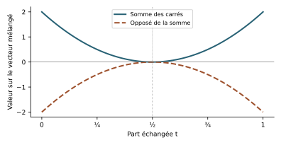

# BCE ECG — Mathématiques approfondies (ESSEC-HEC) 2026 · Corrigé guidé

*Corrigé rédigé par IA, non officiel. Signalez toute erreur.*

**Rédaction** · Claude Opus 5.5 · effort non renseigné · vitesse non renseignée

**Révision (tour 1)** · modèle non renseigné · effort non renseigné · vitesse non renseignée

**Révision (tour 2)** · modèle non renseigné · effort non renseigné · vitesse non renseignée

**Révision (tour 3)** · GPT-6.2 Astra Ultra · vitesse non renseignée

**Révision (tour 4)** · GPT-6.2 Astra Ultra · vitesse non renseignée

## Présentation du sujet

**Cadre.** Épreuve de 4 heures, conception ESSEC BS – HEC Paris, sans document ni calculatrice. Trente questions numérotées (46 en comptant les sous-questions), en quatre parties qui s'enchaînent. Le rapport 2026 indique 2448 copies et une note péréquée moyenne de 10,84.

**Le fil directeur.** Une matrice bistochastique « mélange » les coordonnées d'un vecteur : $BX$ est moins dispersé que $X$. Toute fonction S-convexe dépend seulement du vecteur trié. La réciproque exige une hypothèse supplémentaire : la symétrie et la convexité réunies suffisent. On transporte ensuite tout cela aux matrices symétriques à travers leurs valeurs propres triées : c'est le théorème de Davis (une fonction spectrale est convexe dès que sa trace sur les diagonales l'est) puis l'inégalité de Fan.

- **Partie I (Q1–Q6)** : matrices de permutation ($P_\sigma P_\tau=P_{\sigma\circ\tau}$, orthogonalité), existence et unicité du réordonnement décroissant $\hat x$, tri en Python.
- **Partie II (Q7–Q10)** : matrices bistochastiques et orthostochastiques, théorème de Birkhoff-Von Neumann démontré à la main pour $n=2$ et $n=3$, algorithme de normalisation alternée (Sinkhorn) en Python.
- **Partie III (Q11–Q21)** : fonctions symétriques, fonctions S-convexes, inégalité de Jensen, condition différentielle $(x_i-x_j)(\partial_if-\partial_jf)\geqslant0$, cas $f=\sum h(x_k)$.
- **Partie IV (Q22–Q30)** : fonctions spectrales, réduction ordonnée $A=Q\Lambda(A)\,{}^tQ$, théorème de Davis, convexité des sommes partielles de valeurs propres (Ky Fan), inégalité de Fan.

**Notions du programme.** Calcul matriciel (produit, transposée, trace), applications linéaires et bases, matrices orthogonales et théorème spectral (ECG2), produit scalaire et bases orthonormées, fonctions convexes (définition, inégalité de convexité généralisée, caractérisation $C^1$ par la croissance de $f'$), dérivée de $t\mapsto f(x+th)$ pour $f$ de classe $C^1$ sur $\mathbb{R}^n$, récurrence, raisonnement par l'absurde, Python (tableaux `numpy`).

**Difficulté.** Le sujet est long et abstrait, mais presque toutes les questions se règlent en quelques lignes une fois la bonne idée trouvée. La difficulté est surtout de **notation** : $x_\sigma$ et $P_\sigma X$ ne font pas intervenir la même permutation (Q11), $\hat x$ doit être bien défini (Q5), et la partie IV demande de manipuler sans erreur $QA\,{}^tQ$.

**Questions à ne pas laisser passer.** Q1, Q2, Q3, Q6, Q7(a), Q8, Q9(a)(b)(c), Q11, Q14, Q15(a), Q16, Q17, Q22. Le rapport 2026 note que la partie II a été « globalement mieux traitée que les autres, notamment pour $n = 2$ » et que les questions 23 à 30 ont été « peu ou mal abordées » : elles sont pourtant courtes une fois Q24 acquise.

**Gestion du temps.** Environ 40 minutes pour la partie I, 50 minutes pour la partie II, 1 h 10 pour la partie III et 1 h 10 pour la partie IV, avec une relecture. La partie IV se traite en admettant les résultats précédents.

> [!JURY]
> Le rapport 2026 met en garde contre le survol : « Certains candidats ont survolé les questions pour en toucher un maximum, au détriment de la qualité. Cela a été un mauvais calcul pour les points accordés. » Il recommande de « Privilégier la qualité à la quantité ».

---

## Partie I — Préliminaires

On fixe le vocabulaire des permutations. Tout repose sur une seule formule : la colonne $j$ de $P_\sigma$ est $e_{\sigma(j)}$.

### Question 1

> [!INDICATION]
> Que représente la $j$-ième colonne de la matrice d'un endomorphisme dans la base canonique ?

> [!INDICATION]
> Écrire $\varphi_\sigma(e_j)=\sum_i(P_\sigma)_{i,j}e_i$ et utiliser la définition du symbole de Kronecker.

#### Solution

La $j$-ième colonne de $P_\sigma$ contient les coordonnées de $\varphi_\sigma(e_j)$ :

$$\varphi_\sigma(e_j)=\sum_{i=1}^n\delta_{i,\sigma(j)}\,e_i .$$

Le seul terme non nul est celui d'indice $i=\sigma(j)$, donc $\boxed{\varphi_\sigma(e_j)=e_{\sigma(j)}}$.

> [!METHODE]
> Pour identifier une matrice de permutation, lire la position du $1$ dans chaque colonne : la colonne $j$ a son $1$ à la ligne $\sigma(j)$.

### Question 2

> [!INDICATION]
> Passer par les endomorphismes : deux applications linéaires égales sur une base sont égales.

> [!INDICATION]
> Pour l'inverse, calculer $P_\sigma P_{\sigma^{-1}}$ et identifier $P_{\mathrm{id}}$.

#### Solution

Pour tout $j$, avec la question 1 :

$$\begin{aligned}
\varphi_\sigma\circ\varphi_\tau(e_j) &= \varphi_\sigma\big(e_{\tau(j)}\big)\\
&= e_{\sigma(\tau(j))}\\
&= \varphi_{\sigma\circ\tau}(e_j).
\end{aligned}$$

Les deux endomorphismes coïncident sur une base, donc sont égaux, et leurs matrices aussi : $\boxed{P_\sigma P_\tau=P_{\sigma\circ\tau}}$.

Comme $(P_{\mathrm{id}})_{i,j}=\delta_{i,j}$, $P_{\mathrm{id}}=I_n$. Pour $P=P_\sigma$, on a $P_\sigma P_{\sigma^{-1}}=P_{\mathrm{id}}=I_n$. Une matrice carrée qui a un inverse à droite est inversible, donc $P_\sigma^{-1}=P_{\sigma^{-1}}$ : c'est une matrice de permutation.

> [!PIEGE]
> Le calcul direct par coefficients, $\sum_k\delta_{i,\sigma(k)}\delta_{k,\tau(j)}=\delta_{i,\sigma(\tau(j))}$, marche aussi, mais il faut l'écrire proprement. Le rapport 2026 relève que « la formule du produit matriciel est une lacune courante ».

### Question 3

> [!INDICATION]
> Calculer le coefficient $(i,j)$ de ${}^tP\,P$ avec la formule du produit matriciel.

> [!INDICATION]
> L'injectivité de $\sigma$ permet de conclure ; la définition de $\mathscr{O}_n$ porte sur $M\,{}^tM$, pas sur ${}^tM\,M$.

#### Solution

Pour $P=P_\sigma$ :

$$\begin{aligned}
({}^tP\,P)_{i,j} &= \sum_{k=1}^nP_{k,i}P_{k,j}\\
&= \sum_{k=1}^n\delta_{k,\sigma(i)}\delta_{k,\sigma(j)}\\
&= \delta_{\sigma(i),\sigma(j)}.
\end{aligned}$$

Comme $\sigma$ est injective, c'est $\delta_{i,j}$, donc ${}^tP\,P=I_n$. Ainsi $P$ est inversible d'inverse ${}^tP$, donc $P\,{}^tP=I_n$ aussi :

**$P\in\mathscr{O}_n$**.

> [!JURY]
> Le rapport 2026 cite les matrices orthogonales parmi les démonstrations que certains candidats ont su maîtriser : c'est une question à ne pas perdre.

### Question 4

> [!INDICATION]
> Pour passer de $n-1$ à $n$, placer d'abord le plus grand élément en tête.

> [!INDICATION]
> Échanger $1$ et l'indice $m$ du maximum par une transposition $\tau$, appliquer l'hypothèse de récurrence aux $n-1$ dernières composantes, puis recoller les permutations en une seule.

#### Solution

Notons $\mathcal{H}(n)$ l'énoncé. Pour $n=1$, $\alpha=\mathrm{id}$ convient.

Soit $n\geqslant2$ avec $\mathcal{H}(n-1)$ vraie, et $x\in\mathbb{R}^n$.

Soit $m$ tel que $x_m=\max_ix_i$ et $\tau$ la permutation qui échange $1$ et $m$.

On pose $y_i=x_{\tau(i)}$, de sorte que $y_1$ est le maximum.

On applique $\mathcal{H}(n-1)$ à $(z_1,\dots,z_{n-1})=(y_2,\dots,y_n)$ : on obtient $\gamma\in\mathscr{P}_{n-1}$ avec $z_{\gamma(1)}\geqslant\dots\geqslant z_{\gamma(n-1)}$.

On définit $\beta\in\mathscr{P}_n$ par $\beta(1)=1$ et $\beta(k+1)=\gamma(k)+1$. Alors

$$y_{\beta(1)}=y_1\geqslant y_{\beta(2)}\geqslant\dots\geqslant y_{\beta(n)} .$$

Avec $\alpha=\tau\circ\beta$, on a $x_{\alpha(i)}=y_{\beta(i)}$, ce qui prouve $\mathcal{H}(n)$. **Par récurrence, (1) admet toujours une solution $\alpha$.**

> [!PIEGE]
> L'hypothèse de récurrence porte sur des $(n-1)$-uplets indexés par $[\![1;n-1]\!]$ : il faut décaler les indices explicitement, sinon la permutation $\alpha$ n'est pas définie proprement.

### Question 5

> [!INDICATION]
> Raisonner par l'absurde sur le premier indice où les deux suites diffèrent.

> [!INDICATION]
> Compter le nombre d'indices $k$ tels que $x_k\geqslant a$, où $a$ est la plus grande des deux valeurs en désaccord, en utilisant tour à tour $\alpha$ puis $\beta$.

#### Solution

Supposons qu'il existe $i$ avec $x_{\alpha(i)}\neq x_{\beta(i)}$ ; prenons le plus petit, et supposons $a=x_{\alpha(i)}>x_{\beta(i)}$ (sinon on échange les rôles). Soit $N=\operatorname{card}\{k : x_k\geqslant a\}$.

- Via la bijection $\alpha$ : $N=\operatorname{card}\{j : x_{\alpha(j)}\geqslant a\}\geqslant i$, car tous les $j\leqslant i$ conviennent.
- Via la bijection $\beta$ : pour $j\geqslant i$, $x_{\beta(j)}\leqslant x_{\beta(i)}<a$, donc $N\leqslant i-1$.

Contradiction : $\boxed{x_{\alpha(i)}=x_{\beta(i)}\ \text{pour tout } i}$. Le vecteur trié $\hat x$ est donc bien défini, quel que soit le choix de $\alpha$.

> [!METHODE]
> Pour montrer qu'un objet défini par un choix ne dépend pas de ce choix, on compare deux choix quelconques. Ici l'argument de comptage évite toute récurrence.

> [!JURY]
> Le rapport 2026 signale une « Méconnaissance des principes de démonstrations de base (analyse-synthèse, raisonnement par l'absurde et contraposé) ». Annoncer clairement l'hypothèse absurde et la contradiction obtenue.

### Question 6

> [!INDICATION]
> Il s'agit d'un tri par sélection : à l'étape $i$, chercher le plus grand élément parmi `Y[i], …, Y[n-1]`.

> [!INDICATION]
> `imax` part de `i` ; la comparaison se fait avec l'élément courant le plus grand ; l'échange concerne `Y[i]` et `Y[imax]`.

#### Solution

```python
def permutevecteur(X):
    n = len(X)
    alpha = np.arange(0, n, 1)
    Y = X.copy()  # Y est un nouveau tableau initialisé avec les valeurs de X
    for i in range(n):
        imax = i
        for k in range(i, n):
            if Y[k] > Y[imax]:
                imax = k
        if imax > i:
            Y[i], Y[imax] = Y[imax], Y[i]
            alpha[i], alpha[imax] = alpha[imax], alpha[i]
    return Y, alpha
```

L'invariant `Y[k] == X[alpha[k]]` est conservé à chaque échange. Exécutée sur `X = np.array([3., -1., 7., 2., 7., 0.5])`, la fonction renvoie `Y = [7., 7., 3., 2., 0.5, -1.]` et `alpha = [2, 4, 0, 3, 5, 1]` (indices Python, décalés de 1 par rapport à l'énoncé).

> [!PIEGE]
> Comparer `Y[k]` à `Y[i]` au lieu de `Y[imax]` ne donne pas le maximum. Et l'échange doit porter sur `Y`, pas sur `X`, que la fonction ne doit pas modifier.

---

## Partie II — Matrices bistochastiques. Théorème de Birkhoff-Von Neumann en basses dimensions

On montre que l'ensemble des matrices bistochastiques contient les orthostochastiques et les permutations, puis que, pour $n\leqslant3$, toute bistochastique est combinaison convexe de permutations.

### Question 7(a)

> [!INDICATION]
> Les sommes de carrés de coefficients d'une ligne ou d'une colonne de $Q$ sont des coefficients diagonaux d'un produit de $Q$ par sa transposée.

> [!INDICATION]
> Pour $Q$ orthogonale, on a $Q\,{}^tQ=I_n$, mais aussi ${}^tQ\,Q=I_n$ : pourquoi ?

#### Solution

Si $S_{i,j}=Q_{i,j}^2$ avec $Q\in\mathscr{O}_n$, les coefficients sont positifs. Comme $Q$ est inversible d'inverse ${}^tQ$, on a aussi ${}^tQ\,Q=I_n$, d'où

$$\begin{aligned}
\sum_jS_{i,j} &= (Q\,{}^tQ)_{i,i}\\
&= 1
\end{aligned}$$

$$\begin{aligned}
\sum_iS_{i,j} &= ({}^tQ\,Q)_{j,j}\\
&= 1.
\end{aligned}$$

Pour $P_\sigma$ : les coefficients sont dans $\{0,1\}$. La ligne $i$ ne contient qu'un $1$, en colonne $\sigma^{-1}(i)$.

La colonne $j$ ne contient qu'un $1$, en ligne $\sigma(j)$.

**Les deux sont bistochastiques.**

### Question 7(b)

> [!INDICATION]
> Une matrice orthostochastique a les mêmes coefficients nuls que $Q$. Chercher une bistochastique dont le motif de zéros empêche deux lignes d'être orthogonales.

> [!INDICATION]
> Essayer une matrice dont chaque ligne contient deux coefficients $\frac12$ et un zéro, les zéros étant mal placés.

#### Solution

$$S=\frac12\begin{pmatrix}1&1&0\\0&1&1\\1&0&1\end{pmatrix}$$

est bistochastique. Si $S_{i,j}=Q_{i,j}^2$ avec $Q\in\mathscr{O}_3$, alors $Q_{1,3}=Q_{2,1}=0$ et les autres coefficients des deux premières lignes valent $\pm\frac1{\sqrt2}$. Le produit scalaire des deux premières lignes vaut $Q_{1,2}Q_{2,2}=\pm\frac12\neq0$, alors que $Q\,{}^tQ=I_3$ l'impose nul.

**$S$ n'est pas orthostochastique.**

> [!JURY]
> Le rapport 2026 relève une « Difficulté à construire des contre-exemples corrects ». Un contre-exemple se vérifie entièrement : ici, il faut montrer qu'il est bistochastique **et** qu'aucune $Q$ ne convient.

### Question 8(a)

> [!INDICATION]
> Combien y a-t-il de permutations de $\{1,2\}$ ?

#### Solution

Les deux permutations de $\{1,2\}$ donnent

$$\boxed{I_2=\begin{pmatrix}1&0\\0&1\end{pmatrix}\quad\text{et}\quad J=\begin{pmatrix}0&1\\1&0\end{pmatrix}}$$

### Question 8(b)

> [!INDICATION]
> Une matrice bistochastique $2\times2$ est déterminée par un seul de ses coefficients.

> [!INDICATION]
> Poser $a=S_{1,1}$ et en déduire les trois autres coefficients ; ne pas oublier la réciproque.

#### Solution

Si $S$ est bistochastique et $a=S_{1,1}$, alors $S_{1,2}=1-a$, $S_{2,1}=1-a$, $S_{2,2}=a$, avec $a\in[0,1]$ par positivité. Donc

$$S=\begin{pmatrix}a&1-a\\1-a&a\end{pmatrix}=aI_2+(1-a)J .$$

Réciproquement, $\alpha I_2+(1-\alpha)P$ vaut $I_2$ si $P=I_2$, ou a pour coefficients $\alpha,1-\alpha\geqslant0$ de sommes $1$ si $P=J$. **Équivalence démontrée.**

> [!PIEGE]
> Une équivalence demande deux sens. La réciproque est immédiate, mais il faut l'écrire.

### Question 9(a)

> [!INDICATION]
> Dénombrement des bijections d'un ensemble à trois éléments.

#### Solution

Il y a $\boxed{3!=6}$ permutations.

### Question 9(b)

> [!INDICATION]
> Utiliser la question 1 : la colonne $j$ a son $1$ à la ligne $\sigma(j)$.

#### Solution

Chaque $P_k$ a un unique $1$ par ligne et par colonne.

Si la colonne $j$ a son $1$ en ligne $\sigma(j)$, alors $\sigma$ est une bijection et $(P_k)_{i,j}=\delta_{i,\sigma(j)}$ :

| Matrice | $\sigma(1)$ | $\sigma(2)$ | $\sigma(3)$ | Permutation |
|---|---|---|---|---|
| $P_1$ | 1 | 3 | 2 | $(1,3,2)$ |
| $P_2$ | 3 | 2 | 1 | $(3,2,1)$ |
| $P_3$ | 2 | 1 | 3 | $(2,1,3)$ |
| $P_4$ | 3 | 1 | 2 | $(3,1,2)$ |
| $P_5$ | 2 | 3 | 1 | $(2,3,1)$ |

Avec $I_3$, ce sont les six matrices de permutation.

> [!PIEGE]
> Lire les lignes au lieu des colonnes donne $\sigma^{-1}$ : pour $P_4$ on trouverait $(2,3,1)$, qui est la permutation de $P_5$.

### Question 9(c)

> [!INDICATION]
> Exprimer la troisième colonne grâce aux sommes des lignes 1 et 2, la troisième ligne grâce aux sommes des colonnes 1 et 2.

> [!INDICATION]
> Pour $S_{3,3}$, utiliser la somme de la ligne 3 ; les conditions nécessaires viennent de la positivité de chaque coefficient.

#### Solution

Les lignes 1, 2 et les colonnes 1, 2 donnent la forme (2). La ligne 3 donne

$$\begin{aligned}
S_{3,3} &= 1-S_{3,1}-S_{3,2}\\
&= S_{1,1}+S_{1,2}+S_{2,1}+S_{2,2}-1 .
\end{aligned}$$

Conditions nécessaires (positivité des neuf coefficients) :

$$S_{1,1},\,S_{1,2},\,S_{2,1},\,S_{2,2}\geqslant0,$$

$$S_{1,1}+S_{1,2}\leqslant1,\qquad S_{2,1}+S_{2,2}\leqslant1,$$

$$S_{1,1}+S_{2,1}\leqslant1,\qquad S_{1,2}+S_{2,2}\leqslant1,$$

$$S_{1,1}+S_{1,2}+S_{2,1}+S_{2,2}\geqslant1 .$$

Elles sont aussi suffisantes pour que (2) soit bistochastique.

### Question 9(d)

> [!INDICATION]
> Écrire l'égalité $S=\beta_0I_3+\sum\beta_iP_i$ coefficient par coefficient : neuf équations linéaires.

> [!INDICATION]
> Les trois coefficients diagonaux donnent $\beta_1,\beta_2,\beta_3$ en fonction de $\beta_0$ ; deux autres équations donnent $\beta_4,\beta_5$. Vérifier les quatre restantes avec la forme (2).

> [!INDICATION]
> Pour la positivité de $\beta_4$ et $\beta_5$, distinguer selon le coefficient diagonal où le minimum est atteint.

#### Solution

Position des $1$ :

| Matrice | Positions des coefficients égaux à 1 |
|---|---|
| $P_1$ | $(1,1),(3,2),(2,3)$ |
| $P_2$ | $(3,1),(2,2),(1,3)$ |
| $P_3$ | $(2,1),(1,2),(3,3)$ |
| $P_4$ | $(3,1),(1,2),(2,3)$ |
| $P_5$ | $(2,1),(3,2),(1,3)$ |


On pose

$$\begin{aligned}
\beta_1&=S_{1,1}-\beta_0, & \beta_2&=S_{2,2}-\beta_0, & \beta_3&=S_{3,3}-\beta_0,\\
\beta_4&=S_{1,2}-S_{3,3}+\beta_0, & \beta_5&=S_{2,1}-S_{3,3}+\beta_0. & &
\end{aligned}$$

Les coefficients $(1,1),(2,2),(3,3),(1,2),(2,1)$ sont corrects par construction. Pour les quatre autres, on utilise (2) et la valeur de $S_{3,3}$ :

$$\begin{aligned}
\beta_2+\beta_5 &= S_{2,2}+S_{2,1}-S_{3,3}\\
&= 1-S_{1,1}-S_{1,2}\\
&= S_{1,3},
\end{aligned}$$

et de même $\beta_2+\beta_4=S_{3,1}$, $\beta_1+\beta_4=S_{2,3}$, $\beta_1+\beta_5=S_{3,2}$.

Positivité : $\beta_1,\beta_2,\beta_3\geqslant0$ par définition du minimum. Ensuite :

- si $\beta_0=S_{3,3}$ : $\beta_4=S_{1,2}$ et $\beta_5=S_{2,1}$ ;
- si $\beta_0=S_{1,1}$ : $\beta_4=S_{2,3}$ et $\beta_5=S_{3,2}$ ;
- si $\beta_0=S_{2,2}$ : $\beta_4=S_{3,1}$ et $\beta_5=S_{1,3}$.

Dans tous les cas ce sont des coefficients de $S$, donc des réels positifs. **La décomposition existe.**

> [!METHODE]
> Les matrices de permutation de taille 3 vérifient une relation linéaire (somme des trois permutations paires égale à la somme des trois impaires) : la décomposition peut varier. Par exemple, la matrice dont toutes les entrées valent $1/3$ est à la fois $(I_3+P_4+P_5)/3$ et $(P_1+P_2+P_3)/3$. Le choix $\beta_0=\min S_{i,i}$ annule l'un des $\beta_1,\beta_2,\beta_3$ et garantit la positivité.

### Question 9(e)

> [!INDICATION]
> Il reste à vérifier que la somme des coefficients vaut 1 : regarder la somme d'une ligne.

#### Solution

En sommant la première ligne de $S=\beta_0I_3+\sum_{i=1}^5\beta_iP_i$, chaque matrice de permutation contribue pour $1$ : $\beta_0+\dots+\beta_5=1$. Ainsi $S$ est une combinaison convexe des six matrices de permutation. Avec la question 8(b) pour $n=2$, **le théorème de Birkhoff-Von Neumann est démontré pour $n\in\{2,3\}$.**

### Question 10

> [!INDICATION]
> `rd.random([n, n])` fournit $A^{(0)}$. Une boucle sur `k` répète deux normalisations.

> [!INDICATION]
> Traiter chaque ligne `A[i, :]` (puis chaque colonne `A[:, j]`) séparément : la somme utilisée est celle de la ligne avant modification.

#### Solution

```python
def bistochastique(n, iter):
    A = rd.random([n, n])            # A(0)
    while np.any(A == 0):
        masque = (A == 0)
        A[masque] = rd.random(np.count_nonzero(masque))
    for k in range(iter):
        for i in range(n):           # A(2k+1) : lignes normalisées
            A[i, :] = A[i, :] / np.sum(A[i, :])
        for j in range(n):           # A(2k+2) : colonnes normalisées
            A[:, j] = A[:, j] / np.sum(A[:, j])
    return A
```

Testée avec `bistochastique(4, 200)` : les sommes de lignes et de colonnes valent $1$ à la précision machine.

On retire les zéros éventuels du générateur pour respecter l’intervalle ouvert. Après un nombre fini de passages, les colonnes ont exactement la somme demandée en arithmétique exacte. Les lignes peuvent encore s’en écarter. Par exemple, partons de $A^{(0)}=\frac14\left(\begin{smallmatrix}2&1\\1&1\end{smallmatrix}\right)$. Après la normalisation des lignes puis des colonnes, on obtient
$$A^{(2)}=\begin{pmatrix}4/7&2/5\\3/7&3/5\end{pmatrix}.$$
Les sommes des lignes sont $34/35$ et $36/35$. L’admission d’une approximation pour un grand nombre d’itérations intervient précisément ici.

> [!JURY]
> Le rapport 2026 signale la « Confusion entre indice et puissance » : $A^{(2k)}$ désigne la $2k$-ième matrice de la suite, pas une puissance de $A$. Aucune puissance matricielle n'intervient ici.

---

## Partie III — Fonctions symétriques et fonctions S-convexes

On caractérise les fonctions qui diminuent quand on « mélange » les coordonnées par une bistochastique. Outils : questions 11 et 12 (permutations des coordonnées), Jensen, et la dérivée de $t\mapsto f(x+th)$.

### Question 11

> [!INDICATION]
> Calculer la $i$-ième coordonnée de $P_\sigma X$ avec la formule du produit matriciel.

#### Solution

$(P_\sigma X)_i=\sum_j\delta_{i,\sigma(j)}x_j=x_{\sigma^{-1}(i)}$, donc

$$\boxed{P_\sigma X=X_{\sigma^{-1}}}$$

> [!PIEGE]
> Ce n'est pas $X_\sigma$ : multiplier par $P_\sigma$ permute les coordonnées selon $\sigma^{-1}$. L'erreur est sans conséquence en Q12 (on parcourt toutes les permutations), mais elle fausse Q23 et Q25(b) si l'on n'y prend pas garde.

### Question 12

> [!INDICATION]
> L'application $\sigma\mapsto\sigma^{-1}$ est une bijection de $\mathscr{P}_n$.

#### Solution

Si $f$ est symétrique, $f(P_\sigma X)=f(X_{\sigma^{-1}})=f(X)$. Réciproquement, si $f(PX)=f(X)$ pour toute $P\in\mathbb{P}_n$, alors $f(X_\tau)=f(P_{\tau^{-1}}X)=f(X)$ pour toute $\tau$. **Équivalence démontrée.**

### Question 13

> [!INDICATION]
> Dans un sens, prendre pour $\hat f$ la restriction de $f$ à $H_n$.

> [!INDICATION]
> Dans l'autre sens, il faut montrer que $\widehat{x_\sigma}=\hat x$ : trouver une permutation qui range $x_\sigma$, et invoquer Q5.

#### Solution

*Lemme* : $\widehat{x_\sigma}=\hat x$. Si $\alpha$ range $x$, alors $\alpha'=\sigma^{-1}\circ\alpha$ range $x_\sigma$, car $(x_\sigma)_{\alpha'(i)}=x_{\sigma(\alpha'(i))}=x_{\alpha(i)}$.

Par la question 5, $\widehat{x_\sigma}=(x_{\alpha(1)},\dots,x_{\alpha(n)})=\hat x$.

Si $f$ est symétrique, $\hat f=f_{|H_n}$ convient : $f(x)=f(x_\alpha)=\hat f(\hat x)$. Réciproquement, si $f(x)=\hat f(\hat x)$, alors $f(x_\sigma)=\hat f(\widehat{x_\sigma})=\hat f(\hat x)=f(x)$.

### Question 14

> [!INDICATION]
> Pour $f_1$ et $f_3$, un changement d'indice bijectif. Pour $f_2$, la première coordonnée joue un rôle à part.

> [!INDICATION]
> Pour le contre-exemple, éviter $x=e_1$, qui donne la même valeur après échange.

#### Solution

- $f_1$ est symétrique : $\sum_kx_{\sigma(k)}=\sum_kx_k$ ($\sigma$ bijective).
- $f_2$ ne l'est pas : pour $x=(2,0,\dots,0)$ et la transposition qui échange $1$ et $2$, on trouve $f_2(x)=4$ et $f_2(x_\sigma)=2$.
- $f_3$ est symétrique : $(i,j)\mapsto(\sigma(i),\sigma(j))$ est une bijection de $[\![1;n]\!]^2$, le maximum porte sur le même ensemble de valeurs.

> [!PIEGE]
> Pour $x=te_1$, l’échange donne $f_2(te_1)=t^2$ et $f_2(te_2)=t$. Choisir $t$ hors de $\{0,1\}$ distingue les deux valeurs.

### Question 15(a)

> [!INDICATION]
> Reconnaître une fonction de la forme $t\mapsto f(x+th)$, dont la dérivée est au programme.

#### Solution

$g_{i,x}(t)=f(x+te_i)$ avec $f$ de classe $C^1$ : $g_{i,x}$ est $C^1$ sur $\mathbb{R}$ et

$$\boxed{g_{i,x}'(t)=\langle\nabla f(x+te_i),e_i\rangle=\partial_if(x+te_i)}$$

### Question 15(b)

> [!INDICATION]
> Montrer que $x_\sigma+te_i$ est le vecteur $(x+te_{\sigma(i)})$ permuté par $\sigma$, puis utiliser la symétrie de $f$.

#### Solution

La $j$-ième composante de $(x+te_{\sigma(i)})_\sigma$ est $x_{\sigma(j)}+t\,\delta_{\sigma(j),\sigma(i)}=x_{\sigma(j)}+t\,\delta_{j,i}$. Donc

$$\begin{aligned}
g_{i,x_\sigma}(t) &= f\big((x+te_{\sigma(i)})_\sigma\big)\\
&= f(x+te_{\sigma(i)})\\
&= g_{\sigma(i),x}(t).
\end{aligned}$$

### Question 15(c)

> [!INDICATION]
> Dériver l'égalité précédente en $t=0$.

#### Solution

Par (a), $g_{i,x_\sigma}'(0)=\partial_if(x_\sigma)$ et $g_{\sigma(i),x}'(0)=\partial_{\sigma(i)}f(x)$. Par (b) : $\boxed{\partial_if(x_\sigma)=\partial_{\sigma(i)}f(x)}$.

### Question 16

> [!INDICATION]
> Une matrice de permutation est bistochastique : on obtient une inégalité. Comment obtenir l'inégalité inverse ?

> [!INDICATION]
> Appliquer la S-convexité à $P^{-1}$ et au vecteur $PX$.

#### Solution

Pour $P\in\mathbb{P}_n$ (bistochastique, Q7(a)) : $f(PX)\leqslant f(X)$. Comme $P^{-1}\in\mathbb{P}_n$ (Q2) :

$$f(X)=f\big(P^{-1}PX\big)\leqslant f(PX).$$

Donc $f(PX)=f(X)$ et **$f$ est symétrique** (Q12).

### Question 17

> [!INDICATION]
> Récurrence sur $m$, en isolant le dernier terme.

> [!INDICATION]
> Écrire $\sum_{k\leqslant m+1}\alpha_kz_k=s\,w+(1-s)z_{m+1}$ avec $s=\alpha_1+\dots+\alpha_m$ et $w$ un barycentre des $z_1,\dots,z_m$ ; traiter à part le cas $s=0$.

#### Solution

Pour $m=1$, égalité. Supposons le résultat au rang $m$. Si $\alpha_{m+1}=1$, égalité. Sinon $s=1-\alpha_{m+1}\in\,]0,1]$ et $w=\sum_{k\leqslant m}\frac{\alpha_k}sz_k$. Par convexité puis par hypothèse de récurrence :

$$\begin{aligned}
g\Big(\sum_{k=1}^{m+1}\alpha_kz_k\Big) &\leqslant s\,g(w)+\alpha_{m+1}g(z_{m+1})\\
&\leqslant \sum_{k=1}^m\alpha_kg(z_k)+\alpha_{m+1}g(z_{m+1}).
\end{aligned}$$

> [!JURY]
> Le rapport 2026 range l'inégalité de Jensen parmi les démonstrations réussies par certains candidats : la récurrence doit être complète (initialisation, cas $s=0$, hypothèse appliquée à des poids de somme 1).

### Question 18

> [!INDICATION]
> Décomposer $B$ grâce au théorème de Birkhoff-Von Neumann (admis).

> [!INDICATION]
> Appliquer Jensen dans $\mathcal{M}_{n,1}(\mathbb{R})$ aux vecteurs $P_kX$, puis la question 12.

#### Solution

$B=\sum_ka_kP_k$ (combinaison convexe de permutations). Alors

$$\begin{aligned}
f(BX) &= f\Big(\sum_ka_kP_kX\Big)\\
&\leqslant \sum_ka_kf(P_kX)\\
&= \sum_ka_kf(X)=f(X).
\end{aligned}$$

**$f$ est S-convexe.**

La symétrie seule donne l’égalité sur les permutations. Pour $f(x)=-\sum_i x_i^2$ et $X=(1,-1)$, la matrice dont toutes les entrées valent $1/2$ donne $BX=0$. On obtient $f(BX)=0>-2=f(X)$, ce qui exclut la S-convexité. Dans l’autre sens, $h(x)=-(\sum_i x_i)^2$ est S-convexe puisque la somme des coordonnées est préservée. Sa restriction à la droite $x=t e_1$ vaut $-t^2$ et n’est pas convexe.



### Question 19(a)

> [!INDICATION]
> Écrire $g(t)=f(x+th)$ pour un vecteur $h$ à déterminer.

#### Solution

$g(t)=f(x+th)$ avec $h=(x_2-x_1,\,x_1-x_2)$. Donc $g$ est $C^1$ et, avec $u(t)=\big((1-t)x_1+tx_2,(1-t)x_2+tx_1\big)$ :

$$\boxed{g'(t)=(x_2-x_1)\big(\partial_1f(u(t))-\partial_2f(u(t))\big)}$$

### Question 19(b)

> [!INDICATION]
> Trouver une matrice bistochastique $B_t$ telle que $u(t)=B_tX$.

> [!INDICATION]
> Pour le signe de $g'(0)$, passer à la limite dans le taux d'accroissement à droite.

#### Solution

$B_t=\begin{pmatrix}1-t&t\\t&1-t\end{pmatrix}$ est bistochastique pour $t\in[0,1]$ et $B_tX=u(t)$, d'où $g(t)\leqslant g(0)$.

Pour $t\in\,]0,1]$, $\frac{g(t)-g(0)}t\leqslant0$, et la limite en $0^+$ donne $g'(0)\leqslant0$.

> [!PIEGE]
> On ne connaît le signe du taux d'accroissement que pour $t>0$ : c'est une limite à droite, qui suffit puisque $g$ est dérivable en $0$.

### Question 19(c)

> [!INDICATION]
> Évaluer (a) en $t=0$.

#### Solution

$u(0)=x$, donc $(x_2-x_1)\big(\partial_1f(x)-\partial_2f(x)\big)\leqslant0$, soit

$$\boxed{(x_1-x_2)\big(\partial_1f(x)-\partial_2f(x)\big)\geqslant0}$$

### Question 20

> [!INDICATION]
> Généraliser la matrice $B_t$ de Q19 en n'agissant que sur les coordonnées $i$ et $j$.

> [!INDICATION]
> Écrire $B_tX=x+th$ et calculer $\langle\nabla f(x),h\rangle$.

#### Solution

Si $i=j$, c'est nul.

Sinon, soit $B_t$ égale à $I_n$ sauf $(B_t)_{i,i}=(B_t)_{j,j}=1-t$ et $(B_t)_{i,j}=(B_t)_{j,i}=t$ : elle est bistochastique pour $t\in[0,1]$.

De plus $B_tX=x+th$ avec $h=(x_j-x_i)e_i+(x_i-x_j)e_j$.

Pour $g(t)=f(x+th)$ :

$$g'(0)=\langle\nabla f(x),h\rangle=-(x_i-x_j)\big(\partial_if(x)-\partial_jf(x)\big).$$

Comme en 19(b), $g(t)\leqslant g(0)$ sur $[0,1]$ donne $g'(0)\leqslant0$, d'où $\boxed{(x_i-x_j)\big(\partial_if(x)-\partial_jf(x)\big)\geqslant0}$.

### Question 21

> [!INDICATION]
> Un sens découle de la question 18, l'autre de la question 20.

> [!INDICATION]
> Pour la réciproque, choisir $x$ dont seules les deux premières coordonnées sont libres, et se souvenir de la caractérisation des fonctions convexes de classe $C^1$.

#### Solution

On a $\partial_if(x)=h'(x_i)$.

*Si $h$ est convexe* : $f$ est symétrique (somme réindexée) et convexe, car

$$\begin{aligned}
f(tx+(1-t)y) &= \sum_kh\big(tx_k+(1-t)y_k\big)\\
&\leqslant \sum_k\big(t\,h(x_k)+(1-t)\,h(y_k)\big)\\
&= t\,f(x)+(1-t)\,f(y).
\end{aligned}$$

Par Q18, $f$ est S-convexe.

*Si $f$ est S-convexe* : avec $x=(a,b,0,\dots,0)$, Q20 donne $(a-b)\big(h'(a)-h'(b)\big)\geqslant0$ pour tous réels $a,b$.

Donc $h'$ est croissante et, $h$ étant $C^1$, **$h$ est convexe**.

> [!METHODE]
> Pour une fonction de classe $C^1$ d'une variable : convexe $\iff$ $f'$ croissante. C'est le résultat du programme qu'on attend ici.

---

## Partie IV — Fonctions spectrales. Théorèmes de Davis et de Fan

On transporte la partie III aux matrices symétriques. La clé est Q24 : toute $A$ symétrique s'écrit $Q\Lambda(A)\,{}^tQ$ avec les valeurs propres **rangées**. Un rappel sert partout : deux matrices symétriques semblables ont le même $\hat\lambda$ (les coefficients d'une diagonale semblable à $A$ sont ses valeurs propres comptées avec la dimension des sous-espaces propres), en particulier $\hat\lambda(QA\,{}^tQ)=\hat\lambda(A)$ et $\hat\lambda(D(x))=\hat x$.

> [!JURY]
> Le rapport 2026 dénonce une « Mauvaise interprétation des notations (ex. $QA^tQ$ assimilé systématiquement à une matrice diagonale) ». $QA\,{}^tQ$ est seulement une matrice symétrique semblable à $A$.

### Question 22

> [!INDICATION]
> Calculer $(QA\,{}^tQ)^k$ en utilisant ${}^tQ\,Q=I_n$.

> [!INDICATION]
> Puis la propriété $\operatorname{Tr}(MN)=\operatorname{Tr}(NM)$.

#### Solution

$(QA\,{}^tQ)^k=QA^k\,{}^tQ$ (récurrence, ${}^tQ\,Q=I_n$), donc

$$\begin{aligned}
F_k(QA\,{}^tQ) &= \operatorname{Tr}\big(QA^k\,{}^tQ\big)\\
&= \operatorname{Tr}\big(A^k\,{}^tQ\,Q\big)\\
&= \operatorname{Tr}(A^k).
\end{aligned}$$

### Question 23

> [!INDICATION]
> Calculer l'image de chaque vecteur $e_k$ de la base canonique par $P_\sigma D(X)\,{}^tP_\sigma$.

> [!INDICATION]
> ${}^tP_\sigma=P_{\sigma^{-1}}$ par Q2 et Q3.

#### Solution

$$\begin{aligned}
P_\sigma D(X)\,{}^tP_\sigma\,e_k &= P_\sigma D(X)\,e_{\sigma^{-1}(k)}\\
&= x_{\sigma^{-1}(k)}\,e_k .
\end{aligned}$$

La matrice est diagonale de coefficients $x_{\sigma^{-1}(k)}=(P_\sigma X)_k$ (Q11) : $\boxed{P_\sigma D(X)\,{}^tP_\sigma=D(P_\sigma X)}$.

### Question 24

> [!INDICATION]
> Le théorème spectral donne une diagonalisation orthogonale, mais pas forcément avec les valeurs propres rangées.

> [!INDICATION]
> Réordonner la diagonale par une matrice de permutation grâce à Q23 ; un produit de matrices orthogonales est orthogonal.

#### Solution

$A=Q_0D(Y)\,{}^tQ_0$ avec $Q_0\in\mathscr{O}_n$ (théorème spectral).

Soit $\alpha$ rangeant $Y$, de sorte que $Y_\alpha=\hat\lambda(A)$, et $P=P_{\alpha^{-1}}$ : $PY=Y_\alpha$ (Q11), donc $P\,D(Y)\,{}^tP=\Lambda(A)$ (Q23). Ainsi

$$A=Q\,\Lambda(A)\,{}^tQ$$

$$Q=Q_0\,{}^tP,$$

et $Q\,{}^tQ=Q_0\,{}^tP\,P\,{}^tQ_0=I_n$.

> [!PIEGE]
> Le programme d'ECG ne contient sur les matrices orthogonales que la propriété ${}^tP=P^{-1}$ pour une matrice de passage entre bases orthonormées : la stabilité par produit se vérifie en une ligne, comme ci-dessus.

### Question 25(a)

> [!INDICATION]
> Appliquer la définition d'une fonction spectrale à l'écriture de Q24.

#### Solution

$F(A)=F\big(Q\Lambda(A)\,{}^tQ\big)=F(\Lambda(A))$.

### Question 25(b)

> [!INDICATION]
> Écrire $D(X_\sigma)$ sous la forme $P\,D(X)\,{}^tP$ avec Q11 et Q23, en choisissant bien $P$.

#### Solution

Avec $P=P_{\sigma^{-1}}$ : $PX=X_\sigma$ (Q11), donc $D(X_\sigma)=P\,D(X)\,{}^tP$ (Q23), et comme $P\in\mathscr{O}_n$ et $F$ est spectrale, $f(x_\sigma)=F(D(X))=f(x)$.

### Question 25(c)

> [!INDICATION]
> $D$ est linéaire.

#### Solution

$$\begin{aligned}
f(tx+(1-t)y) &= F\big(t\,D(x)+(1-t)\,D(y)\big)\\
&\leqslant t\,f(x)+(1-t)\,f(y).
\end{aligned}$$

### Question 26

> [!INDICATION]
> Dans le sens direct, la fonction $f$ de Q25 convient. Dans l'autre, deux matrices orthogonalement semblables ont le même $\hat\lambda$.

> [!INDICATION]
> Pour l'unicité, évaluer en $A=D(x)$.

#### Solution

*Sens direct* : $f$ de Q25 est symétrique et $F(A)=F(\Lambda(A))=f(\hat\lambda(A))$.

*Réciproque* : $\hat\lambda(QA\,{}^tQ)=\hat\lambda(A)$, donc $F(QA\,{}^tQ)=F(A)$.

*Unicité* : si $f,g$ symétriques conviennent, pour tout $x$, $f(x)=f(\hat x)=F(D(x))=g(\hat x)=g(x)$.

> [!PIEGE]
> L'unicité tient à la symétrie : sans elle, on ne connaît $f$ que sur $H_n$ (les vecteurs déjà rangés).

### Question 27(a)

> [!INDICATION]
> Développer le coefficient diagonal $(i,i)$ de $Q\Lambda(A)\,{}^tQ$.

#### Solution

$$A_{i,i}=\sum_kQ_{i,k}^2\,\hat\lambda_k(A).$$

La matrice $(Q_{i,k}^2)$ est orthostochastique donc bistochastique (Q7(a)) : $\boxed{\operatorname{diag}(A)=S\,\hat\lambda(A)}$.

### Question 27(b)

> [!INDICATION]
> Diagonaliser $C$ (et non $A$ ou $B$) dans une base orthonormée.

> [!INDICATION]
> Écrire ${}^tRCR={}^tRAR+{}^tRBR$, prendre les diagonales et appliquer (a) aux deux termes.

#### Solution

$C=R\Lambda(C)\,{}^tR$ (Q24). Alors $\Lambda(C)={}^tRAR+{}^tRBR$.

Les matrices $A'={}^tRAR$, $B'={}^tRBR$ sont symétriques, de mêmes $\hat\lambda$ que $A$ et $B$. En prenant les diagonales et avec (a) :

$$\hat\lambda(C)=\operatorname{diag}(A')+\operatorname{diag}(B')=S_1\hat\lambda(A)+S_2\hat\lambda(B).$$

### Question 27(c)

> [!INDICATION]
> $f$ est symétrique et convexe : que dit Q18 ?

> [!INDICATION]
> Appliquer (b) à $tA$ et $(1-t)B$, utiliser $\hat\lambda(cA)=c\,\hat\lambda(A)$ pour $c\geqslant0$, puis la convexité et la S-convexité de $f$.

#### Solution

$f$ est S-convexe (Q18). Pour $t\in[0,1]$, $\hat\lambda(tA+(1-t)B)=t\,S_1\hat\lambda(A)+(1-t)\,S_2\hat\lambda(B)$, donc

$$\begin{aligned}
F\big(tA+(1-t)B\big) &\leqslant t\,f\big(S_1\hat\lambda(A)\big)+(1-t)\,f\big(S_2\hat\lambda(B)\big)\\
&\leqslant t\,f(\hat\lambda(A))+(1-t)\,f(\hat\lambda(B))\\
&= t\,F(A)+(1-t)\,F(B).
\end{aligned}$$

**Théorème de Davis : $F$ est convexe.**

> [!METHODE]
> Deux inégalités de nature différente s'enchaînent : la convexité de $f$ « sépare » la combinaison, la S-convexité « efface » les matrices bistochastiques.

### Question 27(d)

> [!INDICATION]
> $DG(A)=D(\operatorname{diag}A)$ : exprimer $F(DG(A))$ à l'aide de $f$, puis utiliser (a).

#### Solution

$$\begin{aligned}
F(DG(A)) &= f\big(\widehat{\operatorname{diag}A}\big)\\
&= f(\operatorname{diag}A)\\
&= f\big(S\,\hat\lambda(A)\big)\\
&\leqslant f(\hat\lambda(A))=F(A).
\end{aligned}$$

### Question 28(a)

> [!INDICATION]
> Décomposer $X_k$ dans la base orthonormée $(V_i)$ et calculer $\langle X_k,AX_k\rangle$ en fonction des $\langle X_k,V_i\rangle^2$.

> [!INDICATION]
> Majorer les $\hat\lambda_i(A)$ d'indice $i\geqslant m$ par $\hat\lambda_m(A)$, et utiliser $\sum_ic_i^2=1$.

> [!INDICATION]
> Pour (4), sommer (3) sur $k\leqslant m$ et majorer $\sum_{k\leqslant m}\langle X_k,V_i\rangle^2$ par $1$ (Parseval dans la base $(X_k)$).

#### Solution

Avec $c_i=\langle X_k,V_i\rangle$, $\sum_ic_i^2=1$ et $\langle X_k,AX_k\rangle=\sum_i\hat\lambda_i(A)c_i^2$. Donc

$$\begin{aligned}
\langle X_k,AX_k\rangle &\leqslant \sum_{i<m}\hat\lambda_i(A)c_i^2+\hat\lambda_m(A)\sum_{i\geqslant m}c_i^2\\
&= \hat\lambda_m(A)+\sum_{i=1}^{m-1}\big(\hat\lambda_i(A)-\hat\lambda_m(A)\big)c_i^2 ,
\end{aligned}$$

c'est (3). En sommant sur $k\leqslant m$, avec $\sum_{k\leqslant m}\langle X_k,V_i\rangle^2\leqslant\|V_i\|^2=1$ et $\hat\lambda_i(A)-\hat\lambda_m(A)\geqslant0$ :

$$\begin{aligned}
\sum_{k=1}^m\langle X_k,AX_k\rangle&\leqslant m\,\hat\lambda_m(A)+\sum_{i=1}^{m-1}\big(\hat\lambda_i(A)-\hat\lambda_m(A)\big)\\
&= \Sigma_m(A).
\end{aligned}$$

> [!PIEGE]
> La majoration $\sum_{k\leqslant m}\langle X_k,V_i\rangle^2\leqslant1$ n'est utilisable que parce que le coefficient $\hat\lambda_i-\hat\lambda_m$ est positif : c'est pourquoi on s'arrête à $i\leqslant m-1$.

### Question 28(b)

> [!INDICATION]
> Que vaut $\sum_{k\leqslant m}\langle X_k,CX_k\rangle$ ? Appliquer (4) à $A$ puis à $B$.

> [!INDICATION]
> Sous-additivité et homogénéité positive suffisent pour la convexité.

#### Solution

$\Sigma_m(C)=\sum_{k\leqslant m}\langle X_k,CX_k\rangle=\sum_{k\leqslant m}\langle X_k,AX_k\rangle+\sum_{k\leqslant m}\langle X_k,BX_k\rangle\leqslant\Sigma_m(A)+\Sigma_m(B)$, (4) étant appliqué à $A$, puis à $B$ avec une base propre de $B$. Comme $\Sigma_m(cA)=c\,\Sigma_m(A)$ pour $c\geqslant0$ :

$$\Sigma_m\big(tA+(1-t)B\big)\leqslant t\,\Sigma_m(A)+(1-t)\,\Sigma_m(B).$$

### Question 29

> [!INDICATION]
> Suivre l'indication : $\hat\lambda_k=\Sigma_k-\Sigma_{k-1}$, puis regrouper les termes (transformation d'Abel).

#### Solution

$H$ est spectrale car $\hat\lambda(QA\,{}^tQ)=\hat\lambda(A)$. Avec $\Sigma_0=0$ :

$$H=\sum_{k=1}^{n-1}(\alpha_k-\alpha_{k+1})\,\Sigma_k+\alpha_n\,\Sigma_n ,$$

combinaison à coefficients positifs de fonctions convexes (28(b)) : **$H$ est convexe.**

### Question 30

> [!INDICATION]
> Appliquer Q27(d) à une fonction spectrale bien choisie de la forme $M\mapsto\sum_ka_k\hat\lambda_k(M)$.

> [!INDICATION]
> Q29 demande $\alpha_n\geqslant0$ : se ramener à ce cas en retranchant $a_n\operatorname{Tr}(M)$, qui est linéaire.

> [!INDICATION]
> Utiliser deux fois l'inégalité obtenue : une fois avec les coefficients $\hat\lambda(B)$ et la matrice $A$, une fois avec les coefficients $\hat U$ et la matrice $B$.

#### Solution

*Lemme.* Par Q24 et l'invariance de la trace, $\operatorname{Tr}(M)=\Sigma_n(M)$. Pour $a$ rangé dans l'ordre décroissant, $G_a(M)=\sum_ka_k\hat\lambda_k(M)=\sum_k(a_k-a_n)\hat\lambda_k(M)+a_n\operatorname{Tr}(M)$ est spectrale et convexe (Q29, Q22). Sa fonction associée $x\mapsto\sum_ka_k\hat x_k$ est convexe (Q25(c)). Par Q27(d) :

$$\sum_ka_k\,\widehat{\operatorname{diag}(M)}_k\leqslant\sum_ka_k\,\hat\lambda_k(M).$$

Avec $a=\hat\lambda(B)$, $M=A$ : $\langle\hat\lambda(B),\hat U\rangle\leqslant\langle\hat\lambda(B),\hat\lambda(A)\rangle$. Avec $a=\hat U$, $M=B$ : $\langle\hat U,\hat V\rangle\leqslant\langle\hat U,\hat\lambda(B)\rangle$. D'où

$$\boxed{\langle\hat U,\hat V\rangle\leqslant\langle\hat\lambda(A),\hat\lambda(B)\rangle}$$

> [!METHODE]
> Contrôle numérique possible (hors épreuve) : pour des matrices symétriques aléatoires, comparer $\langle\hat U,\hat V\rangle$, $\langle\hat U,\hat\lambda(B)\rangle$ et $\langle\hat\lambda(A),\hat\lambda(B)\rangle$ ; la chaîne d'inégalités se vérifie sur des centaines de tirages.

---

## Bilan

**Méthodes à retenir.**

- Une matrice de permutation se lit par colonnes : $P_\sigma e_j=e_{\sigma(j)}$, et donc $P_\sigma X=X_{\sigma^{-1}}$. Retenir le $\sigma^{-1}$.
- Montrer qu'une définition ne dépend pas d'un choix (Q5) : comparer deux choix, ici par un argument de comptage.
- Inégalité de Jensen : récurrence en isolant le dernier point, avec renormalisation des poids.
- Obtenir une inégalité sur des dérivées partielles : construire un chemin $t\mapsto x+th$ sur lequel $f(x+th)\le f(x)$ pour $0<t\le1$, puis prendre la limite du taux d’accroissement à droite en $0$.
- Pour une matrice symétrique, la diagonalisation orthogonale **ordonnée** s'obtient en composant le théorème spectral avec une matrice de permutation.
- Convexité d'une fonction positivement homogène : sous-additivité + homogénéité.
- Transformation d'Abel pour écrire une combinaison à coefficients décroissants comme combinaison positive de sommes partielles.

**Prérequis à revoir.** Formule du produit matriciel, transposée et matrices orthogonales, théorème spectral, caractérisation $C^1$ des fonctions convexes, dérivée de $t\mapsto f(x+th)$.

**Questions transposables.** Q2–Q3 (groupe des matrices de permutation), Q7(b) (contre-exemple par motif de zéros), Q17 (Jensen), Q24 (diagonalisation ordonnée), Q28 (principe de Ky Fan) reviennent régulièrement dans les sujets d'algèbre linéaire et d'optimisation.

> [!JURY]
> Recommandations du rapport 2026 : « Maîtriser les bases : Calcul matriciel, permutations, et convexité. » et « Lire attentivement les énoncés : Analyser les notations et les hypothèses avant de commencer. »
