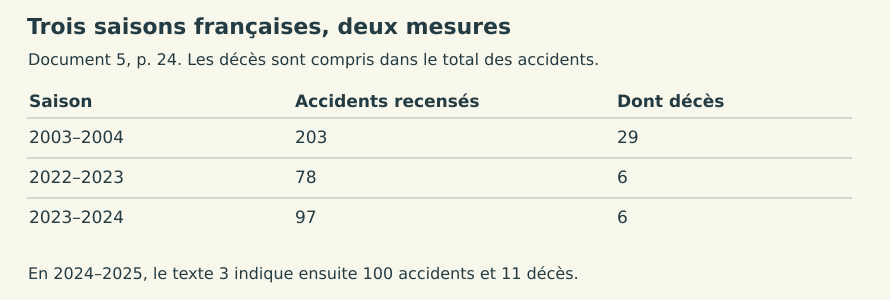

# BCE ECG · Polonais LVB (ELVi) 2026 · Corrigé guidé

*Corrigé rédigé par IA, non officiel. Signalez toute erreur.*

**Rédaction** · GPT-6.2 Astra Ultra · vitesse non renseignée

**Autocontrôle** · GPT-6.2 Astra Ultra · vitesse non renseignée

**Révision (tour 1)** · GPT-6.2 Astra Ultra · vitesse non renseignée

## 1. Résumé analytique comparatif

Oba artykuły przedstawiają spór o bezpieczeństwo polowań w Polsce. Pierwszy opisuje skutki wypadków dla rodzin i mieszkańców oraz postuluje skuteczniejszy nadzór. Drugi pokazuje, dlaczego mimo szerokiego społecznego poparcia dla okresowych badań lekarskich i psychologicznych Sejm odrzucił dotyczący ich projekt już w pierwszym czytaniu. Francja pojawia się w pytaniu, lecz żaden z tych dwóch artykułów nie przedstawia francuskich danych pozwalających porównać skalę wypadków ani ich zmiany w czasie.

Autorzy pierwszego dokumentu wskazują co najmniej dwadzieścia osiem wypadków śmiertelnych w latach 2015–2024. Przywołane przykłady pokazują, że niebezpieczeństwo dotyczy także osób nieuczestniczących w polowaniu. Artykuł wiąże zagrożenie między innymi z naruszaniem przepisów i z brakiem ponownej oceny stanu zdrowia po uzyskaniu pozwolenia. Autorzy kwestionują również przejrzystość działalności organizacji łowieckich. Dziesięcioletnia suma nie mówi jednak, w których latach wypadków było więcej.

Z sondażu przytoczonego w drugim artykule wynika, że badania lekarskie popierało osiemdziesiąt sześć procent ankietowanych, a psychologiczne osiemdziesiąt osiem procent. Dziennikarka oddaje głos zarówno zwolennikom badań, jak i Polskiemu Związkowi Łowieckiemu. Według związku w latach 2020–2023 odnotowano dwadzieścia dwa postrzelenia, w których ucierpiały trzy osoby postronne i dziewiętnastu uczestników polowań. Siedem osób zmarło. Związek odnosi te liczby do ponad dziewiętnastu milionów polowań i odstrzałów sanitarnych oraz kwestionuje istnienie związku przyczynowego między wypadkami a stanem zdrowia myśliwych. Przedstawicielka fundacji podkreśla natomiast, że policyjne kategorie nie pozwalają odtworzyć pełnego obrazu zdarzeń. Pierwszy tekst akcentuje więc rozmiar szkód, drugi ujawnia spór o ich pomiar i przyczyny. Różne okresy i zakresy obu zestawień nie pozwalają wyliczyć trendu dla Polski.

## 2. Essai argumenté

Nie uważam, żeby sam wiek jakiegoś obyczaju wystarczał do uzasadnienia ryzyka, jakie ponoszą ludzie, którzy go nie praktykują. Nie oznacza to jednak, że tradycja łowiecka jest w polskiej kulturze bez znaczenia. Pytanie brzmi raczej, kto ma prawo decydować o dopuszczalnym ryzyku i na jakiej podstawie.

W czwartej księdze „Pana Tadeusza” koncert Wojskiego po polowaniu staje się wspólnym przeżyciem uczestników. Zmieniające się dźwięki rogu pozwalają słuchaczom jeszcze raz przeżyć wydarzenie, a czytelnikowi wejść w świat obyczajów szlacheckich. Możemy dzisiaj czytać tę scenę, wykonywać muzykę i poznawać lokalną historię, nie przyjmując automatycznie dawnych hierarchii ani dawnych wyobrażeń o tym, do kogo należy las. Dziedzictwo może trwać właśnie dlatego, że kolejne pokolenia wybierają sposób jego przekazywania.

Dla mieszkańca wsi skraj lasu może być codzienną drogą, a dla rodziny z miasta miejscem niedzielnego spaceru. Żadna z tych osób nie udziela zgody na ryzyko przez sam fakt, że znalazła się poza domem. Rozumiem argument, że liczba zdarzeń w przeliczeniu na wszystkie polowania jest niewielka. Taki wskaźnik odpowiada jednak na inne pytanie niż liczba rodzin, które w danym okresie straciły bliskiego. Trzeba brać pod uwagę jedno i drugie, a także możliwość doznania trwałego uszczerbku na zdrowiu. Trudno rozmawiać o społecznej akceptacji, jeśli poszczególne instytucje liczą co innego. Polski związek przytacza dane dotyczące kilku lat, a działacze społeczni podkreślają, że brakuje pełnego zestawienia. Dopiero porównywalne dane pozwoliłyby sprawdzić, czy sytuacja rzeczywiście się zmienia.

Dlatego popieram jawny rejestr wypadków z jednolitymi definicjami, dostępny zarówno mieszkańcom, jak i organizacjom łowieckim. Uważam także, że stan zdrowia osób wykonujących czynności wiążące się z odpowiedzialnością za innych można sprawdzać okresowo. Badania nie rozwiążą wszystkich problemów. Ich skutki należy oceniać, a koszt i zasady ustalać publicznie. Z przytoczonego sondażu wynika, że wielu respondentów oczekuje takich badań. Poparcie społeczne uzasadnia debatę, ale samo w sobie nie dowodzi skuteczności konkretnego rozwiązania.

Tradycja zasługuje zatem na miejsce w rozmowie, lecz nie daje żadnej grupie prawa do jednostronnego ustalania reguł wspólnej przestrzeni. Najlepszą oznaką szacunku dla dziedzictwa jest dla mnie gotowość jego uczestników do wysłuchania innych ludzi i do zmiany praktyk, których koszt spada na osoby postronne.

## 3. Traduction du français en polonais

Po osiągnięciu dwa lata temu najniższego poziomu w historii liczba śmiertelnych wypadków na polowaniach ponownie wzrosła w sezonie 2024–2025. „Zginęło jedenastu myśliwych, podczas gdy w każdym z dwóch poprzednich sezonów zginęło ich sześciu” (…).

„Ogólna tendencja w ciągu ostatnich dwudziestu pięciu lat jest nadal bardzo korzystna”. Liczba wypadków spadła o ponad połowę, „trzeba jednak zachować czujność” – powiedział agencji AFP Olivier Thibault, dyrektor generalny Francuskiego Urzędu ds. Bioróżnorodności (OFB). „Wspólnie z myśliwymi osiągnęliśmy ogromny postęp, szkolenia przynoszą dobre wyniki, ale tendencja może się odwrócić i liczba wypadków znów może wzrosnąć” – ostrzegł. Wskazał trzy kwestie wymagające szczególnej uwagi: błędy w obchodzeniu się z bronią, nieuwzględnianie otoczenia w chwili oddawania strzału oraz coraz liczniejsze polowania zbiorowe organizowane w pośpiechu, aby chronić uprawy przed szkodami wyrządzanymi przez dziki lub jelenie.

## Répondre malgré un écart entre la question et le corpus autorisé

La question I demande une comparaison de la Pologne et de la France. La consigne limite pourtant cette partie aux documents 1 et 2, qui portent tous deux sur la Pologne. La réponse en polonais explique cette limite, traite l’ampleur et les causes discutées dans ces documents et précise pourquoi ils ne donnent aucune évolution française vérifiable. La comparaison avec les données françaises est possible lors de la lecture du dossier entier.

L’article d’*Onet* de décembre 2025 recense au moins 28 accidents mortels sur dix ans et plaide pour de meilleurs contrôles. L’article de *Rzeczpospolita* de janvier 2025 rapporte un débat parlementaire et des points de vue divergents sur les examens périodiques. Pour 2020–2023, l’association des chasseurs cite 22 personnes atteintes, dont sept décédées, et plus de 19 millions d’opérations recensées. L’article distingue les trois personnes extérieures à la chasse des dix-neuf participants touchés. La simple comparaison de 28 et 7 ne donne pas une évolution temporelle : les périodes se recouvrent et les catégories et producteurs ne coïncident pas. Les 86 % et 88 % concernent les opinions mesurées sur les examens, pas leur efficacité clinique.

## Confronter les documents visuels

Le document 4 est un diagramme circulaire des exemplaires d’armes enregistrés en Pologne fin 2023, distingués selon l’usage. Les exemplaires enregistrés pour la chasse représentent 46,8 % du graphique. Il ne s’agit pas de la proportion de chasseurs, encore moins d’un risque d’accident. Le document 5 donne une série française. Les totaux passent de 203 accidents en 2003–2004 à 78 en 2022–2023, puis 97 en 2023–2024. Les nombres de décès correspondants sont 29, 6 et 6. Les décès sont inclus dans les totaux. Le document 3 prolonge la série jusqu’à 2024–2025 avec 100 accidents et onze décès. Une hausse à court terme peut ainsi coexister avec une baisse de longue durée.

L’essai confronte la transmission d’une culture, illustrée par le concert de Wojski dans le livre IV de *Pan Tadeusz*, et le droit des habitants et promeneurs à participer au débat sur un risque collectif. Le thème de la page 23 commence au minimum historique et s’arrête à la protection des cultures contre les sangliers ou les cerfs. Les seize non-chasseurs blessés figurent hors des crochets. Le texte français oppose onze décès pendant la saison 2024–2025 à six lors de chacune des deux précédentes, lecture confirmée par le graphique.

**Longueur des réponses.** Le résumé compte 242 mots et l’essai 340 par séparation aux espaces, titres exclus. Tous deux respectent la tolérance de 10 %.

Souligner les expressions temporelles polonaises puis inscrire en regard la saison à laquelle elles renvoient. Six décès pendant deux saisons successives peuvent accompagner des nombres totaux d’accidents différents.

[Fascicule officiel commun, à partir de la page 20](https://www.concours-bce.com/sites/default/files/2026-04/76%20CH%20-%20LANGUE_VIVANTE_B_ELVI_CHINOIS_HEBREU_JAPONAIS_POLONAIS.pdf#page=20)
