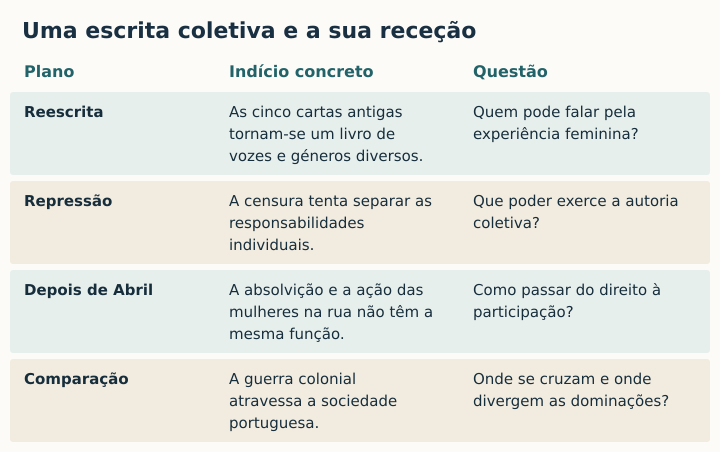

# BCE ECG — Portugais LVA (ELVi) 2026 · Corrigé guidé

*Corrigé rédigé par IA, non officiel. Signalez toute erreur.*

**Rédaction** · GPT-6.2 Astra Ultra · vitesse non renseignée

[Sujet officiel, option Portugais LVA (ELVi)](https://www.concours-bce.com/sites/default/files/2026-04/75%20AR%20-%20LANGUE_VIVANTE_A_ELVI_ARABE_ITALIEN_PORTUGAIS_RUSSE.pdf#page=13)

Le portugais LVA commence à la page 13 du fascicule 75 AR. Le résumé se fonde sur les deux premiers textes et vise 350 mots. L’essai personnel vise 500 mots. Une variation de 10 % est admise. Le thème couvre les deux paragraphes du document 3 sur la publication de 1972 puis la mobilisation internationale.

## Préparer les trois exercices

Commencer par l’opération littéraire commune aux deux lectures. Trois écrivaines partent de cinq lettres publiées anonymement en 1669 et construisent un ensemble de 120 textes sans signature individuelle. Analyser ce que change ce dispositif pour la représentation du corps, de la famille et du pouvoir. Puis distinguer la préface d’Ana Luísa Amaral, attentive à la genèse et à la réception internationale, de la lecture de Lucas Brandão, davantage tournée vers la citoyenneté et les inégalités persistantes.

Pour l’essai, définir les deux sens de *colonialismos*. Le colonialisme portugais relève d’une histoire politique déterminée. L’emploi figuré du pluriel ouvre une comparaison entre des formes de dépossession. Tester cette comparaison sur un exemple où plusieurs contraintes se rencontrent, puis préciser ce qui disparaîtrait si on les confondait. Dans le thème, conserver le présent historique et attribuer correctement la préface de 1974 à ses deux signataires.

## Résumé analytique comparatif · 351 mots

Ana Luísa Amaral e Lucas Brandão apresentam as Novas Cartas Portuguesas como uma intervenção literária que tornou pública a subordinação das mulheres e a relacionou com outras formas de violência no Portugal do Estado Novo. Ambos sublinham que a escrita em comum fazia parte da contestação. A diferença entre as duas leituras reside sobretudo na atenção que Amaral dá à genealogia do livro e na pergunta de Brandão sobre as consequências dessa intervenção para a cidadania.

Segundo Amaral, Maria Isabel Barreno, Maria Teresa Horta e Maria Velho da Costa partiram de cinco cartas amorosas publicadas anonimamente em França no século XVII. A figura da religiosa Mariana Alcoforado, cuja identificação com a autora das cartas permanece discutida, passara a representar uma feminilidade portuguesa abandonada e suplicante. Ao reescreverem esse modelo, as três autoras multiplicaram os sujeitos e os modos de falar. Cartas, poemas, relatórios, narrativas e ensaios convivem em cento e vinte textos sem assinatura individual. Quando as autoridades tentaram isolar a responsabilidade por determinadas passagens, as escritoras mantiveram a autoria coletiva.

Brandão mostra o que essa pluralidade permitia dizer. As expectativas ligadas ao casamento e à maternidade, o controlo da sexualidade, a violência doméstica e a pobreza surgiam ao lado da guerra colonial e da experiência de emigrantes e exilados. Para os dois autores, a moral familiar e a repressão política ajudam a compreender por que motivo o livro foi apreendido e as escritoras processadas. A censura deu, porém, projeção internacional àquilo que pretendia silenciar. Amaral destaca a circulação das traduções, o apoio de escritoras estrangeiras e a adoção do caso pelo movimento feminista.

Brandão acompanha também o contraste entre o regime de 1972 e as mudanças jurídicas posteriores à Revolução de Abril. A igualdade legal torna possível medir a persistência de desigualdades no trabalho e nos lugares de decisão. Assim, o livro trata tanto das vidas então excluídas do discurso público como da possibilidade de as próprias mulheres definirem a experiência que desejam transmitir. A sua atualidade depende, para ambos os textos, da relação entre a liberdade conquistada pela escrita e as condições sociais em que essa liberdade se exerce.

## Essai argumenté · 489 mots

O plural «colonialismos» pode iluminar a leitura das Novas Cartas Portuguesas, desde que se saiba quem o emprega e o que se pretende comparar. Na minha opinião, o livro põe a descoberto um gesto comum a várias dominações: alguém reclama para si o direito de dispor do corpo, da palavra ou do destino de outra pessoa. Mas seria empobrecedor fazer de todas as desigualdades versões da mesma história. Quando a comparação é rigorosa, torna visíveis as diferenças de posição entre pessoas que lutam juntas.

A decisão das três Marias de escrever sem assinaturas individuais ajuda a perceber o primeiro ponto. O interrogatório procurava ligar um texto considerado ofensivo a uma autora isolada. A recusa em identificar quem escrevera cada fragmento impedia a autoridade de determinar os termos da responsabilidade e da vergonha. A fotografia da manifestação de 1974 prolonga esse gesto. Mulheres que o regime desejava manter afastadas da decisão pública ocupam a rua e apresentam-se como força política. Mesmo depois da revolução, é preciso discutir quem fala em nome do novo país. O cartaz que anuncia a absolvição regista uma vitória jurídica, mas a manifestação mostra que o direito de participar exige organização continuada.

Nesse Portugal, o sentido histórico do colonialismo também estava presente em cada família afetada pela guerra. Uma mulher portuguesa podia sofrer a autoridade do marido e, ao mesmo tempo, beneficiar de uma ordem imperial que negava autonomia a populações africanas. Uma mulher em Moçambique enfrentava relações de poder que não se explicam inteiramente pela moral doméstica metropolitana. Em *Niketche*, de Paulina Chiziane, a narradora procura as outras mulheres com quem o seu marido mantém relações. As conversas revelam experiências regionais, familiares e económicas diferentes. O próprio esforço de constituir uma solidariedade exige que cada mulher ouça aquilo que não viveu. A leitura conjunta de Chiziane e das três Marias é mais interessante se nenhuma delas se tornar porta-voz de todas as outras.

A questão continua atual no mundo lusófono. No Brasil, a escritora Carolina Maria de Jesus registou em *Quarto de despejo* a fome, o trabalho e o cuidado dos filhos a partir de uma favela de São Paulo. A sua escrita torna impossível separar tranquilamente a desigualdade entre homens e mulheres das condições materiais e do racismo. Também mostra o limite de uma homenagem puramente simbólica. Elogiar uma mulher que escreve não equivale a garantir a outra tempo para escrever, dinheiro para comer ou acesso a uma editora.

Entendo, pois, a denúncia do livro como um convite à comparação e à ação comum. Uma lei pode retirar ao marido poderes sobre a mulher sem repartir por igual o trabalho de cuidar. Uma independência política pode recuperar a soberania de um país sem assegurar voz às suas cidadãs. Conhecer a história particular de cada conquista permite perguntar quem ficou de fora. É nessa possibilidade de corrigir a própria ideia de emancipação, ouvindo outras mulheres, que encontro a atualidade mais exigente das Novas Cartas Portuguesas.

## Thème

Em 1972, em Portugal, sob a ditadura, três escritoras, que viriam a ficar conhecidas como as «Três Marias», publicam em Lisboa a obra *Novas Cartas Portuguesas*. São elas Maria Isabel Barreno, Maria Teresa Horta e Maria Velho da Costa. O livro, que lança um olhar crítico sobre a situação das mulheres e sobre várias facetas do regime de Salazar, é apreendido pela polícia política, e as autoras são processadas por atentado à moral pública e aos bons costumes. Para algumas feministas, o processo simboliza a repressão a que as mulheres estão sujeitas: «Somos nós, as mulheres, que vamos ser julgadas.» Suscita um vasto movimento internacional de solidariedade.

O livro torna-se um «símbolo» pela sua história e pelo movimento feminista internacional que suscitou, afirmam Monique Wittig e Évelyne Le Garrec no prefácio da edição francesa (Gallimard, 1974). Os protestos ficaram na memória do movimento feminista como exemplo bem-sucedido de articulação internacional. As ações de mobilização, nascidas por iniciativa de mulheres latino-americanas em França, são organizadas com grupos feministas de diferentes países e divulgadas nas páginas de numerosos órgãos de comunicação social.
