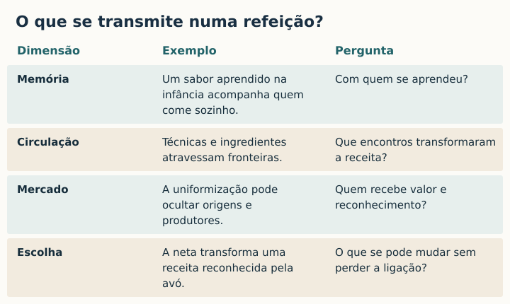

# BCE ECG — Portugais LVB (ELVi) 2026 · Corrigé guidé

*Corrigé rédigé par IA, non officiel. Signalez toute erreur.*

**Rédaction** · GPT-6.2 Astra Ultra · vitesse non renseignée

[Sujet officiel, option Portugais LVB (ELVi)](https://www.concours-bce.com/sites/default/files/2026-04/76%20AR%20-%20LANGUE_VIVANTE_B_ELVI_ARABE_ITALIEN_PORTUGAIS_RUSSE.pdf#page=12)

Le portugais LVB commence à la page 12 du fascicule 76 AR. Le résumé de 250 mots et l’essai de 350 mots admettent une tolérance de 10 %. Le thème se limite au passage sur la grand-mère de Louise Bourrat, puis sur le féminisme et l’écologie de la cheffe.

## Préparer les trois exercices

Relier chaque observation à sa source. Paula Guerra et Kadma Marques voient dans les odeurs, les manières de manger et la mémoire familiale une dimension collective qui demeure même quand on mange seul. La chronique de Curitiba privilégie les échanges anciens et les possibilités nouvelles de fusion. Les deux documents reconnaissent la persistance du local. Seul le premier insiste autant sur l’inquiétude liée à l’uniformisation.

Pour l’essai, mettre à l’épreuve l’affirmation selon laquelle on « mange de la culture ». Choisir un aliment associé à un lieu, puis reconstituer les échanges qui l’y ont conduit. Mettre enfin cette liberté de composition en regard du prix, du temps disponible et des conditions écologiques. Dans le thème, garder le « je » de Louise quand elle cite sa grand-mère et distinguer les ingrédients qu’elle voudrait cultiver des produits déjà achetés par son restaurant.

## Résumé analytique comparatif · 238 mots

Paula Guerra e Kadma Marques e o cronista do Jornal de Curitiba mostram que a alimentação guarda a memória das sociedades e muda com os contactos entre elas. As primeiras explicam o que permite reconhecer uma pertença. O segundo acompanha a formação de cozinhas nas quais essa pertença se constrói precisamente pelo encontro de várias tradições.

Para Guerra e Marques, os sabores e os cheiros aprendidos na infância conservam a dimensão social das refeições, mesmo quando alguém come sozinho. Os rituais ajudam a distinguir grupos e posições sociais. A associação dos portugueses ao bacalhau ilustra a construção de uma imagem nacional, por vezes idealizada. A globalização pode enfraquecer esses vínculos ao uniformizar produtos de origem desconhecida. Também suscita movimentos em defesa de tradições locais.

A crónica brasileira realça sobretudo a inovação. A cozinha de fusão atual prolonga intercâmbios anteriores, ligados ao comércio e à colonização. As cozinhas crioulas das Américas e a influência portuguesa na fritura japonesa ilustram essa história. O encontro de tradições japonesas e peruanas dá origem à cozinha nikkei, que hoje também se encontra nas cidades brasileiras.

Assim, os dois textos não identificam a memória nacional com a conservação intacta de uma receita. Enquanto o primeiro assinala a tensão entre anonimato comercial e defesa das diferenças, o segundo valoriza a possibilidade de combinar técnicas internacionais e ingredientes locais. Um mesmo prato pode, portanto, testemunhar tanto uma aprendizagem familiar como deslocações que atravessam fronteiras e gerações.

## Essai argumenté · 341 mots

Concordo com a ideia de que comemos cultura, sobretudo quando uma refeição parece tão natural que já ninguém pergunta como se tornou habitual. Em Portugal, uma mesa de Natal com bacalhau parece afirmar uma continuidade nacional. Contudo, o peixe vem de águas distantes e a sua presença depende de viagens, de técnicas de conservação e de redes comerciais. O que se transmite em casa inclui, portanto, relações com pessoas e lugares que a fotografia de família deixa de fora.

A cultura entra também na decisão de alterar uma receita. A avó de Louise Bourrat considera um erro aquilo que os jurados de um concurso de cozinha recebem como invenção. Ambas defendem algo reconhecível. A primeira protege a memória de um sabor que sabe reproduzir. A neta homenageia-a ao fazer desse saber o ponto de partida de uma experiência. A discussão só tem sentido porque existe entre as duas uma linguagem partilhada. Se qualquer alteração anulasse a tradição, muitas receitas hoje consideradas portuguesas ou brasileiras nunca teriam podido nascer.

No Brasil, basta pensar na mandioca. Conhecimentos indígenas permitiram preparar e transformar este alimento, que aparece sob formas muito diferentes em numerosas cozinhas do país. Um restaurante pode hoje servir farinha ou tapioca a um público internacional. Dizer que se trata de cultura implica perguntar quem transmitiu a técnica, quem cultiva a raiz e quem recebe o reconhecimento quando o prato se torna célebre. O rótulo de «fusão» pouco explica se apagar precisamente essas pessoas.

Há, no entanto, um limite para a fórmula. Quem tem pouco dinheiro ou pouco tempo para cozinhar nem sempre escolhe o que o representa melhor. O preço de um alimento, o acesso à terra e o horário de trabalho também decidem o jantar. Entendo por cultura o conjunto destas práticas e relações, incluindo os conflitos que as transformam. Um pastel de nata comprado longe de Portugal pode despertar uma recordação íntima ou ser apenas a primeira descoberta de um sabor. A mesma receita oferece experiências distintas porque comer põe uma história coletiva em contacto com uma vida particular.

## Thème

Durante todo o concurso, referiu-se muitas vezes à avó portuguesa, que lhe ensinou a apreciar as coisas boas. É por ela que Louise Bourrat reinterpreta os clássicos da cozinha portuguesa e conquista os chefes. Mas nem sempre conquista a avó: «É muito à antiga, só conhece a gastronomia portuguesa e, assim que faço alguma coisa de maneira diferente, diz que faço tudo ao calhas», explica Louise Bourrat.

A jovem chefe afirma o seu estilo e as suas convicções. Em primeiro lugar, o feminismo. Tendo sofrido por ser mulher num meio muito masculino, acabou por formar no seu restaurante uma equipa constituída exclusivamente por mulheres. Depois, a ecologia. Adepta do «desperdício zero», gostaria de abrir um restaurante no campo para cultivar os seus próprios produtos e trabalhá-los diretamente na sua cozinha.
