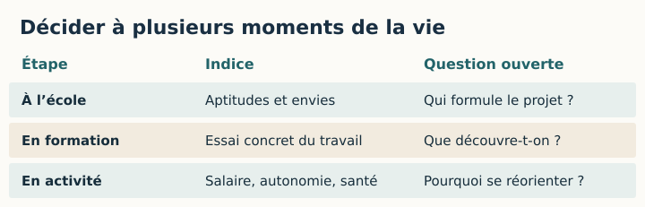

# BCE ECG — Russe LVA (ELVi) 2026 · Corrigé guidé

*Corrigé rédigé par IA, non officiel. Signalez toute erreur.*

**Rédaction** · GPT-6.2 Astra Ultra · vitesse non renseignée

[Sujet officiel, option Russe LVA (ELVi)](https://www.concours-bce.com/sites/default/files/2026-04/75%20AR%20-%20LANGUE_VIVANTE_A_ELVI_ARABE_ITALIEN_PORTUGAIS_RUSSE.pdf#page=18)

L’épreuve met en regard le premier choix des lycéens et les reconversions ultérieures. Le résumé s’appuie sur les deux articles russes. L’essai peut discuter les deux images de la page 22 et le témoignage de la page 23. Seuls les quatre paragraphes en gras de ce témoignage sont à traduire.

## Préparer les trois exercices

Pour comparer les articles, prendre comme point de départ un même parcours à deux dates. Gorgoul observe le lycéen et les conseils qu’il reçoit. Altoukhov retrouve l’adulte qui exerce ou a quitté sa spécialité initiale. Les 54 % qui ont essayé de travailler dans leur domaine d’études sont une fraction des personnes exerçant hors de ce domaine. Il faut également distinguer les résultats d’enquêtes russes des hypothèses concernant les transformations du travail dans le monde.

Pour l’essai, éprouver le diagramme *хочу, могу, надо* sur un métier concret. Dans l’image, le troisième cercle désigne ce qui est bien payé. Un métier utile peut pourtant être mal rémunéré. Dans le document voisin, le robot et les trois hommes tirent sur une corde en sens opposés. On peut contester cette représentation binaire en choisissant une tâche où l’outil et le professionnel font des choses différentes.

Dans le thème, la question en page 18 emploie « venue », mais le passage à traduire en page 23 porte « je suis allée ». Les deux conduisent à *пошла к психологу*. Conserver les marques féminines de la narratrice, le vouvoiement du psychologue et le passage au tutoiement du lecteur.

## Résumé analytique comparatif · 315 mots

Опросы, приведённые в двух статьях, позволяют увидеть трудности профессионального выбора на разных этапах жизни. Геннадий Горгуль сообщает, что более семидесяти процентов российских школьников пока не знают, кем хотели бы стать. По сведениям Виталия Алтухова, среди взрослых по полученной специальности работает не более половины. При этом более половины тех, кто трудится в другой области, в своё время всё же пытались применить полученное образование по назначению.

Оба автора обращают внимание на расхождение между ожиданиями семьи и желаниями самого ученика. Так, по данным, которые приводит Горгуль, в 2019 году родители заметно чаще хотели видеть своих детей врачами или юристами, чем сами школьники выбирали эти профессии. Алтухов добавляет к влиянию родственников привлекательные, но далёкие от повседневной работы образы из социальных сетей. Подростку трудно представить отдалённые последствия решения. Взрослый же может обнаружить, что ему важнее самостоятельность, достойная зарплата или возможность уйти из коллектива, в котором он испытывает постоянное напряжение.

Технологические перемены осложняют выбор и в России, и за её пределами. Первый автор поясняет, почему приходится обновлять знания уже после окончания вуза, и связывает привлекательность российского сектора информационных технологий в том числе с ростом оплаты труда. Второй показывает, как перемены затрудняют прогноз для сегодняшнего ребёнка. За годы его учёбы границы специальности могут измениться, а на стыке прежних занятий возникнут новые, как в случае журналиста, который умеет работать с базами данных. Вместе с тем Алтухов отмечает неодинаковую подвижность профессий. Например, врачи и юристы сравнительно часто остаются в избранной сфере.

Поэтому в статье Горгуля обсуждаются пределы ранней диагностики. Даже заметная способность требует устойчивого интереса и труда, а результат разового теста зависит в том числе от настроения ребёнка. Родители могут поддерживать интерес, не превращая всё детство в подготовку к одной должности. Знакомство с предприятиями и лабораториями даёт школьникам возможность проверить свои представления на опыте. Если Алтухов объясняет, почему взрослые меняют направление, то Горгуль предлагает заранее учить детей самому выбору и повторному обучению. Такая подготовка сохраняет смысл и тогда, когда первый профессиональный план приходится пересматривать.

## Essai argumenté · 459 mots

Стоит ли школьнице, которая быстро решает задачи, становиться инженером? Возможно, но для начала я спросил бы, какие именно задачи ей хочется решать. Одно дело получать удовольствие от короткого доказательства, другое — месяцами дорабатывать конструкцию вместе с людьми, которые мыслят совсем иначе. И то и другое требует способностей. Однако успех на олимпиаде сообщает о человеке меньше, чем принято думать, а неудача на ней тем более не закрывает ему дорогу в профессию.

Талант помогает заметить направление, в котором интересно сделать первые шаги. В русской музыкальной традиции примером часто служит Римский-Корсаков. Будущий композитор получил морское образование и успел побывать в дальнем плавании. Встреча с Балакиревым дала ему возможность обсуждать собственную музыку с опытным собеседником. В этой истории меня интересует сосуществование двух разных занятий. До знакомства с практикой композиции никакой школьный советчик не мог бы надёжно установить, какое место море, а какое музыка займут в жизни молодого человека. И работа над партитурой требовала долгого обучения, даже когда слух и воображение уже давали о себе знать.

В диаграмме из досье успех помещён туда, где пересекаются желание, способность и хороший заработок. Я бы предложил дорисовать четвёртый круг — условия, в которых придётся жить. Можно любить медицину и хорошо знать биологию, но понять только после разговора с дежурным врачом, что ночная работа тяжело совместима с заботой о близких. Бывает и обратное. Подросток, которому учитель посоветовал заниматься переводом, на первой встрече с переводчиком впервые обнаруживает, что ему нравится искать точное слово для чужого опыта. Настоящая проба допускает как отказ, так и неожиданное согласие.

Как устроить такую пробу, если семья не знает никого в выбранной сфере? Школьная библиотека могла бы организовать несколько встреч, на которых местные специалисты показывали бы одну обычную задачу и объясняли, как проверяют результат. Потом ученики попробовали бы выполнить небольшое задание и обсудили бы с гостем, что в нём оказалось интересным и что утомило. В отличие от родительских знакомств, такой ресурс был бы открыт всему классу. Для сельской школы часть встреч можно было бы проводить по видеосвязи, оставляя время для вопросов тех, кто обычно молчит.

Наконец, совет должен учитывать изменчивость самой работы. На рисунке робот и люди тянут канат в разные стороны. Но журналист, работающий с данными, может поручить программе поиск повторов в таблице, а затем лично выяснить, почему одна цифра выпадает из ряда. Для этого мало уметь пользоваться сегодняшней программой. Нужны статистика, владение языком и привычка перепроверять источник. Такие умения пригодятся и при переходе в другую область. Поэтому я выбирал бы сначала содержание работы, затем условия, в которых можно ему научиться, и только потом название специальности. Полезно было бы также возвращаться к своему плану раз в год и спрашивать себя, какие из первоначальных ожиданий подтвердились. В этом порядке у таланта появляется полезное, но вполне скромное место. Он подсказывает, что стоит попробовать, а решение остаётся за тем, кому предстоит работать, менять свои планы и отвечать за них.

## Thème

В пятнадцать лет я впервые пошла к психологу, чтобы пройти тест на профориентацию и решить, какую профессию выбрать после школы. Когда я открыла дверь его кабинета, я не знала, чем хочу заниматься, но искала ответы, задавала вопросы.

Помню, он сказал мне: «С вашими способностями к математике вам надо стать инженером!» Тогда я совершенно не представляла себе своего профессионального будущего, поэтому решила последовать его совету.

Сегодня я могу сказать, что этот человек направил меня по неверному пути. Но… каждый сам пишет историю своей жизни, и помочь вам с выбором ещё не значит принять решение за вас. Я любила математику и потому сама решила стать инженером. Благодаря этому выбору я нашла во время учёбы очень хороших друзей и встретила своего мужа!

Если ты сейчас в таком же положении, как я тогда, знай: твой первый выбор ещё не определяет всю твою профессиональную жизнь! Прежде всего важно понять, почему тебя интересует та или иная профессия.
