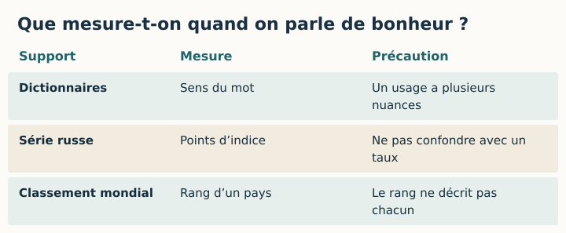

# BCE ECG — Russe LVB (ELVi) 2026 · Corrigé guidé

*Corrigé rédigé par IA, non officiel. Signalez toute erreur.*

**Rédaction** · GPT-6.2 Astra Ultra · vitesse non renseignée

[Sujet officiel, option Russe LVB (ELVi)](https://www.concours-bce.com/sites/default/files/2026-04/76%20AR%20-%20LANGUE_VIVANTE_B_ELVI_ARABE_ITALIEN_PORTUGAIS_RUSSE.pdf#page=17)

Le résumé confronte les deux articles sur le bonheur. Pour l’essai, le graphique russe, le classement international et le reportage français offrent trois comparaisons dont les unités diffèrent. Le thème traduit uniquement le paragraphe encadré de ce reportage.

## Préparer les trois exercices

Dans le résumé, attribuer l’interprétation d’un mot aux linguistes, l’évolution des réponses aux sociologues, et les hypothèses sur les relations ou la stabilité émotionnelle aux psychologues. La comparaison des dictionnaires porte sur trente langues. La Russie est l’un des nombreux cas où le bonheur est associé à la chance. Une différence culturelle n’équivaut donc pas à une propriété exclusive.

Dans l’essai, le document 3 donne un minimum de six points d’indice en février 1992. Le premier article parle, pour la même année, de 2 % de personnes se déclarant heureuses. Ces données ont des unités différentes. Le document 4 montre les dix premières places du classement mondial, pas une mesure de l’expérience de chaque habitant. Utiliser une scène littéraire pour discuter ce qui échappe à un questionnaire.

Dans le thème, distinguer le bonheur aujourd’hui, la prévision de la situation personnelle et la prévision de la conjoncture nationale en 2019. Pour « un quart », *четверть* évite de réécrire la proportion, et *повод для радости* garde le sens affectif.

## Résumé analytique comparatif · 238 mots

В статье Елены Матвеевой лингвисты предлагают начать с самого слова «счастье». В словарях большинства из тридцати изученных языков, в том числе русского, оно связано с удачей. Там, где на первый план выходит представление об удобной жизни, счастье, по мнению исследователей, легче представить целью сознательных усилий. В русскоязычной культуре к чужому или собственному счастью иногда относятся настороженно, словно это ограниченное благо, которого может не хватить другим.

Социологи, чьи результаты приводит Матвеева, обнаруживают и влияние обстоятельств. Во время резких экономических и политических перемен в России показатели счастья снижаются. Неуверенность в завтрашнем дне мешает человеку сохранять спокойствие. Именно здесь наблюдения первого автора пересекаются с выводом второго. Как поясняет Гульнара Краснова, психологи включают в переживание счастья не только радость, но и душевное равновесие. Вместе с тем низкое благосостояние страны само по себе ещё не определяет ответы её жителей.

Второй материал рассматривает прежде всего различия между людьми и то, на что они могут повлиять. Близкие отношения поддерживают человека, а расширение круга общения может помочь и тому, кому трудно первым завести разговор. Эмоциональная устойчивость развивается с детства, однако позже она тоже меняется. Оптимизм облегчает преодоление неудач, хотя порой мешает заметить риск. В российских исследованиях отмечена связь благополучия с любознательностью, причём возможна и обратная зависимость. Чувство безопасности само располагает к открытиям. Таким образом, если у Матвеевой язык и история помогают объяснить коллективные оценки счастья, то у Красновой общение, благодарность и способы справляться со стрессом позволяют понять, почему в сходных условиях люди могут чувствовать себя по-разному.

## Essai argumenté · 324 mots

Когда в русской речи говорят «мне выпало счастье», в этой фразе слышится что-то неподвластное воле. Я согласен, что у русскоязычной культуры есть узнаваемый способ рассказывать о счастье. Но одно дело узнать интонацию, а другое — объявить, будто миллионы людей одинаково понимают хорошую жизнь. Даже словари, на которые ссылается первый документ, находят сходство между русским словом и словами многих других языков.

Особенно ясно эта двойственность видна у Чехова в рассказе «Крыжовник». Николай Иванович наконец пробует ягоды со своего участка и считает их прекрасными. Брат находит ягоды кислыми, а за довольством хозяина видит чужое страдание, о котором тот предпочитает не думать. Один и тот же вечер можно описать как исполнение мечты и как повод усомниться в цене такого исполнения. Мне близка тревога рассказчика. Однако я не думаю, что человек, радующийся собственному саду, обязательно отнимает что-то у соседа. Вопрос в том, замечает ли он соседа и откроет ли ему дверь.

История тоже меняет смысл ответов. График из досье показывает минимум российского индекса счастья в начале девяностых годов. Было бы странно объяснять это одной пословицей, которая существовала и до кризиса, и после него. Для семьи, тревожащейся о завтрашней зарплате, счастьем вполне может быть возможность спокойно строить планы на месяц вперёд. И во Франции, судя по тексту для перевода, многие довольны сегодняшней жизнью рядом с близкими, хотя гораздо меньше людей ждут улучшения. Здесь сходство опыта сильнее различия слов.

Лично для меня счастье складывается из удачи и заботы. Я не выбираю случайную встречу с человеком, который станет другом, зато могу позвонить ему через неделю и не исчезнуть, когда ему станет тяжело. Я бы добавил к этому возможность побыть одному, не чувствуя себя брошенным. Для такого вечера не требуется ни громкая радость, ни место страны в первой десятке мирового рейтинга. Если бы меня спросили в анкете, счастлив ли я, мне сначала захотелось бы вспомнить, к кому я могу обратиться и кому помогаю сам. Этот ответ перекликается с вниманием русской литературы к другому человеку и вместе с тем вполне понятен за пределами России.

## Thème

Семьдесят три процента французов говорят, что они счастливы. Однако лишь двадцать девять процентов считают, что в будущем их жизнь станет лучше. Для Франции этот парадокс не нов. Ещё в 2019 году опрос показал, что только пятнадцать процентов французов ожидали улучшения экономической ситуации в стране. Социологические данные свидетельствуют о том, что французы чувствуют себя счастливыми в кругу семьи и друзей. Половина опрошенных называет семью и детей главным источником счастья, двадцать девять процентов упоминают дружбу и любовь. В их представлении о счастье важное место занимает и дом. Часто говорят, что деньги очень важны для счастья, но лишь четверть французов называет своё материальное положение одним из главных поводов радоваться жизни, тогда как для половины оно служит серьёзным источником стресса.
