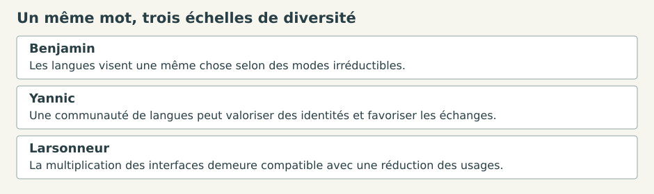

# BCE ECG — Synthèse de textes (ESCP-HEC) 2026 · Corrigé guidé

*Corrigé rédigé par IA, non officiel. Signalez toute erreur.*

**Rédaction initiale** · claude-opus-5-5 · configuration complémentaire non renseignée

**Relecture antérieure** · configuration non renseignée

**Lecture du rapport du jury** · GPT-6.2 Astra Ultra · vitesse non renseignée

**Révision** · GPT-6.2 Astra Ultra · vitesse non renseignée

**Révision (tour 3)** · GPT-6.2 Astra Ultra · vitesse non renseignée

**Révision (tour 4)** · GPT-6.2 Astra Ultra · vitesse non renseignée · 26 novembre 2026

## Dossier et consigne

L’épreuve du 28 avril 2026 porte le code 304. Sa feuille de garde indique les voies générale et technologique ainsi que les programmes ENS ULM A/L et ENS Lyon. La présente fiche correspond à la voie ECG. La copie doit confronter les trois textes en 300 mots avec une tolérance de 10 %, soit 270 à 330 mots. Les repères se placent tous les cinquante mots et le total figure à la fin. Le rapport inclut la question initiale dans ce décompte et compte le nom de chaque auteur du corpus comme un seul mot, même accompagné de son prénom. La proposition emploie uniquement les patronymes et évite les mots avec traits d’union ou apostrophes, ce qui permet de contrôler les six tranches sans ambiguïté.

## Trois questions pour lire les écarts

**Walter Benjamin, pages 2 et 3.** Dans « La tâche du traducteur » (1923, traduction de Martine Broda publiée en 1991), le philosophe distingue la chose visée et la manière de la viser. Son exemple allemand et français montre comment deux mots peuvent toucher le même objet sans être interchangeables dans l’expérience de ceux qui les prononcent. L’original et la langue d’arrivée se transforment. La traduction peut manifester une complémentarité sans fournir une copie définitive, ni offrir à elle seule la possession d’une langue pure.

**Aurélien Yannic, pages 3 et 4.** L’article de 2010 part de langues apparentées qui permettent une compréhension réciproque. Il examine ensuite les enjeux culturels, politiques et commerciaux de la traduction. Le français peut fonctionner comme langue partagée en association avec des langues africaines et régionales. La mondialisation des produits et des échanges peut simultanément exiger des traductions toujours plus nombreuses et simplifier les usages. Une politique de coexistence des langues ne résout pas mécaniquement les tensions entre cultures.

**Claire Larsonneur, pages 5 et 6.** L’article de 2021 analyse les corpus, les mesures de performance, les requêtes adressées aux machines, la concentration du marché et les règles décidées par les plateformes. Un outil qui traite davantage de langues peut favoriser une variété dominante à l’intérieur de chacune. Il faut distinguer l’augmentation de l’offre visible et la diversité effective des pratiques. Le texte formule ce constat à la date de son enquête.

Chez Larsonneur, un logiciel de correction donne un exemple précis du passage entre le choix des données et ses effets sur un locuteur. Le correcteur signale comme fautive une tournure pratiquée dans une communauté. Cette décision peut atteindre un anglophone qui ne cherche même pas à traduire. Elle donne une raison de distinguer le nombre de langues disponibles et la variété des usages reconnus.

> [!INDICATION]
> Pourquoi ne pas consacrer les trois parties à la traduction littéraire, à la francophonie et aux outils numériques ?

Ce plan mettrait bout à bout les textes. La synthèse suit trois problèmes que chacun peut éclairer. D’abord, ce qui constitue une différence de langue ou d’usage. Puis ce qui la menace dans les échanges. Enfin ce que permettent ou limitent les relations entre langues. Le terme de parenté change de sens d’un auteur à l’autre. Chez Yannic il justifie l’apprentissage entre langues proches. Chez Benjamin il désigne une complémentarité qui ne se réduit ni à la ressemblance des mots ni à une origine historique commune. Chez Larsonneur, l’enjeu concerne aussi la variété interne d’une seule langue.

## Contrôler les cinquante mots

Au premier passage, relever les idées et leurs auteurs. Au second, suivre le fil d’une phrase à l’autre et enlever tout jugement personnel. Au dernier, recompter la rédaction effectivement copiée. Ici, les six tranches s’achèvent respectivement à « valeurs », « que », « accessibles », « français », « portée » et « entendues ». Les doubles barres et la mention finale sont des repères de contrôle extérieurs au total.

Prenez un outil qui propose une langue supplémentaire. Quel changement observerait-on dans la liste des langues proposées, dans les échanges entre locuteurs et dans les façons de dire qu’admet effectivement l’outil ? Ces trois questions aident à confronter les auteurs en gardant un problème commun.

## Synthèse rédigée

Quelle place pour la diversité quand les langues circulent ?

Que révèle leur pluralité ? Pour Benjamin, le français pain et le mot allemand Brot désignent la même chose. Pourtant, chaque langue la signifie selon une intention singulière. Yannic reconnaît dans chaque langue une manière de concevoir le monde, porteuse de valeurs // culturelles et politiques. Larsonneur déplace cette observation vers les usages internes : des groupes parlant une même langue développent des styles distincts, que les outils numériques peuvent méconnaître.

Quels échanges risquent de réduire ces différences ? Selon Benjamin, rechercher une copie fidèle supposerait un original et une langue traductrice immobiles, alors que // les deux se transforment. Yannic observe que les besoins du commerce mondial stimulent une traduction standardisée pour des marchés toujours plus vastes. Larsonneur précise comment les corpus dominants, les objectifs commerciaux des plateformes et les requêtes simplifiées demandées aux utilisateurs privilégient certaines formes, même lorsque davantage de langues deviennent accessibles. // Mesurer les clics récompense la capacité de retenir le public, indépendamment de la qualité de la traduction.

Comment préserver la singularité des langues dans ces relations ? Yannic mise sur la compréhension réciproque des locuteurs de langues apparentées et sur un enseignement qui mobilise les ressources des langues maternelles. Le français // partagé peut ainsi valoriser les langues africaines ou régionales, sans que leur simple coexistence suffise au dialogue des cultures. Pour Benjamin, la rencontre touche une dimension plus profonde : toute traduction demeure provisoire, mais révèle la complémentarité des intentions par lesquelles les langues tendent vers un langage pur hors de portée // de chacune. Larsonneur mesure pour sa part les limites de cette ouverture dans les pratiques numériques : quelques entreprises décident seules des expressions admises et tiennent pour fautives certaines tournures usuelles chez des locuteurs minoritaires. Multiplier les interfaces donne accès à davantage de messages sans garantir la diversité des voix entendues. //

*(300 mots)*

[Sujet officiel, code 304](https://www.concours-bce.com/sites/default/files/2026-04/304%20-ETUDE_ET_SYNTHESE_DE_TEXTE_ESCP_BS_HEC_Paris.pdf) · [Rapport du jury 2026](https://www.concours-bce.com/sites/default/files/2026-09/304%20-%20Etude%20et%20synthe%CC%80se%20de%20textes%20ESCP%20BS.HEC%20Paris%202026.pdf)
