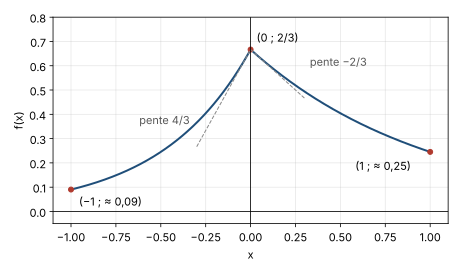

# BCE ECT — Mathématiques T (conception ESCP) 2026 · Corrigé brut

*Corrigé rédigé par IA, non officiel. Signalez toute erreur.*

Épreuve de 4 heures, sans document ni calculatrice (règle graduée seule autorisée). Trois exercices indépendants, 61 questions.

## Exercice 1

### Partie I) Spectre et inversibilité de $M$

**1.** $R(x)=(x^2-4)(x-2)=(x-2)^2(x+2)$. Les racines de $R$ sont donc
$$\boxed{-2 \text{ et } 2}$$
($2$ étant racine double).

**2.** $R$ est un polynôme annulateur de $M$ ; toute valeur propre de $M$ est racine de $R$.

Les seules valeurs propres possibles de $M$ sont donc **$-2$ et $2$**.

**3.** Calcul direct :
$$MU=\begin{pmatrix}-1-1+0\\-2+0+0\\1-1+0\end{pmatrix}=\begin{pmatrix}-2\\-2\\0\end{pmatrix}=-2U,$$
$$MV=\begin{pmatrix}-1-3+6\\-2+0+8\\1-3+6\end{pmatrix}=\begin{pmatrix}2\\6\\4\end{pmatrix}=2V.$$

**4.** $U$ et $V$ sont non nuls et vérifient $MU=-2U$ et $MV=2V$.

Donc $-2$ et $2$ sont valeurs propres de $M$, de vecteurs propres respectifs $U$ et $V$. Avec la question 2 :
$$\boxed{\mathrm{Sp}(M)=\{-2,\,2\}}$$

**5.** $R(M)=O_3$. En développant $R(x)=x^3-2x^2-4x+8$ :
$$M^3-2M^2-4M+8I_3=O_3,$$
donc
$$M\left(-\frac18\left(M^2-2M-4I_3\right)\right)=I_3.$$
La matrice $M$ est donc **inversible**, et
$$\boxed{M^{-1}=-\frac18\left(M^2-2M-4I_3\right)}$$
(on obtient $M^{-1}=\frac14\begin{pmatrix}-2&0&2\\-5&3&1\\-1&1&1\end{pmatrix}$, ce qui n'était pas demandé).

### Partie II) Détermination des puissances entières positives de la matrice $T$

**6.**
$$T^2=\begin{pmatrix}-1&1&0\\0&1&1\\0&0&1\end{pmatrix}\begin{pmatrix}-1&1&0\\0&1&1\\0&0&1\end{pmatrix}=\begin{pmatrix}1&0&1\\0&1&2\\0&0&1\end{pmatrix}.$$
Donc $T^2=I_3+N$.

**7.** $N^2=\begin{pmatrix}0&0&1\\0&0&2\\0&0&0\end{pmatrix}\begin{pmatrix}0&0&1\\0&0&2\\0&0&0\end{pmatrix}$, et
$$\boxed{N^2=O_3}$$
Par suite $N^k=O_3$ pour tout $k\geqslant 2$.

**8.** Soit $n\in\mathbb N$. On a $T^{2n}=(T^2)^n=(I_3+N)^n$. Les matrices $I_3$ et $N$ **commutent** ($I_3N=NI_3=N$), donc la formule du binôme de Newton s'applique :
$$(I_3+N)^n=\sum_{k=0}^n\binom nk N^k I_3^{\,n-k}.$$
Comme $N^k=O_3$ pour $k\geqslant2$, il reste les termes $k=0$ et $k=1$ (pour $n=0$, seul le terme $k=0$ existe, et la formule ci-dessous reste vraie) :
$$\boxed{T^{2n}=I_3+nN=\begin{pmatrix}1&0&n\\0&1&2n\\0&0&1\end{pmatrix}}$$

**9.** $T^{2n+1}=T^{2n}T=(I_3+nN)T=T+nNT$. Or
$$NT=\begin{pmatrix}0&0&1\\0&0&2\\0&0&0\end{pmatrix}\begin{pmatrix}-1&1&0\\0&1&1\\0&0&1\end{pmatrix}=\begin{pmatrix}0&0&1\\0&0&2\\0&0&0\end{pmatrix}=N.$$
Donc
$$T^{2n+1}=T+nN=\begin{pmatrix}-1&1&n\\0&1&1+2n\\0&0&1\end{pmatrix}.$$

### Partie III) Détermination des puissances entières de la matrice $T$

**10.** $T$ est triangulaire supérieure de coefficients diagonaux $-1,1,1$, tous non nuls : **$T$ est inversible**.

On résout $TX=Y$ avec $X=\begin{pmatrix}x\\y\\z\end{pmatrix}$ et $Y=\begin{pmatrix}a\\b\\c\end{pmatrix}$ :
$$\begin{cases}-x+y=a\\ y+z=b\\ z=c\end{cases}$$
On remonte le système : $z=c$, puis $y=b-c$, puis $x=y-a=-a+b-c$. Donc
$$\boxed{T^{-1}=\begin{pmatrix}-1&1&-1\\0&1&-1\\0&0&1\end{pmatrix}}$$
(on vérifie que $TT^{-1}=I_3$).

**11.** Calcul direct :
$$(T^{-1})^2=\begin{pmatrix}-1&1&-1\\0&1&-1\\0&0&1\end{pmatrix}\begin{pmatrix}-1&1&-1\\0&1&-1\\0&0&1\end{pmatrix}=\begin{pmatrix}1&0&-1\\0&1&-2\\0&0&1\end{pmatrix}.$$
On a bien $(T^{-1})^2=I_3-N$.

**12.** Soit $n\in\mathbb N$. Comme $-N$ commute avec $I_3$ et $(-N)^2=N^2=O_3$, la formule du binôme donne, comme à la question 8 :
$$(T^{-1})^{2n}=(I_3-N)^n=I_3-nN=\begin{pmatrix}1&0&-n\\0&1&-2n\\0&0&1\end{pmatrix}.$$
Ensuite $(T^{-1})^{2n+1}=(I_3-nN)T^{-1}=T^{-1}-nNT^{-1}$. De $NT=N$ on tire, en multipliant à droite par $T^{-1}$, $NT^{-1}=N$. Donc
$$(T^{-1})^{2n+1}=T^{-1}-nN=\begin{pmatrix}-1&1&-1-n\\0&1&-1-2n\\0&0&1\end{pmatrix}.$$

**13.** Montrons par récurrence sur $k\in\mathbb N$ que $T^k(T^{-1})^k=I_3$.

- Pour $k=0$ : $T^0(T^{-1})^0=I_3$.
- Si $T^k(T^{-1})^k=I_3$, alors, par associativité,
$$\begin{aligned}
T^{k+1}(T^{-1})^{k+1} &= T^k\,(TT^{-1})\,(T^{-1})^k\\
&= T^k(T^{-1})^k\\
&= I_3.
\end{aligned}$$

Ainsi $T^k$ est inversible et $(T^k)^{-1}=(T^{-1})^k$ pour tout $k\in\mathbb N$.

**14.** Soit $j\in\mathbb Z$.

- Si $j\geqslant0$, les questions 8 et 9 donnent $T^{2j}=I_3+jN$ et $T^{2j+1}=T+jN$.
- Si $j<0$, on pose $p=-j\in\mathbb N^*$. Alors $T^{2j}=T^{-2p}=(T^{-1})^{2p}=I_3-pN=I_3+jN$ (question 12). De plus $2j+1=-(2(p-1)+1)$ avec $p-1\in\mathbb N$, donc
$$T^{2j+1}=(T^{-1})^{2(p-1)+1}=T^{-1}-(p-1)N=\begin{pmatrix}-1&1&-p\\0&1&1-2p\\0&0&1\end{pmatrix}.$$
Comme $-p=j$ et $1-2p=1+2j$, c'est encore $T+jN$.

Dans tous les cas :
$$\boxed{T^{2j}=\begin{pmatrix}1&0&j\\0&1&2j\\0&0&1\end{pmatrix},\qquad T^{2j+1}=\begin{pmatrix}-1&1&j\\0&1&1+2j\\0&0&1\end{pmatrix}}$$

### Partie IV) Détermination des puissances entières de la matrice $M$

**15.** On applique la méthode du pivot de Gauss à $(P\mid I_3)$ :
$$\left(\begin{array}{ccc|ccc}1&0&1&1&0&0\\1&1&0&0&1&0\\0&1&1&0&0&1\end{array}\right)
\xrightarrow{L_2\leftarrow L_2-L_1}
\left(\begin{array}{ccc|ccc}1&0&1&1&0&0\\0&1&-1&-1&1&0\\0&1&1&0&0&1\end{array}\right)$$
$$\xrightarrow{L_3\leftarrow L_3-L_2}
\left(\begin{array}{ccc|ccc}1&0&1&1&0&0\\0&1&-1&-1&1&0\\0&0&2&1&-1&1\end{array}\right).$$
On obtient une matrice triangulaire à pivots $1,1,2$ non nuls : **$P$ est inversible**. En achevant la réduction ($L_3\leftarrow\frac12L_3$, puis $L_1\leftarrow L_1-L_3$ et $L_2\leftarrow L_2+L_3$) :
$$P^{-1}=\frac12\begin{pmatrix}1&1&-1\\-1&1&1\\1&-1&1\end{pmatrix}.$$

**16.**
$$MP=\begin{pmatrix}-2&2&2\\-2&4&2\\0&2&4\end{pmatrix},\qquad PT=\begin{pmatrix}-1&1&1\\-1&2&1\\0&1&2\end{pmatrix}.$$

**17.** On constate que $MP=2PT$. En multipliant à droite par $P^{-1}$ : $M=2PTP^{-1}$. Le réel
$$\boxed{a=2}$$
convient.

**18.** Les matrices $P$, $T$ et $P^{-1}$ sont inversibles, et
$$\begin{aligned}
\left(aPTP^{-1}\right)\left(\frac1aPT^{-1}P^{-1}\right) &= \frac aa\,P\,T\,(P^{-1}P)\,T^{-1}P^{-1}\\
&= PTT^{-1}P^{-1}\\
&= PP^{-1}\\
&= I_3.
\end{aligned}$$
Comme $M=aPTP^{-1}$, on obtient $M^{-1}=\dfrac1aPT^{-1}P^{-1}$.

**19.** Pour $n\in\mathbb N$, notons $\mathcal P(n)$ la propriété de l'énoncé.

- **Initialisation** ($n=0$) : $M^0=I_3$ et $a^0PT^0P^{-1}=PP^{-1}=I_3$ ; de même $(M^{-1})^0=I_3=\frac1{a^0}PT^{0}P^{-1}$. Donc $\mathcal P(0)$ est vraie.
- **Hérédité** : supposons $\mathcal P(n)$ vraie pour un $n\in\mathbb N$. Alors
$$\begin{aligned}
M^{n+1} &= M^nM\\
&= a^nPT^nP^{-1}\cdot aPTP^{-1}\\
&= a^{n+1}PT^n(P^{-1}P)TP^{-1}\\
&= a^{n+1}PT^{n+1}P^{-1}.
\end{aligned}$$
De même, avec la question 18,
$$\begin{aligned}
(M^{-1})^{n+1} &= (M^{-1})^nM^{-1}\\
&= \frac1{a^n}PT^{-n}P^{-1}\cdot\frac1aPT^{-1}P^{-1}\\
&= \frac1{a^{n+1}}PT^{-n}T^{-1}P^{-1}.
\end{aligned}$$
Or $T^{-n}T^{-1}=(T^{-1})^nT^{-1}=(T^{-1})^{n+1}=T^{-(n+1)}$. Donc $(M^{-1})^{n+1}=\frac1{a^{n+1}}PT^{-(n+1)}P^{-1}$, et $\mathcal P(n+1)$ est vraie.

Par récurrence, **$\mathcal P(n)$ est vraie pour tout $n\in\mathbb N$** (avec $a=2$).

## Exercice 2

On suppose, comme le sujet le sous-entend, que chaque carte achetée est l'une des $n$ cartes de la collection, toutes équiprobables, et que les achats successifs sont indépendants.

### Partie I) Étude préliminaire de la suite $(u_j)_{j\in\mathbb N^*}$

**20.** $f(x)$ est défini si et seulement si $1+x>0$, c'est-à-dire $x>-1$ :
$$\boxed{D=\,]-1,+\infty[}$$

**21.** $x\mapsto1+x$ est dérivable et strictement positive sur $D$, et $\ln$ est dérivable sur $]0,+\infty[$ : $f$ est dérivable sur $D$ (composée et somme de fonctions dérivables), et
$$f'(x)=\frac1{1+x}-1=\frac{-x}{1+x}.$$
Sur $D$, $1+x>0$, donc $f'(x)$ a le signe de $-x$ :

- $f'>0$ sur $]-1,0[$ ;
- $f'(0)=0$ ;
- $f'<0$ sur $]0,+\infty[$.

**$f$ est strictement croissante sur $]-1,0]$ et strictement décroissante sur $[0,+\infty[$**, avec un maximum $f(0)=\ln1-0=0$.

**22.** D'après la question 21, $f$ admet en $0$ son maximum sur $D$, égal à $0$. Donc $f(x)\leqslant0$ pour tout $x\in D$, c'est-à-dire
$$\forall x\in D,\quad \ln(1+x)\leqslant x.$$

**23.** Soit $j\in\mathbb N^*$. Comme $H_{j+1}=H_j+\frac1{j+1}$,
$$u_{j+1}-u_j=\frac1{j+1}-\ln(j+1)+\ln(j)=\frac1{j+1}+\ln\left(\frac j{j+1}\right).$$
Or $\frac j{j+1}=1-\frac1{j+1}$, d'où
$$u_{j+1}-u_j=\frac1{j+1}+\ln\left(1-\frac1{j+1}\right).$$

**24.** Soit $j\in\mathbb N^*$. Le réel $x=-\frac1{j+1}$ appartient à $\left[-\frac12,0\right[\subset D$. La question 22 donne
$$\ln\left(1-\frac1{j+1}\right)\leqslant-\frac1{j+1},$$
donc $u_{j+1}-u_j\leqslant0$ : **la suite $(u_j)$ est décroissante**.

**25.** Soit $k\in\mathbb N^*$. Pour tout $t\in[k,k+1]$, $t\geqslant k>0$, donc $\frac1t\leqslant\frac1k$. Par croissance de l'intégrale (bornes dans l'ordre $k<k+1$) :
$$\int_k^{k+1}\frac{dt}t\leqslant\int_k^{k+1}\frac{dt}k=\frac1k.$$

**26.** Soit $j\in\mathbb N^*$. On somme l'inégalité précédente pour $k$ de $1$ à $j$ et on utilise la relation de Chasles :
$$\begin{aligned}
H_j &= \sum_{k=1}^j\frac1k\geqslant\sum_{k=1}^j\int_k^{k+1}\frac{dt}t\\
&= \int_1^{j+1}\frac{dt}t\\
&= \ln(j+1).
\end{aligned}$$
Donc $u_j=H_j-\ln j\geqslant\ln(j+1)-\ln(j)>0$ : **la suite $(u_j)$ est positive**.

**27.** La suite $(u_j)$ est décroissante (question 24) et minorée par $0$ (question 26). D'après le théorème de la limite monotone, **elle converge** ; notons $\gamma$ sa limite, avec $\gamma\geqslant0$.

**28.** Pour $n\geqslant2$, $\ln n>0$ et $H_n=u_n+\ln n$, donc
$$\frac{H_n}{\ln n}=1+\frac{u_n}{\ln n}.$$
Comme $u_n\to\gamma$ (réel) et $\ln n\to+\infty$, $\frac{u_n}{\ln n}\to0$. Donc
$$\boxed{\lim_{n\to+\infty}\frac{H_n}{\ln n}=1}$$

### Partie II) Temps moyen pour obtenir la totalité de la collection

**29.** Pour $k\in[\![2,n]\!]$, $X_k$ est le nombre d'achats faits entre le moment où l'on possède $k-1$ cartes différentes et celui où l'on en possède $k$ : $N_k=N_{k-1}+X_k$. De plus $N_1=X_1$. En sommant ces égalités (somme télescopique) :
$$\begin{aligned}
N_n &= N_1+\sum_{k=2}^n(N_k-N_{k-1})\\
&= \sum_{k=1}^nX_k.
\end{aligned}$$

**30.** Au premier achat, on n'a encore aucune carte : la carte obtenue est toujours nouvelle. Donc $X_1$ est la variable certaine égale à $1$ : $X_1(\Omega)=\{1\}$ et $P(X_1=1)=1$.
$$\boxed{\begin{aligned}E(X_1)&=1\\V(X_1)&=0\end{aligned}}$$

**31.** Au deuxième achat, la carte est l'une des $n$ cartes, équiprobables. Elle diffère de la première carte dans $n-1$ cas sur $n$. La probabilité cherchée est
$$\boxed{\frac{n-1}n}$$

**32.** Après la première carte, chaque achat est une épreuve de Bernoulli dont le succès « obtenir une carte différente de la première » a la probabilité $p=\frac{n-1}n\in\,]0,1[$, et ces épreuves sont indépendantes. $X_2$ est le rang du premier succès : $X_2\hookrightarrow\mathcal G\left(\frac{n-1}n\right)$, c'est-à-dire
$$P(X_2=i)=\left(\frac1n\right)^{i-1}\frac{n-1}n\text{ pour tout } i\in\mathbb N^*.$$
D'où
$$\begin{aligned}E(X_2)&=\frac1p=\boxed{\frac n{n-1}}\\V(X_2)&=\frac{1-p}{p^2}=\frac{1/n}{(n-1)^2/n^2}=\boxed{\frac n{(n-1)^2}}\end{aligned}$$

**33.** On possède $k-1$ cartes différentes. Une carte achetée est nouvelle si elle est l'une des $n-(k-1)$ cartes manquantes, parmi $n$ cartes équiprobables :
$$\boxed{p_{n,k}=\frac{n-k+1}n}$$

**34.** À partir du moment où l'on possède $k-1$ cartes différentes, chaque achat est une épreuve de Bernoulli de succès « la carte est nouvelle », de probabilité $p_{n,k}$ (question 33), ces épreuves étant indépendantes et le nombre de cartes possédées ne changeant pas tant qu'il n'y a pas de succès. $X_k$ est le rang du premier succès dans cette suite d'épreuves. Comme $p_{n,k}\in\,]0,1]$, $X_k\hookrightarrow\mathcal G(p_{n,k})$.

**35.** La formule de la question 33 vaut aussi pour $k=1$ ($p_{n,1}=1$, cohérent avec la question 30) et pour $k=2$ (question 32). Donc $E(X_k)=\frac1{p_{n,k}}=\frac n{n-k+1}$ pour tout $k\in[\![1,n]\!]$. Avec l'égalité admise après la question 29 et le changement d'indice $i=n-k+1$ :
$$\begin{aligned}
E(N_n) &= \sum_{k=1}^n\frac n{n-k+1}\\
&= n\sum_{i=1}^n\frac1i\\
&= nH_n.
\end{aligned}$$
Donc, avec la question 28,
$$\frac{E(N_n)}{n\ln n}=\frac{H_n}{\ln n}\xrightarrow[n\to+\infty]{}1.$$
**Interprétation** : pour une grande collection de $n$ cartes, il faut en moyenne environ $n\ln n$ achats pour la compléter, nettement plus que $n$ ; ce sont les dernières cartes, devenues rares parmi les nouveautés, qui coûtent le plus d'achats.

### Partie III) Suivi jour par jour de l'avancée de la collection

**36.** On achète au plus une carte par jour : deux lignes distinctes de CARTES ont deux dates différentes. L'attribut **`Date`** identifie donc chaque ligne et peut servir de clé primaire. `Nom` ne convient pas (une même carte peut avoir été achetée plusieurs fois), ni `Lieu` (plusieurs achats dans un même magasin).

**37.**
```sql
SELECT DISTINCT Nom FROM CARTES;
```

**38.**
```sql
SELECT Nom FROM POKEMON WHERE PV >= 100;
```

**39.** On joint les deux tables sur le nom du Pokemon (la valeur `'feu'` est supposée écrite ainsi dans la base) :
```sql
SELECT CARTES.Nom, CARTES.Date, CARTES.Lieu
FROM CARTES INNER JOIN POKEMON ON CARTES.Nom = POKEMON.Nom
WHERE POKEMON.Energie = 'feu';
```

## Exercice 3

### Partie I) Représentation graphique d'un cas particulier

**40.** Sur $[-1,0[$, $f(x)=\frac23e^{2x}$ est strictement croissante ; sur $[0,1]$, $f(x)=\frac23e^{-x}$ est strictement décroissante.

Les deux expressions valent $\frac23$ en $0$ : $f$ est continue en $0$, où elle atteint son maximum $\frac23\approx0{,}67$.

Valeurs aux bornes : $f(1)=\frac23e^{-1}\approx\frac23\times0{,}4\approx0{,}27$ et $f(-1)=\frac23e^{-2}\approx\frac23\times0{,}16\approx0{,}11$ (valeurs exactes $\approx0{,}25$ et $\approx0{,}09$).

La courbe forme un « pic » en $0$ : demi-tangente de pente $\frac43$ à gauche, de pente $-\frac23$ à droite ; elle est convexe sur chacun des deux morceaux et monte plus vite à gauche qu'elle ne descend à droite.



**41.**
```python
import numpy as np
import matplotlib.pyplot as plt

def f(x):
    if x < 0:
        return 2/3*np.e**(2*x)
    else:
        return 2/3*np.e**(-x)

A = np.linspace(-1,1,1000) # Intervalle en abscisse
B = np.zeros(1000)         # Valeurs en ordonnee
for k in range(1000):
    B[k]=f(A[k])

plt.plot(A,B)
```

### Partie II) Étude d'une variable aléatoire $X$ et de son opposé $-X$

**42.** $f$ est continue sur $\mathbb R$ sauf peut-être en $m$. Elle est positive si et seulement si $M\geqslant0$. Pour $A<m<B$ :
$$\int_m^BMe^{-a(x-m)}dx=\frac Ma\left(1-e^{-a(B-m)}\right)\xrightarrow[B\to+\infty]{}\frac Ma,$$
$$\int_A^mMe^{b(x-m)}dx=\frac Mb\left(1-e^{b(A-m)}\right)\xrightarrow[A\to-\infty]{}\frac Mb.$$
Donc $\int_{-\infty}^{+\infty}f(x)\,dx$ converge et vaut $M\left(\frac1a+\frac1b\right)=M\,\frac{a+b}{ab}$. Elle vaut $1$ si et seulement si
$$\boxed{M=\frac{ab}{a+b}}$$
(cette constante ne dépend pas de $m$)
valeur strictement positive : $f$ est alors une densité de probabilité.

**43.** On a $F_X(x)=\int_{-\infty}^xf(t)\,dt$, avec $\frac Mb=\frac a{a+b}$ et $\frac Ma=\frac b{a+b}$.

(a) Si $x<m$ : pour $A<x$,
$$\int_A^xMe^{b(t-m)}dt=\frac Mb\left(e^{b(x-m)}-e^{b(A-m)}\right)\xrightarrow[A\to-\infty]{}\frac Mb\,e^{b(x-m)},$$
car $b>0$. Donc $F_X(x)=\dfrac a{a+b}e^{b(x-m)}$.

(b) Si $x\geqslant m$ : par la relation de Chasles et le calcul de la question 42,
$$F_X(x)=\int_{-\infty}^mf(t)\,dt+\int_m^xMe^{-a(t-m)}dt=\frac a{a+b}+\frac b{a+b}\left(1-e^{-a(x-m)}\right).$$
Donc $F_X(x)=1-\dfrac b{a+b}e^{-a(x-m)}$.

**44.** $X$ étant à densité, $P(X=c)=0$ pour tout réel $c$. Pour tout $x\in\mathbb R$ :
$$\begin{aligned}
F_{-X}(x) &= P(-X\leqslant x)\\
&= P(X\geqslant-x)\\
&= 1-P(X<-x)\\
&= 1-F_X(-x).
\end{aligned}$$

- Si $x\in\,]-\infty,-m]$, alors $-x\geqslant m$ et, par 43(b),
$$F_{-X}(x)=\frac b{a+b}e^{-a(-x-m)}=\frac b{a+b}e^{a(x+m)}.$$

- Si $x\in\,]-m,+\infty[$, alors $-x<m$ et, par 43(a),
$$F_{-X}(x)=1-\frac a{a+b}e^{b(-x-m)}=1-\frac a{a+b}e^{-b(x+m)}.$$

**45.** Notons $m'=-m$, $a'=b$, $b'=a$, qui sont strictement positifs.

D'après la question 43, la fonction de répartition $G$ de la loi $\mathcal L(m',a',b')$ vaut :

- pour $x<-m$, $G(x)=\frac{a'}{a'+b'}e^{b'(x-m')}=\frac b{a+b}e^{a(x+m)}$ ;
- pour $x\geqslant-m$, $G(x)=1-\frac{b'}{a'+b'}e^{-a'(x-m')}=1-\frac a{a+b}e^{-b(x+m)}$.

$G$ coïncide avec $F_{-X}$ sur $]-\infty,-m[$ et sur $]-m,+\infty[$. En $x=-m$, les deux valent $\frac b{a+b}$. La fonction de répartition caractérisant la loi :
$$\boxed{-X\hookrightarrow\mathcal L(-m,\,b,\,a)}$$

### Partie III) Une première méthode pour simuler $X$ à l'aide de Python

Ici $a=b$, donc $M=\frac a2$, $F_X(x)=\frac12e^{a(x-m)}$ si $x<m$ et $F_X(x)=1-\frac12e^{-a(x-m)}$ si $x\geqslant m$.

**46.** $Y=|X-m|\geqslant0$. Si $y<0$, l'événement $(Y\leqslant y)$ est impossible : $F_Y(y)=0$.

**47.** Soit $y\geqslant0$. $(Y\leqslant y)=(m-y\leqslant X\leqslant m+y)$, donc
$$\begin{aligned}
F_Y(y) &= P(m-y\leqslant X\leqslant m+y)\\
&= F_X(y+m)-P(X<-y+m)\\
&= F_X(y+m)-F_X(-y+m),
\end{aligned}$$
car $P(X=-y+m)=0$.

**48.** Soit $y\geqslant0$. $y+m\geqslant m$, donc $F_X(y+m)=1-\frac12e^{-ay}$.

Si $y>0$, $-y+m<m$ et $F_X(-y+m)=\frac12e^{-ay}$ ; si $y=0$, $F_X(m)=\frac12=\frac12e^{0}$. Dans tous les cas
$$F_Y(y)=1-\frac12e^{-ay}-\frac12e^{-ay}=1-e^{-ay}.$$
Avec la question 46, $F_Y$ est la fonction de répartition de la loi exponentielle de paramètre $a$ : $\boxed{Y\hookrightarrow\mathcal E(a)}$.

**49.**
$$\begin{aligned}
P(X>m) &= 1-F_X(m)\\
&= 1-\left(1-\frac12\right)\\
&= \boxed{\frac12}
\end{aligned}$$
(dans le cas général, $P(X>m)=\frac b{a+b}$).

**50.** La fonction `Simu1_X(m,a)` tire $Y$ selon une loi exponentielle, puis, avec probabilité $\frac12$ chacun (test `rd.random() > 1/2`), renvoie $m+Y$ ou $m-Y$.

C'est exactement la description de $X$ donnée par les questions 48 et 49 : $|X-m|$ suit une loi exponentielle et $X$ est au-dessus ou au-dessous de $m$ avec probabilité $\frac12$.

On le vérifie : pour $x\geqslant m$, en notant $Y\hookrightarrow\mathcal E(a)$ et en utilisant l'indépendance du tirage de $Y$ et du tirage du signe,
$$\begin{aligned}
P(\text{résultat}\leqslant x) &= \frac12P(Y\leqslant x-m)+\frac12P(-Y\leqslant x-m)\\
&= \frac12\left(1-e^{-a(x-m)}\right)+\frac12\\
&= 1-\frac12e^{-a(x-m)},
\end{aligned}$$
et pour $x<m$, $P(\text{résultat}\leqslant x)=0+\frac12P(Y\geqslant m-x)=\frac12e^{a(x-m)}$ : c'est $F_X$.

L'appel `Simu1_X(2,1)` simule donc $X\hookrightarrow\mathcal L(2,1,1)$, et le programme affiche la **moyenne empirique de 1000 simulations indépendantes** de $X$. D'après la loi faible des grands nombres, elle est proche de $E(X)$ avec une grande probabilité. Or $E(X)=m$ : en posant $u=x-m$,
$$\int_{-\infty}^{+\infty}xf(x)\,dx=m\int_{-\infty}^{+\infty}f(x)\,dx+\frac a2\left(\int_0^{+\infty}ue^{-au}\,du-\int_0^{+\infty}ue^{-au}\,du\right)=m,$$
toutes ces intégrales convergeant ($\int_0^{+\infty}ue^{-au}du=\frac1{a^2}$). La valeur affichée $2{,}02\ldots$ est donc **une estimation de $E(X)=m=2$**.

Remarques : le programme suppose `import numpy as np` (il utilise `np.zeros` après `import numpy`). Par ailleurs, `rd.exponential(s)` de numpy simule la loi $\mathcal E(1/s)$ (le paramètre est l'inverse $\frac1\lambda$) ; avec $a=1$, cela ne change rien ici.

### Partie IV) Une seconde méthode pour simuler $X$ à l'aide de Python

**51.** Sur $]-\infty,m[$, $F_X(x)=\frac a{a+b}e^{b(x-m)}$. Cette fonction est continue et strictement croissante ($b>0$), avec
$$\begin{aligned}\lim_{x\to-\infty}F_X(x)&=0,\\\lim_{x\to m^-}F_X(x)&=\frac a{a+b}.\end{aligned}$$
D'après le théorème de la bijection, $F_X$ réalise une bijection de $]-\infty,m[$ sur $\left]0,\frac a{a+b}\right[$.

**52.** Soient $y\in\left]0,\frac a{a+b}\right[$ et $x\in\,]-\infty,m[$. Alors
$$\begin{aligned}
&F_X(x)=y\\
\iff{}&e^{b(x-m)}=\frac{a+b}ay\\
\iff{}&b(x-m)=\ln\left(\frac{a+b}ay\right)\\
\iff{}&x=m+\frac1b\ln\left(\frac{a+b}ay\right),
\end{aligned}$$
le logarithme étant défini car $\frac{a+b}ay>0$. Donc $F_1(y)=m+\dfrac1b\ln\left(\dfrac{a+b}ay\right)$.

**53.** $U\hookrightarrow\mathcal U(]0,1[)$ :
$$F_U(u)=\begin{cases}0&\text{si }u\leqslant0\\u&\text{si }0<u<1\\1&\text{si }u\geqslant1\end{cases}$$

**54.** Soit $t<m$. Si $U\geqslant\frac a{a+b}$, alors $T=F_2(U)\in[m,+\infty[$, donc $T>t$. Ainsi
$$(T\leqslant t)=\left(U<\tfrac a{a+b}\right)\cap\left(F_1(U)\leqslant t\right).$$
Sur $\left]0,\frac a{a+b}\right[$, $F_1$ est la réciproque de la restriction de $F_X$ à $]-\infty,m[$ ; elle est strictement croissante, comme $F_X$.

Pour $u\in\left]0,\frac a{a+b}\right[$, en appliquant $F_X$ (strictement croissante) :
$$F_1(u)\leqslant t\iff F_X(F_1(u))\leqslant F_X(t)\iff u\leqslant F_X(t).$$
Enfin $F_X(t)<\frac a{a+b}$ (question 51), donc $(U\leqslant F_X(t))\subset\left(U<\frac a{a+b}\right)$. Comme $U$ prend ses valeurs dans $]0,1[$ :
$$\begin{aligned}(T\leqslant t)&=(U\leqslant F_X(t)),\\P(T\leqslant t)&=P(U\leqslant F_X(t)).\end{aligned}$$

**55.** Pour tout réel $t$, $F_X(t)\in\,]0,1[$ (questions 43 et 51), donc $F_U(F_X(t))=F_X(t)$ et $P(U>F_X(t))=1-F_X(t)$.

- Si $t<m$ : $F_T(t)=P(U\leqslant F_X(t))=F_X(t)$ (question 54).
- Si $t\geqslant m$ : $F_T(t)=1-P(T>t)=1-P(U>F_X(t))=F_X(t)$ (résultat admis).

Donc $\boxed{F_T=F_X}$ : $T$ suit la même loi que $X$, la loi $\mathcal L(m,a,b)$.

**56.**
```python
import numpy
import numpy.random as rd

def Simu2_X(m,a,b):
    U=rd.random()
    if U < a/(a+b) :
        X = m + numpy.log((a+b)/a*U)/b
    else:
        X = m - numpy.log((a+b)/b*(1-U))/a
    return X
```
Les parenthèses autour de `a+b` sont indispensables.

### Partie V) Étude d'une suite de variables aléatoires suivant des lois de Laplace

**Remarque sur l'énoncé.** Pour $X_n\hookrightarrow\mathcal L(0,2^n,2^n)$, la question 42 donne la constante $M=\frac{2^n\cdot2^n}{2^n+2^n}=2^{n-1}$.

Une densité de $X_n$ est donc $f_n(x)=2^{n-1}e^{-2^n|x|}$, et non $\frac12e^{-2^n|x|}$ comme imprimé : cette dernière fonction a pour intégrale $2^{-n}\neq1$ et n'est pas une densité.

On travaille avec $f_n(x)=2^{n-1}e^{-2^n|x|}$, conformément à la définition de la loi $\mathcal L$. La conclusion de la question 61 serait la même avec le coefficient imprimé (voir la fin).

**57.** Soit $S\hookrightarrow\mathcal E(\lambda)$, de densité $x\mapsto\lambda e^{-\lambda x}$ sur $[0,+\infty[$ et $0$ sur $]-\infty,0[$.

D'après le cours, $S$ admet une espérance et une variance, $E(S)=\frac1\lambda$ et $V(S)=\frac1{\lambda^2}$. Donc
$$\begin{aligned}\int_0^{+\infty}x\lambda e^{-\lambda x}dx&=E(S)=\frac1\lambda,\\\int_0^{+\infty}xe^{-\lambda x}dx&=\frac1{\lambda^2}.\end{aligned}$$
Par la formule de Koenig-Huygens, $E(S^2)=V(S)+E(S)^2=\frac2{\lambda^2}$, et
$$\begin{aligned}\int_0^{+\infty}x^2\lambda e^{-\lambda x}dx&=E(S^2)=\frac2{\lambda^2},\\\int_0^{+\infty}x^2e^{-\lambda x}dx&=\frac2{\lambda^3}.\end{aligned}$$
(Toutes ces intégrales convergent.)

**58.** Soit $n\in\mathbb N^*$ et $h:x\mapsto xf_n(x)$. Comme $f_n$ est paire, $h$ est impaire. D'après la question 57 avec $\lambda=2^n$,
$$\int_0^{+\infty}h(x)\,dx=2^{n-1}\int_0^{+\infty}xe^{-2^nx}dx=\frac{2^{n-1}}{4^n}$$
converge. Par (R2), $\int_{-\infty}^{+\infty}xf_n(x)\,dx$ converge et vaut $0$. Ainsi $X_n$ admet une espérance et
$$\boxed{E(X_n)=0}$$

**59.** Soit $g:x\mapsto x^2f_n(x)$, fonction paire. D'après la question 57,
$$\begin{aligned}
\int_0^{+\infty}g(x)\,dx &= 2^{n-1}\int_0^{+\infty}x^2e^{-2^nx}dx\\
&= 2^{n-1}\cdot\frac2{8^n}\\
&= \frac1{4^n}
\end{aligned}$$
converge. Par (R2), $\int_{-\infty}^{+\infty}x^2f_n(x)\,dx$ converge et vaut $\frac2{4^n}$ : $X_n$ admet un moment d'ordre 2, donc une variance, et par Koenig-Huygens
$$\boxed{V(X_n)=E(X_n^2)-E(X_n)^2=\frac2{4^n}}$$

**60.** Par linéarité de l'espérance, $\overline{X_n}$ admet une espérance et
$$\begin{aligned}
E(\overline{X_n}) &= \frac1n\sum_{k=1}^nE(X_k)\\
&= 0.
\end{aligned}$$
Les $X_k$ sont mutuellement indépendantes et admettent une variance : par (R1) et $V(cZ)=c^2V(Z)$,
$$\begin{aligned}
V(\overline{X_n}) &= \frac1{n^2}\sum_{k=1}^n\frac2{4^k}\\
&= \frac2{n^2}\cdot\frac14\cdot\frac{1-(1/4)^n}{1-1/4},
\end{aligned}$$
d'où
$$\boxed{\begin{aligned}E(\overline{X_n})&=0\\V(\overline{X_n})&=\frac{2}{3n^2}\left(1-\frac1{4^n}\right)\end{aligned}}$$

**61.** $\overline{X_n}$ admet une variance. L'inégalité de Bienaymé-Tchebychev avec $\varepsilon=\frac1{\sqrt n}>0$ donne
$$0\leqslant P\left(|\overline{X_n}-0|\geqslant\frac1{\sqrt n}\right)\leqslant\frac{V(\overline{X_n})}{1/n}=\frac2{3n}\left(1-\frac1{4^n}\right)\leqslant\frac2{3n}.$$
Comme $\frac2{3n}\to0$, le théorème d'encadrement donne
$$\lim_{n\to+\infty}P\left(|\overline{X_n}|\geqslant\frac1{\sqrt n}\right)=0.$$

Avec le coefficient $\frac12$ imprimé dans l'énoncé, les mêmes calculs donnent $E(X_n)=0$, « $V(X_n)$ » $=\frac2{8^n}$, $V(\overline{X_n})=\frac2{7n^2}\left(1-\frac1{8^n}\right)$ et la majoration $\frac2{7n}\to0$ : la conclusion est inchangée.

**FIN**
