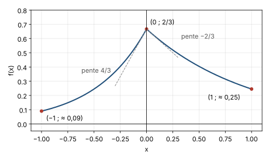

# BCE ECT — Mathématiques T (conception ESCP) 2026 · Corrigé guidé

*Corrigé rédigé par IA, non officiel. Signalez toute erreur.*

## Présentation du sujet

Épreuve de **4 heures**, sans document ni calculatrice (seule une règle graduée est autorisée). Trois exercices indépendants, **61 questions**, qui balaient les deux années du programme de mathématiques de la voie technologique : algèbre linéaire, analyse, probabilités discrètes et à densité, Python et SQL.

| Exercice | Questions | Contenu | Notions du programme ECT |
|---|---|---|---|
| 1 — Puissances d'une matrice | 1 à 19 | Spectre de $M$ par un polynôme annulateur, puissances paires et impaires d'une matrice triangulaire $T$ (binôme avec une matrice nilpotente), puissances négatives, puis $M=2PTP^{-1}$. | Polynôme annulateur, valeurs propres, inverse par pivot de Gauss, binôme pour des matrices qui commutent, récurrence |
| 2 — Le collectionneur | 20 à 39 | Étude de $u_j=H_j-\ln j$ (série harmonique), puis espérance du nombre d'achats pour compléter une collection, et trois requêtes SQL. | Étude de fonction, comparaison somme-intégrale, limite monotone, loi géométrique, espérance d'une somme, SQL (`DISTINCT`, `WHERE`, `INNER JOIN`) |
| 3 — Loi de Laplace | 40 à 61 | Graphe d'une densité, loi de Laplace asymétrique et loi de $-X$, deux simulations en Python (exponentielle et inversion), puis une suite de variables de Laplace et Bienaymé-Tchebychev. | Densité, fonction de répartition, loi exponentielle, bijection réciproque, loi uniforme, Bienaymé-Tchebychev, Python |

**Ce qu'en dit le jury.** Le rapport 2026 donne une moyenne de 9,2 et un écart type de 5,1. Le barème répartit les points en 28 % pour l'exercice 1, 30 % pour l'exercice 2 et 42 % pour l'exercice 3. Les questions qui rapportent le plus sont 5, 8, 12, 19 (exercice 1), 21, 24, 26, 30 (exercice 2) et 42, 43, 57, 60 (exercice 3). Le barème « accorde beaucoup de points aux questions de cours et aux questions Python et SQL ».

**Difficulté et gestion du temps.** L'exercice 1 est classique et calculatoire : il faut le faire vite et sans erreur. L'exercice 2 est le plus « fin » en analyse (questions 23 à 28), mais sa partie probabilités et le SQL sont accessibles. L'exercice 3 pèse le plus lourd et contient beaucoup de questions de cours déguisées (42, 43, 46 à 49, 53, 57) : ne pas les laisser passer. Les questions 51 à 55 (méthode d'inversion) sont les plus abstraites.

**Une erreur d'énoncé à signaler (partie V de l'exercice 3).** La densité imprimée de $X_n\hookrightarrow\mathcal L(0,2^n,2^n)$, $\frac12e^{-2^n|x|}$, n'est pas une densité : la question 42 donne la constante $2^{n-1}$. On le signale sur la copie et on poursuit avec $f_n(x)=2^{n-1}e^{-2^n|x|}$ ; la conclusion de la question 61 est la même dans les deux cas.

## Exercice 1 — Puissances entières d'une matrice

L'exercice cherche toutes les puissances $M^n$, $n\in\mathbb Z$. On passe par une matrice $T$ « presque diagonale » dont le carré s'écrit $I_3+N$ avec $N^2=O_3$ : le binôme se réduit à deux termes. La relation $M=2PTP^{-1}$ transporte ensuite le résultat.

### Question 1

> [!INDICATION]
> Factorisez complètement $x^2-4$.

#### Solution

$R(x)=(x-2)(x+2)(x-2)=(x-2)^2(x+2)$. Les racines de $R$ sont
$$\boxed{-2 \text{ et } 2}$$
($2$ est racine double).

### Question 2

> [!INDICATION]
> Quel résultat du cours relie les valeurs propres d'une matrice et les racines d'un polynôme annulateur ?

#### Solution

Toute valeur propre de $M$ est racine du polynôme annulateur $R$. Les seules valeurs propres possibles sont donc **$-2$ et $2$**.

> [!PIEGE]
> Le cours ne dit pas que toute racine de $R$ est valeur propre : la question 2 donne seulement des **candidates**. Il faut un vecteur propre pour conclure, c'est le rôle de la question 3.

### Question 3

> [!INDICATION]
> Calcul direct : comparez le résultat à $U$ et à $V$.

#### Solution

$$MU=\begin{pmatrix}-2\\-2\\0\end{pmatrix}=-2U,\qquad MV=\begin{pmatrix}2\\6\\4\end{pmatrix}=2V.$$

### Question 4

> [!INDICATION]
> Un vecteur **non nul** $X$ tel que $MX=\lambda X$ fait de $\lambda$ une valeur propre.

#### Solution

$U\neq0$ et $MU=-2U$ : $-2$ est valeur propre. $V\neq0$ et $MV=2V$ : $2$ est valeur propre. Avec la question 2,
$$\boxed{\mathrm{Sp}(M)=\{-2,\,2\}}$$

### Question 5

> [!INDICATION]
> Développez $R(M)=O_3$ et isolez le terme constant.

> [!INDICATION]
> Si l'on trouve une matrice $B$ telle que $MB=I_3$, alors $M$ est inversible et $B=M^{-1}$.

#### Solution

$R(x)=x^3-2x^2-4x+8$, donc $M^3-2M^2-4M+8I_3=O_3$, soit
$$M\left(-\frac18\left(M^2-2M-4I_3\right)\right)=I_3.$$
$M$ est inversible et
$$\boxed{M^{-1}=-\frac18\left(M^2-2M-4I_3\right)}$$

> [!METHODE]
> Polynôme annulateur à terme constant non nul : on met $I_3$ d'un côté, on factorise par $M$ de l'autre. Si le terme constant était nul, $0$ pourrait être valeur propre et la méthode ne conclurait pas.

> [!PIEGE]
> L'énoncé impose d'utiliser $R$ : un argument par les valeurs propres ($0$ n'est pas valeur propre) ou un calcul de $M^{-1}$ par pivot ne répond pas à la consigne.

### Question 6

> [!INDICATION]
> Produit matriciel, ligne par colonne.

#### Solution

$$T^2=\begin{pmatrix}1&0&1\\0&1&2\\0&0&1\end{pmatrix}=I_3+N.$$

### Question 7

> [!INDICATION]
> Calcul direct ; pensez à ce qu'il en découle pour $N^k$, $k\geqslant2$.

#### Solution

$$\boxed{N^2=O_3}$$
donc $N^k=N^2N^{k-2}=O_3$ pour tout $k\geqslant2$.

### Question 8

> [!INDICATION]
> $T^{2n}=(T^2)^n$. Quelle hypothèse faut-il vérifier avant d'appliquer le binôme à deux matrices ?

> [!INDICATION]
> Dans la somme du binôme, presque tous les termes sont nuls grâce à la question 7.

#### Solution

$T^{2n}=(I_3+N)^n$. Les matrices $I_3$ et $N$ commutent, donc
$$(I_3+N)^n=\sum_{k=0}^n\binom nkN^kI_3^{\,n-k}.$$
Les termes $k\geqslant2$ sont nuls, d'où
$$\boxed{T^{2n}=I_3+nN=\begin{pmatrix}1&0&n\\0&1&2n\\0&0&1\end{pmatrix}}$$
La formule vaut aussi pour $n=0$ (seul le terme $k=0$ existe).

> [!JURY]
> Rapport 2026 : « Moins de la moitié des candidats connaissent la formule du binôme de Newton avec ses hypothèses. » La commutation de $I_3$ et $N$ doit être écrite.

### Question 9

> [!INDICATION]
> $T^{2n+1}=T^{2n}T$. Calculez $NT$ : le résultat est remarquable.

#### Solution

$T^{2n+1}=(I_3+nN)T=T+nNT$, et un calcul direct donne $NT=N$. Donc
$$T^{2n+1}=T+nN=\begin{pmatrix}-1&1&n\\0&1&1+2n\\0&0&1\end{pmatrix}.$$

## Exercice 1, partie III — Puissances entières de $T$

On reproduit la méthode avec $T^{-1}$, dont le carré vaut $I_3-N$, puis on recolle les cas $j\geqslant0$ et $j<0$.

### Question 10

> [!INDICATION]
> Un critère du cours donne l'inversibilité d'une matrice triangulaire sans calcul.

> [!INDICATION]
> Pour l'inverse : résolvez $TX=Y$, ou appliquez le pivot de Gauss à $(T\mid I_3)$.

#### Solution

$T$ est triangulaire supérieure de diagonale $(-1,1,1)$ sans zéro : **$T$ est inversible**.

Le système $TX=Y$ s'écrit $-x+y=a$, $y+z=b$, $z=c$.

On le remonte : $z=c$, $y=b-c$, $x=-a+b-c$. Donc
$$\boxed{T^{-1}=\begin{pmatrix}-1&1&-1\\0&1&-1\\0&0&1\end{pmatrix}}$$

> [!JURY]
> Rapport 2026 : « La question 10 a été la moins réussie ; beaucoup de candidats se sont appuyés sur la question suivante pour montrer que T est inversible ». La question 11 suppose déjà $T^{-1}$ connue : on ne peut pas s'en servir ici.

> [!PIEGE]
> Factoriser $T^2-N=I_3$ en $T(T-N)=I_3$ demande de vérifier $TN=N$. C'est vrai ici, mais il faut le calculer : en général $T^2-N\neq T(T-N)$.

### Question 11

> [!INDICATION]
> Calcul direct.

#### Solution

$$(T^{-1})^2=\begin{pmatrix}1&0&-1\\0&1&-2\\0&0&1\end{pmatrix}=I_3-N.$$

### Question 12

> [!INDICATION]
> Même démarche qu'aux questions 8 et 9, avec $-N$ à la place de $N$.

> [!INDICATION]
> Pour la puissance impaire, il faut $NT^{-1}$ : tirez-le de $NT=N$.

#### Solution

$-N$ commute avec $I_3$ et $(-N)^2=O_3$ : par le binôme,
$$(T^{-1})^{2n}=(I_3-N)^n=I_3-nN=\begin{pmatrix}1&0&-n\\0&1&-2n\\0&0&1\end{pmatrix}.$$
En multipliant $NT=N$ à droite par $T^{-1}$, on obtient $N=NT^{-1}$. Donc
$$(T^{-1})^{2n+1}=(I_3-nN)T^{-1}=T^{-1}-nN=\begin{pmatrix}-1&1&-1-n\\0&1&-1-2n\\0&0&1\end{pmatrix}.$$

### Question 13

> [!INDICATION]
> Montrez par récurrence que $T^k(T^{-1})^k=I_3$.

#### Solution

Pour $k=0$, c'est $I_3=I_3$. Si $T^k(T^{-1})^k=I_3$, alors
$$T^{k+1}(T^{-1})^{k+1}=T^k\,(TT^{-1})\,(T^{-1})^k=I_3.$$
Donc $(T^k)^{-1}=(T^{-1})^k$ pour tout $k\in\mathbb N$.

### Question 14

> [!INDICATION]
> Séparez $j\geqslant0$ (partie II) et $j<0$ (poser $p=-j$ et utiliser la question 12).

> [!INDICATION]
> Pour $j<0$, écrivez $2j+1$ sous la forme $-(2q+1)$ avec $q\in\mathbb N$.

#### Solution

Si $j\geqslant0$, c'est la partie II. Si $j<0$, posons $p=-j\geqslant1$.

- $T^{2j}=(T^{-1})^{2p}=I_3-pN=I_3+jN$.
- $2j+1=-(2(p-1)+1)$, donc $T^{2j+1}=(T^{-1})^{2(p-1)+1}=T^{-1}-(p-1)N$, de troisième colonne $(-p,\,1-2p,\,1)$, c'est-à-dire $(j,\,1+2j,\,1)$.

Pour tout $j\in\mathbb Z$ :
$$\boxed{T^{2j}=\begin{pmatrix}1&0&j\\0&1&2j\\0&0&1\end{pmatrix},\qquad T^{2j+1}=\begin{pmatrix}-1&1&j\\0&1&1+2j\\0&0&1\end{pmatrix}}$$

> [!METHODE]
> Une formule « unifiée » sur $\mathbb Z$ se vérifie en deux temps : on la lit sur les cas positifs, puis on substitue $j=-p$ dans les formules négatives et on compare.

## Exercice 1, partie IV — Puissances entières de $M$

### Question 15

> [!INDICATION]
> Le déterminant d'une matrice d'ordre 3 n'est pas au programme : utilisez le pivot de Gauss.

#### Solution

Le pivot de Gauss sur $(P\mid I_3)$, avec $L_2\leftarrow L_2-L_1$ puis $L_3\leftarrow L_3-L_2$, donne une matrice triangulaire de pivots $1,1,2$, tous non nuls : **$P$ est inversible**. En achevant la réduction :
$$P^{-1}=\frac12\begin{pmatrix}1&1&-1\\-1&1&1\\1&-1&1\end{pmatrix}.$$

### Question 16

> [!INDICATION]
> Deux produits matriciels ; comparez-les.

#### Solution

$$MP=\begin{pmatrix}-2&2&2\\-2&4&2\\0&2&4\end{pmatrix},\qquad PT=\begin{pmatrix}-1&1&1\\-1&2&1\\0&1&2\end{pmatrix}.$$

### Question 17

> [!INDICATION]
> Comparez $MP$ et $PT$, puis multipliez à droite par $P^{-1}$.

#### Solution

$MP=2PT$, donc $M=2PTP^{-1}$ :
$$\boxed{a=2}$$

### Question 18

> [!INDICATION]
> Montrez que le produit de $aPTP^{-1}$ par la matrice proposée vaut $I_3$.

#### Solution

$$\begin{aligned}
\left(aPTP^{-1}\right)\left(\frac1aPT^{-1}P^{-1}\right) &= PT(P^{-1}P)T^{-1}P^{-1}\\
&= PP^{-1}\\
&= I_3,
\end{aligned}$$
donc $M^{-1}=\frac1aPT^{-1}P^{-1}$.

### Question 19

> [!INDICATION]
> Récurrence : à l'hérédité, $M^{n+1}=M^nM$, et les $P^{-1}P$ du milieu disparaissent.

> [!INDICATION]
> Pour la seconde égalité, il faut $T^{-n}T^{-1}=T^{-(n+1)}$ : utilisez la définition de la question 13.

#### Solution

**Initialisation.** $M^0=I_3=PT^0P^{-1}$ et $(M^{-1})^0=I_3$.

**Hérédité.** Si $\mathcal P(n)$ est vraie,
$$M^{n+1}=a^nPT^nP^{-1}\cdot aPTP^{-1}=a^{n+1}PT^{n+1}P^{-1},$$
$$\begin{aligned}
(M^{-1})^{n+1} &= \frac1{a^n}PT^{-n}P^{-1}\cdot\frac1aPT^{-1}P^{-1}\\
&= \frac1{a^{n+1}}P(T^{-1})^{n+1}P^{-1}\\
&= \frac1{a^{n+1}}PT^{-(n+1)}P^{-1}.
\end{aligned}$$

Par récurrence, $\mathcal P(n)$ est vraie pour tout $n\in\mathbb N$.

> [!JURY]
> Rapport 2026 : « La question 19 a bien été traitée. » C'est une des questions les mieux payées de l'exercice : rédigez initialisation, hérédité et conclusion.

## Exercice 2 — Le problème du collectionneur

La partie I établit $\frac{H_n}{\ln n}\to1$ par une suite auxiliaire $u_j=H_j-\ln j$. La partie II décompose le temps de collecte en une somme de variables géométriques. La partie III est un exercice SQL indépendant.

### Question 20

> [!INDICATION]
> Où le logarithme est-il défini ?

#### Solution

$\ln(1+x)$ existe si et seulement si $1+x>0$ :
$$\boxed{D=\,]-1,+\infty[}$$

> [!JURY]
> Rapport 2026 : « le domaine de définition est faux dans 9 copies sur 10 et peu de candidats justifient la dérivabilité de la fonction. »

### Question 21

> [!INDICATION]
> Justifiez la dérivabilité, calculez $f'$ et mettez-la au même dénominateur.

> [!INDICATION]
> Sur $D$, le signe du dénominateur est connu ; seul le numérateur compte.

#### Solution

$f$ est dérivable sur $D$ ($x\mapsto1+x$ est dérivable et strictement positive sur $D$, $\ln$ est dérivable sur $]0,+\infty[$), et
$$f'(x)=\frac1{1+x}-1=\frac{-x}{1+x}.$$
Comme $1+x>0$, $f'(x)$ a le signe de $-x$.

**$f$ est strictement croissante sur $]-1,0]$, strictement décroissante sur $[0,+\infty[$**, de maximum $f(0)=0$.

> [!JURY]
> Rapport 2026 : « Plusieurs candidats se lancent dans le calcul de limites à la question 21. » Les variations suffisent ; les limites ne servent pas pour la suite.

### Question 22

> [!INDICATION]
> Que vaut le maximum de $f$ sur $D$ ?

#### Solution

$f$ atteint son maximum en $0$, égal à $0$ : $f(x)\leqslant0$ sur $D$.

Autrement dit, $\ln(1+x)\leqslant x$ pour tout $x\in D$.

> [!JURY]
> Rapport 2026 : « Le terme "En déduire" a souvent été ignoré à la question 22. » Une étude séparée de $x\mapsto x-\ln(1+x)$ ne rapporte pas les points d'une déduction.

### Question 23

> [!INDICATION]
> Écrivez $H_{j+1}=H_j+\frac1{j+1}$ et regroupez les logarithmes.

#### Solution

$$\begin{aligned}
u_{j+1}-u_j &= \frac1{j+1}-\ln(j+1)+\ln j\\
&= \frac1{j+1}+\ln\left(\frac j{j+1}\right)\\
&= \frac1{j+1}+\ln\left(1-\frac1{j+1}\right).
\end{aligned}$$

### Question 24

> [!INDICATION]
> Appliquez la question 22 à un $x$ bien choisi ; vérifiez qu'il appartient à $D$.

#### Solution

Avec $x=-\frac1{j+1}\in\left[-\frac12,0\right[\subset D$ :
$$\ln\left(1-\frac1{j+1}\right)\leqslant-\frac1{j+1},$$
donc $u_{j+1}-u_j\leqslant0$. **La suite $(u_j)$ est décroissante.**

### Question 25

> [!INDICATION]
> Comparez $\frac1t$ et $\frac1k$ pour $t\in[k,k+1]$, puis intégrez.

#### Solution

Pour $t\in[k,k+1]$, $\frac1t\leqslant\frac1k$. Par croissance de l'intégrale ($k<k+1$) :
$$\int_k^{k+1}\frac{dt}t\leqslant\frac1k.$$

> [!METHODE]
> Comparaison série-intégrale : on encadre la fonction sur chaque intervalle $[k,k+1]$, on intègre, puis on somme avec Chasles.

### Question 26

> [!INDICATION]
> Sommez l'inégalité de la question 25 pour $k$ de $1$ à $j$.

#### Solution

$$\begin{aligned}
H_j\geqslant\sum_{k=1}^j\int_k^{k+1}\frac{dt}t &= \int_1^{j+1}\frac{dt}t\\
&= \ln(j+1).
\end{aligned}$$
Donc $u_j\geqslant\ln(j+1)-\ln j>0$.

### Question 27

> [!INDICATION]
> Décroissante et minorée…

#### Solution

$(u_j)$ est décroissante et minorée par $0$ : par le théorème de la limite monotone, **elle converge** vers un réel $\gamma\geqslant0$.

### Question 28

> [!INDICATION]
> Écrivez $\frac{H_n}{\ln n}$ à l'aide de $u_n$.

#### Solution

Pour $n\geqslant2$, $\frac{H_n}{\ln n}=1+\frac{u_n}{\ln n}$ ; $u_n$ a une limite finie et $\ln n\to+\infty$, donc
$$\boxed{\lim_{n\to+\infty}\frac{H_n}{\ln n}=1}$$

## Exercice 2, partie II — Temps moyen pour compléter la collection

Hypothèse de modélisation implicite : chaque carte achetée est l'une des $n$ cartes, toutes équiprobables, et les achats sont indépendants.

### Question 29

> [!INDICATION]
> Que vaut $N_k-N_{k-1}$ ?

#### Solution

$N_1=X_1$ et $N_k=N_{k-1}+X_k$ pour $k\geqslant2$. Par télescopage :
$$\begin{aligned}
N_n &= N_1+\sum_{k=2}^n(N_k-N_{k-1})\\
&= \sum_{k=1}^nX_k.
\end{aligned}$$

### Question 30

> [!INDICATION]
> Au premier achat, combien de cartes possède-t-on déjà ?

#### Solution

La première carte est toujours nouvelle : $X_1$ est certaine égale à $1$.
$$\boxed{\begin{aligned}E(X_1)&=1\\V(X_1)&=0\end{aligned}}$$

> [!JURY]
> Rapport 2026 : de « nombreuses copies où les candidats répondent avec des lois usuelles du programme, au hasard et sans justifications ». Ici aucune loi usuelle n'est à invoquer : la variable est constante.

### Question 31

> [!INDICATION]
> Combien de cartes, parmi les $n$ équiprobables, diffèrent de la première ?

#### Solution

$$\boxed{\frac{n-1}n}$$

### Question 32

> [!INDICATION]
> $X_2$ compte les achats jusqu'au premier succès dans une suite d'épreuves indépendantes de même probabilité de succès.

#### Solution

Chaque achat après le premier donne une carte différente de la première avec probabilité $p=\frac{n-1}n$, indépendamment des autres. $X_2$ est le rang du premier succès : $X_2\hookrightarrow\mathcal G\left(\frac{n-1}n\right)$, et
$$\begin{aligned}E(X_2)&=\boxed{\frac n{n-1}}\\V(X_2)&=\frac{1-p}{p^2}=\boxed{\frac n{(n-1)^2}}\end{aligned}$$

> [!JURY]
> Rapport 2026 : « Plusieurs candidats ont répondu aux questions dans le cas n = 4 qui était donné seulement en exemple. » Les réponses doivent être données pour $n$ quelconque.

### Question 33

> [!INDICATION]
> Combien de cartes manquent quand on en possède $k-1$ ?

#### Solution

Il manque $n-k+1$ cartes parmi $n$ équiprobables :
$$\boxed{p_{n,k}=\frac{n-k+1}n}$$

### Question 34

> [!INDICATION]
> Même raisonnement qu'à la question 32 : identifiez l'épreuve de Bernoulli, sa probabilité et l'indépendance.

#### Solution

Tant qu'on n'a pas obtenu de nouvelle carte, on possède toujours $k-1$ cartes : chaque achat est une épreuve de Bernoulli indépendante, de succès « carte nouvelle » de probabilité $p_{n,k}$. $X_k$ est le rang du premier succès, donc $X_k\hookrightarrow\mathcal G(p_{n,k})$.

> [!METHODE]
> Loi géométrique = **rang du premier succès** dans une suite d'épreuves de Bernoulli indépendantes de même paramètre. Les trois éléments (épreuve, paramètre, indépendance) doivent apparaître dans la justification.

### Question 35

> [!INDICATION]
> $E(X_k)=\frac1{p_{n,k}}$ ; faites le changement d'indice $i=n-k+1$ dans la somme.

> [!INDICATION]
> Vous devez reconnaître $H_n$.

#### Solution

$E(X_k)=\frac n{n-k+1}$ pour tout $k\in[\![1,n]\!]$ (la formule vaut aussi pour $k=1,2$). Donc
$$\begin{aligned}
E(N_n) &= \sum_{k=1}^n\frac n{n-k+1}\\
&= n\sum_{i=1}^n\frac1i\\
&= nH_n,
\end{aligned}$$
et, par la question 28,
$$\frac{E(N_n)}{n\ln n}=\frac{H_n}{\ln n}\xrightarrow[n\to+\infty]{}1.$$
**Interprétation** : pour une grande collection, il faut en moyenne environ $n\ln n$ achats, bien plus que $n$ ; ce sont les dernières cartes manquantes qui coûtent le plus cher.

## Exercice 2, partie III — Requêtes SQL

### Question 36

> [!INDICATION]
> Relisez l'énoncé général de l'exercice : combien de cartes achète-t-on au plus par jour ?

#### Solution

On achète au plus une carte par jour : la **`Date`** est différente pour chaque ligne de CARTES et peut servir de clé primaire. `Nom` ne convient pas (doublons possibles), ni `Lieu`.

> [!PIEGE]
> Proposer `Nom` comme clé : l'énoncé précise justement qu'un même nom peut apparaître plusieurs fois.

### Question 37

> [!INDICATION]
> Le mot-clé qui supprime les doublons.

#### Solution

```sql
SELECT DISTINCT Nom FROM CARTES;
```

### Question 38

> [!INDICATION]
> Les cartes « à collectionner » sont décrites dans POKEMON.

#### Solution

```sql
SELECT Nom FROM POKEMON WHERE PV >= 100;
```

### Question 39

> [!INDICATION]
> L'énergie est dans POKEMON, les cartes possédées dans CARTES : il faut une jointure.

#### Solution

```sql
SELECT CARTES.Nom, CARTES.Date, CARTES.Lieu
FROM CARTES INNER JOIN POKEMON ON CARTES.Nom = POKEMON.Nom
WHERE POKEMON.Energie = 'feu';
```

## Exercice 3 — Loi de Laplace

On étudie la loi $\mathcal L(m,a,b)$ : deux exponentielles « recollées » en $m$. Les parties III et IV simulent cette loi de deux façons, la partie V applique Bienaymé-Tchebychev à une moyenne de variables de Laplace.

### Question 40

> [!INDICATION]
> Étudiez chaque morceau : monotonie, valeurs en $-1$, $0$, $1$ avec $e^{-1}\approx0{,}4$.

> [!INDICATION]
> Regardez aussi les pentes à gauche et à droite de $0$.

#### Solution

Sur $[-1,0[$, $f(x)=\frac23e^{2x}$ croît ; sur $[0,1]$, $f(x)=\frac23e^{-x}$ décroît.

$f$ est continue en $0$ et y vaut $\frac23\approx0{,}67$ (maximum).

$f(1)=\frac23e^{-1}\approx0{,}27$ et $f(-1)=\frac23e^{-2}\approx0{,}11$ avec $e^{-1}\approx0{,}4$.

La courbe a un pic en $0$, avec des demi-tangentes de pentes $\frac43$ et $-\frac23$.



> [!JURY]
> Rapport 2026 : « Seule une vingtaine de candidats obtiennent une allure cohérente à la question 40. » Placer les trois points et respecter la monotonie suffit pour une allure correcte.

### Question 41

> [!INDICATION]
> Les deux `return` reprennent l'expression de $f$ ; la boucle remplit `B` point par point.

#### Solution

```python
def f(x):
    if x < 0:
        return 2/3*np.e**(2*x)
    else:
        return 2/3*np.e**(-x)

A = np.linspace(-1,1,1000)
B = np.zeros(1000)
for k in range(1000):
    B[k]=f(A[k])
plt.plot(A,B)
```

### Question 42

> [!INDICATION]
> Trois conditions : positivité, continuité sauf en un nombre fini de points, intégrale égale à $1$.

> [!INDICATION]
> Calculez séparément $\int_m^{+\infty}$ et $\int_{-\infty}^m$ en passant par des bornes finies.

#### Solution

$f$ est continue sauf peut-être en $m$, et positive si $M\geqslant0$. Pour $A<m<B$ :
$$\int_m^BMe^{-a(x-m)}dx=\frac Ma\left(1-e^{-a(B-m)}\right)\xrightarrow[B\to+\infty]{}\frac Ma,$$
$$\int_A^mMe^{b(x-m)}dx=\frac Mb\left(1-e^{b(A-m)}\right)\xrightarrow[A\to-\infty]{}\frac Mb.$$
L'intégrale totale vaut $M\frac{a+b}{ab}$, d'où
$$\boxed{M=\frac{ab}{a+b}}$$
(cette constante ne dépend pas de $m$)

> [!PIEGE]
> Oublier la positivité et la continuité par morceaux : la définition d'une densité a trois conditions, pas une.

### Question 43

> [!INDICATION]
> $F_X(x)=\int_{-\infty}^xf(t)\,dt$ : ne considérez que les morceaux de $f$ qui interviennent.

> [!INDICATION]
> Pour $x\geqslant m$, coupez en $m$ (Chasles) et réutilisez la question 42.

#### Solution

(a) Pour $x<m$ :
$$F_X(x)=\lim_{A\to-\infty}\frac Mb\left(e^{b(x-m)}-e^{b(A-m)}\right)=\frac a{a+b}e^{b(x-m)}.$$
(b) Pour $x\geqslant m$ :
$$F_X(x)=\frac a{a+b}+\frac b{a+b}\left(1-e^{-a(x-m)}\right)=1-\frac b{a+b}e^{-a(x-m)}.$$

> [!METHODE]
> Fonction de répartition d'une densité définie par morceaux : on distingue les cas selon la position de $x$ par rapport aux points de raccord, et l'on calcule l'intégrale impropre par une borne finie puis une limite, comme le programme le demande.

### Question 44

> [!INDICATION]
> $P(-X\leqslant x)=P(X\geqslant -x)$ ; passez au complémentaire.

> [!INDICATION]
> Le cas dépend de la position de $-x$ par rapport à $m$.

#### Solution

$F_{-X}(x)=1-F_X(-x)$ car $P(X=-x)=0$.

- Si $x\leqslant-m$ : $-x\geqslant m$ et $F_{-X}(x)=\frac b{a+b}e^{a(x+m)}$.
- Si $x>-m$ : $-x<m$ et $F_{-X}(x)=1-\frac a{a+b}e^{-b(x+m)}$.

> [!PIEGE]
> Confondre la fonction de répartition de $-X$ avec $x\mapsto -F_X(x)$ ou $x\mapsto F_X(-x)$ : on repart toujours de la définition $P(-X\leqslant x)$. Le rapport 2026 signale cette confusion.

### Question 45

> [!INDICATION]
> Cherchez $m'$, $a'$, $b'$ tels que les formules de la question 43 redonnent celles de la question 44.

#### Solution

Avec $m'=-m$, $a'=b$, $b'=a$, les formules de la question 43 donnent exactement $F_{-X}$ (y compris en $x=-m$, où les deux valent $\frac b{a+b}$). La fonction de répartition caractérise la loi :
$$\boxed{-X\hookrightarrow\mathcal L(-m,\,b,\,a)}$$

## Exercice 3, partie III — Première simulation ($a=b$)

### Question 46

> [!INDICATION]
> Quel est le signe de $Y$ ?

#### Solution

$Y\geqslant0$, donc $F_Y(y)=0$ pour $y<0$.

### Question 47

> [!INDICATION]
> Traduisez $|X-m|\leqslant y$ par un encadrement de $X$.

#### Solution

$F_Y(y)=P(m-y\leqslant X\leqslant m+y)=F_X(y+m)-F_X(-y+m)$, car $P(X=-y+m)=0$.

> [!JURY]
> Rapport 2026 : « Les questions 46 et 47 ont été bien traitées quand elles ont été abordées. »

### Question 48

> [!INDICATION]
> Avec $a=b$, remplacez $F_X$ par ses expressions ; attention au cas $y=0$.

#### Solution

Pour $y\geqslant0$ : $F_X(y+m)=1-\frac12e^{-ay}$ et $F_X(-y+m)=\frac12e^{-ay}$ (y compris pour $y=0$, où $F_X(m)=\frac12$).

Donc $F_Y(y)=1-e^{-ay}$ et $\boxed{Y\hookrightarrow\mathcal E(a)}$.

### Question 49

> [!INDICATION]
> Complémentaire et question 43(b) en $x=m$.

#### Solution

$$P(X>m)=1-F_X(m)=\boxed{\frac12}$$

### Question 50

> [!INDICATION]
> Que simule `Simu1_X` ? Rapprochez-la des questions 48 et 49.

> [!INDICATION]
> Que calcule la dernière ligne, et quel théorème relie cette quantité à une espérance ?

#### Solution

`Simu1_X(m,a)` tire $Y$ exponentielle puis renvoie $m+Y$ ou $m-Y$ avec probabilité $\frac12$ chacun.

Pour $x\geqslant m$, la probabilité que le résultat soit $\leqslant x$ vaut $\frac12(1-e^{-a(x-m)})+\frac12=F_X(x)$.

Pour $x<m$, elle vaut $\frac12e^{a(x-m)}=F_X(x)$. La fonction simule donc $X\hookrightarrow\mathcal L(m,a,a)$.

Le programme affiche la moyenne de 1000 simulations indépendantes de $X\hookrightarrow\mathcal L(2,1,1)$. Par la loi faible des grands nombres, elle approche $E(X)$. Or $E(X)=m$ : la densité est symétrique par rapport à $m$, et
$$\int_{-\infty}^{+\infty}(x-m)f(x)\,dx=\frac a2\left(\int_0^{+\infty}ue^{-au}du-\int_0^{+\infty}ue^{-au}du\right)=0.$$
La valeur $2{,}02$ est une **estimation de $E(X)=2$**.

> [!PIEGE]
> Deux détails du code : il faut `import numpy as np` pour que `np.zeros` fonctionne, et `rd.exponential(s)` simule la loi $\mathcal E(1/s)$ (numpy prend en argument l'inverse du paramètre). Avec $a=1$, cela ne change rien ici.

## Exercice 3, partie IV — Seconde simulation : la méthode d'inversion

L'idée : si $U$ est uniforme sur $]0,1[$, alors $F_X^{-1}(U)$ suit la loi de $X$. Comme $F_X$ est définie par morceaux, sa réciproque l'est aussi.

### Question 51

> [!INDICATION]
> Continuité, stricte monotonie, limites aux bornes : quel théorème ?

#### Solution

Sur $]-\infty,m[$, $F_X(x)=\frac a{a+b}e^{b(x-m)}$ est continue, strictement croissante, de limites $0$ en $-\infty$ et $\frac a{a+b}$ en $m^-$.

Par le théorème de la bijection, $F_X$ réalise une bijection de $]-\infty,m[$ sur $\left]0,\frac a{a+b}\right[$.

> [!JURY]
> Rapport 2026 : « Les questions 51 à 55 ont été très peu abordées. » Les questions 51, 52 et 53 sont pourtant des applications directes du cours.

### Question 52

> [!INDICATION]
> Résolvez $F_X(x)=y$ d'inconnue $x<m$.

#### Solution

$$\begin{aligned}
&\frac a{a+b}e^{b(x-m)}=y\\
\iff{}&b(x-m)=\ln\left(\frac{a+b}ay\right)\\
\iff{}&x=m+\frac1b\ln\left(\frac{a+b}ay\right).
\end{aligned}$$

### Question 53

> [!INDICATION]
> Fonction de répartition de la loi uniforme : trois morceaux.

#### Solution

$F_U(u)=0$ si $u\leqslant0$, $F_U(u)=u$ si $0<u<1$, $F_U(u)=1$ si $u\geqslant1$.

### Question 54

> [!INDICATION]
> Si $t<m$, que dire de $T$ lorsque $U\geqslant\frac a{a+b}$ ?

> [!INDICATION]
> Sur $\left]0,\frac a{a+b}\right[$, appliquez $F_X$ (strictement croissante) à l'inégalité $F_1(U)\leqslant t$.

#### Solution

Si $U\geqslant\frac a{a+b}$, $T=F_2(U)\geqslant m>t$. Donc $(T\leqslant t)=\left(U<\frac a{a+b}\right)\cap(F_1(U)\leqslant t)$. Pour $u\in\left]0,\frac a{a+b}\right[$,
$$F_1(u)\leqslant t\iff u\leqslant F_X(t),$$
car $F_X$ est strictement croissante et $F_X(F_1(u))=u$. Comme $F_X(t)<\frac a{a+b}$, on obtient $(T\leqslant t)=(U\leqslant F_X(t))$ et $P(T\leqslant t)=P(U\leqslant F_X(t))$.

### Question 55

> [!INDICATION]
> $F_X(t)$ est dans $]0,1[$ : que vaut alors $F_U(F_X(t))$ ?

#### Solution

Pour $t<m$, $F_T(t)=F_U(F_X(t))=F_X(t)$.

Pour $t\geqslant m$, $F_T(t)=1-P(U>F_X(t))=1-(1-F_X(t))=F_X(t)$. Donc $\boxed{F_T=F_X}$ : $T$ suit la loi $\mathcal L(m,a,b)$.

### Question 56

> [!INDICATION]
> Traduisez la définition de $T$ avec les formules de $F_1$ et $F_2$.

#### Solution

```python
def Simu2_X(m,a,b):
    U=rd.random()
    if U < a/(a+b) :
        X = m + numpy.log((a+b)/a*U)/b
    else:
        X = m - numpy.log((a+b)/b*(1-U))/a
    return X
```

> [!JURY]
> Rapport 2026 : « Dans la question 56, beaucoup de candidats écrivent U<a/a+b en oubliant les parenthèses. » En Python, `a/a+b` vaut $1+b$.

## Exercice 3, partie V — Une suite de variables de Laplace

**Erreur d'énoncé.** Pour $\mathcal L(0,2^n,2^n)$, la question 42 donne $M=2^{n-1}$ : une densité de $X_n$ est $f_n(x)=2^{n-1}e^{-2^n|x|}$.

Le coefficient $\frac12$ imprimé ne donne pas une intégrale égale à $1$. On le signale et on travaille avec $f_n$ ; la conclusion de la question 61 ne dépend pas de ce coefficient.

### Question 57

> [!INDICATION]
> Écrivez $E(S)$ et $E(S^2)$ comme des intégrales, et utilisez les valeurs du cours.

#### Solution

$S$ a pour densité $\lambda e^{-\lambda x}$ sur $[0,+\infty[$ ; $E(S)=\frac1\lambda$, $V(S)=\frac1{\lambda^2}$. Donc $\int_0^{+\infty}x\lambda e^{-\lambda x}dx=\frac1\lambda$, d'où
$$\int_0^{+\infty}xe^{-\lambda x}dx=\frac1{\lambda^2}.$$
Par Koenig-Huygens, $E(S^2)=\frac1{\lambda^2}+\frac1{\lambda^2}=\frac2{\lambda^2}=\int_0^{+\infty}x^2\lambda e^{-\lambda x}dx$, d'où
$$\int_0^{+\infty}x^2e^{-\lambda x}dx=\frac2{\lambda^3}.$$

> [!JURY]
> Rapport 2026 : « La question 57 a montré que beaucoup de candidats ne maitrisent pas suffisamment le cours. » Espérance et variance de la loi exponentielle sont à savoir par cœur.

### Question 58

> [!INDICATION]
> La fonction $x\mapsto xf_n(x)$ est-elle paire ou impaire ? Que donne (R2) ?

#### Solution

$f_n$ est paire, donc $h:x\mapsto xf_n(x)$ est impaire.

Par la question 57 avec $\lambda=2^n$, $\int_0^{+\infty}h=\frac{2^{n-1}}{4^n}$ converge. Par (R2), $\int_{-\infty}^{+\infty}xf_n(x)dx$ converge et vaut $0$ :
$$\boxed{E(X_n)=0}$$

> [!JURY]
> Rapport 2026 : « Dans les questions 58 et 59, peu de candidats utilisent (R2) bien que l’énoncé l’impose. »

### Question 59

> [!INDICATION]
> Appliquez (R2) à $x\mapsto x^2f_n(x)$, paire.

#### Solution

$$\int_0^{+\infty}x^2f_n(x)\,dx=2^{n-1}\cdot\frac2{8^n}=\frac1{4^n}.$$
Par (R2), $E(X_n^2)=\frac2{4^n}$ et, avec Koenig-Huygens,
$$\boxed{V(X_n)=\frac2{4^n}}$$

### Question 60

> [!INDICATION]
> Linéarité de l'espérance, puis (R1) et $V(cZ)=c^2V(Z)$.

> [!INDICATION]
> Il reste une somme géométrique de raison $\frac14$, qui commence à $k=1$.

#### Solution

$E(\overline{X_n})=\frac1n\sum E(X_k)=0$. Par (R1) :
$$\begin{aligned}
V(\overline{X_n}) &= \frac1{n^2}\sum_{k=1}^n\frac2{4^k}\\
&= \frac2{n^2}\cdot\frac13\left(1-\frac1{4^n}\right),
\end{aligned}$$
soit
$$\boxed{\begin{aligned}E(\overline{X_n})&=0\\V(\overline{X_n})&=\frac2{3n^2}\left(1-\frac1{4^n}\right)\end{aligned}}$$

> [!PIEGE]
> Oublier le facteur $\frac1{n^2}$ : la variance n'est pas linéaire, $V\left(\frac1nZ\right)=\frac1{n^2}V(Z)$.

### Question 61

> [!INDICATION]
> Bienaymé-Tchebychev avec $\varepsilon=\frac1{\sqrt n}$, puis encadrement.

#### Solution

$$0\leqslant P\left(|\overline{X_n}|\geqslant\frac1{\sqrt n}\right)\leqslant n\,V(\overline{X_n})=\frac2{3n}\left(1-\frac1{4^n}\right)\leqslant\frac2{3n}\xrightarrow[n\to+\infty]{}0.$$
Par encadrement, la limite vaut $0$.

Avec le coefficient imprimé $\frac12$, on trouverait $V(X_n)=\frac2{8^n}$ et la majoration $\frac2{7n}$ : même conclusion.

> [!METHODE]
> Pour montrer qu'une probabilité tend vers $0$ : la minorer par $0$, la majorer par une quantité explicite (Markov ou Bienaymé-Tchebychev) qui tend vers $0$, puis conclure par encadrement.

## Bilan

**Méthodes à retenir.**

- Polynôme annulateur : il donne les valeurs propres **possibles** ; un vecteur propre confirme. Avec un terme constant non nul, il donne l'inverse.
- Puissances de $I+N$ avec $N$ nilpotente : binôme (après avoir vérifié que les matrices commutent), qui se réduit à quelques termes.
- Comparaison somme-intégrale sur $[k,k+1]$, puis Chasles : $\frac{H_n}{\ln n}\to1$.
- Loi géométrique comme rang du premier succès, espérance d'une somme ; le temps de collecte vaut en moyenne $nH_n$, et $\frac{E(N_n)}{n\ln n}\to1$.
- Densité définie par morceaux : intégrales impropres par bornes finies puis limites ; fonction de répartition par cas.
- Loi de $-X$ ou de $|X-m|$ : toujours repartir de $P(-X\leqslant x)$ ou de $P(|X-m|\leqslant y)$.
- Méthode d'inversion : si $U\hookrightarrow\mathcal U(]0,1[)$, $F_X^{-1}(U)$ suit la loi de $X$.
- Bienaymé-Tchebychev puis encadrement pour une limite de probabilité.

**Prérequis à revoir.** Lois usuelles et leurs moments (géométrique, exponentielle, uniforme), formule du binôme et ses hypothèses, pivot de Gauss, théorème de la limite monotone, théorème de la bijection, syntaxe SQL (`DISTINCT`, `INNER JOIN … ON`) et Python (parenthèses, `np.linspace`, `rd.random`).

**Questions transposables.** Le problème du collectionneur, la comparaison $H_n$ / $\ln n$, et la simulation d'une loi par inversion de la fonction de répartition reviennent régulièrement dans les sujets de la voie technologique.
