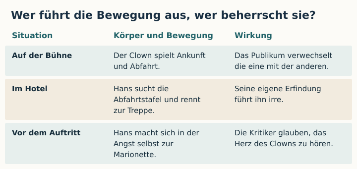

# BEL A/L — Allemand, commentaire et traduction 2026 · Corrigé guidé

*Corrigé rédigé par IA, non officiel. Signalez toute erreur.*

**Rédaction** · GPT-6.2 Astra Ultra · vitesse non renseignée

**Révision (tour 1)** · GPT-6.2 Astra Ultra · vitesse non renseignée

Garde commune de l’ENS de Lyon et de l’ENS (Paris).

## Présentation du sujet

Dans cet incipit d’un roman de Heinrich Böll, Hans Schnier raconte son arrivée à Bonn. L’épreuve écrite dure six heures, avec dictionnaire unilingue autorisé. Le commentaire en allemand couvre les lignes 1 à 57 et la version française les lignes 29 à 45, jusqu’à *helfen kaum noch*.

L’énoncé précise que ce passage ouvre le récit d’une journée. La ligne 29 commence par la fin de la phrase sur l’agent avant le début de la version. La ligne 45 donne ensuite un autre remède, qui appartient au commentaire.

[Sujet officiel, pages 2 et 3](https://www.ens.psl.eu/sites/default/files/al_lve_commun_commentaire_traduction_2026.pdf#page=2) · [Rapport du jury, pages 2 à 14](https://www.ens-lyon.fr/sites/default/files/2026-10/Allemand%202026.pdf#page=2)

## Retrouver le mouvement de l’ouverture

> [!INDICATION]
> Relever le moment où le narrateur nomme son métier. Quels mots, avant cette ligne, ont-ils déjà fait de lui un metteur en scène de ses gestes ?

#### Solution

Le mot *Clown* n’arrive qu’à la ligne 18. Le lecteur a pourtant déjà suivi l’abandon et la reprise du sac de voyage comme deux temps indépendants d’un numéro. Dans la série d’infinitifs, commencer par remettre une personne et un verbe conjugué devant chaque geste. La lourdeur du résultat fait entendre ce que Böll gagne en les supprimant. Observer ensuite le chiasme des escaliers du matin et du soir. Le lecteur expérimente la confusion avant d’en apprendre le titre de scène.

**Faire travailler une contradiction.** Chez le narrateur, le départ de Marie rend la routine plus mécanique, mais multiplie aussi les moments où il en sort. Suivre le même couple de gestes dans deux circonstances. Sur scène, Schnier règle l’erreur de perception du public. À l’hôtel, pris dans sa propre invention, il cherche le tableau des départs. Les deux faces du numéro fournissent une transition entre la virtuosité du clown et sa détresse.

**Écouter les voix étrangères.** Les formules entre guillemets sur l’âme d’artiste et le bien-être sont celles de l’agent. Plus loin, d’autres guillemets donnent la parole aux critiques. Ni les uns ni les autres ne perçoivent de l’intérieur ce que le narrateur appelle ses maux. Sans les guillemets, on perdrait deux occasions de distinguer ce que Hans montre de ce qu’il éprouve.

> [!JURY]
> Le rapport discute des projets de lecture qui articulent le métier, l’aliénation du narrateur et la construction de l’incipit. Le texte permet d’argumenter chacun de ces termes par un détail de langue. Ainsi le contraste entre *gibt* et *gäbe* distingue le remède disponible de la guérison impossible.

## Commentaire rédigé en allemand

#### Solution

Wie verrät sich ein Clown, bevor der Leser überhaupt erfährt, was er beruflich macht? Am Anfang von Heinrich Bölls *Ansichten eines Clowns* (1963) kommt Hans Schnier in Bonn an und versucht, einen gewohnten Ablauf zu unterbrechen. Die erste Anstrengung, von der er erzählt, gilt einer Handlung, die erst einmal jeder Reisende ausführen könnte. Erst später wird deutlich, wie viel Arbeit gerade in der scheinbaren Mühelosigkeit steckt. Das komische Verwechseln von Ankunft und Abfahrt erscheint dabei in wechselndem Licht. Zunächst beherrscht Schnier es als Kunststück, zuletzt droht ihm die Verfügung über den eigenen Körper und damit über seine Kunst zu entgleiten.

Die Erzählung setzt mit einem bestimmten Abend in einer bestimmten Stadt ein. Nach dem kurzen Hinweis auf die Dunkelheit könnte man erwarten, Näheres über Bonn zu erfahren. Stattdessen folgen die Stationen einer Ankunft, die auf beinahe jeden Bahnhof passt. In der Reihung der Infinitive ab Zeile 3 verschwindet das Subjekt: Von der Treppe bis zum Zeitungsstand scheint ein Handgriff den nächsten vorzuschreiben. Schnier zählt sogar das Abstellen und Wiederaufnehmen der Reisetasche einzeln auf. Gerade die Genauigkeit, mit der er seine Bewegungen schildert, macht ihren automatischen Charakter spürbar. Zugleich bietet er dem Leser ausgerechnet jenen Ablauf vollständig dar, dem er sich diesmal zu entziehen versucht. Die fünf Jahre auf Reisen gewinnen so eine eigentümliche Gegenwart. Selbst die Stadt wird in Einheiten seines Tagesablaufs lesbar: Der Taxameter misst die Entfernung in Mark, nicht in Metern. Die Reihe der Fahrpreise ersetzt für einen Augenblick jede Beschreibung der Straßen.

Im Rückblick kehren die Treppen mit vertauschten Richtungsangaben wieder. Die Bewegungen gleichen sich bis auf die Reihenfolge. Der Rhythmus des Satzes leistet bereits, was später die Pantomime beim Zuschauer bewirken soll. Wie wenig selbstverständlich diese Leichtigkeit ist, deutet die Verbindung von „einstudierte“ und „Lässigkeit“ an (Z. 9–10). Ein Teil des Bewusstseins beobachtet den Erfolg der eigenen Arbeit, während der Körper sie verrichtet. Aber mitten in diese Wiederholung tritt ein Name, Marie. Ihre Trennung von Hans führt zu zwei scheinbar unvereinbaren Folgen. Seine Gewohnheiten werden noch mechanischer, und gerade deshalb fällt es umso stärker auf, wenn er aus dem Takt gerät. Mal sucht er beim Hotelportier die Fahrkarte, mal will er am Bahnhof die Zimmernummer erfahren. Schnier kann noch beide Verwechslungen zu einer vollkommen symmetrischen Pointe ordnen. Dass er sie erzählen kann, bedeutet keineswegs, dass er sie in dem Augenblick beherrscht hat, in dem sie ihm unterliefen.

Die förmliche Selbstvorstellung in den Zeilen 18 und 19 unterbricht die Reihe der Missgeschicke. Beruf, Verhältnis zur Kirchensteuer und Alter erscheinen wie Einträge in einem Formular. Der Clown braucht aber eine andere Bezeichnung, sobald er von seinem Beruf selbst spricht. Der Titel seiner Nummer nimmt die beiden Bewegungsrichtungen des Anfangs auf, und die Zahl von mehr als sechshundert Abläufen lässt erst ermessen, wie viel der Künstler im Gedächtnis behalten muss. Im Zug probt er die Nummer, im Hotel sieht er dann tatsächlich die Abfahrtstafel, die dort seine Phantasie hervorgebracht hat. Auf der Bühne stellt er absichtlich eine Verwechslung her, die sein Zuschauer bis zum Ende nicht auflösen kann. Beim Eintreten ins Hotel fällt er selbst auf seine Erfindung herein. Die Komik bleibt erhalten, doch ihr Urheber wechselt unversehens den Platz.

Das Hotel erleichtert ihm die Rückkehr zur Ordnung. Sein Agent hat dafür gesorgt, dass Blumen, Kaffee, Kognak und das Bad im richtigen Augenblick bereitstehen. Die Fremdwörter und Anführungszeichen um die Bezeichnungen für das seelische Wohl des Künstlers (Z. 29–31) lassen die Stimme des Agenten in das Bekenntnis des Erzählers eindringen. Hans selbst wirft die Schuhe in die Ecke und unterbricht seinen Bericht eigens, um zu sagen, wie sehr er sie hasst. Unter der Sprache des behaglichen Empfangs macht sich eine Gereiztheit bemerkbar, die der reibungslose Service kaum beseitigen kann. Selbst beim Zeitunglesen in der Wanne hält Hans über die Menge Buch. Die Lieder, die er dort singt, hat er in einer katholischen Schule gelernt. Seine protestantischen Eltern hatten ihn im Zeichen der Versöhnung dorthin geschickt. Als Erwachsener zählt er die geistlichen Texte nach ihrer Wirkung auf seine Beschwerden auf. Das Wort „übergelaufen“ (Z. 42) lässt nun sogar Maries Entschluss, den Katholiken Züpfner zu heiraten, wie einen Frontwechsel erscheinen. Der eingeschobene Einwand gegen den eigenen Ausdruck zeigt, dass Hans den Widerspruch hört und an dem Wort festhält.

Im Schlussabschnitt geraten die Mittel gegen die Schmerzen in eine bedrückende Ordnung. Der Alkohol wirkt, aber nur für kurze Zeit. Der Name Marie würde eine dauerhafte Heilung versprechen. Der Konjunktiv „gäbe“ und der unmittelbar folgende Satz über ihren Fortgang lassen zwischen diesem Versprechen und seiner Erfüllung kaum einen Augenblick verstreichen. Wer sich betrinkt, verliert aber genau jene Präzision, die den Auftritt des Clowns überhaupt rechtfertigt. Sogar sein eigenes Lachen wird zum Kunstfehler: Derjenige, der seinen Einfall darbieten soll, übernimmt die Rolle des Publikums. Auch nüchtern entgeht er dem Zwiespalt nicht. Vor dem Auftritt muss er bisweilen hinausgestoßen werden, und was die Kritiker auf der Bühne als Herzlichkeit zu hören glauben, gelingt ihm nur durch eine verzweifelte Kälte. Mit dem Bild der Marionette verändert sich noch einmal der Sinn der anfänglichen Automatik. Hans muss sich selbst zur Puppe machen, um spielen zu können. Reißt der Faden, bleibt derselbe Mensch zurück, der ihn geführt hat und von ihm gehalten wurde. Die Trennung zieht sich durch den letzten Zeilenumbruch: Auf „auf mich selbst“ folgt, allein am Ende des Absatzes, „zurückfiel“ (Z. 56–57). Eben derjenige, der die Fäden führt, verliert beim Reißen des Fadens seinen Halt. Die Genauigkeit des Erzählens gibt dem Leser einen Einblick in das Können des Clowns und lässt ihn zugleich die Angst nachvollziehen, mit der Hans dieses Können jeden Abend neu aufbringen muss.

## Version des lignes 29 à 45

**Délimiter la première phrase.** Le sujet de *wird voll respektiert* est toute la relative introduite par *Was*. Le pronom *er* renvoie à l’agent. Le complément de temps *sobald* installe le cadre de la chambre et *kaum* enclenche une autre construction. L’inversion française « à peine ai-je… que » rétablit le rôle de la femme de chambre, sujet des verbes qui suivent.

**Peser les intensités.** *Lauter* devant *unseriöse* porte sur tous les journaux. Dans *mit mäßig lauter Stimme*, *lauter* est au contraire l’adjectif *laut* décliné au datif féminin, que modifie *mäßig*. Le premier détermine quels journaux il lit, le second indique à quel volume il chante. *Bis zu* donne un maximum et *mindestens* un minimum.

**Retrouver les références.** Le relatif après la liste des chants renvoie aux souvenirs d’école. C’est son éducation catholique, choisie par des parents protestants, qui donne au narrateur ce répertoire de remèdes. Respecter la différence entre les convictions actuelles de Hans et la pratique qui lui reste. Le *Tantum ergo* et les litanies sont cités comme deux exemples précis.

**Comprendre la parenthèse de Marie.** *Überlaufen* prête aux catholiques les contours d’un camp que l’on rejoint en quittant l’autre. Hans précise en même temps que Marie était déjà catholique. Garder les deux termes du paradoxe rend sensible sa perception de l’abandon. La version s’arrête au constat que les chants le soulagent à peine. L’alcool puis Marie comme remèdes ne relèvent que du commentaire.

#### Solution

On a tous les égards pour ce qu’il appelle la « sensibilité de l’âme d’artiste », et une « aura de bien-être » m’enveloppe dès que je suis dans ma chambre. Des fleurs dans un joli vase. À peine ai-je jeté mon manteau et balancé mes chaussures dans un coin (j’ai horreur des chaussures) qu’une jolie femme de chambre m’apporte du café et du cognac et me fait couler un bain auquel des ingrédients verts donnent une bonne odeur et des vertus apaisantes. Dans la baignoire, je lis des journaux, tous sans grande tenue, jusqu’à six, mais au moins trois, et je chante sans trop élever la voix, exclusivement des chants liturgiques, des chorals, des hymnes, des séquences dont je me souviens encore depuis l’école. Mes parents, de fervents protestants, suivirent la mode de la réconciliation entre confessions qui régnait après la guerre et m’envoyèrent dans une école catholique. Pour ma part, je ne suis pas croyant, je ne suis même pas pratiquant, et si je recours aux textes et aux mélodies de la liturgie, c’est pour des raisons thérapeutiques. Rien ne m’aide autant à surmonter les deux maux dont je suis affligé de naissance, la mélancolie et les maux de tête. Depuis que Marie est passée dans le camp des catholiques (bien que Marie soit elle-même catholique, l’expression me paraît appropriée), ces deux maux se font de plus en plus violents, et même le *Tantum ergo* ou les litanies de Lorette, qui avaient jusqu’ici ma préférence pour combattre la douleur, ne me soulagent presque plus.

## Bilan

À la relecture du commentaire, préciser à quel moment le narrateur, le voyageur, l’artiste ou le spectateur est susceptible de confondre arrivée et départ. Dans la version, relever séparément les paroles de l’agent, le commentaire personnel de Hans et les mots qu’il emprunte au vocabulaire religieux.
