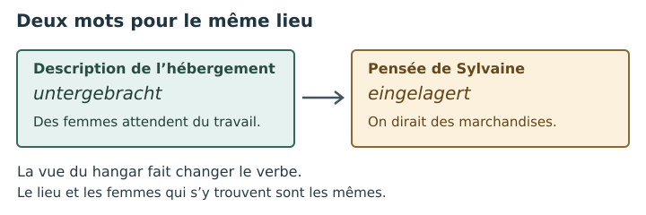

# BEL A/L — Allemand, thème Lyon 2026 · Corrigé brut

*Corrigé rédigé par IA, non officiel. Signalez toute erreur.*

**Rédaction** · GPT-6.2 Astra Ultra · vitesse non renseignée

**Révision (tour 1)** · GPT-6.2 Astra Ultra · vitesse non renseignée

## Thème

Séverine Cressan, *Nourrices* (2025).

Von der Fahrt, die zwei volle Tage und eine Nacht dauern sollte, sind Sylvaine nur einzelne Erinnerungen geblieben. Die kurzen Rastpausen, wenn man dem Pferd Wasser gab und die Frauen sich endlich die Beine vertreten konnten. Die Steigungen oder schwierigen Stellen, an denen man ihnen befahl, zu Fuß hinter dem Karren herzugehen. Die Nacht im Gasthaus, wo ein Teil des Obergeschosses zu einem riesigen Schlafsaal umgebaut worden war, der den Müttern und ihren Kleinen vorbehalten war. Das unbestimmte Gefühl, das sie nie verließ, diesem Mann ausgeliefert zu sein, diesem Allouïn, vor dessen anzüglichen Anspielungen und ordinärem Gelächter sie sich ekelte.

Am Ende der Fahrt sind die Frauen vom Schlafmangel und den Strapazen der Reise erschöpft. Das sieht man an den breiten bläulichen Ringen unter ihren Augen. Als es dunkel wird, setzt Allouïn die Frauen bei der Ammenvermittlung ab. Dort nimmt die Vermittlerin, eine Frau um die fünfzig, sie in Empfang. Gleich darauf führt sie die Frauen in eine geräumige, schlecht gelüftete Lagerhalle. Hier werden die künftigen Ammen untergebracht, die darauf warten, dass jemand sie in Dienst nimmt. Eingelagert, denkt Sylvaine, so sehr erinnert sie der Ort an einen Warenschuppen. Die Halle ist zum Bersten voll. Eine lärmende Menge drängt sich darin, überall stehen Betten im Weg, auf denen verdreckte Strohsäcke liegen. Unruhe und Anspannung sind mit Händen zu greifen. In den Schreien der Säuglinge hallen die Streitereien der Mütter wider. In diesem heillosen Durcheinander wirken die neu angekommenen Frauen wie junge Schauspielerinnen in ihrer ersten Hauptrolle, unerfahren und unbeholfen.

Das Stimmengewirr und die drangvolle Enge lassen eine beschwerliche Nacht erwarten. Voller Sehnsucht denkt Sylvaine an die Wärme ihrer Hütte, an die bescheidene Behaglichkeit dort. Sie fängt an zu bereuen, dass sie überhaupt hierhergekommen ist, und denkt an das Geld, das sie für Fahrt, Unterkunft und Essen ausgegeben hat und das sie wieder hereinverdienen muss. In der Ecke, die ihr die Vermittlerin zugewiesen hat, bereitet sie sich ihr Lager zwischen dem von Mahaut und dem der Rothaarigen. Sie widmet Jehan ihre ganze Aufmerksamkeit, um dem zu entkommen, was sie ringsum erlebt, und schläft schließlich ein.

Am nächsten Morgen führt man Sylvaine, Mahaut, die Rothaarige und vier weitere Bewerberinnen in einen fensterlosen Raum.

