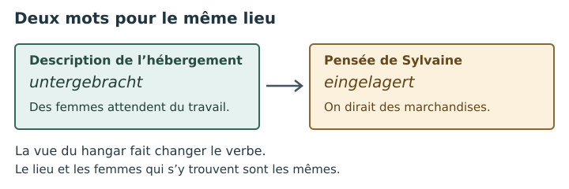

# BEL A/L — Allemand, thème Lyon 2026 · Corrigé guidé

*Corrigé rédigé par IA, non officiel. Signalez toute erreur.*

**Rédaction** · GPT-6.2 Astra Ultra · vitesse non renseignée

**Révision (tour 1)** · GPT-6.2 Astra Ultra · vitesse non renseignée

## Présentation du sujet

L’ENS de Lyon donne quatre heures, sans dictionnaire, pour traduire en allemand un extrait de *Nourrices* (2025) de Séverine Cressan. Sylvaine se souvient du voyage en charrette. À la fin de la journée, elle découvre le lieu où l’on rassemble les femmes en attente d’un emploi de nourrice. L’énoncé donne *die Vermittlerin* pour la femme qui les accueille. Les quatre paragraphes sont à traduire, jusqu’à l’entrée dans la pièce sans fenêtre le lendemain matin. [Sujet officiel, p. 10](https://www.ens-lyon.fr/sites/default/files/2026-04/Epreuve%20de%20sp%C3%A9cialit%C3%A9%202026.pdf#page=10)

## Thème

### Donner un point d’appui à chaque souvenir

> [!INDICATION]
> Compter les souvenirs avant de chercher les verbes allemands. Le dernier désigne-t-il encore une étape du trajet ?

#### Solution

Sylvaine retient les haltes, les montées ou passages difficiles, puis la nuit à l’auberge. Le dernier terme est d’une autre nature. Son malaise en présence d’Allouïn traverse tout le voyage. Traduire chacun des quatre souvenirs par un groupe nominal donne à l’énumération des points d’appui. Dans *diesem Mann ausgeliefert zu sein*, le datif désigne la personne à la merci de laquelle Sylvaine se trouve. Le dégoût revient à Sylvaine. Les allusions et le rire appartiennent à Allouïn.

Le verbe *sollte* place la durée du voyage dans l’avenir vu depuis son début. L’infinitif *dauern* en précise le sens temporel. Il faut distinguer cet emploi de l’ordre donné aux voyageuses sur les pentes, ici traduit par *man befahl ihnen*. Au moment des haltes, un seul cheval reçoit de l’eau. Avec *geben*, la chose donnée est à l’accusatif et son destinataire au datif, d’où *dem Pferd Wasser gab*.

### Entendre le mot que Sylvaine substitue à celui du narrateur

> [!INDICATION]
> Quelle différence le lecteur ressent-il entre l’accueil au bureau et la manière dont Sylvaine se décrit une fois dans le bâtiment ?

#### Solution

La femme chargée de placer les nourrices reçoit les voyageuses, puis les conduit dans le hangar. Le récit emploie d’abord le vocabulaire de l’hébergement. Sylvaine le corrige aussitôt par le mot qui conviendrait à des marchandises. On peut conserver cette irruption de sa voix en isolant *eingelagert* juste après la phrase sur les nourrices. Le mot allemand fait en outre entendre *Lager* dans *Lagerhalle*, si bien que la vue du bâtiment semble lui souffler le terme. Dans *so sehr erinnert sie der Ort an einen Warenschuppen*, *der Ort* est le sujet et *sie* le complément qui désigne Sylvaine.

### Vérifier les cas en suivant les femmes

| Passage | Construction proposée | Lecture |
|---|---|---|
| L’arrivée dans le bâtiment | *in eine … Lagerhalle* | L’accusatif après *in* indique le lieu que les femmes gagnent en suivant la recommandaresse. |
| La foule à l’intérieur | *eine … Menge drängt sich darin* | Le groupe occupe déjà le lieu. *Darin* reprend la halle et permet de passer du trajet à la description. |
| Les couchages voisins | *zwischen dem von Mahaut und dem der Rothaarigen* | Les deux formes *dem* reprennent le neutre *Lager*. Chacune correspond à un couchage situé de part et d’autre de celui de Sylvaine. |
| Le dernier déplacement | *in einen fensterlosen Raum* | Le groupe entre dans une autre pièce. *Man* traduit l’agent indéterminé de la forme passive française et garde ouverte son identité. |

Le bruit et la proximité subie des autres font craindre une nuit pénible. Le souvenir de la chaumière accentue ensuite le regret du voyage. *Bescheidene Behaglichkeit* laisse entendre que la simplicité de la maison avait du prix pour Sylvaine. Le changement d’échelle sonore compte aussi. *Streitereien* désigne les disputes qui se multiplient dans la salle, puis *Stimmengewirr* mêle toutes ces voix dans la perception de Sylvaine. Les dépenses de transport et de séjour rendent son choix difficile à défaire. Elle doit regagner l’argent déjà dépensé, d’où *wieder hereinverdienen*. Dans le dernier geste de la soirée, Jehan devient l’objet de toute son attention et le verbe final signale son endormissement.

> [!JURY]
> Le rapport admet une narration au présent ou au prétérit dans la partie qui commence à l’arrivée, pourvu que le choix soit tenu. Il attire aussi l’attention sur la différence entre un accueil qui a lieu et un aménagement déjà réalisé. Ici, *nimmt … in Empfang* fait assister à l’accueil, et *vorbehalten war* décrit l’usage auquel le dortoir était réservé. [Rapport de l’ENS de Lyon, p. 15 à 24](https://www.ens-lyon.fr/sites/default/files/2026-10/Allemand%202026.pdf#page=15)

### Traduction rédigée

#### Solution

Von der Fahrt, die zwei volle Tage und eine Nacht dauern sollte, sind Sylvaine nur einzelne Erinnerungen geblieben. Die kurzen Rastpausen, wenn man dem Pferd Wasser gab und die Frauen sich endlich die Beine vertreten konnten. Die Steigungen oder schwierigen Stellen, an denen man ihnen befahl, zu Fuß hinter dem Karren herzugehen. Die Nacht im Gasthaus, wo ein Teil des Obergeschosses zu einem riesigen Schlafsaal umgebaut worden war, der den Müttern und ihren Kleinen vorbehalten war. Das unbestimmte Gefühl, das sie nie verließ, diesem Mann ausgeliefert zu sein, diesem Allouïn, vor dessen anzüglichen Anspielungen und ordinärem Gelächter sie sich ekelte.

Am Ende der Fahrt sind die Frauen vom Schlafmangel und den Strapazen der Reise erschöpft. Das sieht man an den breiten bläulichen Ringen unter ihren Augen. Als es dunkel wird, setzt Allouïn die Frauen bei der Ammenvermittlung ab. Dort nimmt die Vermittlerin, eine Frau um die fünfzig, sie in Empfang. Gleich darauf führt sie die Frauen in eine geräumige, schlecht gelüftete Lagerhalle. Hier werden die künftigen Ammen untergebracht, die darauf warten, dass jemand sie in Dienst nimmt. Eingelagert, denkt Sylvaine, so sehr erinnert sie der Ort an einen Warenschuppen. Die Halle ist zum Bersten voll. Eine lärmende Menge drängt sich darin, überall stehen Betten im Weg, auf denen verdreckte Strohsäcke liegen. Unruhe und Anspannung sind mit Händen zu greifen. In den Schreien der Säuglinge hallen die Streitereien der Mütter wider. In diesem heillosen Durcheinander wirken die neu angekommenen Frauen wie junge Schauspielerinnen in ihrer ersten Hauptrolle, unerfahren und unbeholfen.

Das Stimmengewirr und die drangvolle Enge lassen eine beschwerliche Nacht erwarten. Voller Sehnsucht denkt Sylvaine an die Wärme ihrer Hütte, an die bescheidene Behaglichkeit dort. Sie fängt an zu bereuen, dass sie überhaupt hierhergekommen ist, und denkt an das Geld, das sie für Fahrt, Unterkunft und Essen ausgegeben hat und das sie wieder hereinverdienen muss. In der Ecke, die ihr die Vermittlerin zugewiesen hat, bereitet sie sich ihr Lager zwischen dem von Mahaut und dem der Rothaarigen. Sie widmet Jehan ihre ganze Aufmerksamkeit, um dem zu entkommen, was sie ringsum erlebt, und schläft schließlich ein.

Am nächsten Morgen führt man Sylvaine, Mahaut, die Rothaarige und vier weitere Bewerberinnen in einen fensterlosen Raum.
