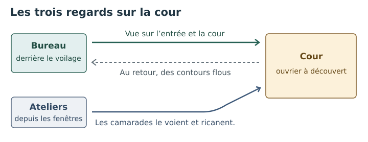

# BEL A/L — Allemand, version et thème Ulm 2026 · Corrigé brut

*Corrigé rédigé par IA, non officiel. Signalez toute erreur.*

**Rédaction** · GPT-6.2 Astra Ultra · vitesse non renseignée

## I. Version

Franz Innerhofer, *Die großen Wörter* (1977).

(La scène se passe dans une usine.)

Les bureaux devaient être à peu près le seul domaine où Feinschmied régnait avec assurance, encore que là aussi ses manières fussent apprises, puisées dans des cours et des manuels de management. Friedrich Baumer, qui avait souvent protégé Richard Feinschmied des emportements de son père au temps où Richard était encore apprenti, dit un jour que tout ce que Feinschmied avait gardé d’autrefois, c’était son haleine infecte. Tout le reste, chez Feinschmied, lui était devenu étranger. Rien d’étonnant à cela d’ailleurs, car les services que Feinschmied arpentait, l’air grave, le visage bronzé, toujours vêtu à la dernière mode, avec ou sans lunettes de soleil, il ne les avait pas conçus lui-même. Il en avait importé des États-Unis le concept tout fait et avait fait reproduire, aux dimensions exactes, ce que des psychologues, des spécialistes de l’économie et des architectes avaient mis au point sous forme de maquette. Ce n’était sûrement pas lui qui avait eu l’idée de se tenir planté derrière une table bien nette d’où l’on pouvait embrasser du regard, à travers le voilage et sans être vu, l’unique entrée des véhicules et la grande cour bétonnée qui s’étendait de cette entrée à la façade des ateliers, jusqu’aux entrepôts tout au fond.

Toute la façade du long bâtiment des bureaux qui donne sur la cour est en verre. Du bureau, on peut voir ce qui se passe dans la cour, mais de la cour, regarder dans le bureau ne sert pas à grand-chose. On ne voit que des contours flous, impossible de rien distinguer. C’est pour cette raison que personne ne voulait travailler dans la cour. On se trouvait là, à découvert, sans défense devant cette maudite paroi de verre, et aux fenêtres des ateliers il y avait toujours des figures qui ricanaient, ravies du spectacle. On montrait le bureau du doigt et, par la porte ouverte de l’atelier, on vous demandait à grands cris si vous étiez passé chez les fanatiques du grand air. À sept heures sonnantes, le gardien, grand amateur d’heures supplémentaires, fermait à clé l’entrée des ouvriers. Ensuite il fallait contourner le bureau, prendre l’entrée des véhicules, traverser la cour, longer la partie vitrée du mur et enfin entrer en tenue de travail dans le bureau, où il fallait donner les raisons de son retard. Les ouvriers rompus à la pointeuse disaient que ce système-là était bien pire que le contrôle par la machine. Dans un cas comme dans l’autre, le temps qui manquait était déduit. Seulement, avec la pointeuse, tu flanques ta carte dedans et puis voilà, ou alors tu règles une fois pour toutes son compte à ce fichu tic-tac, tandis que chez Feinschmied tu te mets à chanter sur un ton bien penaud je ne sais quelle litanie d’excuses. Mais, on l’a dit, ces inventions n’étaient pas de Feinschmied. Feinschmied n’était même pas capable d’aménager son bureau à son goût. Pas un objet personnel auquel on aurait pu s’intéresser. Rien que du goût d’architecte, des produits conçus par on ne sait quelles têtes, fabriqués par on ne sait quelles mains et quelles machines. Même de ses coûteux voyages, il ne rapportait rien. Un cube de verre qui lui était étranger et où même lui ne supportait pas de rester. Pas étonnant qu’on se mette à transpirer devant lui.

## II. Thème

Béatrice Commengé, *En face du jardin. Six jours dans la vie de Rainer Maria Rilke* (2007).

Die Nacht ist noch nicht hereingebrochen. Rilke hat die Bahnhofshalle durchquert und ist ohne zu zögern auf den früheren Droschkenstand zugegangen. Die Wagen warten noch immer an derselben Stelle. Viel mehr Motoren, weniger Pferde. Er hält nach jenen reizenden kleinen Omnibussen Ausschau, die Benvenuta so sehr gefielen. Denn plötzlich fällt ihm ein, dass er seine letzte »Ankunft« mit ihr erlebt hat, Ende März 1914 (oder war es die vorletzte? Hatte es nicht einen Monat später diese törichte Flucht nach Assisi gegeben, aus einer Laune heraus?). Er sieht noch ihr so fröhliches Gesicht vor sich, als sie auf den roten Plüschsitzen Platz genommen hatten, unter den kleinen, mit frischen Blumen geschmückten Spiegeln, die zwischen den Fenstern festgeschraubt waren. Sie hatten sich nebeneinandergesetzt, und er erklärte ihr Paris. In jenem Augenblick hielt er sich für glücklich. Benvenuta… Er hat schon lange nicht mehr an Benvenuta gedacht. Auf der Fahrbahn wird der Fahrer ungeduldig. Paris, da vor ihm. »Wie viel Wirklichkeit in dieser Stadt« – immer wieder drängt sich ihm dieses eine Wort auf.

Der Wagen ist in den Boulevard de Sébastopol eingebogen, um zur Place du Châtelet zu gelangen, den Pont au Change zu überqueren und den Boulevard Saint-Michel hinaufzufahren, immer geradeaus, es ist so einfach, bis zum Jardin du Luxembourg. Dann ist er nach rechts in die Rue de Médicis abgebogen, am Gitter entlang bis zur Rue de Vaugirard gefahren, wo er seinen Fahrgast an der Ecke zur Rue de Tournon, vor der Nummer 33, abgesetzt hat. Vor dem alten Hotel Foyot.

Alles ist da. An seinem Platz. Der Fluss, die Straßen, das Licht. Und das Postamt, gleich gegenüber. Eine unmittelbare Berührung. Eine »vollkommene, unerschöpfliche« Versöhnung. Hätte der Wagen in einem Anfall von Wahnsinn kehrtgemacht und ihn jäh in die Schweiz zurückbefördert, so wäre er schon wunschlos glücklich gewesen. Aber der Wagen setzt ihn ab, hier, auf dem Bürgersteig, vor dem Portal des Hotels. Sein Zimmer ist seit über einer Woche reserviert.

