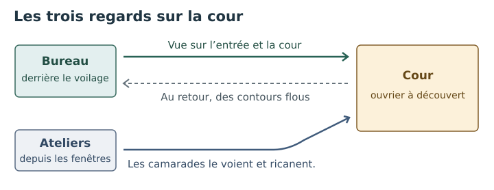

# BEL A/L — Allemand, version et thème Ulm 2026 · Corrigé guidé

*Corrigé rédigé par IA, non officiel. Signalez toute erreur.*

**Rédaction** · GPT-6.2 Astra Ultra · vitesse non renseignée

## Présentation du sujet

L’épreuve d’option d’Ulm dure six heures. La page 2 du livret donne la version, une scène d’usine tirée de *Die großen Wörter* (1977). La page 3 donne le thème, un extrait d’*En face du jardin. Six jours dans la vie de Rainer Maria Rilke* de Béatrice Commengé (2007). Le chapeau qui date la scène du retour à Paris est marqué d’un astérisque et dispensé de traduction. L’allemand commence donc avec la tombée de la nuit. [Sujet officiel, p. 2 et 3](https://www.ens.psl.eu/sites/default/files/al_opt_lve_vers-theme_261109.pdf#page=2)

Le livret imprime « Franz Innenhofer » sous la version. L’éditeur du roman donne la graphie Franz Innerhofer, retenue ici. [Notice de Residenz Verlag](https://www.residenzverlag.com/buch/die-grossen-worter)

## I. Version

### Situer les regards dans l’usine

> [!INDICATION]
> Relever les deux points de départ indiqués par *vom … aus*. Si un ouvrier arrive en retard, à partir de quel moment peut-il être vu ?

#### Solution

La paroi vitrée donne sur la cour. Du bureau, le regard porte jusqu’aux entrepôts du fond, à travers le voilage. De la cour, l’ouvrier perçoit seulement des contours. Les ouvriers postés aux fenêtres des ateliers disposent d’un troisième point de vue. Ils voient leur camarade exposé et lui lancent leurs plaisanteries. Après sept heures, le retardataire doit passer par l’entrée des véhicules. Il se trouve déjà à découvert bien avant de pouvoir expliquer son retard.

Deux composés précisent la géométrie du parcours. *Arbeitereingang* désigne l’accès des ouvriers, celui que le gardien verrouille. *Hofeinfahrt* donne accès à la cour par une voie carrossable. Si l’on traduit les deux par « entrée » sans autre précision, la nécessité du détour disparaît.

### Faire entendre les changements de voix

| Indice | Choix de traduction |
|---|---|
| *dürften … gewesen sein* | Le locuteur avance une supposition sur le passé. « Devaient être à peu près » transmet la nuance et laisse entendre sa réserve. |
| *habe* puis *sei* après les paroles de Baumer | Le subjonctif I allemand prolonge le discours de Baumer sur deux phrases. En français, le « lui » de la deuxième rattache encore le constat à l’homme qui a connu Richard apprenti. |
| *hatte … nachbauen lassen* | Feinschmied fait construire d’après un modèle. Le tour « avait fait reproduire » distribue les rôles entre le commanditaire, les concepteurs et les exécutants. |
| *man* puis *du* | La description s’ouvre à l’expérience commune de l’ouvrier. « Tu flanques ta carte dedans » restitue le brusque tutoiement et la brutalité familière du geste. |
| *Entschuldigungsgesänge* | Au vacarme du tic-tac succède le « chant » de l’ouvrier contraint de plaider sa cause. « Litanie d’excuses » donne à entendre le rituel de cette justification. |

La description de la façade passe au présent. Garder ce présent pour la vue depuis le bureau, puis reprendre l’imparfait quand on revient à ce que voulaient les ouvriers, restitue le mouvement du récit. À la fin, les phrases nominales dressent l’inventaire du bureau. Le dernier *ihm* peut faire entendre le retour à Feinschmied. En gardant un nom masculin pour le cube de verre, on laisse aussi ce lieu de surveillance dans le champ de « devant lui ».

### Version rédigée

#### Solution

(La scène se passe dans une usine.)

Les bureaux devaient être à peu près le seul domaine où Feinschmied régnait avec assurance, encore que là aussi ses manières fussent apprises, puisées dans des cours et des manuels de management. Friedrich Baumer, qui avait souvent protégé Richard Feinschmied des emportements de son père au temps où Richard était encore apprenti, dit un jour que tout ce que Feinschmied avait gardé d’autrefois, c’était son haleine infecte. Tout le reste, chez Feinschmied, lui était devenu étranger. Rien d’étonnant à cela d’ailleurs, car les services que Feinschmied arpentait, l’air grave, le visage bronzé, toujours vêtu à la dernière mode, avec ou sans lunettes de soleil, il ne les avait pas conçus lui-même. Il en avait importé des États-Unis le concept tout fait et avait fait reproduire, aux dimensions exactes, ce que des psychologues, des spécialistes de l’économie et des architectes avaient mis au point sous forme de maquette. Ce n’était sûrement pas lui qui avait eu l’idée de se tenir planté derrière une table bien nette d’où l’on pouvait embrasser du regard, à travers le voilage et sans être vu, l’unique entrée des véhicules et la grande cour bétonnée qui s’étendait de cette entrée à la façade des ateliers, jusqu’aux entrepôts tout au fond.

Toute la façade du long bâtiment des bureaux qui donne sur la cour est en verre. Du bureau, on peut voir ce qui se passe dans la cour, mais de la cour, regarder dans le bureau ne sert pas à grand-chose. On ne voit que des contours flous, impossible de rien distinguer. C’est pour cette raison que personne ne voulait travailler dans la cour. On se trouvait là, à découvert, sans défense devant cette maudite paroi de verre, et aux fenêtres des ateliers il y avait toujours des figures qui ricanaient, ravies du spectacle. On montrait le bureau du doigt et, par la porte ouverte de l’atelier, on vous demandait à grands cris si vous étiez passé chez les fanatiques du grand air. À sept heures sonnantes, le gardien, grand amateur d’heures supplémentaires, fermait à clé l’entrée des ouvriers. Ensuite il fallait contourner le bureau, prendre l’entrée des véhicules, traverser la cour, longer la partie vitrée du mur et enfin entrer en tenue de travail dans le bureau, où il fallait donner les raisons de son retard. Les ouvriers rompus à la pointeuse disaient que ce système-là était bien pire que le contrôle par la machine. Dans un cas comme dans l’autre, le temps qui manquait était déduit. Seulement, avec la pointeuse, tu flanques ta carte dedans et puis voilà, ou alors tu règles une fois pour toutes son compte à ce fichu tic-tac, tandis que chez Feinschmied tu te mets à chanter sur un ton bien penaud je ne sais quelle litanie d’excuses. Mais, on l’a dit, ces inventions n’étaient pas de Feinschmied. Feinschmied n’était même pas capable d’aménager son bureau à son goût. Pas un objet personnel auquel on aurait pu s’intéresser. Rien que du goût d’architecte, des produits conçus par on ne sait quelles têtes, fabriqués par on ne sait quelles mains et quelles machines. Même de ses coûteux voyages, il ne rapportait rien. Un cube de verre qui lui était étranger et où même lui ne supportait pas de rester. Pas étonnant qu’on se mette à transpirer devant lui.

## II. Thème

### Reconstituer les temps d’une arrivée

> [!INDICATION]
> À la gare, qui appartient au souvenir de 1914, et qui se tient sur la chaussée dans le présent du récit ? De quoi Rilke est-il encore capable de douter ?

#### Solution

Le visage de Benvenuta appartient au souvenir des sièges de peluche. Le chauffeur impatient attend dans le présent de la scène parisienne. Rilke hésite sur le rang qu’il doit attribuer à l’arrivée de fin mars 1914, la dernière ou l’avant-dernière. Les deux questions entre parenthèses donnent directement accès à ce doute. Transformer l’épisode d’Assise en une affirmation fermerait prématurément la parenthèse.

*Hat … durchquert* présente la traversée du hall comme déjà accomplie au moment où Rilke regarde les voitures. *Hatten … Platz genommen* situe l’installation des deux voyageurs à l’intérieur du souvenir. *Er erklärte ihr Paris* peut ensuite laisser durer, au prétérit, la scène qu’il revoit. À la fin, *setzt ihn ab* revient au présent sur un geste que le paragraphe précédent a déjà raconté au parfait.

### Suivre la voiture jusqu’au seuil

Les trois premiers infinitifs indiquent la destination, la traversée du pont, puis la remontée du boulevard. Le second groupe de verbes commence avec le virage à droite. Garder « toujours tout droit » à l’intérieur du premier groupe fait entendre l’aisance de Rilke, qui retrouve le chemin. Conserver aussi la phrase détachée « devant le vieil hôtel » permet de passer de l’itinéraire à la reconnaissance du lieu.

Le chauffeur s’impatiente, mais c’est la voiture qui, dans l’hypothèse finale, pourrait devenir folle et reconduire Rilke en Suisse. *Der Wagen* reste donc le sujet des verbes de mouvement. L’inversion *Hätte der Wagen …* introduit l’irréel du passé. Le groupe *wäre … gewesen* indique que, même dans cette éventualité, le simple contact avec Paris aurait déjà comblé Rilke.

Pour les miroirs et les bouquets, vérifier chaque rattachement. *Mit frischen Blumen geschmückt* qualifie les petits miroirs, et *zwischen den Fenstern festgeschraubt* en précise la fixation. Dans la dernière phrase, la réservation faite depuis plus d’une semaine est encore valable. Le présent d’état *ist … reserviert* accompagné de *seit* restitue cette continuité.

### Thème rédigé

#### Solution

Die Nacht ist noch nicht hereingebrochen. Rilke hat die Bahnhofshalle durchquert und ist ohne zu zögern auf den früheren Droschkenstand zugegangen. Die Wagen warten noch immer an derselben Stelle. Viel mehr Motoren, weniger Pferde. Er hält nach jenen reizenden kleinen Omnibussen Ausschau, die Benvenuta so sehr gefielen. Denn plötzlich fällt ihm ein, dass er seine letzte »Ankunft« mit ihr erlebt hat, Ende März 1914 (oder war es die vorletzte? Hatte es nicht einen Monat später diese törichte Flucht nach Assisi gegeben, aus einer Laune heraus?). Er sieht noch ihr so fröhliches Gesicht vor sich, als sie auf den roten Plüschsitzen Platz genommen hatten, unter den kleinen, mit frischen Blumen geschmückten Spiegeln, die zwischen den Fenstern festgeschraubt waren. Sie hatten sich nebeneinandergesetzt, und er erklärte ihr Paris. In jenem Augenblick hielt er sich für glücklich. Benvenuta… Er hat schon lange nicht mehr an Benvenuta gedacht. Auf der Fahrbahn wird der Fahrer ungeduldig. Paris, da vor ihm. »Wie viel Wirklichkeit in dieser Stadt« – immer wieder drängt sich ihm dieses eine Wort auf.

Der Wagen ist in den Boulevard de Sébastopol eingebogen, um zur Place du Châtelet zu gelangen, den Pont au Change zu überqueren und den Boulevard Saint-Michel hinaufzufahren, immer geradeaus, es ist so einfach, bis zum Jardin du Luxembourg. Dann ist er nach rechts in die Rue de Médicis abgebogen, am Gitter entlang bis zur Rue de Vaugirard gefahren, wo er seinen Fahrgast an der Ecke zur Rue de Tournon, vor der Nummer 33, abgesetzt hat. Vor dem alten Hotel Foyot.

Alles ist da. An seinem Platz. Der Fluss, die Straßen, das Licht. Und das Postamt, gleich gegenüber. Eine unmittelbare Berührung. Eine »vollkommene, unerschöpfliche« Versöhnung. Hätte der Wagen in einem Anfall von Wahnsinn kehrtgemacht und ihn jäh in die Schweiz zurückbefördert, so wäre er schon wunschlos glücklich gewesen. Aber der Wagen setzt ihn ab, hier, auf dem Bürgersteig, vor dem Portal des Hotels. Sein Zimmer ist seit über einer Woche reserviert.
