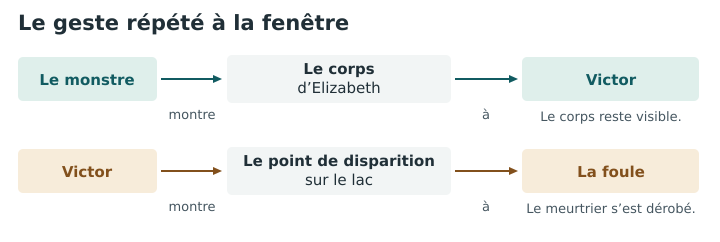

# BEL A/L — Anglais, commentaire et traduction 2026 · Corrigé guidé

*Corrigé rédigé par IA, non officiel. Signalez toute erreur.*

**Rédaction** · GPT-6.2 Astra Ultra · vitesse non renseignée

**Autocontrôle** · GPT-6.2 Astra Ultra · vitesse non renseignée

**Révision** · GPT-6.2 Astra Ultra · vitesse non renseignée

**Retouches** · GPT-6.2 Astra Ultra · vitesse non renseignée

**Révision (tour 2)** · GPT-6.2 Astra Ultra · vitesse non renseignée

**Révision (tour 3)** · GPT-6.2 Astra Ultra · vitesse non renseignée

Garde commune de l’ENS de Lyon et de l’ENS (Paris), portant aussi l’ENS Paris-Saclay pour l’anglais.

## Présentation du sujet

Les deux exercices portent sur le même extrait de *Frankenstein* de Mary Shelley. Le commentaire en anglais va du débarquement des époux à la dispersion des chercheurs, lignes 1 à 59. La version commence au départ d’Elizabeth, ligne 22, et s’achève sur l’évanouissement de Victor, ligne 36. Dans cette épreuve de six heures avec dictionnaire unilingue autorisé, tracer ces bornes dès la première lecture évite de confondre le réveil de Victor, ligne 37, avec la fin du passage à traduire.

Le texte de la version tient sur la page 4. La page 5 poursuit le récit après l’évanouissement. Les retours au présent et les deux gestes à la fenêtre permettent d’expliquer comment Victor parle à un auditoire qui n’a pas vu la scène.

[Sujet officiel, pages 4 et 5](https://www.ens.psl.eu/sites/default/files/al_lve_commun_commentaire_traduction_2026.pdf#page=4) · [Rapport du jury, partie écrite, pages 2 à 23](https://www.ens-lyon.fr/sites/default/files/2026-10/Anglais%202026.pdf#page=2)

## Commentaire

### Construire une question à partir d’un détail

> [!INDICATION]
> Relever qui peut entendre la question d’Elizabeth au début et qui peut voir la créature à la fin. Que manque-t-il, chaque fois, pour que deux personnes sachent la même chose ?

#### Solution

Victor identifie l’origine du cri, peut imaginer Elizabeth endormie après que quelqu’un l’a déplacée et interprète le sourire aperçu à la fenêtre. Chaque détail pose la même question de lecture. Comment le récit rend-il sensibles les limites du témoignage de Victor alors même que celui-ci nous fait voir la scène avec une telle intensité ?

### Organiser les preuves

| Axe de lecture | Passages à rapprocher | Question à résoudre |
|---|---|---|
| Voir et entendre dans une scène gothique | Le reflet de la lune et des nuages sur le lac (l. 4–8), la chambre éclairée par la lune (l. 47–52), le cri et le coup de feu (l. 25–30 et 53–56). | Que peut-on percevoir directement ? Que faut-il reconstituer à partir de ce qui est perçu ? |
| Lire le corps d’autrui | Les questions d’Elizabeth et le duel imaginé par Victor (l. 10–21), son immobilité entre les deux cris (l. 26–29), les deux attitudes du corps d’Elizabeth (l. 32–35 et 40–46). | Comment un homme si sensible aux mouvements de son propre corps a-t-il pu se tromper sur le danger couru par sa femme ? |
| Faire partager un souvenir | Les présents du récit (l. 31 et 34), les deux gestes de désignation (l. 51–56), les « we » et le « they » (l. 1 et 56–59). | Pourquoi le geste du témoin convainc-il si mal ses compagnons alors que l’image obsède encore celui qui raconte ? |

Retrouver le sujet de chacun des deux gestes avant d’identifier les témoins. Le second geste permet à Victor d’indiquer un lieu. Il donne à la foule un point de départ pour ses recherches, sans lui fournir la même expérience qu’au narrateur.

> [!JURY]
> À la page 4, le jury demande de construire une interprétation en rapprochant des particularités de l’extrait. On peut ainsi étudier ensemble le cri d’Elizabeth et le bruit du coup de feu. Victor accourt à la chambre, puis la foule y accourt à son tour. Dans les deux cas, le bruit conduit au lieu d’un événement dont l’action principale échappe au regard.

### Commentaire rédigé

#### Solution

Elizabeth asks the simplest and most urgent question in this passage from Mary Shelley's *Frankenstein* (1818). What does Victor fear? He can describe his feelings with extraordinary precision to Walton, who hears his story afterwards. On his wedding night he can give his wife no answer that would help her act. The murder itself takes place out of his sight. How does Shelley make the limits of Victor's testimony felt in the very intensity of his account? The Gothic scene draws the reader into his acts of looking. His attention to bodies then exposes a blind spot in his understanding of Elizabeth, and the difficulty of sharing what he has seen gives his story its peculiar force as testimony.

The couple's first pleasure together is to make out shapes in failing light. The adjective “transitory” (l. 2) sets a limit on that pleasure. The wind dies down in the south only to rise in the west. On the lake the waves lend the reflection of the clouds a motion over and above their own (ll. 4–8). An act of looking can register more movement than its object possesses. Shelley puts this effect to work again inside the inn. When the shutters are thrown back, moonlight makes the figure at the window visible and induces “a kind of panic” (ll. 47–51). The reader sees the creature through the aperture of the window and through the account of someone already afraid. The grin is visible. Its intention as a jeer remains an inference, marked by “seemed” (l. 51). Even at its most sharply lit the scene leaves something for Victor to supply.

Sound offers a different kind of access to the murder. Before Elizabeth leaves, every noise alarms Victor as he waits for a combat that never takes place (ll. 10–13). Her cry, by contrast, breaks into a sentence still occupied with his hopeful conjecture. The part of the house he chose for her becomes the one place towards which he must now run. Later the report of his pistol brings a crowd into the room (ll. 53–56). They can see the man who fired, but the figure he fired at has gone. The witnesses do not all miss the same thing. Victor hears Elizabeth before he can see what has happened to her. The crowd hears Victor before it can see what he fired at. The reader's position resembles theirs. We hear the cry through Victor, see what he finds afterwards and have to piece together the missing action.

That gap matters because Victor has already given the danger a plot. The alternatives he imagines are his own death and his adversary's. Elizabeth has no place in that sentence, although she is standing close enough to notice his agitation (ll. 10–15). Her two questions move from what she can observe to what she cannot know. His reply gives her a time, insistently repeated, in place of an explanation. He imagines what witnessing his combat would do to her and begs her to leave. The “bridal bier” (l. 35) gives that gesture its terrible consequence in a single phrase. The bed on which the couple should have met has become the place where he sees the body of the wife he meant to spare.

Victor's most searching account of a body is, at first, an account of his own. Between the two cries each muscle stops moving, yet he feels the blood travelling all the way to his extremities (ll. 26–29). The man who once gave dead matter life discovers how little power being alive gives him over his own limbs. Elizabeth's limbs, in turn, seem to offer contradictory evidence. At first the hanging head and the hair across the face give her body the weight of something thrown. Once her head rests on her arm she could almost be asleep. The qualification in “might have supposed” (l. 42) matters. Victor knows how readily a change of posture can alter what a witness sees. Embracing her brings the coldness of the limbs home to him. The intimate sequence of names, “my love, my wife” (l. 40), gives way to the impersonal “what” he now holds (l. 44). The reader has heard Elizabeth speak and can feel what is lost in that change of grammar.

What can Victor pass on to anyone else? The question arises most sharply in two pointing gestures. At the window the creature directs Victor's eye towards the body. When the crowd comes, Victor points to the spot where the creature has disappeared (ll. 51–56). The first gesture supplies its own visible evidence. The second asks others to imagine someone they cannot see. The companions take to the water with Victor and cast nets. Most come to doubt his account, although the search continues on land. Even the pronouns register how far his experience can be shared. The initial “we” takes in the couple's walk (l. 1), another “we” brings the searchers back ashore, and “they” sets them off in different directions (ll. 56–59).

For Victor himself, the difficulty lies in escaping what he has seen. In the room his narrative breaks out of its past tense. The question of why he is “here” (l. 31) belongs to the man who has survived to tell the story. Wherever he turns, he still sees the same shape (l. 34). His companions needed him to show them something that had gone. Walton, and through him the reader, must listen to a man for whom what happened that night will never quite be past. The precision of the description makes that burden intelligible even as the account reveals how decisively Victor misread the danger while Elizabeth lived.

Elizabeth dies between a question her husband leaves unanswered and a cry he understands at once. Shelley's telling makes us inhabit both moments. We can recognise the truth of Victor's grief from the way a gesture, a patch of moonlight or a glimpse of a body persists in his language. That same language preserves enough of Elizabeth's question for us to hear what went unanswered while she could still speak.

## Version — lignes 22 à 36

> [!INDICATION]
> Repérer d’abord ce que Victor faisait déjà au moment où il entend le cri. Repérer ensuite le premier verbe qui le ramène au moment où il raconte.

#### Solution

Elle me laissa. Quelque temps encore, j’arpentai les couloirs de la maison, scrutant le moindre recoin où mon adversaire eût pu trouver refuge. Je ne trouvai pourtant nulle trace de lui et je commençais à me figurer que quelque heureux hasard était intervenu pour l’empêcher de mettre ses menaces à exécution, quand soudain j’entendis un cri perçant et effroyable. Il venait de la chambre où Elizabeth s’était retirée. Quand je l’entendis, toute la vérité s’imposa d’un coup à mon esprit. Mes bras retombèrent. Tout mouvement cessa dans chacun de mes muscles, dans chacune de mes fibres. Je sentais mon sang couler goutte à goutte dans mes veines et, aux extrémités de mes membres, le picotement qu’il y provoquait. Je ne demeurai qu’un instant dans cet état. Le cri retentit de nouveau et je me précipitai dans la chambre.

Grand Dieu ! Que ne suis-je mort à cet instant ! Pourquoi suis-je ici à relater la perte du plus bel espoir et de la plus pure créature de cette terre ? Elle gisait là, sans vie et sans mouvement, jetée en travers du lit, la tête pendante, ses traits pâles et déformés à demi voilés par ses cheveux. De quelque côté que je me tourne, je vois la même silhouette — ses bras exsangues, son corps affaissé que le meurtrier a précipité sur son catafalque nuptial. Comment pouvais-je contempler ce spectacle et vivre encore ? Hélas ! La vie s’obstine et jamais elle ne s’attache à nous si étroitement que lorsque nous la haïssons le plus. Un instant seulement, je perdis le souvenir de tout. Je m’évanouis.

### Justifier trois décisions de traduction

**L’action interrompue.** La conjecture était en train de se former au moment où le cri l’interrompt. L’imparfait ménage cette place à l’événement. À « je commençais » répond « j’entendis » au passé simple. La traduction du second cri doit également rendre le redémarrage de Victor après un arrêt d’un instant.

**La distance entre la chambre et le récit.** La première interrogation après l’entrée dans la chambre porte sur l’instant où Victor aurait voulu mourir. La suivante concerne sa présence au moment de parler. Le présent revient encore lorsqu’il se tourne et retrouve toujours la même silhouette. Mettre toute la scène au passé effacerait la persistance de cette vision.

**Le lit des époux.** Un *bier* est un support funèbre sur lequel on dépose le mort. *Catafalque nuptial* maintient le sens funéraire du nom et la contradiction avec l’adjectif. Le lit est encore nommé à la ligne 33. Deux lignes plus loin, *bier* fait voir au même emplacement l’appareil d’une cérémonie funèbre.

## Bilan

À la relecture du commentaire, vérifier que chaque interprétation précise qui voit, entend ou touche. À la relecture de la version, suivre dans la marge le passage de la marche au cri, du cri à l’immobilité, de l’immobilité à l’élan. Le dernier point du français tombe avec l’évanouissement.
