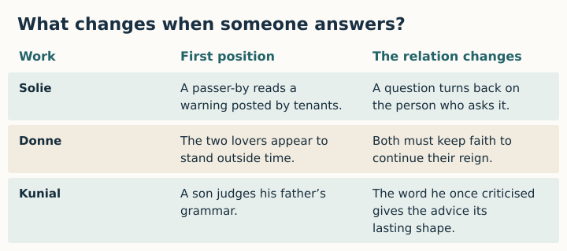
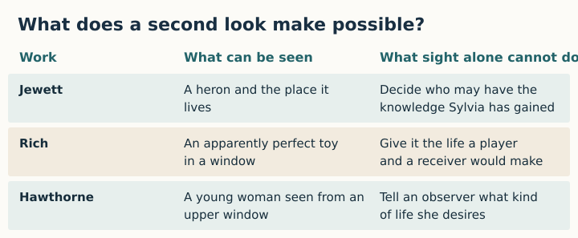

# BEL A/L · Anglais tronc commun du 16 juin 2026 — Corrigé guidé partiel

*Corrigé rédigé par IA, non officiel. Signalez toute erreur.*

**Rédaction** · GPT-6.2 Astra Ultra · vitesse non renseignée

La feuille de l’ENS cite onze titres. Quatre poèmes sont expliqués sur toute leur longueur publiée, ceux de Donne, Shelley, Kunial et Rich. Les vers disponibles du poème de Solie font l’objet d’une explication partielle. Les nouvelles de Jewett et Hawthorne sont étudiées sur leur texte publié, mais les extraits de concours restent à délimiter. Les quatre autres ouvrages sont cités sans passage identifiable.

[Feuille officielle du 16 juin](https://www.ens.psl.eu/sites/default/files/anglais_tronc_commun_listes-sujets-16-juin.pdf) · [Rapport du jury](https://www.ens.psl.eu/sites/default/files/2026_al_rapport_oral_anglais_tc.pdf)

## Préparer le commentaire en anglais

Le jury prévoit 1 h 30 de préparation, puis vingt minutes d’exposé au maximum et dix minutes d’entretien. Il conseille de lire une dizaine de lignes, de justifier ce choix et de faire progresser un raisonnement en deux ou trois parties. Les sept explications portent sur des billets distincts.

**Solie.** Distinguez trois voix, celles des locataires à la fenêtre, de la personne qui se demande pourquoi ils ne partent pas et de la voix qui répond au lecteur. Dans la phrase sur le loyer, cachez d’abord le verbe principal. Qu’avez-vous appris sur le logement avant de savoir combien il coûte ?

**Donne.** Dessinez une ligne pour l’intervalle mesuré par l’anniversaire, une autre pour la journée perpétuelle de la première strophe. Ajoutez l’hypothèse des deux tombes, puis les soixante années souhaitées. La condition qui rend le règne des amants possible est contenue dans une exception grammaticale.

**Shelley.** Répartissez les verbes entre le nuage, les autres puissances qui le dirigent et les observateurs au sol. Reliez le regard sur les reflets de la lune au dernier regard sur le ciel bleu. Pourquoi le monument funéraire serait-il la preuve d’un décès pour une voix et un sujet d’hilarité pour l’autre ?

**Kunial.** Rejouez la même scène de la porte en deux temps. D’abord un fils croit devoir corriger la syntaxe d’un père. Puis un adulte se souvient qu’il n’arrivait lui-même à expliquer ni son repli ni sa honte. La position matérielle de l’article avant un rejet peut servir de preuve quand vous passez d’un âge de l’écoute à l’autre.

**Jewett.** À la première lecture, notez ce que le chasseur tient pour une découverte. À la deuxième, notez le point de vue du sommet du pin et le souvenir qui empêche Sylvia de parler. La promesse de dix dollars est concrète. Le lecteur doit pouvoir entendre la valeur de ce à quoi son silence lui fait renoncer.

**Rich.** Mimez une passe. À quel moment les mains qui lancent n’ont-elles plus la balle, alors que celles qui recevront le lancer ne l’ont pas encore ? Cherchez dans la troisième strophe l’équivalent verbal de cet intervalle. Relisez alors le dernier mot de la quatrième, qu’on pourrait d’abord entendre comme un compliment à l’adresse de la collectionneuse.

**Hawthorne.** Pour le début et pour la fin, placez sur un croquis le personnage à la fenêtre et celui qui est regardé dans le jardin. Recueillez ensuite deux descriptions incompatibles de Béatrice et une phrase où elle exprime directement son désir. Le changement de point de vue modifie la portée morale de la dernière intervention.

## 1. Karen Solie, “Toronto the Good” · passages publiés

Le fascicule donne la date du recueil *Wellwater*, 2025. *The Sewanee Review* publiait déjà le poème en 2019. Son aperçu permet de travailler l’ouverture jusqu’au retour personnel sur la ville. Un entretien avec Solie cite un autre passage sur les visites d’appartements. L’analyse porte sur ces vers attestés. [Entretien sur *Wellwater*](https://www.theguardian.com/books/2026/jan/21/there-is-a-sense-of-things-careening-towards-a-head-ts-eliot-prize-winner-karen-solie)

**Who has the right to describe a home?** A notice appears in an upstairs window on Sherbourne. Before we even know what it says, we know the size of its letters and the distance across which it must be read. The tenants have turned part of a dwelling into a place of public address. Their capitals name the landlords, warn strangers away and explain the warning by comparing the tenants’ treatment to the treatment of animals. The street now carries testimony that a rental advertisement would have no reason to print.

Two kinds of reply follow. The mark on a plague house and the plea for mercy lend the notice the force of a collective emergency. Then a colloquial voice wonders why the tenants do not leave. There is a change in the direction of address. What looked like a question about the tenants becomes an examination of what the listener knows about moving. The abrupt second-person answer places the burden on the passer-by. The following sentence offers material evidence. A catalogue of cheap finishes, cramped units, inadequate maintenance and poor light delays the verb that states what has happened to the rent. Syntax makes us spend time examining the damage before letting us hear the price. The speaker’s declaration of love for this place uses the past tense. Criticism arises out of attachment and acquires the force of an elegy.

In the lines about viewing flats cited in the interview, the promising terms of the advertisements give way to a comparison with miniature museums of illegality. The emphasis on what *we* persuaded ourselves to accept prevents the voice from taking refuge in the role of a morally superior onlooker. The tenants can read the euphemisms as clearly as anyone else. The question is what freedom they have to act on that reading.

**Interview. What does the sign do that a complaint in private could not?** A window lets someone outside read the words without entering the landlord’s property. The poem then adopts the same outward-facing structure by placing a direct question about the city’s rents before its own reader.

[Texte de travail · Solie](https://thesewaneereview.com/articles/toronto-good)

## 2. John Donne, “The Anniversary”

**Suggested reading.** Read the final stanza, paying particular attention to the turn after the safety of the lovers has been asserted. The exception to that security is so small in grammatical extent and so consequential in meaning that the voice should allow it to register.

**What can an anniversary measure if love is beyond time?** The first stanza brings the seemingly most secure things in the world within the scope of ageing. The list includes kings, the gifts on which political and social distinction depend, and the sun that allows days to be counted. The very instrument that measures time becomes subject to its own measurement. Love alone appears to escape the consequence. The verb for running gives it motion without giving time power to take it away. Past and future are collapsed into an everlasting first day. One might expect so complete a proposition to make a second anniversary unnecessary.

Instead, two graves appear at the head of the next stanza. The numeral names an inescapably physical objection. Bodies that once communicated through sight and hearing will be separated. Tears and oaths remind us how much the province of an immaterial love has depended on the senses. The poem imagines the souls after death having love as their essential inhabitant. Could love even increase there? The suggestion is attractive but raises a new problem. Heaven will bless the lovers along with everybody else. To be one of the blessed would be to relinquish a distinction the pair can experience on earth.

That distinction is political in form. Each lover can be at once the other’s subject and sovereign. The grammar of the pronoun gives this little kingdom a genuine advantage over the monarchies named at the outset. No outsider can betray it. The exception, quietly inserted, is either member of the couple. The peril is exactly as intimate as the privilege. The commands with which the poem ends consequently express a choice about how the two will live. The speaker imagines years being added to years until they can reckon sixty, and numbers the year of their reign as the second. Eternal love gets its most convincing human expression in an act of dating. A calendar becomes a way of renewing responsibility to the other person.

**Interview. Why are there two graves but just one reign?** Death makes the existence of two bodies unavoidable. The metaphor of the reign lets two people share power without dissolving either person’s capacity to betray or sustain it.

[Texte de travail · Donne](https://www.poetryfoundation.org/poems/50336/the-anniversary-56d22d56d635f)

## 3. Percy Bysshe Shelley, “The Cloud”

**Suggested reading.** Read the final stanza. Carry the line about passing through the earth and water into the short declaration about change. In the last four lines, make room for the comic pleasure with which the speaker can attend its own memorial.

**How does the voice persuade us that it survives its many different shapes?** A cloud could easily be a fleeting object contemplated from the ground. Shelley gives it a sustained first person. It can be identified by what it does, how it sees and what kind of time its operations inhabit. The short internal echoes in the long lines keep bringing different things together before the rhyme at the end of a shorter line gives the ear a rest. Motion repeatedly produces enough pattern for a voice to remain recognisable.

At first, rain and shade make the cloud valuable to flowers and leaves. Its capacity for tenderness is immediately complicated by its more violent behaviour. One and the same subject can wield hail like a flail and dissolve it into rain. Later, forces often named as the cloud’s possessions or dependants have powers of their own. Lightning pilots it, thunder struggles and howls. The sun leaps aboard and, at sunset, the cloud with folded wings resembles a resting dove. In the sunrise passage an eagle poised on an unstable crag suggests the energy of apparent stillness. A natural object that performs so many parts can also become the setting for someone else’s part. No single figure will accommodate it for long.

The moon’s passage shows what a change of viewpoint can do to the visible world. A tear in the cloud’s imagined roof lets stars appear to move. The opening widens until the bodies of water below seem paved with the same stars and moon. Their apparent depth becomes a surface one could walk on. Later a rainbow becomes a triumphal arch. The earth and the light above participate in making the colours across which the cloud claims to march. Its claim to triumph is joyous and theatrical, while its descriptions repeatedly reveal how much it owes to the conditions around it.

The final stanza names earth and water as parents and sky as nurse. Such genealogy turns permanent circulation into an intimate family history. A blue sky after rain might look to an observer on the ground like an empty monument. The cloud itself can laugh at that reading because it knows where its water has gone. The final comparisons to birth and to a figure rising from the grave give two opposite accounts of one reappearance. Its last action undoes the dome that sunlight and air had appeared to finish. For this voice, a finished sky would be the real fiction.

**Interview. Does personification simply turn the cloud into a human being?** The same speaker can be a parent-like protector, a resting bird, a roof and the person passing through an arch. These shifting relations help us follow a continuity that no single human biography or solid object could represent.

[Texte de travail · Shelley](https://www.poetryfoundation.org/poems/45117/the-cloud-56d2247bf4112)

## 5. Zaffar Kunial, “The Word”

**Suggested reading.** Take the lines from the father standing in the doorway through the speaker’s first statement about his own linguistic competence. Carry the definite article over the line break in the son’s comment. The small interruption is a part of the argument.

**How can the word a son once wanted to correct become the word that preserves his father’s care?** The speaker starts with a failure of recollection. He cannot now explain the impulse to shut himself away from summer. The correction immediately following his first account makes even the degree of his withdrawal uncertain. An almost verbless admission about spending much of the time in bed cuts the story short. Then the father appears in the present tense. The explanation the son cannot recover yields to a voice he can still hear.

Look at what the father actually does at the doorway. He pauses, shapes some advice, repeats it and refrains from coming farther in. The wording indicates effort on behalf of somebody else. The son, by contrast, hears a definite article where his own idiom would omit it. The words on each side of this article point to something he cannot presently do, namely take pleasure in being alive. His sophisticated ear and his position in bed make a painful combination. Because he sees himself as a native speaker, the smallest determiner can mark the imagined boundary between two people’s ways of belonging here. Terms of self-criticism come in short, sometimes single-word sentences. They interrupt fluent English just when fluency has seemed to authorise judgement.

The older speaker does something different with the same grammatical detail. The word for the article becomes itself an object needing an article, and the line breaks make us feel how awkwardly it can be placed. Its continuing position between the verb and its object leaves both the father’s manner of speaking and the son’s former judgement audible. The final division of right and wrong across a line takes the word in two directions at once. The poem preserves the father’s words with their affection intact. It also admits how much of that affection the younger listener could not yet hear.

**Interview. Why does the doorway matter?** It gives spatial form to the article’s position. The father stops on the threshold, while his advice travels into the room and continues to return long after the occasion. The son’s own later sense of being halfway multiplies the meanings of that threshold.

[Texte de travail · Kunial](https://onbeing.org/poetry/the-word/)

## 7. Sarah Orne Jewett, “A White Heron” · préparation sur la nouvelle

**The price of telling someone what one knows.** A visitor would like to locate a heron. Sylvia, who lives with her grandmother and knows these woods, has the kind of knowledge he needs. His collecting depends on being able to convert a sighting into possession. The story tests whether learning to see for oneself must lead to giving the sight away.

The opening walk with the cow makes the child’s slowness in getting home intelligible from her side. She navigates a familiar landscape as a participant in another creature’s habits, while the stranger’s whistle initially strikes her as an alarming intrusion. His good looks and the attention he gives her then matter quite genuinely. The ten dollars he offers would materially help the household. As the young man describes the desired bird he also teaches the girl a way of attaching importance to it. Jewett makes the attraction of his company strong enough for any refusal to have a price.

At the top of a tall pine, the coast, sky and water come into view before the sought-after bird is identified. The exertion of climbing gives Sylvia an experience of scale that she could never have had from a collector’s description. The narration sometimes addresses or encourages her, making the audience impatient to discover what she can see. The heron is valuable to her in movement and in its relations to the landscape. It does not need to become a specimen in order to count as a discovery. Her moment of looking with the bird rather than simply at it changes what it means to know its secret.

When she comes back, two people at the door wait for her account. The narrating voice allows itself to feel how splendid the moment of telling ought to be and then records that Sylvia remains silent. Even the end refuses to make the foregone friendship imaginary. Sylvia will remember the hunter’s whistle and at times forget her pain at what his collecting did to other birds. The final address to the woods asks for gifts on her behalf. It does not tell us that what she lost can certainly be compensated. The reader has been allowed to see the heron with Sylvia and must judge the costs of disclosing a living thing’s whereabouts.

**Interview. Was the climb an act of disobedience to the visitor?** At first it appears capable of gratifying him. It supplies the very knowledge for which he offered to pay. What she learns through the climb changes the conditions on which she might have imagined imparting that knowledge.

[Texte de travail · Jewett](https://eclass.uoa.gr/modules/document/file.php/ENL606/Sarah%20Orne%20Jewett%20%E2%80%93%20A%20White%20Heron.pdf)

## 8. Adrienne Rich, “A Ball Is for Throwing”

**Suggested reading.** Read the first two stanzas, letting the different questions sound like real challenges to the speaker’s claim. The image in the window remains steady while the imagined colours begin to move.

**When does a beautiful object come into existence?** The demonstrative gesture at the beginning seems straightforward. Anyone looking through the toyshop window should be able to see the ball. But its ideal roundness already outdoes the things in the sky one might take as models. The question about its colour offers alternatives the viewer cannot settle. By the end of the stanza a thing we could apparently point to has been declared nonexistent. It is difficult to account for that statement if existence means only occupying space behind glass.

The hands begin to answer. Their movement can anticipate an arc in the air without yet holding anything. Once the imagined ball is spinning, separate colours can give way to a more intense composite. The argument progresses by testing the senses one after another. Sight alone at a display window supplies less information about the possible ball than the coordinated action of those who could throw and receive it. The poem makes an analogous experiment with language. A word one anticipates hearing already has beauty in the mind. That quality cannot replace the event of its actually being spoken and received. The ball lives during the brief interval between letting go and another person catching it. Completeness now belongs to an exchange during which no one keeps possession.

A second toy exposes the cost of refusing that risk. Dealers, collectors and Queen Victoria with her doll’s house belong to a class of people who can withhold things from play. The diminutive house has charm and nothing in it has ever been broken. That apparent merit is delivered as the last line, where the reader can hear its other sense. To prevent absolutely every break is to have ruled out the hands and the chances that would have given play its life. The return of a rhyme linking the withheld toy’s status as a sign to the final word for damage quietly completes the speaker’s case. It is a poem that asks the reader to take the risk of catching its thought in motion.

**Interview. Would throwing the ball alone solve the problem?** The emphasis on release and another hand gives the action a social direction. A receiver matters in just the way a listener matters to the eagerly awaited word. This is why an unbroken possession cannot answer the demand made by the title.

[Texte de travail · Rich](https://www.poetryfoundation.org/poetrymagazine/poems/27402/a-ball-is-for-throwing)

## 9. Nathaniel Hawthorne, “Rappaccini’s Daughter” · préparation sur la nouvelle

**Who is entitled to say what Beatrice is?** The story first pretends to introduce an eccentric foreign author with an unfortunate tendency towards allegory. The elaborate joke about a translation from the French invites us to look for meanings while making us suspicious of any reading that turns a character too quickly into the representative of an idea. Beatrice will suffer precisely from having other people tell her what her existence means.

Giovanni first sees the garden through a window. The distance makes it easy to picture an Eden and to give the lovely young woman below a role in that story. When signs in the garden unsettle his picture, he still wants her appearance to yield a single verdict. Different experiences of Beatrice are available to him. Looking from above or listening to someone else’s theory is very different from walking and talking with her. Her own words ask to be weighed against the interpretations he brings into the garden. Even when he recognises the gentleness of her manner, he can treat it as another sign from which to infer what she really is.

Two men of learning would like their interpretations to prevail. Rappaccini regards his daughter’s exceptional condition as a triumph that places her beyond ordinary danger. Baglioni, watching a professional rival, can present intervention as rescue. The reader has reason to distrust the adequacy of both descriptions. The physical garden, carefully made to embody a scheme, begins to resemble the foreign writer’s alleged fault. A powerful designer can impose a marvellous pattern on materials and forget what it might be to live inside that pattern. The daughter finally states in plain speech what her father never thought to ask, whether she wanted to command fear or receive love.

The climax allows a language of moral purity to become a further danger. Giovanni’s accusations wound her before anyone can decide whose explanation of the garden is true. By asking him at the end to consider his own nature she takes back the judgement that he has presumed to exercise. The professor’s voice heard from the window after her death turns the catastrophe back into a contest between two learned men. The reader who has heard Beatrice speak can measure how much that closing cry leaves out. The mock preface has prepared us to recognise the cleverness of an allegory and to ask whose voice its neatness might sacrifice.

**Interview. What is gained by ending at a window?** It recalls Giovanni’s first position and supplies a different man with the last words. An observer can still mistake being able to see the outcome for understanding the person who has just died.

[Texte de travail · Hawthorne](https://en.wikisource.org/wiki/Mosses_from_an_Old_Manse/Rappaccini%27s_Daughter)

## Extraits encore à identifier

La feuille donne *The Crucible* (Arthur Miller), *Long Day’s Journey into Night* (Eugene O’Neill), *Let Us Now Praise Famous Men* (James Agee et Walker Evans) et *The Heart Is a Lonely Hunter* (Carson McCullers). Les scènes ou pages distribuées à l’oral ne sont pas indiquées.
