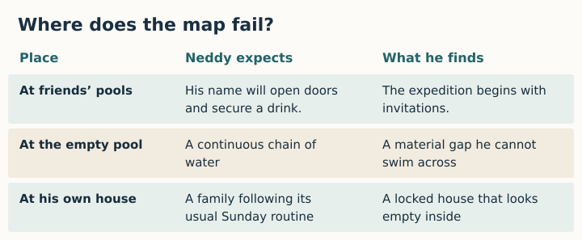
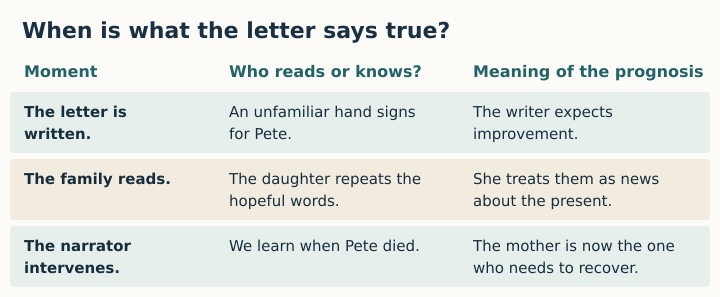

# BEL A/L · Anglais tronc commun du 17 juin 2026 — Corrigé guidé partiel

*Corrigé rédigé par IA, non officiel. Signalez toute erreur.*

**Rédaction** · GPT-6.2 Astra Ultra · vitesse non renseignée

La feuille officielle cite douze œuvres. Le poème de Whitman est expliqué dans son intégralité. La nouvelle de Cheever est étudiée sur la publication du New Yorker, sans identification des bornes du feuillet de concours. Les dix autres extraits restent à délimiter.

[Feuille officielle du 17 juin](https://www.ens.psl.eu/sites/default/files/anglais_tc_1_sujets_tires_17_juin_2026.pdf) · [Rapport du jury](https://www.ens.psl.eu/sites/default/files/2026_al_rapport_oral_anglais_tc.pdf)

## Préparer l’oral

Pour l’épreuve commune, le jury prévoit 1 h 30 de préparation, vingt minutes au plus d’explication et dix minutes d’entretien. Lisez une dizaine de lignes et expliquez le choix du passage à partir de la question que vous voulez poser. Travaillez séparément le poème et la nouvelle.

**Cheever.** Reliez cinq lieux sur une feuille, du premier bassin à la maison de Neddy. Pour chaque étape, écrivez ce que Neddy s’attend à pouvoir faire grâce à son nom ou à ses habitudes. Reprenez ensuite un même geste en deux endroits, par exemple offrir une boisson ou sortir de l’eau. Décrire la différence entre les deux gestes rend l’ironie plus précise que le constat général du temps qui passe.

**Whitman.** Préparez trois petites fiches pour la voix qui appelle au début, celle de la fille qui croit possible la guérison et celle qui connaît le décès. Indiquez sur chacune ce que cette voix sait au moment où elle parle. Dans le texte publié, essayez d’entendre les différents sens de l’expression *be better*. Vous pourrez ensuite revenir aux deux champs du poème, la ferme et le lieu éloigné d’où part la lettre. Faites le lien entre ces espaces à partir d’un indice concret, la forme de l’écriture reconnue comme étrangère.

**S’exercer à l’entretien.** Chez Cheever, la diminution de la force du nageur peut être observée alors même que la durée de la traversée reste indécidable. Chez Whitman, l’ordre entre la mort du soldat et la lecture au seuil est établi par un vers précis. Entraînez-vous à modifier votre réponse suivant la nature de la preuve que donne chaque texte.

## 3. John Cheever, “The Swimmer” · entraînement sur la nouvelle

Le *New Yorker* met à disposition le récit de 1964. La feuille officielle ne précise pas quelle partie le candidat devait expliquer. Cette lecture relie plusieurs scènes de la nouvelle publiée.

**What does Neddy Merrill’s map leave out?** On a midsummer Sunday, a man visiting friends decides to swim home across the succession of suburban pools between their house and his. Cheever lets us feel the exhilaration of making a new discovery in an ordinary setting. Then he leaves the map largely intact while changing what it means for its maker to occupy a place on it.

Our first example of local speech is a complaint about drinking too much. The narrator can apparently hear it practically everywhere, from a place of worship to a naturalists’ outing. Social life is wonderfully easy to represent when so many people can be made to say the same thing. Neddy’s geography accomplishes something similar. It turns separate pieces of private property into one river which he names after his wife. Neither water nor ownership actually joins up, but his familiarity with local families seems as good as a right of passage. The proprietor of one pool wants to put a drink into his hand as soon as he arrives. At another he has to greet so many guests that the progress from his hostess to the bar almost constitutes a stage of the expedition. The heroic analogy is funny in part because the traveller’s greatest early difficulty is extricating himself from people delighted to see him.

Two sorts of interruption expose the assumptions built into this course. One pool has been drained. Neddy can cross the space, but cannot swim it. On the highway, an observer seeing him almost naked has no reason to know who he is. The narration actually offers the reader that hypothetical roadside point of view. What appears heroic on the swimmer’s private map looks absurd or pitiable from a passing car. The municipal pool provides another kind of test. The water can still be swum but the conditions of entry are no longer set by a familiar hostess. Even among his friends there are signs of an altered world. Some trees show autumn colouring and the weather turns cold. Neddy tries explanations that might accommodate these observations within the space of a single day. Our sense of the accumulating evidence increasingly diverges from his.

The sharpest challenge to his map comes when people remember events he cannot place. The Hallorans speak of his misfortunes. At the Sachses’ he learns that an operation he appears to have forgotten happened three years earlier. A former mistress treats his arrival as a potential request for money and declines even to give him a drink. Her answers reverse the pattern of hospitality at the early pools. Cheever makes withheld recognition register in the body. Neddy can no longer hoist himself out of the water as easily. He still interprets the locked family house by recalling the customary arrangements for a Sunday evening. Only when he looks through the windows does the narrative deliver an unqualified physical fact about the interior. The swimmer’s route has succeeded as a feat of connection on a map. What he took for his present family life has disappeared at the very point to which it led him.

**Interview. Is there an exact clock for the story?** Domestic routines and an afternoon storm provide one time scale. Leaves and constellations invoke a longer one. Other people remember years. The force of these contradictions lies in their convergence against Neddy’s self-image. A reader can recognise that effect without assigning a precise duration to every swim.

[Texte de travail · Cheever](https://www.newyorker.com/magazine/1964/07/18/the-swimmer)

## 7. Walt Whitman, “Come Up from the Fields Father”

**Suggested reading.** Take the mother’s rush to the door through the letter’s statement about recovery. Give the rapid commands a different pace from the broken news of the skirmish. Leave the promised improvement audible enough for the daughter to take it up later.

**Who knows what the letter says?** An Ohio family receives news of a son serving in the Civil War. A letter can cross the distance between battlefield and farm, yet its arrival does not bring the family to the same moment as the absent soldier. Whitman makes that gap register through changes of speaker, tense and sentence length.

The first voice calls two parents in from different places and presents the letter as if it had come from Pete. Then the poem suspends the opening scene. Its repeated invitations to look and smell make the Ohio farm almost excessively present. Grapes, ripening apples, bees lately at the buckwheat and air cleared by rain convey a prosperity that needs no argument. The long lines can gather several sensations before coming to rest. When the daughter calls again, there has been time for an audience to experience precisely what a remembered home might mean to a soldier. The contrast with war works through ordinary farm labour too. What the father has been doing in the fields has to stop for an event that has taken place in a very different kind of field.

The mother approaches the news through handwriting. She knows at once that the letter bearing her son’s name was written by someone else. Before we are given many words from the page, we know what the strokes of a familiar hand would have meant to her. Vision then partially fails. What she can take in are pieces of information, an injury, an encounter involving cavalry, a hospital, a cautiously reassuring prognosis. The broken syntax makes us read the letter with her. Her daughter hears something in it that she can still offer as comfort. A separate voice singles out the mother leaning at the door, isolated against a populous and wealthy state. Whitman delays the verb describing how she stands until the end of this suspended portrait. One body momentarily holds the attention the earlier lines could extend over an entire landscape.

The daughter’s reassurance becomes unbearable because the poem can tell us something the family cannot yet know. By the time they read at the door, Pete has died. The nearly identical words about getting better thus pass from the letter to the daughter to a new speaker who can contradict them. Then it is the mother who needs to recover. The transfer of that simple expression does more to bring the consequences of the war into the house than a description of combat could. Her clothes, uneaten food and interrupted sleep carry those consequences into an indefinite future. The poem began by urgently calling members of the family into one place. The mother’s final wish, formed in private and repeated through a succession of infinitives, would take her silently away from it, in search of the one person the call could never bring to the door.

**Interview. Does the letter lie?** It contains a prognosis at the time of writing, and the daughter cites it faithfully. The narrator knows that events have overtaken it. Distinguishing the writer’s time, the family’s time and the narrative voice makes the moment more painful than a simple contrast between truth and falsehood.

[Texte de travail · Whitman](https://poets.org/poem/come-fields-father)

## Extraits encore à identifier

Le document officiel mentionne *The Promise* (Damon Galgut), *Paradise* (Abdulrazak Gurnah), *North and South* (Elizabeth Gaskell), *A Map of Glass* (Jane Urquhart), *Oryx and Crake* (Margaret Atwood), *Americana* (Don DeLillo), *Handbag* (Mark Ravenhill), *Wish You Were Here* (Graham Swift), *Life & Times of Michael K* (J. M. Coetzee) et *Robinson Crusoe* (Daniel Defoe). Le rapport évoque le rapport du vrai et du faux dans un extrait de Swift. Cette remarque ne suffit pas à repérer les pages du roman. Son exemple détaillé de DeLillo concerne un autre livre, *Falling Man*.
