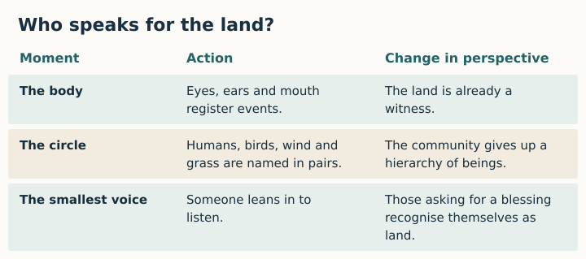
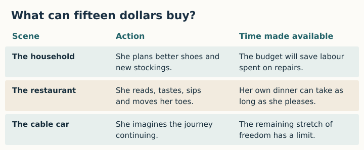

# BEL A/L · Anglais tronc commun du 18 juin 2026 — Corrigé brut partiel

*Corrigé rédigé par IA, non officiel. Signalez toute erreur.*

**Rédaction** · GPT-6.2 Astra Ultra · vitesse non renseignée

Sur les dix références de la feuille officielle, le poème de Harjo est expliqué en entier. Trois vers attestés du poème d’Armitage permettent un exercice partiel. La nouvelle de Chopin est expliquée à partir de son texte publié, sans identification des bornes de l’extrait du concours. Les sept autres passages ne sont pas délimités par la feuille officielle.

[Feuille officielle du 18 juin](https://www.ens.psl.eu/sites/default/files/sujets_anglais_tronc_commun_18_juin.pdf) · [Rapport du jury](https://www.ens.psl.eu/sites/default/files/2026_al_rapport_oral_anglais_tc.pdf)

## 4. Joy Harjo, “Bless This Land”

**Suggested reading.** Take the sequence from the blessing of the mouth through the instructions about humans, birds, insects, wind and grass. Give the repeated opening its measured beat. Let the sentences following it change speed and weight according to what has been done to the land.

**Who is capable of giving the blessing?** The title looks like a simple injunction addressed to whoever will speak. In the opening lines, a person might seem to be looking down from above, taking in a continent that extends from an Arctic head to tropical feet. By the close it has become impossible to say on which side of the blessing the people themselves stand. The poem makes its listeners move from possessive habits of language towards a more demanding first person plural.

One can start almost anywhere in the anatomy and find that the being described is already an active witness. The eyes have seen cruelty and kindness. The ears register grief and celebration. Even before we reach the mouth, the trees and stones have a song one might hear. In the passage on the mouth, speaking, singing and keeping a record belong to the land. This matters to the status of the poem’s own voice. It cannot simply confer life upon an inert surface by an imaginative act. It has to learn how to hear life that already speaks. Sound enacts some of that learning. The repeated imperative lets listeners fall into step together. The disruption produced by the rush of words for mineral extraction brings another rhythm, impatient for profit, into the song.

The body of the land holds relations which a vertical diagram of power could not adequately represent. The lines about animals, wind and grass remove a presumed superior term each time a new pair is named. The motion recalls the circle of people held by song. Later the heart is pictured both planting food and making poetry. This combination of nourishment and speech helps explain why a refusal to use words for warfare belongs in an account of the land. A blessing can train the speaker in a different way of exercising power. The appearance of an unruly, noisy gathering of birds keeps this proposition from turning into a picture of perfect solemnity.

The imperative is hardest to understand when it extends to destruction. Harjo distinguishes the growth that can follow recurrent catastrophes from what happens when human greed tips the earth carried by the turtle. In the second case a question hangs over the survival of anyone who could remember the song. The response comes from the smallest and hardest voice to hear. Leaning towards it reverses the privileged viewpoint imagined at the beginning. The speaker who remembers asks for a blessing on *us*, and the grammar of ownership gives way to an affirmation of shared being. The ending circulates rather than marching towards a final point. The magazine places a traditional Mvskoke song after this poem, with its own heading and a translation by Rosemary McCombs Maxey. Its account of two women singing at different ends of a group during forced removal offers a very concrete example of voices sustaining people in motion. The distinction between the two texts preserves the song’s attribution.

**Interview. What gives the reference to extraction its particular weight?** The materials are named in a passage that has just presented the land as a keeper of what happens there. A forest or ocean made available for sale cannot cease to hold the history of its sale. The language of a quick rush to wealth collides with that longer memory.

[Texte de travail · Harjo](https://worldliteraturetoday.org/2019/autumn/bless-land-joy-harjo)

## 5. Simon Armitage, “The Anaesthetist” · trois vers attestés

Le titre est répertorié par l’auteur et figure sur une plaquette datée de 1994. La feuille du concours indique 1995. Le manuel *Writing with Power*, p. 214, donne trois vers. Ils permettent un exercice de lecture précis. La portée de l’explication s’arrête à ce fragment. [Bibliographie de l’auteur à Leeds](https://ahc.leeds.ac.uk/english/staff/557/simon-armitage)

**How can the arrival of a medical professional make his authority look at once credible and faintly absurd?** The title supplies the professional designation, but the three lines initially offer only a masculine pronoun. Somebody has to decide whether to believe him. The phrase opening the fragment suppresses the subject making that judgement, which makes it easy for a listener to borrow the position of an onlooker. The ensuing action is a strikingly humble way to enter. The heavy sound of *trundles* gives the movement weight and a slight ungainliness.

An expertly prepared figure has scrubbed up, yet the following expression about his cleanliness sounds almost like something one would say to a child. A long participle then carries the motion across a line ending. Its object, when it arrives, is a handcart and the apparatus it bears belongs to deep-sea diving. The image has a practical basis. Both occupations involve specialised equipment and the problem of breathing under unfamiliar conditions. But a specialist who appears to be preparing for a maritime expedition in the very place where one expected clinical reassurance may seem distinctly alarming. The measured delay before the cargo is identified permits amusement and apprehension to develop together.

**Interview. Why does the break before the cart matter?** The doctor is already in motion but what he is steering has not yet been named. A person might expect a conventional piece of hospital furniture. The exact description supplies something cumbersome and makes the setting momentarily strange. Other implications of the image would have to be tested against the rest of the poem.

[Texte de travail · Armitage](https://resources.finalsite.net/images/v1624887420/skschoolsorg/dgk0y7ua6c4w9pzv6fyt/English10WritingwithPower_Part2.pdf#page=121)

## 6. Kate Chopin, “A Pair of Silk Stockings” · préparation sur la nouvelle

La feuille indique 1896. Chopin écrit le récit en avril de cette année-là. *Vogue* le publie le 16 septembre 1897. Le témoin de la Kate Chopin International Society permet de lire la nouvelle entière. Les limites du texte effectivement distribué restent inconnues.

**Suggested reading.** Start where Mrs. Sommers notices she has forgotten to eat and comes to rest at the counter. Bring out the interruption in the recollection of lunch. The correction matters to the way we understand what her hand does next.

**What does fifteen dollars buy Mrs. Sommers?** The first answer seems simple. After calculating how long better shoes might last her children and what the purchase of new stockings could save in darning, she has formed a plan. Each purchase would give her back a little labour as well as clothing her family. The question of time therefore enters before the first coin has been spent. By the last page she will be wishing for something that no sum of money can buy.

One of the first people to misread Mrs. Sommers is the reader. Her apparently dreamy state at the outset turns out to be calculation. An internal correction then makes us realise that she forgot her own lunch altogether. The energetic vocabulary of securing bargains describes an accomplished shopper with an important household job. On this particular day she lacks the physical strength to perform it. Her ungloved hand rests on some silk almost before she knows she has touched it. The window sign assuring her of a reduction is still visible. The decisive evidence, however, arrives through her fingers. A body accustomed to serving other people’s needs becomes audible in a narrative previously dominated by sums and plans.

The detail that she puts the stockings on is vital to what follows. The purchase becomes a change in the way she can stand, be fitted and walk through a crowded street. A clerk cannot reconcile what her old shoes and her stockings seem to say about her. At the glove counter both women pause to admire her hand. Later the diners give her no special attention, which is precisely what allows her to settle in. The scene makes room for a hungry woman to eat well and for a reader to cut open a magazine at leisure. Eating, reading, tasting wine and moving her toes share a rhythm in the prose. The stockings have enabled a form of ordinary, sustained attention. She also tips the waiter. Even a modest windfall briefly allows her to initiate an exchange in which somebody else is being served and paid.

The theatre enlarges the field of perception. Mrs. Sommers takes in performers and spectators together. Among the well-dressed audience, the neighbour who shares her tears offers a sweet. Neither shopping nor the performance has required an account of her *better days*. The man in the cable car, however, takes her face as an object of study. After following her throughout the day we can recognise the limits of his attentive look. The narrator gives us the wish he cannot decipher. She longs for the vehicle to keep moving, indefinitely suspending the return to her ordinary duties. The story closes without a domestic reckoning. Time experienced in this fleeting way has become more valuable to her than any individual item on the bill.

**Interview. Is the narrator simply celebrating freedom to consume?** The day’s pleasures are real enough to give the ending its force, but all require resources now being used up. Fine clothing gets her through certain thresholds. The wish in the last sentence exposes how little security that temporary admission can buy.

[Texte de travail · Chopin](https://www.katechopin.org/pdfs/Kate%20Chopin%2C%20A%20Pair%20of%20Silk%20Stockings.pdf)

## Extraits encore à identifier

La feuille cite *Far from the Madding Crowd* (Thomas Hardy), *Middlemarch* (George Eliot), *Moby-Dick* (Herman Melville), *Richard III* (William Shakespeare), *The Black Prince* (Iris Murdoch), *The God of Small Things* (Arundhati Roy) et *Typhoon* (Joseph Conrad). Le corps des textes distribués reste à retrouver.
