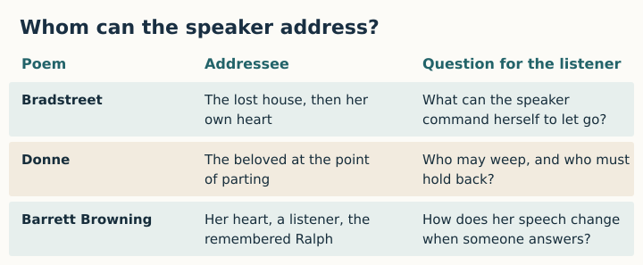
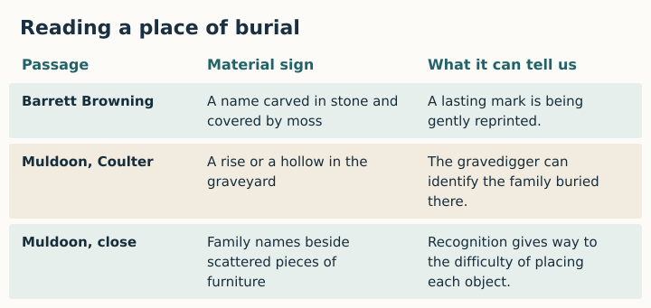

# BEL A/L · Anglais tronc commun du 19 juin 2026 — Corrigé brut partiel

*Corrigé rédigé par IA, non officiel. Signalez toute erreur.*

**Rédaction** · GPT-6.2 Astra Ultra · vitesse non renseignée

La liste officielle comporte onze références. Trois poèmes sont expliqués en entier, ceux de Bradstreet, Donne et Barrett Browning. Pour Muldoon, les passages reproduits dans une thèse permettent une analyse partielle. Pour les sept œuvres de prose, les références indiquées par l’ENS ne délimitent pas les extraits du jour.

[Feuille officielle du 19 juin](https://www.ens.psl.eu/sites/default/files/sujets_anglais_tronc_commun19_juin1.pdf) · [Rapport du jury](https://www.ens.psl.eu/sites/default/files/2026_al_rapport_oral_anglais_tc.pdf)

## 1. Anne Bradstreet, “Verses upon the Burning of Our House”

**Suggested reading.** Read the ten lines that begin with the speaker passing the ruins. Let the place words land distinctly. Furnish the house in the listener’s imagination before the poem addresses it as an absent host.

**A house that can still be visited in words.** The precise date attached to Bradstreet’s poem gives the event a place in family history. Its speaker remembers the fire, revisits the remains and imagines another dwelling. How can she say that her possessions always belonged to God when every detail of her speech makes the house her own again?

The first sound comes before anything can be seen. Rest, an unexpected noise and the voices crying out follow one another in short rhymed lines. The passage from reported cries to the speaker’s wish that nobody else should know that sound briefly interrupts the past tense. Even as she tells her story, she recoils from making anyone share her experience. On getting up she can see the light and call to God. The object of that first prayer matters. She asks for strength and assistance in distress. She does not ask to get the house back. When she can bear to look no longer, her blessing recalls Job’s words about the Lord giving and taking away. Both halves of the formula matter. If what she has received belongs to its giver, the claim that she has been robbed becomes difficult to make.

Yet another kind of looking begins as soon as the speaker walks past the ruins. The repeated indications of position distinguish the trunk from the chest. Though their sites have survived, the objects have gone. Describing them requires pointing with the precision one would use in a furnished room. Then a significant change occurs. The inventory gives way to possible guests, stories, light and the sound of a bridegroom. The loss extends forward in time to gatherings that will never take place. The direct address to the house grants it the standing of someone one might take leave of. The fire was deafening. The desolate house will be silent. Between the two, the poem lets us hear the sociable life the dwelling made possible.

At this point the speaker begins to address her own heart. Questions about where it has fixed its hope turn into an imperative to look upward. The figure of a house persists even here. The heavenly architect has furnished another dwelling whose permanence the earthly building could never offer. There is an economic puzzle in the language of its purchase. Someone else has paid an immeasurable price for what she receives as a gift. This allows her to imagine a treasure whose possession is fully compatible with dependence upon the giver. The closing farewell has force precisely because the poem has taught its listener the value of what is being relinquished. Its last petition still gives the speaker a task to perform.

**Interview. Why pay so much attention to the guests?** They make an account of private property into an account of shared life. We have heard ordinary conversation and ceremonial celebration imagined under the same roof. That makes the eventual silence audible and gives the final prayer an exact human cost.

[Texte de travail · Bradstreet](https://www.poetryfoundation.org/poems/43707/verses-upon-the-burning-of-our-house-july-10th-1666)

## 4. John Donne, “A Valediction: of Weeping”

**Suggested reading.** Read the first stanza, allowing a short pause after its opening request. Carry the syntax across the line in which the addressee’s face makes an impression. The division of the lines makes the unfolding argument sound like an invention in the listener’s presence.

**How much can one tear hold?** A lover on the point of departure asks to be allowed to weep. The permission requested at the beginning will turn into a series of injunctions against a beloved’s tears and sighs. The speaker has to explain why one apparently harmless act can endanger both of them. Three experiments in scale supply the explanation.

In the first stanza a tear momentarily contains the face of the person before whom it is shed. The image can be physically understood as a tiny reflection. Donne then gives it another operation. The face stamps the tear in the way a mint confers an image and a value upon a coin. A fluid drop passes for something one could keep and exchange. Its worth lasts only as long as the impression holds. The next comparisons change the nature of what it holds. A tear bears the other person almost as a body bears a child, and is the fruit of grief already felt and a sign of grief to come. When the drop falls, the version of the beloved that it carried falls with it. The line about being nothing on different shores gives separation a sharper sense than geographical absence. Their identities here depend upon being present to one another.

The next stanza imagines a maker at work. A sphere acquires the outlines of continents from maps or models at hand. A blank object can become an entire world through the transfer of marks to its surface. The argument returns to the tear with a new possibility. One reflected face now makes a little totality. If each lover’s tears could simply be added to the other’s, such intimacy might sound reassuring. Their meeting instead produces a flood which dissolves that world. The elongation of the final line lets the destructive water keep coming after one might expect the stanza to close. One drop had trouble retaining one image. A greater quantity of the same substance makes the loss greater too.

With the address to a power greater than the moon, the beloved acquires authority over the tides. The speaker’s impending journey makes the sea more than a convenient emblem of separation. He asks her to refrain from giving it an example to follow. Her breath also threatens to teach the wind. This imagined chain of instruction makes an intimate farewell reverberate out into the conditions of travel. A last turn takes the argument back into their bodies. If both breathe what belongs to the other, even a sigh of sympathy spends the other’s life. The closing prospect of cruelty gives the request for restraint its unsettling edge. The lover pleading to express himself has claimed the right to tell his partner how much grief she may safely express.

**Interview. Does the middle stanza merely repeat the first?** A coin bears a sovereign’s image, whereas the worked globe claims to contain the shape of a whole world. Bringing two tears together then tests whether that totality can survive the material contact the lovers desire. The answer prepares the perilous sea of the last stanza.

[Texte de travail · Donne](https://www.poetryfoundation.org/poems/44132/a-valediction-of-weeping)

## 7. Elizabeth Barrett Browning, “My Heart and I”

**Suggested reading.** Read the two stanzas centred on Ralph and the return to the graveyard stone. Differentiate his kindly observation, her remembered silent reply and the time from which she now tells the story.

**Who speaks when the heart is tired?** A speaker sits by a headstone with her heart as companion. The same pair appear at either end of stanza after stanza, with small changes in their refrain. Listen for the point at which a formula of weariness begins to tell a story that the speaker could hardly have told in a single complaint.

There are two kinds of inscription on the headstone. A mason has cut the letters sharply and growing moss has softened and in a sense reprinted them. The dead person’s name remains legible. The living speaker wishes the name there were hers and her heart’s. Personifying the heart allows her to say *we* even when she imagines herself nearly erased. The second stanza supplies her own experience of making marks. The pen was dipped in blood as though to give the writing a colour that could never fade. Writing and loving had appeared to carry that guarantee. The cool symmetry of the lines about hoping for success and keeping a friend makes a painful claim sound almost proverbial. An audience may recognise the saying while missing the individual who has paid for it.

The third stanza tests what the voice can do to its audience now. The person who once thrilled at the sound can sleep through it. Even tears are reduced to their physical wetness. The question at the stanza’s end briefly exposes the despair usually covered by the refrain. And then we actually hear another voice. In the remembered evening under the lime tree, Ralph noticed what he took to be weariness. The younger speaker could smile and shake her head. His mistaken reading was itself an act of care. Her present diagnosis, now painfully accurate, leaves her with nobody to make such a mistake. The next stanza lets an embrace become the current posture of leaning upon stone. The same adjective can describe the luxurious weariness of being held and the exhaustion of encountering an object that cannot hold one back.

In the sixth stanza an imagined offer of crowns and jewels receives scarcely more attention than the sight of a child or a blue sky. The movement from spectacular reward to ordinary sources of delight measures the extent of the fatigue. The final question then invites the listener to decide whether any complaint has in fact been made. A brisk series of commands gives the world apparent permission to dispose of worn things. To speak so harshly about oneself makes it uncomfortable for the listener to accept the invitation. In the last lines having been loved appears next to having been used. The hesitant qualification of the speaker’s verdict leaves a gap between saying that one had enough and feeling satisfied. The refrain survives. After seven stanzas, its two companions have given each other the hearing the world no longer provides.

**Interview. Is the poem’s repetition monotonous?** It lets a listener register very small differences. The declaration of tiredness becomes an exclamation, a question and finally something close to an acquittal. Ralph once heard the speaker’s condition incorrectly but tenderly. We are asked how carefully we can hear it now.

[Texte de travail · Browning](https://www.poetryfoundation.org/poems/43730/my-heart-and-i)

## 9. Paul Muldoon, “Come into My Parlour” · passages retrouvés

Rory Benjamin Clarkson reproduit plusieurs passages, de l’ouverture à la chute, dans *The Work of Elegy: Grief, Landscape, Perspective and Poetic Form*, Durham University, 2024, pp. 138–144. Ils proviennent des pp. 92–93 des *Poems 1968–1998* de Muldoon. L’analyse suivante porte sur ces passages. Les vers qui les relient restent à vérifier sur l’édition complète. [Notice de la thèse](https://etheses.durham.ac.uk/id/eprint/15453/)

**How does one read a graveyard?** In the opening we are given something we could count on whenever someone died. A named man, Coulter, would be at Collegelands with the implements of his job. The small verbal movement from an unnamed dead person to a man one knows where to find makes the gravedigger, unusually, the most readily identifiable figure in the scene. His skills come to include a kind of literacy. The uneven ground is called his “text”. What looks to the stranger like changes in level is, for him, a record of which family lies where. His expertise becomes necessary particularly when communal or family memory fails.

One little speech lets us hear the reader of this uneven page. He remembers interring so many members of one family that he pictures them piled like plates. That audible joke gives him an idiom drawn from a kitchen cupboard. It grants the dead an odd form of domestic proximity. Then the wet ground and an image of disappearing snow threaten the permanence of his arrangement. There is no solemn formula of consolation to separate the two remarks. Coulter can keep the names straight even as the substance that made individual bodies distinct disappears.

The later lines briefly bring the speaker’s own kin into view. Reference to mother, father and grandfather momentarily organises the land into a genealogy. The eye goes on across neighbouring fields, picking up differences of height that cannot all be accounted for by that family story. Near the close names return beside a list of broken domestic objects. A bedstead, for instance, suggests a particular kind of private room. As wreckage it no longer tells us whose room it was. The radius of the scattering at the end returns to the radius within which everyone could reliably find Coulter at the beginning. The same area has become both legible and an expanse strewn with damaged things. That return gives the nursery invitation in the title a disquieting resonance. Entering this particular parlour requires a guide, and even he cannot put every piece back in its place.

**Interview. Where does the change of scale affect tone?** Start with the local worker and his familiar tools, then the surprising intimacy of his joke. End with the nouns for ordinary furniture spread across the landscape. This sequence lets domesticity furnish both a moment of recognition and a measure of dislocation.

[Texte de travail · Muldoon](https://etheses.durham.ac.uk/id/eprint/15453/1/RCThe_Work_of_Elegy_-_Corrected.pdf#page=145)

## Extraits encore à identifier

La feuille cite *White Teeth* (Zadie Smith), *Roughing It* (Mark Twain), *Playground* (Richard Powers), *Wide Sargasso Sea* (Jean Rhys), *Roxana: The Fortunate Mistress* (Daniel Defoe), *The Road* (Cormac McCarthy) et *Carpentaria* (Alexis Wright). Le rapport invite notamment à observer la classe sociale chez Smith et le comique chez Twain. Ces indications générales laissent ouvertes les pages précises à commenter.
