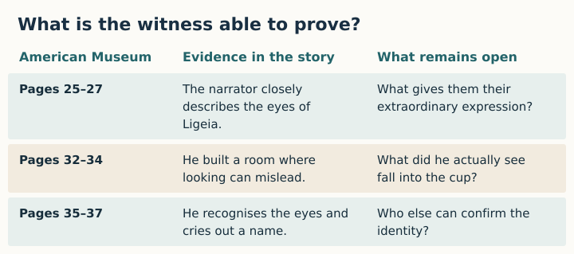
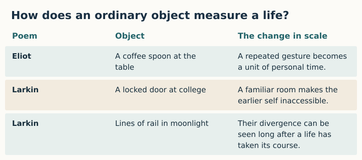

# BEL A/L · Anglais tronc commun du 20 juin 2026 — Corrigé guidé partiel

*Corrigé rédigé par IA, non officiel. Signalez toute erreur.*

**Rédaction** · GPT-6.2 Astra Ultra · vitesse non renseignée

La feuille officielle indique douze titres. Les deux poèmes d’Eliot et de Larkin sont expliqués sur toute leur longueur publiée. La nouvelle de Poe est disponible dans l’édition de 1838. Le commentaire de préparation mobilise plusieurs passages de la nouvelle, mais la sélection exacte du jury est inconnue. Pour les neuf autres œuvres, l’ENS donne le titre sans délimiter l’extrait.

[Feuille officielle du 20 juin](https://www.ens.psl.eu/sites/default/files/sujets_anglais_tc_20_juin_.pdf) · [Rapport du jury](https://www.ens.psl.eu/sites/default/files/2026_al_rapport_oral_anglais_tc.pdf)

## Préparer l’exposé

L’oral laisse 1 h 30 de préparation et prévoit vingt minutes d’exposé au maximum, puis dix minutes de questions. Le jury demande de lire une dizaine de lignes et d’organiser la démonstration en deux ou trois parties. Préparez chaque titre séparément.

**Poe.** Dans la première édition, lisez d’abord le dispositif des tentures p. 32, puis le verre de vin p. 34 et la reconnaissance p. 37. Attribuez chaque indice à un observateur précis. Le dispositif des tentures a pour particularité d’avoir été choisi par le même homme qui regarde. Dans le passage du verre, à quel instant un témoignage assuré commence-t-il à se dédire ? En revenant aux premières pages, demandez-vous pourquoi les yeux de Ligeia lui paraissent décisifs.

**Eliot.** Dites à haute voix l’invitation initiale, une remarque sur la calvitie et la réplique imaginée près du coussin. Essayez de marquer les changements de voix sans faire de la dernière réplique une réponse effectivement prononcée. Faites ensuite le trajet inverse, de la chanson entendue au large au couplet sur Michel-Ange. Dans les deux cas, des voix font exister un monde de sociabilité auquel le locuteur voudrait avoir accès.

**Larkin.** Soulignez une information donnée par le doyen, une conjecture biographique et une proposition générale du locuteur. À quel endroit le penseur retire-t-il lui-même une première interprétation de la décision de Dockery ? Relisez le poème en franchissant les limites des strophes lorsque la syntaxe s’y prolonge. Comparez le délai imposé avant de savoir si la chambre s’ouvre et le délai imposé avant de nommer ce qui éclaire les rails.

## 6. Edgar Allan Poe, “Ligeia” · préparation sur la nouvelle de 1838

La feuille de l’ENS donne le titre de la nouvelle. La première édition dans l’*American Museum* occupe les pp. 25–37. Le feuillet de l’oral ne permettant pas de localiser le passage distribué, les pages 25–27, 32–34 et 35–37 fournissent trois points de comparaison documentés pour s’entraîner.

**What does a witness recognise?** A man believes he has looked into the eyes of his dead first wife once more. By the time we reach his cry of recognition, we have been trained to expect extraordinary things of these eyes. We have also been taught how easily a viewer can produce the thing that he appears merely to discover.

The narrator begins with the failure of his memory. The circumstances of his first acquaintance with Ligeia are precisely the kind one might expect a lover to remember best. All the more remarkable, then, is the precision with which he subsequently describes individual features of her face. Comparison after comparison promises to convey her particular kind of beauty. The eyes, which are singled out as both extraordinarily large and extraordinarily expressive, eventually defeat the act of comparison. What he cannot place has a disproportionate hold on his imagination. Her vast knowledge reinforces this reversal of mastery. The man who describes her with the confidence of a connoisseur is also her intellectual pupil. After her death the obstacle to possessing her in words becomes part of his reason for continuing to seek her image.

In the abbey the narrator supplies a practical demonstration of unstable evidence. He has had the bridal chamber fitted up so that the apparent pattern of the hangings changes as a person moves through it. Air led behind the fabric adds movement to forms already liable to be seen as living monsters. He calls our attention to the mechanism. As an observer in the same room, however, he cannot consistently apply that knowledge of artificial effects. When he brings wine to the ailing Rowena, he believes he sees something fall into it. The narration gives and withdraws its own testimony in the space of a clause. Rowena’s act of drinking does not confirm what he saw. She has not shared the sight. His use of opium makes a further explanation available, while his admission that he loathes his second wife gives us a reason to scrutinise his self-presentation. The story offers competing grounds for judgement without resolving what was in the cup.

The last vigil continually resets the threshold at which bodily evidence would count as life. Signs of warmth and a pulse occur, then fail. The witness who earlier took pains to record successive changes eventually hurries over repetitions of what he calls a drama. In the final scene he lists features that he thinks belong to Rowena until a perceived change of height unsettles the identification. Loosened wrappings release dark hair. The eyes open only at the very end, and the name of Ligeia comes from the husband. Nobody answers him. The ending brings back what mattered most to him on the opening pages. Such symmetry gives the tale extraordinary conviction as a narrative. Whether it makes the witness any more reliable is a question the symmetry itself leaves open.

**Interview. At what point can we be certain that something has changed?** At least the witness’s way of naming the woman has changed. The change in his designation is directly available to us through his speech. The cause and the identity of the standing figure still depend on that single witness.

[Texte de travail · Poe](https://www.eapoe.org/works/tales/ligeiaa.htm)

## 8. T. S. Eliot, “The Love Song of J. Alfred Prufrock”

**Suggested reading.** Read the first twelve lines of Prufrock’s own speech, after the Dante epigraph. Let the polite invitation move briskly, then slow for the comparison attached to the evening. The listener should feel how quickly the invitation can lose control of its destination.

**What happens to a love song when its speaker can imagine the listener’s every answer?** The Italian epigraph makes an act of confession depend on a strange assurance. In Dante’s *Inferno*, Guido da Montefeltro assumes that the person hearing him cannot return to repeat his words. In the poem that follows, some unidentified other person is addressed from the first line, but the status of this listener proves just as unstable. The speech of a man who keeps the decisive words to himself nevertheless reaches us in print.

A hand appears to be extended to a companion. An evening walk, then a visit, can begin. Yet the evening itself resembles an anaesthetised patient, and streets conduct what feels like a long and suspect argument. This is an invitation whose scenery seems to have designs of its own. The fog rubs, licks, makes a leap and curls up outside a house. The animal is so intensely suggested by its actions that Eliot can leave it unnamed. The speaker, meanwhile, can name a whole repertoire of social acts without bringing himself to perform the one he imagines will matter. The repeated couplet about the women and Michelangelo makes a room audible from outside. Its ease and perfect little chime are in sharp contrast to the efforts required to cross into conversation.

Prufrock can be prodigiously active while deferring action. He hears in advance what others will say about his hair and limbs. He invents a position for every hand and almost every piece of clothing in the room. His own body can be inspected in pieces, like the isolated arms he watches or the specimen he imagines himself pinned up to become. That last image turns a phrase formulated by somebody else into a physical instrument of capture. The many promises of time are less reassuring when an entire life can already be measured by the tiny utensils brought out with refreshments. Once he thinks he knows the response in advance, a question may appear to have become redundant before he has even asked it.

His imagined attempts to break the impasse adopt imposing precedents. He might return from the dead like Lazarus and disclose everything. The listener, rearranging a cushion, might quietly say that he has misunderstood. The juxtaposition gives the small gesture as much power as the grand announcement. When he casts himself in a Shakespearean drama he expressly declines the lead. The elaborate delivery of his application for a supporting part shows just how theatrical his modesty can become. At the shore, a question about eating a peach shares the rhythm of his earlier question about disturbing the universe. Yet the music he finally hears comes from creatures singing to one another. It exists independently of his need for a reply. The singular pronoun opens out again to a plural at the close. Whoever is included in that last *we*, waking to human voices is described as drowning. The poem has given us the experience of an intimacy which a real conversation might abruptly end.

**Interview. Is the opening “you” necessarily a woman?** The invitation establishes an addressee but fixes neither identity nor gender. Later imagined remarks from women are strikingly specific. Keeping the first pronoun open helps us notice how often the speaker dispenses with a real response by supplying one himself.

[Texte de travail · Eliot](https://www.poetryfoundation.org/poetrymagazine/poems/44212/the-love-song-of-j-alfred-prufrock)

## 12. Philip Larkin, “Dockery and Son”

**Suggested reading.** Read the speaker’s arrival at Sheffield, the walk along the platform and the first response to the sight of the tracks. Read beyond the end of the stanza so the listener can hear how long the moon takes to emerge.

**Can a life’s direction be explained once the tracks have parted?** A dean mentions that a man who once studied at the college has a son there now. Almost nothing more is known of either father or son. The striking thing about the title is how easily it supplies a relation, like a name over a business, where the speaker still has to find a language for his own situation.

At the college, conversation mingles almost immediately with the speaker’s memory of an earlier summons to the dean’s desk. A half-finished question and a recollection of disciplinary excuses do more to suggest ordinary undergraduate life than an elegy for lost youth would. One ordinary test of continuity is to try the door to one’s old room. The single syllable reporting the result falls on the other side of a stanza break. We can hear the bell a former student recognises, but he is no longer the person to whom it calls. At first the news about Dockery prompts only an exercise in dates. How old could this father have been when the son was born? Which of several young men had he been? The uncertainty should caution us about attributing actual convictions to Dockery.

The stop at Sheffield furnishes smoke, an unappetising pie and the view from the end of a platform. An almost continuous sequence of ordinary actions brings the observer to rails that join and part. One might think one had been given an illustration of a voluntary choice between routes. The sentence goes on across the stanza break to a moon whose movement appears entirely unimpeded. The speaker’s own numb response complicates that illustration. Having no wife, son or property had felt quite natural. The shock comes from discovering how much time a life experienced as natural has actually used, and how widely it has diverged from others. The rail junction lets us see two distinct lines. It cannot tell us what put anybody on either one.

The speaker tries out an account based on deliberate planning, assigns it to Dockery and interrupts himself. Perhaps an unexamined assumption about what it means to gain a family has more force than any consciously stated wish. The same act might look like increase to one person and dilution to the other. An ordinary habit, viewed retrospectively, becomes as imposing and hard to see through as a cloud of sand. The hardening of habits recalls for us the actual locked door at the college. What does the childless speaker inherit? Even absence takes on something of an heir’s capacity to judge or patronise a parent. That paradox prepares the sombre move from two individual cases to the closing propositions about life and age. The first-person thinker arrives at a statement applicable to both men. Its force comes partly from the weary recognition that no arrival at a general truth will reopen that door.

**Interview. Does Dockery have the better life?** The poem gives us the fact of the son and almost none of the father’s experience. The speaker imagines the assumptions that would make fatherhood seem an increase. He can recognise their equal power without finding out what Dockery himself once thought or feels now.

[Texte de travail · Larkin](https://www.poetryfoundation.org/poems/48416/dockery-and-son)

## Extraits encore à identifier

La feuille cite *Cat on a Hot Tin Roof* (Tennessee Williams), *The Real Life of Sebastian Knight* (Vladimir Nabokov), *Sula* (Toni Morrison), *Northanger Abbey* (Jane Austen), *The History of Tom Jones, a Foundling* (Henry Fielding), *The Portrait of a Lady* (Henry James), *In Custody* (Anita Desai), *Lessons* (Ian McEwan) et *Native Son* (Richard Wright). Leurs extraits ne sont pas reproduits dans la feuille du jour.
