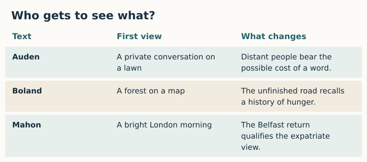
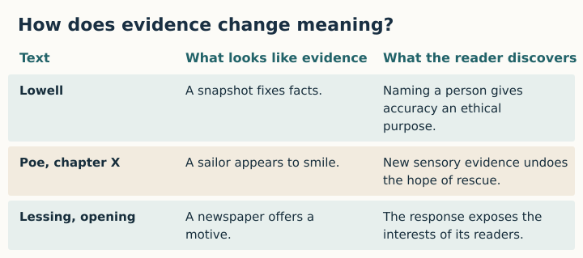

# BEL A/L · Anglais tronc commun du 22 juin 2026 — Corrigé guidé partiel

*Corrigé rédigé par IA, non officiel. Signalez toute erreur.*

**Rédaction** · GPT-6.2 Astra Ultra · vitesse non renseignée

La feuille officielle donne douze références. Quatre poèmes nommément identifiés sont analysés dans leur texte publié. Le jury décrit aussi la scène du brick qui passe devant les naufragés chez Poe (chapitre X) et le début du roman de Doris Lessing. Les deux romans sont traités sur ces passages repérables, dont les bornes du concours restent inconnues. Les six autres extraits ne sont pas identifiés. La fiche est partielle.

[Feuille officielle du 22 juin](https://www.ens.psl.eu/sites/default/files/sujet_oraux_anglais_tronc_commun_2_22juin_al.pdf) · [Rapport du jury](https://www.ens.psl.eu/sites/default/files/2026_al_rapport_oral_anglais_tc.pdf)

## Préparer l’explication en anglais

L’épreuve prévoit 1 h 30 de préparation, vingt minutes d’exposé au plus et dix minutes d’entretien. Le jury demande une progression en deux ou trois parties et la lecture d’environ dix lignes. Les six analyses se préparent séparément. Pour un roman, entraînez-vous à décrire d’abord la forme du passage dont vous disposez, puis à en faire ressortir la portée. L’ouverture identifiée chez Lessing et la scène de Poe fournissent ici des terrains d’exercice sans établir les bornes matérielles des feuillets de 2026.

**Auden.** Cachez les six derniers vers. À qui attribueriez-vous le tableau que termine l’adjectif *private* ? Découvrez la suite et reprenez le verbe d’attente du chauffeur dans le premier mouvement. Les soldats attendent eux aussi. Faites entendre, dans les rimes finales, quel acte de parole pourrait lier les deux attentes.

**Boland.** Lisez le titre comme l’amorce d’une phrase. Repérez sa reprise avant le souvenir du voyage en Connacht. Établissez ensuite une chronologie à trois niveaux, les travaux de 1847, la promenade passée des deux amoureux et le geste réitéré de déplier la carte. Sur votre feuille, dessinez le point où la route cesse et notez ce qui s’y est passé.

**Mahon.** Dans chaque partie, relevez la qualité de la lumière et le pronom employé pour désigner la communauté. L’injure dirigée contre soi complique l’expression de solidarité. Interrogez le conditionnel final avant d’affirmer que le retour en Irlande du Nord aurait permis de résoudre la contradiction.

**Lowell.** Faites deux colonnes pour les apparitions de la photographie. D’abord, la photographie fixe et emprisonne. Ensuite, chaque personne mérite un nom. Entre les deux, repérez l’exemple de Vermeer et le mouvement de la lumière. Vous pourrez expliquer comment l’exigence de fidélité change de sens.

**Poe.** Relevez un signe visuel, une odeur et un mouvement du corps dont l’interprétation se modifie pendant la scène. Cherchez ce que le narrateur explique après coup et ce qu’il reconnaît taire. Avant de décrire un narrateur globalement peu fiable, précisez sur quel point ses données sensibles sont justes et son inférence fausse.

**Lessing.** Répartissez les premières phrases entre la voix de l’entrefilet et la narration qui en envisage les lecteurs. Distinguez le motif supposé, l’auteur avoué de l’acte et les intérêts collectifs révélés par la rumeur. Pour le contexte, nommez la Rhodésie du Sud, puis justifiez sur le texte la portée régionale de l’analyse des hiérarchies coloniales.

## W. H. Auden, “Embassy”

An embassy represents a public power, yet the first eight lines of this sonnet end by suggesting a picture of private life. What does the picture leave beyond its frame? Auden makes the reader enjoy the clarity of an evening view before asking what it would mean to see the whole situation clearly.

First the weather changes. The pressure of the day lifts, and distant peaks are easier to see after the rain. The motion that crosses the cultivated garden belongs grammatically to the conversation. Before we can pick out any of its participants, their talk seems to drift like one more element of agreeable weather. *Cultured* flowers and highly trained speakers share the implication of careful formation. Such ease has been made possible by work. Two gardeners treat a passing pair of shoes as something to be priced. The chauffeur reads while he waits. Each of these figures is close enough to see, and socially far enough away to value or use the occasion differently.

At the eighth line a complete sentence appears to frame the scene. Its crucial qualification is the verb of seeming. If it looks like private leisure, what has happened to the responsibility of the people paid to talk? The ninth line changes the camera position without moving any of the people on the lawn. Far away, an army is also waiting. The verb connects soldiers and chauffeur, but almost everything about the consequences of their waiting differs. The soldiers await something as small as an error in language. Words that sounded like cultivated conversation are revealed as instruments whose possible effects exceed their speakers' intentions.

The close makes the reader hold two parts of one sentence together across successive lines. What depends on diplomatic charm may be the devastation of a country and the loss of its young men. The rhymes tying intention to dependence and error to terror compress an entire relation of cause and exposure into the sound of the verse. Even the short final line feels like a reduction of human possibilities. The poem does not tell us that a particular negotiator has made the error. It asks who can see the consequences that remain possible while skilled men still appear to be taking an evening walk.

**Reading and discussion.** Read from the entrance of the gardeners to the final line. Asked what the turn at line nine changes, start with the repeated act of waiting before you move to the wider subject of war.

[Texte de travail · Auden](https://www.stabroeknews.com/2022/03/13/sunday/arts-on-sunday/poetry-and-war/)

## Eavan Boland, “That the Science of Cartography Is Limited”

Read the heading straight into the opening of the poem. The title states something the speaker wishes to prove and the first lines postpone the main verb while qualifying the claim. A map cannot smell of balsam, but that familiar observation does not go far enough. What kind of loss on the page requires a love story, a famine and the reader's sense of syntax to make it visible?

The first scene involves two people driving to the borders of Connacht when they were first in love. One tells the other to look down. The instruction is modest, and it sharply alters how we understand the wood. A road, hardly distinguishable from grass and ivy, had once to be built there. Sight alone cannot restore the knowledge. The *you* supplies the story that makes the stones legible. Lovers could have remembered the landscape merely for its scent or shade. Their memory becomes historical because somebody speaks and somebody stays to listen.

When the year 1847 emerges, an intimate account makes room for the Great Famine. Starving people were given road work by relief committees after the potato crop had failed twice. A conventional map could register a continuous route by its destination and utility. Here the labourers' deaths determined where the route came to an end. The break around the statement that the road ended and still ends makes the historical past exert pressure on the speaker's present. An abandoned stretch can be a more exact record of coercion and hunger than the successfully completed road a map is designed to display.

The ending repeats an act of looking, this time as the speaker takes down a map of the island. She knows the ingenious operation by which a curve becomes a plane. She returns to the map to remind herself of a line that will be absent from it. A line telling the map-reader *woodland* might be accurate as a statement about vegetation and still fail to communicate the cry of hunger from that ground. The poem makes a line run and give out where the walkers died. The shape that cartography cannot use becomes a form the poet can make us follow. The wish to prove something therefore ends with a discipline of remembering who identified the road and whose labour it preserves.

**Reading and discussion.** Read the movement from the instruction to look down to the road's double ending. Asked whether every absence makes a map false, distinguish an accurate account of spatial distribution from a history of what it cost people to occupy or traverse a particular place.

[Texte de travail · Boland](https://www.brinkerhoffpoetry.org/poems/that-the-science-of-cartography-is-limited)

## Derek Mahon, “Afterlives”

Mahon divides the poem between two cities and two mornings. An expatriate in London watches daylight spread over the roofs. A man coming home by sea sees Belfast after five years of war. How far can one man's change of position alter his right to speak for a community?

In the first part the flat is dark, the outside world unexpectedly soft in sound. Once the curtains are drawn, washed roofs and morning light make it possible to imagine reason itself as a bright element in which *we* are at home. That pronoun moves very quickly from a particular person at a window to a community confident in long-term solutions. Public speakers and the actual interruption of gunfire qualify the view. Yet the sentence pushes forward into a vision of children learning together and light filling dark places. Listen to how the lines carry that confidence on into a future that no one at the window can see.

The violent change of register when the speaker calls his group privileged is also a grammatical event. The first-person plural does not disappear. It changes from a credential into a confession. He asks what authorises his class to turn its idea of rational progress into divine wisdom and the people who kneel at noon into strangers. The self-accusation challenges both the exclusion and the illusion that those criticised could have nothing to do with him.

Part two replaces the sweeping *we* with the traveller's *I*. A guitar, a gull and moonlit water briefly make the journey seem lyrical and unhurried. Then the ship has to shudder through the practical business of turning and backing into the lough. Buoy, slipway and dry dock record the city at working scale. At its threshold the poet discovers that remembered places have changed and that people are trying to tell him something for which visual recognition is inadequate. The hills still have their familiar colour. That reassuring fact cannot supply the missing years.

The final conditional resists a tidy moral. Had he stayed, he *might* have come to understand home. Living through a conflict would have cost more than a change of intellectual position. His stark phrase measuring time bomb by bomb refuses a tourist's claim to acquire such knowledge in an instant. The afterlife of an earlier home is a place at once continuous and irrecoverable, and the adult the poet imagines he could have become there remains conditional too.

**Reading and discussion.** Read across the break from hope in a future generation to the speaker's class-bound self-criticism. If asked whether returning resolves the problem, listen to the uncertainty in the last four lines and the faces that still have to explain.

[Texte de travail · Mahon](https://www.poetryfoundation.org/poems/92153/afterlives)

## Robert Lowell, “Epilogue”

An epilogue would ordinarily step back from the work it concludes. Lowell instead asks why the familiar equipment of a poet, including rhyme, no longer seems to help him. Can a poem grounded in what happened make something through imagination without depriving people of their reality?

The accented opening word gives traditional structures a near-religious blessing just as the question reveals their present failure. Form is a support whose help cannot be called forth at will. The speaker hears his own voice as noise. A claim about the painter follows, imagining vision as a hand able to caress light. That tactile verb gives perception a life a lens seems to lack. Yet as soon as the speaker turns to his own writing, his eye produces something like a snapshot. The piled adjectives make the snapshot vivid, fast and even heightened, and for all that stuck to the facts. Its defect is a particular way of fixing things in place.

A tiny question then undoes the apparent opposition. Why should a poet not say what happened? The abruptness matters because it lets us hear a speaker testing a different possibility. If saying what happened requires the grace of accuracy, accuracy cannot be the automatic consequence of pointing a camera correctly. Vermeer supplies an example. Light moves across a map as a tide might move and illuminates a girl whose yearning has the solidity of an object. The painter has attended so carefully to something fleeting that it becomes possible to perceive both a presence in space and a life beyond the surface.

The final photograph retrieves the object earlier treated with suspicion. The speaker includes himself among the passing facts. A picture's subjects are figures someone might group, colour or frame. They are also people who have names and whose disappearance makes it urgent to give those names back. The adjective *living* does more than ask for a reliable caption. It asks for language adequate to an existence which a rapid inventory would reduce. The poem's provisional answer is a change in responsibility. Imagination can animate exact attention because that is one way the dead and the passing may retain more than the outlines of their poses.

**Reading and discussion.** Read the turn from the failed snapshot through the Vermeer passage. If asked to reconcile the two photographs, ask what the act of naming requires that taking an image does not accomplish by itself.

[Texte de travail · Lowell](https://www.poetryfoundation.org/poems/47693/epilogue-56d22853c55c0)

## Edgar Allan Poe, *The Narrative of Arthur Gordon Pym*, chapter X — the passing brig

The jury describes a passage in which a seagull feeds on a body aboard a passing vessel. Chapter X supplies the distinctive scene. Its printed limits in the examination remain unknown. How does Pym make false hope convincing to a reader who is already examining the evidence of its failure?

The survivors see a brig approach and watch it change direction in ways they have to explain. Drunkenness at the helm is available as an inference precisely because the vessel's action seems erratic and human intention is what the watchers most need it to contain. What appears to be a nodding, smiling sailor steadies their belief in rescue. The red cap falls into the water without drawing the figure's attention. The reader can register an anomaly while the men, needing reassurance, register an encouraging gesture. The older narrating voice interrupts to insist that things appeared this way to them. Exact description is being pledged at the very instant that accurate interpretation is unavailable.

The change begins in the nose before it reaches the eyes. The survivors can still imagine how they might board the approaching vessel when its smell renders that explanation almost unendurable. Dashes divide the effort to name the smell. Their broken rhythm sits inside a narrative that had seemed able to estimate distances with ease. Once they can see the bodies, the white of a gull and the exposure of a mouth eventually give them a different account of what they saw. A movement of the bird set the body swaying. A smile that seemed to promise deliverance is retrospectively revealed as something the observers made out of a face incapable of addressing them.

Yet the scene does not end in the comfort of a solved optical puzzle. Pym breaks off before completing his account of a thought triggered by something falling at their feet. Augustus acts when Pym cannot bring himself to say what he had contemplated. Two gaps in narration thus have different meanings. At first the speaker explains an error as fully as he can. Later he marks the limit of what he is willing or able to disclose about his own response. The victors of the scene, if one can call them that, are the senses. The men see and feel intensely, then discover that this intensity has paralysed their powers of thought and action. The passing brig takes away even the possibility of making practical use of the truth acquired at such a cost.

**Reading and discussion.** Read the turn from the hopeful gesture to Pym's qualification about appearances. Asked whether *Pym* is simply unreliable, distinguish an indispensable account of a perceptual mistake from the deliberate withholding of a thought.

[Texte de travail · Poe](https://www.eapoe.org/works/tales/pymb10.htm)

## Doris Lessing, *The Grass Is Singing* — a reading of the opening of chapter I

The report locates the examination extract near the beginning and discusses its use of crime fiction and a collage of viewpoints. The following reading examines the opening where those features converge. The panel's wording does not identify the exact first or last sentence. The novel is set in colonial Southern Rhodesia, now Zimbabwe. The larger regional framework of white rule in southern Africa should be distinguished from the specific legal history of apartheid in the Union of South Africa.

Mary Turner's death reaches us first through the layout and vocabulary of a brief newspaper item. The sensational promise of a murder mystery coexists with a confession by the arrested household servant. The paragraph says that no motive has been discovered before reporting the belief that he wanted valuables. The passive construction provides the explanation with no accountable speaker. Mary is named through her husband and his farm. The accused is identified by his job. Those unequal introductions already show the paper allocating visibility and authority.

The next voice tells us how different readers must have responded. The movement from a sensational heading to their almost satisfied anger is disquieting. The crime can confirm a racial prejudice and so bring the readers a kind of reassurance. Once that mental work is complete, they turn the page. The people in the district are imagined keeping the clipping in letters or books, perhaps as an omen. That private care makes their public silence more striking. The narrative's modal language marks these reactions as reconstructions, inviting us to examine the mechanism by which everyone appears to know something few people are in a position to explain.

The discussion of the Turners' social status discloses another set of interests. Their poverty, their unsociability and their inadequate house offend neighbours concerned with how white farmers appear to Black residents. Whether the label *poor whites* can apply to British settlers uncovers divisions of nationality and class within the community claiming racial solidarity. The idiom of gossip drifts in and out of a narrative voice capable of exposing its prejudices. Reading every phrase as a straightforward declaration by the author would miss the discomfort that this shifting distance creates.

A conventional crime narrative might start with an unidentified murderer and end when a name or confession restores order. This opening gives the community an apparently adequate culprit from the outset. The troubling question is what kind of order such a quick explanation allows the neighbours to preserve. The form turns the investigation back upon the readers of the report, including us. We have to ask how much of a story we have accepted merely because a newspaper has given it the recognisable shape of news.

**Reading and discussion.** Read the newspaper announcement and its first exchange with the narrative voice, taking about ten lines in your edition. If asked who knows the motive, separate a confession to an act, an unattributed belief about motives and the narrator's account of local interests.

[Texte de travail · Lessing](https://mercyhighschool.ecampus.com/grass-singing-reprint-lessing-doris-may/bk/9780060953461)

## Références dont le passage manque

Les extraits de Laurence Sterne (*Tristram Shandy*), E. M. Forster (*A Passage to India*), Ralph Waldo Emerson (« The Poet »), Oscar Wilde (*The Picture of Dorian Gray*), John Webster (*The Duchess of Malfi*) et Jack Kerouac (*Big Sur*) restent à délimiter. La liste du jour identifie les œuvres. Un commentaire de la totalité de l’essai ou du roman ne permettrait pas de rendre compte du morceau retenu.
