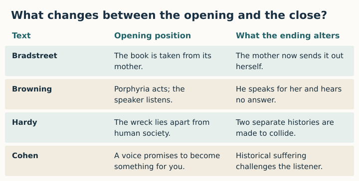
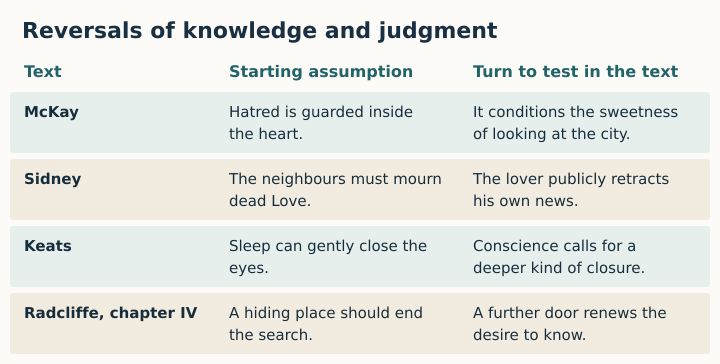

# BEL A/L · Anglais tronc commun du 23 juin 2026 — Corrigé guidé partiel

*Corrigé rédigé par IA, non officiel. Signalez toute erreur.*

**Rédaction** · GPT-6.2 Astra Ultra · vitesse non renseignée

La feuille officielle donne douze références et leurs dates. Sept poèmes identifiables par leur titre sont analysés sur le texte des poèmes publiés. Le rapport situe l’épisode de Radcliffe au chapitre IV sans en fournir les deux bornes. Les extraits de Kingsley, Okri, Cather et Brontë restent sans repérage. La fiche est partielle.

[Feuille officielle du 23 juin](https://www.ens.psl.eu/sites/default/files/anglais_tronc_commun_sujets_tires_le_23_juin.pdf) · [Rapport du jury](https://www.ens.psl.eu/sites/default/files/2026_al_rapport_oral_anglais_tc.pdf)

## Préparer son billet à partir d’une référence identifiée

Le jury prévoit 1 h 30 de préparation, vingt minutes d’exposé au maximum et dix minutes de questions. Il attend une explication en anglais en deux ou trois parties qui progresse vers une conclusion, ainsi que la lecture d’une dizaine de lignes. Le billet candidat peut avoir une mise en page différente de celle de votre édition de travail. Repérez donc les mots du début et de la fin de la lecture choisie avant de vous entraîner à voix haute.

**Bradstreet.** Suivez les verbes entre publication et révision. Dans la scène des pieds étirés, vérifiez à l’oreille que la poétesse sait parfaitement faire tenir son embarras dans des couplets. Quelle ressource le tissu domestique désigne-t-il au sens propre, puis dans le travail de la langue ?

**Browning.** Marquez qui accomplit chaque action et qui en propose l’interprétation. Après la mort de Porphyria, presque tout ce que le narrateur présente comme une preuve d’assentiment découle de ses propres actes. À l’oral, utilisez *the speaker claims* quand il prétend connaître l’expérience de l’autre.

**Hardy.** Tracez deux lignes du temps. L’une va de la construction au naufrage. L’autre commence avec les objets au fond de la mer et remonte ensuite à leur genèse. L’inversion ouvre une position d’observateur inaccessible aux acteurs et fournit un moyen concret de discuter la destinée.

**Cohen.** Écoutez la place grammaticale répétée de *you* avant *I*. Dressez la liste des voix envisageables pour le destinataire. Éprouvez chacune sur la dernière strophe. Les accusations antisémites que la voix rejoue doivent être nommées comme telles. Revenez à l’observation du jury, page 6, lorsque vous évaluez l’hypothèse d’une prière.

**McKay.** Marquez les trois quatrains et le distique final, puis repérez le passage des chambres du cœur à la ville visible. Demandez ce que la forme anglaise du sonnet apporte à une voix noire décrivant l’hégémonie blanche. Le jury soulève précisément cette question à la page 3 de son rapport.

**Sidney.** Comparez les deux dernières prières vers par vers. L’objet dont *us* demande de se libérer a changé, alors que la cadence reste familière. Reprenez ensuite la première annonce en montrant quelle autorité, au début, faisait passer une colère privée pour un deuil collectif.

**Keats.** Travaillez le milieu du poème comme une hésitation véritable. Le locuteur peut accepter de s’endormir avant son *Amen* ou préférer aller au bout. Relevez ensuite les verbes attribués à la conscience et demandez pourquoi fermer les yeux ne suffirait pas à garantir le repos.

**Radcliffe.** Sur le chapitre IV, classez ce que le personnage constate, ce qu’il déduit et les autres interprétations que suggère le récit. Le jury décrit la scène aux pages 8 et 9. À l’entretien, vous pourrez justifier votre lecture du passage identifié en revenant aux changements de position, de lumière et de vocabulaire.

**Pour les quatre autres romans.** Le billet officiel donne *Westward Ho!* de Charles Kingsley, *The Famished Road* de Ben Okri, *My Antonia* de Willa Cather et *Agnes Grey* d’Anne Brontë. Il faudrait récupérer une photocopie, des bornes ou un repérage concordant pour commenter le morceau effectivement tiré. Une connaissance de l’œuvre entière ne permet pas de prédire le narrateur, le point de vue ou la scène retenue pour cette date.

## Anne Bradstreet, “The Author to Her Book”

What should an author do when a book she considers unfinished comes home from the printer and calls her mother? In twenty-four lines of rhyming couplets Bradstreet gives revision the intimacy and difficulty of attending to a child's body. The addressee stays silent, but the embarrassing fact of its public existence changes the terms on which the author herself can speak.

At first she tells a history of separation. The book was born and remained with her until friends sent it out to be seen. The adjective *true* allows them loyalty even as she questions their wisdom. Their good intentions cannot control the press and the press has not removed the errors. Movement is a repeated humiliation. The badly clothed child must trudge before an audience. The rhyme that pairs the press-bound child's progress with the spectator's right to judge makes public reception audible just where the author is least able to intervene. Back from print, the child calls her mother in public. It is an association the audience can see whatever her own feelings.

The turn towards affection makes the middle of the poem wonderfully specific. Washing does not cleanly remove defects. Rubbing one mark away produces another. Stretching the joints makes uneven feet visible, with *feet* belonging at once to the child's gait and the poem's metre. The couplets are regular enough for us to appreciate how accomplished this complaint about stumbling actually is. Listen to the verbs of domestic labour. They also describe a writer exercising exacting and sometimes counterproductive judgment over her language. Homespun cloth measures available resources but suggests a possible style, plain, recognisable and made at home.

The ending lets the child roam while trying to choose its readers. Avoid critics, go where nobody knows you, answer this way about your parents. Once in print it can hardly obey that first command. The absence of a father lays claim to an authorial relation entirely her own. Poverty supplies a socially intelligible motive for sending a child out, and may also be part of the modest public persona the poem constructs. The historical fact that friends or relatives arranged publication does not make the poem a simple affidavit. An author publicly addresses the work she says she would have preferred to keep close. The art by which she gives voice to embarrassment is also a newly confident act of authorship.

**Reading and discussion.** Read the ten lines beginning with the child's return, attending to the turn towards affection. If asked whether the defects are real, distinguish the speaker's dissatisfaction from the evident control of the verse in which she expresses it.

[Texte de travail · Bradstreet](https://www.poetryfoundation.org/poems/43697/the-author-to-her-book)

## Robert Browning, “Porphyria's Lover”

The first speaker in this dramatic monologue sounds like a listener. A storm has the force to tear and to vex. The man does little except listen with a heart he represents as almost breaking. By the end he claims to know with certainty what Porphyria wanted. How does so radical an increase in apparent authority make him less believable?

Porphyria enters through a sudden change of syntax and of temperature. The successive actions are hers as she shuts the cold outside, tends the fire, removes her wet clothes, calls to the speaker and arranges their posture. Her call receives no answer. The extraordinarily close attention to everything she does coexists with his refusal to give us a conversation. Even her account of love reaches us as reported speech. Once he begins to explain why she has not given herself to him for ever, we should hear the difference between a woman crossing the storm to visit and her lover's assumptions about her pride or social ties. The title identifies her through her name. His claim on her is the only identification supplied for him.

The turning point comes in the look which he says has given him knowledge of being worshipped. Browning places a disturbing qualification on that triumph. It belongs to *that moment*. A desire to possess a transient relation perfectly and permanently leaves no room for Porphyria's future wishes. The speaker kills her, then immediately claims to know that she felt no pain. His repetition of that assurance sounds least like knowledge where he insists upon it most. The recurring pattern of five rhymed lines keeps its composure through the decisive event. Formal continuity makes the failure of moral response harder to evade.

At the end her head and his shoulder repeat an earlier arrangement with their roles reversed. Things that he himself has arranged can now be made to look like signs of her assent. The move from her acts to his interpretation of her stillness is the darkest consequence of his demand for permanence. A reader who recalls the unanswered call at the beginning hears the last line differently. He has waited for God to speak and reports silence. Silence cannot furnish the divine acquittal he seems to expect, any more than the dead woman's silence can express consent. The poem leaves us, its living listeners, responsible for judging what its sole speaker has told us.

**Reading and discussion.** Read ten lines around Porphyria's arrival, allowing the repeated active verbs to give her an agency the ending appropriates. If asked about Browning's own view, distinguish the poet who arranges these contradictions from the speaker who lives by them.

[Texte de travail · Browning](https://www.poetryfoundation.org/poems/46313/porphyrias-lover)

## Thomas Hardy, “The Convergence of the Twain”

The subtitle identifies the loss of the *Titanic*. An occasional poem might be expected to name the lost, tell their stories or take us through a crowded ship. Hardy begins after the event, underwater, with a wreck whose ornaments have an audience utterly indifferent to the uses for which they were made. How can a poem about a collision bind two histories together before either could know the other?

The first five numbered units give us an inventory. Chambers once heated by fires have become instruments played upon by currents. Mirrors prepared for wealthy passengers are inspected by a sea worm that has no use for a reflection. The jewels still exist but without the light on which their whole social function depended. Compressed first and second lines open out into a long third line, making each triplet feel like another exhibit with an unexpected conclusion. When the fish finally ask a question, Hardy momentarily lends them the human capacity to judge the very vanity to which they were indifferent. Their imagined question provides the hinge for the answer introduced by *Well*.

The perspective then moves backwards in time. The ship is under construction and the iceberg is coming into being far away. Repeated syntax gives both a kind of growth and makes distance compatible with likeness. *Mate* belongs to an unsettling marriage vocabulary, while *welding* turns a process of shipbuilding into a figure for the retrospective joining of destinies. Through the phrase *no mortal eye* we reach the difficulty of the poem's own perspective. Neither builder nor passenger could see this convergence. The poet constructs the commanding vantage that the poem denies its human participants.

The final imperative *Now!* produces the instant that the preceding triplets have delayed. A force called the Immanent Will and a Spinner of the Years are names for an ordering power. There is little evidence that its purpose is humane, or even that it is delivering a proportionate moral punishment. The impact jars two hemispheres. What has been composed as an exact fit in the scheme of the poem is experienced as a shock in the inhabited world. The absence of individual names leaves a disturbing distance between this beautifully finished form and a disaster whose dead cannot speak from it.

**Reading and discussion.** Read the question of the fish and the next three triplets, bringing out the change of time. If asked whether the poem blames passengers, distinguish the satire on opulence from an assertion about who deserved to die.

[Texte de travail · Hardy](https://www.poetryfoundation.org/poems/47266/the-convergence-of-the-twain)

## Leonard Cohen, “The Genius”

In this poem from *The Spice-Box of Earth*, the grammatical frame promises devotion. A first-person voice repeatedly offers to become something for someone else. Yet the identity of *you* is never fixed and each promised transformation opens a different archive of antisemitic fantasy or historical suffering. What does it cost to let an unnamed addressee prescribe the available forms of a Jewish life?

The opening of each stanza postpones the self. The line of dedication comes first. Only then can the voice name the role it says it will assume. This might sound like the resourcefulness of a lover willing to play any part. It can equally sound like a script offered to a hostile spectator. The early sequence places a ghetto figure beside the false accusation of poisoning wells, then an apostate before a Spanish priest in an invented narrative of ritual blood and a concealed child. These accusations belong to histories of persecution. The poem's strategy is to expose what it means to be required to act them out. It supplies no basis for their truth.

The banker identified with a king's ruin and the Broadway figure alternating stage emotion with commerce shift the scene to other institutions and other centuries. The lines grow and contract around the use made of the body. The series has a disturbing performative brilliance. That can be one meaning of the title, a speaker's talent for becoming whatever the audience expects. But a talent practised within a repertoire made by persecutors is also a kind of unfreedom. The doctor's grotesque attempt to undo a bodily sign of Jewishness brings that pressure particularly close to the flesh.

In the last stanza the name of Dachau changes the pressure carried by the future tense. The image of twisted limbs returns from the opening dance. Here it belongs to the victims of the Nazi concentration camp. At this point a reader cannot sustain the fantasy of free play among roles. The last assertion of incomprehensible pain denies the audience the satisfaction of having mastered this history. One can hear an address to a lover, a hostile observer or, as a candidate discussed in the jury report, an absent God. No divine answer settles the matter. The unsettling persistence of *for you* makes the reader ask what kind of listener has been willing to hear all those promises.

**Reading and discussion.** Read the first two stanzas, giving the address time to register before the roles it introduces. Asked who *you* is, test an interpretation against the last stanza as well as the first. The report's account of a reading as prayer is an invitation to argue from the text.

[Texte de travail · Cohen](https://www.leonardcohenfiles.com/poem.html#genius)

## Claude McKay, “The White City”

The sonnet's opening pronoun presumes something already at issue. The speaker will not toy with *it*. Before the city takes visible shape, we learn that his relation to it is inwardly guarded and that he must live a part before other people. How can an urban world experienced as hostile nevertheless become sweet to look upon?

The first quatrain lodges hatred in the heart's secret chambers. Verbs of sustained attention and endurance distinguish it from a passing outburst. To bear the feeling nobly is already to dispute the expectation that the feeling must demean the person who bears it. The second quatrain risks a more striking claim. Without this passion the self would be an empty shell. Blood, heaven and hell supply physical and theological forms for what might otherwise be treated as a private emotion. *Dark* and *white* are set into a relation that refuses any inherited equation of whiteness with moral light.

The shift to seeing comes in line nine. The mist may be an atmospheric condition and also a medium through which a mind already full of passion sees. Passing trains, masses of people, spires, towers, ships and wharves put the city's modern speed inside a markedly traditional form. The port is fortified. The crowd is goaded. The speaker's act of looking is therefore neither the gaze of a neutral tourist nor a simple refusal to see beauty. McKay takes the resources of the English sonnet, its three quatrains and final couplet, to carry a Black speaker's urban knowledge. The tension between command of an inherited form and refusal to bow to racial hierarchy is more specific than simply calling the poem formally regular.

Its last sentence makes us wait through the accumulation of city sights for the predicate that will tell us how they affect him. The sweetness is compared to wanton loves and explained by the very hatred with which we began. The final rhyme makes sustained contemplation answer to hate. Holding fast to his own judgment allows him to enjoy seeing without having to admire the city's distribution of power. This is a qualified, troubling freedom. The city still possesses the force to shape the emotional terms on which he can inhabit it.

**Reading and discussion.** Read from the conditional picture of the empty self into the catalogue of streets and ships. Asked about the octave and sestet, acknowledge the turn at line nine while noting the English quatrains and couplet. These are complementary observations about different features of the sonnet.

[Texte de travail · Mckay](https://www.poetryfoundation.org/poems/46463/the-white-city)

## Philip Sidney, “Ring Out Your Bells”

The speaker calls on a community to mourn the death of Love. After three stanzas of apparently overwhelming public evidence, the fourth opens with an admission that the news was false. What does it take to reverse an entire funeral service already under way in verse?

The announcement grows less plausible the more often it is made. A command to ring the bells becomes news of a universal death, supposedly caused by disdain. Then, in the refrain, a grievance against the conduct of women peeps through the communal language of deliverance. The voice that invokes *us* has an interest in making its disappointment everyone's business. Names for faith, worth and scorn turn a disappointed suitor's judgment into an allegorical company that seems to attest the death.

The neighbours are next told to weep because they have heard it said. The logic is that of rumour lending authority to itself. A bed, winding-sheet, will and executor give Love the full arrangements of a deceased person. In the third stanza the dirge and the trentals, a set of masses for the dead, continue the public rite. The tomb at last discloses the grievance's point of origin. It is his mistress's allegedly marble heart. The epitaph imagines her eyes as Love's former weapon. A woman who has yet to speak has been assigned the roles of killer, monument and explanation of a universal loss.

*Alas, I lie* withdraws the testimony. The revelation concerns the speaker as much as Love. Rage bred the mistaken report. Love is asleep within the woman's mind and may awaken when she finds sufficient merit. The alleged hardness of stone becomes the capacity for judgment and restraint. Remarkably, the closing prayer retains its familiar sound. Its object has changed. The speaker now asks to be delivered from the folly of calling her judgment frenzy. Listening closely to the revised refrain lets us hear him correct the very words into which he tried to recruit his neighbours. His recantation is public because his original complaint made a private disappointment a public accusation.

**Reading and discussion.** The last ten lines make a particularly revealing passage to read. Compare the alterations of the refrain with its earlier wording. If asked whether the mistress now loves the speaker, point out that the poem leaves her judgment and the question of his merit open.

[Texte de travail · Sidney](https://www.poetryfoundation.org/poems/45168/ring-out-your-bells)

## John Keats, “To Sleep”

How can a listener hear an entire hymn if the prayer it contains is successful before the singing ends? Keats makes that difficulty explicit in a sonnet that asks Sleep to close the speaker's eyes and silence his conscience. The very beauty of the words that seek unconsciousness gives wakefulness a reason to continue.

The first four lines personify sleep through hands that can close human eyes gently. *Embalmer* brings care for a body into troubling proximity with death. The midnight here is quiet and sheltering. Its darkness lets the plural *our* suggest an experience beyond this particular speaker. The second address, more intimate, asks that the willing eyes of the individual *me* be closed. Sleep can interrupt the hymn in its middle or wait for the Amen. By giving the addressee that choice the speaker momentarily gives up control over the length of the very poem he is composing. A poppy and the language of charity connect bodily relief and the promise of grace.

The ninth line turns the invocation into an urgent plea for rescue. The danger is that a day already over will continue to shine on the pillow. Light has changed sides. What seemed a natural alternative to sleep becomes the unwelcome return of waking troubles. Capitalised Conscience takes the masculine action of a ruler before it becomes a burrowing mole. Closing the eyes will hardly suffice against a power that works underneath and thrives on darkness. The poet has to imagine a closure more exact than simply dimming the light.

A key turns within oiled wards and the soul becomes a casket. The precision of the locksmith's image makes the wished-for absence of sound almost audible. A casket can be a small container for something precious, and it can suggest a coffin. That ambiguity returns us to the first word of personification. Sleep promises an interval in which the self is preserved by being sealed away. The finished sonnet does reach its last line, leaving the reader awake to imagine a silence that its speaker could not consciously report.

**Reading and discussion.** Read the last ten lines, including both possible timings of the Amen. If asked what threatens the speaker, distinguish an outside light from the continuing inner work of conscience, which is precisely why a lock becomes necessary in the final image.

[Texte de travail · Keats](https://www.poetryfoundation.org/poems/44487/to-sleep-56d2239b832a2)

## Ann Radcliffe, *The Romance of the Forest*, chapter IV — identifiable scene

The novel is named on the day's list. The jury's account of a performance identifies the abbey exploration in chapter IV and quotes its correction of “vaults” to “cells”. The following reading follows the identifiable episode in the novel. Its first and last lines on the examination sheet are unknown.

Why would a man who has already found a promising hiding place be unable to walk away from another closed door? La Motte wants to keep his family safe from discovery. That practical need brings him below the abbey and gives us a standard against which to measure everything he does there. The extinguished light sends him back. When he returns with a lantern, air currents and damp wood have material effects that he can partly understand. A Gothic setting conceals things, but his ability to form a hypothesis and alter his conduct is also what lets the exploration continue. Rational enquiry and fear work on one another.

The chest intensifies their connection. An involuntary backward step marks his first response on seeing the human remains. His next look is a deliberate return to the very object from which he recoiled. The narrator briefly generalises about curiosity in order to explain that change of posture. What he sees seems to him to support a story of murder. Physical evidence of a death does not tell him in itself what happened. Radcliffe makes the reader feel the attraction of supplying the missing story while keeping the gap in the evidence visible.

Further down, the narrator's revision from vaults to cells is a small act of discovery in language. La Motte thinks of monks' burial places. The alternative explanation offered by the narration, punishment for the living, is in a way more disturbing. For a man who needs to keep himself out of custody, prospective shelter and enclosure now occupy the very same space. His relief at having a safe place revives his sense that he must hurry back to the family. Yet another door holds him there. His desire to discover what lies beyond outlasts the practical task that first justified his enquiry. The little interval between judging a refuge sufficient and pressing on measures curiosity's power better than an abstract announcement that Gothic characters are fascinated by terror.

In the working edition, the desire is called *irresistible*. The report describes the same moment with *irrepressible*. The distinctive phrase about the cells, the situation and the chapter establish the scene. The combination of these precise agreements with a small verbal difference is a reason to retain the distinction between identifying an episode and knowing exactly where a particular printed extract ended.

**Reading and discussion.** Read the movement from the vaults to La Motte's interpretation of their purpose, using your printed edition to select about ten lines. If asked whether Adeline sees the skeleton at the same instant, distinguish the initial solitary exploration from the later movement of the family below.

[Texte de travail · Radcliffe](https://mirror.csclub.uwaterloo.ca/gutenberg/6/4/7/0/64701/64701-0.txt)

## Références dont le passage manque

Ni la liste d’une page ni les descriptions du rapport ne permettent de fixer ici les passages de *Westward Ho!*, *The Famished Road*, *My Antonia* et *Agnes Grey*. La mention des titres documente les quatre tirages restant à corriger.
