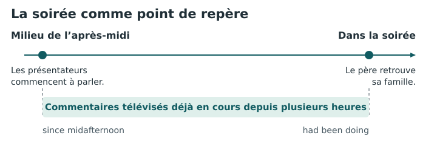

# BEL A/L — Anglais, thème Lyon 2026 · Corrigé brut

*Corrigé rédigé par IA, non officiel. Signalez toute erreur.*

**Rédaction** · GPT-6.2 Astra Ultra · vitesse non renseignée

**Autocontrôle** · GPT-6.2 Astra Ultra · vitesse non renseignée

**Révision** · GPT-6.2 Astra Ultra · vitesse non renseignée

**Révision (tour 2)** · GPT-6.2 Astra Ultra · vitesse non renseignée

**Révision (tour 3)** · GPT-6.2 Astra Ultra · vitesse non renseignée

**Thème** — Marc Dugain, *Ils vont tuer Robert Kennedy* (2017).

On November 22, 1963, I was nine, and it had rained for much of the morning. When the sun finally condescended to put in an appearance, my grandmother ventured out of her house in spite of the chill and spent a long time looking over the garden to see how her plants were doing. Then she came and sat down on the bench. My father had just bought a stake in a private hospital in downtown Vancouver and had been called in to deal with a psychiatric emergency there. I was playing outside by myself, in the solitude peculiar to only children, who have to draw on their own imaginations to bring a world to life. My mother came tearing out of the house, her face full of terror, as if driven by the devil. She stopped in the middle of the garden, appealing to heaven, her eyes starting from their sockets. At first my grandmother thought something had happened to my father and my mother had just had the news over the phone. She hurried to my mother, who burst into tears. My grandmother could tell from the way she was crying that it had nothing to do with her son. Then my mother collected herself, as if she blamed herself for overreacting. At last she managed to choke back her tears and speak, and it dawned on me then that the world's most famous Irishman had just been assassinated. That put Maine’s mind at rest once and for all. The tragedy lay outside our own immediate circle, the only one that counted as far as she was concerned.

That evening my father found us sitting in the rattan chairs in the living room. My grandmother used to say they were so uncomfortable my parents must have bought them to keep visitors from staying too long. We sat mesmerized by the television. Even then, news anchors could hold forth for hours on what little they knew, and had been doing just that since midafternoon. President Kennedy had been murdered by a man acting alone, a communist into the bargain. Not only was the President of the United States dead, but the threat of nuclear war hung over America and therefore over Canada too, assuming weapons of that sort aren't terribly particular about borders. My mother's terror had given way to stunned disbelief. She sipped steadily at her beer. She held me tight against her, as though all this might somehow cause her to lose me. For a moment it gave me a great sense of my own importance, and I took the opportunity to drink in the scent of her hair and skin.

**Repère de lecture**

Au moment où le père rentre, les présentateurs parlent depuis le milieu de l’après-midi. L’anglais peut conserver ce double repère avec *had been talking since midafternoon*. Le plus-que-parfait progressif fait entendre la durée déjà écoulée au moment du retour.

