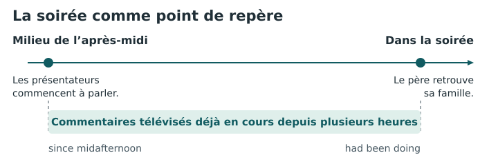

# BEL A/L — Anglais, thème Lyon 2026 · Corrigé guidé

*Corrigé rédigé par IA, non officiel. Signalez toute erreur.*

**Rédaction** · GPT-6.2 Astra Ultra · vitesse non renseignée

**Autocontrôle** · GPT-6.2 Astra Ultra · vitesse non renseignée

**Révision** · GPT-6.2 Astra Ultra · vitesse non renseignée

**Révision (tour 2)** · GPT-6.2 Astra Ultra · vitesse non renseignée

**Révision (tour 3)** · GPT-6.2 Astra Ultra · vitesse non renseignée

## Présentation du sujet

Le thème anglais de spécialité, commun à l’ENS de Lyon et à l’ENS Paris-Saclay, demande de traduire en quatre heures, sans dictionnaire, deux paragraphes d’*Ils vont tuer Robert Kennedy* de Marc Dugain (2017). Le 22 novembre 1963, un enfant de neuf ans est témoin d’une scène familiale à Vancouver. Le titre du livre nomme Robert. Le président dont on apprend ici la mort est John Kennedy. Le texte retarde même son nom jusqu’à la scène du salon. La traduction doit ménager ce délai.

[Sujet officiel, page 11](https://www.ens-lyon.fr/sites/default/files/2026-04/Epreuve%20de%20sp%C3%A9cialit%C3%A9%202026.pdf#page=11) · [Rapport écrit, pages 24 à 31](https://www.ens-lyon.fr/sites/default/files/2026-10/Anglais%202026.pdf#page=24)

### Placer les procès par rapport aux deux scènes

> [!INDICATION]
> Pour le jardin, prendre comme repère la sortie de la grand-mère. Pour le salon, prendre comme repère le retour du père. Quels événements ont déjà commencé à chacun de ces deux moments ?

#### Solution

La pluie est antérieure à la sortie au jardin. Le père a pris une participation dans la clinique avant d’y être appelé pour une urgence. L’enfant, lui, est en plein jeu lorsque sa mère surgit. Le premier repère justifie le passage du *past perfect* au prétérit simple et au prétérit progressif. Le soir, les présentateurs poursuivent une activité commencée plusieurs heures auparavant. *Since midafternoon* désigne le départ de cette activité. Avec *had been doing*, on fait du retour du père le point d’où sa durée peut se mesurer.

Faire varier le repère en anglais. Depuis le présent, on dirait *have been talking*. Racontée depuis la soirée passée, la même durée devient *had been talking*. Le complément introduit par *since* garde le même point de départ.

### Retrouver qui sait quoi

> [!INDICATION]
> Attribuer séparément à une personne la peur pour le fils, le geste de ravaler ses larmes et le soulagement une fois le nom de la victime compris.

#### Solution

| Personnage | Élément décisif | Conséquence en anglais |
|---|---|---|
| La grand-mère, Maine | Elle croit d’abord son fils en danger puis reconnaît, aux pleurs de sa belle-fille, que l’affaire est autre. | Redonner au besoin un nom au lieu d’enchaîner les *she* et les *her*. Préserver le nom de Maine lorsqu’il apparaît. |
| La mère | Elle passe de l’effroi à la stupeur. Le soir, elle serre son enfant. | *Her terror had given way to stunned disbelief* décrit une succession. *Held me tight against her* fait sentir le contact qui fonde la dernière phrase. |
| Le narrateur | Un enfant assiste aux gestes. Celui qui raconte peut ironiser sur les commentaires des présentateurs. | Garder le ton de la remarque sur les frontières et l’écart entre la peur de la mère et le plaisir furtif de l’enfant. |

La désignation par les origines irlandaises est le premier nom que la nouvelle prend pour l’enfant. La remplacer immédiatement par un nom propre ferait perdre ce moment de reconnaissance. De même, l’affirmation entendue à la télévision sur l’assassin fait partie de cette soirée racontée. Le traducteur la rapporte sous la forme affirmative choisie par le texte.

### Résoudre trois difficultés de formulation

**L’urgence et les parts.** En anglais nord-américain, *private hospital* convient à l’établissement de soins de ce passage. Dans la traduction, le père est le sujet des deux verbes. Il a d’abord acquis une participation dans la clinique (*had just bought a stake in*), puis on l’y a appelé pour une urgence (*had been called in*). Le lieu suit immédiatement *private hospital*.

**Les sièges.** L’antécédent du relatif est le mobilier. En scindant la longue phrase au retour du père, on peut faire de la grand-mère le sujet de la seconde. *Must have bought* rend la déduction malicieuse qu’elle tire de l’inconfort des sièges. L’action appartient aux parents et la déduction à la grand-mère.

**La boisson et l’odeur.** Dans *she sipped steadily at her beer*, le verbe fixe la taille de chaque gorgée et l’adverbe en fait un geste continu pendant la scène du salon. À la fin, le plaisir sensoriel appartient à l’enfant. *Drink in the scent* permet de retrouver la métaphore d’ivresse tout en indiquant qu’il respire l’odeur de sa mère.

> [!JURY]
> Dans ses observations sur les segments du thème, le rapport 2026 admet deux manières de dater la pluie, *past perfect* simple ou progressif. Il relève aussi deux difficultés de sens à la fin du texte. Les armes franchissent les frontières indépendamment des pays menacés, et c’est l’enfant lui-même qui se sent important dans les bras de sa mère.

### Traduction rédigée

#### Solution

On November 22, 1963, I was nine, and it had rained for much of the morning. When the sun finally condescended to put in an appearance, my grandmother ventured out of her house in spite of the chill and spent a long time looking over the garden to see how her plants were doing. Then she came and sat down on the bench. My father had just bought a stake in a private hospital in downtown Vancouver and had been called in to deal with a psychiatric emergency there. I was playing outside by myself, in the solitude peculiar to only children, who have to draw on their own imaginations to bring a world to life. My mother came tearing out of the house, her face full of terror, as if driven by the devil. She stopped in the middle of the garden, appealing to heaven, her eyes starting from their sockets. At first my grandmother thought something had happened to my father and my mother had just had the news over the phone. She hurried to my mother, who burst into tears. My grandmother could tell from the way she was crying that it had nothing to do with her son. Then my mother collected herself, as if she blamed herself for overreacting. At last she managed to choke back her tears and speak, and it dawned on me then that the world's most famous Irishman had just been assassinated. That put Maine’s mind at rest once and for all. The tragedy lay outside our own immediate circle, the only one that counted as far as she was concerned.

That evening my father found us sitting in the rattan chairs in the living room. My grandmother used to say they were so uncomfortable my parents must have bought them to keep visitors from staying too long. We sat mesmerized by the television. Even then, news anchors could hold forth for hours on what little they knew, and had been doing just that since midafternoon. President Kennedy had been murdered by a man acting alone, a communist into the bargain. Not only was the President of the United States dead, but the threat of nuclear war hung over America and therefore over Canada too, assuming weapons of that sort aren't terribly particular about borders. My mother's terror had given way to stunned disbelief. She sipped steadily at her beer. She held me tight against her, as though all this might somehow cause her to lose me. For a moment it gave me a great sense of my own importance, and I took the opportunity to drink in the scent of her hair and skin.

## Bilan

Relire les deux paragraphes en suivant trois fils. Une circonstance météorologique mène à l’alerte, l’alerte au commentaire télévisé, puis le raisonnement sur la guerre à la sensation privée. À chaque passage d’un fil à l’autre, vérifier le repère temporel, le sujet du verbe et le registre de la voix.
