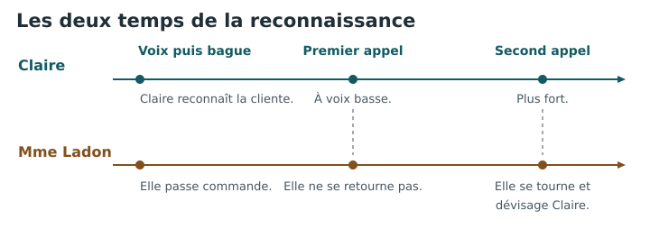

# BEL A/L — Anglais, version et thème Ulm 2026 · Corrigé brut

*Corrigé rédigé par IA, non officiel. Signalez toute erreur.*

**Rédaction** · GPT-6.2 Astra Ultra · vitesse non renseignée

**Autocontrôle** · GPT-6.2 Astra Ultra · vitesse non renseignée

**Révision** · GPT-6.2 Astra Ultra · vitesse non renseignée

**Révision (tour 2)** · GPT-6.2 Astra Ultra · vitesse non renseignée

## I. Version

James Dickey, *Deliverance* (1970).

J’étais à quelque cent cinquante pieds au-dessus de la rivière, autant que je pouvais en juger, et je me disais que, si j’avais pu arriver jusque-là, je pourrais bien faire le reste du chemin, même si la falaise était plus raide ici que plus bas. Bon, regardons un peu. C’est tout ce qu’il y a à faire, là, en cet instant. C’est tout ce qu’il y a à faire et c’est tout ce qu’il faut faire.

Quelle vue ! dis-je encore. Dans sa beauté, la rivière n’exprimait rien, ne pensait rien. Jamais je n’ai rien vu d’aussi splendide. Mais voir n’était pas tout à fait le mot. Pour une fois, il ne s’agissait pas simplement de voir. Il s’agissait de contempler. Je contemplais la rivière dans son gouffre glacé de lumière, dans ce bruit qu’elle faisait si loin en contrebas, dans son indifférence, dans sa large boucle et les pointes et les éclats minuscules de la lune, dans sa longue forme sinueuse, dans toute l’importance qu’elle avait sans en rien savoir. Qu’y avait-il donc ?

Rien que cette lumière formidable. Rien que deux rochers aussi grands que des îles. Autour de l’un d’eux semblait courir un fil écarlate, comme pour dessiner un visage, une sorte de dieu, une maquette de publicité, un croquis, un élément de composition. Ce fil avait la couleur des images du soleil qui persistent sous les paupières. Le rocher tremblait comme une braise, parce que je voulais qu’il tremble. Il était pris dans ce contour qui palpitait, et ce qui palpitait en lui, c’était moi. On aurait pu y voir quelque chose comme mon visage, sur une de ces photos éclairées par en dessous. Mon visage, pourquoi pas ? Je peux le faire à mon idée, une sorte de visage vu de trois quarts, au milieu du gouffre de lune, avec peut-être un air un peu étudié ou factice, bien différent pourtant de tout ce que peut montrer un miroir. Je crus voir la mâchoire se serrer, respirer au rythme de la rivière et de la pierre, mais peut-être aussi était-ce une sorte de sourire. Je fermai les yeux et les rouvris. Le fil autour du rocher avait disparu, mais il avait bel et bien été là. Je me sentais mieux, merveilleusement bien, et au cœur de ce que j’éprouvais, il y avait la peur. La peur et l’attente de ce qui allait venir. Impossible de savoir où cela finirait.

Je me retournai. Je me retournai vers la paroi, vers la falaise, et me retrouvai aux prises avec ma situation. J’essayais de me représenter la hauteur que m’avait paru avoir la falaise la dernière fois que je l’avais vue de jour, et d’évaluer à quel niveau j’en étais. J’étais sûrement déjà aux trois quarts de la montée, me disais-je.

## II. Thème

Pascal Quignard, *Les Solidarités mystérieuses* (2011).

She was tasting a strawberry that had scarcely more scent than the water it contained when she heard a voice that moved her in a way she could not describe. She felt her body expand from within, with little idea what was happening to her.

She opened her eyes. She turned round.

A little way off to her left she saw a woman selling organic vegetables, deep in conversation with an elderly lady.

She approached slowly.

The vegetables laid out for sale on the stall were nothing much to look at. They looked puny. There was no shape to their bulk. The dirt on their skins had been left there on purpose.

The voice came from the tiny woman standing in front of the vegetables.

She wore her white hair in a bun and over it a headscarf patterned with little pink flowers on black, far too small for all that hair. The old lady was asking what the leeks were like.

Claire loved the voice she could hear ten paces away.

She adored that voice.

She tried to put a name to that tone, so clear, to those waves, as it were, of rhythmic phrases that drew her bodily towards them. The voice rose from among the cos lettuces and the dark beetroots. All at once the voice asked, quite firmly, for a bunch of radishes. When the voice asked for chard stalks, Claire Menthuen's eyes filled with tears. She did not actually cry, but through the blur she saw, without surprise, the hand and the ring rise above the broad dark leaves on the spinach stalks to take the drab recycled-paper bag the stallholder was holding out to her.

Claire was pushing people in the queue.

The people waiting their turn began to mutter and grumble.

“Madame Ladon,” Claire whispered under her breath.

Nothing. The old lady did not turn round.

Claire spoke louder.

“Madame Ladon!”

She saw the old lady's back stiffen. Slowly the old lady’s face turned towards Claire. The old lady had brown eyes and gold-rimmed glasses. She raised her eyes to Claire's face and looked thoroughly embarrassed as she took in this young woman in front of her, so tall, so long-limbed, twice her own height, who was calling her by name. Madame Ladon did not recognise Claire straight away. She was scrutinising her face when a man in a Swiss hat came up and ordered Claire to go back to her place in the queue.

**Repère de lecture**

Dans le thème de Quignard, *Nothing* après le premier appel maintient la perception de Claire au premier plan. Lorsque la cliente finit par se retourner, le texte décrit son embarras. La traduction doit laisser au lecteur le soin d’interpréter cette réaction.

