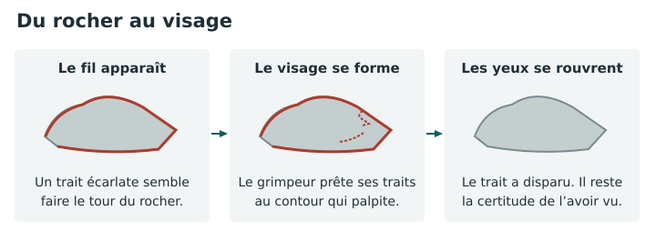
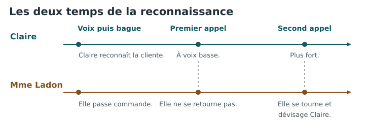

# BEL A/L — Anglais, version et thème Ulm 2026 · Corrigé guidé

*Corrigé rédigé par IA, non officiel. Signalez toute erreur.*

**Rédaction** · GPT-6.2 Astra Ultra · vitesse non renseignée

**Autocontrôle** · GPT-6.2 Astra Ultra · vitesse non renseignée

**Révision** · GPT-6.2 Astra Ultra · vitesse non renseignée

**Révision (tour 2)** · GPT-6.2 Astra Ultra · vitesse non renseignée

## Présentation du sujet

Pour l’option d’anglais de l’ENS de Paris, le livret prévoit deux traductions en six heures, sans dictionnaire. La version occupe la page 4. Dans *Deliverance* (1970), James Dickey fait entendre un homme qui suspend son ascension pour regarder la rivière. Le thème occupe la page 5. Dans *Les Solidarités mystérieuses* (2011), Pascal Quignard fait reconnaître une personne par le son de sa voix avant qu’un visage soit vu de face. La première traduction travaille les degrés d’adhésion à une image. Dans la seconde, Claire retrouve le nom de la vieille dame alors que celle-ci scrute encore le visage de Claire à la fin de l’extrait.

[Sujet officiel, pages 4 et 5](https://www.ens.psl.eu/sites/default/files/al_opt_lve_vers-theme_261109.pdf#page=4)

## I. Version

### Distinguer ce que l’homme mesure et ce qu’il projette

> [!INDICATION]
> Retrouver au début et à la fin deux mesures qui ne sont pas du même ordre. Entre les deux, quel geste permet au narrateur de vérifier une partie de ce qu’il croit voir ?

#### Solution

Au début, la hauteur au-dessus de la rivière est estimée en pieds. À la fin, l’homme essaie de retrouver de mémoire la hauteur totale de la paroi vue de jour, pour estimer la fraction de la montée accomplie. Rien ne garantit l’exactitude de l’une ou de l’autre. Entre ces repères, la perception du trait rouge, le désir de faire trembler le rocher et la ressemblance avec un visage ne relèvent pas de la même certitude. Après avoir rouvert les yeux, le grimpeur tient à maintenir l’existence passée du trait. Cela n’établit pas que le rocher portait déjà les traits qu’il lui a prêtés.

### Trouver le ton de la voix intérieure

| Difficulté | Lecture | Choix de français |
|---|---|---|
| *seeing / beholding* | Un verbe de perception ordinaire est repris, écarté, puis relayé par un terme qui suppose une attention soutenue. | Maintenir la reprise de « voir » et réserver « contempler » au palier suivant. |
| *layout for an ad* | Au milieu de l’apparition presque religieuse, l’homme songe au travail de composition d’une image commerciale. | « Maquette de publicité » laisse cet objet incongru parmi les autres sans ennoblir tout le passage. |
| *I can have it as I wish* | Pendant un instant, le locuteur s’accorde au présent le pouvoir de composer lui-même la vue de trois quarts. | Un présent à la première personne fait surgir cette pensée au milieu du récit au passé. |
| *it had been there* | Le constat négatif après le battement des paupières est suivi d’une affirmation sur le moment précédent. | Le plus-que-parfait remonte d’un cran. Un renforcement bref fait entendre l’insistance. |

La rivière a une forme que le regard peut ordonner, un bruit qui monte d’en bas et une présence considérable qui échappe à toute intention. Le couplage de *consequence* avec l’adjectif de l’incompréhension autorise ici la lecture d’une importance prêtée à une chose qui ne sait rien de ce qu’elle représente pour un homme.

### Version rédigée

#### Solution

J’étais à quelque cent cinquante pieds au-dessus de la rivière, autant que je pouvais en juger, et je me disais que, si j’avais pu arriver jusque-là, je pourrais bien faire le reste du chemin, même si la falaise était plus raide ici que plus bas. Bon, regardons un peu. C’est tout ce qu’il y a à faire, là, en cet instant. C’est tout ce qu’il y a à faire et c’est tout ce qu’il faut faire.

Quelle vue ! dis-je encore. Dans sa beauté, la rivière n’exprimait rien, ne pensait rien. Jamais je n’ai rien vu d’aussi splendide. Mais voir n’était pas tout à fait le mot. Pour une fois, il ne s’agissait pas simplement de voir. Il s’agissait de contempler. Je contemplais la rivière dans son gouffre glacé de lumière, dans ce bruit qu’elle faisait si loin en contrebas, dans son indifférence, dans sa large boucle et les pointes et les éclats minuscules de la lune, dans sa longue forme sinueuse, dans toute l’importance qu’elle avait sans en rien savoir. Qu’y avait-il donc ?

Rien que cette lumière formidable. Rien que deux rochers aussi grands que des îles. Autour de l’un d’eux semblait courir un fil écarlate, comme pour dessiner un visage, une sorte de dieu, une maquette de publicité, un croquis, un élément de composition. Ce fil avait la couleur des images du soleil qui persistent sous les paupières. Le rocher tremblait comme une braise, parce que je voulais qu’il tremble. Il était pris dans ce contour qui palpitait, et ce qui palpitait en lui, c’était moi. On aurait pu y voir quelque chose comme mon visage, sur une de ces photos éclairées par en dessous. Mon visage, pourquoi pas ? Je peux le faire à mon idée, une sorte de visage vu de trois quarts, au milieu du gouffre de lune, avec peut-être un air un peu étudié ou factice, bien différent pourtant de tout ce que peut montrer un miroir. Je crus voir la mâchoire se serrer, respirer au rythme de la rivière et de la pierre, mais peut-être aussi était-ce une sorte de sourire. Je fermai les yeux et les rouvris. Le fil autour du rocher avait disparu, mais il avait bel et bien été là. Je me sentais mieux, merveilleusement bien, et au cœur de ce que j’éprouvais, il y avait la peur. La peur et l’attente de ce qui allait venir. Impossible de savoir où cela finirait.

Je me retournai. Je me retournai vers la paroi, vers la falaise, et me retrouvai aux prises avec ma situation. J’essayais de me représenter la hauteur que m’avait paru avoir la falaise la dernière fois que je l’avais vue de jour, et d’évaluer à quel niveau j’en étais. J’étais sûrement déjà aux trois quarts de la montée, me disais-je.

## II. Thème

### Suivre les deux regards

> [!INDICATION]
> Quand le nom de famille est-il enfin prononcé ? À quel moment le visage de la vieille dame se présente-t-il à celui de Claire ?

#### Solution

L’apparition du nom complet de Claire accompagne les larmes. La reconnaissance de la vieille dame, elle, se donne à lire dans l’attente d’une main et d’une bague, puis dans l’appel répété. Les deux articles définis sont importants. Pour Claire, ce sont déjà la main et la bague de quelqu’un. À la fin, le retard se transporte du côté de Madame Ladon. Sa gêne précède le moment où elle pourrait identifier la jeune femme. Un client interrompt cet examen pour ordonner à Claire de reprendre sa place dans la file.

Comparer les sujets de « Elle dit plus fort » et « Elle vit le dos de la vieille dame se crisper ». Les deux actes reviennent à Claire. Le mouvement qu’elle observe est en revanche celui de la cliente.

### Faire entendre les reprises

La reprise de *the voice asked* lie les deux commandes. La répétition de *the voice* garde la voix au premier plan alors que le lecteur a déjà rencontré la femme qui parle. Un pronom personnel ferait passer trop tôt du phénomène entendu à la personne reconnue. Dans la série des légumes, *cos lettuces* désigne les romaines dans l’usage britannique. *Chard stalks* garde les côtes, qui motivent la commande précise, et *the stallholder* désigne la marchande au moment où cette dernière tend le sac.

Le texte donne à la perception une dimension physique. Le mouvement intérieur du premier paragraphe précède l’identification consciente. Dans la suite, traduire l’attraction avec *bodily* évite de la réduire au plaisir d’entendre une voix. Repérer aussi le passage du murmure de la file au murmure de Claire. Après l’appel plus fort, un déplacement du dos précède le retour du visage. Il est tentant d’écrire d’emblée que la vieille dame se retourne tout entière. Les deux gestes successifs donnent pourtant à l’attente sa durée.

### Thème rédigé

#### Solution

She was tasting a strawberry that had scarcely more scent than the water it contained when she heard a voice that moved her in a way she could not describe. She felt her body expand from within, with little idea what was happening to her.

She opened her eyes. She turned round.

A little way off to her left she saw a woman selling organic vegetables, deep in conversation with an elderly lady.

She approached slowly.

The vegetables laid out for sale on the stall were nothing much to look at. They looked puny. There was no shape to their bulk. The dirt on their skins had been left there on purpose.

The voice came from the tiny woman standing in front of the vegetables.

She wore her white hair in a bun and over it a headscarf patterned with little pink flowers on black, far too small for all that hair. The old lady was asking what the leeks were like.

Claire loved the voice she could hear ten paces away.

She adored that voice.

She tried to put a name to that tone, so clear, to those waves, as it were, of rhythmic phrases that drew her bodily towards them. The voice rose from among the cos lettuces and the dark beetroots. All at once the voice asked, quite firmly, for a bunch of radishes. When the voice asked for chard stalks, Claire Menthuen's eyes filled with tears. She did not actually cry, but through the blur she saw, without surprise, the hand and the ring rise above the broad dark leaves on the spinach stalks to take the drab recycled-paper bag the stallholder was holding out to her.

Claire was pushing people in the queue.

The people waiting their turn began to mutter and grumble.

“Madame Ladon,” Claire whispered under her breath.

Nothing. The old lady did not turn round.

Claire spoke louder.

“Madame Ladon!”

She saw the old lady's back stiffen. Slowly the old lady’s face turned towards Claire. The old lady had brown eyes and gold-rimmed glasses. She raised her eyes to Claire's face and looked thoroughly embarrassed as she took in this young woman in front of her, so tall, so long-limbed, twice her own height, who was calling her by name. Madame Ladon did not recognise Claire straight away. She was scrutinising her face when a man in a Swiss hat came up and ordered Claire to go back to her place in the queue.

## Bilan

Relire la version à voix haute en suivant le fil rouge, puis la phrase qui ramène à la paroi. Une même voix doit pouvoir passer de la mesure à l’illusion et revenir à la mesure. Dans le thème, masquer les noms propres et refaire la scène en attribuant chaque geste à l’une des trois femmes, puis au client qui intervient. Rétablir un nom ou une profession partout où la chaîne des pronoms anglais rendrait cette attribution impossible.
