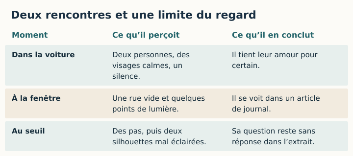

# BEL A/L — Arabe, commentaire et traduction 2026 · Corrigé brut

*Corrigé rédigé par IA, non officiel. Signalez toute erreur.*

**Rédaction** · GPT-6.2 Astra Ultra · vitesse non renseignée

## Commentaire en arabe

يرحل الراوي في مطلع هذا المقطع من رواية «نادي السيارات» لعلاء الأسواني طلبا للعزلة. غير أن أول من نسمع خبرها زوجته التي تفهمت رغبته، وأول ما يصاحبه في الطريق صوت أم كلثوم، وآخر ما ينطق به سؤال يوجهه إلى زائرين. بين هذه البداية وتلك النهاية، كيف يكتب روائي عن حاجته إلى الآخرين في اللحظة التي يسعى فيها إلى الانفراد بمخطوطه؟

يبدأ السفر بتوزيع دقيق للأشياء. يترك الرجل السيارة الكبيرة مع السائق لأسرته، ويقود الصغيرة بنفسه. يذكر أن البيت على الساحل ملك له ولزوجته، ثم يتبع تعليماتها وهو يفتحه ويعده للإقامة. يدل ضمير الجمع في «نملكه» منذ البداية على الصلة الباقية بين المسافر ومن تركهم في القاهرة. وحين يبلغ القرية يقف حارس عند بابها ليتحقق من هويته. فقبل أن تصبح الوحدة شعورا، كانت وضعا ماديا أتاحته للرجل خدمات أشخاص آخرين، منهم أيضا صاحب المحل الوحيد الذي يستطيع أن يطلب منه طعامه في الشتاء.

عند أول ظهور لسيارة أخرى ينقطع وصف الطريق ليفسح المجال لقصة كاملة يتخيلها الراوي في لحظة. إنه يميز عمر الرجل التقريبي وجمال المرأة ثم يجزم بأنهما عاشقان. وليس في النص حوار سمعه بينهما. إن صمتهما بالذات هو الذي يقرأ فيه دليلا قاطعا على الحب. وحين يعقب بأن من العسير أن يقع مثله بين زوجين يخبرنا عن تصوره للحياة الزوجية أكثر مما يكشف لنا من حقيقة هذين الغريبين. أما القارئ فقد سمع قبل قليل خبر زوجة تفهم، في صمت أيضا، رغبة زوجها. هكذا يضع النص إلى جانب حكم الرجل على غيره واقعة من حياته تسمح لنا بتقدير المسافة بين الملاحظة والتأويل.

يتبدل معنى المكان حين يهبط الليل. كانت أعمدة النور ما يبقى من مشهد الشوارع الخالية في النهار، فإذا بها تصير من الشرفة شريطا يحدد مدى الظلام. في الصباح أمكن تشبيه القرية بمدينة مسحورة، أما الآن فالفراغ يجعل الراوي يحسب المسافة التي تفصله عن القاهرة ويتخيل عنوانا في الجريدة يروي فيه الآخرون مصرعه. تردد الأسئلة في نفسه يحوله من صاحب القصة المتخيلة إلى بطلها المحتمل. وكلما جاء بحجة ليطمئن بها نفسه وجد فيها مبدأ قصة جديدة. كثرة الحراس ومعرفتهم الدقيقة بالمنطقة تكفيان في إحدى الجمل لنفي الخطر، ثم تكفيان في التالية لتخيل فيلم بوليسي. الأشياء باقية على حالها، والذي تغير هو النوع الأدبي الذي اختار أن يدرجها فيه.

وحين يجلس أخيرا إلى مخطوطه، يعود زمن الرحلة الأولى في صورة أخرى. ثلاث ساعات قطعها في السيارة وثلاث ساعات يستغرقها في مراجعة الرواية التي سبق أن راجعها مرارا. لا تكاد ثمرة هذه القراءة تتجاوز فاصلة أو نقطة. وفي المقابل يستطيع حول شخصين مرا به أو وقع خطوات لم يعرف أصحابها أن يؤلف في لحظة احتمالات لا تنتهي. يوصل الحاسوب بالطابعة ويعد الورق ثم يغلق الملف ويخرج إلى الشرفة. يسمي ما يفعله للمرة الأولى تهربا. وبهذا الاعتراف تتغير قيمة الأعمال اليومية التي نفذها قبله. إعداد القهوة أو الوقوف تحت الماء الساخن استراحة جسدية وطريقة لتأجيل مواجهة ما يشغله في آن واحد.

لِمَ تصعب ضغطة واحدة على الإصبع إلى هذا الحد؟ تجمع عبارة خروج الرواية إلى النور بين إخراج نسخة ورقية منها وولادة كائن ذي حياة مستقلة. ثم تتوالى صور لا تؤدي المعنى نفسه تماما. في الشخصيات أصدقاء اعتاد الكاتب صحبتهم حتى إن الفرح بإتمام عمله يختلط بوحشة فراقهم. وفي تشبيه تسليم الكتاب إلى قرائه بزفاف الابنة يضاف وجه آخر للفراق. الأب نفسه يمد يده ليسلم ابنته وهو سعيد بزواجها، وبهذا الفعل يفقد حقه في الاستئثار بها. لذلك فإن التردد أمام الآلة يطيل لحظة ما زالت الرواية فيها ملكا لخيال كاتبها، في الوقت الذي يتوقف فيه تحققها المادي على انتهاء تلك اللحظة.

ما يصل من الخارج في نهاية المقطع صوت قبل أن يكون صورة. يسمع الراوي خطوات، يرتاب في سمعه، ثم يصغي من جديد فيتبين تعدد أصحابها. وبعد أن رأى أول مرة رجلا وامرأة عابرين وعرف في ظنه سر حياتهما، يرى الآن عند عتبة بيته رجلا وامرأة فلا يستطيع حتى أن يتبين ملامحهما في الضوء الخافت. إننا نعرف سبب خوفه أكثر مما نعرف مقصد الزائرين. وقد يذكرنا ظهورهما بالسيارة السابقة، ولكن الراوي لا يثبت أنه تعرف إلى راكبيها. يحرمنا الاستفهام الأخير من جواب يسارع الخيال إلى اختراعه. هكذا يصل رجل ذهب ليستكمل قصته بعيدا عن الناس إلى باب يفتحه بنفسه، وتعود الكلمة الأخيرة في حكايته، بقدر ما تنتظر جوابا، إلى الآخرين.

## Version française — lignes 1 à 9

Ma femme comprit que j’avais besoin d’être seul.

Je lui laissai la grande voiture et le chauffeur pour ses déplacements avec les enfants. Je pris moi-même le volant de la petite pour rejoindre la maison de vacances que nous possédons sur la côte nord. Trois heures seul avec mes pensées et la voix d’Oum Kalthoum qui montait du lecteur de cassettes de la voiture. Avant que je ne franchisse la grille du village, le garde examina mes papiers de près. L’hiver, la direction du village renforce les mesures de sécurité pour prévenir les vols. L’air de la mer, froid et vivifiant, me fouetta le visage. Le village était tout à fait vide. On aurait dit une ville ensorcelée que ses habitants avaient désertée. Les maisons de vacances étaient fermées, les rues dépeuplées, à l’exception des réverbères. Je traversai la place principale du village puis tournai dans la rue qui mène à notre maison. Soudain apparut une voiture japonaise de modèle récent. Au volant, un homme d’une cinquantaine d’années, et près de lui une belle femme d’une quarantaine d’années. Quand la voiture passa à ma hauteur, je les regardai. C’étaient deux amants venus au village pour être seuls ensemble, loin des regards. Aucun doute là-dessus. Cette sérénité, ces joues roses, ce silence plein d’amour, il est bien difficile de trouver cela chez deux époux. J’arrivai à la maison.

[Sujet officiel, pages 6 et 7](https://www.ens.psl.eu/sites/default/files/al_lve_commun_commentaire_traduction_2026.pdf#page=6) · [Rapport du jury, pages 2 et 3](https://www.ens-lyon.fr/sites/default/files/2026-10/Arabe%202026.pdf#page=2)

