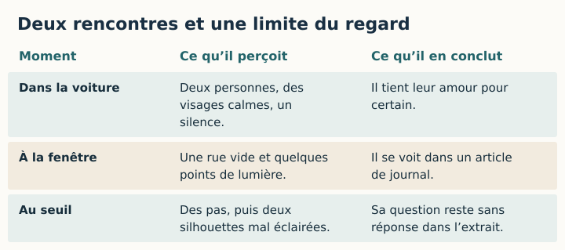

# BEL A/L — Arabe, commentaire et traduction 2026 · Corrigé guidé

*Corrigé rédigé par IA, non officiel. Signalez toute erreur.*

**Rédaction** · GPT-6.2 Astra Ultra · vitesse non renseignée

## Présentation du sujet

L’épreuve commune dure six heures. La version, au début de la page 6, se limite au voyage vers la maison de vacances et s’arrête à l’arrivée devant celle-ci. Le commentaire en arabe inclut toute la suite jusqu’à la question du narrateur, à la fin de la page 7.

[Sujet officiel, pages 6 et 7](https://www.ens.psl.eu/sites/default/files/al_lve_commun_commentaire_traduction_2026.pdf#page=6) · [Rapport du jury, pages 2 et 3](https://www.ens-lyon.fr/sites/default/files/2026-10/Arabe%202026.pdf#page=2)

## Préparer le commentaire

> [!INDICATION]
> Le narrateur aperçoit deux personnes depuis sa voiture, puis deux silhouettes à sa porte. Sur quelles observations se fonde-t-il chaque fois ? Que peut-il affirmer avec certitude ?

#### Solution

Dès la première rencontre, il distingue trois signes, le calme, les couleurs du visage et le silence, mais il tire de ces signes une certitude sur une relation intime qu’il ignore. La dernière scène lui fournit d’abord des indices sonores, puis deux silhouettes difficiles à reconnaître. Relire les deux passages en soulignant les verbes de perception avant les affirmations sur la nature ou le but de ces rencontres.

**Relier les hypothèses à des formes de récit.** Au cours de la nuit, l’inquiétude prend successivement la forme d’un titre de presse et d’une idée de film policier. Le dispositif de sécurité se prête à deux histoires. Il devrait rassurer le narrateur et devient l’ingrédient d’un scénario inquiétant. Ce renversement donne à voir comment le romancier fabrique une intrigue en l’absence d’événement.

**Comparer deux durées.** L’aller en voiture et la relecture du manuscrit durent chacun trois heures. Face à un livre déjà écrit, le narrateur n’apporte que des changements infimes. Sa vivacité lorsqu’il prête une histoire à un couple aperçu en voiture fait ressortir sa lenteur au moment d’imprimer. Les images de la naissance, de l’amitié et du mariage précisent ce que lui coûte ce geste.

> [!JURY]
> Le rapport commun salue une copie qui construit son commentaire autour des rapports entre réel et fiction. Pour donner du contenu à cette question, on peut distinguer à chaque étape ce que l’œil ou l’oreille perçoivent et l’histoire que ces indices suscitent. Le rapport relève aussi des confusions entre lettres emphatiques et non emphatiques et l’emploi de tours dialectaux.

## Commentaire rédigé en arabe

#### Solution

يرحل الراوي في مطلع هذا المقطع من رواية «نادي السيارات» لعلاء الأسواني طلبا للعزلة. غير أن أول من نسمع خبرها زوجته التي تفهمت رغبته، وأول ما يصاحبه في الطريق صوت أم كلثوم، وآخر ما ينطق به سؤال يوجهه إلى زائرين. بين هذه البداية وتلك النهاية، كيف يكتب روائي عن حاجته إلى الآخرين في اللحظة التي يسعى فيها إلى الانفراد بمخطوطه؟

يبدأ السفر بتوزيع دقيق للأشياء. يترك الرجل السيارة الكبيرة مع السائق لأسرته، ويقود الصغيرة بنفسه. يذكر أن البيت على الساحل ملك له ولزوجته، ثم يتبع تعليماتها وهو يفتحه ويعده للإقامة. يدل ضمير الجمع في «نملكه» منذ البداية على الصلة الباقية بين المسافر ومن تركهم في القاهرة. وحين يبلغ القرية يقف حارس عند بابها ليتحقق من هويته. فقبل أن تصبح الوحدة شعورا، كانت وضعا ماديا أتاحته للرجل خدمات أشخاص آخرين، منهم أيضا صاحب المحل الوحيد الذي يستطيع أن يطلب منه طعامه في الشتاء.

عند أول ظهور لسيارة أخرى ينقطع وصف الطريق ليفسح المجال لقصة كاملة يتخيلها الراوي في لحظة. إنه يميز عمر الرجل التقريبي وجمال المرأة ثم يجزم بأنهما عاشقان. وليس في النص حوار سمعه بينهما. إن صمتهما بالذات هو الذي يقرأ فيه دليلا قاطعا على الحب. وحين يعقب بأن من العسير أن يقع مثله بين زوجين يخبرنا عن تصوره للحياة الزوجية أكثر مما يكشف لنا من حقيقة هذين الغريبين. أما القارئ فقد سمع قبل قليل خبر زوجة تفهم، في صمت أيضا، رغبة زوجها. هكذا يضع النص إلى جانب حكم الرجل على غيره واقعة من حياته تسمح لنا بتقدير المسافة بين الملاحظة والتأويل.

يتبدل معنى المكان حين يهبط الليل. كانت أعمدة النور ما يبقى من مشهد الشوارع الخالية في النهار، فإذا بها تصير من الشرفة شريطا يحدد مدى الظلام. في الصباح أمكن تشبيه القرية بمدينة مسحورة، أما الآن فالفراغ يجعل الراوي يحسب المسافة التي تفصله عن القاهرة ويتخيل عنوانا في الجريدة يروي فيه الآخرون مصرعه. تردد الأسئلة في نفسه يحوله من صاحب القصة المتخيلة إلى بطلها المحتمل. وكلما جاء بحجة ليطمئن بها نفسه وجد فيها مبدأ قصة جديدة. كثرة الحراس ومعرفتهم الدقيقة بالمنطقة تكفيان في إحدى الجمل لنفي الخطر، ثم تكفيان في التالية لتخيل فيلم بوليسي. الأشياء باقية على حالها، والذي تغير هو النوع الأدبي الذي اختار أن يدرجها فيه.

وحين يجلس أخيرا إلى مخطوطه، يعود زمن الرحلة الأولى في صورة أخرى. ثلاث ساعات قطعها في السيارة وثلاث ساعات يستغرقها في مراجعة الرواية التي سبق أن راجعها مرارا. لا تكاد ثمرة هذه القراءة تتجاوز فاصلة أو نقطة. وفي المقابل يستطيع حول شخصين مرا به أو وقع خطوات لم يعرف أصحابها أن يؤلف في لحظة احتمالات لا تنتهي. يوصل الحاسوب بالطابعة ويعد الورق ثم يغلق الملف ويخرج إلى الشرفة. يسمي ما يفعله للمرة الأولى تهربا. وبهذا الاعتراف تتغير قيمة الأعمال اليومية التي نفذها قبله. إعداد القهوة أو الوقوف تحت الماء الساخن استراحة جسدية وطريقة لتأجيل مواجهة ما يشغله في آن واحد.

لِمَ تصعب ضغطة واحدة على الإصبع إلى هذا الحد؟ تجمع عبارة خروج الرواية إلى النور بين إخراج نسخة ورقية منها وولادة كائن ذي حياة مستقلة. ثم تتوالى صور لا تؤدي المعنى نفسه تماما. في الشخصيات أصدقاء اعتاد الكاتب صحبتهم حتى إن الفرح بإتمام عمله يختلط بوحشة فراقهم. وفي تشبيه تسليم الكتاب إلى قرائه بزفاف الابنة يضاف وجه آخر للفراق. الأب نفسه يمد يده ليسلم ابنته وهو سعيد بزواجها، وبهذا الفعل يفقد حقه في الاستئثار بها. لذلك فإن التردد أمام الآلة يطيل لحظة ما زالت الرواية فيها ملكا لخيال كاتبها، في الوقت الذي يتوقف فيه تحققها المادي على انتهاء تلك اللحظة.

ما يصل من الخارج في نهاية المقطع صوت قبل أن يكون صورة. يسمع الراوي خطوات، يرتاب في سمعه، ثم يصغي من جديد فيتبين تعدد أصحابها. وبعد أن رأى أول مرة رجلا وامرأة عابرين وعرف في ظنه سر حياتهما، يرى الآن عند عتبة بيته رجلا وامرأة فلا يستطيع حتى أن يتبين ملامحهما في الضوء الخافت. إننا نعرف سبب خوفه أكثر مما نعرف مقصد الزائرين. وقد يذكرنا ظهورهما بالسيارة السابقة، ولكن الراوي لا يثبت أنه تعرف إلى راكبيها. يحرمنا الاستفهام الأخير من جواب يسارع الخيال إلى اختراعه. هكذا يصل رجل ذهب ليستكمل قصته بعيدا عن الناس إلى باب يفتحه بنفسه، وتعود الكلمة الأخيرة في حكايته، بقدر ما تنتظر جوابا، إلى الآخرين.

## Version des lignes 1 à 9

**Attribuer les actions.** Dans la première ligne, l’épouse est le sujet de la compréhension et le narrateur celui qui éprouve le besoin de solitude. Dans la deuxième, c’est lui qui conduit la petite voiture. La grande voiture et le chauffeur restent à la disposition de sa femme. Un sujet mal identifié change les conditions de tout le récit.

**Distinguer le village et la maison.** Le garde contrôle l’entrée du village de vacances. C’est seulement après avoir traversé la place et tourné dans une rue que le narrateur atteint la maison du couple. « Maison de vacances » maintient la continuité du lieu désigné par le mot d’emprunt *chalet*. La version s’arrête à l’arrivée devant cette maison, avant l’ouverture de la porte.

**Entendre le passage de la vue au jugement.** Les deux adjectifs d’âge indiquent des décennies. L’homme a la cinquantaine et la femme la quarantaine. La relation de cause à effet par laquelle le silence du couple devient une certitude amoureuse appartient au personnage. Les trois groupes nominaux de la fin rendent sensible l’accumulation des preuves à ses yeux.

#### Solution

Ma femme comprit que j’avais besoin d’être seul.

Je lui laissai la grande voiture et le chauffeur pour ses déplacements avec les enfants. Je pris moi-même le volant de la petite pour rejoindre la maison de vacances que nous possédons sur la côte nord. Trois heures seul avec mes pensées et la voix d’Oum Kalthoum qui montait du lecteur de cassettes de la voiture. Avant que je ne franchisse la grille du village, le garde examina mes papiers de près. L’hiver, la direction du village renforce les mesures de sécurité pour prévenir les vols. L’air de la mer, froid et vivifiant, me fouetta le visage. Le village était tout à fait vide. On aurait dit une ville ensorcelée que ses habitants avaient désertée. Les maisons de vacances étaient fermées, les rues dépeuplées, à l’exception des réverbères. Je traversai la place principale du village puis tournai dans la rue qui mène à notre maison. Soudain apparut une voiture japonaise de modèle récent. Au volant, un homme d’une cinquantaine d’années, et près de lui une belle femme d’une quarantaine d’années. Quand la voiture passa à ma hauteur, je les regardai. C’étaient deux amants venus au village pour être seuls ensemble, loin des regards. Aucun doute là-dessus. Cette sérénité, ces joues roses, ce silence plein d’amour, il est bien difficile de trouver cela chez deux époux. J’arrivai à la maison.

## Bilan

Relire les dernières lignes en séparant les deux moments de la rencontre. Le narrateur entend d’abord plusieurs personnes, puis distingue un homme et une femme. Il s’adresse à eux avant qu’ils aient pu prononcer un mot. Ce point précis suffit à défendre une interprétation de la fin ouverte.
